# WebJET CMS 2026

Vítejte v dokumentaci k WebJET CMS verze 2026. Doporučujeme přečíst si [seznam změn](CHANGELOG-2026.md) a [roadmap](ROADMAP.md).

## Seznam změn ve verzi 2026.40

> WebJET CMS 2026.40 přináší [**novou verzi PageBuildera**](#webové-stránky) s panelem Struktura, přehlednější knihovnou bloků a kopírováním bloků mezi stránkami. [**Plánované publikování stránek i se soubory**](#webové-stránky) umožňuje připravit budoucí obsah s obrázky a dokumenty, které zůstanou chráněny až do termínu zveřejnění. Funkci zapíná správce.
>
> [**Vícekrokové formuláře**](#formuláře) získaly vylepšené nastavování podmínek zobrazení a povinnosti polí, návrat na předchozí krok se zachováním vyplněných údajů, kopírování polí mezi formuláři a propojení výběrových polí na číselníky.
>
> [**Novou úvodní obrazovku**](#úvodní-obrazovka) si přizpůsobíte výběrem widgetů, jejich velikostí a pořadím. Potřebné údaje tak máte na jednom místě. [**Rychlé vyhledávání**](#úvodní-obrazovka) dostupné v celé administraci přes Ctrl+K / ⌘K pomůže najít stránky, soubory i nastavení.
>
> [**Sémantické vyhledávání**](#sémantické-vyhledávání) umožňuje návštěvníkům najít stránky podle významu otázky a volitelně zobrazit AI odpověď sestavenou z obsahu webu. Nový [**headless režim**](#headless-režim) zpřístupňuje obsah, navigaci, vyhledávání a formuláře přes REST API pro webové aplikace s vlastním frontendem.

!>**Před aktualizací:** Prostudujte si [průlomové změny](#průlomové-změny) a požadavky na úpravu prostředí, konfigurace či vlastních rozšíření.

### Úvodní obrazovka

- [Úvodní obrazovku](redactor/admin/welcome.md) jsme předělali na widgetový systém, abyste měli údaje potřebné při práci na jednom místě bez procházení jednotlivých částí administrace. Sami si vyberete widgety a nastavíte zobrazované údaje, velikost a pořadí podle svých potřeb (#58806).

<div class="video-container">
    <iframe width="790" height="444" src="https://www.youtube.com/embed/X2GNFn8IpCI" title="YouTube video player" frameborder="0" allow="accelerometer; autoplay; clipboard-write; encrypted-media; gyroscope; picture-in-picture" allowfullscreen></iframe>
</div>

- [Rychlé vyhledávání](redactor/admin/search/README.md) je dostupné z hlavičky celé administrace tlačítkem **Hledat…** nebo zkratkou **Ctrl+K / ⌘K**. Nabízí návrhy stránek podle názvu a URL, výsledky z obsahu stránek, souborů, uživatelů, textových klíčů a položek menu. Vybraný výraz můžete přenést do příslušné sekce s dalšími filtry (#348).

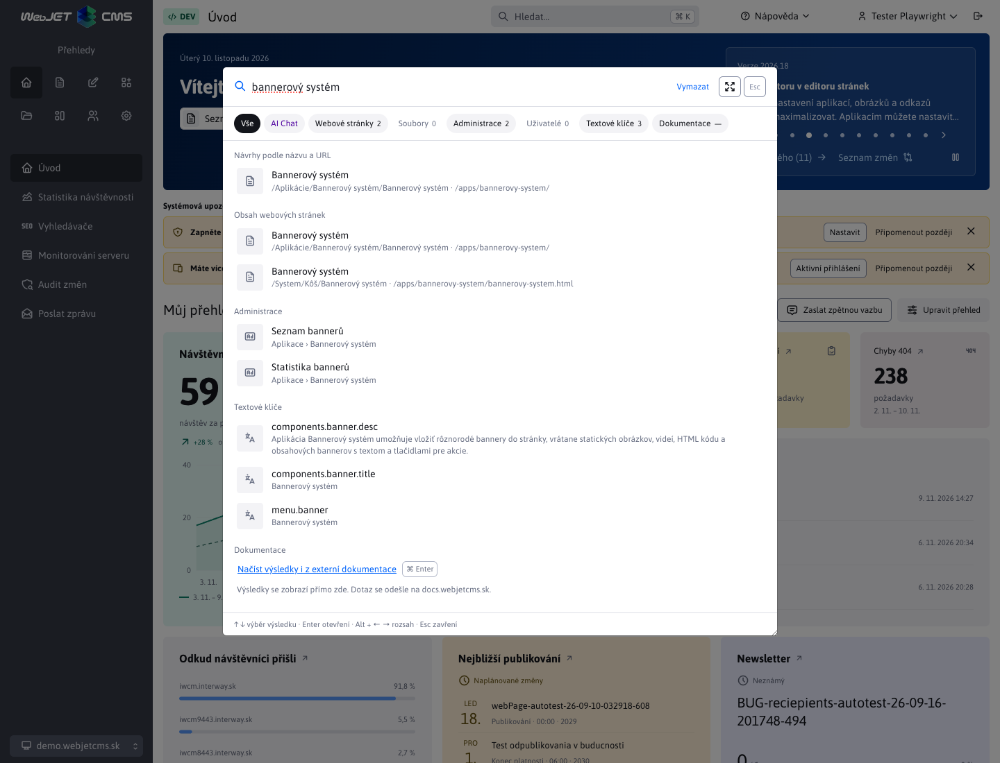

- Nová karta [AI Čet](redactor/admin/search/README.md#ai-čet) v rychlém vyhledávání umožňuje rozhovor s AI asistentem. Podporuje výběr asistenta, průběžné zobrazování a zastavení odpovědí, Markdown s tabulkami a kopírování textu. Při ukládaných rozhovorech OpenAI a Gemini můžete přidávat obrázky a dokumenty přetažením kamkoli do plochy četu, vyhledávat v historii a stahovat přílohy z panelu **Soubory v četě**. Historie a přílohy jsou dostupné pouze vlastníkovi rozhovoru v příslušné doméně. Přepínání asistentů zachová rozepsané zprávy i neodeslané přílohy; okno můžete zvětšit nebo maximalizovat. Lupa v hlavičce historie zobrazí vyhledávání rozhovorů; přílohy přidáte ikonou plus. Slovenské rozhraní a dokumentace používají označení „čet“ (#386).

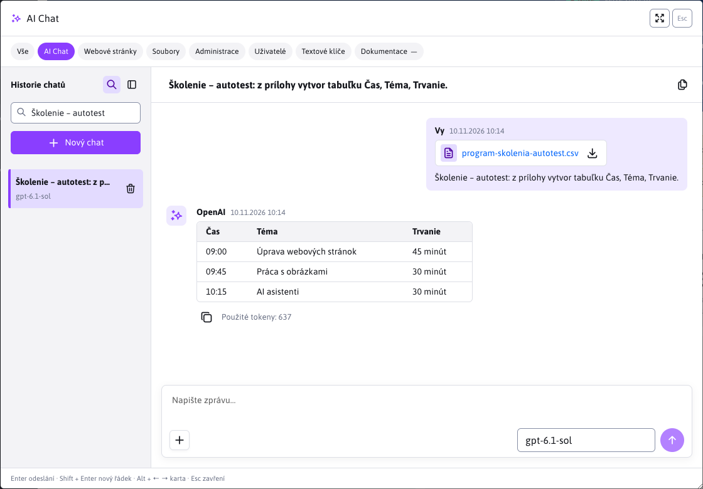

- Panel [Co je nového](redactor/admin/welcome.md#Co-je-nové) doplňuje novinky nainstalované verze o videa a příspěvky z YouTube a Facebooku WebJET CMS. Štítek **Nové** se po rozbalení panelu skryje a znovu upozorní na nový obsah (#358).

### Přihlašování a ochrana účtu

- [Uživatelské menu v hlavičce](redactor/admin/README.md#uživatelské-menu) zobrazuje údaje účtu, počet aktivních relací a stav dvoustupňového ověřování. Položka **Aktivní přihlášení** otevře správu vlastních přihlášení z kterékoliv stránky administrace. Dokumentace obsahuje aktuální screenshot a popis všech položek menu (#351).

- WebJET CMS nově [eviduje prohlížeče, ze kterých se přihlašujete](redactor/admin/logon.md#přihlášení-z-nového-zařízení). Přihlášení z nového prohlížeče zobrazí upozornění na úvodní obrazovce a odešle email, abyste mohli rozpoznat cizí přihlášení do svého účtu. Vlastní zařízení potvrdíte emailovým odkazem nebo jednorázovým kódem přes **Byl jsem to já** (#340).

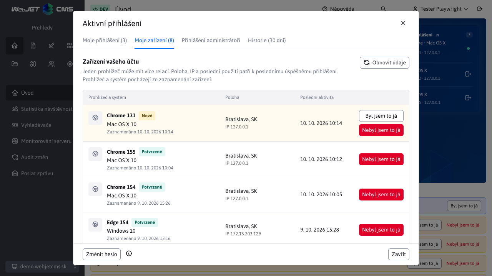

- Pokud přihlášení neznáte, můžete [zablokovat zařízení a ukončit jeho aktivní přihlášení](redactor/admin/welcome.md#pokud-přihlášení- neznáte). Při dalším přihlášení ze zablokovaného prohlížeče se po zadání správného jména a hesla zobrazí **Ověření zablokovaného zařízení**. Pro odblokování a vstup do administrace je třeba zadat šestimístný kód z emailu účtu; při zapnutém 2FA se toto ověření provede až po kódu z autentifikační aplikace. Podrobný postup je uveden v [návodu k přihlášení](redactor/admin/logon.md#ověření-zablokovaného-zařízení) (#340).

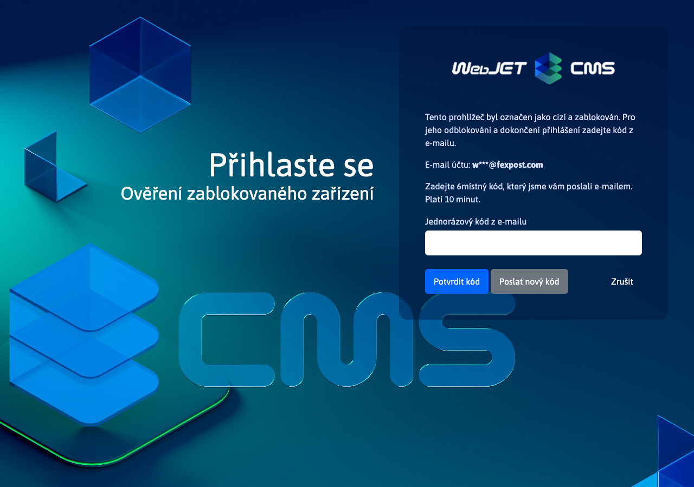

- Specifická přihlášení přes `doFilterLogon` a `wjlogontoken` odmítnou zablokovaný prohlížeč bez emailové výzvy. K odblokování je třeba použít běžný přihlašovací formulář ve stejném prohlížeči (#340).

Sledování zařízení lze vypnout nastavením konfigurační proměnné `adminNewDeviceDetectionEnabled` na false. Při přihlášení se také zjišťuje [přibližná poloha](admin/setup/configuration/dashboard.md#orientační-poloha-přihlášení) podle IP adresy, vypnout se dá nastavením `adminLoginLocationApiKey` na hodnotu `DISABLED`.

### Webové stránky

- Editor stránek - nová nabídka [Styly](redactor/webpages/working-in-editor/README.md#práce-se-styly-a-formátování-textu). Zobrazuje aktivní styly s možností jejich odebrání a umožňuje vybrat upravovaný odstavec, sloupec či celou sekci. Pro správnou funkčnost je třeba mít správně nastavené [CSS selektory](frontend/page-builder/blocks.md#selektory-struktury) a vytvořené [doplňkové komentáře](frontend/examples/template-bare/README.md#vyhledávání-a-skupiny-stylů) v CSS soubor (#356).

<div class="video-container">
    <iframe width="790" height="444" src="https://www.youtube.com/embed/IomtyBHpx64" title="YouTube video player" frameborder="0" allow="accelerometer; autoplay; clipboard-write; encrypted-media; gyroscope; picture-in-picture" allowfullscreen></iframe>
</div>

- Koš webových stránek - přidáno [automatické mazání starých stránek a složek](redactor/apps/gdpr/data-deleting.md) z koše podle nastaveného retenčního období. Přidána možnost mazání stránek a složek v koši i v sekci [Mazání dat](sysadmin/data-deleting/README.md) podle zvoleného rozsahu dat. Sjednocená logika výpočtu počtu a mazání, opraveno trvalé odstranění složky koše a prázdných složek (#271).

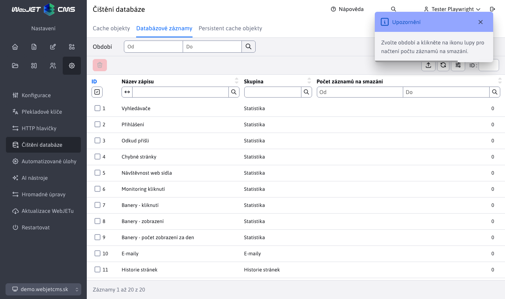

- Přesměrování - přesměrování vytvořená uživatelem jsou odlišena od automatických (označeno šedým pozadím) a lze je samostatně [filtrovat v seznamu přesměrování](redactor/webpages/redirects/README.md#automatické-a-uživatelem-vytvořené-přesměrování) (#58625).

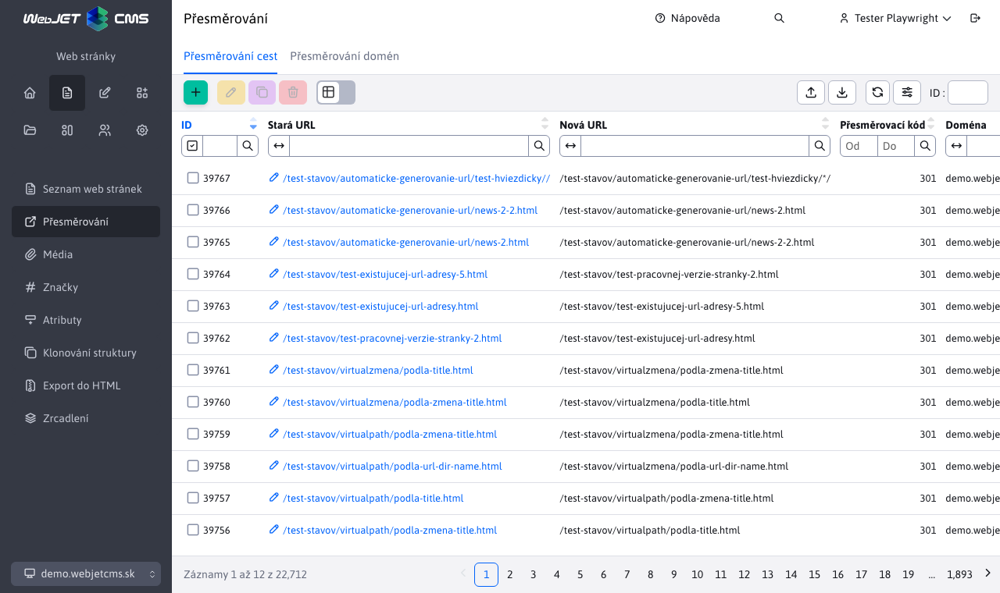

- SEO - přidáno samostatné nastavení **Následujení odkazů vyhledávači** s možnostmi **Podle nastavení Procházet**, **Povolit následování odkazů** (`follow`) a **Zakázat následování odkazů** (`nofollow`). HTTP hlavička `X-Robots-Tag` a Ninja `${ninja.page.robots}` používají stejnou logiku: při indexování bez omezení vrátí `all`, jinak kombinaci direktiv `noindex` a `nofollow` podle nastavení stránky. Více v [dokumentaci Ninja](frontend/ninja-starter-kit/ninja-jv/page/README.md#nastavení-indexování-string) (#OSK563).
- SEO - v [skupinách šablon](frontend/templates/template-groups.md#karta-seo) lze nastavit výchozí SEO popis, obrázek a alternativní text obrázku. Objekt Ninja `Page` je použije, pokud stránka nemá zadané vlastní hodnoty; přibyla také hodnota `${ninja.page.seoImageAlt}` pro `og:image:alt` (#OSK593).

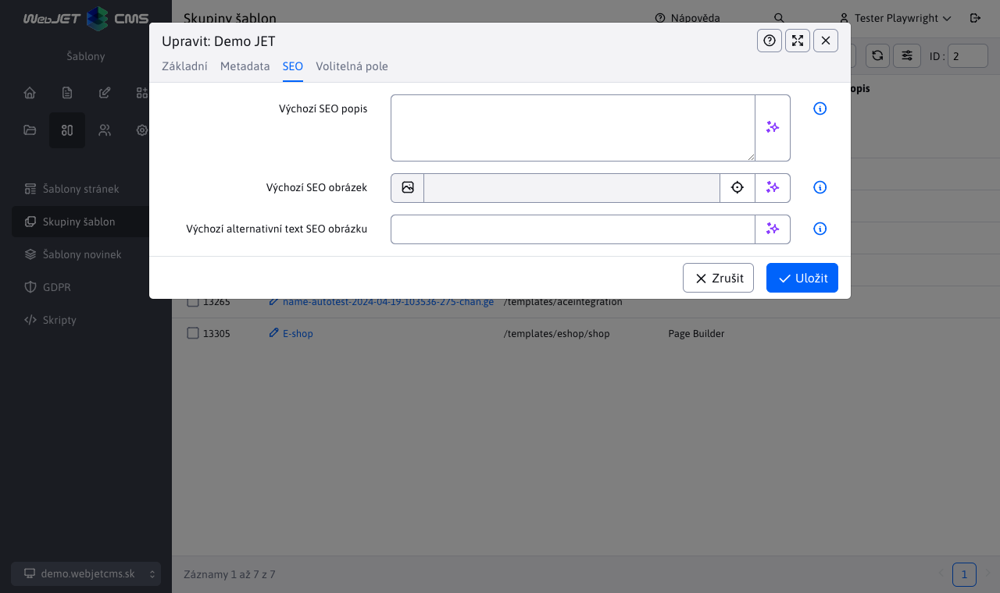

- Ninja - doplněno [generování rozměrů](frontend/ninja-starter-kit/ninja-bp/README.md) SEO obrázku `og:image:width` a `og:image:height` (#OSK563).
- Šablony - přidána možnost nastavit přesun `<style>` a `<link rel="stylesheet">` značek z těla stránky do `<head>` přes [volbu v šabloně](frontend/templates/templates.md) s podporou globální konfigurační proměnné `showDocMoveStyleToHead`. Bloky v IE podmínkách, `noscript` a `script` zůstávají na místě (#231).

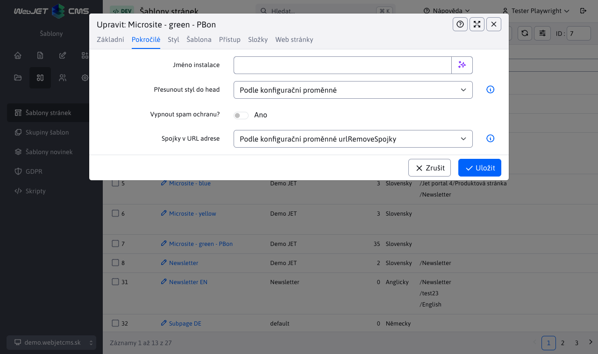

- V dialogu vkládání obrázků přidána karta **Miniatura** pro nastavení parametrů [generování zmenšených obrázků](redactor/webpages/working-in-editor/README.md#karta-miniatura) `thumbnail`. Podporován je volný režim nastavení rozměrů, ale také režim [přesně definovaných rozměrů](frontend/thumb-servlet/README.md#omezení) výběrem z možností (#58317,#58758).
- Výběr rozměru zobrazuje název režimu i číslo `ip`. Režimy `learn/check/allow` nabízejí i vlastní rozměr, `strict` vyžaduje povolenou kombinaci au `deny` je karta skrytá. Existující nepovolená miniatura se v režimu `strict` označí a vyžaduje výběr náhrady (#353).

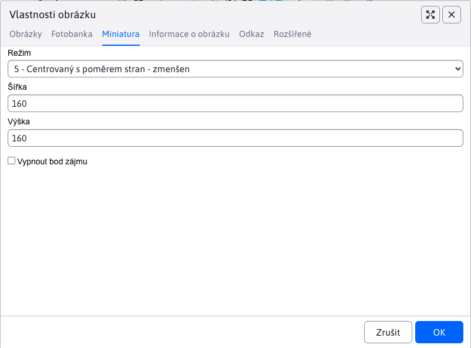

- V dialogu vkládání odkazu přidána karta [Manažer dokumentů](redactor/files/file-archive/README.md) pro snadné vkládání odkazů na soubory v manažerovi dokumentů, nahrávání nových souborů a jejich správu. Více se dozvíte v části [Odkazy na soubory a nahrávání souborů](redactor/webpages/working-in-editor/README.md#odkazy-na-soubory-a-nahrávání-souborů) (#58593).

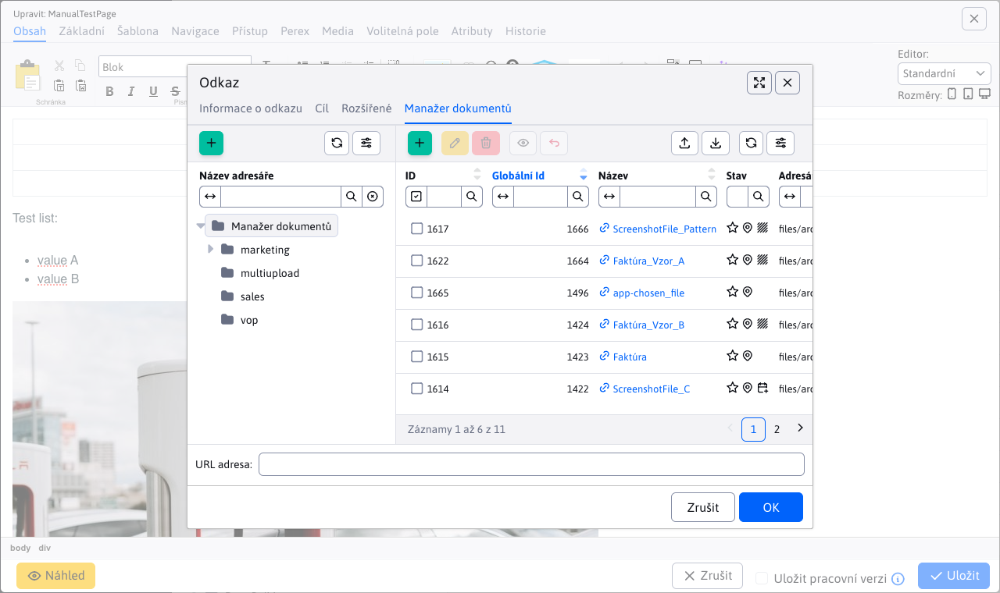

- Soubory Manažera dokumentů ve složce `/files/archiv` jsou v dialozích vkládání odkazu a obrázku dostupné pouze pro zobrazení a výběr. Nahrávání, přejmenování, mazání a ostatní úpravy lze provést pouze přes [Manažer dokumentů](redactor/files/file-archive/README.md) (#298,#313,#317).

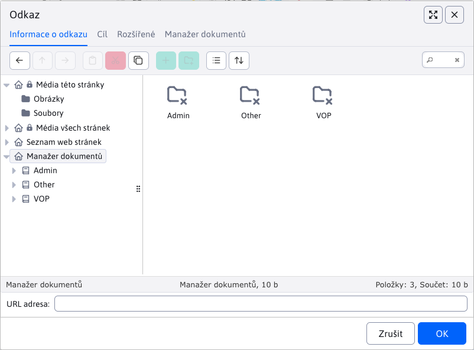

- [Fotobanka](redactor/webpages/working-in-editor/README.md#karta-fotobanka) - při stahování obrázku z fotobanky lze nastavit název souboru. Název se automaticky předvyplní a očistí, přípona se určí podle zdrojového obrázku a stávající soubor se nepřepíše. Přidána také podpora výběru typu a kategorie obrázku a možnost hledat video soubory (#58645).

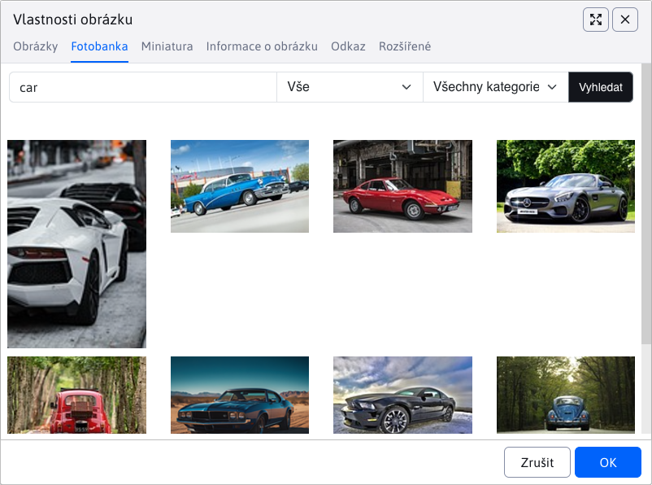

- Page Builder - elementy označené CSS třídou [`pb-duplicable`](frontend/page-builder/settings.md#duplikovatelný-element-oranžová-barva) lze v rámci stejného rodiče přesouvat, duplikovat a smazat. Vlastní nebo více selektorů lze nastavit přes `pbCustomSettings` (#58750).
- Page Builder - přidána možnost vytvořit [div.pb-section](frontend/page-builder/settings.md), který získá běžné ovládání sekce. Navíc aplikace `!INCLUDE(...)!` vložené přímo v sekci, nebo kontejnery, zobrazují náhled i přesto, že jsou vloženy mimo běžný sloupec (#osk711).
- Page Builder - upraveno [ovládání editoru](redactor/webpages/pagebuilder.md). Přidána pevná horní lišta s cestou k vybranému bloku, panel **Struktura**, rychlé akce a režim vkládání sekcí, kontejnerů a sloupců přímo do stránky. Rámečky lze skrýt nebo zobrazit pro celou hierarchii bloku. Knihovna bloků má kompaktní okno s náhledy, kategoriemi a kombinovaným vyhledáváním se štítky. Nastavení stylu používá rozbalovací skupiny vlastností a označuje právě upravovaný blok (#308).

<div class="video-container">
    <iframe width="790" height="444" src="https://www.youtube.com/embed/B_m_vPPel80" title="YouTube video player" frameborder="0" allow="accelerometer; autoplay; clipboard-write; encrypted-media; gyroscope; picture-in-picture" allowfullscreen></iframe>
</div>

- Page Builder - zlepšená detekce změn v HTML kódu stránky, aby se nezobrazilo hlášení "V editoru pravděpodobně máte neuložený text" i když jste reálně žádný text ve stránce nezměnili (#317).
- Page Builder - opraveno ukládání stránek s neúplnou HTML strukturou a neplatnými odkazy na starší instance editoru. Obsah takových prvků se zachová spolu s aktuálními úpravami ostatních bloků (#400).
- [Page Builder](redactor/webpages/pagebuilder.md) - po kliknutí na + ve žluté čáře v okně **Vložit blok** na kartě **Základní** přibyly možnosti **Obrázek** a **Aplikace**. Otevřou příslušný dialog editoru a umožní vložit obsah na zvolené místo (#339).
- Page Builder - přidáno [kopírování bloků mezi stránkami](redactor/webpages/pagebuilder.md#kopírování-bloků-mezi-stránkami). Volby **Zkopírovat** a **Vložit** přenášejí sekce, kontejnery a sloupce is obsahem a vlastními styly. Editor nabídne pouze místa vhodná pro typ bloku. Schránka má platnost 30 minut od zkopírování (#353).
- Šablony - na kartě Pokročilé můžete nastavit [odstraňování spojek z URL stránky](frontend/templates/templates.md#karta-pokročilé): podle `urlRemoveSpojky`, vždy odstranit nebo ponechat. Blog tak může ponechat spojky i při zapnutém odstraňování pro zbytek webu (#353).
- Změna URL složky s aplikováním na podsložky a podstránky aktualizuje i nezobrazované stránky, naplánované verze, verze čekající na schválení a poslední pracovní verzi. Zachovává jejich obsah, stav a termín publikování; naplánované publikování již nevrátí původní URL (#353).
- SEO - nastavení **Procházet** nabízí samostatné volby povolit (`index`) a zakázat (`noindex`). Sekce **HTTP hlavičky** na kartě Základní zobrazuje aktuální náhled `X-Robots-Tag`, `Referrer-Policy` a při nastaveném přesměrování i `Location` podle neuložených nastavení stránky a konfigurace serveru (#353).
- Historie - uživatelé s oprávněním **Čištění databáze** mohou [mazat historické verze](redactor/webpages/history.md) přímo v editoru stránky, i hromadným výběrem. Aktuálně publikovaná verze a verze čekající na schválení jsou chráněny. Bez tohoto oprávnění zůstává dostupné rušení budoucího naplánovaného publikování (#353).
- Plánované publikování - při zapnutí `plannedPublishingEnabled` lze připravit budoucí verzi stránky s chráněnými obrázky, dokumenty a samostatnou sadou médií [postup a podmínky nasazení](redactor/webpages/planned-publishing.md) (#362).

<div class="video-container">
    <iframe width="790" height="444" src="https://www.youtube.com/embed/z3QGUdDG2pk" title="YouTube video player" frameborder="0" allow="accelerometer; autoplay; clipboard-write; encrypted-media; gyroscope; picture-in-picture" allowfullscreen></iframe>
</div>

- Webové stránky - nové menu [Další akce](redactor/webpages/README.md#další-akce-a-hromadná-změna-skupin) v pravé části nástrojové lišty obsahuje hromadné přidání a odebrání značky i skupiny uživatelů bez přepsání ostatních skupin. Skupiny práv a e-mailové skupiny se vybírají společně. Přesunuli jsme do něj také kontrolu odkazů, statistiku stránky, uložení jako AB test a Import/Export (#368).

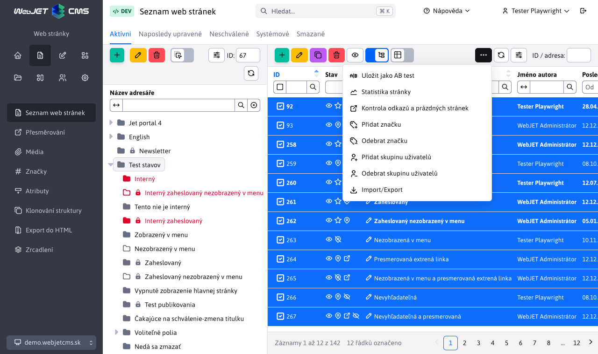

- Webové stránky - [výchozí nastavení stromu](redactor/webpages/README.md#výchozí-nastavení-pro-uživatele) pro nového uživatele lze nastavit přes konfigurační proměnnou `webpagesTreeDefaultSettings` (#368).
- Editor stránek - v úzkém okně se skupiny nástrojů přesunou do [panelu Další nástroje](redactor/webpages/working-in-editor/README.md#panel-nástrojů-v-úzkém-okně). Lišta se nezalamuje do dalšího pásu a nepřekrývá přepínač editoru a rozměrů. Tlačítko se třemi tečkami je přímo za poslední skupinou ikon a má bublinovou nápovědu. Stejné ovládání funguje ve Standardním editoru i v Page Builderu (#372).

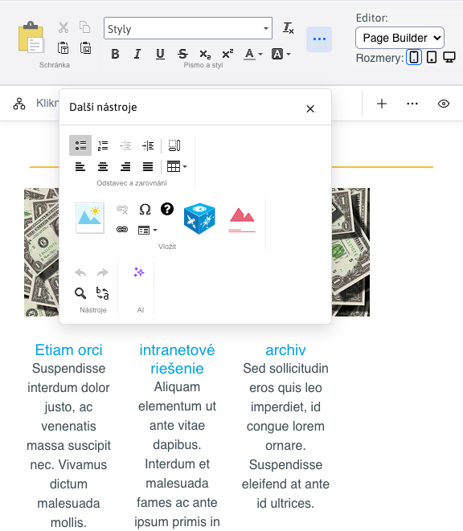

- Page Builder - dialogy, které se nevejdou do šířky náhledu, se automaticky rozšíří na velikost okna prohlížeče. Po potvrzení nebo zavření se obnoví původní šířka náhledu a posun stránky. Ovládací prvky Page Buildera používají jazyk administrace (#372).
- Obrázky - přidána podpora obrázků a animací ve [formátu AVIF](frontend/thumb-servlet/README.md#obrázky-avif). Serverové úpravy, vodotisk a miniatury přes `/thumb` zachovávají snímky, průhlednost a časování animace. Zpracování vyžaduje `ImageMagick` 7.1.2-34 nebo novější s `libheif` 1.22.0 nebo novějším. Editor obrázků ukládá statický obrázek (#371).

- Zrcadlení struktury - před smazáním stránky nebo složky se zobrazí [seznam zrcadlených položek](redactor/webpages/README.md#smazání-zrcadlených-stránek-a-složek), které se také smažou.

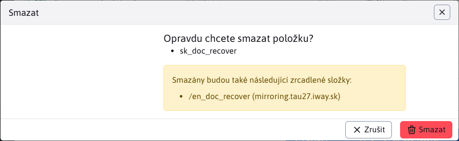

- Zrcadlení struktury - volba **Zobrazit zrcadlení** v nastavení zobrazení stromové struktury přidává do stromu [odkazy na jazykové verze](redactor/webpages/README.md#prechod-mezi-zrcadlenými-složkami) a [upozornění na chybné mapování](redactor/webpages/mirroring/groups.md#upozornění-ve-stromové-struktuře) (#370).

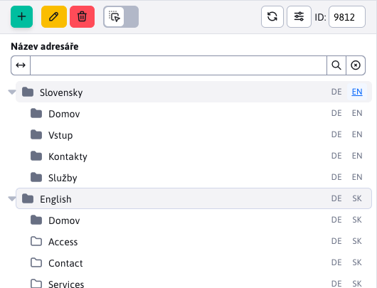

- AI Čet u pole - přidána ukládaná historie filtrovaná podle stejného pole a záznamu. Starší rozhovor můžete vyhledat, otevřít a pokračovat v něm i po zavření editoru; odpovědi zůstávají dostupné pro vložení do pole.
- AI Čet při poli a v editoru stránky - přidáno nahrávání obrázků a dokumentů pro asistenty s podporou historie. Soubory můžete vybrat ikonou plus, přetáhnout do zprávy nebo vložit obrázek ze schránky - asistent je zpracuje spolu s obsahem stránky (#386).

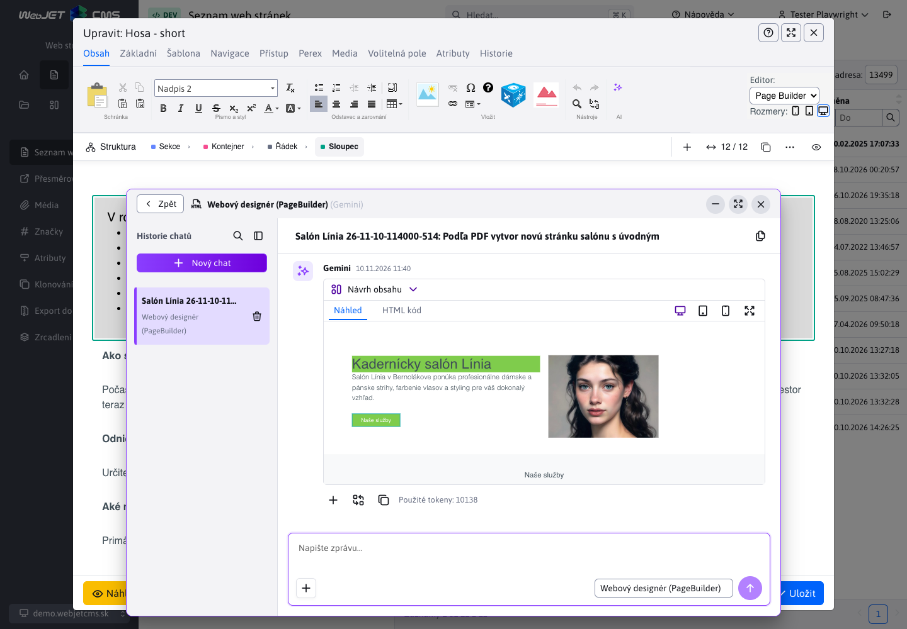

### Headless režim

Přidána [podpora headless režimu](frontend/headless/README.md), ve kterém WebJET CMS slouží čistě jako `backend` CMS. Obsah, navigace, vyhledávání a formuláře jsou dostupné přes REST API. Frontend aplikace (např. Astro, Next.js, Vue, React nebo jakýkoli HTTP klient) si data stáhne a zobrazuje je podle vlastních šablon (#258).

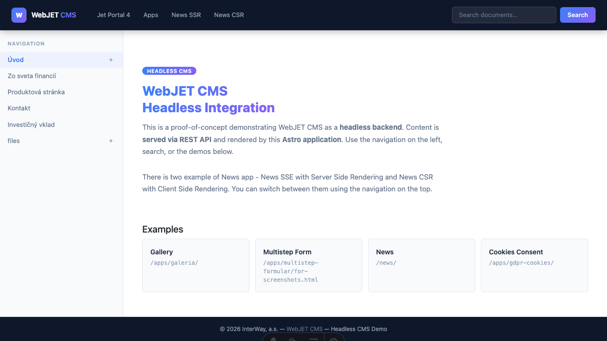

V jednom WebJET CMS můžete mít více (desítky) domén a následně mít menší web stránky vytvořené v různých technologiích, které konzumují a zobrazují obsah z CMS systému. Podporováno je také vkládání standardní aplikací jako foto galerie, formuláře, GDPR cookies a podobně.

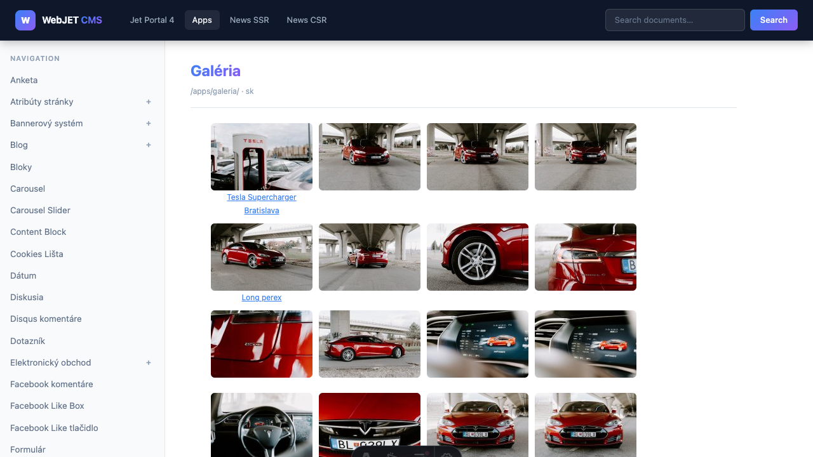

- Přesměrování - přidáno [čištění a optimalizace přesměrování](redactor/webpages/redirects/README.md#čištění-přesměrování) s náhledem změn před provedením. Čištění odstraňuje staré, duplicitní a cyklické přesměrování a zkracuje řetězce přesměrování (#58629).

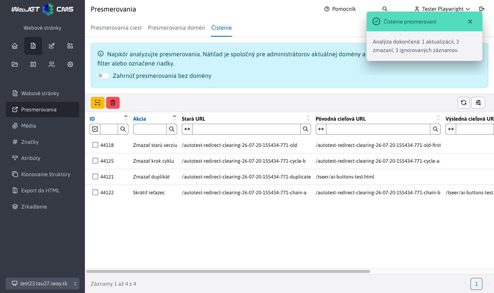

### Formuláře

- Vícekrokové formuláře - v editoru každé položky přibylo za názvem pole volitelné pole **Nápověda**. Podporuje víceřádkový formátovaný text a rozsáhlejší HTML obsah. Zobrazuje se za názvem pole ve formuláři přes značku `${hint}` a přenáší se i při kopírování položky (#396).
- Formulář snadno a vícekrokové formuláře - jednořádkový editor názvu pole a vysvětlivky nepovoluje nadpisy, seznamy ani zalomení řádků. Vložený text a HTML se převedou na jeden řádek se zachováním zvýraznění, barev a odkazů (#396).
- Nastavení formulářů - přidaná karta **Volitelná pole** s poli A–F. Pole jsou dostupná také v editoru aplikace Formulář snadno a přes `FormSettingsEntity`. V HTML překladových klíčů lze použít [značky `${settings.*}`](redactor/apps/formsimple/README.md#polia-z-nastavení-formuláře) pro A–F, emailová nastavení, přesměrování, limity souborů a vzhled. Podporuje je i náhled a emailová podoba vícekrokových formulářů. A–F i text před a za emailem umožňují HTML (#364).
- Vícekrokové formuláře - přidána možnost upravit [HTML tlačítka na předchozí krok](redactor/apps/formsimple/README.md#html-kód-tlačítek) přes překladový klíč `components.multistep.form.back_button` (#osk782).
- Vícekrokové formuláře - po neúspěšném přechodu na další krok nebo odeslání se stránka posune na první viditelné chybové hlášení i při opakovaném pokusu (#58794).
- Formuláře - validace nahraných souborů rozlišuje nepovolený znak v názvu a nepovolenou příponu. Chyba názvu uvede konkrétní zakázaný znak nebo řetězec. Názvy souborů v chybových hlášeních se zobrazují jako text, aby se případné HTML značky v názvu neprovedly (#58794).
- Vícekrokové formuláře - při [návratu na předchozí krok](redactor/apps/multistep-form/README.md#návrat-na-předchozí-krok) se zachovají rozpracované hodnoty i dokončené nahrávání (#58794).
- Vícekrokové formuláře - přidána ve výchozím nastavení zapnuta [validace při opuštění pole](redactor/apps/multistep-form/README.md#validace-při-opuštění-pole). Vypnete ji nastavením konfigurační proměnné `multistepform_validateOnBlur` na `false` (#58794).
- [Formuláře](redactor/apps/form/README.md#možné-konfigurační-proměnné) - klasické i vícekrokové formuláře respektují `sendMailSaveEmail` a ukládají emaily jako soubory `.eml` do `sendMailSaveEmailPath` místo SMTP odeslání. Pokud se zápis nezdaří, formulář oznámí chybu.
- Vícekrokové formuláře - přidán [návrat na předchozí krok](redactor/apps/multistep-form/README.md#návrat-na-předchozí-krok) s obnovením uložených hodnot a souborů a [výběr CSS šablony](redactor/apps/multistep-form/README.md#css administraci (#58742).

<div class="video-container">
    <iframe width="790" height="444" src="https://www.youtube.com/embed/5ooxA3JVWc0" title="YouTube video player" frameborder="0" allow="accelerometer; autoplay; clipboard-write; encrypted-media; gyroscope; picture-in-picture" allowfullscreen></iframe>
</div>

- Vícekrokové formuláře - opraveno vyhodnocování podmínek po odškrtnutí políčka při návratu na předchozí krok. Skryté nebo již nepovinné pole nezablokuje pokračování kvůli původně uložené hodnotě (#58742).
- [Statistiky vícekrokových formulářů](redactor/apps/multistep-form/stat.md) byly rozšířeny o datový filtr a pokročilé metriky zobrazení/pokusů/jazyků etc. (#58509).

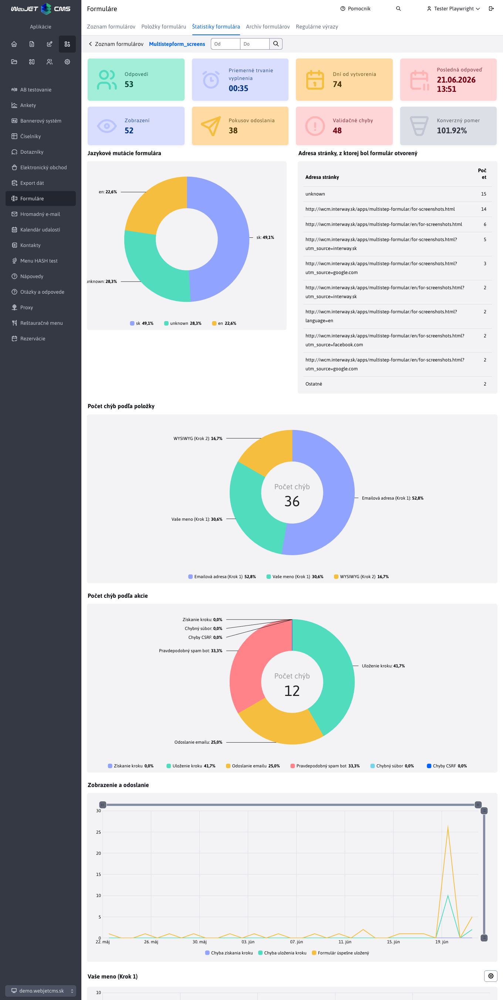

- Vícekrokové formuláře - [prázdná možnost](redactor/apps/multistep-form/README.md#prázdná-možnost) ve skupině výběrových polí zobrazuje nastavitelný text **Bez zvolené možnosti** (#381).
- Do vícekrokových formulářů přidána možnost jednoduše nastavovat výběrová pole a skupiny zaškrtávacích / výběrových polí (#58517).

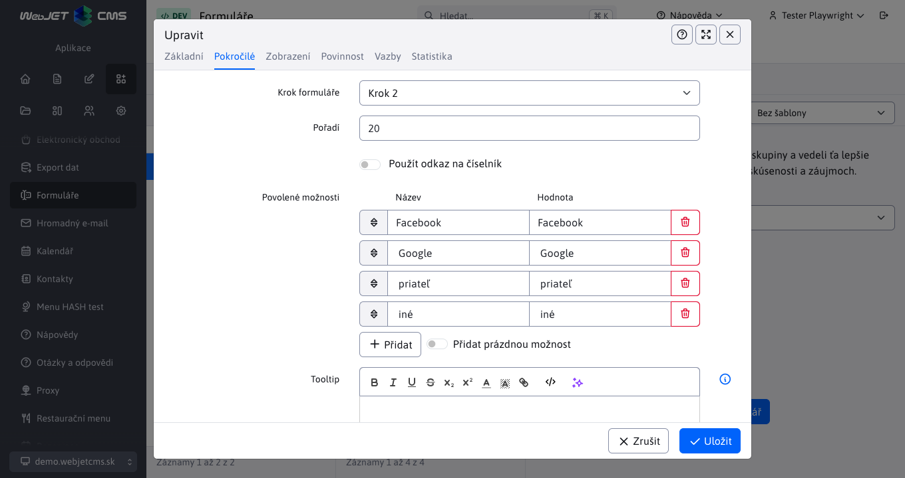

- Do vícekrokových formulářů přidána možnost propojení výběrového pole a skupiny zaškrtávacích / výběrových polí na číselník (#58517).

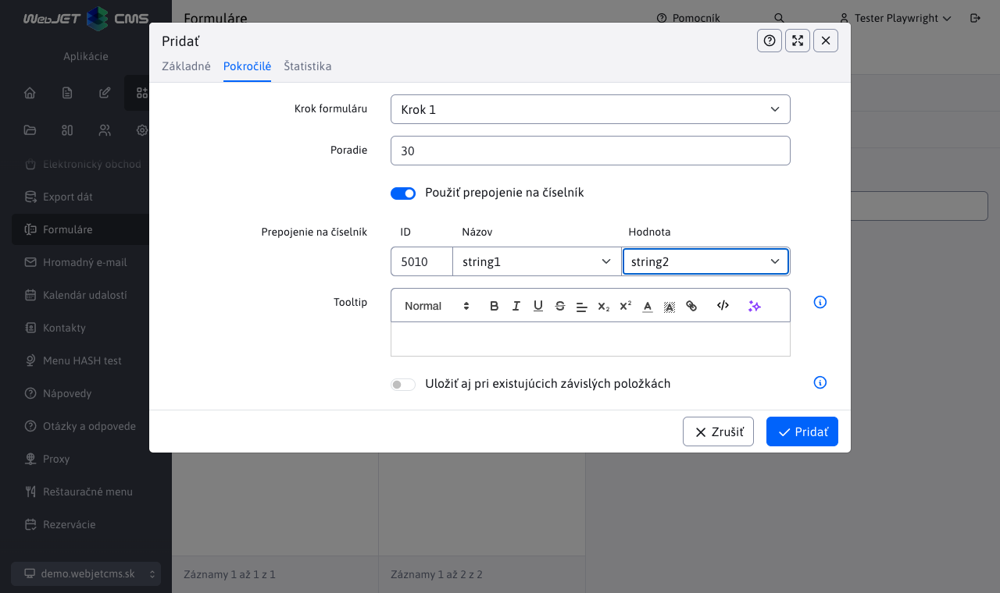

- Přidána možnost ve formuláři nastavit maximální kombinovaná velikost souboru, původně se dala nastavovat jen velikost pro soubor, pokud formulář obsahuje více souborů lze nastavit maximální velikost pro všechny soubory společně (#58517).
- [Vícekrokové formuláře](redactor/apps/multistep-form/README.md) - přidáno duplikování celého formuláře včetně nastavení, kroků a položek. Editor položek zobrazuje jejich automaticky vytvořený identifikátor a podporuje vlastní chybovou zprávu, oříznutí mezer, prázdnou možnost ve výběrovém seznamu a nový typ pole automatické doplňování s vyhledáváním bez rozlišení diakritiky (#osk573).
- [Vícekrokové formuláře](redactor/apps/multistep-form/README.md) - do úvodního textu kroku a [stránky s verzí pro email](redactor/apps/form/README.md#karta---nastavení) lze vložit hodnoty položek pomocí značek. Opraveno bylo rozpoznávání polí jména a emailu podle začátku identifikátoru, zpracování jazyka, reCAPTCHA v3, nezávislé vložení více instancí formuláře na jednu stránku a vymazání všech odpovědí bez odstranění definice formuláře (#osk573).
- [Vícekrokové formuláře](redactor/apps/multistep-form/README.md) - přidána možnost zadat vlastní chybovou zprávu a oříznout mezery na začátku a konci textu zadaného návštěvníkem (#osk573).
- Formulář snadno a vícekrokové formuláře - [vlastní HTML kód tooltipu](redactor/apps/formsimple/README.md#vlastní-html-kód-tooltipu) v překladovém klíči `components.formsimple.tooltipCode` podporuje značky s identifikátory pole, položky a kroku včetně unikátního `${tooltipId}`. Ovládací prvek tak lze pomocí `aria-describedby` jednoznačně propojit s obsahem tooltipu i při opakovaném vložení formuláře na stránku. Vícekrokový formulář po každém zobrazení kroku publikuje na objektu `window` [událost `WJ.multistepForm.stepShown`](redactor/apps/multistep-form/README.md#javascript-událost-po-zobrazení-kroku) s odkazy na jeho HTML elementy a identifikátory formuláře a kroku (#306).
- Formulář snadno a vícekrokové formuláře - výchozí tooltip je nově dostupný myší i klávesnicí, poskytuje stabilní kontextový název a popis, zůstává zobrazen při přesunu kurzoru na jeho obsah a lze jej zavřít klávesou `Escape` (#306).
- Vícekrokové formuláře - přidáno [kopírování polí mezi formuláři a kroky](redactor/apps/multistep-form/README.md#kopírování-polí-mezi-formuláři). Vložení otevře editor s uloženými nastaveními pole; podmínky zobrazení a povinnosti se nepřenášejí. Interní schránka funguje mezi kartami prohlížeče a umožňuje opakované vložení po dobu 30 minut (#58826).
- Vícekrokové formuláře - přidána možnost [Zobrazit obsah bez přesměrování](redactor/apps/form/README.md#karta---nastavení). Přepínač použije webovou stránku z pole **Přesměrování po vyplnění** a po úspěšném odeslání nahradí přednastavenou hlášku jejím obsahem beze změny URL adresy. Pokud návštěvník nemá oprávnění k zobrazení webové stránky, zobrazí se přednastavená hláška o úspěšném odeslání (#58826).
- Vícekrokové formuláře - nová karta [Vazby](redactor/apps/multistep-form/README.md#vazby) v editoru pole zobrazuje samostatné seznamy polí, které jeho hodnotu používají v podmínkách zobrazení a povinnosti (#377).

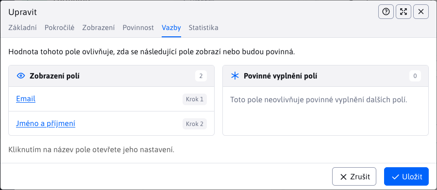

- Vícekrokové formuláře - při nastavování podmínek zobrazení a povinnosti se srovnávaná hodnota pro výběrová pole vybírá z jejich možností včetně číselníků a společných rádiových skupin. Není třeba zadávat hodnoty ručně (#391).
- Vícekrokové formuláře - výběr **Krok formuláře** v editoru položky zobrazuje aktuální číslo kroku i po změně pořadí kroků potažením myší (#392).
- Regulární výrazy - seznam zobrazuje přeložený název podle jazyka administrace a původní název označuje jako **Překladový klíč**. Výběr **Povolená hodnota** ve vícekrokových formulářích používá formát **kód - název** (#387).
- Vícekrokové formuláře - opravený překlep v překladových klíčích z `components.mustistep.*` na `components.multistep.*` (#378).
- Vícekrokové formuláře - pomocné zápisy statistiky na [veřejném uzlu clusteru s omezenými databázovými právy](install/config/ro-user.md#víceleté-formuláře) již neblokují zobrazení, validaci ani odeslání formuláře. Při chybě se návštěvníkovi zobrazí název aplikace namísto názvu Java třídy (#384).
- Odložené odesílání emailů - zvětšený sloupec `emails.message` na `LONGTEXT` v MySQL/MariaDB, aby uložení velkého HTML emailu neselhalo. Doplněn [návod na menší CSS pro email a PDF](redactor/apps/form/README.md#css-styly-pro-email-a-pdf) (#374).

### Sémantické vyhledávání

- Přidána podpora **MariaDB Vector** jako alternativy k `PostgreSQL/pgvector` pro sémantické a hybridní vyhledávání i RAG odpovědi. Minimální podporovaná verze je **MariaDB 11.8 LTS**, doporučujeme **11.8.9 nebo novější opravnou verzi**.Verze od **12.3 LTS** obsahuje zrychlení vyhledávání. Minimální a doporučené verze PostgreSQL, pgvector a MariaDB i jejich výhody jsou v [přehledu databázových požadavků](custom-apps/apps/rag/semantic-search/README.md#podporované-databáze-a-verze) (#232).
- Nedostupná samostatná RAG databáze již neblokuje start CMS. RAG perzistence se inicializuje až při prvním použití a po neúspěšném připojení umožňuje další pokus bez restartu CMS (#232).

- Přidána podpora [sémantického vyhledávání](redactor/apps/semantic-search/README.md) postaveného na technologii vektorové databáze `pgvector` a `OpenAI embeddings`. Umožňuje návštěvníkům najít relevantní stránky na základě **významu otázky**, nejen shody klíčových slov (#211).
- Doplněný hybridní režim sémantického vyhledávání a volitelná RAG odpověď z indexovaného obsahu. Aplikace **Vyhledávání** má nová nastavení pro typ vyhledávání, hybridní chování, výběr AI asistenta a limity kontextu odpovědi (#58521).

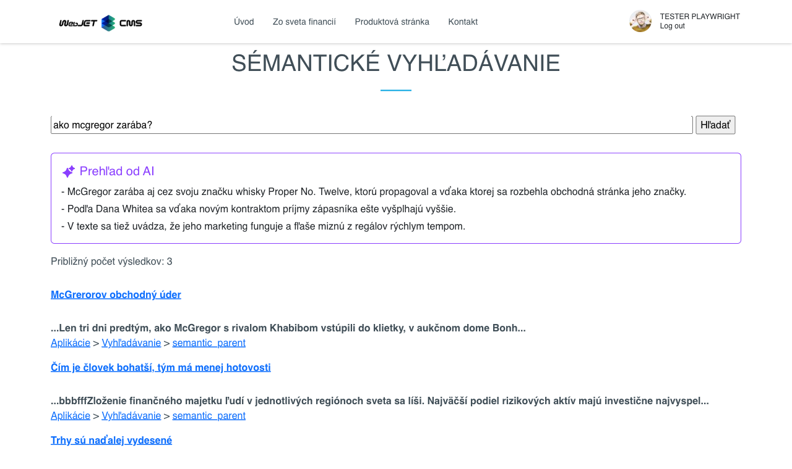

- Embedding indexování a vyhledávání používá poskytovatele a model nastavený v systémovém AI asistentovi. Indexy různých poskytovatelů a modelů mohou existovat současně; stránka **Sémantický index** zobrazuje aktuální nastavení a při opětovném indexování zachová ostatní kombinace. Jádro embedding požadavků, odpovědí a komunikace s poskytovateli bylo vyčleněno do knihovny `webjet-ai` ; WebJET CMS nadále zajišťuje výběr asistenta, indexování a uložení vektorů (#58694).
- AI asistenti a **sémantické vyhledávání** - přidána podpora [lokálních modelů](redactor/ai/settings/README.md#lokální-modely) pro generování textu, překlad a tvorbu embeddingů přímo na serveru bez odesílání obsahu externí AI službě. Tyto modely lze **spustit na běžném hardwaru** (CPU), **nevyžadují speciální grafické karty** (#58561).
- Sémantické vyhledávání - lokální [reranking výsledků](custom-apps/apps/rag/semantic-search/README.md#reranking-výsledků) zlepšuje pořadí výsledků i výběr RAG kontextu podle textové shody s otázkou. Nevyžaduje další AI volání ani opětovné indexování (#58778).
- Sémantické vyhledávání - textové chunky mají maximum o 50 % vyšší než cílová velikost (výchozí `1500` znaků). Markdown zachovává celé sekce a bloky, které se vejdou do maxima, a spojuje krátké sekce se společným kontextem nadpisů. Větší obsah se rozdělí podle vět a slov. Změny se použijí po opětovném indexování. Více v [popisu indexování](custom-apps/apps/rag/semantic-search/README.md#1-indexování) (#58778).
- Sémantické vyhledávání - přidána [podpora Markdown dokumentace](custom-apps/apps/rag/markdown-search.md) z webových i lokálních složek (`file:`), plánovaná indexace změn, vyhledávání Docsify podle jazyka a adresáře a volitelná RAG odpověď. Nová karta **Markdown dokumenty** umožňuje indexaci a odstranění přes stromový výběr složky. Jazyk se odvozuje z cesty souboru. Index je společný pro všechny domény; AI asistenti a spotřeba patří doméně prováděné operace. Vyhledávání respektuje limity ochrany před SPAMem ještě před voláním AI a při jejich překročení zobrazí zprávu. Nastavení aliasu `file:/docs`, parametry úlohy `koreň|doména` a migrace starších indexů jsou popsány v návodu (#58778).

### Aplikace

- AI asistenti - nová karta [Limity tokenů](redactor/ai/settings/README.md#karta----limity-tokenů) umožňuje omezit spotřebu asistenta a zobrazit její vývoj za posledních 14 dní. Na zadaný notifikační e-mail se odešlou upozornění při dosažení 75 % a 100 % limitu. Po dosažení limitu se další požadavky zablokují. Spotřebu lze vynulovat ručně pro vybrané asistenty nebo aktuální doménu, případně pravidelně pro všechny domény úkolem `AiTokenUsageReset`, který se ve výchozím nastavení spouští každý den o půlnoci (#400).
- AI asistenti - opraveno zpracování průběžných textových odpovědí včetně Gemini. Počet tokenů a chybové zprávy se správně zpracují i ​​při rozdělení nebo spojení síťových bloků; technické údaje se nevkládají do generovaného textu. Přerušená odpověď se již neoznačí jako úspěšně dokončená.
- Číselníky - výběr a správa typů se přesunuly do stromu v levém panelu s vyhledáváním. Více v [dokumentaci Číselníků](redactor/apps/enumeration/README.md) (#58786).
- Blog - výběr a přidávání sekcí jsou dostupné ve stromu v levém panelu s vyhledáváním. Více v [dokumentaci Blogu](redactor/apps/blog/README.md) (#58786).
- Novinky - výběr složky se přesunul do stromu v levém panelu s vyhledáváním, dostupného iv editoru aplikace. Automatické hledání složek vynechává kořeny blogerů i jejich podsložky. Více v [dokumentaci Novinek](redactor/apps/news/README.md) (#58786).
- Elektronický obchod - přidáno volitelné [zaokrouhlování cen](redactor/apps/basket/rounding.md), aby se košík počítal ze zobrazené ceny za kus. Počet desetinných míst určuje `currencyFormat` ; šablony se značkou `iway:curr` převezmou nové formátování automaticky (#316).
- Číselníky - pro pojmenovaná řetězcová pole lze v nové kartě [Typy řetězcových polí](redactor/apps/enumeration/README.md#karta-typy-řetězcových-pole) nastavit typ pole, možnosti výběru, povinnost, pomocný text a omezení délky stejně jako u volitelných polí. Nabídka a názvy konfigurací vycházejí z poslední uložené verze typu číselníku. Nepojmenovaná pole zůstávají skrytá, nevyhodnocují se jako povinná a pole bez specifické konfigurace se zobrazí jako běžný text. Starší vlastní Excel šablony a integrace REST API je třeba upravit z atributů `string1` až `string12` na `fieldA` až `fieldL` (#58641).

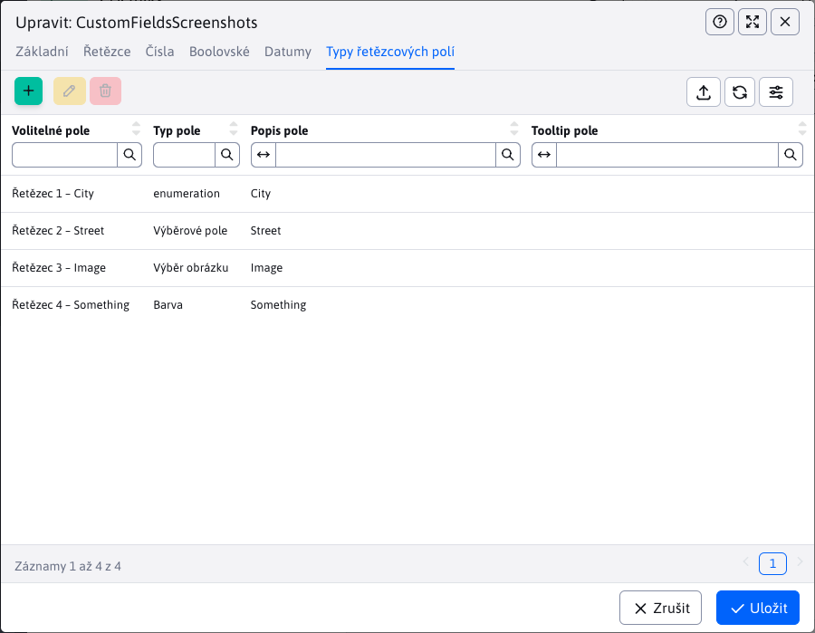

- Elektronický obchod - přidaná aplikace [Statistiky](redactor/apps/eshop/stats/README.md) se souhrnnými ukazateli, filtrováním podle stavu, měny a období a grafy tržeb, produktů, kategorií, způsobů doručení a platebních metod (#58065).

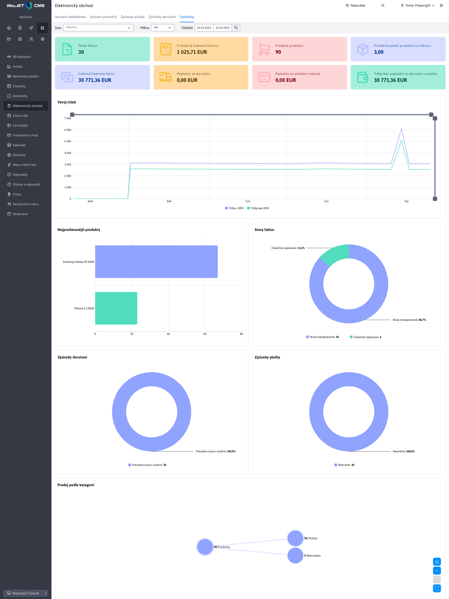

- Přidána nová aplikace [Přesměrování podle jazyka](redactor/apps/language-redirect/README.md) pro automatické přesměrování návštěvníků na jazykovou verzi stránky podle detekce jazyka z HTTP hlavičky `Accept-Language`. Podporuje až 8 přiřazení jazyků na URL adresy, respektování jazykového cookie a možnost přesměrování pouze na kořenové URL (#58497).

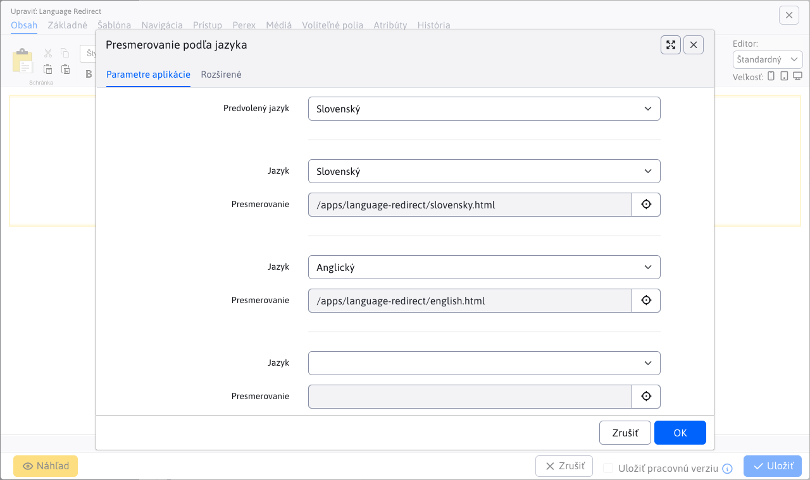

- Rezervace - aplikace **Rezervace času** a **Rezervace dní** mají sjednocený vizuální styl podle kalendáře `Vanilla Calendar`, upravené kontrastní barvy buněk podle `WCAG`, oddělené vizuální CSS styly do samostatných souborů a **Rezervace času** zobrazuje v hodinových buňkách skutečnou cenu dle ceníku.
- Rezervace - přidána nová aplikace [Moje rezervace](redactor/apps/reservation/my-reservations-app/README.md), která přihlášenému uživateli zobrazí přehled jeho rezervací, stavem rezervace a možností smazání povolených budoucích rezervací (#58565).

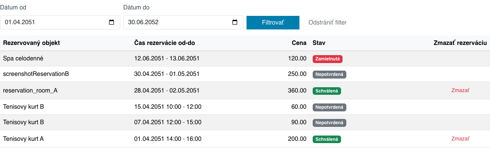

- Manažer dokumentů - přidáno zobrazení stromové struktury složek (#58593).

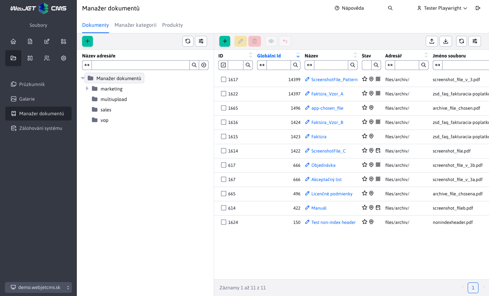

- Manažer dokumentů - přidána možnost nahrát více souborů najednou přes `drag&drop` (#58593).

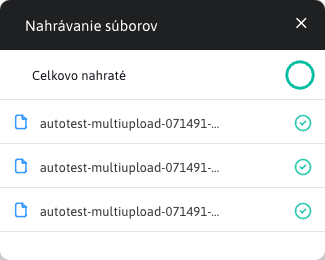

- Manažer dokumentů - při [hromadném nahrávání souborů](redactor/files/file-archive/README.md#hromadné-nahrávání-souborů) lze na kartách **Základní** a **Pokročilé** nastavit společnou platnost, naplánovat pozdější nahrání s e-mailovou notifikací8 a4 zadat rozšíření.

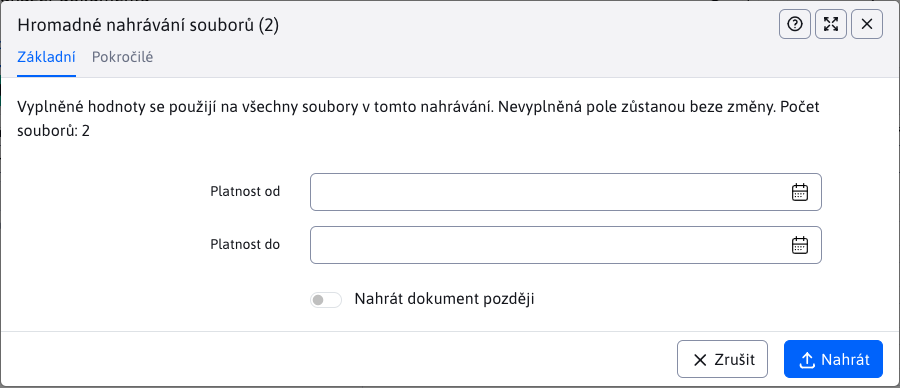

- Manažer dokumentů - vylepšená kontrola práv na souborový systém. Ikona pro přidání složky se zobrazuje jen pokud uživatel má právo zápisu, při výběru složky se kontrolují práva, pokud uživatel nemá právo zápisu souborů do `/files/archiv` zobrazí se chybová zpráva (#osk802).
- Výběr složky - zakázané složky ve stromové struktuře se zobrazují ikonou složky s křížkem (#osk802).
- Manažer dokumentů - strom složek má minimální šířku 200 px, aby vyhledávací pole s tlačítky nepřesahovalo do tabulky ani při nastavení menšího poměru. Nastavení šířky v pixelech proto nabízejí hodnoty od 200 px (#360).
- Manažer dokumentů - pole **Produkt** a **Kategorie** při uložení, přejmenování a hromadném nahrávání normalizují tvrdé mezery, tabulátory a zalomení řádků, sloučí opakované mezery a odstraní okrajové mezery i rušivé neviditelné znaky z kopírovaného textu. **Upozornění:** při opětovném uložení existujícího dokumentu se odstraní tvrdé mezery v názvu, produktech a podobně. Filtry v aplikaci ve webových stránkách se automaticky neaktualizují. Pokud používají původní název s tvrdými nebo opakovanými mezerami či neviditelnými znaky, dokument se po uložení nemusí ve filtrovaném seznamu zobrazit. Opravte názvy ve všech dotčených dokumentech a v aplikacích nastavte filtry podle nových hodnot. Uložení jednoho dokumentu neopraví ostatní dokumenty se stejným názvem produktu nebo kategorie (#360).
- Manažer dokumentů - v [aplikaci na webové stránce](redactor/files/file-archive/file-archive-app.md#karta---rozšířené) přidáno řazení podle začátku a konce platnosti, kódu produktu, produktu, kategorie, jména souboru a velikosti dokumentu (#359, #osk791).
- Manažer dokumentů - konfigurační proměnnou `fileArchivCheckHistoryValid=false` lze povolit stahování historických verzí i mimo rozsah platnosti; historické verze dokumentů se tehdy zobrazí i v aplikaci na webové stránce. Data zůstávají zobrazena v archivu; výchozí hodnota `true` zachovává kontrolu platnosti od i do. Více v [dokumentaci](redactor/files/file-archive/README.md#platnost-a-stahování-historických-verzí) (#380).

### Galerie

- Přidána možnost nastavit samostatný způsob [změny velikosti pro velký obrázek](redactor/apps/gallery/structure.md#karta-rozměry) nezávisle na malém obrázku. Ve výchozím nastavení se použije způsob změny velikosti stejně jako je nastaveno pro malý obrázek. Nastavení lze volitelně překopírovat i do podsložek (#58633).

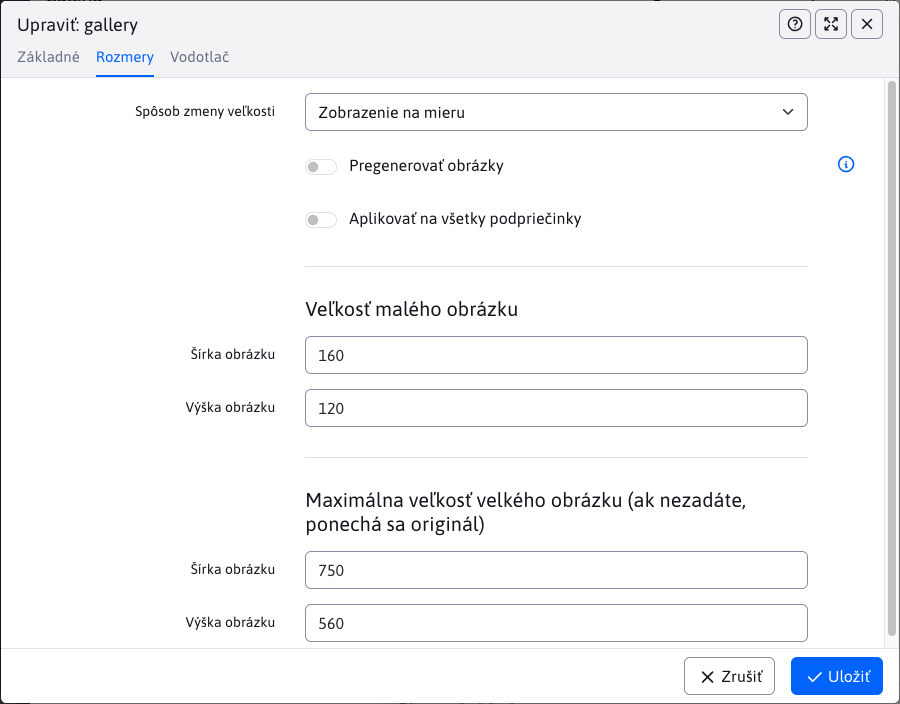

### Datové tabulky

- Sekce **Nastavení → Datové tabulky** sdružuje [Nastavení polí](frontend/datatables/fields-settings.md), [Nastavení karet](frontend/datatables/tabs-settings.md) a [Volitelná pole](frontend/datatables/custom-fields-settings.md). Pro jednotlivé entity a domény můžete měnit názvy, pořadí a zobrazení polí či zakázat jejich úpravy. Můžete také upravovat karty editoru a vytvářet vlastní karty s volitelnými poli. **Upozornění:** Původní oprávnění **Volitelná pole** (`customFields`) bylo odstraněno. Po aktualizaci je třeba příslušným uživatelům nebo skupinám práv přidělit nové oprávnění **Datové tabulky** (`dataTablesConfig`). Původní oprávnění se automaticky nepřenesou (#366).

<div class="video-container">
    <iframe width="790" height="444" src="https://www.youtube.com/embed/xkgdP7odoPA" title="YouTube video player" frameborder="0" allow="accelerometer; autoplay; clipboard-write; encrypted-media; gyroscope; picture-in-picture" allowfullscreen></iframe>
</div>

- Webové stránky - při ukládání se zachovají hodnoty polí skrytých v editoru a polí se zakázanými úpravami podle stejných pravidel jako v ostatních datových tabulkách. Při úpravě z historie se použijí hodnoty z vybrané verze stránky (#366).

### Volitelná pole

- Kompletně implementovaná funkčnost [nastavení volitelných polí](frontend/webpages/customfields/custom-fields-settings.md). Umožňuje centrálně nastavit vlastnosti polí bez editace překladových klíčů. Podporovány jsou všechny typy polí (text, textarea, select, multiselect, autocomplete, enumeration, obrázek, odkaz, JSON a další) s typově specifickými nastaveními jako maximální délka textu, možnosti výběru, propojení na číselníky nebo závislost na jiných polích. Uživatelské rozhraní nabízí také jednoduchý způsob nastavení možných hodnot pro výběrová/autocomplete pole (#58529).

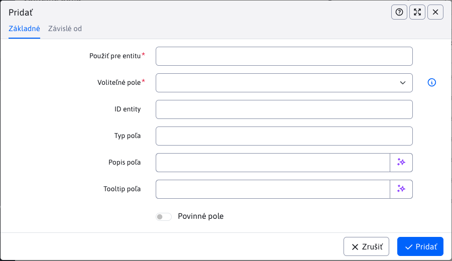

- Přidána možnost nastavit volitelné pole jako povinné (#58413).
- Přidány nové typy volitelných polí [přepínač a zaškrtávací pole](frontend/webpages/customfields/custom-fields-settings.md#rozdíl-mezi-selectmultiselect-a-radiocheckbox) s podporou statických možností i propojení na číselník. Typ `multiselect` nyní také podporuje [propojení na číselník](frontend/webpages/customfields/custom-fields-settings.md#zdroj-možností). Původní typ `enumeration` byl nahrazen přepínačem zdroje možností u typů `select`, `multiselect`, `radio` a `checkbox` kde se pro všechny tyto typy polí načtou možnosti z propojeného číselníku (#58637).
- Přidán typ [Editor JSON](developer/datatables-editor/customfields.md#json-editor) (`jsoneditor`) pro přímé zadávání JSON objektu s čísly řádků a tlačítkem pro formátování (#311).

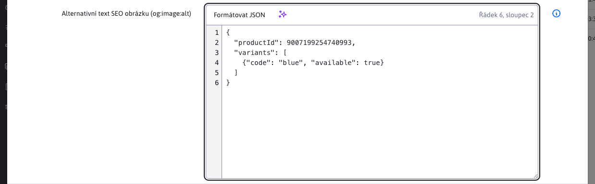

### Přístupnost

- Administrace - rozšířené ovládání klávesnicí a podpora čteček obrazovky pro datové tabulky, modální okna a notifikace, bublinová nápověda, výběr data a barvy a HTML editor. Upraveno bylo přesouvání a zvracení zaměření, výběr řádků a buněk, přístupné názvy a ARIA stavy, označení povinných polí, kontrasty ovládacích prvků a odkaz na přeskočení na hlavní obsah. Byly doplněny automatizované regresní testy `a11y` pro tyto scénáře (#235).

### Multiweb

- Přidána možnost [vytvořit novou doménu](install/multiweb/config.md) z řídicí domény, vytvoří také uživatele, skupinu šablon, šablonu a systémové stránky (#58525).
- Přidáno zobrazení seznamu skupin šablon (#58525).
- V řídící doméně je možné upravovat všechna přesměrování domén.
- V řídicí doméně přidána možnost zobrazit všechny soubory.
- GDPR - opraveno přidávání a úprava cookies v ostatních doménách bez oprávnění k úpravě všech překladových klíčů. Poskytovatel, účel a platnost se ukládají a zobrazují pro aktuální doménu (#344).

### Jiné menší změny

- Monitorování serveru - v aktuálních hodnotách byla přidána sekce [Kódování znaků](sysadmin/monitoring/README.md#kódování-znaků), která zobrazuje kódování HTTP odpovědí, JVM a locale prostředí běžícího procesu aplikačního serveru (#305).
- Konfigurace - přidán hierarchický strom konfiguračních proměnných s pohledy **Změněno**, **Zákaznické**, **Všechny** a modulovými větvemi (#293).
- Konfigurace - přidána možnost **Nastavit dočasně**, která nastaví hodnotu konfigurační proměnné pouze na aktuálním uzlu bez uložení do databáze. Po restartu se obnoví hodnota uložená v databázi (#291).

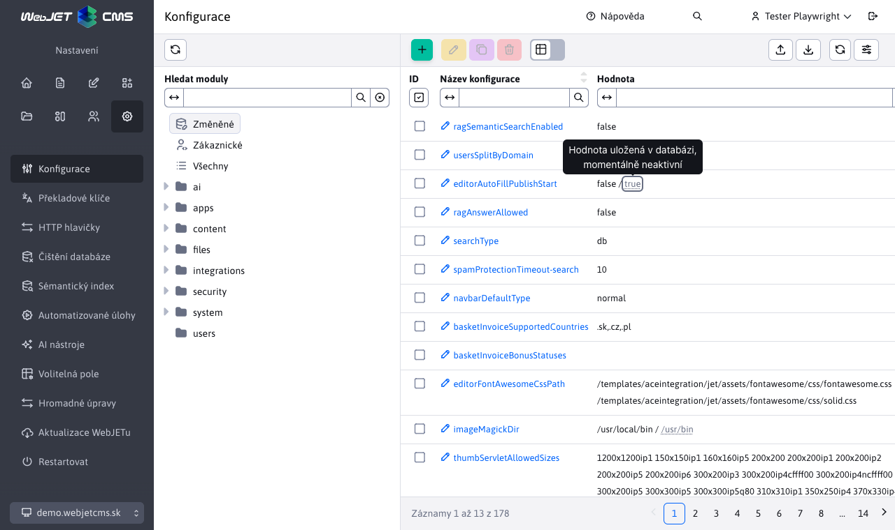

- Automatizované úlohy - přidána možnost [manuálně spustit úlohu](admin/settings/cronjob/README.md) na uzlu nebo skupině uzlů nastavené v poli **Běží na uzlu**. Původní lokální spuštění na aktuálním uzlu zůstává dostupné samostatným tlačítkem (#58718).

- Překladové klíče - přidána stromová struktura prefixů překladových klíčů s filtrováním seznamu podle zvoleného prefixu (#58714).

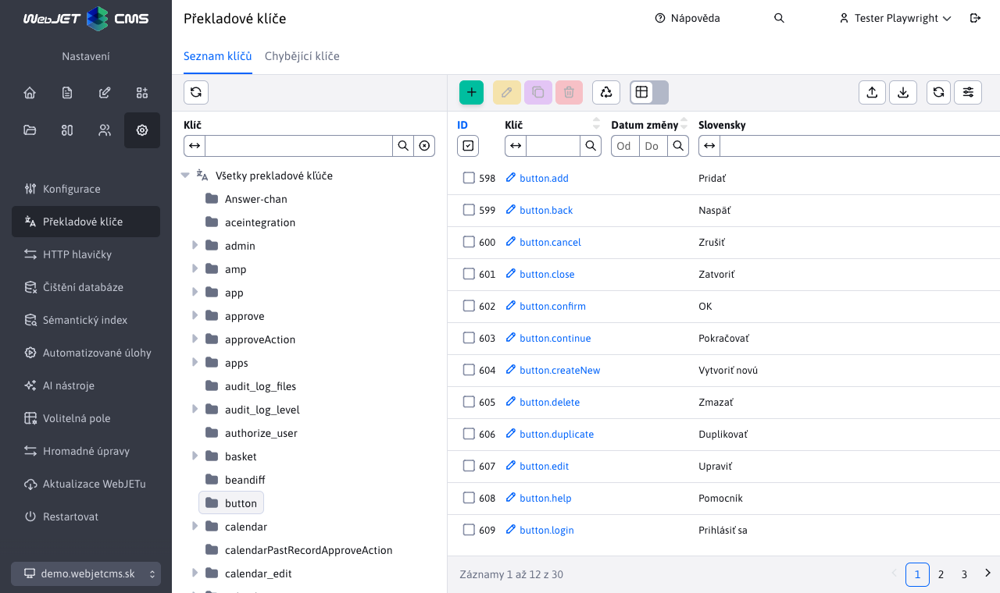

- Průzkumník - ve vlastnostech složky přidána karta [Nepoužívané soubory](redactor/files/fbrowser/folder-settings/README.md#nepoužívané-soubory) pro vyhledání a smazání nepoužívaných souborů (#58621).

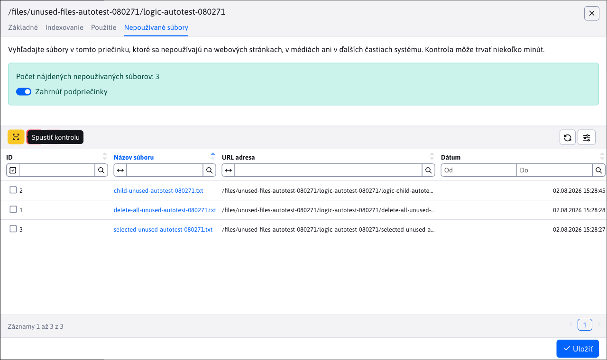

- Průzkumník - přidáno právo **Povolit nahrávání souborů s diakritikou**, které umožňuje zachovat diakritiku při nahrávání, vytváření a přejmenování souborů a složek ve složkách `/files`, `/images` a `/shared`. Bez tohoto práva se názvy nadále automaticky upraví bez diakritiky (#58589).
- Přihlášení - zrychlené načtení úvodní stránky v administraci - přidána vyrovnávací paměť pro seznam posledních stránek, změněných stránek a auditních záznamů (#58589).
- Export/import souborů - upravený design dialogového okna a responzivní zobrazení formulářových polí podle aktuálního designu administrace (#58581).
- Grafy - přidán nový stromový graf [`TreeChartForm`](developer/frameworks/charts/frontend/statjs.md#graf-typu-tree) pro vizualizaci hierarchických dat s přibližováním, rozbalováním a maximalizováním (#58065).
- Google reCaptcha - doplněna podpora vkládání více více krokových formulářů do stránky, podporován je režim `invisible/reCaptcha/reCaptchaV3`, upravené chybové hlášení na srozumitelnější text (#osk573).
- Webové stránky - doplněné zvýraznění elementu nad kterým je vyvoláno kontextové menu. Důležité pokud chcete provést akci Smazat element, abyste přesně viděli který element je označen (#OSK675).
- Multiweb - doplněna možnost přejmenovat existující doménu + přesměrování po přejmenování (#58317-15).
- Multiweb - upraveno [zobrazení skupin šablon](install/multiweb/README.md) podle dostupných šablon a aliasu aktuální domény (#58317-17).
- Statistika - nastavené datum/rozsah od-do se ukládá v prohlížeči a je zapamatován i po odhlášení/restartu prohlížeče (#58065).
- Statistika - prohlížeče se ukládají bez často se měnícího čísla verze. Doplněna je ručně spouštěná dávková migrace v sekci Aktualizace WebJET, která sloučí historické záznamy bez výpadku webu. Na stránce `/admin/v9/settings/stat-browser-migration/` klikněte na Analyzovat a potom spusťte migraci. Po úspěšné migraci klikněte na Finalizovat. Finalizace před mazáním ověřuje používání identifikátorů včetně operačních systémů a jejich verzí, zachovává používané hodnoty a zobrazuje průběh kontroly po tabulkách. Aktualizován je seznam `User-Agent` prohlížečů pro lepší detekci (#303).

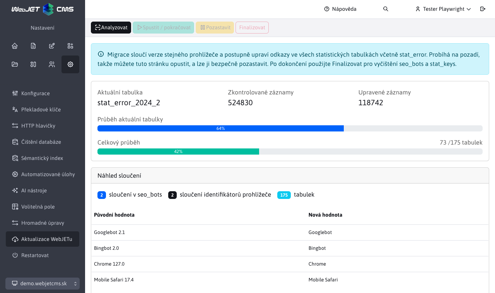

- Vícekrokové formuláře - doplněné přesunutí (`scroll`) na začátek formuláře po přechodu na další krok (#osk573).
- Průzkumník - při aktualizaci souboru je výběr omezen na jeden soubor a hlášení upozorní na nesprávný typ (#317).
- Průzkumník - v informacích o složce se již nezobrazuje nepřesná rekurzivní velikost (#317).
- Proxy - [výjimky `proxyHostsException`](install/config/README.md#httphttps-proxy) podporují zástupné vzory jako `*.firma.sk` a `127.*`, oddělovače čárka i `|` a porovnávání bez rozlišování velikosti písmen. Stejný normalizovaný seznam se používá pro HTTP/HTTPS i JVM nastavení `http.nonProxyHosts`. Změna konfigurace vyžaduje restart (#361).

### Oprava chyb

- Zrcadlení struktury - při selhání překladu, například po vyčerpání kvóty DeepL, uživatel obdrží upozornění s konkrétním důvodem z výjimky překladače včetně HTTP kódu a dostupné chybové zprávy DeepL. Pevné mezery a jejich HTML entity se normalizují v názvech složek a generovaných URL, aby nevznikaly adresy s textem `nbsp` ani zbytečná přesměrování (#402).
- Datové tabulky - po úpravě jednoho záznamu se při vynuceném obnovení údajů zobrazí strana s upraveným záznamem podle aktuálního třídění. V konfiguraci se proměnná vyhledává podle názvu i při změně jejího ID. Při mazání se zachová aktuální strana, případně se zobrazí poslední platná strana. Při pořizování záznamu se stránkování nadále resetuje (#400).
- Vícekrokové formuláře - identifikátor položky se generuje z textu názvu pole bez HTML značek, aby formátování názvu neovlivňovalo identifikátor (#396).
- Vícekrokové formuláře - při smazání položky, kroku nebo formuláře se odstraní i příslušné podmínky zobrazení a povinnosti. Podmínky již smazaných položek neblokují odstranění polí, na která odkazovaly (#395).
- Vícekrokové formuláře - pravidla **Povolená hodnota** již neodmítnou prázdné nepovinné pole. U povinného pole se regulární výrazy kontrolují i ​​pro prázdnou hodnotu; při odeslání kroku se zohledňují i ​​podmínky povinnosti (#394).
- Page Builder - vložené karty dostanou vlastní ID i při kopírování před dokončením inicializace, aby se jejich odkazy nepropojovaly s původním blokem.
- Datové tabulky - zadání ID otevře záznam i po předchozím filtrování bez výsledků.
- Webové stránky - opraven [export do ZIP archivu](redactor/webpages/import-export.md) pro obrázky vložené přes `/thumb/`, které se původně do exportu nepřidaly (#389).
- Webové stránky - dialog pro vložení obrázku omezuje výběr souborů na obrázky, videa a zvukové soubory i ve složce Soubory. Nepodporované typy rozpoznané prohlížečem odmítne ještě před odesláním. Server navíc ověří příponu před uložením (#375).
- Webové stránky - přesměrování stránky se přihlášenému administrátorovi neukládá do cache prohlížeče, aby se jeho změna nebo zrušení projevily při dalším otevření stránky (#372).
- Spring aplikace - [chyba při vytvoření nebo provedení aplikace](custom-apps/spring-mvc/README.md#chyba-při-provádění-aplikace) nahradí pouze její značku `INCLUDE`. Okolní text, JSP aplikace i ostatní Spring aplikace zůstanou na stránce zachovány a hláška uvede název aplikace, která selhala (#384).
- Redis session - opraveno nahrávání souborů po částech, spotřebování jednorázových CSRF tokenů a aktualizace údajů přihlášeného uživatele po úpravě profilu přes registrační formulář. Změněné objekty se zapíší zpět do session.
- Editor stránek - opravena chyba při otevření náhledu po obnovení session ze serializovaného úložiště, například Redis. Chybějící data editoru se obnoví z náhledové verze stránky.
- Šablony - audit vytvoření, úpravy a smazání používá jednotné prefixy `CREATE:`, `UPDATE:` a `DELETE:` s ID a názvem šablony.
- Editor stránek - při přepínání stránek čeká na dokončení obnovy CKEditoru, aby se nezobrazil a neuložil obsah předchozí stránky.
- Webové stránky - lomítka v názvu stránky, názvu v menu a ve výběru hlavičky, patičky či navigace se zobrazují jako `/` místo `&#47;`.
- AI asistenti - při HTTP chybě generování obrázku se zobrazí chyba a ukončí indikátor zpracování. Požadavek lze zopakovat.
- Datové tabulky - HTML editor [`QUILL`](developer/datatables-editor/standard-fields.md#quill) - nabídky nadpisů, zarovnání a barev se již neořezávají na spodním okraji dialogového okna a zůstávají dostupné iv nízkém okně prohlížeče (#376).
- Elektronický obchod - opraveno přidání kategorie produktů bez označeného produktu v tabulce (#373).
- Webové stránky - URL stránky, přesměrování a perex obrázku zachovávají parametry i po načtení přes JPA včetně historie. HTML sanitizér již nepřepisuje znaky `&` a `=` v URL na HTML entity (#373).
- Webové stránky - přesměrování stránky se přihlášenému administrátorovi neukládá do cache prohlížeče, aby se jeho změna nebo zrušení projevily při dalším otevření stránek (#372).
- Editor stránek - při automatické maximalizaci v nízkém nebo úzkém okně zůstává celý panel nástrojů nad obsahem stránky. Obsah již neprosvítá pod ikonami a názvy skupin (#372).
- Editor stránek - při selhání získání obsahu nebo hodnotě `undefined` se zobrazí chyba a uložení se zastaví, aby se nepřepsal původní obsah. Atributy `contenteditable` se odstraňují při načítání i ukládání HTML včetně kódu vloženého v HTML režimu (#369).
- Page Builder - při selhání načítání obsahu lze přepnout do HTML režimu obnovením posledního dostupného HTML. Obnova vyžaduje potvrzení, protože nemusí obsahovat nejnovější změny (#369).
- Page Builder - opraveno zamrznutí editoru při otevření HTML se zbývajícím atributem `contenteditable="true"`. CKEditor se na stejném bloku již neinicializuje dvakrát.
- Page Builder - obnovení fokusu po vložení obsahu nebo strukturálního bloku, přesunu, duplikování a zavření vlastností či knihovny neposouvá stránku k začátku editoru. Oprava funguje také v šablonách s plynulým posouváním (`scroll-behavior: smooth`) (#389).
- Page Builder - nepodporované elementy označené `pb-editable`, například položky seznamu `li`, již nezablokují přepnutí z HTML editoru. Jejich obsah zůstává zachován a lze jej upravovat přes nadřazenou editovatelnou oblast (#382).
- Page Builder - vnořené značky `pb-editable` a `pb-content` se odstraní před spuštěním editoru. V jednom bloku nevznikají vnořené CKEditory a při vytváření odstavců či seznamů se nekopíruje nadbytečné označení. Text a ostatní CSS třídy zůstávají zachovány (#382).
- Email - opraveno ovlivňování SMTP nastavení mezi aplikacemi na společném aplikačním serveru. Každé odeslání používá vlastní properties a mailovou session, takže se nepřenáší SSL port, autentifikace ani nastavení Amazon SES z jiné aplikace (#367).
- Page Builder - opraveno hromadění prázdných řádků v HTML vnořených bloků. Při ukládání a přepnutí do HTML editoru se odstraní i staré nadbytečné řádky mezi elementy. Obsah `pre`, `textarea` a mezery zachovávané přes CSS `white-space` zůstávají nezměněny (#367).
- Webové stránky - opravené zasekávání a skákání při [srovnávání verzí](redactor/webpages/history.md), pokud šablona stránky používá plynulé posouvání (`scroll-behavior: smooth`) (#367).
- Webové stránky - editor JSON přijímá také pole a jednoduché hodnoty s komentáři. Opraveno rozdělení sloupců a posouvání v Page Builderu a zavírání tooltipu při úpravě z historie (#346).
- Vícekrokové formuláře - opravena validace polí s řetězenými podmínkami viditelnosti (#58794).
- Formuláře - opraveno archivování formulářů (#305).
- Formuláře - oddělené mazání odeslaných dat od nastavení a položek. Pokud formulář používá zobrazovaná stránka nebo má data v archivu, definice zůstane zachována a notifikace uvede důvod i docId stránek. Při úplném odstranění se smažou i kroky, položky a jejich podmínky (#393).
- Průzkumník - upravené porovnávání souborů s diakritikou při kontrole existence souboru při jeho přepsání - formát `utf-8 NFC vs NFD` (#58317-12, #58698).
- Webové stránky - opraveno přidávání prázdného `P` elementu na konec stránky (#58317-13).
- Webové stránky - opraveno načtení hodnoty `ckeditor_button_sizes` pro tlačítko typu `A` (#OSK674).
- Monitorování SQL - opravena správa životního cyklu měření `PreparedStatement`. Záznam se odstraní i při zavření před spuštěním měření a jednotlivé objekty `PreparedStatement` se rozlišují podle identity bez volání JDBC `hashCode()` a `equals()`. Souběžný přístup používá `ConcurrentHashMap` a atomický stav bez globálního `synchronized` bloku, takže vlákna nečekají na společný zámek a měření se nespojí ani při kolizi identitních hashů.
- Page Builder - opraveno zbytečné posouvání stránky nahoru/dolů pokud jste upravovali aplikaci ve stránce (#343).
- Page Builder - opraveno zobrazení nástrojové lišty pokud stránka neobsahuje žádnou sekci (#343).
- Page Builder - přidána možnost nastavit [šířku okna struktura](frontend/page-builder/settings.md) (#343)
- Administrace - opraveno zobrazení ikony zaškrtnutí u vybrané položky v nabídce automatického doplňování (#osk800).
- Zrcadlení struktury - [pracovní verze](redactor/apps/docmirroring/README.md#úprava-existující-web-stránky) již nepřepisuje zveřejněné překlady a [hromadné mazání](redactor/webpages/README.md#smazání-zrcadlených-stránek-a-- Přesun nevytváří duplicitní jazykové verze. Při přesunu složky se aktualizují generované a zděděné URL. Dočasná nastavení klonování a stav administrace zrcadlení se nesdílejí mezi souběžnými požadavky (#370).

### Výkon

- Vícekrokové formuláře - zrychlené opakované kontroly polí během vyplňování (#58794).
- Optimalizované načítání skupiny šablon při zobrazení stránky a hledání volitelných polí. Skupina je uložena do cache a znovu použita bez potřeby jejího čtení z databáze (#311).

### Bezpečnost

- AI asistenti - vyhledávání ve statistice a grafy používání zobrazují pouze záznamy a asistenty aktuální domény (#58850).
- Webové stránky - mazání ověřuje práva ke všem zrcadleným stránkám au složek vyžaduje i `deleteDir`. [Zrušení zrcadlení](redactor/apps/clone-structure/README.md#zrušení-zrcadlení) kontroluje oprávnění pro celý podstrom včetně nakonfigurovaných omezení domény a uživatelských skupin (#370).
- Dependency Check - aktualizované knihovny `Jackson 2.22.3 → 2.22.4`, `Jackson 3.2.3 → 3.2.4` s opravou `CVE-2026-110879` a `undici 6.28.1 → 6.29.1` s opravou `CVE-2026-109383`. Aktualizace Jackson zpřísňuje kontrolu typů při polymorfní deserializaci; vlastní integrace používající názvy Java tříd v JSON je třeba ověřit (#385).
- Dependency Check - výjimky pro `CVE-2026-116802`, `CVE-2026-116803` a `CVE-2026-116804` v `DOMPurify 3.4.16` byly ověřeny a omezeny na přesný hash dodávaného `Swagger UI 5.34.0` bundle. Integrace ošetřuje HTML řetězce bez XHTML režimu, `IN_PLACE`, `SAFE_FOR_TEMPLATES` a zvracení DOM; její hook neodstraňuje uzly. Výjimky potvrzují nepoužití dotčených režimů, nikoli opravu knihovny DOMPurify (#385).
- Dependency Check - aktualizované knihovny `Hibernate Validator 9.0.0.Final → 9.0.2.Final` s opravou `CVE-2026-93879`, tranzitivní závislost `ASM 9.7.1 → 9.11.1` s opravami zpracování Java bytecode a závislost sestavení administrace `ip-address 10.7.1 → 10.7.4` s opravou `CVE-2026-111997`. Aktualizace nevyžadují změnu verze Java ani úpravu aplikačních API (#385).
- Dependency Check - doplněná výjimka pro `CVE-2026-104828` v `neko-htmlunit 4.5.0`, existující výjimka pro `CVE-2026-47842` byla znovu ověřena pro `spring-security-crypto 7.1.2`. Ověřené integrace nepoužívají `HTMLWriterFilter` ani staré AES API. Výjimky jsou omezeny na konkrétní verze; při změně integrací je třeba je přehodnotit. Nejedná se o opravu těchto knihoven (#385).
- Formuláře - zamezené přepsání šifrovacího klíče parametrem `encryptKey` v požadavku. Podvržený, prázdný nebo poškozený parametr nezmění šifrování uložených hodnot ani HTML podoby formuláře (#376).
- Node.js - verze pro vývoj a sestavení projektu v `.nvmrc` a `devcontainer` aktualizována na `22.23.4`, která opravuje zranitelnost Brotli dekodéru CVE-2026-111497. Lokálně iv build prostředích aktualizujte Node.js podle [návodu k instalaci](developer/install/README.md#rspack-build-js-css-a-pug-souborů) (#373).
- Web stránky - při ukládání se ověřují práva k původní stránce ik cílové složce při přesunu. Změnou ID a složky v požadavku nelze převzít cizí stránku (#373).
- Web stránky - název stránky a název v menu se čistí od nebezpečného HTML při ukládání i načítání (#373).
- HTML sanitizace - přidán sdílený `AllowSafeHtmlAttributeConverterWithSave` k čištění HTML při ukládání i načítání. Používá se na cestu z názvů složek ve stránkách a historii; ošetřeny jsou i starší JDBC zápisy.
- Datatabulky - při vykreslování odkazů a obrázků se escapují URL v HTML atributech, aby vložené uvozovky nemohly vytvořit další atribut. Samotná URL v datech zůstává nezměněna (#373).
- Dependency Check - aktualizované knihovny `Jackson 2.22.3/3.2.3`, `jsoup 1.23.2`, `logback-core/classic 1.6.5`, `slf4j-api 2.0.19`, `mariadb-java-client 3.5.10`, `postgresql 42.7.14`, `Swagger UI 5.32.15` (s `DOMPurify 3.4.13`), `moment 2.31.0` včetně statické kopie, @@CODE `brace-expansion 1.1.21/2.1.7/5.0.12`, `ip-address 10.7.1`, `http-cache-semantics 4.3.0`, `source-map-js 1.2.2`, `svgo 3.3.5`, `tar 7.5.21` a `undici 6.28.1`. Sestavení vyžaduje Node.js 20 nebo 22 a novější (#349).
- Dependency Check - přidány výjimky pro `kotlin-stdlib 2.4.0`, `webjet-ai/webjet-ai-local 2.0.4`, `spring-security-crypto 7.1.1`, `http-cache-semantics 4.2.0`, `fabric 5.2.4/5.5.2` a `jQuery 3.3.1` v testovací šabloně eshopu. Výjimky pro `ai.djl:api 0.36.0` a `tar 6.2.1` představují schválené přijetí zbytkového rizika. Podrobnosti jsou v `dependency-check-suppressions-project.xml` (#349).
- Přidána podpora generování `nonce` pro [Content-Security-Policy](sysadmin/pentests/README.md#content-security-policy-csp) hlavičku (#58533).
- AI asistenti - přidána ochrana před `prompt injection` útoky s oddělením systémových instrukcí od uživatelského obsahu a detekcí kódovaných vstupů (#58549).
- HTML sanitizace - `AllowSafeHtmlAttributeConverter` zachovává na všech dosud povolených HTML elementech atributy `role`, `aria-*`, `data-*`, `id`, `title`, `lang`, `dir` (`ltr`, `rtl` (`-1`, `0`). Umožňuje tak používat atributy přístupnosti a vlastní datové atributy (#317).

### Dokumentace

- AI skills - doplněn [přehled WebJET skillů](developer/guidelines/ai-skills.md#přehled-webjet-skills) s účelem a příklady použití. Stejná tabulka se automaticky přenáší do README distribuce `webjetcms/skills`. Export kontroluje úplnost seznamu (#376).
- Formuláře - doplněný návod [Šifrování formulářů](redactor/apps/form/encryption.md) s vytvořením a nastavením klíčů, dešifrováním záznamů, rozsahem ochrany a technickým popisem algoritmů (#376).
- Datatabulky - doplněné vysvětlení [upozornění na neuložené změny](redactor/datatables/README.md#upozornění-na-neuložené-změny) při obnovení nebo opuštění stránky a při zavření editoru tlačítkem Zrušit (#339).
- Vytvořena nová sekce [Přehled nových vlastností](sales/README.md) která obsahuje popisy nových vlastností a **funkcionalit WebJET CMS srozumitelným jazykem**, bez zbytečně technických formulací (#58505).
- Vytvořená sekce [Řešení problémů](sysadmin/troubleshooting/README.md) v manuálu pro provoz.

### Pro programátora

#### Průlomové změny

- Formuláře - šifrovací klíč se u klasických formulářů a aplikací Formulář snadno načítá výhradně ze serverových nastavení formuláře. Pokud byl dosud zadán pouze v HTML poli `encryptKey`, přeneste jej do pole **Šifrovací klíč** v administraci. Parametr odeslaný návštěvníkům již šifrování neovlivňuje. Více v návodu [Šifrování formulářů](redactor/apps/form/encryption.md#nastavení-veřejného-klíče-pro-formulář) (#376).
- Databáze - minimální podporovaná verze je MariaDB 10.11 LTS nebo MySQL 8.4 LTS. Před aktualizací WebJET CMS na starším serveru aktualizujte databázi podle postupu jejího výrobce. Podrobnosti a požadavky aktualizovaného JDBC ovladače jsou v [návodu k instalaci](install/setup/README.md#základní-požadavky-na-server) (#349).
- Statistika – prohlížeče se po aktualizaci ukládají bez čísla verze, která se v dnešní době velmi často mění. Po nasazení této verze je třeba spustit migraci historických statistik na URL `/admin/v9/settings/stat-browser-migration/`, bez jejího dokončení zůstanou historické údaje rozděleny podle čísla verze prohlížečů (#303).
- Z administrace byla odstraněna závislost na knihovně [Vue.js](https://vuejs.org). Před aktualizací doporučujeme ověřit kompatibilitu vlastních aplikací. Velikost JavaScript souborů se zmenšila o cca 170kB, což má dopad také na rychlost inicializace administrace. Více v [sekci pro programátora](#další-změny).
- AspectJ - z distribuce byla odstraněna podpora `load-time weavingu` (`aspectjweaver` a `META-INF/aop-ajc.xml`); vestavěné aspekty se zpracují již při kompilaci, více v [sekci pro programátora](#další-změny). Při použití v MultiWeb instalaci můžete odstranit `-javaagent:/www/tomcat/.../aspectjweaver.jar` nastavení z `JAVA_OPTS` v aplikačním serveru (#290).
- Export obsahu pro Flash - odstraněna byla historická funkce generování XML souborů `/flash_xml/{docId}.xml` při publikování stránky. Konfigurační proměnná `exportFlash` již není podporována a její definování v `SpringConfig` funkci neobnoví (#293).
- Microsoft SQL Server - ukončena byla podpora verzí starších než 2012 a odstraněna konfigurační proměnná `mssqlUseOldTopQuery`. WebJET CMS vyžaduje Microsoft SQL Server 2012 nebo novější, starý způsob stránkování pomocí `TOP` již není podporován (#293).
- Formulář snadno a vícekrokové formuláře - upravené zobrazení `tooltip` z původního `i` elementu na standardní `button`. Je tak splněn požadavek na přístupnost - tooltip je dostupný myší i klávesnicí (#306).
- Galerie - metoda `sk.iway.iwcm.gallery.GalleryDB.resizePicture(String realPath, String dir)` vrací místo `void` výsledek zpracování typu `int`: `0` při úspěchu, jinak kód chyby. Po aktualizaci je třeba překompilovat závislý Java kód i JSP soubory, například vyčištěním pracovní složky konkrétní aplikace v Tomcat (#371).
- Vícekrokové formuláře - metody `validateStep` a `runStepInterceptor` rozhraní [FormProcessorInterface](custom-apps/apps/multistep-forms/README.md#rozhraní-formprocessorinterface) dostávají za `formName` nový parametr `FormSettingsEntity formSettings`. Pokud používáte vlastní Java třídu pro zpracování formulářů je třeba ji upravit a znovu zkompilovat. Nastavení již nemusí načítat podle jména formuláře, ale dostanete jej přímo (#364).
- Vícekrokové formuláře - identifikátor polí se již generuje z názvu s odstraněným HTML kódem (použije se pouze text). Pokud máte v názvu pole použité HTM formátování pro rádio skupiny, tak znovu uložte **všechny její možnosti**. Aktualizujte také podmínky a odkazy na změněné identifikátory (#396).

#### Další změny

- Datatabulky - tabulky nastavení mají společný prefix `dt_`: `dt_customfields`, `dt_fields` a `dt_tabs`. Stávající tabulka `custom_fields` se při aktualizaci automaticky přejmenuje se zachováním údajů; vlastní SQL dotazy je třeba upravit na `dt_customfields` (#58830).
- Datatabulky - třídy pro [systémová nastavení](developer/datatables/README.md#systémová-nastavení) volitelných polí, polí a karet byly přesunuty pod `sk.iway.iwcm.system.datatable.settings` do podbalíků `customfields`, `fields` a `tabs`. Vlastní kód a šablony používající tyto třídy vyžadují aktualizaci importů a úplných názvů tříd (#58830).
- Datatabulky - přidaný typ pole [`BUTTON_GROUP`](developer/datatables-editor/standard-fields.md#button_group) pro výběr jedné možnosti ze skupiny tlačítek. Používá styly administrace a podporuje i volbu **Bez změny** při třístavových nastaveních (#58830).
- SBOM - přidáno [generování společného seznamu Java a npm závislostí](developer/install/sbom.md) ve formátu CycloneDX JSON příkazem `ant -f ant/build.xml sbom`, včetně tranzitivních závislostí a validace reportu.
- [Centrální generátor novinek](developer/install/social-media-feed.md) po úspěšném publikování odstraní nepoužívané náhledy s 30denní ochrannou lhůtou. Zachová obrázky aktuálních příspěvků i záložních údajů pro výpadek zdroje (#358).
- Editor stránek - [nastavení nabídky Styly](frontend/examples/template-bare/README.md#vyhledávání-a-skupiny-stylů) podporuje metadata v komentářích `editor.scss` / `editor.css` pro kategorie a jejich ikony, vzájemně se nahrazující skupiny, povolené elementy a základní třídy zachovány. Nová nabídka je ve výchozím nastavení zapnuta; nastavením `ckeditor_styleComboEnabled=false` se obnoví původní výběr stylů (#OSK764).
- AI agenti - připravená distribuce WebJET CMS skills přes `npx skills`, včetně společných konvencí a nastavení projektových pokynů pro Codex, GitHub Copilot a Claude Code. [Návod](custom-apps/skills/README.md) popisuje instalaci, aktualizaci a použití ve starších klientských projektech. Pokyny v `AGENTS.md` a tematické reference v `.github/agents/` byly ověřeny podle aktuálního kódu; popisují používané frameworky, postupy vývoje a testování i rozdíly mezi jádrem CMS a klientskými projekty (#357).
- Dashboard - přidán registr widgetů, responzivní grid a REST rozhraní pro transakční ukládání nastavení do `user_settings_admin`. Stávající tabulka MySQL/MariaDB se při aktualizaci konvertuje na InnoDB. Používání popisuje [dokumentace úvodní obrazovky](redactor/admin/welcome.md), pozadí a označení prostředí její [konfigurace](admin/setup/configuration/dashboard.md). Pravidla vývoje, kontrakt a důvody rozhodnutí udržuje projektový skill `wj-dashboard-widget` v `.agents/skills/wj-dashboard-widget/` (#58806).
- Administrace - odstraněná závislost na [Vue.js](https://vuejs.org). Stromová pole, úvodní stránka, výběr oblasti obrázku a monitorování serveru používají nativní [web komponenty](developer/frameworks/web-components.md). Globální objekt `window.VueTools` ani balíky pro Vue již nejsou součástí administrace. Vlastní rozšíření je musí nahradit web komponenty nebo si Vue sestavit samostatně (#58722).
- AI asistenti - klientská logika nezávislá na poskytovateli pro OpenAI, Gemini a OpenRouter, zpracování streamů, typy požadavků/odpovědí a ochrana promptů byly vyčleněny do samostatného artefaktu `com.webjetcms:webjet-ai` a externího [repozitáře webjet-ai](https://github.com/webjetcms/webjetcmi/webjetcmi). WebJET CMS předává konfiguraci přes typovaný adaptér a nadále zajišťuje auditování, perzistenci a integraci uživatelského rozhraní. Jedná se o nekompatibilní změnu: původní CMS SPI pro vlastní poskytovatele a jeho transportní a streamovací podpůrné třídy byly odstraněny. Vlastní poskytovatelé je nutné migrovat na rozhraní `AiProvider` knihovny a CMS adaptér `LibrarySupportLogic` (#58670).
- AI poskytovatelé - vlastní implementaci lze [přidat do projektu](custom-apps/apps/ai/assistants/README.md) jako Spring bean `AiProvider` ; CMS ji automaticky spojí s vestavěnými poskytovateli. Konfigurace a pole editoru jsou soustředěny v jednom adaptéru `LibrarySupportLogic` /`AiAssitantsInterface`. Možnosti generování obrázků se načítají podle poskytovatele, modelu a operace z knihovny `webjet-ai`, takže se dynamicky zobrazí pouze podporovaný počet, rozměr, kvalita a poměr stran (#58694).
- Datové tabulky - přidán nový typ pole `OPTIONS` pro [dynamický seznam hodnot](developer/datatables-editor/standard-fields.md#options) v editoru. Každý řádek obsahuje dvě textová pole (klíč a hodnota), podporuje přidávání, odebírání a změnu pořadí pomocí `drag & drop` (#58517).


- Datové tabulky - rozšířená funkcionalita pole typu [`OPTIONS`](developer/datatables-editor/standard-fields.md#options) o možnost přidat prázdnou hodnotu pomocí `allowEmptyOption` (#osk573).
- Datové tabulky - HTML editor [`QUILL`](developer/datatables-editor/standard-fields.md#quill) při úpravě zdrojového kódu odstraňuje nadbytečné prázdné odstavce (#osk573).
- Datové tabulky - HTML editor [`QUILL`](developer/datatables-editor/standard-fields.md#quill) zachovává vnořené obalové elementy `div`. Čištění prázdných odstavců se nově provádí pouze na konci ukládané hodnoty; prázdné odstavce mezi obsahem zůstávají zachovány (#osk782).
- Datové tabulky - přidán nový typ pole `ENUMERATION` pro [napojení na číselníky](developer/datatables-editor/standard-fields.md#enumeration) v editoru. Pole ukládá konfiguraci ve formátu `enumeration-options|ID_CISELNIKA|MENO_STLPCA_TEXTU|MENO_STLPCA_HODNOTY` a umožňuje nastavit zdroj hodnot (#58517).
- Datové tabulky - [výběr složky](developer/datatables-editor/field-json.md#možnosti-classname) přes pole `dt-tree-dir-simple` při omezených právech správně zobrazuje nastavenou kořenovou složku i neaktivní rodiče povolených složek a respektuje konfigurační proměnnou `fbrowserShowOnlyWritableFolders`. Přidaný atribut `data-dt-field-writableOnly` umožňuje omezit výběr pouze na složky s právem na zápis (#58317-17).


- AspectJ - historické aspekty `CloudFilter`, `SqlPerformance` a `AspectException` ve formátu `.aj` byly migrovány na Java třídy s anotací `@Aspect`. Gradle nejprve zkompiluje zdrojové kódy přes `javac`, který spustí anotační procesory Lombok/MapStruct, a plugin `io.freefair.aspectj.post-compile-weaving` následně zpracuje bajtový kód pomocí `AspectJ weaving`. Odstraněna byla duplicitní Ant/AJC kompilace i lokální kopie build knihoven; Ant balení používá výstup z Gradle a úlohy `Delombok`. `CloudFilter` používá `execution pointcut` a příslušný `advice` se při kompilaci vloží do `GroupsDB` a `DocDB`, takže se filtrování aplikuje i při volání z JSP zkompilovaných bez LTW. Byly doplněny regresní testy a aktualizována [dokumentace nasazení](developer/install/deployment.md#kompilace-java-a-aspectj) (#290).
- Logování - do [Logback MDC](https://logback.qos.ch/manual/mdc.html) doplněn atribut `sessionId` a přihlašovacího jména uživatele `userLogin` (#OSK526).
- Aktualizovaná knihovna [Tabler Icons](https://tabler.io/icons) na verzi 3.44.0, vyřešen problém se současným používáním `Outline` a `Filled` sad (#58509).
- Web stránky - pokud potřebujete mít prázdný první řádek v konfigurační proměnné `imageMagickCustomParams*` pro [nastavení vlastních parametrů](redactor/apps/gallery/README.md#vlastní-parametry-imagemagick) `ImageMagick` zadejte hodnotu `---`.
- Překladové klíče - upravené auditování chybějících překladových klíčů - vyloučené auditování pokud se později testuje, zda klíč skutečně existuje (#261).
- Testování - přidáno [automatizované nahrávání prezentačních videí](developer/testing/video.md) pomocí CodeceptJS a Playwright. Video scénáře vytvářejí kvalitní WebM výstup se syntetickým kurzorem, přirozenou dráhou pohybu a reprodukovatelným průběhem kliknutí. Mluvené slovo lze ze scénáře automaticky vygenerovat přes ElevenLabs API jako MP3 soubor s nastavitelným modelem a hlasem (#299).
- Konfigurace - ze tříd `Constants` a `ConstantsV9` byly odstraněny zastaralé konfigurační proměnné. Pokud je ve svém projektu používáte můžete si do vašeho `SpringConfig` přidat potřebnou definici:

```java
		setString("smsSendCmd", "", MOD_SMS,
				"Format pre odosielanie SMS, pre Orange:email e2sms@e2sms.orange.sk smtp.iway.sk tomas.kosec@interway.sk, pre T-Mobile:email sms.eurotel.sk obsidian.interway.sk");
		setString("smsSendInternational", "", MOD_SMS, "Format cisla pre SMS, moze mat hodnoty ++42, +42, 42");
		setInt("smsSendMaxlength", 140, MOD_SMS, "maximalna dlzka SMS spravy");
		setString("syncRemoteServer", "", "sync", "Adresa servera, s ktorym sa tento synchronizuje");
		setString("multilang", "", MOD_CONFIG, "overwrite string na ziskanie moznych hodnot MultilangDB");
		setBoolean("editorEnableXHTML", true, MOD_OBSOLETE, "xhtml mode for Struts framework");
		setBoolean("usrLogonRequireSMS", false, "user;security",
				"ak je true, tak prihlasenie na stranke vyzaduje SMS autorizaciu, vyzaduje nastavenie modulu SMS");
		setString("fbrowserFileEditor", "editarea", MOD_OBSOLETE, "typ editora suborov - normal, alebo editarea");
		setString("chartColors", "#5C5CF7,#F75C5C,#5CF75C,#FFC165,#E463E4,#A13600,#55FFFF,#FFAFAF,#B10505,#065BD8",
				"stat;config", "farby ciar a textov pre grafy statistiky (Open Flash Chart)");
		setString("mapGoogleLicense", "", "map", "predvoleny licencny kluc pre google mapy");
		setBoolean("magzillaChangeEmailRecipients", true, MOD_MAGZILLA,
				"flag ci sa v magzille pri commente k bugu zobrazi moznost zmenit komu sa posle email, alebo sa nezobrazi a maily sa poslu podla default nastaveni");
		setString("magzilla_mail_sufix", "interway.sk", MOD_MAGZILLA, "suffix emailu pre komunikaciu s magzillou");
		setString("magzilla_web", "", MOD_MAGZILLA,
				"base URL adresa pre magzilla stranky (napr. http://www.interway.sk/helpdesk)");
		setString("magzilla_attachments_dir", "/files/helpdesk/", MOD_MAGZILLA, "adresar pre prilohy magzilly");
		setString("mgz_mailbox", "INBOX", MOD_MAGZILLA, "udaje pre mail parser helpdesku - priecinok s inboxom");
		setString("mgz_user_name", "", MOD_MAGZILLA, "udaje pre mail parser helpdesku - prihlasovacie meno");
		setString("mgz_host", "", MOD_MAGZILLA, "udaje pre mail parser helpdesku - adresa POP3 servera");
		setInt("mgz_port", -1, MOD_MAGZILLA, "udaje pre mail parser helpdesku - port POP3 servera");
		setBoolean("mgz_use_ssl", false, MOD_MAGZILLA,
				"udaje pre mail parser helpdesku - pouzitie SSL pri pristupe k POP3 serveru");
		setString("mgz_password", "", MOD_MAGZILLA, "udaje pre mail parser helpdesku - heslo");
		setString("mgz_client_type", "pop3", MOD_MAGZILLA, "udaje pre mail parser helpdesku - typ pripojenia");
		setString("mgz_strings",
				"__________ Informacia od ESET NOD32 Antivirus|--\nS pozdravom|<br>--\n<br>|<pre class=\"moz-signature\"|<p class=MsoAutoSig>",
				MOD_MAGZILLA, "zoznam retazcov oddelenych znakom | za ktorymi sa povazuje sprava za ukoncenu");
		setString("mgz_subjects", "Re:|Fwd:|FW:", MOD_MAGZILLA, "prefixy, ktore sa odstranuje z predmetu spravy");
		setString("mgzManagerGroupName", "Prava-manazeri", MOD_MAGZILLA, "Nazov hlavnej skupiny manazerov");
		setString("mgzClientGroupName", "HD Klienti", MOD_MAGZILLA, "Nazov hlavnej skupiny klientov");
		setString("mgzSolverGroupName", "Prava-solveri", MOD_MAGZILLA, "Nazov hlavnej skupiny solverov");
		setString("mgzTesterGroupName", "Prava-testeri", MOD_MAGZILLA, "Nazov hlavnej skupiny testerov");
		setString("mgzManagerBugViews", "managerAllBugs,managerWaitingBugs,allNewBugs,allBugs,notSolvedBugs,solvedBugs",
				MOD_MAGZILLA,
				"predvolene pohlady bugov generovane do selectBoxu v MagZille pri parametri allowBugs=all, generuju sa do selectBoxu podla poradia - pre manazera");
		setString("mgzClientBugViews", "clientAllBugs,clientWaitingBugs,clientSolvedBugs", MOD_MAGZILLA,
				"predvolene pohlady bugov generovane do selectBoxu v MagZille pri parametri allowBugs=all, generuju sa do selectBoxu podla poradia -  pre klienta");
		setString("mgzSolverBugViews", "assignedSolverBugs,allNewBugs,notSolvedBugs,solvedBugs", MOD_MAGZILLA,
				"predvolene pohlady bugov generovane do selectBoxu v MagZille pri parametri allowBugs=all, generuju sa do selectBoxu podla poradia - pre solvera");
		setString("mgzTesterBugViews", "assignedTesterBugs,newTesterBugs,allTesterBugs,notSolvedBugs,solvedBugs",
				MOD_MAGZILLA,
				"predvolene pohlady bugov generovane do selectBoxu v MagZille pri parametri allowBugs=all, generuju sa do selectBoxu podla poradia - pre testera");
		setString("microsite_web", "", MOD_MICROSITE,
				"base URL adresa pre microsite stranky (napr. http://www.interway.sk/microsite)");
		setInt("KurzyDBCacheInMinutes", 60, "kurzy;performance", "default nastavenie poctu minut, pre KurzyDB");
		setBoolean("magmaSaveAttendance", false, "magma",
				"Nastavenim na true sa bude zaznamenavat prihlasenie pouzivatela do prace");
		setString("magma_defaultApproverEmail", "", "magma",
				"email adresa pre schvalovanie dovoleniek ak nie je nikto nastaveny");
		setString("magma_holidaysApproveCC", "", "magma",
				"CC email so spravou o schvaleni dovolenky (napr. email ekonomky)");
		setString("magmaCalendarLoginEnabled", "", "magma",
				"ciarkou oddeleny zoznam IP adries z ktorych sa zaznamena prichod a odchod do prace (aby sa nezaznamenal prichod do prace napr. z domu");
		setString("usersPositionListReport", "", MOD_MAGZILLA,
				"Pre helpdesk definuje zoznam pozicii zamestnanca, pre ktore sa budu generovat reporty. Jednotlive pozicie sa oddeluju znakom |.");
		setString("magma_meetingUserGroup", "", "magma",
				"Názov skupiny z ktorej sa budú zobrazovat pouzivatelia pri vytvarani schodzky");
		setString("magzilla_private_web", "", MOD_MAGZILLA,
				"interna base URL adresa pre magzilla stranky(napr. http://intra.iway.sk/helpdesk)");
		setString("magzillaNotifyOnTicket", "", MOD_MAGZILLA,
				"Zoznam bodkociarkou oddelenych zaznamov v tvare id ticketu:email napr. (5555:helpdesk@iway.sk;). Nasledne ak si pouzivatel prida ticket 5555 do kalendara, odosle sa mail na helpdesk@iway.sk");
		setBoolean("webdavActive", false, "webdav", "Určuje či je prístup cez WebDav aktívny");
		setString("webdavUrlPrefix", "webdav", "webdav", "Určuje prefix cez ktorý je WebDav pristupny napr 'webdav' ");
		setString("webdavSharedDirectories", "/css/;/jscripts/;/files/;/images/", "webdav",
				"Urcuje, ktore adresare su pristupne cez WebDav. Priklad : /images/;/files/;");
		setString("mgzAutoreplyWords", "Out Of Office|Automatická odpoveď|AutoReply", MOD_MAGZILLA,
				"Slovička, ktorými sa definujú autoreply maily v predmete správy. Takéto správy sa odstraňujú. Pokiaľ je hodnota prázdna, tak sa funkcia odstraňovania takýchto e-mailov vypne.");
		setString("magzillaAutomaticChangeStatus", "RIESI SA,In progress", MOD_MAGZILLA,
				"Automatická zmena statusu ticketu pri vytvorení nového záznamu do kalendára z prostredia helpdesk v intranete");
		setBoolean("dragDropUploadEnabled", true, MOD_OBSOLETE,
				"Povolenia Drag & Drop nahrávania súborov z desktopu do WebJETu vo FireFoxe");
		setBoolean("googleDocsEnabled", false, "Googel Docs",
				"Ak je nastavene na true, spristupni sa upload a otvorenie prilohy v ticketoch cez Google Docs.");
		setString("googleDocsConsumerKey", "", "Googel Docs",
				"Kluc pre domenu, cez ktoru sa bude ku Google Docs pristupovat. Ak je prazdne, Google Docs v tiketoch nie je pristupny.");
		setString("googleDocsConsumerSecret", "", "Googel Docs",
				"Secret pre domenu, cez ktoru sa bude ku Google Docs pristupovat. Ak je prazdne, Google Docs v tiketoch nie je pristupny.");
		setString("mgzBugErrorStrings", "bug,chyba", MOD_MAGZILLA, " Vyhladavane texty pri nefakturovanom case");
		setBoolean("zmluvyApprovEditChanges", false, "zmluvy",
				"Pokial je nastavena hodnota na true, tak editovanu zmluvu bude treba opatovne schvalit na publikaciu. E-mail o zmene sa posle schvalovatelom ci je hodnota true alebo false.");
		setBoolean("portalStartup", false, "portal", "Spustanie portalu pri starte WJ");
		setString("AngularCDNVersion", "2.0.0-beta.0");
		setBoolean("sassCompilerEnabled", false, MOD_CONFIG,
				"nastavenim na true, sa zapne kompilacia sass a scss suborov");
		setString("AngularCDNVersion", "", "angular", "Verzia angular.io ktora sa ma vlozit do stranky");
		setString("emailAttachmentsPublisher.pop3.host", "", "emailAttachmentsPublisher", "adresa na pop3");
		setString("emailAttachmentsPublisher.pop3.user", "", "emailAttachmentsPublisher", "pouzivatel na pop3");
		setString("emailAttachmentsPublisher.pop3.password", "", "emailAttachmentsPublisher", "heslo na pop3");
		setBoolean("zmluvyEnableVo", false, "zmluvy",
				"Ak je nastavena na true, tak sa budu zobrazovat aj skupiny pre verejne obstaravanie.");
```

- Datové tabulky - upravená validace povinných polí typu [`DATE` a `DATETIME`](developer/datatables-editor/standard-fields.md#date). Umožňuje to vymazat nastavenou hodnotu data nebo čísla v editoru - původně se při prázdné hodnotě zachovala hodnota v uložené entitě (#58770).
- Datové tabulky - validační chyba pole [`QUILL`](developer/datatables-editor/standard-fields.md#quill) zároveň zvýrazní okraj nástrojové lišty i editoru (#58770).
- Datové tabulky - při duplicitní hodnotě, pokusu vymazat či změnit záznam, na který odkazují další záznamy, prázdné hodnotě pro `NOT NULL` sloupec se zobrazí srozumitelnější chybová zpráva (#58770).

