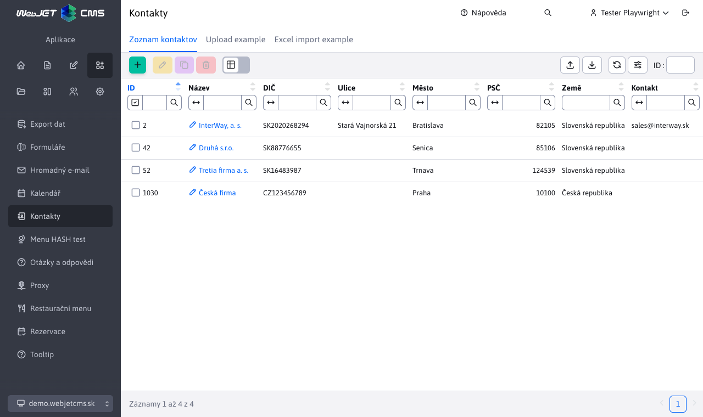
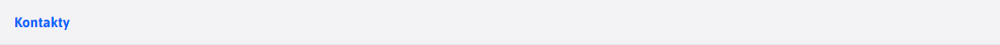
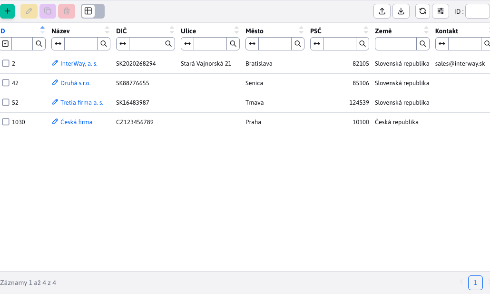

# Položka v menu admin části

Administrace je založena na [data tabulkách](../../developer/datatables/README.md) a [REST rozhraní](../../developer/datatables/restcontroller.md). Jako základ je třeba pochopit jejich fungování podle dokumentace pro [Programátora WebJET CMS](../../developer/README.md).

V této ukáže naprogramujeme správu kontaktů, využita je tabulka ```contact```, která existuje ve standardní instalaci WebJET CMS (ale typicky se nepoužívá).



## Backend

Ideální řešení využívá `Spring DATA` repozitář, REST controller a datatabulku generovanou z ```@DataTableColumn```, [anotací](../../developer/datatables-editor/datatable-columns.md).

Ukázková JPA entita is anotacemi ```@DataTableColumn```, [pro datatabulku a editor](../../developer/datatables-editor/datatable-columns.md). Také si všimněte anotace ```@EntityListeners``` pro automatické [zapisování auditu](../../developer/backend/auditing.md) při změně entity.

Povinná pole a jiné validace [nastavujete anotacemi](../../developer/datatables/restcontroller.md#validace--povinné-pole), ```@NotBlank,@Size,@Email``` atp.

!>**Upozornění:** v entitě nepoužívejte primitivní typy `int, long` ale pouze objektové `Integer, Long`, jinak nebude korektně fungovat filtrování/vyhledávání.

```java
package sk.iway.basecms.contact;

import jakarta.persistence.Column;
import jakarta.persistence.Entity;
import jakarta.persistence.EntityListeners;
import jakarta.persistence.GeneratedValue;
import jakarta.persistence.Id;
import jakarta.persistence.Table;
import jakarta.persistence.TableGenerator;
import jakarta.validation.constraints.Email;
import jakarta.validation.constraints.NotBlank;
import jakarta.validation.constraints.Size;

import lombok.Getter;
import lombok.Setter;
import sk.iway.iwcm.system.adminlog.EntityListenersType;
import sk.iway.iwcm.system.datatable.DataTableColumnType;
import sk.iway.iwcm.system.datatable.annotations.DataTableColumn;

/**
 * Ukazkova JPA entita pre pouzitie v datatabulke
 * http://docs.webjetcms.sk/v2022/#/custom-apps/admin-menu-item
 */

//nastavenie JPA entity
@Entity
@Table(name = "contact")
//automaticke generovanie getter/setter metod cez lombok
@Getter
@Setter
//nastavenie automatickeho auditovania zmien, dolezite je nastavit Adminlog.TYPE_XXX
@EntityListeners(sk.iway.iwcm.system.adminlog.AuditEntityListener.class)
@EntityListenersType(sk.iway.iwcm.Adminlog.TYPE_CLIENT_SPECIFIC)
public class ContactEntity {

    @Id
    @Column(name = "contact_id")
	@GeneratedValue(generator = "WJGen_contact")
	@TableGenerator(name = "WJGen_contact", pkColumnValue = "contact")
    @DataTableColumn(inputType = DataTableColumnType.ID)
    private Long id;

    @DataTableColumn(inputType = DataTableColumnType.OPEN_EDITOR, title="components.contact.property.name")
    @NotBlank
    private String name;

    @DataTableColumn(inputType = DataTableColumnType.TEXT, title="components.contact.property.vatid")
    private String vatid;

    @DataTableColumn(inputType = DataTableColumnType.TEXT, title="components.contact.property.street")
    private String street;

    @DataTableColumn(inputType = DataTableColumnType.TEXT, title="components.contact.property.city")
    private String city;

    @DataTableColumn(inputType = DataTableColumnType.TEXT, title="components.contact.property.zip")
    @Size(min=5, max=8)
    private String zip;

    @DataTableColumn(inputType = DataTableColumnType.SELECT, title="components.contact.property.country")
    private String country;

    @DataTableColumn(inputType = DataTableColumnType.TEXT, title="components.contact.property.contact")
    @Email
    private String contact;

    @DataTableColumn(inputType = DataTableColumnType.TEXT, title="components.contact.property.phone")
    private String phone;

}
```

Ukázkový JPA repozitář, při jeho použití vždy využívejte i ```Pageable``` objekt pro stránkování a uspořádání. Pro podporu dynamického generování vyhledávacích kritérií (v REST controlleru metoda ```addSpecSearch```) repozitář rozšiřuje i ```JpaSpecificationExecutor```.

```java
package sk.iway.basecms.contact;

import org.springframework.data.domain.Page;
import org.springframework.data.domain.Pageable;
import org.springframework.data.jpa.repository.JpaRepository;
import org.springframework.data.jpa.repository.JpaSpecificationExecutor;

/**
 * Ukazkovy Spring DATA repozitar pre pouzitie v datatabulke
 * http://docs.webjetcms.sk/v2022/#/custom-apps/admin-menu-item
 */
public interface ContactRepository extends JpaRepository<ContactEntity, Long>, JpaSpecificationExecutor<ContactEntity> {

    //citanie firiem podla zadanej krajiny pre MVC ukazku
    public Page<ContactEntity> findAllByCountry(String country, Pageable pageable);

}
```

!>**Upozornění:** všimněte si použití ```JpaSpecificationExecutor```. Ten umožňuje dynamickou tvorbu SQL příkazu pro vyhledávání/filtrování/uspořádání záznamů v datatabulce. Pokud byste jej nepoužili, tak se vyhledává ve formě [Query By Example](https://www.baeldung.com/spring-data-query-by-example) kdy **nesmíte** použít primitivní typy a inicializační hodnoty v Entitu (např. ```String text="test"```). Při vyhledávání by se pak hodnota ```test``` automaticky hledala i když není zadána. Toto řeší ```JpaSpecificationExecutor```, který hledá pouze parametry zadané ve filtru (testováním request parametrů začínajících na ```search```).

Ukázkový REST controller, vždy dávejte pozor na kontrolu práv přes anotaci ```@PreAuthorize``` a nezapomeňte i anotaci ```@Datatable``` pro korektní generování chybových odpovědí.

V metodě ```getOptions``` nastavuje možnosti pro výběrové pole země.

V metodě ```beforeSave``` lze nastavit dodatečná (needitovatelná) data před uložením entity do databáze.

```java
package sk.iway.basecms.contact;

import java.util.ArrayList;
import java.util.List;

import org.springframework.beans.factory.annotation.Autowired;
import org.springframework.security.access.prepost.PreAuthorize;
import org.springframework.web.bind.annotation.RequestMapping;
import org.springframework.web.bind.annotation.RestController;

import sk.iway.iwcm.system.datatable.Datatable;
import sk.iway.iwcm.system.datatable.DatatablePageImpl;
import sk.iway.iwcm.system.datatable.DatatableRestControllerV2;
import sk.iway.iwcm.system.datatable.json.LabelValue;

/**
 * Ukazkovy Spring REST pre pouzitie v datatabulke
 * http://docs.webjetcms.sk/v2022/#/custom-apps/admin-menu-item
 */

@RestController
//nastavenie URL adresy REST controllera
@RequestMapping("/admin/rest/apps/contact/")
//nastavenie kontroly prav na alikaciu cmp_contact (tento kluc sa definuje v modinfo.properties)
@PreAuthorize("@WebjetSecurityService.hasPermission('cmp_contact')")
@Datatable
public class ContactRestController extends DatatableRestControllerV2<ContactEntity, Long> {

    @SuppressWarnings("unused")
    private final ContactRepository contactRepository;

    @Autowired
    public ContactRestController(ContactRepository contactRepository) {
        super(contactRepository, ContactEntity.class);
        //odlozme si repozitar na pripadne specialne pouzitie
        this.contactRepository = contactRepository;
    }

    @Override
    public void getOptions(DatatablePageImpl<ContactEntity> page) {

        //pridaj zoznam pre pole country
        page.addOptions("country", getCountries(), "label", "value", false);
    }

    @Override
    public void beforeSave(ContactEntity entity) {
        //tu mozete vykonat nastavenie pred ulozenim, napr. nastavit datum poslednej zmeny
    }

    /**
     * Vrati zoznam vyberoveho pola pre krajinu
     * @return
     */
    public static List<LabelValue> getCountries() {
        //vytvor zoznam krajin, toto by sa idealne malo citat z nejakeho ciselnika
        List<LabelValue> countries = new ArrayList<>();
        countries.add(new LabelValue("Slovenská republika", "sk"));
        countries.add(new LabelValue("Česká republika", "cz"));
        countries.add(new LabelValue("Rakúsko", "at"));

        return countries;
    }
}
```

## Frontend

Jak je zmíněno výše pro frontend se využívají datatabulky. Administrace je zkompilována z pug souborů do html a následně zobrazena.

Pro snadné vytvoření nové stránky v administraci jsme zavedli před připravenou šablonu rozložení stránky. Vy doplníte jen střední část stránky (šablona zajistí generování hlavičky a menu). [Mapování URL adres](../../src/main/java/sk/iway/iwcm/admin/ThymeleafAdminController.java) je připraveno jako ```/apps/{app}/admin/``` nebo ```/apps/{app}/admin/{subpage}```.

Stačí připravit soubor ```/apps/{app}/admin/index.html``` nebo ```/apps/{app}/admin/{subpage}.html``` kde ```{app}``` je jméno adresáře ve kterém je aplikace (bez diakritiky a mezer) a ```{subpage}``` je případné jméno souboru bez přípony (pokud se nejedná o jméno index.html).

Příkladem je aplikace ```src/main/webapp/apps/contact/admin/index.html``` volaná přes URL adresu ```/apps/contact/admin/```:

```html
<script>
    var dataTable;

    window.domReady.add(function () {

        WJ.breadcrumb({
            id: "contact",
            tabs: [
                {
                    url: '/apps/contact/admin/',
                    title: '[[#{components.contact.title}]]',
                    active: true
                }
            ]
        })

        //URL adresa REST rozhrania
        let url = "/admin/rest/apps/contact";
        //package a meno triedy s JPA entitou
        let columns = [(${layout.getDataTableColumns("sk.iway.basecms.contact.ContactEntity")})];

        dataTable = WJ.DataTable({
            url: url,
            serverSide: true,
            columns: columns,
            //id musi byt zhodne s tagom table nizsie
            id: "dataTable",
            fetchOnEdit: true,
            fetchOnCreate: true
        });
    });

</script>

<table id="dataTable" class="datatableInit table"></table>
```

Pomocí funkce [WJ.breadcrumb](../../developer/frameworks/webjetjs.md#navigační-lišta) je vygenerována navigační lišta.



Funkce [WJ.DataTable](../../developer/datatables/README.md#možnosti-konfigurace) inicializuje ve stránce datatabulku do HTML tabulky s ```id=dataTable```. Upozorňujeme na volání ```window.domReady.add```, které je třeba používat místo ```$(document).ready``` - volání čeká na inicializaci [překladových klíčů](../../developer/libraries/translator.md) a teprve po jejich získání je vyvolána zadaná funkce.



Pro zobrazení položky v menu a zobrazení práva pro uživatele je ještě třeba vytvořit konfigurační soubor ```modinfo.properties```, ten umístěte do ```/apps/MENO_APLIKACIE/```, pro náš případ ```src/main/webapp/apps/contact/modinfo.properties```:

```sh
#prekladovy kluc menu polozky
leftMenuNameKey=components.contact.title
#pouzivatelske pravo
itemKey=cmp_contact
#ak je true, je mozne pravo nastavovat
userItem=true
#linka v menu
leftMenuLink=/apps/contact/admin/
#Tabler icon name without the "ti ti-" prefix
icon=address-book
#Disable the new permission for existing administrators on its first initialization
defaultDisabled=true
#Custom module flag; it does not change the order in the current administration menu
custom=true

#submenu
#leftSubmenu1NameKey=components.contact.subpage.title
#leftSubmenu1Link=/apps/contact/admin/subpage/
```

Pokud máte stránky typu ```master-detail```, která není definována v ```modinfo.properties```, nemusí se korektně zobrazit levé menu, protože neví jakou položku má zvýraznit. Nejjednodušší řešení je takovou stránku pojmenovat ```meno-details.html``` (jako je např. URL adresa ```/apps/stat/admin/top-details/?docId=35267&dateRange=``` v souboru ```/apps/stat/admin/top-details.html```). Výraz ```-details``` nebo ```-detail``` se při hledání položky pro zvýraznění v menu odstraní a zvýrazní se tak hlavní (```master```) stránka.

Pokud takové použití není vhodné můžete využít ve vaší stránce JavaScript funkci ```WJ.selectMenuItem(href)``` pro zvýraznění zadané menu položky. V parametru ```href``` zadáte přímo URL adresu stránky v menu, kterou chcete zvýraznit:

```JavaScript
window.domReady.add(function () {
    WJ.selectMenuItem("/admin/v9/apps/gallery/");
});
```

V případě staré JSP komponenty funkci volejte pomocí ```setTimeout``` aby se provedla až po zobrazení stránky.

### Přiložení JavaScript souboru

Pokud potřebujete k aplikaci připojit JavaScript modul WebJET automaticky hledá soubor ```/apps/{app}/admin/{app}.js``` a existuje-li vloží jej do hlavičky HTML kódu jako modul, přičemž jej importuje jako objekt ```appModule```:

```html
<script type="module">
        import * as appModule from "[[${appIncludePathJs}]]";
        window.appModule = appModule;
</script>
```

Například v aplikaci stat by existoval soubor ```/apps/stat/admin/stat.js```:

```javascript
export const ChartType = {
    Bar: "bar"
    ...
}

export class ChartForm {
    constructor(chartType, yAxeName, xAxeName, chartTitle) {
        this.chartType = chartType;
        ...
    }
}

export async function setAmchart(chartForm) {
    ...
}
```

který se následně v JavaScript/HTML kódu jmenuje jako ```appModule.ChartType.Bar``` atp.

## Automatizovaný test

Pro datatabulku je připraven [základní automatizovaný test](../../developer/testing/datatable.md), který stačí nakonfigurovat. Vytvořte nový testovací scénář v ```src/test/webapp/tests/apps/contact.js``` s alespoň základním testem:

```javascript
Feature('contact');

Before(({ I, login }) => {
    login('admin');
    I.amOnPage("/apps/contact/admin/");
});

Scenario('contact-zakladne testy', async ({ I, DataTables, DTE }) => {
    await DataTables.baseTest({
         dataTable: 'dataTable',
         //meno prava na kontrolu podla modinfo.properties
         perms: 'cmp_contact',
         createSteps: function(I, options) {
            //toto pole musime vyplnit rucne, kedze ma specialnu validaciu
            DTE.fillField("zip", "85106");
         }
    });
});
```

## Reference souboru modinfo.properties

Soubor `modinfo.properties` registruje modul, jeho položky v administračním menu, uživatelská práva a doplňkové aplikace pro vkládání do stránky. Načítá ho třída `sk.iway.iwcm.system.Modules`, zobrazení menu zabezpečuje `MenuService` a seznam aplikací v AppStore připravuje `AppManager`.

### Umístění a načítání

Soubor umístěte do `/components/MENO_APLIKACIE/` nebo `/apps/MENO_APLIKACIE/`. `Modules` prochází pouze bezprostřední podadresáře těchto dvou složek. V každém načte `modinfo.properties` a případné `modinfo1.properties` až `modinfo29.properties`. Číslování nemusí být souvislé.

Každý soubor představuje samostatnou definici modulu. Číslované soubory nepřebírají nastavení ze základního souboru, proto jim zadejte vlastní `itemKey`. Shodný identifikátor zpravidla nahradí dřívější definici. Výjimkou je automaticky vytvořený modul z `/apps/` bez vlastního odkazu, který nepřepíše již načtený modul.

Základní modul vznikne také pro složku bez souboru `modinfo.properties`. Automaticky dostane identifikátor `cmp_MENO_APLIKACIE`, cestu ke složce a překladový klíč `components.MENO_APLIKACIE.title`, případně `apps.MENO_APLIKACIE.title`. Samotná existence složky však nevytvoří položku v levém menu ani nastavitelné uživatelské právo.

Hodnoty `true` a `false` zapisujte malými písmeny bez koncových mezer. Parser u některých atributů porovnává přesný řetězec. Výchozí kódování je `ISO-8859-1`, pro soubor v UTF-8 přidejte na začátek direktivu `#encoding=utf-8`.

Definice se uchovávají v paměti. Po změně souboru je třeba opětovné načtení modulů, například restartem WebJET CMS. AppStore má také vlastní vyrovnávací paměť seznamu aplikací podle jazyka.

### Kompletní příklad

Příklad pro `/components/example/modinfo.properties` obsahuje všechny atributy, které `Modules` čte, včetně aliasu `custom` a starších příznaků. Silnice, překladové klíče a názvy práv jsou ukázkové. Před použitím upravte nebo vynechejte omezení `installName`, `requireConstantsKey` a `domainName`. V tomto příkladu musí být konfigurační proměnná `exampleEnabled` nastavena například na `true`.

```properties
#encoding=utf-8

#Module identity and administration menu
leftMenuNameKey=components.example.title
itemKey=cmp_example
leftMenuLink=/apps/example/admin/
group=components
icon=address-book
menuOrder=120

#Permissions and availability
userItem=true
defaultDisabled=true
requireConstantsKey=exampleEnabled
installName=customer,customer-test
domainName=www.example.sk,www.example.cz

#AppStore registration and custom module flag
app=true
isCustom=true
#Alias used only when isCustom is missing or empty
custom=true

#Legacy flags - see the reference below
showSubcategories=false
hideSubmenu=false

#Submenu with its own permission
leftSubmenu1NameKey=components.example.records.title
leftSubmenu1Link=/apps/example/admin/records/
leftSubmenu1ItemKey=cmp_example_records
leftSubmenu1UserItem=true
leftSubmenu1DefaultDisabled=false
leftSubmenu1Icon=list

#Standalone permission without a visible menu link
leftSubmenu2NameKey=components.example.export.title
leftSubmenu2Link=javascript:void();
leftSubmenu2ItemKey=cmp_example_export
leftSubmenu2UserItem=true
leftSubmenu2DefaultDisabled=true
leftSubmenu2Icon=download

#Additional application in the page editor
component1NameKey=components.example.card.title
component1Link=/components/example/editor_card.jsp
component1Icon=/components/example/editoricon.png
```

### Identifikace a menu

- `leftMenuNameKey` - ​​překladový klíč názvu modulu v menu a v aktuálním stromu práv. Pokud chybí, použije se `components.MENO_APLIKACIE.title` nebo `apps.MENO_APLIKACIE.title` podle složky. Nemění interní `nameKey`, které používá běžná JSP aplikace v AppStore.
- `itemKey` - ​​jednoznačný identifikátor modulu a zároveň název práva, například `cmp_contact`. Výchozí hodnota je `cmp_MENO_APLIKACIE`. Stejný identifikátor použijte při kontrole práv v REST controlleru, JSP nebo Java kódu. Pro samostatně nastavitelné právo používejte klíč s alespoň třemi znaky.
- `leftMenuLink` - ​​URL adresa nebo JavaScript akce hlavní položky menu. Neprázdná hodnota zároveň zapne zobrazování modulu v levém menu; prázdná nebo vynechaná hodnota jej nezapne. Příklad: `/apps/contact/admin/`. Odkaz `javascript:void();` může sloužit jako kontejner podpoložek.
- `group` - ​​sekce administračního menu a stromu práv. Výchozí hodnota je `components`. Aktuální menu zná hodnoty `welcome`, `website`, `news`, `components`, `files`, `templates`, `users`, `config` ; nová hodnota sama nevytvoří novou sekci. Pro některé standardní moduly má přednost mapování v `MenuService`. Tento atribut neurčuje kategorii aplikace v AppStore.
- `icon` - ​​název Tabler ikony bez prefixu `ti ti-`, například `address-book`. `MenuService` prefix doplní při tvorbě menu a stromu práv. Ve výchozím nastavení je hodnota prázdná; pro standardní moduly může mít přednost interní mapování ikon. Ikonu karty v AppStore nastavuje jiný mechanismus, popsaný níže.
- `menuOrder` - ​​celé číslo pro vzestupné řazení modulů, ve výchozím nastavení `1000`. Neplatná neprázdná hodnota se převede na `0` ; při shodě se porovná interní `nameKey`. V aktuálním menu mají některé standardní moduly pevně mapované pořadí a sekce `components` se následně seřadí podle přeložených názvů. V této sekci proto `menuOrder` neurčuje konečné pořadí. Neurčuje ani pořadí karet v AppStore.

### Práva a dostupnost

- `userItem` - ​​při `true` zpřístupní právo modulu na nastavování v právech uživatelů a skupin práv. Výchozí hodnota je `false`. Samotný příznak právo uživateli neuděluje a hodnota `false` neznamená zákaz aplikace.
- `defaultDisabled` - ​​ve výchozím nastavení `false`. Při `true` inicializace nově zjištěného práva jednorázově přidá zákaz stávajícím administrátorům. `UpdateDatabase` provedení zaznamená pod označením `NEW MODULE: itemKey`. Právo pak lze povolit v nastavení uživatele nebo přes skupinu práv. Nejedná se o trvalé vypnutí modulu ani o výchozí nastavení pro každého budoucího uživatele. Změna zpět na `false` již zapsané zákazy neodstraní.
- `requireConstantsKey` - ​​název jedné konfigurační proměnné, na které závisí dostupnost modulu. Její hodnota v `Constants` musí být neprázdná a odlišná od přesného řetězce `false`. Například `requireConstantsKey=exampleEnabled` kontroluje proměnnou `exampleEnabled`, nenastavuje ji. Prázdný nebo vynechaný atribut tuto podmínku vypne.
- `installName` - ​​omezí načtení celé definice na konkrétní instalace podle `Constants.getInstallName()`. Více hodnot oddělte čárkou bez mezer, například `customer,customer-test`. Porovnání rozlišuje velká a malá písmena. Při neshodě se definice včetně pod položek přeskočí. Prázdná nebo vynechaná hodnota načtení neomezuje.
- `domainName` - ​​omezení zobrazení podle aktuální domény, například `www.example.sk,www.example.cz`. Prázdná nebo vynechaná hodnota zobrazení neomezuje. Používá se při tvorbě aktuálního administračního menu a při filtrování aplikací v `appstore.jsp`. Přesné porovnávání a omezení přenosu do AppStore jsou popsány v části [AppStore a filtrování podle domény](#appstore-a-filtrování-dle-domény).

Práva se nastavují ve stromu práv uživatele nebo skupiny práv; jeho tvorbu popisuje dokumentace [seznamu uživatelů](../../developer/apps/users/README.md). WebJET CMS ukládá uživatelské zákazy, přičemž povolení přes skupinu práv má přednost před uživatelským zákazem. Dostupnost modulu podle licence a konfigurace se kontroluje zvlášť, takže uživatelské povolení nezpřístupní nedostupný modul.

Definice v `modinfo.properties` nenahrazuje kontrolu práv v aplikačním kódu. Administrační Thymeleaf controller kontroluje právo odvozené z URL položky menu, ale REST rozhraní chraňte samostatně, například anotací `@PreAuthorize("@WebjetSecurityService.hasPermission('cmp_contact')")` z ukázky výše.

### Podpoložky menu a samostatná práva

Namísto `N` použijte číslo **1 až 24**. Čísla mohou být vynechána. Podpoložka se vytvoří pouze tehdy, jsou-li oba atributy `leftSubmenuNNameKey` a `leftSubmenuNLink` neprázdné.

- `leftSubmenuNNameKey` - ​​překladový klíč názvu podpoložky v menu nebo názvu samostatného práva.
- `leftSubmenuNLink` - ​​URL adresa nebo JavaScript akce podpoložky. Hodnota `javascript:void();` umožňuje zaregistrovat právo bez viditelného odkazu v menu; i při takovém právu musí být atribut vyplněn.
- `leftSubmenuNItemKey` - ​​vlastní identifikátor práva podpoložky. Bez něj se při zobrazení a kontrole URL použije právo nadřazeného modulu. Při zadání se kontroluje toto právo samostatně, nadřazené právo se k němu automaticky nepřidává jako další podmínka.
- `leftSubmenuNUserItem` - ​​u `true` zobrazí podpoložku jako samostatně nastavitelné právo. Ve výchozím nastavení `false`, nezávisle na rodičovském `userItem`. Pro samostatné právo nastavte i vlastní `leftSubmenuNItemKey` s alespoň třemi znaky.
- `leftSubmenuNDefaultDisabled` - ​​stejné jednorázové zakázání jako u `defaultDisabled`, ale pro právo podpoložky. Pokud chybí, přebírá hodnotu rodičovského `defaultDisabled`. Výslovné `false` toto dědění vypne, `true` zapne zakázání bez ohledu na rodiče.
- `leftSubmenuNIcon` - ​​název Tabler ikony bez prefixu `ti ti-`. Aktuálně se používá ve stromu práv; třetí úroveň levého menu tuto ikonu nevykresluje. Ve výchozím nastavení není nastavena.

Pokud má uživatel povolenou podpoložku s vlastním právem, může se mu zobrazit i při zakázaném právě nadřazeného modulu. Rodič zůstane v menu jako kontejner a jeho odkaz se změní na první povolenou podpoložku.

Pro podmínění odkazu existujícími právy lze použít `leftSubmenuNItemKey=pravoA&pravoB` pro současné splnění obou práv nebo `leftSubmenuNItemKey=pravoA|pravoB` pro splnění alespoň jednoho. Taková podpoložka zpravidla nemá `leftSubmenuNUserItem=true`, protože nedefinuje nové samostatné právo. V jednom výrazu nekombinujte oba operátory; `WebjetSecurityService.hasPermission` takový zápis odmítá.

### AppStore a doplňkové aplikace

- `app` - ​​ve výchozím nastavení `true`. Hodnota `false` vyřadí tuto definici modulu z tvorby aplikací v `AppManager`, včetně jejích položek `componentN...`. Menu ani uživatelská práva tím nevypne. Používá se například při dalším `modinfo2.properties`, který přidává administrační obrazovku do již existujícího modulu.
- `componentNNameKey` - ​​překladový klíč názvu doplňkové aplikace v editoru stránky.
- `componentNLink` - ​​odkaz na editor doplňkové aplikace, předaný jako akce při výběru aplikace. V `appstore.jsp` se cesta začínající `/` otevře přímo; při jednoduchém názvu se sestaví `/components/NAZOV/editor_component.jsp`. Při instalaci s názvem `cloud` má `AppManager` zvláštní zpracování starších cest obsahujících `cloud/`.
- `componentNIcon` - ​​obrázek doplňkové aplikace, například `/components/example/editoricon.png`. `appstore.jsp` podporuje také celý zápis tříd Tabler ikony, například `ti ti-address-book`. Na rozdíl od `icon` se zde prefix automaticky nedoplňuje. Atribut je při načtení volitelný, pro vykreslení karty jej však vyplňte; existence souboru se u této větve registrace nekontroluje.

Pro `componentN...` použijte čísla **1 až 14**, opět is mezerami v číslování. Záznam vznikne pouze u neprázdných `componentNNameKey` a `componentNLink`. Tyto položky vytvářejí další aplikace pro vkládání do stránky, ne další odkazy v administračním menu. Právo nadřazeného modulu převezmou pouze u `userItem=true` ; jinak obdrží prázdný identifikátor práva.

Pro běžnou JSP aplikaci `AppManager` hledá ve složce modulu `editor_component.jsp` a `editoricon.png`, případně `editoricon.gif`. Základní karta vyžaduje editor a alespoň jeden z těchto obrázků. Pokud editor existuje, ale chybí oba obrázky, přeskočí se celý modul včetně jeho položek `componentN...`. Její název vychází z automatického `nameKey`, ne z `leftMenuNameKey`. Seznam se doplňuje také ze zákaznických složek a anotací `@WebjetAppStore`, které mají vlastní nastavení; samotné `app=true` proto není úplnou definicí karty a `app=false` nevypíná samostatnou registraci přes anotaci.

#### AppStore a filtrování podle domény

`appstore.jsp` získává seznam přes `AppManager.getAppsList(request, true)`. Seznam již respektuje práva přihlášeného uživatele a vynechává aplikace označené `hideInAppstore`. Doménu filtruje až JSP, protože společný seznam aplikací je uložen ve vyrovnávací paměti podle jazyka.

Aktuální doména se získá přes `DocDB.getDomain(request)` a převede na malá písmena. Při neprázdném `domainName` se testuje, zda jeho hodnota **obsahuje aktuální doménu jako podřetězec**. Stejný způsob porovnávání používá `Modules.filterDomain()` pro administrační menu. Hodnoty proto zapisujte malými písmeny, bez protokolu a cesty. Čárka slouží pouze jako praktický oddělovač: filtr nerozděluje hodnotu na přesné názvy domén a nepodporuje masky ani regulární výrazy. Například `domainName=www.example.sk` vyhoví i aktuální doméně `example.sk`, protože ji obsahuje.

Při tvorbě základní JSP aplikace se `domainName` přenese z modulu do `AppBean`. U doplňkových položek `componentN...` se **nepřenáší**, takže u nich nelze očekávat filtrování podle rodičovského `domainName`. Omezení zobrazení zároveň nenahrazuje kontrolu oprávnění ani oddělení dat podle domén.

Anotace `@WebjetAppStore` se stejnou neprázdnou `itemKey` a stejnou variantou může nahradit již vytvořenou kartu. Nová karta použije `domainName` z anotace; omezení ze souboru `modinfo.properties` nepřebírá. Pokud tedy aplikace používá anotaci, nastavte požadované domény iv ní.

`appstore.jsp` navíc vynechává položky s názvy `components.user.title` a `components.form.title`. Zvýrazněné aplikace vybírá konfigurační proměnná `appstorePromo`. Tato pravidla nejsou atributy souboru `modinfo.properties`.

### Zákaznické a starší příznaky

- `isCustom` - ​​označení zákaznického modulu, ve výchozím nastavení `false`. V aktuálním `MenuService` se příznak nepřenáší do položky menu a `AppManager` jej z `ModuleInfo` nekopíruje do aplikace. Samotné nastavení proto nemění pořadí ani zařazení mezi zákaznické aplikace v těchto rozhraních.
- `custom` - ​​alias pro `isCustom`, použitý pouze tehdy, když `isCustom` chybí nebo je prázdné. Například `isCustom=false` má přednost před `custom=true`. V běžném souboru stačí použít jeden z těchto atributů.
- `showSubcategories` - ​​starší příznak určený pro výběr skupin nebo kategorií v právech modulu, ve výchozím nastavení `false`. `Modules` jej stále načítá, ale aktuální menu a strom práv WebJET 9 jej nepoužívají. Nezapíná zobrazení položek `leftSubmenuN...`. Název atributu obsahuje malé `c` v části `categories`.
- `hideSubmenu` - ​​ve výchozím nastavení `false`. Skrytí podpoložek používá starý soubor `admin/skins/webjet8/layout_sidebar.jsp` ; aktuální menu WebJET 9 tento příznak nevyhodnocuje. K vytvoření samostatného práva bez navigačního odkazu použijte `leftSubmenuNLink=javascript:void();`.
- `#encoding=utf-8` - ​​direktiva `IwayProperties` pro kódování souboru. Není to atribut modulu, navzdory úvodnímu `#` má na načtení souboru vliv.

### Speciality ve stávajících souborech

- `components/file_archiv/modinfo.properties` definuje i práva bez odkazu v menu pomocí `javascript:void();`, například `menuFileArchivExportFiles`.
- `components/adminlog/modinfo.properties` používá kombinaci práv `cmp_adminlog&menuWebpages` ; `components/stat/modinfo.properties` používá `users.edit_admins|users.edit_public_users`.

Vlastnosti objektu `ModuleInfo` nejsou automaticky platnými atributy souboru. `Modules` ze souboru nečte například `nameKey`, `path`, `wjVersions`, `showInLeftMenu` ani `hideInAppstore`. Cestu a základní překladový klíč odvozuje ze složky, zobrazování v menu zapíná přes `leftMenuLink`.
