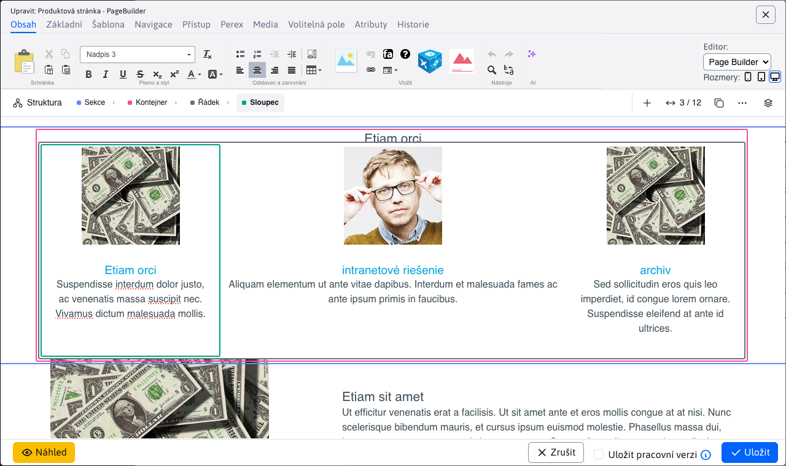

# Page Builder

Page Builder je speciální režim editace stránek. V tomto režimu není editována celá stránka ale jen její vybrané části.

Viz manuál pro [web designéra](../../../frontend/page-builder/README.md), nebo pro [redaktora](../../../redactor/webpages/pagebuilder.md).



## Implementační detaily

Režim je aktivován nastavením atributu ```editingMode=pagebuilder``` na objektu [DocEditorFields](../../../../javadoc/cs/iway/iwcm/doc/DocEditorFields.html). V atributu ```editingModeLink``` je odkaz, který se načte do iframe. Nastavuje je metoda ```setEditingMode```.

Tento odkaz obsahuje URL parametr ```inlineEditorAdmin=true```, podle něj můžete v kódu najít místa implementující funkci Page Builder. Když je tento parametr zadán, neprovede se přesměrování stránky (pokud má stránka nastaven atribut ```externalLink```).

Technicky je karta Obsah v editoru složena ze dvou ```div``` elementů, jeden obsahuje standardní CK Editor a jeden iframe pro Page Builder. Kód vzniká v ```field-type-wysiwyg.js```. Kromě toho je zobrazeno výběrové pole, které zajišťuje funkci přepínání mezi editory (zajišťuje funkce ```switchEditingMode```).

## Ukládání neúplného HTML

Export HTML zajišťuje metoda `getSaveNode` v `admin/webpages/page-builder/scripts/ninja-page-builder.js.jsp`. Obsah editovatelné oblasti získává z CK Editoru pouze tehdy, pokud instance uvedená v atributu `data-ckeditor-instance` patří danému elementu. Pokud instance neexistuje nebo patří jinému elementu, zachová HTML oblasti z kopie aktuálního DOM. Z výsledku odstraní dočasné ovládací prvky a atributy editoru včetně neplatných odkazů na instance.

Stránku tak lze uložit i tehdy, obsahuje-li například nadpis přímo v kontejneru bez řádku a sloupce nebo atributy ze starší relace editoru. Export chybějící obalovače nedoplňuje. Pro plné ovládání bloku v Page Builderu je třeba opravit jeho [HTML strukturu](../../../frontend/page-builder/blocks.md). Stejný export se používá při přepnutí do HTML editoru a při kopírování bloků.

## Nová stránka

Page Builder se otevírá v iframu jako zobrazená web stránka, což komplikuje zobrazení pro novou web stránku. V takovém případě se otevře hlavní stránka adresáře, přičemž samozřejmě se nastaví prázdná data. Po uložení již vznikne korektně nová web stránka, která lze editovat. Nastavení URL adresy pro hlavní stránku se děje v [DocEditorFields.setEditingMode](../../../../javadoc/cs/iway/iwcm/doc/DocEditorFields.html).

## Optimalizace rychlosti načítání

Při inicializaci Page Builder je CK Editor přepnut do režimu HTML kódu, aby se zbytečně nečetly obrázky, CSS styly atd. pro editor, který není zobrazen. Naopak, při standardním režimu je iframe pro Page Builder nastaven na URL adresu ```about: blank```.

Vkládané objekty do stránky jsou v ```ShowDoc.fixDataForInlineEditingAdmin``` nastaveny na prázdné hodnoty, aby se zbytečně nenačítala hlavička, patička, menu atp. Standardně Page Builder získá HTML kód pomocí AJAX volání ```/admin/inline/get_page.jsp```, abychom jedno volání ušetřili je hodnota pro ```doc_data``` atribut přenesená v ```inline_page_toolbar.jsp``` přes JSON objekt ```window.inlineEditorDocData```, který pokud existuje použije se místo AJAX získání dat.
