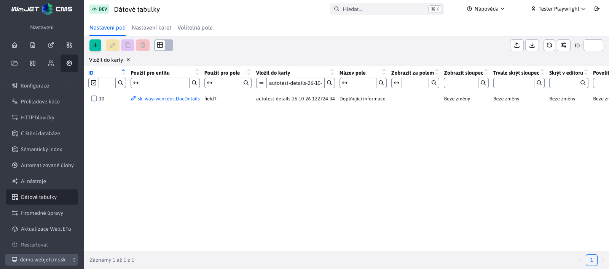
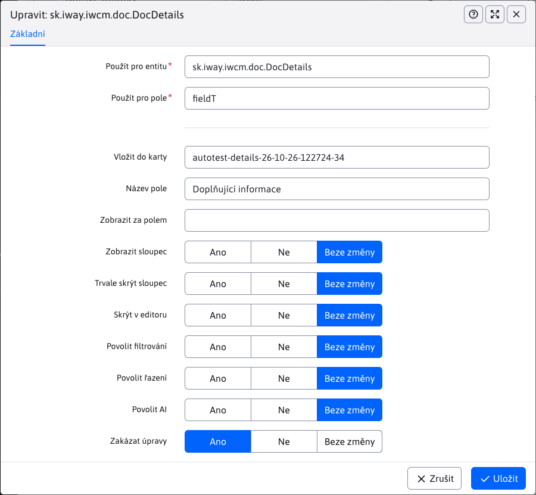

# Nastavení polí

Na kartě **Nastavení → Datové tabulky → Nastavení polí** přizpůsobíte názvy, pořadí a zobrazení polí v editoru i sloupců v tabulce. Nastavení se vztahuje na všechny záznamy vybrané entity v aktuálně zvolené doméně. Pro přístup potřebujete oprávnění **Datové tabulky** (`dataTablesConfig`).

## Výběr pole

Při vytváření nastavení nejprve v poli **Použít pro entitu** vyberte třídu entity, například `sk.iway.iwcm.doc.DocDetails` pro webové stránky. Potom v poli **Použít pro pole** vyberte vlastnost, kterou chcete upravit, například `title` pro název stránky.

Obě pole podporují automatické doplňování po zadání alespoň jednoho znaku. V návrzích polí a karet se zobrazuje název i technický identifikátor; uloží se identifikátor. Zadáním `*` nebo `%` zobrazíte všechny dostupné možnosti. Nabídka polí a karet závisí na vybrané entity.

## Umístění a název

| Pole | Význam |
| --- | --- |
| **Vložit do karty** | Identifikátor existující karty, do které se pole přesune. `basic`. Nabídka zahrnuje také vlastní karty vytvořené v [Nastavení karet](tabs-settings.md). |
| **Název pole** | Nový název pole v editoru i sloupce v tabulce. Můžete zadat text nebo překladový klíč. |
| **Zobrazit za polem** | Identifikátor pole, za které se upravované pole zařadí. `navbar`. Vyberte pole v cílové kartě. |

Pokud některá z těchto polí ponecháte prázdná, použije se původní hodnota z definice entity. Novou kartu nejprve vytvořte v [Nastavení karet](tabs-settings.md), teprve potom na ni přesouvejte pole.

## Zobrazení a chování

Přepínače mají tři hodnoty: **Ano**, **Ne** a **Bez změny**. Hodnota **Bez změny** ponechá původní nastavení pole; neznamená automaticky **Ne**.

| Nastavení | Význam hodnoty **Ano** |
| --- | --- |
| **Zobrazit sloupec** | Ve výchozím nastavení se sloupec zobrazí v tabulce. Při hodnotě **Ne** jej může uživatel zapnout ve výběru sloupců. |
| **Trvalo skrýt sloupec** | Sloupec se nezobrazí ani ve výběru sloupců. Tato volba má přednost před nastavením **Zobrazit sloupec**. |
| **Skrýt v editoru** | Pole se nezobrazí v dialogu úpravy záznamu. Zobrazení sloupce v tabulce se nastavuje samostatně. |
| **Povolit filtrování** | Povolí filtr pro daný sloupec. |
| **Povolit řazení** | Povolí seřazení tabulky podle daného sloupce. |
| **Povolit AI** | Povolí použití funkcí AI pro pole, jsou-li pro něj dostupné. |
| **Zakázat úpravy** | Pole je v editoru pouze ke čtení. |

Zobrazení sloupců může ovlivnit i uložené uživatelské nastavení tabulky. Pokud se změna neprojeví, obnovte nastavení tabulky.

## Příklad úpravy názvu stránky

Chcete-li přejmenovat pole s názvem stránky a upravit jeho umístění:

1. Pro entitu `sk.iway.iwcm.doc.DocDetails` vyberte pole `title`.
2. Do pole **Název pole** zadejte například `Názov webovej stránky`.
3. Pole **Vložit do karty** nastavte na `basic` a **Zobrazit za polem** na `navbar`.
4. Ostatní přepínače ponechte na hodnotě **Bez změny**.
5. Uložte nastavení, znovu načtěte seznam webových stránek a otevřete editor.

Typ, povinnost vyplnění, nápovědu a možnosti volitelných polí `fieldA` až `fieldZ` nastavíte na kartě [Volitelná pole](custom-fields-settings.md). K jejich přesunu na jinou kartu použijte **Nastavení polí**.

## Validace a zrušení nastavení

Pro kombinaci entity a pole může v jedné doméně existovat pouze jeden záznam. Pole i cílová karta musí existovat pro vybranou entitu. Pole nelze zařadit za sebe sama ani za neexistující pole.

Po uložení nastavení znovu načtěte příslušnou stránku administrace. Odstraněním záznamu z nastavení se obnoví původní definice pole. Uložené hodnoty záznamů se tím neodstraní.
