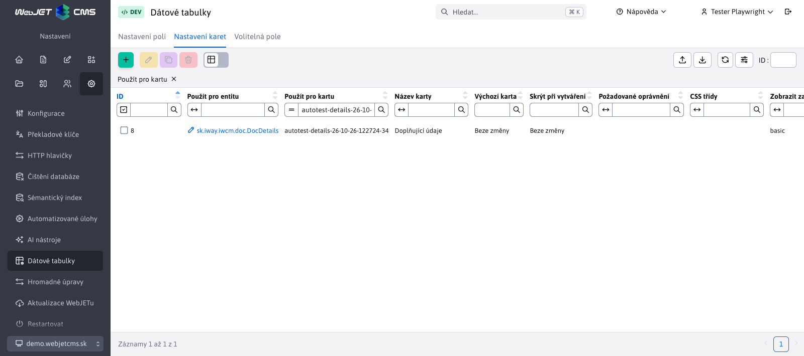
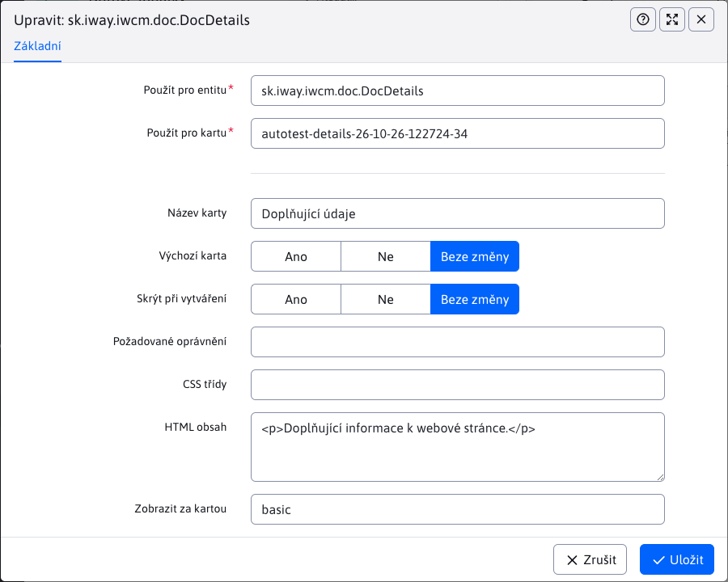

# Nastavení karet

Na kartě **Nastavení → Datové tabulky → Nastavení karet** upravíte členění editoru: přejmenujete a seřadíte karty, nastavíte výchozí kartu nebo přidáte vlastní kartu. Nastavení platí pro všechny záznamy vybrané entity v aktuálně zvolené doméně. Pro přístup potřebujete oprávnění **Datové tabulky** (`dataTablesConfig`).

## Výběr nebo vytvoření karty

Nejprve v poli **Použít pro entitu** vyberte třídu entity, například `sk.iway.iwcm.doc.DocDetails` pro webové stránky. V poli **Použít pro kartu** vyberte identifikátor existující karty, například `basic`, nebo zadejte nový identifikátor, například `details`. Výběrem existujícího identifikátoru upravíte danou kartu, zadáním nového vytvoříte vlastní kartu.

Automatické doplňování nabízí entity a karty po zadání alespoň jednoho znaku. Zadáním `*` nebo `%` zobrazíte všechny dostupné možnosti. U každé karty se zobrazuje název i identifikátor. Do nastavení se uloží identifikátor.

## Nastavení

| Pole | Význam |
| --- | --- |
| **Název karty** | Zobrazený název nebo překladový klíč. U nové karty bez názvu se použije její identifikátor. |
| **Výchozí karta** | Hodnota **Ano** vybere kartu při otevření editoru. |
| **Skrýt při vytváření** | Hodnota **Ano** skryje kartu při vytváření nového záznamu; při úpravě existujícího záznamu zůstane dostupná. |
| **Požadované oprávnění** | Kód oprávnění, které uživatel potřebuje k zobrazení karty. |
| **CSS třídy** | CSS třídy pro úpravu vzhledu karty. |
| **HTML obsah** | Doplňkový obsah karty, například. vysvětlující text. Samotná pole se do karty přiřazují přes [Nastavení polí](fields-settings.md). |
| **Zobrazit za kartou** | Identifikátor karty, za kterou se tato karta zařadí. Hodnota `FIRST` ji zařadí na začátek. |

Přepínače **Výchozí karta** a **Skrýt při vytváření** nabízejí hodnoty **Ano**, **Ne** a **Bez změny**. Hodnota **Bez změny** zachová původní chování. Pokud textové pole ponecháte prázdné, zachová se původní hodnota stávající karty.

Jako výchozí doporučujeme označit pouze jednu kartu. Pokud jich označíte více, editor vybere první z nich ve výsledném pořadí. Pokud se výchozí karta při vytváření záznamu nezobrazuje, editor vybere dostupnou kartu.

## Vlastní karta s volitelnými poli

1. V **Nastavení karet** vytvořte záznam pro `sk.iway.iwcm.doc.DocDetails` s identifikátorem `details` a názvem `Doplňujúce údaje`. Pole **Zobrazit za kartou** nastavte na `basic`.
2. Na kartě [Volitelná pole](custom-fields-settings.md) nastavte pro stejnou entitu pole **A** a **B**: jejich typ, popis a povinnost vyplnění.
3. V [Nastavení polí](fields-settings.md) vytvořte pro každé z polí `fieldA` a `fieldB` samostatný záznam. V obou nastavte **Vložit do karty** na `details`. V poli `fieldB` můžete nastavit **Zobrazit za polem** na `fieldA`.
4. Znovu načtěte seznam webových stránek a otevřete editor. Pole se zobrazí na kartě **Doplňující údaje**. Zachovají si typ, možnosti i povinnost vyplnění z nastavení volitelných polí.

## Validace a zrušení nastavení

Kombinace entity a identifikátoru karty musí být v jedné doméně jedinečná. Kartu nelze zařadit za sebe samu. V poli **Zobrazit za kartou** můžete vybrat existující kartu dané entity nebo zadat `FIRST`.

Odstraněním nastavení původní karty se obnoví její původní definice. Při rušení vlastní karty nejprve přesuňte její pole na jinou kartu nebo odstraňte jejich nastavení přesunu. Teprve poté odstraňte kartu. Změnu ověřte po opětovném načtení stránky administrace.
