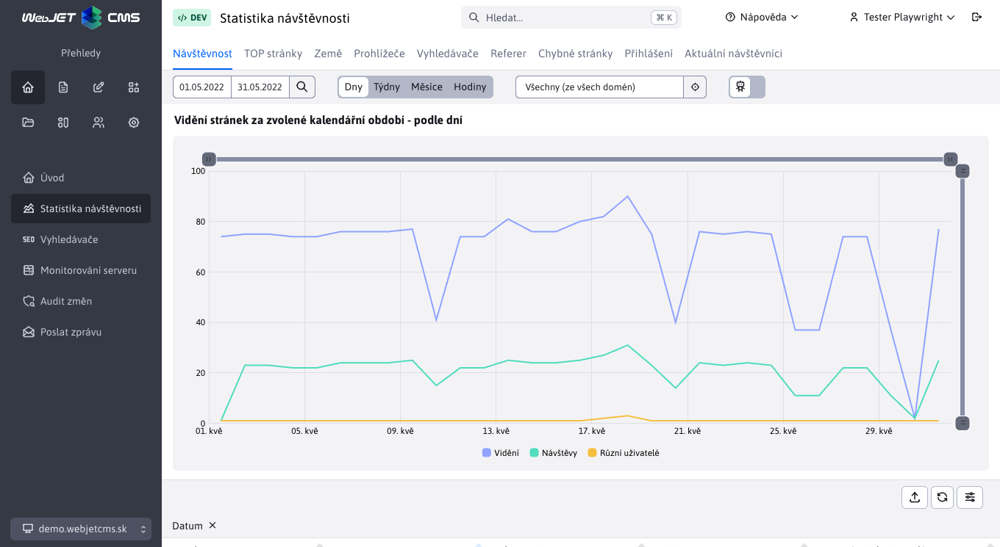
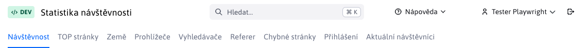
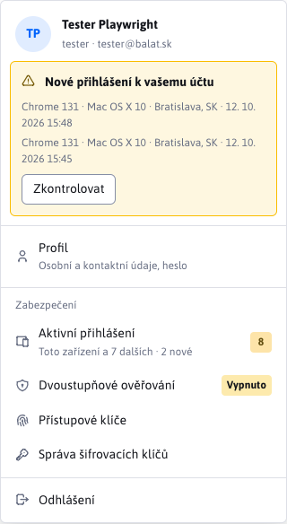
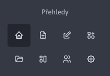
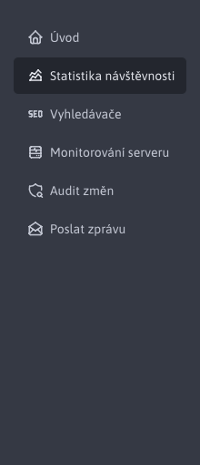
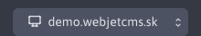
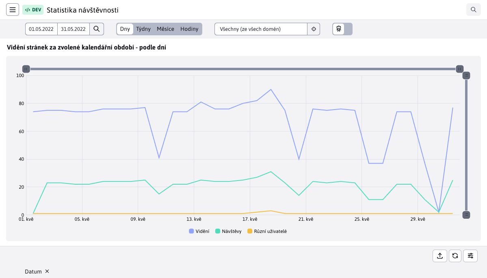
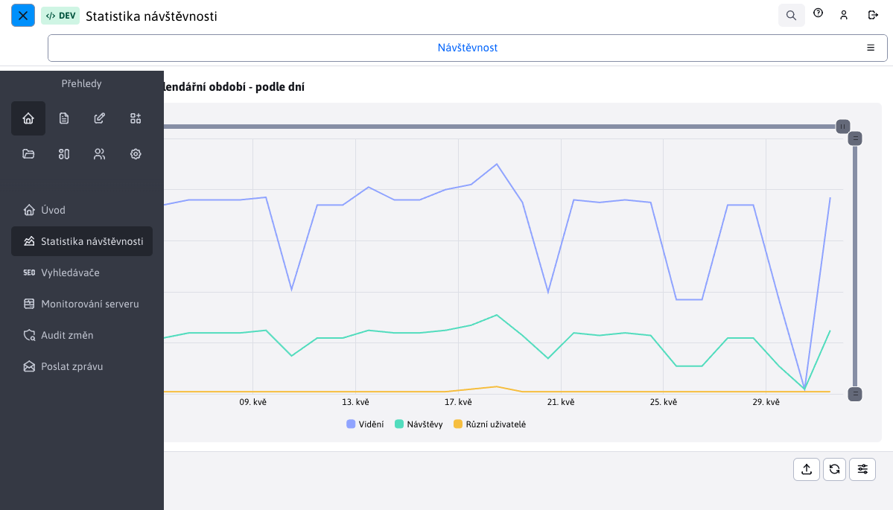
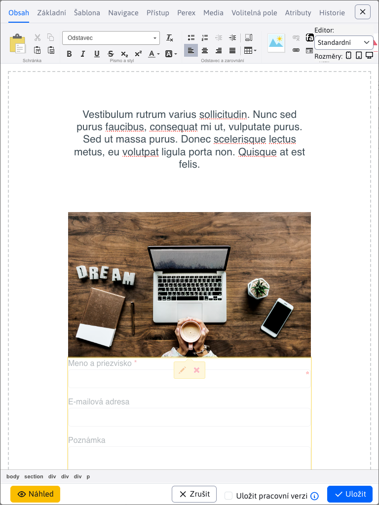
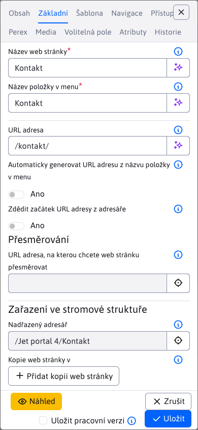

# Hlavní ovládací prvky

Rozložení administrace je standardní. V horní části se nachází hlavička, v levé části menu. Třetí úroveň menu je zobrazena jako navigační karty v hlavičce.

## Hlavička

V horní části se nachází hlavička:

obsahuje následující možnosti:

- **Označení prostředí** – barevný štítek před názvem stránky, například **DEV**, **TEST** nebo **PROD**, který pomáhá rozlišit, ve kterém prostředí pracujete. Jeho text, barvu a ikonu nastavíte podle návodu [Konfigurace úvodní obrazovky a označení prostředí](../../admin/setup/configuration/dashboard.md).
- **Název aktuální stránky** – například **Statistika návštěvnosti**, zobrazený za označením prostředí.
- Tlačítko **Hledat…** pro otevření [rychlého vyhledávání](search/README.md). Dialog otevřete také zkratkou **Ctrl+K** ve Windows nebo **⌘K** na Macu.
- Menu **Pomocník** s pomocí k aktuální stránce, dokumentací, novinkami a kontakty.
- Jméno aktuálně přihlášeného uživatele, kterým otevřete [uživatelské menu](#uživatelské-menu) s profilem, zabezpečením účtu a odhlášením.
-  Ikonu pro odhlášení z administrace.

V hlavičce se mohou zobrazovat karty pro přechod do třetí úrovně menu.

### Vyhledávání

Tlačítko **Hledat…** v hlavičce otevře rychlé vyhledávání přes aktuální stránku. Podle vašich oprávnění můžete hledat webové stránky, soubory, uživatele, textové klíče a položky menu administrace; dostupné je i vyhledávání v dokumentaci. Podrobný popis možností a ovládání naleznete v části [Vyhledávání](search/README.md).

### Nápověda

Menu **Pomocník** je dostupné v hlavičce na všech stránkách administrace. Nabízí:

- **Pomoc k této stránce** – návod k otevřené části administrace. Pod odkazem je název aktuální stránky. Pokud stránka nemá přiřazený návod, položka se nezobrazí.
- **Dokumentace WebJET CMS** – úvodní stránka dokumentace v jazyce přihlášeného uživatele.
- **Klávesové zkratky** – [přehled zkratek](keyboard-shortcuts.md) a míst, kde fungují.
- **Co je nového ve verzi…** – konkrétní verze v dokumentaci. Počet novinek a označení **Nové** odpovídají kartě na úvodní obrazovce. Označení zůstává 30 dní od prvního zobrazení daného obsahu v menu nebo na úvodu; úprava obsahu začne nové období.
- **Seznam všech změn** – kompletní changelog.
- **Poslat zpětnou vazbu** – dialog pro nápad, problém nebo pochvalu. Funguje i mimo úvodní obrazovku. Šipka zpět vás vrátí do menu; zavření křížkem zachová rozepsanou zprávu během otevření této stránky.
- **Kontaktovat podporu** – stránka podpory nastavená pro jazyk uživatele.

Odkazy na dokumentaci a podporu se otevírají v nové kartě. Ve spodní části menu je edice, verze a server WebJET CMS. Ikonou kopírování zkopírujete informace pro podporu.

Menu lze ovládat klávesnicí: **Enter** nebo mezerník jej otevře, šipky procházejí položky a **Esc** jej zavře a vrátí fokus na tlačítko **Nápověda**.

### Uživatelské menu

Klepnutím na své jméno v pravé horní části hlavičky otevřete uživatelské menu. V jeho horní části jsou iniciály, celé jméno, přihlašovací jméno a email, pokud jej máte vyplněn v profilu.

Menu nabízí:

- **Profil** – úprava vlastních osobních a kontaktních údajů a hesla. Po uložení systém doporučuje odhlásit se a znovu přihlásit, aby se projevily všechny změny.
- **Aktivní přihlášení** – přejde na úvodní stránku a otevře okno **Aktivní přihlášení** na kartě **Moje přihlášení**. Můžete zkontrolovat vlastní relace, odhlásit ostatní přihlášení, spravovat zařízení a prohlížet historii přihlášení; dle oprávnění je dostupná i karta přihlášených administrátorů. Podrobný popis naleznete v části [Přihlášení na úvodní stránce](welcome.md#přihlášení). Číslo u položky udává počet relací vašeho účtu ze všech serverů clusteru, stejně jako karta **Moje přihlášení**. Text **Toto zařízení a 3 další · 1 nové** znamená čtyři relace a jedno nové zařízení pro kontrolu. Žlutý blok **Nové přihlášení do vašeho účtu** vypíše každé nové zařízení na samostatném řádku s prohlížečem, systémem, dostupnou polohou a časem posledního přihlášení. Odkaz **Zkontrolovat** otevře dialog na kartě **Moje zařízení**, kde můžete přihlášení ověřit.
- **Dvoustupňové ověřování** – nastavení ověřování kódem z aplikace, například `Google Authenticator` nebo `Microsoft Authenticator`. Štítek **Zapnuto** nebo **Vypnuto** ukazuje stav pro váš účet. Stav se načte při každém otevření menu. Postup zapnutí popisuje [Dvoustupňové ověřování](logon.md#dvoustupňové-ověřování). Položka se zobrazuje, pokud je konfigurační proměnná `2factorAuthEnabled` nastavena na `true`.
- **Přístupový klíč** – správa přístupových klíčů pro přihlašování pomocí biometrie nebo PIN zařízení. Umožňuje přidat nový klíč a odstranit zaregistrovaný klíč. Postup naleznete v části [Přidání nového přístupového klíče](logon.md#přidání-nového-přístupového-klíče). Položka se zobrazuje, pokud je konfigurační proměnná `password_passKeyEnabled` nastavena na `true`.
- **Správa šifrovacích klíčů** – vytvoření nového klíče pro šifrování formulářů nebo zadání stávajícího klíče pro jejich dešifrování. Položka se zobrazuje uživatelům s právem **Formuláře**.
- **Odhlášení** – odhlášení z administrace. Stejnou funkci má samostatná ikona odhlášení vedle vašeho jména v hlavičce.

Menu je dostupné na všech stránkách administrace. Klávesou **Enter** nebo mezerníkem jej otevřete, šipkami nahoru a dolů procházíte položky a klávesou **Esc** jej zavřete a vrátíte fokus na své jméno.

Menu se otevře ihned. Počty a stav ověřování se načítají následně; do té doby je na jejich místě prázdný prostor. Pokud načtení selže, zobrazí se informace o nedostupnosti údajů a odkazy v menu zůstávají funkční.

## Menu

V levé části pod logem WebJETu jsou ikony reprezentující hlavní sekce menu. Rozhodli jsme se pro takovou reprezentaci první úrovně menu, abychom nemuseli mít hluboce vnořené menu položky:

Klepnutím na ikonu hlavní sekce se zobrazí menu položky zvolené sekce:

Výběr domény se kterou pracujete (při více doménové instalaci) se nachází ve spodní části levého menu.

## Zobrazení na mobilních zařízeních

Administrace se přizpůsobuje mobilním zařízením. Při šířce okna méně než 1200 bodů se schová hlavička stránky a levé menu:

hlavičku a menu zobrazíte kliknutím na ikonu hamburger menu  vlevo nahoře. Následně se menu a hlavička zobrazí přes stránku. Navigační karty se v hlavičce zobrazí jako výběrové menu.

menu zavřete kliknutím na ikonu zavření menu .

Editor v datatabulce při šířce okna méně než 992 bodů (tabletové zobrazení) se zobrazí na plnou velikost okna:

U okna užšího než 576 bodů se přesunou i názvy polí z levé strany nad pole pro lepší zobrazení např. na mobilním telefonu:

