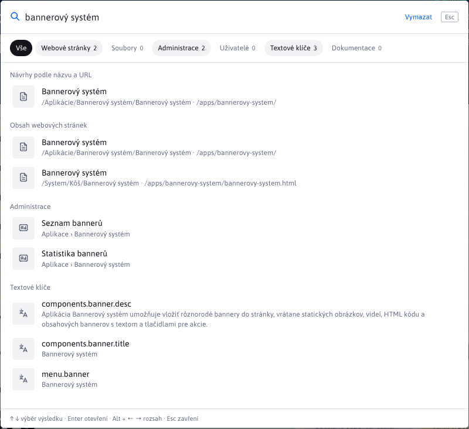
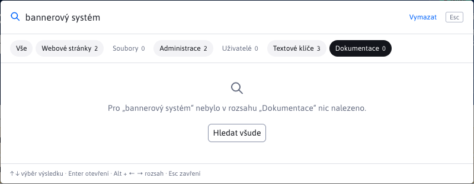

# Vyhledávání

## Rychlé vyhledávání v hlavičce

Tlačítko **Hledat…** v hlavičce otevře vyhledávání přes aktuální stránku. Je dostupné v celé administraci. Otevřete jej také klávesami **Ctrl+K** ve Windows nebo **⌘K** na Macu; po otevření můžete hned psát. Zkratka nepřebírá příkazy při psaní v jiném textovém poli nebo editoru.

Před zadáním výrazu uvidíte poslední hledání a odkazy na dostupné sekce. Historii si prohlížeč pamatuje zvlášť pro přihlášeného uživatele a doménu. Jednotlivé záznamy i celou historii můžete odstranit.

Rozsah **Vše** zobrazuje nejvýše tři výsledky z každé oblasti. Klepnutím na rozsah nebo odkaz **Všechny** zobrazíte výsledky pouze z vybrané oblasti. Nabídka se řídí vašimi oprávněními:

- **Web stránky** – návrhy podle názvu nebo URL stránky a hledání v obsahu. Návrh stránky otevře její editor.
- **Soubory** – hledání v názvech a indexovaném obsahu souborů.
- **Administrace** – odkazy na dostupné položky menu včetně jejich karet.
- **Uživatelé** – hledání podle jména, příjmení, celého jména, emailu nebo přihlašovacího jména.
- **Textové klíče** – hledání klíčů a jejich překladů.
- **Dokumentace** – sémantické vyhledávání s ukázkami z dokumentace přímo v dialogu. Pokud služba vrátí i AI odpověď, zobrazí se nad výsledky a můžete ji rozbalit. Nadpisy, seznamy a další Markdown formátování zůstanou čitelné. Klepnutím na výsledek otevřete příslušnou stránku dokumentace v nové kartě.

Na úvodní stránce se předvolí **Vše**. Při otevření z podporované sekce se předvolí její rozsah. Změna rozsahu platí do zavření dialogu. V poli jej přepnete také pomocí **Alt+šipka vlevo/vpravo**. **Tab** a **Shift+Tab** přesouvají fokus mezi ovládacími prvky, šipky nahoru/dolů vybírají výsledek a **Enter** jej otevře.

Odkaz **Otevřít výsledky v sekci…** přenese hledaný výraz do příslušné sekce, kde můžete použít další filtry. Pokud se nic nenašlo, při zúženém rozsahu můžete zvolit **Hledat všude**. Chyba spojení zobrazí zprávu **Vyhledávání je dočasně nedostupné** a tlačítko **Zkusit znovu**.

Dialog zavřete klávesou **Esc**, tlačítkem zavření nebo kliknutím mimo něj. Fokus se vrátí na tlačítko v hlavičce; hledaný výraz se do tlačítka nepřepisuje.

### Nastavení vyhledávání v dokumentaci

V **Nastavení → Konfigurace** nastavte proměnnou `adminDocumentationSearchUrl` na celou URL vyhledávací služby. Výchozí hodnota je `https://docs.webjetcms.sk/rest/rag/markdown/search`. Při změně domény nebo cesty stačí upravit tuto proměnnou a obnovit administraci. Při prázdné hodnotě zůstane dostupný odkaz na externí vyhledávání v dokumentaci.

Tato proměnná zároveň určuje server pro odkazy v menu **Nápověda**, `WJ.showHelpWindow` a changelog. Z URL se pro tyto odkazy použije pouze protokol, doména a port; cesta vyhledávací služby se ignoruje. Například `https://manual.example:8443/rest/rag/markdown/search` otevře dokumentaci na `https://manual.example:8443/latest/cs/`. Při prázdné nebo neplatné hodnotě směřují odkazy na veřejnou dokumentaci. Prázdná hodnota nadále vypíná vyhledávací službu. Dokumentace je dostupná slovensky, česky a anglicky; pro ostatní jazyky administrace se otevře anglická verze.

Administrace doplní parametr `query` s hledaným výrazem a podle jazyka rozhraní odešle `language` a `directory`:

| Jazyk administrace | `language` | `directory` |
| --- | --- | --- |
| Čeština | `cs` | `/cs/` |
| Český | `cs` | `/cs/` |
| Anglický | `en` | `/en/` |

Endpoint vrací JSON s polem `results`. Každý výsledek obsahuje `title`, `url` a Markdown ukázku `snippet`. Volitelné AI shrnutí je v elementu `answer` v Markdown formátu. Relativní odkazy ve výsledcích se otevírají na serveru dokumentace.

Pokud dokumentace běží na jiné doméně, její server musí povolit CORS. Nastavení patří **na server dokumentace**. Pro administraci otevřenou na `http://iwcm.interway.sk` nastavte:

- `accessControlAllowOriginUrls` musí obsahovat `/rest/rag/markdown/search`. Výchozí seznam `/rest/,/private/rest/,/admin/rest/` již tuto cestu pokrývá, zachovejte ostatní potřebné cesty.
- `accessControlAllowOriginValue` nastavte na potřebnou doménu nebo `*`. Jedná se o adresu administrace, ne dokumentace. Při jiném protokolu nebo portu použijte přesnou hodnotu z hlavičky `Origin` požadavku.
- `accessControlAllowMethods` musí povolovat `GET`, výchozí hodnota jej obsahuje.
- Pokud používáte omezení `accessControlAllowedOrigins`, přidejte do něj stejný origin administrace.

Vyhledávání odesílá veřejný požadavek bez cookies a přihlašovacích údajů. Při veřejném dokumentačním API určeném pro libovolné instalace můžete vracet `Access-Control-Allow-Origin: *`. Pokud hlavičku nastavuje reverzní proxy server, zajistěte, aby se neposílala dvakrát. Podrobnosti konfigurace jsou v [HTTP hlavičkách](../../../sysadmin/pentests/README.md#http-hlavičky).

HTTPS endpoint musí mít platný certifikát. Při chybě certifikátu nebo CORS prohlížeč odpověď neposkytne administraci a zobrazí se možnost zopakovat vyhledávání.

## Pokročilé vyhledávání

Sekce **Vyhledávání** poskytuje tabulky pro webové stránky, soubory a textové klíče. Otevřete ji odkazem **Otevřít výsledky v sekci…** z příslušného rozsahu rychlého vyhledávání. Zachová hledaný výraz a zvolí odpovídající kartu.

## Klíčové funkce

1. **Fulltextové vyhledávání**:
   - Vyhledávání probíhá nejen v titulcích stránek, ale také v jejich textovém obsahu.
   - Uživatel může najít obsah i na základě klíčových slov, která se nacházejí v textu dokumentů nebo souborů.

2. **Filtrování výsledků**:
   - Kromě fulltextového vyhledávání lze využít sloupcových filtrů pro přesnější zobrazení výsledků.
   - Tabulky umožňují filtrování na základě sloupců, jako jsou `Názov web stránky`, `Meno autora` nebo `Kľúč`.

3. **Podpora více typů obsahu**:
   - Webové stránky
   - Soubory
   - Textové klíče

## Používání sekce Vyhledávání

### Rozhraní Vyhledávání

Sekce je rozdělena do několika karet. Každá karta umožňuje specifické vyhledávání a filtrování:

#### 1. Web stránky

- **Fulltextové vyhledávání:** Zadejte klíčové slovo, které se nachází v textu stránky nebo její titulku.
- **Omezení podle stromové struktury**  Můžete omezit vyhledávání výběrem složky ve které se bude vyhledávat (hledá se iv pod složkách).
- **Filtrování:** Použijte sloupce jako `Názov web stránky` a `Meno autora` k zúžení výsledků.
- **Práva uživatelů:** Zobrazené výsledky závisí na právech jednotlivých uživatelů. Uživatel vidí pouze ty stránky, ke kterým má oprávnění.

#### 2. Soubory

- **Fulltextové vyhledávání:** Vyhledávejte text, který se nachází v obsahu souborů, jakož i v názvech souborů.
- **Filtrování:** Sloupce jako `Názov súboru` a `URL adresa` pomáhají přesně specifikovat výsledky.
- **Symbol oka:** Klepnutím na ikonu oka  při názvu souboru si můžete soubor zobrazit.
- **URL adresa:** Odkazy  umožňují rychlou navigaci do adresáře v Průzkumníkovi.

!> Upozornění: pro vyhledávání v souborech se používá [plně textový index souborů](../../files/fbrowser/folder-settings/README.md#indexování), nalezeny jsou tedy pouze soubory, které jsou indexovány.

#### 3. Textové klíče

- **Fulltextové vyhledávání:** Najděte textové klíče podle obsahu ve všech dostupných jazycích.
- **Filtrování:** Používejte sloupce, jako `Kľúč` nebo `Jazyk`, pro přesnější vyhledávání.

## Příklady použití

- **Vyhledávání ve web stránkách:**
  - Hledáte frázi `naštartoval obchodnú stránku`.
  - Výsledky obsahují stránky, kde se tato fráze nachází v textu. Pro zúžení výsledků použijete filtr `sales` ve sloupci pro `Názov stránky`.

- **Vyhledávání v souborech:**
  - Hledáte `only for users in Bankari group`.
  - Výsledky obsahují všechny soubory, kde se tato fráze nachází v textu.

- **Vyhledávání textových klíčů:**
  - Hledáte `Pridať adresár`.
  - Výsledky obsahují klíče s českým textem `Pridať adresár`. Následně můžete použít filtr `addGroup` ve sloupci `Kľúč` ke zúžení výsledků.
