# Úvodní obrazovka

Na úvodní obrazovce zkontrolujete návštěvnost, odeslané formuláře či stránky čekající na schválení a vrátíte se k rozpracovaným stránkám.

    <iframe width="790" height="444" src="https://www.youtube.com/embed/X2GNFn8IpCI" title="YouTube video player" frameborder="0" allow="accelerometer; autoplay; clipboard-write; encrypted-media; gyroscope; picture-in-picture" allowfullscreen></iframe>

Přehled tvoří **widgety**, tedy karty s údaji, například grafem návštěvnosti nebo seznamem požadavků na schválení. Vyberte si ty, které při práci využíváte. Pomocí [zkratek](#vaše-zkratky) otevřete často používanou část administrace nebo konkrétní složku.

Ve výchozím nastavení se podle vašich oprávnění zobrazí widgety **Návštěvnost**, **Formuláře**, **Ke schválení**, **Chyby 404**, **Pokračujte v práci**, **Odkud návštěvníci přišli**, **Nejbližší publikování** a **Newsletter**. Nad nimi najdete přivítání se zkratkami, novinky a systémová upozornění.

Rozložení se ukládá na váš účet a je společné pro všechny domény a prohlížeče. Výběr konkrétního formuláře nebo kampaně se pamatuje zvlášť pro každou doménu. Dostupnost widgetů závisí na vašich oprávněních.

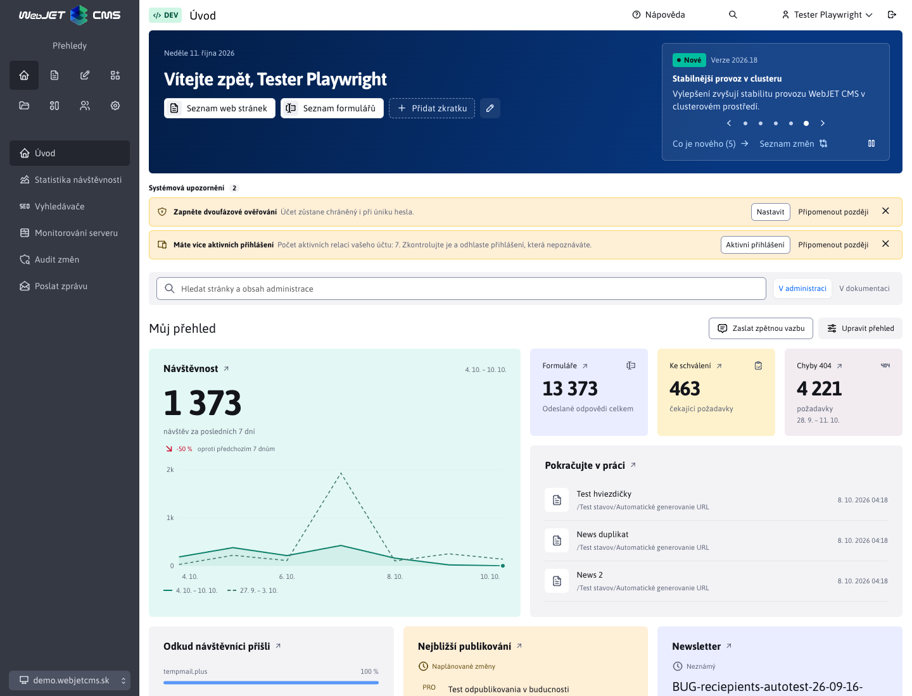

Označení **PROD**, **TEST**, **CIT**, **INT**, **UAT**, **DEMO**, **LOCAL** nebo **DEV** pomáhá rozlišit prostředí, ve kterých pracujete. Naleznete jej v hlavičce administrace, na přihlašovací stránce i v titulku karty prohlížeče. Správce může jeho vzhled upravit v [konfiguraci prostředí](../../admin/setup/configuration/dashboard.md).

## Přizpůsobení přehledu

Widgety, které kontrolujete nejčastěji, umístěte na začátek. Nepotřebné můžete odstranit.

Klepněte na **Upravit přehled**. V liště se zobrazí tlačítka **Obnovit výchozí**, **Přidat widget**, **Zrušit** a **Uložit**. Widgety můžete přesouvat úchytem nebo upravovat přes **Možnosti widgetu**.

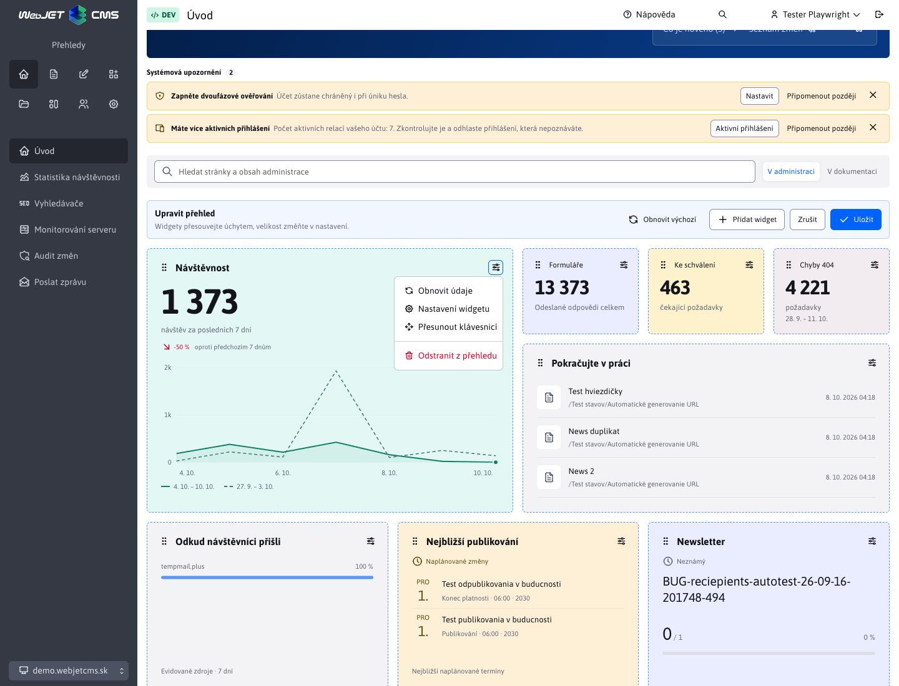

Nový widget přidáte takto:

1. Klepněte na **Přidat widget** a vyhledejte jej v katalogu.
2. Při widgetu klikněte na **Přidat** nebo **Přidat další**.
3. Vyberte velikost a další nastavení. Výsledek zkontrolujte v náhledu.
4. Potvrďte tlačítkem **Přidat widget**. Widget přibude na konec přehledu. Pokud nastavení zrušíte, nepřidá se.

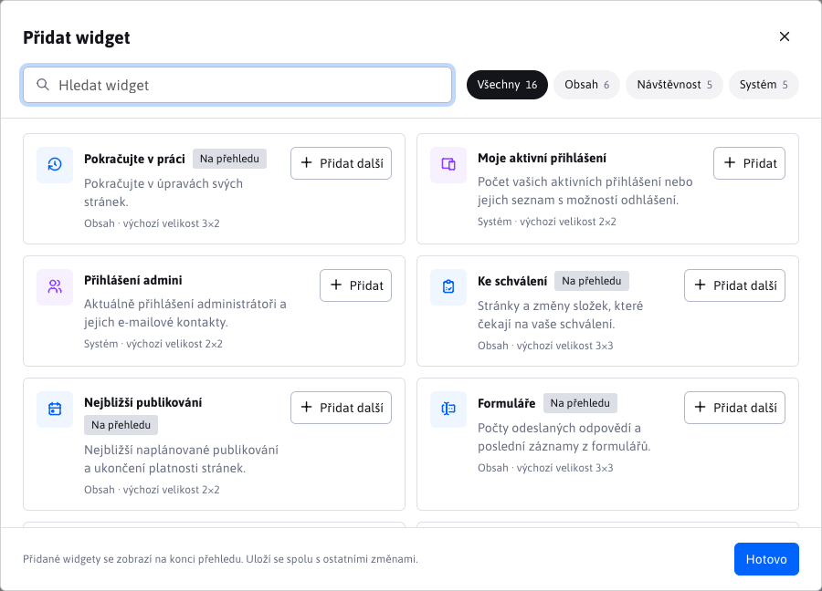

Tlačítko **Možnosti widgetu** nabízí:

- **Nastavení widgetu**: změňte velikost, barvu a dostupné možnosti, například období nebo formulář. Ne každý widget nabízí více velikostí. Změny potvrďte tlačítkem **Použít**.
- **Přesunout klávesnicí**: šipkami změňte pozici, klávesou **Enter** ji potvrďte nebo **Esc** přesun zrušte. Přesun spustíte i mezerníkem na úchytu. Klávesa **Esc** zruší i přesun myší.
- **Odstranit z přehledu**: odstraňte kartu bez potvrzení. Data aplikace zůstanou zachována. Akci vrátíte přes **Zpět** v oznámení nebo **Ctrl Z**. Oznámení je dostupné 8 sekund; při podržení myši nebo zaměření klávesnicí se odpočet zastaví. Widget můžete kdykoli přidat znovu.
- **Obnovit údaje**: načtěte aktuální údaje karty.

Větší kartu zvolte pro podrobnější graf nebo delší seznam. V části **Barva pozadí** vyberte odstín z palety nebo **Vlastní barvu**, kterou můžete zadat i kódem HEX. Příliš tmavou barvu je třeba nahradit světlejší. Volba **Výchozí** obnoví původní pozadí widgetu. Změny uvidíte v náhledu.

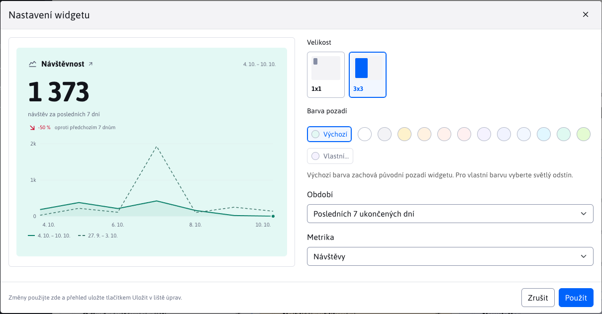

Po dokončení klikněte na **Uložit** v liště. Až tím se uloží veškeré úpravy widgetů. Při chybě zůstanou změny dostupné pro opětovné uložení. Při neuložených změnách tlačítko **Zrušit** nabídne **Pokračovat v úpravách** nebo **Zahodit změny** ; při odchodu ze stránky upozorní prohlížeč. Zkratky se upravují a ukládají samostatně.

Rozložení může obsahovat nejvýše 48 položek včetně zkratek, přihlášení, novinek a vyhledávání.

Tlačítko **Obnovit výchozí** po potvrzení připraví původní výběr widgetů, jejich velikosti, pořadí a nastavení. Klepnutím na **Uložit** se obnova dokončí a vymažou se i filtry widgetů ve všech doménách. Zkratky a ostatní nastavení účtu zůstanou zachovány.

Pokud při klepnutí na **Obnovit výchozí** podržíte **Shift**, po potvrzení se připraví přehled se všemi dostupnými widgety v každé podporované velikosti. Nepotřebné varianty odstraňte a výsledek uložte.

## Dostupné informace

Widgety můžete přidat opakovaně s různými nastaveními, například pro sledování dvou formulářů nebo návštěvnosti za 7 a 30 dní.

Statistické widgety ve výchozím nastavení zobrazují posledních sedm ukončených dnů. Vybrat můžete také 30 nebo 90 dní; srovnání používá stejně dlouhé předchozí období. Skutečný rozsah dat je uveden na kartě. Formuláře a chyby 404 mají pravidla popsaná níže.

### Zkratka do modulu

Otevře často používanou část administrace, složku nebo vlastní URL adresu. Postup přidání naleznete v části [Vaše zkratky](#vaše-zkratky).

### Pokračujte v práci

Zobrazuje nejvýše šest vašich naposledy upravovaných stránek. Klepnutím na stránku se vrátíte do jejího editoru, kliknutím na nadpis widgetu otevřete celý seznam webových stránek.

### Ke schválení

Zobrazuje požadavky z karty **Neschváleno** ve Web stránkách. Větší varianta obsahuje šest nejnovějších požadavků na změnu nebo smazání stránky či složky.

Klepnutím na položku otevřete její schvalování. Nadpis nebo celkový počet otevře celý seznam požadavků.

### Nejbližší publikování

Ukazuje, které stránky se mají **zveřejnit nebo přestat zobrazovat**, spolu s datem a časem změny. Klepnutím na nadpis otevřete úplný plán publikování.

### Formuláře

Zobrazuje odeslané formuláře, například poptávky nebo kontaktní zprávy. V nastaveních vyberte konkrétní formulář nebo všechny dostupné formuláře.

- **Všechny formuláře**: celkový počet odpovědí za celé období. Velký widget zobrazí deset formulářů s nejnovějším odesláním. Klepnutím na název otevřete odpovědi.
- **Konkrétní formulář**: ve velkém widgetu posledních deset odeslání za zvolené období. Ve sloupci **Formulář** je jméno, příjmení a email; pokud tato pole chybí, zobrazí se první tři vyplněné údaje. Klepnutím otevřete detail odeslání.

### Návštěvnost

Porovnává návštěvnost webu s předchozím obdobím. V nastaveních vyberte období a údaj: počet zobrazení, návštěv nebo unikátních návštěvníků. Přesné hodnoty zobrazíte podržením kurzoru nad grafem.

### Nejnavštěvovanější stránky

Zobrazuje stránky s nejvyšším počtem zobrazení za zvolené období. Pomůže určit, kterému obsahu věnovat pozornost při aktualizaci. Klepnutím na stránku otevřete její podrobnou statistiku.

### Co návštěvníci hledají

Zobrazuje hledané výrazy a jejich počty za zvolené období. Zjistíte, o která témata mají návštěvníci zájem a zda k nim na webu najdou aktuální informace.

### Odkud návštěvníci přišli

Porovnává podíl zdrojů návštěvnosti za zvolené období. Přesné hodnoty zobrazíte podržením kurzoru nad grafem.

### Vady 404

Pomáhá najít neexistující adresy a určit, které odkazy nebo přesměrování je třeba prověřit jako první.

Počítá chybové požadavky, ne různé adresy. Údaje zahrnují celé týdny zasahující do zvoleného období; aktuální týden obsahuje dosavadní údaje. Skutečný rozsah dat vidíte na kartě. Pokud historické údaje nelze oddělit podle domény, karta oznámí jejich nedostupnost.

### Newsletter

Sleduje průběh odesílání hromadného emailu a zaznamenané otevření či kliknutí. Vybírá aktivní kampaň, nejbližší naplánovanou nebo poslední dokončenou. V nastaveních můžete zvolit konkrétní kampaň.

Při odesílání se údaje viditelné karty obnovují každých 30 sekund.

### Co je nového

V panelu **Co je nového** naleznete novinky nainstalované verze WebJET CMS i videa a příspěvky z YouTube a Facebooku WebJET CMS. Na jednom místě tak můžete sledovat nové funkce a návody k jejich používání. Klepnutím na novinku nebo tlačítko **Co je nového** rozbalíte celý přehled.

Štítek **Nové** upozorňuje na nepřečtený obsah. Po rozbalení panelu se zobrazené novinky označí za přečtené a štítek se skryje. Znovu se objeví, když přibude příspěvek nebo se aktualizují novinky nainstalované verze.

### Systémová upozornění

Upozornění informují o problémech vyžadujících vaši pozornost. Nové přihlášení z neznámého zařízení je vždy první, za ním následují chyby, varování a informace.

Chyby zůstávají viditelné do vyřešení příčiny. Běžné varování můžete odložit na 7 dní tlačítkem **Připomenout později** nebo **×**.

#### Nové přihlášení z neznámého zařízení

Pokud se přihlásíte z prohlížeče, který WebJET CMS při vašem účtu nerozpozná jako použitý během posledních 90 dnů, zobrazí se upozornění a obdržíte email. Zkontrolujte prohlížeč, operační systém, IP adresu a čas přihlášení. U aktuálního prohlížeče se zobrazí **Přihlásili jste se z nového prohlížeče** a označení **Tento prohlížeč**.

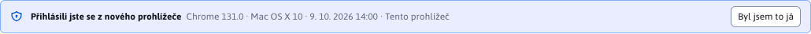

Email **Nové přihlášení do WebJET CMS** obsahuje údaje o přihlášení a tlačítka pro jeho potvrzení nebo zabezpečení účtu.

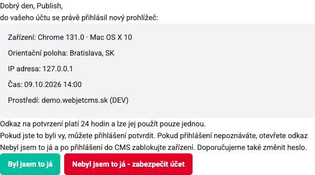

#### Pokud přihlášení znáte

Klikněte na **Byl jsem to já**. Na váš email se odešle šestimístný kód. Zadejte jej pod upozorněním a klikněte na **Potvrdit kód**.

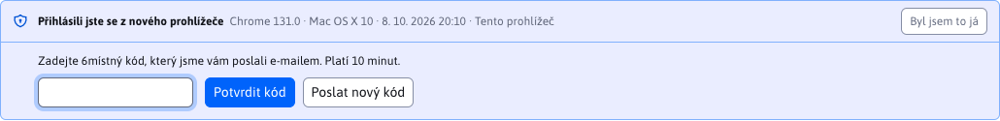

Kód naleznete v emailu **Kód pro potvrzení přihlášení do WebJET CMS**:

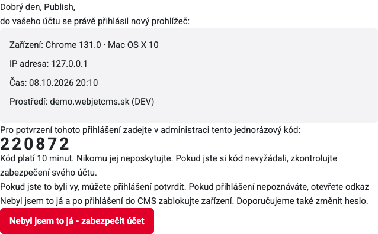

Kód platí 10 minut a umožňuje maximálně 5 pokusů. Po minutě můžete přes **Poslat nový kód** vyžádat další; předchozí přestane platit. Po ověření se zařízení potvrdí a upozornění zmizí iv ostatních prohlížečích po obnovení přehledu.

Použít můžete i odkaz **Byl jsem to já** v původním emailu. Platí 24 hodin, pouze jednou a po přihlášení do příslušného účtu. Vyžádání nového kódu jej nezruší; úspěšné potvrzení zneplatní odkaz i kód.

#### Pokud přihlášení neznáte

Při upozornění nebo v kartě **Moje zařízení** v okně **Aktivní přihlášení** klikněte na **Nebyl jsem to já**. Zařízení se zablokuje a jeho známé pořady se odhlásí. Pokud zablokujete aktuální prohlížeč, odhlásí i vás.

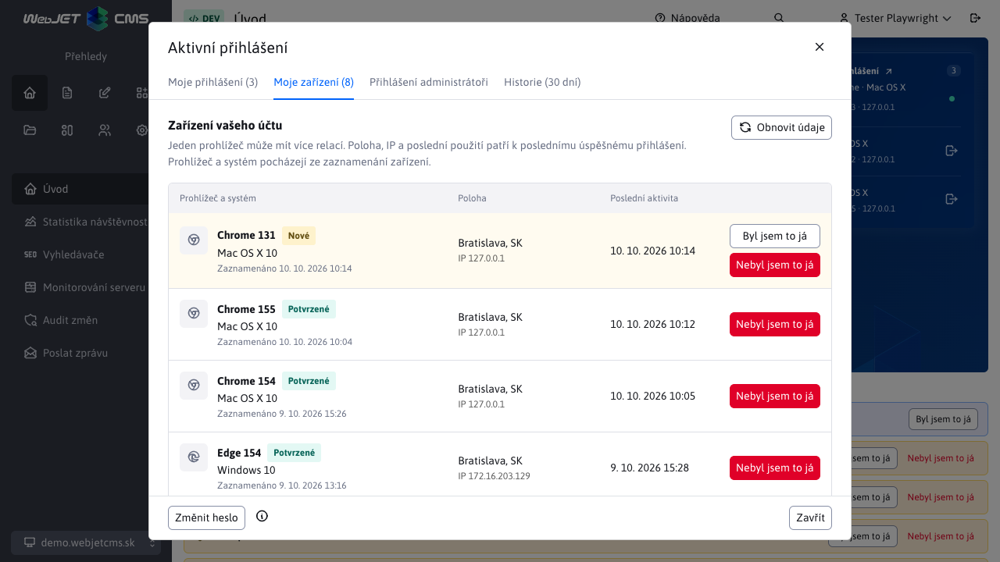

Odkaz **Nebyl jsem to já – zajistit účet** v emailu po přihlášení otevře okno **Zajistěte svůj účet**. Samotné otevření zařízení nezablokuje; použijte tlačítko **Zablokovat zařízení**.

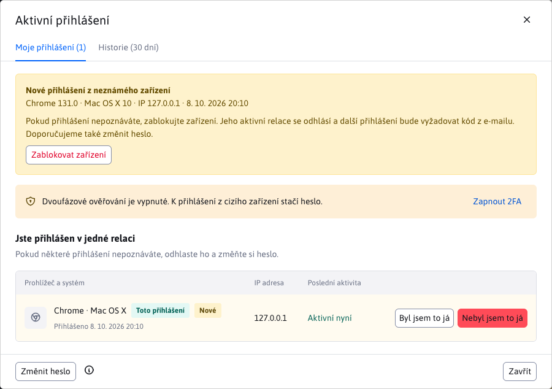

Po zablokování zvolte **Změnit heslo** a zkontrolujte ostatní přihlášení. Je-li dostupné, nastavte pomocí **Zapnout 2FA** dvoustupňové ověřování. **Později** pouze zavře okno. U firemního účtu změňte heslo u poskytovatele přihlášení nebo kontaktujte správce.

Při dalším přihlášení ze zablokovaného zařízení je třeba po zadání správných přihlašovacích údajů zadat [kód z emailu](logon.md#ověření-zablokovaného-zařízení). Až správný kód prohlížeč odblokuje.

#### Zapamatování prohlížeče a platnost upozornění

Po úspěšném dvoufaktorovém ověření se nezablokovaný prohlížeč potvrdí automaticky. Dostanete informační email s možností **Nebyl jsem to já**. Při zablokovaném zařízení se i po 2FA vyžaduje emailový kód; viz [Ověření zablokovaného zařízení](logon.md#ověření-zablokovaného-zařízení).

Upozornění na nové zařízení nelze odložit ani zavřít křížkem. Zmizí po potvrzení nebo zablokování zařízení, nejpozději po 7 dnech od události. Další přihlášení lhůtu neprodlouží. Zablokování zůstává platné i po zmizení upozornění. Zjištění, potvrzení a zablokování zařízení se zapisují do auditu jako **USER_DEVICE**.

WebJET CMS si prohlížeč pamatuje pomocí cookie. Každé dokončené přihlášení prodlouží zapamatování o 90 dní; odhlášení cookie neodstraní. Po vymazání nebo expiraci cookie se prohlížeč rozpozná jako nový a neuplatní se ani jeho předchozí blokování. Nové upozornění můžete obdržet iv jiném profilu nebo anonymním okně. Aktualizace prohlížeče či změna IP adresy při zachované cookie jej nevyvolá. Lhůtu může správce změnit v [konfiguraci](../../admin/setup/configuration/dashboard.md).

### Vyhledávání a pomoc

Klikněte na **Hledat…** v hlavičce nebo stiskněte **Ctrl+K** ve Windows či **⌘K** na Macu. [Rychlé vyhledávání](search/README.md) najde podle vašich oprávnění stránky, soubory, položky administrace, uživatele a textové klíče. Stránky můžete hledat podle názvu nebo URL.

Rozsah **Dokumentace** vyhledá zadaný výraz v návodech. Pomoc k otevřené části administrace najdete i přes nápovědu v hlavičce.

### Moje aktivní přihlášení

Zkontrolujete svá přihlášení a odhlásíte zařízení, které již nepoužíváte. Panel v horní části přehledu nelze odstranit; z katalogu můžete přidat také samostatný widget. Podrobnosti naleznete v části [Přihlášení](#přihlášení).

### Přihlášeni admini

Ukazuje kolegy, kteří právě pracují v systému, a umožňuje jim odeslat email. Dostupnost závisí na vašich oprávněních. Viz [Přihlášení administrátoři](#přihlášení-administrátoři).

### Změněné stránky

Zobrazuje poslední úpravy dostupných stránek v aktuální doméně is autorem změny.

### Audit

Zobrazuje poslední události z celého serveru podle vašich oprávnění. Pomůže při kontrole operací nebo zjišťování příčiny problému.

### Obsazenost paměti

Zobrazuje využití paměti serveru, například pro prověření zpomalení systému. Podrobnosti naleznete v části [Změněné stránky, audit a monitorování](#změněné-stránky-audit-a-monitorování).

### Zatížení CPU

Zobrazuje zatížení procesoru serveru. Pomůže prověřit, zda souvisí s pomalými odezvami. Viz [Změněné stránky, audit a monitorování](#změněné-stránky-audit-a-monitorování).

## Přihlášení

Okno **Aktivní přihlášení** otevřete z kterékoli stránky přes [uživatelské menu](README.md#uživatelské-menu): klikněte na své jméno a vyberte **Aktivní přihlášení**. Přejdete na úvodní stránku s otevřenou kartou **Moje přihlášení**.

Okno otevřete také přes nadpis widgetu **Moje aktivní přihlášení** nebo odkaz v systémovém upozornění na více relací. Nabízí vlastní přihlášení, správu zařízení, historii za posledních 30 dní a podle oprávnění i přihlášených administrátorů.

### Moje aktivní přihlášení

Karta **Moje přihlášení** zobrazuje aktivní relace vašeho účtu. Jeden prohlížeč může mít více pořadů. U každé vidíte prohlížeč, operační systém, datum přihlášení a IP adresu. Aktuální relace je označena jako **Toto přihlášení**.

Sloupec **Poloha** obsahuje [orientační město a zemi](../../admin/setup/configuration/dashboard.md#orientační-poloha-přihlášení) podle veřejného internetového připojení. Pokud je nelze zjistit, zobrazí se **Neznámá**. IP adresa zjištěná serverem může být interní.

Ostatní relace můžete odhlásit jednotlivě přes **Odhlásit**, například pokud jste se zapomněli odhlásit na jiném počítači. Tlačítko **Odhlásit všechny ostatní** vyžaduje potvrzení. **Změnit heslo** otevře váš profil; informační ikona u tlačítka obsahuje pokyny pro firemní účty.

Widget **Moje aktivní přihlášení** při jediném pořadu oznámí, že jste přihlášeni pouze zde. U více ukáže počet a ve větších variantách i seznam. Relace nepotvrzených zařízení označí štítkem **Nové**.

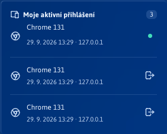

V clusteru se při relaci zobrazuje i server, na kterém je aktivní. Pokud zvolíte **Odhlásit tuto relaci**, na aktuálním uzlu se ukončí okamžitě; na jiném uzlu se čeká na synchronizaci, typicky do minuty. Doménu a uzel zobrazíte podržením kurzoru nad záznamem.

Data se aktualizují po přihlášení uživatele. Častější aktualizaci může správce nastavit přes [úlohu na pozadí](../../admin/settings/cronjob/README.md) `sk.iway.iwcm.stat.SessionClusterService`, například každých 10 minut. Úloha odstraňuje záznamy starší 60 minut; bez ní se při přihlášení odstraní záznamy starší 24 hodin.

### Moje zařízení

Karta **Moje zařízení** obsahuje uložené prohlížeče vašeho účtu i bez aktivní relace. Jsou seřazeny od naposledy použitých, po 20 na stránku. Tlačítkem **Obnovit údaje** načtete aktuální stav.

U zařízení vidíte prohlížeč, operační systém, čas zaznamenání a údaje posledního úspěšného přihlášení: **Poslední aktivita**, IP adresa a **Poloha**. Nedostupná poloha je označena jako **Neznámá**. Aktuální prohlížeč má štítek **Toto zařízení**.

- **Nové**: zařízení zatím není potvrzeno. Přes **Byl jsem to já** si pošlete emailový kód a zadejte ho pod zařízením. Až správný kód zařízení potvrdí a odstraní upozornění. **Zrušit** zavře formulář bez změny stavu.
- **Potvrzeno**: pokud zařízení neznáte, přes **Nebyl jsem to já** ho můžete zablokovat. Datum potvrzení zobrazíte podržením kurzoru nad štítkem.
- **Zablokováno**: odblokuje se až při dalším přihlášení ověřením kódu z emailu. Datum a pokyny zobrazíte podržením kurzoru nad štítkem.

Pokud neznáte nové zařízení, také použijte **Nebyl jsem to já**. Zablokování odhlásí všechny jeho známé pořady včetně vaší, pokud jde o aktuální prohlížeč. U jiného prohlížeče se otevře okno **Zabezpečte svůj účet** s dalšími kroky.

### Přihlášení administrátoři

S právem **Úvod - zobrazení přihlášených administrátorů** můžete přidat widget **Přihlášení admini**. Zobrazuje počet administrátorů a jejich aktivních relací. Jeden účet může mít více pořadů, proto se počty mohou lišit.

Klepnutím na nadpis otevřete okno **Aktivní přihlášení** v kartě **Přihlášení administrátoři**. Ikonou<i class="ti ti-mail fs-6"></i> odešlete vybranému administrátorovi email.

## Vaše zkratky

Zkratkami pod přivítáním otevřete často používanou část administrace, konkrétní složku nebo vlastní URL adresu včetně parametrů. Ukládají se na váš účet a jsou dostupné ve všech prohlížečích.

Ve výchozím nastavení směřují na webové stránky a formuláře podle vašich oprávnění. Pokud tyto moduly nejsou dostupné, použije se první dostupná položka menu.

Novou zkratku přidáte takto:

1. Klepněte na **Přidat zkratku** za seznamem zkratek.
2. V poli **Kam má zkratka vést?** vyberte **Hlavní část**, **Sekci** a cíl pod **Vyberte kartu**. Cíl můžete vyhledat také podle názvu a vybrat kliknutím nebo šipkami a **Enter**. Volba **Zpět** vrátí seznam o úroveň výše. Pro vlastní odkaz zvolte **Použít vlastní adresu URL…** a vyplňte **URL adresu**.
3. Vyplňte **Název zkratky**, nebo nechte název vybraného cíle. U vlastní URL je název povinen.
4. Vyberte **Ikonu** a **Barvu**. Volba **Vlastní…** umožňuje zadat název ikony Tabler nebo vybrat barvu včetně průhlednosti či HEX hodnoty. Neexistující ikonu nelze uložit. Barva se použije na pozadí ikony; zvolit můžete i **Bez barvy**.
5. Zkontrolujte náhled a klikněte na **Přidat zkratku**.

Tlačítkem s tužkou **Upravit zkratky** zapněte úpravy. Klepnutím na zkratku otevřete její nastavení. Změny potvrďte přes **Uložit změny** ; ve stejném okně ji můžete odstranit přes **Odstranit zkratku**. Oznámení nabídne **Zpět** na 8 sekund. Úpravy ukončíte tlačítkem **Hotovo**.

Zkratku přesunete úchytem před ikonou. Klávesnicí použijte **mezerník**, **šipky vlevo/vpravo** a **Enter** ; **Esc** přesun zruší. Klepnutím na úchyt můžete pozici vybrat také v dialogovém okně.

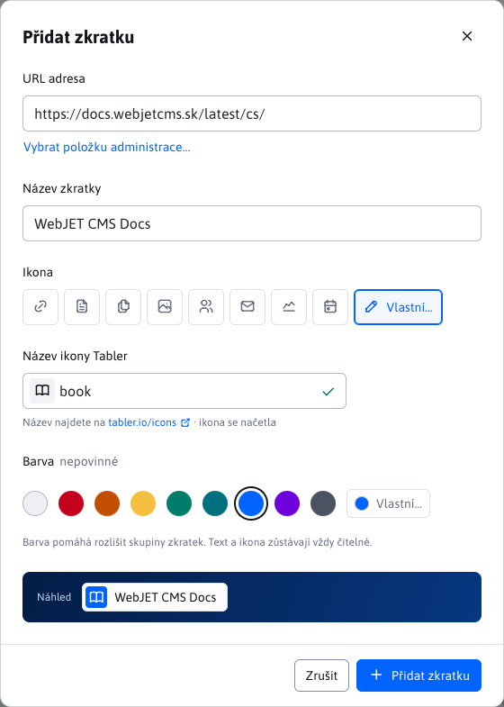

Pro zkratku na konkrétní složku otevřete složku ve Web stránkách a zkopírujte adresu is parametrem `groupid`. Při přidávání zvolte **Použít vlastní adresu URL…**, vložte adresu a zadejte název, například **Aktuality**.

Adresa může mít tvar `/admin/v9/webpages/web-pages-list/?groupid=123`. Číslo `123` nahraďte ID ze své zkopírované adresy. Zkratka pak otevře přímo vybranou složku.

Zkratku na nedostupnou položku menu můžete v režimu úprav opravit nebo odstranit. Křížek **×** ji odstraní bez potvrzení; přes **Zpět** ji do 8 sekund vrátíte. Odstranit můžete také poslední zkratku, ale po obnovení stránky se prázdný seznam doplní výchozími zkratkami podle oprávnění. Widgety a ostatní nastavení se tím nezmění.

## Změněné stránky, audit a monitorování

Widgety **Změněné stránky**, **Audit**, **Přihlášení admini**, **Obsazenost paměti** a **Zatížení CPU** přidáte podle oprávnění přes katalog. Změněné stránky se týkají aktuální domény; audit, přihlášení administrátoři a monitorování celého serveru.

Grafy paměti a CPU mají výchozí velikost **3×3** ; v nastaveních můžete zvolit i **3×2**. Údaje viditelného widgetu se aktualizují každých 5 sekund. Klepnutím na název otevřete úplný přehled.

Měření začne otevřením widgetu i bez zapnutého ukládání historie. Při skrytí karty prohlížeče nebo widgetu se aktualizace pozastaví.

## Zpětná vazba

Vývojovému týmu WebJET CMS můžete poslat připomínku, návrh na zlepšení nebo pochvalu. Klikněte na **Zaslat zpětnou vazbu** v horní liště přehledu.

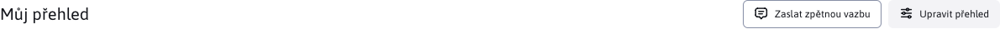

Popište požadovanou změnu nebo problém. Přiložit můžete také soubory, například snímek obrazovky. Formulář se odešle emailem. Při volbě **Zaslat anonymně** nebude v údajích odesílatele vaše jméno ani emailová adresa.

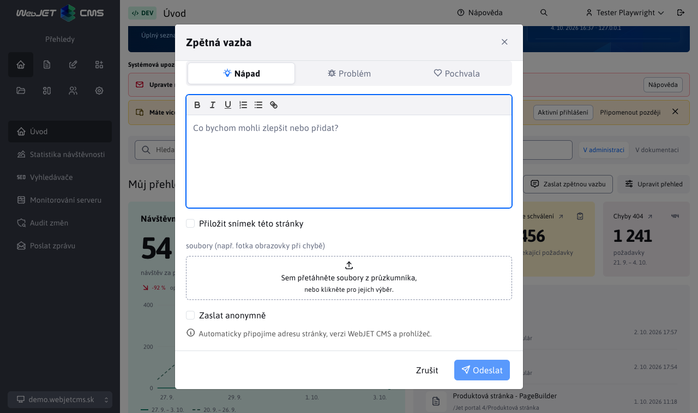

Připomínky posoudíme při plánování vývoje. Plánované změny naleznete v [mapě rozvoje](../../ROADMAP.md).
