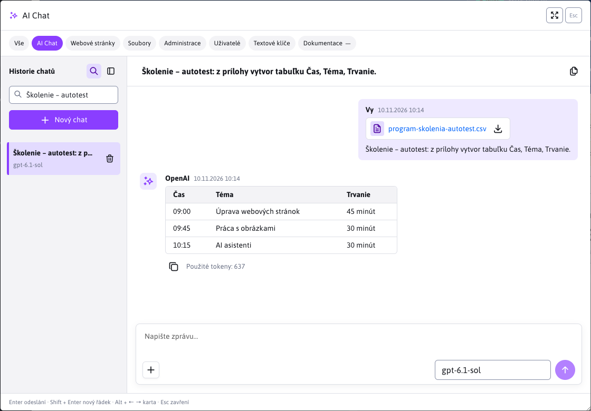
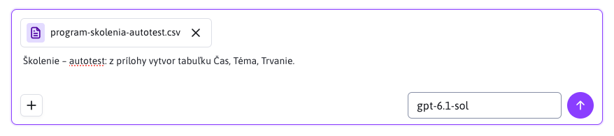
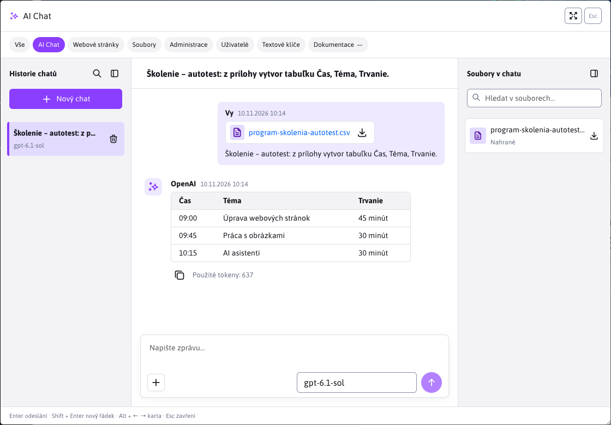
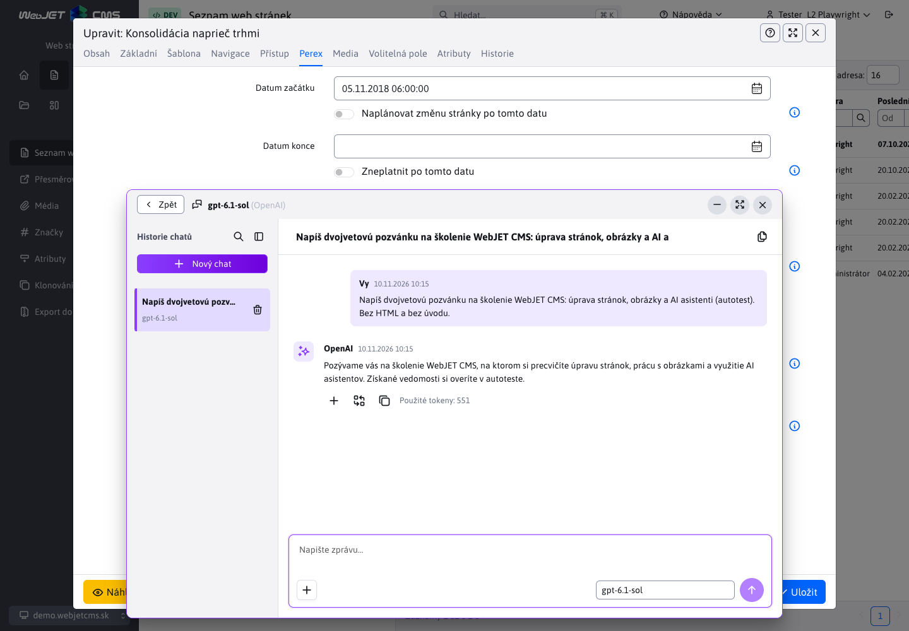
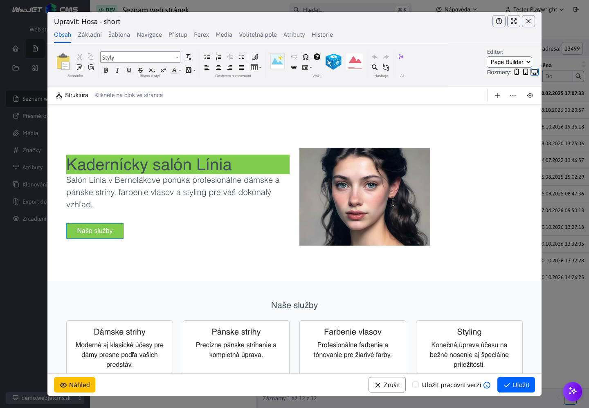

# AI Čet

V AI Četu můžete postupně zpřesňovat zadání, ptát se na obsah přiložených dokumentů nebo připravovat texty pro web. Vyberete si nakonfigurovaného asistenta a zadáte požadavek; na odpověď můžete navázat další zprávou. Možnost uchovat kontext rozhovoru závisí na poskytovateli, modelu a nastavení asistenta.

Čet otevřete dvěma způsoby:

| Umístění | K čemu slouží | Práce s obsahem stránky |
| --- | --- | --- |
| Karta **AI Čet** v rychlém vyhledávání | Samostatné rozhovory, práce s přílohami a uloženou historií. | Obsah otevřené stránky se neposílá. Odpověď můžete zkopírovat. |
| Tlačítko AI u pole nebo v panelu editoru | Návrh a úprava obsahu konkrétního pole, textu nebo PageBuilder stránky. | Asistent obdrží obsah podle nastavení zdrojového pole nebo označený text. Odpověď vložíte až vlastním potvrzením. |

## Zahájení rozhovoru

1. V hlavičce administrace klikněte na **Hledat…** nebo stiskněte **Ctrl+K / ⌘K** a vyberte kartu **AI Čet**.
2. V pravém dolním rohu pole pro zprávu vyberte asistenta. Stejného univerzálního asistenta můžete vybrat i přes tlačítko AI u textového pole.
3. Napište požadavek a odešlete jej tlačítkem se šipkou nahoru nebo klávesou **Enter**. **Shift+Enter** vloží nový řádek.
4. Další požadavek napište do stejného pole. Například po návrhu programu školení můžete požádat o jeho zkrácení nebo doplnění přestávky.

Pokud má asistent zapnuto postupné načítání, odpověď přibývá po částech. Tlačítkem **Zastavit** se čtvercovou ikonou přerušíte generování. Již přijatý text zůstane zobrazen. Samotné zavření dialogu ani přepnutí karty generování nezastaví.

Odpovědi zobrazují Markdown včetně nadpisů, seznamů, zvýraznění a tabulek. U jména odesílatele je čas zprávy, pod odpovědí údaj **Použité tokeny**. Tlačítko **Kopírovat** zkopíruje původní text is Markdown značkami. Názvy tlačítek s ikonami se zobrazí v bublině po najetí myší nebo zaměření klávesnicí.

Pokud asistent vrátí HTML kód, například při tvorbě PageBuilder stránky, zobrazí se karta **Návrh obsahu**. Po dokončení odpovědi se automaticky otevře její **Náhled** a starší návrh se sbalí. Vysvětlení mimo HTML bloku zůstává viditelné.

- **Náhled** zobrazí výsledný vzhled. V editoru stránky používá CSS styly a obalové třídy načtené v klasickém editoru nebo PageBuilderu. V samostatném četě bez kontextu stránky používá základní formátování.
- Ikony **Desktop**, **Tablet** a **Mobil** přepnou šířku vykreslování na 1280, 768 a 375 pixelů. Širší návrh se zmenší tak, aby se vešel do okna četu.
- Ikona **Maximalizovat okno** otevře návrh na celou plochu četu. Ikona **Zmenšit okno** nebo klávesu **Esc** jej vrátí do odpovědi.
- **HTML kód** zobrazí zdrojový kód. Celou odpověď zkopírujete ikonou **Kopírovat** pod zprávou.

Prohlížení návrhu nemění obsah pole ani stránky. Vložíte jej až tlačítkem pod odpovědí. Náhled nespouští skripty ani vložené iframe, proto například mapa nebo dynamická aplikace nemusí zobrazit svůj konečný obsah. Kopírování celé odpovědi i vložení do stránky nadále používají původní obsah.

## Nový čet a návrat k rozhovoru

**Nový čet** zahájí samostatný rozhovor se zvoleným asistentem. Poslední výběr asistenta na kartě **AI Čet** se ukládá do uživatelských nastavení administrace a obnoví se i po obnovení stránky nebo opětovném přihlášení. Pokud již asistent není dostupný, vybere se první z aktuální nabídky. Čet u pole používá asistenta vybraného v editoru.

Pokud se ještě generuje odpověď, **Nový čet** ji zastaví. Uložený rozhovor tím nevymažete: zůstává v historii.

Přepnutí asistenta obnoví jeho naposledy otevřený rozhovor včetně rozepsané zprávy a neodeslaných příloh. Stejné údaje se zachovají při přepnutí karty a zavření a opětovném otevření dialogu, dokud neopustíte aktuální stránku administrace. Rozepsané zprávy a neodeslané přílohy se na server neukládají.

### Ukládané a dočasné rozhovory

U asistentů **OpenAI** a **Gemini** s vypnutou volbou **Zapnout dočasný čet** a modelem podporujícím čet se odeslané zprávy a odpovědi ukládají na serveru. Najdete je v historii i po obnovení stránky nebo opětovném přihlášení. Rozhovory a přílohy jsou dostupné pouze jejich vlastníkovi v příslušné doméně.

Při ostatních nastaveních rozhraní upozorní, že rozhovor se neukládá. Takový čet se nepřidá do historie a nemůžete do něj nahrávat přílohy. Po opuštění nebo obnovení stránky se jeho zobrazený obsah ztratí. Uchování předchozího kontextu u poskytovatele se řídí nastavením asistenta; samotný seznam zpráv v okně nezaručuje, že model pracuje s celým rozhovorem.

### Historie četů

Panel **Historie četů** je ve výchozím nastavení zobrazen. Ikonou postranního panelu vlevo v hlavičce jej můžete skrýt nebo znovu zobrazit. Tato volba se ukládá do uživatelských nastavení administrace a zachová se i po obnovení stránky či opětovném přihlášení; platí i pro čet při poli a v editoru stránky. Automatické zavření panelu na úzké obrazovce uloženou volbu nemění.

Klepnutím na název otevřete uložený čet. Vybraný rozhovor označuje barevné pozadí a fialový proužek.

Lupa v hlavičce panelu, před ikonou zavření, zobrazí pole **Hledat v historii…**. V něm můžete hledat podle názvu, textu zpráv, asistenta nebo poskytovatele. Vyhledávání zahrnuje i starší rozhovory, které ještě nejsou načteny v seznamu, a nerozlišuje velká písmena ani diakritiku. Vymazáním výrazu obnovíte celý seznam. Opětovným kliknutím na lupu nebo klávesou **Esc** vyhledávací pole skryjete a zrušíte filtr. Další **Esc** zavře panel historie.

Pokračování používá kontext uchovaný u poskytovatele. Pokud již není dostupný nebo se změní asistent, model či konfigurace poskytovatele, rozhovor může zůstat pouze pro čtení. Jeho zprávy můžete nadále číst a přílohy stahovat; na další práci začněte nový čet.

### Vymazání rozhovoru

Při rozhovoru klikněte na ikonu koše **Vymazat** a potvrďte vymazání. WebJET nejprve požádá poskytovatele o odstranění uložených odpovědí a poté odstraní lokální historii i přílohy.

Pokud poskytovatel vymazání nepotvrdí, rozhovor zůstane označen pro vymazání. Akci můžete zopakovat tlačítkem při rozhovoru. Při přerušeném požadavku bez vráceného ID odpovědi nemusí být možné potvrdit úplné vymazání; rozhraní zobrazí příslušný stav.

## Přílohy

Přílohy jsou dostupné v ukládaných rozhovorech na kartě **AI Čet** iv četě u pole av editoru stránky s asistentem **OpenAI** nebo **Gemini**. Můžete například přiložit program školení a požádat asistenta, aby z něj vytvořil tabulku nebo pozvánku.

1. Klepněte na ikonu plus **Nahrát soubor**, přetáhněte soubory kamkoli do plochy četu nebo vložte obrázek ze schránky do pole zprávy. Soubor můžete také přetáhnout ze svého počítače.
2. Zkontrolujte názvy souborů a náhledy obrázků. Nechtěnou přílohu před odesláním odstraňte tlačítkem **×**.
3. Doplňte požadavek a odešlete zprávu. Odeslat můžete i samotné přílohy bez textu.

| Omezení | Podporovaná hodnota |
| --- | --- |
| Počet příloh v jedné zprávě | Nejvíce 5 |
| Celková velikost příloh jedné zprávy | Ne více než 10 MB |
| Obrázky | PNG, JPEG, WebP |
| Dokumenty | PDF, DOCX, XLSX, PPTX |
| Textové soubory v UTF-8 | TXT, MD, CSV, TSV, JSON, XML, HTML, HTM, CSS, JS, JAVA, SQL, YAML, YML, LOG |
| Text získaný z příloh jedné zprávy | Ne více než 100 000 znaků |
| Počet stran PDF | Ne více než 200 |

Dokumenty musí obsahovat čitelný text. Skenované PDF bez textové vrstvy se nezpracují. Obsah dokumentů se použije jako kontext rozhovoru. Obrázky nejprve popíše zvolený model a tento popis se přidá do kontextu; model proto musí podporovat obrazový vstup. Zpracování obrázků také spotřebovává tokeny. Hlasový vstup není podporován.

### Soubory ve četě

Ikona **Soubory v četě** vpravo v hlavičce otevře panel se soubory ze všech zpráv vybraného rozhovoru. Rozlišuje **Nahrané** a **Vygenerované** soubory, pokud je asistent v odpovědi vrátí. Můžete v nich hledat podle názvu a kliknutím je stáhnout. Neodeslané přílohy se v tomto panelu ještě nezobrazují.

Přílohu stáhnete i kliknutím na její název nebo ikonu stahování přímo při zprávě. Soubor se stáhne pod původním názvem. Přílohy zůstávají dostupné i po obnovení stránky, dokud rozhovor nevymažete. Na úzké obrazovce se panely historie a souborů zobrazují přes rozhovor vždy po jednom.

## Čet u pole av editoru stránky

U textového pole nebo v panelu nástrojů editoru klikněte na ikonu AI a vyberte asistenta s typem požadavku **Čet**. Napište zadání a odešlete jej. Označený text v podporovaném editoru má přednost před obsahem nastaveného **Zdrojového pole**. Pokud text neoznačíte, použije se zdrojové pole. Pokud ani to není nastaveno, obsah pole ani stránky se neposílá. Stejné pravidlo platí pro uložené i nové záznamy a hromadnou úpravu.

Při označeném textu v editoru obdrží asistent i pokyn vrátit pouze upravený HTML fragment se zachováním jeho struktury. Například při požadavku na tučné písmo má doplnit značky `<strong>` přímo do textu bez přidání nadpisu či obalů PageBuildera. Tento pokyn má při úpravě výběru přednost před pravidly asistenta pro tvorbu celé stránky a nezávisí na nastavených CSS třídách obalů. Platí pro dočasné i ukládané čety zpracované serverovým poskytovatelem.

Okno četu můžete přesunout tažením za horní lištu, aby nezakrývalo text stránky. Po zaměření lišty klávesou **Tab** jej můžete posouvat i šipkami; se **Shift** se posouvá větším krokem. Obsah editoru můžete upravovat i při otevřeném četě.

Tlačítko **Minimalizovat čet** (minus) vpravo nahoře skryje okno do AI ikony v pravém dolním rohu. Klepnutím na **Obnovit čet** se vrátíte ke stejnému rozhovoru, rozepsané zprávě, neodeslaným přílohám a otevřeným panelům. Zachová se i pozice okna; probíhající odpověď pokračuje během minimalizování. Při zmenšení prohlížeče se přesunuté okno přizpůsobí tak, aby zůstalo dostupné. Minimalizovaný čet obnovíte i původním tlačítkem AI při stejném poli, které je dostupné klávesou **Tab**. Zavření editoru odstraní i minimalizovanou ikonu.

U asistentů **OpenAI** a **Gemini** můžete přidat soubory ikonou plus **Nahrát soubor**, přetažením do zprávy nebo vložením obrázku ze schránky. Platí stejné [formáty a limity příloh](#přílohy) jako na kartě AI Čet. Asistent obdrží obsah příloh spolu s obsahem pole nebo označeným textem. Přílohy můžete používat i při zapnuté volbě **Zapnout dočasný čet**.

Odpověď se nejprve zobrazí v četě. Obsah pole nebo stránky změníte až tlačítkem pod dokončenou odpovědí:

| Tlačítko | Výsledek |
| --- | --- |
| **Přidat** (plus) | Přidá odpověď na konec obsahu cílového pole nebo stránky. |
| **Nahradit obsah** (ikona nahrazení) | Nahradí obsah cílového pole nebo stránky odpovědí. |
| **Nahradit označený text** | Při platném výběru v editoru nahradí pouze označenou část. |
| **Kopírovat** | Zkopíruje odpověď do schránky. |

Po vložení odpovědi se v liště četu zobrazí **Zrušit vložení**. Vrátí stav před posledním vložením, pokud jste mezitím obsah dále neupravili. Pokud se označený text změnil, čet odmítne přepsat neaktuální výběr; označte text znovu a znovu otevřete asistenta.

V PageBuilderu může odpověď obsahovat i HTML bloky. Jejich přidání nebo nahrazení se provede stejnými tlačítky pod odpovědí. Další úpravy zadáváte novou zprávou v četě. Změny stránky nakonec uložte obvyklým tlačítkem editoru.

Při uloženém záznamu otevřete ikonou **Historie četů** rozhovory patřící ke stejnému poli téhož záznamu. Například historie pole obsahu stránky nezobrazí rozhovory k jejímu názvu ani k obsahu jiné stránky. Seznam zahrnuje čety různých asistentů pro toto pole; můžete v něm vyhledávat, otevřít starší rozhovor a pokračovat v něm. I při otevřené starší odpovědi zůstávají dostupná tlačítka pro vložení obsahu.

U podporovaných asistentů OpenAI a Gemini s vypnutou volbou **Zapnout dočasný čet** se zprávy i přílohy ukládají. Historie zůstává dostupná po zavření editoru nebo obnovení stránky a je oddělena od samostatných rozhovorů v rychlém vyhledávání. Nové, ještě neuložené záznamy a hromadná úprava více záznamů používají dočasný čet bez ukládané historie.

Zavření okna AI zachová rozepsanou zprávu a neodeslané přílohy, dokud zůstává otevřený editor. Zavření samotného editoru je zahodí a zruší běžící požadavky; již uložené rozhovory tím nevymažete. U dočasných čet se zprávy ani přílohy v CMS trvale neukládají.

## Dostupnost a řešení problémů

- **Karta AI Čet se nezobrazuje:** uživatel potřebuje oprávnění k používání AI asistentů.
- **Není dostupný žádný asistent:** správce musí povolit asistenta s typem požadavku **Čet**, nakonfigurovat jeho poskytovatele a přidat `top-search-field` mezi cílová pole nebo `CHAT_SEARCH` mezi entity. Postup je v [nastavení četového asistenta](../settings/README.md#nastavení-četového-asistenta).
- **Tlačítko pro přidání příloh je neaktivní:** asistent nepodporuje přílohy, čet právě zpracovává požadavek nebo je dostupný pouze pro čtení. Na kartě AI Čet v rychlém vyhledávání musí být navíc zapnuto ukládání rozhovoru.
- **Přílohu nelze zpracovat:** ověřte formát, velikost a čitelnost textu; u obrázku i podporu obrazového vstupu modelem.
- **Odpověď se nepodařilo dokončit:** čet zobrazí důvod a podle typu chyby nabídne opakování požadavku nebo nový čet. Požadavky se automaticky neopakují.

Podrobnosti ukládání a REST rozhraní jsou v [dokumentaci pro programátora](../../../custom-apps/apps/ai/assistants/README.md#ukládané-rozhovory).
