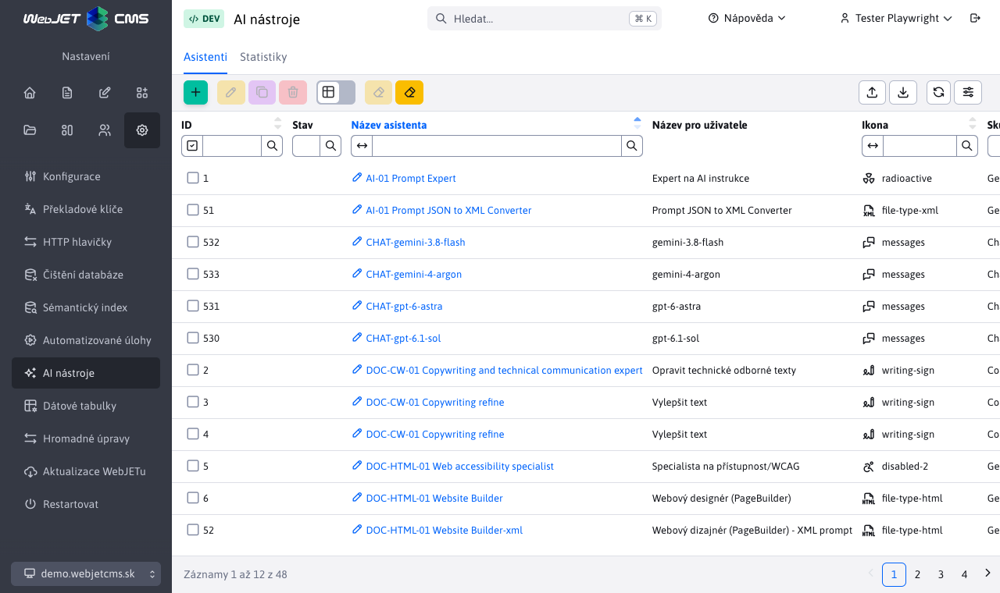
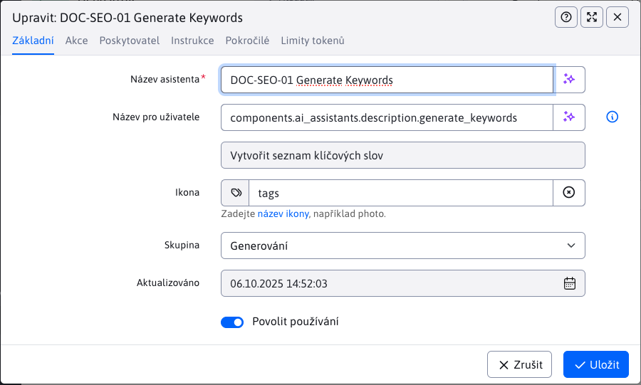
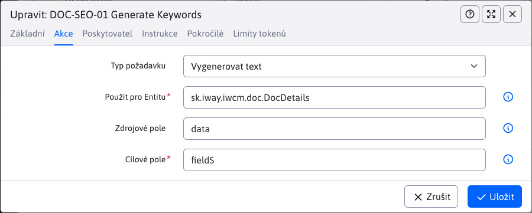
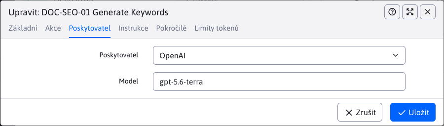
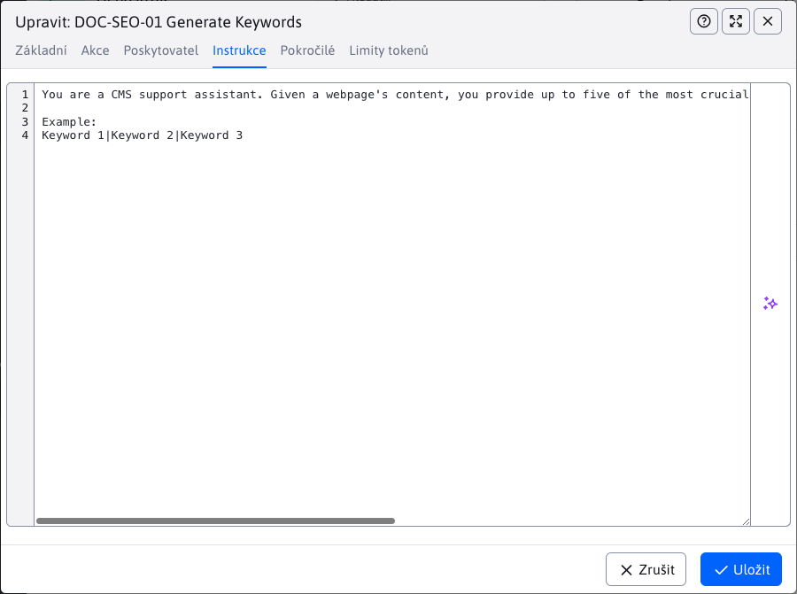
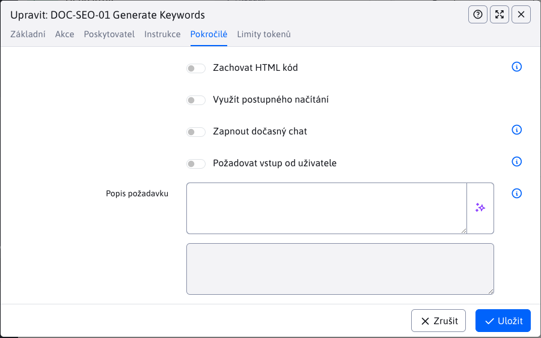
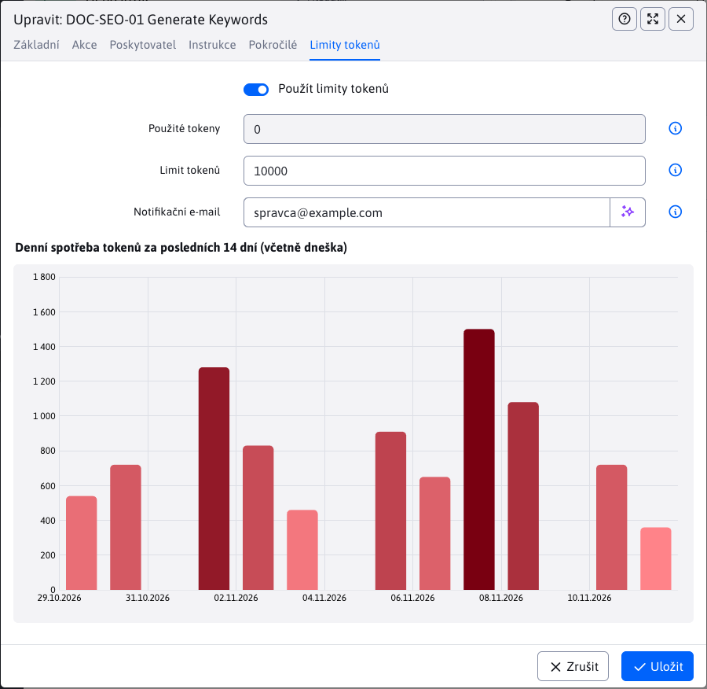
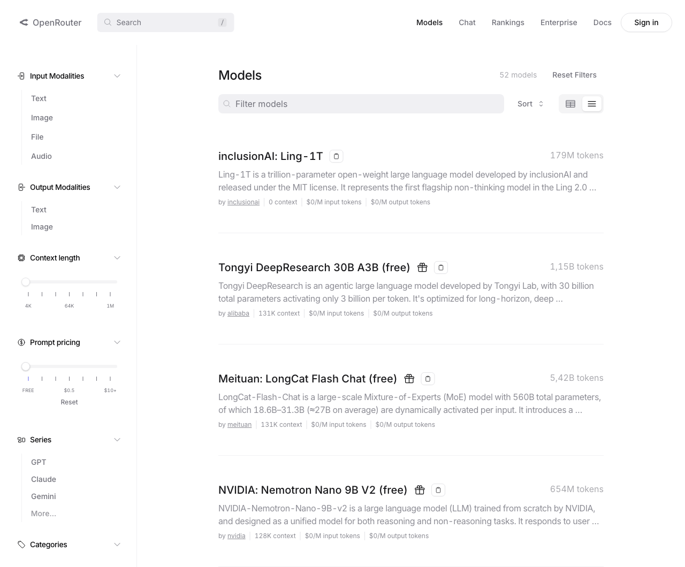

# Nastavení

Tento dokument popisuje správu a konfiguraci AI asistentů ve WebJET CMS. V sekci **AI asistenti** můžete vytvářet a upravovat jednotlivé asistenty, přičemž každý záznam představuje konkrétní typ akce s vybraným poskytovatelem AI služeb. Nastavení umožňují určit, kde (ve které tabulce) a pro které pole nebo pole bude daný asistent dostupný, čili bude provádět nastavenou akci.

Sloupec **Stav** v seznamu asistentů zobrazuje možné stavy:

- <span class="text"><i class="ti ti-ban" style="color: #E00028;" aria-hidden="true"></i>Vypnutý asistent</span> - asistent má vypnutou možnost **Povolit používání**. Uživatelem se nezobrazuje a nelze jej spustit.
- <span class="text"><i class="ti ti-alert-triangle" style="color: #FABD00;" aria-hidden="true"></i>Neinicializovaný poskytovatel</span> - poskytovatel AI není připraven k používání. Zkontrolujte jeho konfiguraci, například API klíč nebo nastavení lokálního modelu.
- <span class="text"><i class="ti ti-gauge-off" style="color: #FABD00;" aria-hidden="true"></i>Dosažený limit tokenů</span> - počet použitých tokenů dosáhl nebo překročil nastavený limit. Další požadavky jsou zablokovány, dokud spotřebu nevynulujete nebo limit nezvýšíte nad aktuální spotřebu.

Pomocí filtru v tomto sloupci můžete vyhledat například asistenty se stavem **Dosažený limit tokenů**.



!>**Upozornění:** Nastavení by měla provádět pouze osoba, která má dostatečné znalosti o fungování AI asistentů a rozumí možnostem jednotlivých poskytovatelů. Nesprávné nastavení může vést k neoptimálnímu chování asistenta nebo k omezení jeho funkčnosti. Doporučujeme, aby konfiguraci prováděl administrátor nebo technicky zdatný uživatel, který umí správně zadat instrukce a parametry pro konkrétního AI poskytovatele.

## Základní informace

V této části si probereme, jak přidat/nastavit nového **AI asistenta**. Při této akci jsou dostupné následující karty:

- Základní
- Akce
- Poskytovatel
- Instrukce
- Pokročilé
- Limity tokenů

### Karta - Základní

Tato karta obsahuje základní informace o asistentovi jako název, ikona nebo datum vytvoření. Obsahuje pole:

- **Název asistenta** – interní identifikátor asistenta (uživatel ho nevidí). Musí být unikátní v kombinaci s hodnotou **Poskytovatel** (tj. stejný název můžete použít pro více asistentů, ale každý musí mít jiného poskytovatele).
- **Název pro uživatele** – zobrazený název v rozhraní. Nemusí být unikátní. Pokud není vyplněn, použije se hodnota z pole **Název asistenta**. Můžete také zadat překladový klíč (hodnota klíče se zobrazí v poli pod ním).

  Značka `{model}` se při zobrazení nahradí aktuální hodnotou pole **Model**. Například `{model}` zobrazí `gpt-6.1-sol` a `Čet {model}` zobrazí `Čet gpt-6.1-sol`. Před značkou může být také překladový klíč: `components.ai_assistants.groups.00-chat {model}` zobrazí přeložený název skupiny a model. Značku můžete použít také přímo v hodnotě překladového klíče. Náhled pod polem se aktualizuje při změně názvu nebo modelu.

- **Ikona** – název ikony ze stránky https://tabler.io/icons. Zobrazuje se spolu s polem **Název pro uživatele**. Zadejte pouze identifikátor ikony (bez URL).
- **Skupina** – logické nebo vizuální seskupení asistentů v rozhraní. Nemá vliv na zpracování ani výsledek.
- **Vytvořeno** – systémem generované datum vytvoření. Nelze upravit a zobrazí se pouze při editaci stávajícího asistenta.
- **Povolit používání** – pokud není zapnuto, asistent se nezobrazuje uživatelem a nelze jej spustit (slouží jako rychlá deaktivace).



### Karta - Akce

Na této kartě nastavujete, jakou akci má AI asistent provádět, odkud bude získávat data a kde bude dostupný. K dispozici jsou tato pole:

- **Typ požadavku** – určujete, jaký typ úlohy má asistent provést:
  - Vygenerovat text
  - Vygenerovat obrázek
  - Upravit obrázek
  - Čet
- **Použít pro Entitu** – vybíráte entitu (tabulku), ve které bude asistent dostupný. Při psaní se automaticky zobrazí všechny podporované entity i hodnota `CHAT_SEARCH` pro samostatný AI Čet v rychlém vyhledávání.
- **Zdrojové pole** – určujete pole z vybrané entity, ze kterého má asistent čerpat data při provádění akce. Toto pole není povinné; vyberte jej pouze v případě, že jsou potřebná vstupní data. Zobrazí se všechna pole dané entity.
- **Cílové pole** – vybíráte pole v entitě, u kterého bude asistent dostupný. U typu **Čet** můžete přidat i `top-search-field` pro kartu **AI Čet** v rychlém vyhledávání. Pokud je jedinou entitou `CHAT_SEARCH`, při uložení četového asistenta se prázdné cílové pole doplní na `*`.



Pro entitu, zdrojové a cílové pole lze zadat i hodnoty typu:

- `value1,value2,value3` – aplikuje se na více hodnot
- `*` – aplikuje se na všechny hodnoty
- `%value!` – aplikuje se, pokud kdekoliv obsahuje hodnotu `value`
- `%value` – aplikuje se, pokud začíná hodnotou `value`
- `value!` – aplikuje se, pokud končí hodnotou `value`

Pro cílové pole lze zadat nejen jméno atributu v entitě, ale také CSS třídu a hodnotu `renderFormat`. Je tedy možné zadat hodnotu `dt-format-text,dt-format-text-wrap` pro aplikování na všechny typy textových polí.

Volitelná pole (tedy pole jejichž název je `fieldX`) se mohou dynamicky měnit, například podle zvolené šablony ve webových stránkách. Při generování AI asistentů se na serverové straně detekuje pouze hlavní typ bez ohledu na použitou šablonu stránky. Proto nemusí být asistent zobrazen správně pokud mají stránky různé šablony. Volitelná pole se inicializují při obnovení webové stránky podle šablony složky ve které se nacházíte, takže obnovení stránky může načíst správné hodnoty. Přechod na jinou stránku s jinou šablonou ale asistenty nezmění.

Zároveň je-li pro volitelné pole nastaven konkrétní asistent (jméno pole se shoduje s hodnotou v poli Cílové pole definice asistenta), nezobrazí se ostatní všeobecní asistenti definovaní např. podle typu pole a podobně. Předpokládá se, že pokud definujete asistenta pro konkrétní volitelné pole, nepotřebujete ostatní všeobecné asistenty (jako např. Opravit gramatiku). Pokud takového asistenta potřebujete, stačí přidat jméno volitelného pole i do těchto všeobecných asistentů.

Pokud v entitě nechcete, aby se pro pole zobrazovaly možnosti AI nástrojů, stačí do anotace nastavit atribut `ai=false` nebo přidat CSS třídu `ai-off`. V takovém případě se u pole zobrazí tlačítko pro AI asistenta jen tehdy, je-li zadán přesně pro danou entitu a pole.

```java
	@Lob
	@Column(name = "description")
	@DataTableColumn(inputType = DataTableColumnType.OPEN_EDITOR, renderFormat = "dt-format-text", tab="description", ai=false, editor = {
			@DataTableColumnEditor(type = "textarea", attr = {
					@DataTableColumnEditorAttr(key = "class", value = "textarea-code") }) })
	private String description;
```

### Karta - Poskytovatel

Tato karta slouží k výběru poskytovatele AI služeb, který bude použit ke zpracování požadavku asistenta. Ve výběrovém poli se zobrazí všichni dostupní poskytovatelé; u poskytovatele bez potřebné konfigurace se k názvu doplní upozornění **nenakonfigurován**. U nakonfigurovaných serverových poskytovatelů se seznam modelů načte přímo z jejich API a ukládá se do vyrovnávací paměti odděleně podle poskytovatele, domény a účinné konfigurace. Po výběru poskytovatele se zobrazí pouze pole podporovaná jeho CMS adaptérem; prohlížečový poskytovatel například vlastní výběr modelu nezobrazuje.



### Karta - Instrukce

Tato karta je klíčová pro správné fungování asistenta. Obsahuje jedno pole, do kterého zadáváte detailní instrukce, co má asistent provést po spuštění. Instrukce by měly být jasné, konkrétní a srozumitelné, aby asistent věděl přesně, jakou úlohu má splnit. Správně zadané instrukce zajistí, že asistent bude provádět požadované akce efektivně a podle očekávání. Více se dočtete v části [psaní instrukcí](../instructions/README.md).



### Karta - Pokročilé

Na této kartě naleznete rozšířené možnosti konfigurace asistenta, které umožňují detailněji přizpůsobit jeho chování podle vašich potřeb. Dostupná nastavení se mohou lišit v závislosti na vybraném poskytovateli AI služeb. Doporučujeme měnit tato nastavení pouze tehdy, pokud přesně víte, jaký bude jejich vliv na fungování asistenta, jelikož mohou ovlivnit jeho výsledky nebo způsob interakce s uživatelem.

- **Zachovat HTML kód** – je-li zapnuto, HTML značky ze zdrojového pole se neodstraní a odešlou se poskytovateli tak, jak jsou. Zapněte pouze v případě, že model potřebuje pracovat se strukturovaným HTML (např. analýza nebo úprava obsahu). Jinak ponechte vypnuto kvůli čistšímu vstupu.
- **Využít postupné načítání** – odpověď se bude zobrazovat po částech (streamování) namísto jednoho bloku. Vhodné u delších generovaných textů, aby měl uživatel okamžitou zpětnou vazbu. Funguje pouze pro textové výstupy.
- **Zapnout dočasný čet** – vypne ukládání rozhovoru do historie AI Četu. Zobrazené zprávy zůstávají pouze na aktuální stránce administrace a přílohy nejsou dostupné. Pro uloženou historii na kartě AI Čet tuto volbu vypněte a použijte podporovaný model OpenAI nebo Gemini. Nastavení nenahrazuje pravidla zpracování a uchovávání údajů u poskytovatele.
- **Požadovat vstup od uživatele** – před spuštěním asistenta musí uživatel zadat vlastní vstup (např. zadání tématu, doplňující instrukce nebo klíčových slov). Pokud je vypnuto, asistent běží bez dodatečného vstupu.
- **Popis požadavku** – krátká nápověda zobrazovaná u pole pro zadání vstupu (usnadňuje uživateli pochopit, co má napsat). Může být zadán i překladový klíč; jeho vyhodnocená hodnota se zobrazí v poli pod ním.



### Karta - Limity tokenů

Na kartě **Limity tokenů** můžete omezit spotřebu konkrétního asistenta. Limit je společný pro všechny uživatele tohoto asistenta v aktuální doméně.

- **Použít limity tokenů** - zapne kontrolu spotřeby a zobrazí další pole. Po vypnutí a uložení se limit i počítadlo použitých tokenů vynulují.
- **Použité tokeny** - počet tokenů spotřebovaných během zapnutého omezení od posledního vynulování. Pole je pouze pro čtení, hodnota se aktualizuje po zaznamenání spotřeby asistenta.
- **Limit tokenů** - povinné celé číslo větší než `0`, pokud je omezení zapnuto.
- **Notifikační e-mail** - volitelná e-mailová adresa, na kterou se odešle upozornění při dosažení **75 %** a **100 %** limitu. Pokud pole ponecháte prázdné, upozornění se neodesílají.

Upozornění se vyhodnotí po zaznamenání spotřeby asistenta. E-mail obsahuje název asistenta, doménu, počet použitých tokenů a nastavený limit. Po úspěšném odeslání nebo zařazení do fronty se upozornění označí jako vybavené do vynulování spotřeby. Při souběžných požadavcích může stejné upozornění přijít vícekrát. Pokud jeden požadavek zvýší spotřebu z hodnoty pod 75 % rovnou na 100 % nebo více, odešle se pouze upozornění o dosažení celého limitu.

!> Upozornění: Před spuštěním požadavku se ověří aktuální spotřeba. Pokud je počet použitých tokenů roven limitu nebo vyšší, asistent požadavek odmítne. Již spuštěný požadavek může limit překročit, protože jeho spotřeba se přičte až po zpracování. Asistenta můžete znovu používat po vynulování spotřeby nebo po zvýšení limitu nad aktuální spotřebu.

Kontrola platí i pro ukládané čety a provede se před zpracováním příloh. Uložené odpovědi zůstávají dostupné i po vyčerpání limitu, opakované doručení již dokončeného požadavku nespustí nové volání AI.

Karta poskytuje také graf **Denní spotřeba tokenů za posledních 14 dní (včetně dneška)**. Pomáhá zvolit limit podle dosavadního používání. Každý sloupec představuje denní součet tokenů ze [statistiky AI](../stat/README.md) ; vyšší spotřeba má tmavší odstín červené. Graf zahrnuje i spotřebu před zapnutím limitu a jeho historie se při vynulování počítadla zachová.



### Vynulování spotřeby

Na konci nástrojové lišty jsou dvě tlačítka <button class="btn btn-sm btn-warning" type="button"><span><i class="ti ti-eraser" aria-hidden="true"></i></span></button>

- **Vynulovat použité tokeny vybraných asistentů** - první tlačítko je dostupné po označení jednoho nebo více asistentů.
- **Vynulovat použité tokeny všech asistentů v aktuální doméně** - druhé tlačítko je dostupné, když není označen žádný asistent. Vynuluje spotřebu celé aktuální domény, i když je seznam filtrován.

Obě akce vyžadují potvrzení a výsledek zobrazí v notifikaci. Vynulují počítadlo **Použité tokeny** a umožní opětovné odeslání e-mailových upozornění při dosažení 75 % a 100 % limitu. Nastavené limity, notifikační e-mail i historie statistik a grafu zůstanou zachovány. Totéž platí při automatickém vynulování.

### Automatické vynulování tokenů

Aktualizace automaticky přidá povolenou úlohu **AI - Reset token usage**, která každý den o půlnoci podle času serveru vynuluje spotřebu tokenů. Role běží na administrátorských nodech a nespouští se po startu. Před resetem počká náhodný čas kratší než 10 vteřin, aby se omezil souběh na více nodech.

Časování můžete změnit nebo úlohu vypnout v sekci **Nastavení → [Automatizované úlohy](../../../admin/settings/cronjob/README.md) ** na adrese `/admin/v9/settings/cronjob/`. Výchozí nastavení:

- ** Název úlohy** - `AI - Reset token usage`.
- **Úkol** - `sk.iway.iwcm.components.ai.rest.AiTokenUsageReset`.
- **Parametry úlohy** - ponechte prázdné.
- **Povoleno** - zapněte.
- **Spouštění po startu** - ponechte vypnuto, chcete-li nulovat pouze podle zadaného harmonogramu.
- **Sekundy, minuty, hodiny** - `0`.
- **Den v měsíci, měsíc, den v týdnu, rok** - `*`.
- **Clustr nod** - `all-admin`.

Chcete-li používat **týdenní limit**, upravte stávající úlohu **AI - Reset token usage** pro reset každé pondělí o půlnoci:

| Pole | Hodnota |
| --- | --- |
| Sekundy | `0` |
| Minuty | `0` |
| Hodiny | `0` |
| Den v měsíci | Měsíc |
| Den v týdnu | `1` |
| Rok | `1` |
| Rok | `*` |

Hodnota **Den v týdnu = `1`** znamená pondělí, `0` znamená neděli. Odpovídající cron výraz je `0 0 0 * * 1 *` v pořadí sekundy, minuty, hodiny, den v měsíci, měsíc, den v týdnu a rok. Úlohu ponechte povolenou a spouštění po startu vypnuto. Tím nahradíte výchozí denní reset týdenním; počítadlo se vynuluje každé pondělí o půlnoci podle času serveru s krátkým náhodným zpožděním popsaným výše.

Úloha vynuluje spotřebu **všech AI asistentů ve všech doménách**. Nepřijímá parametr domény. Nastavené limity ani historické statistiky nemění a počet aktualizovaných asistentů zapíše do auditu automatizovaných úkolů.

Pokud existuje povolená úloha `AiTokenUsageReset` s budoucím termínem spuštění, nad seznamem asistentů se zobrazí informace **Nejbližší vynulování počtu použitých tokenů** s datem a časem. U více povolených úloh se zobrazí nejbližší termín.

## Nastavení četového asistenta

Aktualizace přidá do výchozí domény čtyři univerzální asistenty ve skupině **Čet**:

| Název asistenta | Poskytovatel | Model |
| --- | --- | --- |
| `CHAT-gpt-6.1-sol` | OpenAI | `gpt-6.1-sol` |
| `CHAT-gpt-6-astra` | OpenAI | `gpt-6-astra` |
| `CHAT-gemini-3.8-flash` | Gemini | `gemini-3.8-flash` |
| `CHAT-gemini-4-argon` | Gemini | `gemini-4-argon` |

Po nakonfigurování poskytovatele se tito asistenti nabídnou v rychlém vyhledávání iu textových polí včetně WYSIWYG editoru. V nastavení **Použít pro Entitu** mají `*` av nastavení **Cílové pole** mají `dt-format-text,dt-format-text-wrap,dt-format-wysiwyg,top-search-field`.

V nabídce se zobrazí název modelu (`{model}`). Asistenti mají zapnuté postupné načítání odpovědi a ukládání rozhovorů. Společné instrukce určují stručné odpovědi v jazyce uživatele, formátování Markdown, navazování na předchozí zprávy a odkaz na dokumentaci WebJET CMS. Model i instrukce můžete upravit v nastaveních asistenta.

Vlastního četového asistenta nastavíte takto:

1. V **Nastavení → AI asistenti** vytvořte nebo upravte asistenta a zapněte **Povolit používání**.
2. Na kartě **Akce** vyberte **Typ požadavku → Čet**.
3. Pro zobrazení v rychlém vyhledávání přidejte do **Cílového pole** hodnotu `top-search-field`. Další cílová pole oddělte čárkou. Například pro entitu `sk.iway.iwcm.doc.DocDetails` a cíl `title,top-search-field` bude asistent dostupný při názvu stránky iv rychlém vyhledávání. Pokud má být dostupný pouze v rychlém vyhledávání, stačí nastavit **Použít pro Entitu** na `CHAT_SEARCH`.
4. Na kartě **Poskytovatel** vyberte nakonfigurovaného poskytovatele a model podporující požadovaný způsob práce.
5. V **Instrukcích** určete úlohu asistenta, jazyk a požadovaný formát odpovědí.
6. Pro ukládané rozhovory s přílohami na kartě **AI Čet** použijte OpenAI nebo Gemini, model s podporou četu a vypněte **Zapnout dočasný čet**. Pro průběžné zobrazování odpovědi zapněte **Využít postupné načítání**, pokud jej model podporuje.

Rychlé vyhledávání nabízí aktivní četové asistenty aktuální domény s nakonfigurovaným poskytovatelem. Vyžaduje přesnou hodnotu `top-search-field` v seznamu cílových polí nebo `CHAT_SEARCH` v seznamu entit. Rozhovor otevřený z rychlého vyhledávání začíná bez obsahu otevřené stránky. Pokud asistentovi odstraníte poslední vazbu na rychlé vyhledávání, jeho uložené rozhovory v této nabídce zůstanou dostupné pouze pro čtení.

Uživatel potřebuje oprávnění k používání AI asistentů (`cmp_ai_button`). Pokud změníte model, asistenta nebo konfiguraci poskytovatele, starší uložený rozhovor může zůstat dostupný pouze pro čtení. Postup práce s rozhovory je v kapitole [AI Čet](../chat/README.md).

## Poskytovatelé

Poskytovatel zajišťuje AI nástroje, modely a funkcionality využívané při zpracování požadavků v CMS. Může se jednat o externí službu nakonfigurovanou například API klíčem nebo o lokální model spuštěný přímo na serveru. Jednotliví poskytovatelé se mohou lišit v možnostech, ceně, kvalitě výsledků nebo specializaci na konkrétní typy úkolů. Výběr vhodného poskytovatele závisí na vašich potřebách a požadavcích na konkrétní AI funkcionalitu.

### OpenAI

OpenAI patří mezi nejznámější a nejpoužívanější poskytovatele AI služeb. Ve WebJET CMS je jeho API již integrováno – pro aktivaci stačí zadat váš API klíč do konfigurační proměnné `ai_openAiAuthKey`. Při zadávání klíče doporučujeme využít možnosti **Šifrovat** pro vyšší bezpečnost.

Aktuálně je podporována integrace pro tyto typy požadavků:

- Generování textu
- Generování obrázků
- Úprava obrázků

API klíč získáte registrací na stránce [OpenAI](https://platform.openai.com/signup). Po přihlášení do svého účtu přejděte do sekce `API Keys`, kde si můžete vygenerovat nový klíč. Tento klíč následně vložte do nastavení CMS podle výše uvedeného postupu.

### Gemini

Gemini, podobně jako OpenAI, patří mezi nejznámější a nejpoužívanější poskytovatele AI služeb. Ve WebJET CMS je jeho API již integrováno přes nástroj [AI Studio](https://aistudio.google.com/) – pro aktivaci stačí zadat váš API klíč do konfigurační proměnné `ai_geminiAuthKey`. Při zadávání klíče doporučujeme využít možnosti **Šifrovat** pro vyšší bezpečnost.

Aktuálně je podporována integrace pro tyto typy požadavků:

- Generování textu
- Generování obrázků
- Úprava obrázků

API klíč získáte následovně:

- Otevřete stránku [Google AI Studio](https://aistudio.google.com/apikey).
- Přihlaste se do účtu `Google` (klíč bude vázán na tento účet).
- Klepněte na `Create API key`.
- Vyberte existující nebo vytvořte nový `Google Cloud` projekt, ke kterému se klíč přiřadí.
- Potvrdíte generování – zobrazí se vygenerovaný klíč, který následně vložte do nastavení CMS podle výše uvedeného postupu.

Nově vygenerovaný klíč funguje nejdříve v bezplatném (omezeném) režimu – platí limity na počet požadavků za minutu/hodinu/den. Pro vyšší limity a stabilní provoz nastavte fakturaci přes odkaz `Set up billing` u klíče. Po přidání způsobu platby se limity zpřístupní podle aktuálních podmínek společnosti `Google`.

Pokročilá nastavení (kvóty, fakturace, rotace klíčů, statistiky) naleznete v [Google Cloud Console](https://console.cloud.google.com/).

### OpenRouter

Služba [OpenRouter](https://openrouter.ai) propojuje různé poskytovatele AI služeb do jednoho společného API. Technicky váš požadavek směřuje na API daného poskytovatele, výhoda je, že nepotřebujete mít vytvořené účty u více poskytovatelů, ale máte jeden účet v OpenRouteru, který používáte pro více poskytovatelů AI služeb. Mnoho modelů je dostupných zdarma, služba je tedy výhodná také pro testování/zkoušení možností AI modelů.

Pro používání placených modelů do služby můžete doplnit fixní kredit, nebo nastavit automatické doplňování kreditu, pokud se spotřebuje. Dostupné jsou i statistiky využití jednotlivých modelů.

Vygenerovaný API klíč nastavte do konfigurační proměnné `ai_openRouterAuthKey`.



### Lokální modely

Lokální modely provádějí požadavky přímo na aplikačním serveru WebJET CMS. Kvalita modelů samozřejmě nedosahuje kvality velkých komerčních modelů, ale jsou spuštěny lokálně na vašem serveru, data neopouštějí vaše prostředí. Není potřebná speciální grafická karta, tyto modely jsou spouštěny na standardních procesorech. Samozřejmě ale jejich provoz zvyšuje požadavky na výpočetní výkon a paměť serveru. Praktické nasazení je třeba ověřit a provést i zátěžové testy.

!>**Upozornění:**: aktuálně je podporován běh modelů na architekturách `Linux x86_64`, `Windows x64` nebo `macOS ARM64`.

Dostupné jsou tři samostatné typy poskytovatelů:

- **Lokální model pro generování textu** - používá model `utter-project/EuroLLM-1.7B-Instruct` a podporuje pouze generování textu. Streamování odpovědi není podporováno a požadavky se neukládají.
- **Lokální překladový model** - používá model `facebook/m2m100_418M` k překladu čistého textu. Nepodporuje HTML kód, `INCLUDE` příkazy, strukturovaný vstup ani doplňující vstup uživatele.
- **Lokální embeddingový model** - používá model `intfloat/multilingual-e5-base` k [sémantické indexování a vyhledávání](../../apps/semantic-search/README.md). Model generuje vektory s `768` dimenzemi.

Modelové balíky ve formátu ZIP musí být předem připraveny a schváleny pro WebJET CMS. Nejprve je třeba ve vašem `build.gradle` souboru přidat závislost a task na vytvoření souborů (verzi `com.webjetcms:webjet-ai-local` nastavte shodnou s verzí ve WebJET CMS):

```gradle
dependencies {
	....
	implementation "com.webjetcms:webjet-ai-local:2.0.4"
}

def localAiModelsDirectory = file('src/main/webapp/WEB-INF/local-ai-models')
def localAiModelTasks = [
    prepareLocalAiTextModel: [
        model: 'utter-project/EuroLLM-1.7B-Instruct',
        variant: 'q4-k-m',
        output: 'eurollm-1.7b-instruct-q4-k-m.zip'
    ],
    prepareLocalAiTranslationModel: [
        model: 'facebook/m2m100_418M',
        variant: 'int8',
        output: 'm2m100-418m-int8.zip'
    ],
    prepareLocalAiEmbeddingModel: [
        model: 'intfloat/multilingual-e5-base',
        variant: 'fp32',
        output: 'multilingual-e5-base-fp32.zip'
    ]
]

localAiModelTasks.each { taskName, modelDefinition ->
    tasks.register(taskName, JavaExec) {
        group = 'webjet-ai'
        description = "Prepares ${modelDefinition.model} for local WebJET AI use."
        classpath = configurations.runtimeClasspath
        mainClass = 'com.webjetcms.ai.local.tool.LocalModelTool'
        args 'prepare',
            '--model', modelDefinition.model,
            '--output', new File(localAiModelsDirectory, modelDefinition.output).absolutePath
        if (modelDefinition.variant != null) {
            args '--variant', modelDefinition.variant
        }
        if (providers.gradleProperty('overwriteLocalAiModel').getOrElse('false').toBoolean()) {
            args '--overwrite'
        }
    }
}
```

Následně z kořenové složky projektu spusťte generování modelů:

```shell
gradlew prepareLocalAiEmbeddingModel
gradlew prepareLocalAiTranslationModel
gradlew prepareLocalAiTextModel
```

Nástroj stáhne pevně určené soubory modelu, ověří jejich velikost a kontrolní součet a vytvoří ZIP ve složce `src/main/webapp/WEB-INF/local-ai-models`. Stávající ZIP nepřepíše, chcete-li jej vědomě nahradit, spusťte příslušný skript s parametrem `-PoverwriteLocalAiModel=true`. Každé vytvoření nebo přepsání modelového balíčku vyžaduje připojení k internetu.

Cestu k vytvořenému balíku nastavte v příslušné konfigurační proměnné:

| Proměnná | Model | Cesta vytvořená skriptem |
| --- | --- | --- |
| `ai_localEmbeddingModelBundlePath` | `intfloat/multilingual-e5-base` | `/WEB-INF/local-ai-models/multilingual-e5-base-fp32.zip` |
| `ai_localTranslateModelBundlePath` | `facebook/m2m100_418M` | `/WEB-INF/local-ai-models/m2m100-418m-int8.zip` |
| `ai_localTextModelBundlePath` | `utter-project/EuroLLM-1.7B-Instruct` | `/WEB-INF/local-ai-models/eurollm-1.7b-instruct-q4-km.zip` |

Cesta může být absolutní cesta na serveru nebo cesta začínající `/WEB-INF/`. Cesty začínající `/WEB-INF/` se vyhodnotí vůči kořenovému adresáři nasazené aplikace na serveru.

Cesty jsou globální pro celou instalaci, soubor musí být čitelný procesem aplikačního serveru a po jejich změně je zapotřebí restart. Model se otevře až při prvním použití. Poskytovatel se v editoru označí jako nenakonfigurovaný, dokud příslušná cesta není nastavena.

Nastavte ještě konfigurační proměnné:

- `ragEmbeddingDimensions` na hodnotu 768
- `ragSemanticSearchEnabled` na hodnotu true - aktivuje sémantické vyhledávání
- `searchType` na hodnotu `semantic` pro podporu sémantického vyhledávání
- `ragAnswerAllowed` na hodnotu true pokud chcete nad vyhledáváním zobrazit i sekci "Přehled od AI" a máte aktivován i `ai_localTextModelBundlePath`. Upozorňujeme, že se jedná o poměrně malý jazykový model, takže RAG odpovědi oproti komerčním modelům nemusí být vůbec zobrazeny, nebo nejsou zcela správné/kompletní. Zároveň generování přehledu od AI výrazně zatěžuje výkon serveru a odpověď trvá výrazně déle oproti jednoduchému sémantickému hledání.

Více informací naleznete v [dokumentaci k vyhledávání](../../apps/search/README.md).

!>**Upozornění:**: při změně `ragEmbeddingDimensions` se smaže tabulka `rag_embedding_chunks` se stávajícími záznamy sémantického indexu, protože podle dimenze je nastavena datová struktura.

Pro embedding v sekci AI nástroje upravte asistenta `RAG-EMB-INDEX` a `RAG-EMB-SEARCH` - oběma nastavte v kartě Poskytovatel hodnotu Poskytovatel na Lokální embeddingový model a hodnotu Model na `intfloat/multilingual-e5-base`. Asistentovi `RAG-SEARCH` nastavte Lokální model pro generování textu a model `utter-project/EuroLLM-1.7B-Instruct`. Pokud takoví asistenti neexistují, systém je vytvoří při prvním použití sémantického indexování nebo vyhledávání, potom po vytvoření poskytovatele a modely nastavte.

Pro lokální překlad musí pole **Instrukce** obsahovat zdrojový a cílový jazyk ve formátu JSON, případně s prefixem `Translator:`:

```text
Translator: {"sourceLanguage":"sk","targetLanguage":"en","maximumOutputTokens":200}
```

Jazyky musí být určeny explicitně; hodnota `autodetect` není podporována. Hodnota `userLng` použije aktuální jazyk uživatele a kód `cz` se automaticky změní na `cs`. Volitelná hodnota `maximumOutputTokens` musí být kladné celé číslo, nejvíce `200`.

!>**Upozornění:** Modelové soubory mohou mít stovky megabajtů až několik gigabajtů. Před aktivací ověřte dostatek diskového prostoru a operační paměti a použijte pouze balík z důvěryhodného zdroje.

Nezapomeňte také nastavit [úlohu na pozadí](../../apps/semantic-search/README.md), která provádí indexování.

### Prohlížeč

Poskytovatel **Prohlížeč** používá [zabudované AI rozhraní Google Chrome](https://developer.chrome.com/docs/ai/get-started). Modely se stahují do počítače uživatele a požadavky se provádějí v prohlížeči. Dostupnost tohoto poskytovatele můžete vypnout nastavením konfigurační proměnné `ai_browserAiEnabled` na hodnotu `false`.

Pro spuštění AI v prohlížeči je třeba splnit:

- [HW požadavky](https://developer.chrome.com/docs/ai/get-started#hardware) počítače.
- Spojení do WebJET CMS musí být zabezpečeno (použit protokol HTTPS).

#### Zapnutí potřebných API

Dostupnost jednotlivých API závisí na verzi Chrome; některé jsou [stále experimentální](https://developer.chrome.com/docs/ai/built-in-apis#api_status). Pokud požadované API není dostupné, otevřete `chrome://flags/`, vyhledejte konkrétní položku a nastavte ji na **Enabled**:

| API | Použití ve WebJET CMS | Adresa nastavení |
| --- | --- | --- |
| **Prompt API** | Vlastní zadání pro `LanguageModel` | `chrome://flags/#prompt-api` |
| **Summarizer API** | Sumarizace textu | `chrome://flags/#summarizer-api` |
| **Writer API** | Vytvoření nového textu | `chrome://flags/#writer-api` |
| **Rewriter API** | Přepsání textu, například do neformální podoby | `chrome://flags/#rewriter-api` |

Názvy se mohou mezi verzemi Chrome lišit; starší verze používaly také označení **for Gemini Nano**. Po změně klikněte na **Znovu spustit**. Před restartem uložte rozpracované úpravy ve WebJET CMS.

**Nezapínejte všechny experimenty související s AI.** Pro běžné používání asistentů ponechte tyto volby na **Default**:

| Experiment | Adresa nastavení |
| --- | --- |
| **Gemma 4 for Built-in AI** | `chrome://flags/#gemma4-for-built-in-ai` |
| **Speculative Decoding for Built-in AI** | `chrome://flags/#on-device-model-speculative-decoding` |
| **Prompt API Tool Use** | `chrome://flags/#prompt-api-tool-use` |

Tyto experimenty mohou vynutit jiný model nebo způsob jeho spouštění i pro ostatní AI API. Při testování v **Chrome 157.0.8103.50 na macOS** Rewriter opakovaně selhával se zapnutou kombinací těchto tří experimentů. Po návratu všech tří na **Default** a restartu Chrome začal fungovat. Test potvrdil tento postup řešení; neurčil, který experiment nebo jejich kombinace způsobovaly pád.

#### Stahování a ověření funkčnosti

Při prvním spuštění asistenta může Chrome vyžádat stažení modelu o velikosti několika GB. Po dokončení stahování se zobrazení průběhu změní na přípravu modelu; počkejte na dokončení požadavku. Stav modelů můžete ověřit na `chrome://on-device-internals/`, na kartě **Broker State**. Nainstalované modely mají stav **Ready** a průběh **100 %**. Není třeba mít nainstalovány všechny modely v seznamu.

Jako první můžete vyzkoušet překlad, který stáhne potřebný překladový model. **Úspěšný překlad nepotvrzuje funkčnost Rewriteru ani ostatních generativních API**, protože používají odlišné modely. Samostatně proto vyzkoušejte i požadovanou akci, například **Přepsat text do neformální podoby** na krátkém textu.

Některé API nepodporují všechny jazyky, proto WebJET CMS může výstup následně přeložit. I tento překlad může při prvním použití vyžadovat stažení překladového modelu.

#### Chyby při spouštění modelu

Hlášení `The device is unable to create a session to run the model. Please check the result of availability() first.` znamená, že Chrome nedokázal vytvořit relaci modelu. Může se objevit i tehdy, když je model stažen a `availability()` vrací `available` ; samotný stav dostupnosti nepotvrzuje úspěšné spuštění.

Hlášení `The model process crashed too many times for this version` znamená, že Chrome po opakovaných pádech zablokoval modelový proces. Postupujte takto:

1. Zkontrolujte uvedené tři experimenty a případné **Enabled** změňte na **Default**.
2. Otevřete `chrome://on-device-internals/`. Pokud Chrome hlásí, že interní diagnostické stránky jsou vypnuté, povolte je přes `chrome://chrome-urls/` a poté se vraťte do diagnostiky.
3. Na kartě **Broker State** zkontrolujte **Model crash count (current/maximum)**. Hodnota například `6 / 3` znamená překročený limit pádů. Tlačítko **Reset** vynuluje pouze toto počítadlo, nainstalované modely zůstanou zachovány.
4. Uložte rozpracované úpravy a Chrome úplně ukončete a znovu spusťte. Samotný restart nemusí vynulovat počítadlo a samotný **Reset** nemusí hned odstranit blokování z běžícího prohlížeče.
5. Vyzkoušejte jeden krátký požadavek. Pokud počítadlo znovu roste, modelový proces opět padá. Další údaje hledejte na kartě **Event Logs** a na `chrome://crashes/` ; opakované spouštění asistenta tento stav nevyřeší.

## Připojení

Volání externích AI služeb vyžaduje připojení na internet. Ujistěte se, že váš server má přístup k vnějším službám a že firewall nebo jiná bezpečnostní opatření neblokují požadavky na API daného poskytovatele. Lokální modely internetové připojení při zpracování nevyžadují. Pro externí poskytovatele se používají následující doménová jména:

- OpenAI: `api.openai.com`
- Gemini: `generativelanguage.googleapis.com`
- OpenRouter: `openrouter.ai`

tyto je třeba povolit v odchozích požadavcích na případném proxy serveru nebo firewallu.
