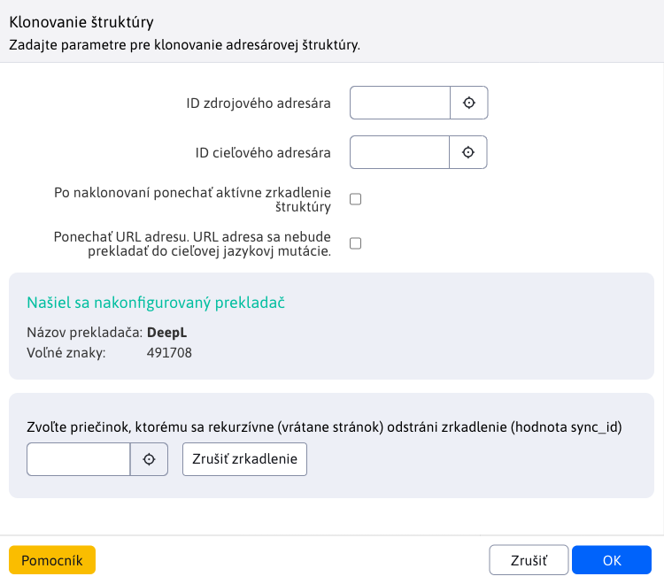
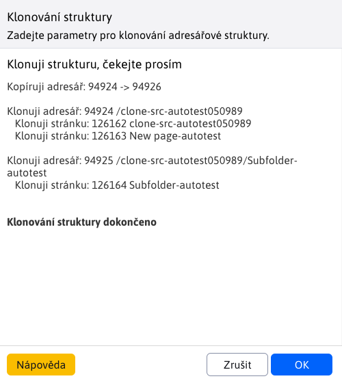
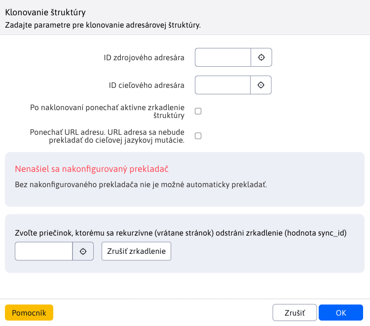
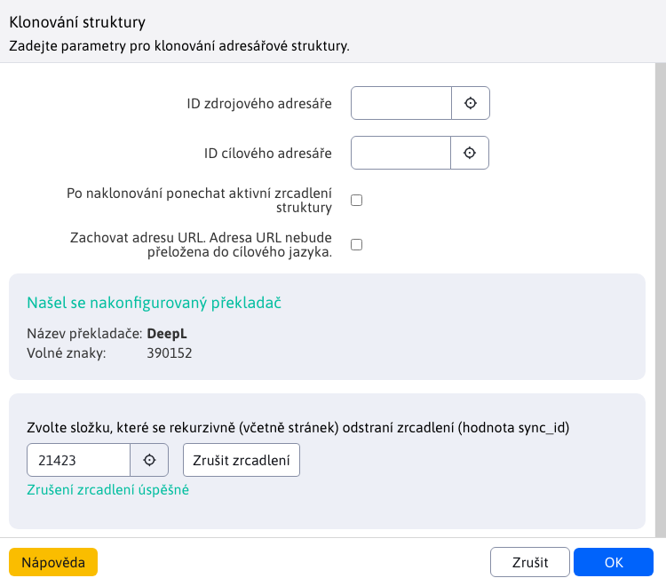

# Klonování struktury

Pomocí Klonování struktury můžeme naklonovat celý obsah adresáře ve stránkách do jiného adresáře bez nutnosti znovu vytváření celé adresářové struktury. Tato možnost je dostupná v sekci **Web stránky** jako **Klonování struktury**. Po výběru této možnosti se zobrazí okno k akci klonování. Typicky se používá k vytvoření nové jazykové mutace web sídla ze stávající verze. Jazyk je stažen z nastavení zdrojové a cílové složky.

Pro provedení akce klonování je třeba zadat ID zdrojové složky (kterou složku klonujeme) a ID cílové složky (kam na naklonuje zdrojovou složku). ID složek můžete zadat přímo, pokud si je pamatujete, nebo může využít možnosti **Vybrat**, která otevře nové okno se stromovou strukturou složek, kde si konkrétní složku volíte kliknutím na její název.

Klonování využívá [Zrcadlení struktury](../docmirroring/README.md) a [Automatický překlad](../../../admin/setup/translation.md). Na dobu klonování se vytvoří dočasné propojení zdrojové a cílové složky platné pouze pro tuto operaci. Do konfigurační proměnné `structureMirroringConfig` se uloží pouze při zvolení možnosti **Po naklonování ponechat aktivní zrcadlení struktury**. Souběžné úpravy jiných stránek používají původní nastavení zrcadlení.

Do cílové složky se naklonují všechny podsložky is web stránkami. Pokud je nastaven překladač, obsah se přeloží podle jazyků zdrojové a cílové složky. Klonované stránky přebírají nastavení zobrazování ze zdroje a složky přebírají způsob zobrazení v menu; volba `structureMirroringDisabledOnCreate` je při klonování neskrývá.

## Možnosti

### ID zdrojového adresáře

Nastavte ID složky ze které se bude klonovat.

### ID cílového adresáře

Nastavte ID složky do které se bude klonovat. Tato složka vytvoří stránky a podsložky podle zdrojové složky.

### Ponechat aktivní zrcadlení

Pokud zvolíte možnost **Po naklonování ponechat aktivní zrcadlení struktury** zachová se nastavené [zrcadlení](../docmirroring/README.md) mezi zdrojovou a cílovou složkou. Následně když vznikne nová složka, nebo web stránka bude se přenášet mezi zrcadlenými složkami.

Nastavení můžete rozpojit i později úpravou konf. proměnné `structureMirroringConfig` ze které vymažete řádek s nastavenými ID složek.

### Ponechat URL adresu

Zvolením možnosti **Ponechat URL adresu** za bezpečí, že se URL adresa stránek a složek nebude překládat do jazykové mutace cílové složky. To znamená, že nová jazyková mutace bude mít **stejné URL adresy ale jiný prefix, kterým tyto adresy začínají**.

Příklad:
Mějme složky SK (s nastaveným slovenským jazykem) a EN (s nastaveným slovenským jazykem).
Složka SK obsahuje podsložku **majetek**, která má hlavní stránku se stejným názvem. Adresa takové stránky je **/cs/majetek/**.
Pokud použijeme klonování struktury **bez ponechání URL**, ze složky SK do složky EN, kopie této stránky bude mít URL **/en/property/**.
Pokud použijeme klonování struktury **s ponecháním URL**, ze složky SK do složky EN, kopie této stránky bude mít URL **/en/majetek/**. Jak vidíme, url nebyla přeložena, změnil se pouze prefix ze /sk na /en, což reprezentuje nadřazenou složku.

## Překladač

Jelikož klonování využívá [Automatický překlad](../../../admin/setup/translation.md), zobrazuje se informace, jaký překladač je nakonfigurován a kolik volných znaků pro překlad ještě zbývá. Pokud žádný překladač nakonfigurován není (např. pokud není zadaný licenční klíč pro překladač `DeepL`) nebo již nezůstávají žádné volné znaky k překladu, budeme při klonování upozorněni. V takovém případě se **nebude** automaticky překládat klonovaná struktura.

## Zrušení zrcadlení

Okno nabízí možnost [zrušit zrcadlení](../docmirroring/README.md) zvolené složky. Stačí a v dolní části okna zvolíte složku a stisknete tlačítko <button class="btn btn-sm btn-outline-secondary" type="button">Zrušit zrcadlení</button> . Následně se pro zvolenou složku, všechny podsložky jako jejich stránky vymaže hodnota `sync_id`, která zajišťovala zrcadlení.

Na zrušení zrcadlení potřebujete právo na **Klonování struktury** a právo upravovat zvolenou složku i všechny její podsložky. Při zapnutém oddělení domén musí celá vybraná struktura patřit do aktuálně zvolené domény. Pokud je zapnuta kontrola přístupu ke stránkám podle uživatelských skupin, ověří se i přístup ke každé stránce v této struktuře. Pokud některá kontrola selže, operace se odmítne a propojení zůstanou zachovány.

!>**Upozornění:** během akce rušení zrcadlení nebude možné spustit klonování, protože tyto akce by spolu kolidovaly.
