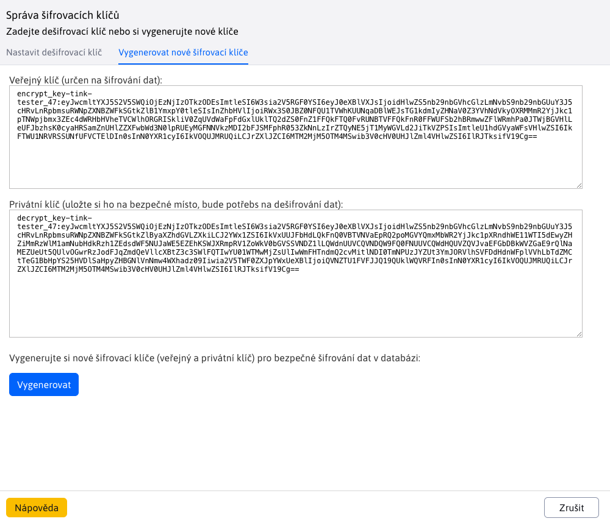
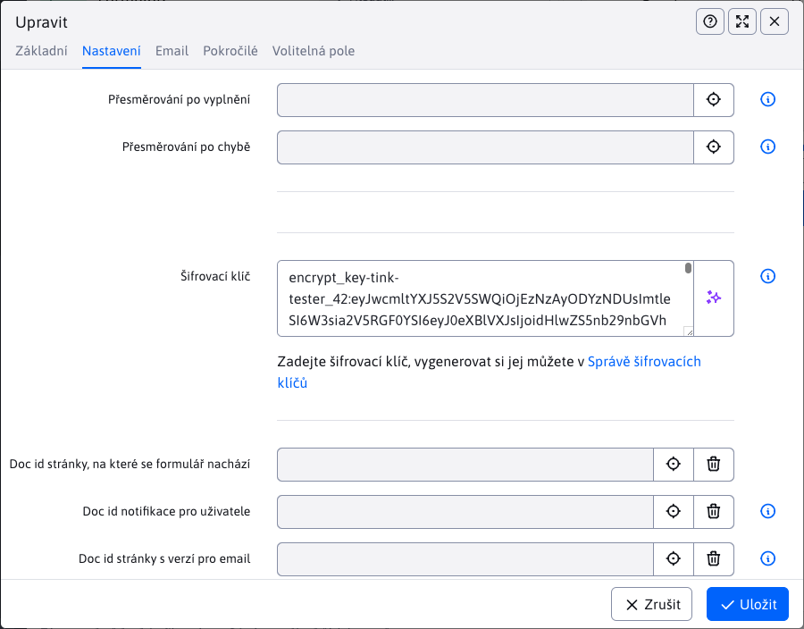
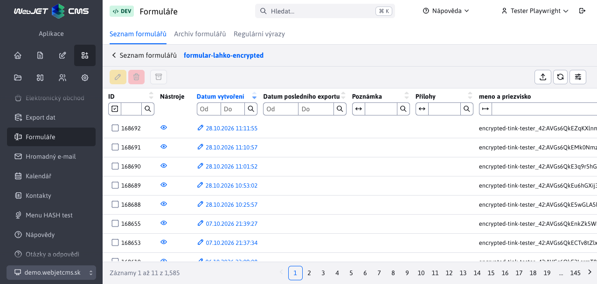
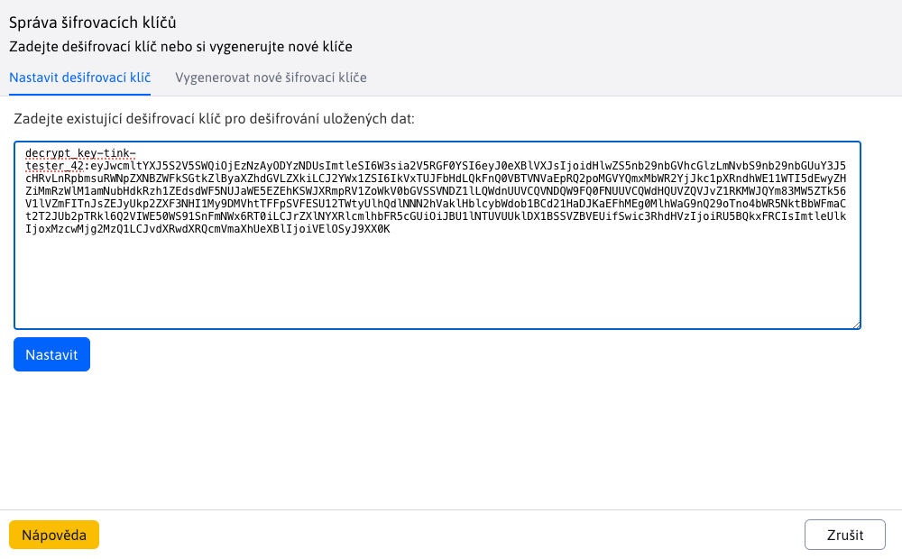
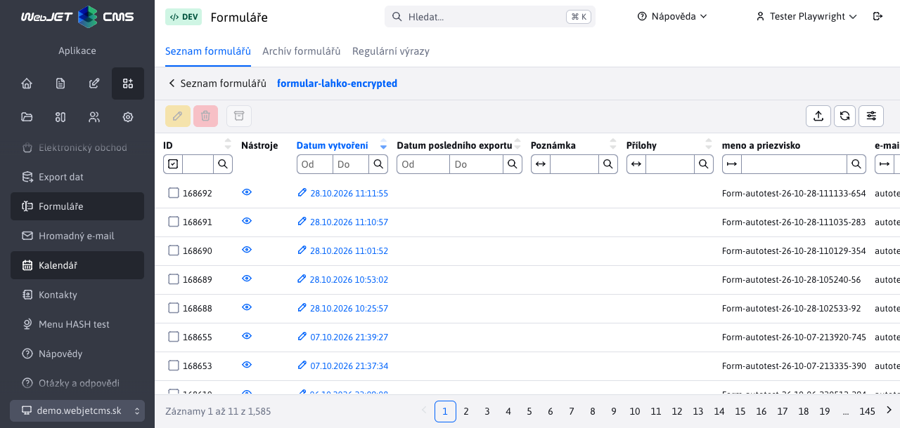

# Šifrování formulářů

Šifrování formulářů chrání obsah odeslaných formulářů uložený v databázi. Při úniku databáze nebo její zálohy tak útočník bez příslušného privátního klíče nedokáže přečíst zašifrované hodnoty, například jméno, emailovou adresu či text žádosti.

WebJET používá dvojici klíčů:

| Klíč | K čemu slouží | Kam ho zadáte |
| --- | --- | --- |
| **Veřejný klíč** | Zašifruje nová data. Samotný veřejný klíč nestačí k jejich dešifrování. | Do pole **Šifrovací klíč** v nastaveních formuláře. |
| **Privátní klíč** | Dešifruje data zašifrovaná odpovídajícím veřejným klíčem. | Do **Zprávy šifrovacích klíčů** při prohlížení odeslaných formulářů. |

Privátní klíč si uchovejte odděleně od databáze a jejích záloh, například ve správci hesel s přístupem pouze pro pověřené pracovníky. Pokud unikne spolu s databází, ochrana zašifrovaného obsahu se ztrácí.

## Co se šifruje

Šifrování je dostupné pro klasické formuláře, [Formulář snadno](../formsimple/README.md) i [víceleté formuláře](../multistep-form/README.md). Používá se při ukládání odeslaných údajů na serveru.

| Údaje | Rozsah ochrany |
| --- | --- |
| Vyplněné hodnoty běžných polí | Do databáze se ukládají zašifrované. U vícekrokového formuláře zůstávají prázdné hodnoty prázdné. |
| Uložená HTML podoba formuláře | V databázi je zašifrována, k jejímu zobrazení přes ikonu oka je zapotřebí privátní klíč. |
| Názvy polí a provozní údaje | Nešifrují se tímto klíčem. Týká se to například názvu formuláře, času odeslání, identifikátorů či poznámky k záznamu. |
| Nahrané soubory | Obsah příloh se tímto mechanismem nešifruje. U vícekrokového formuláře zůstávají čitelné i uložené názvy souborů. |
| Email a PDF kopie | Obsahují čitelné vyplněné hodnoty. Nastavení šifrovacího klíče je nešifruje. |
| Export po dešifrování | Obsahuje čitelné údaje, které je třeba chránit samostatně. |

Šifrování databázových hodnot nenahrazuje HTTPS, přístupová práva ani ochranu emailových schránek a souborů. Server při zpracování formuláře pracuje is čitelnými údaji. Tato funkce proto neposkytuje koncové šifrování mezi návštěvníkem a pracovníkem, který formuláře zpracovává.

## Vytvoření páru klíčů

1. V hlavičce administrace otevřete uživatelské menu a zvolte **Správa šifrovacích klíčů**. Položka se zobrazuje uživatelům s právem **Formuláře**. Zprávu můžete otevřít také odkazem u pole **Šifrovací klíč** v nastaveních formuláře.
2. Přejděte na kartu **Vygenerovat nové šifrovací klíče**.
3. Klepněte na **Vygenerovat**.
4. Zkopírujte celý **Veřejný klíč (určený pro šifrování dat)** a celý **Privátní klíč (uložte si jej na bezpečné místo, bude potřebný k dešifrování dat)**. Zachovejte i začátek klíče před dvojtečkou.
5. Privátní klíč bezpečně uložte ještě před zavřením okna. Evidujte, ke kterým formulářům a období patří.



Klíče na obrázcích jsou ukázkové. Pro vlastní formuláře si vždy vygenerujte vlastní pár.

!> **Při ztrátě privátního klíče nedokážete příslušné údaje dešifrovat.** Opětovné kliknutí na **Vygenerovat** vytvoří jinou dvojici klíčů, neobnoví původní. Správa klíčů neposkytuje seznam k opětovnému vyzvednutí dříve vygenerovaných privátních klíčů.

## Nastavení veřejného klíče pro formulář

1. Otevřete **Formuláře → Seznam formulářů**.
2. Označte požadovaný formulář a klikněte na **Upravit**. Klepnutí na jeho název otevírá seznam odeslaných záznamů.
3. Na kartě **Nastavení** vložte do pole **Šifrovací klíč** celý veřejný klíč, který při výchozím algoritmu začíná na `encrypt_key-tink-`.
4. Uložte nastavení.



Do nastavení formuláře patří pouze veřejný klíč. Privátní klíč začínající na `decrypt_key-` sem nevkládejte.

Nastavení platí pro následující odeslání. Již uložené záznamy se dodatečně nezašifrují. Rovněž změna nebo odstranění veřejného klíče nedešifruje starší záznamy.

!> **Při aktualizaci starších formulářů** přeneste veřejný klíč z případného skrytého HTML pole `encryptKey` do pole **Šifrovací klíč** v administraci. Samotné zadání klíče v HTML již šifrování nezapíná. Po aktualizaci ověřte nové odeslání i jeho dešifrování.

### Ověření nastavení

1. Na webové stránce odešlete formulář s rozpoznatelnými zkušebními údaji.
2. V administraci bez nastaveného privátního klíče otevřete odeslané záznamy daného formuláře.
3. Zkontrolujte, že místo zkušebních hodnot vidíte řetězce začínající na `encrypted-tink-`. U starších RSA klíčů je začátek `encrypted-rsa2048-`.
4. Zkontrolujte i náhled přes ikonu oka. Bez privátního klíče obsahuje šifrovaný text.
5. Nastavte privátní klíč podle následujícího postupu a ověřte, že se zobrazí původní zkušební hodnoty i náhled.



!> **Úspěšné odeslání formuláře samo o sobě nepotvrzuje úspěšné šifrování.** Aktuální implementace při některých chybách šifrování vrací původní text; při některých chybách načítání Tink klíče může vzniknout prázdný šifrovaný obsah. Proto ověřte celý postup včetně dešifrování, zejména po změně klíče.

## Dešifrování seznamu formulářů

1. V uživatelském menu otevřete **Správa šifrovacích klíčů**.
2. Na kartě **Nastavit dešifrovací klíč** vložte celý privátní klíč patřící k veřejnému klíči formuláře. Ve výchozím algoritmu začíná na `decrypt_key-tink-`.
3. Klepněte na **Nastavit**. Zobrazí se hlášení **Dešifrovací klíč úspěšně nastaven**.
4. Vraťte se do seznamu odeslaných formulářů a obnovte jej. Hodnoty zašifrované příslušným veřejným klíčem se zobrazí v čitelné podobě.





Čitelné údaje jsou pak dostupné také v detailu záznamu, náhledu přes ikonu oka a při exportu. **V databázi zůstávají zašifrované** — nastavení privátního klíče slouží k jejich dešifrování při čtení.

Privátní klíč se nastavuje do aktuální serverové relace uživatele (`session`). Po odhlášení nebo zániku relace je třeba jej zadat znovu. Samotné zavření okna správy klíčů jej z relace neodstraní. Po skončení práce se odhlaste, zejména na sdíleném počítači.

V jednom pořadu je nastaven jeden privátní klíč. Máte-li formuláře nebo starší záznamy šifrované jiným párem, nastavte je odpovídající privátní klíč. Hlášení o úspěšném nastavení potvrzuje vložení klíče do relace, nikoli jeho správnost pro konkrétní data.

## Výměna klíčů a řešení problémů

Při výměně klíčů vygenerujte nový pár a nastavte nový veřejný klíč do formuláře. Starý privátní klíč si ponechte pro starší záznamy. Data se při změně nastavení automaticky nepřešifrují.

| Problém | Co zkontrolovat |
| --- | --- |
| Po nastavení privátního klíče zůstávají hodnoty zašifrovány. | Použijte celý privátní klíč z původního páru a obnovte seznam. Zkontrolujte také shodu konfigurace `cryptoContextInfo`, zejména po přenosu dat na jiný server. |
| Některé záznamy se zobrazí čitelně a jiné zůstávají zašifrovány. | Záznamy mohly být šifrovány různými klíči. Orientujte se podle identifikátoru v začátku zašifrované hodnoty. |
| Nové údaje vidíte čitelně i bez privátního klíče. | Zkontrolujte veřejný klíč v nastaveních formuláře v administraci a chyby v serverovém logu. Klíč pouze v HTML poli `encryptKey` šifrování nezapíná. Ověřujte v relaci bez dešifrovacího klíče. |
| Privátní klíč se ztratil. | Vyhledejte jeho bezpečně uloženou zálohu. Nový pár neumožní přečíst data šifrovaná původním párem. |

## Technické informace

### Výchozí algoritmus

Konfigurační proměnná `cryptoAlg` má výchozí hodnotu `CryptoTink`. Při generování klíčů používá implementace `CryptoTink` knihovnu Google Tink a šablonu:

```text
ECIES_P256_HKDF_HMAC_SHA256_AES128_CTR_HMAC_SHA256
```

Jedná se o hybridní šifrování, které kombinuje asymetrickou část s rychlým symetrickým šifrováním obsahu. Použitá šablona zahrnuje:

- **ECIES s křivkou NIST P-256** na asymetrickou část a odvození společného tajemství pomocí ECDH.
- **HKDF-HMAC-SHA-256** pro odvození klíčů.
- **AES-128 v režimu CTR** pro šifrování obsahu.
- **HMAC-SHA-256** pro kontrolu integrity v rámci symetrické části.

Hybridní šifrování umožňuje zpracovat také dlouhé hodnoty a HTML podobu formuláře. Používá náhodnost, takže dvě stejné hodnoty nemusí mít stejný šifrovaný zápis. Podrobnosti principu jsou v [dokumentaci Google Tink](https://developers.google.com/tink/hybrid) ; výše je uvedena konkrétní šablona používaná WebJET CMS.

### Formát klíčů a údajů

U Tink klíčů WebJET používá tyto tvary:

```text
encrypt_key-tink-<login>_<id>:<verejný kľúč v Base64>
decrypt_key-tink-<login>_<id>:<privátny kľúč v Base64>
encrypted-tink-<login>_<id>:<šifrovaný obsah v Base64>
```

Část `<login>_<id>` identifikuje uživatele, který pár vygeneroval, a pořadový identifikátor páru. Pomáhá přiřadit údaje ke klíči; neurčuje přístupová práva. Klíč může k dešifrování použít i jiný oprávněný uživatel, který jej má k dispozici.

Klíčový materiál Tink je serializovaný jako JSON a zakódován do Base64. **Base64 není šifrování privátního klíče** ani jeho ochrana heslem. S celým řetězcem proto zacházejte jako s tajemstvím.

Hodnoty polí jsou uloženy ve sloupci `forms.data` ; šifruje se hodnota každého pole, názvy polí a oddělovače zůstávají čitelné. HTML podoba se šifruje jako celek do `forms.html`. Dešifrování provádí server pomocí `CryptoFactory`, který přečte privátní klíč z aktuální relace. Do databáze se při tomto čtení nezapisuje dešifrovaná verze.

### Související konfigurace

| Proměnná | Význam |
| --- | --- |
| `cryptoAlg` | Vybírá implementaci při generování nového páru: ve výchozím nastavení `CryptoTink`, alternativně `CryptoRsa2048`. Při práci se stávajícími klíči se implementace vybírá podle označení klíče. Změna proměnné nepřešifruje uložená data. |
| `cryptoContextInfo` | Kontext použitý při šifrování i dešifrování přes Tink. Pokud je prázdný, WebJET jej při použití vytvoří a uloží do konfigurace. Pro dešifrování je nutná stejná hodnota jako při šifrování. Při migraci zachovejte i tuto konfiguraci. |
| `cryptoToolsShowGeneratedKeysLog` | Při hodnotě `true` vypisuje generované klíče včetně privátního do serverového logu. Na běžném provozu jej ponechejte vypnuté. |

Starší implementace `CryptoRsa2048` používá RSA s klíčem délky 2048 bitů a prefixem `rsa2048`. Šifruje přímo jeden blok přes Java `Cipher.getInstance("RSA")`, proto má omezenou délku vstupu a není vhodná pro dlouhé formulářové hodnoty ani HTML. Přesné doplnění bloku (`padding`) závisí na kryptografickém poskytovateli Javy. Pro nové páry formulářů ponechte výchozí implementaci `CryptoTink`.

Provádění naleznete ve třídách `CryptoFactory`, `CryptoTink` a `CryptoRsa2048`. Ukládání klasických formulářů a Formuláře snadno zabezpečuje `FormMailAction`, u vícekrokových formulářů `SaveFormService` a `FormHtmlHandler`. Zobrazení dešifrovaných hodnot a HTML zajišťují `FormsService` a `FormsController`.
