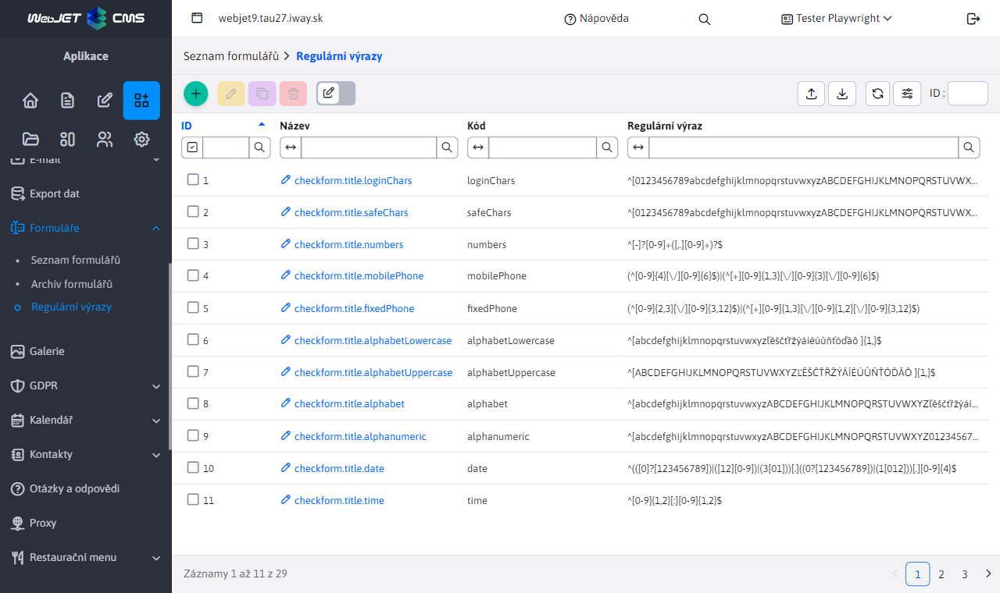
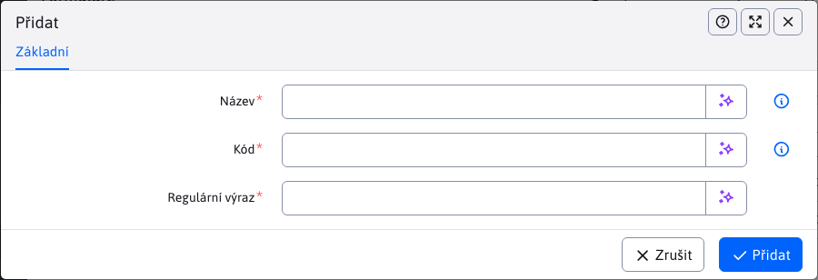

# Regulární výrazy

Aplikace Formuláře obsahuje uzel Regulární výrazy, přes které lze definovat pravidla pro kontrolu vyplnění polí. Pravidla se definují pomocí regulárního výrazu.

Sloupec **Přeložený název** zobrazuje popis pravidla v jazyce, ve kterém jste přihlášeni do administrace. Podle tohoto názvu, kódu i překladového klíče můžete seznam filtrovat a seřadit. Přeložený název se do databáze neukládá a není součástí exportu.

Seznam je ve výchozím nastavení řazen abecedně podle sloupce **Kód**. Podle kódu jsou seřazeny i možnosti **Povolená hodnota** ve vícekrokových formulářích, bez ohledu na velikost písmen a jazyk administrace.

Editor obsahuje následující pole.

- Překladový klíč - klíč popisu pravidla, například `checkform.title.alphabetLowercase`. Můžete také zadat vlastní text, například `minimálne 8 znakov`, který se zobrazí přímo. Při chybějícím překladu se použije standardní náhradní překlad WebJET CMS. Pokud se nenajde, zobrazí se samotný klíč.
- Kód - Kódové označení, může obsahovat pouze písmena bez mezer. V HTML kódu se použije jako CSS třída na vstupním poli.
- Regulární výraz - [Regulární výraz](https://www.w3schools.com/jsref/jsref_obj_regexp.asp) pravidla.

