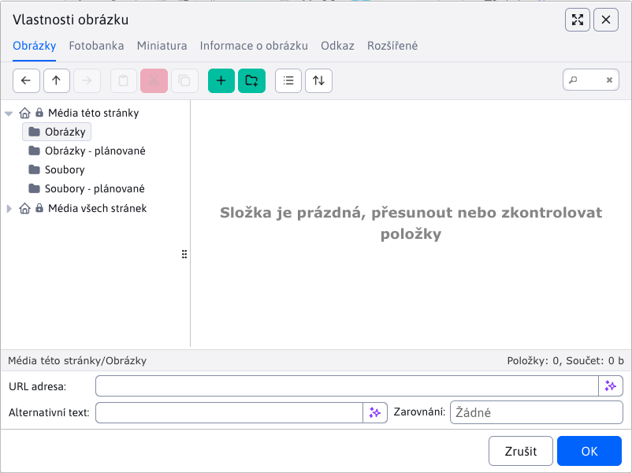

# Plánované publikování s chráněnými soubory

Příští verzi stránky můžete připravit is obrázky a dokumenty, které do termínu zveřejnění nesmí být dostupné návštěvníkům. Živý obsah a běžná pracovní verze zůstávají samostatné. Funkci musí správce zapnout konfigurační proměnnou `plannedPublishingEnabled=true` ; ve výchozím nastavení je vypnuta.

<div class="video-container">
    <iframe width="790" height="444" src="https://www.youtube.com/embed/z3QGUdDG2pk" title="YouTube video player" frameborder="0" allow="accelerometer; autoplay; clipboard-write; encrypted-media; gyroscope; picture-in-picture" allowfullscreen></iframe>
</div>

## Příprava stránky

1. Otevřete existující stránku nebo vytvořte novou a vyplňte její obsah.
2. V kartě **Perex** nastavte **Datum začátku** a zapněte **Naplánovat změnu stránky po tomto datu**. U nové stránky potvrďte **Uložit a pokračovat**. WebJET uloží rozpracovaný obsah s vypnutou možností **Zobrazovat**, zavře editor a znovu jej otevře na kartě Perex se zapnutým plánováním a zachovaným datem. Při chybě ukládání zůstane původní editor otevřený. WebJET jednorázově zkopíruje média uložené stránky do plánované sady.
3. Nové podklady nahrajte ve výběru souborů do **Média této stránky → Obrázky - plánované** nebo **Soubory - plánované**. Tyto složky jsou dostupné i při výběru perexového obrázku a odkazů v kartě **Média**.
4. Upravte obsah a plánovaná média. Klepněte na **Naplánovat**.
5. Při další úpravě použijte **Otevřít plánovanou verzi** v kartě Perex nebo otevřete příslušnou verzi přes Historii. Opětovné otevření již nekopíruje živá média.



První uložení nové stránky ještě nepotvrzuje termín publikování. Pokud po něm editor zavřete bez kliknutí na **Naplánovat**, stránka zůstane uložena jako nezveřejněná. Zrušení úvodního potvrzení stránku neuloží. Při vypnutém `plannedPublishingEnabled` zůstává původní postup: novou stránku můžete přímo naplánovat, ale její soubory a obrázky se neukládají do plánovaných složek.

Na jednu stránku je podporován jeden plán. Změna termínu nahradí původní naplánování. Plánovaná verze při publikování nahradí obsah a celou sadu médií včetně jejich pořadí a skupin. Novější opravy živé stránky proto do připravované verze přeneste ručně. Pokud odstraníte všechna plánovaná média, po publikování bude živá sada prázdná.

Atributy stránky a změny jejího přiřazení do dalších složek (multikategorie) se neplánují. Stejně jako u původního plánování se ukládají okamžitě, i při uložení plánované verze.

Změny médií se ukládají průběžně. Zavření editoru přes **Zrušit** je nevrací. Odškrtnutí časování připravené údaje neodstraní. Tlačítko **Zrušit plánované změny** zruší naplánování, odstraní plánovaná média a vymaže všechny obrázky a soubory z plánovaných složek včetně podsložek. HTML živé stránky ani záznamů historie nemění. Odkazy na vymazané podklady proto ve zrušené historii již nebudou fungovat.

Při ukládání stránky nebo média bez plánovaného publikování nelze odkazovat na soubory ani obrázky z plánovaných změn. Pokud se zobrazí toto upozornění, zapněte plánované publikování stránky nebo vyberte soubor či obrázek z běžné složky. Dostupnost plánovaných souborů, práva na jejich cílové složky a konflikty s jinými plány se kontrolují při uložení plánu a před publikováním, ne při každé úpravě média.

Plán nelze uložit, pokud obsah nebo média odkazují do plánované složky jiné stránky nebo používají zápis plánované cesty, který nelze při publikování přepsat. Vyberte soubor nebo obrázek znovu z plánovaných složek této stránky.

## Soubory a odkazy

Příklad pro stránku s ID `42`:

```text
/files/protected/planned-changes/42/images/apple/foto.webp
→ /images/apple/foto.webp

/files/protected/planned-changes/42/files/apple/parametre.pdf
→ /files/apple/parametre.pdf
```

Cíl je uložen v cestě souboru, proto jej pozdější přejmenování stránky nezmění. **Publikují se všechny soubory ze složek Obrázky - plánované a Soubory - plánované včetně podsložek**, i když na ně stránka ani média neodkazují. Po úspěšném uložení stránky, médií a historie se tyto pracovní složky vyčistí. Další plán tak začíná s prázdnými složkami.

Podporovány jsou obsah, anotace, perexový obrázek, `htmlHead`, volitelná pole a odkazy, náhledy či popisy médií. Při publikování se každý výskyt prefixu `/files/protected/planned-changes/<docId>/` dané stránky nahradí za `/`. Náhrada funguje také v absolutních URL, `/thumb/`, CSS a parametrech `!INCLUDE(...)!` bez rozlišování domény či HTML atributů. Stávající parametry včetně `v` a fragmenty se zachovají beze změny; nové parametry se nepřidávají. Stejný přepis se uloží i do konkrétního publikovaného záznamu historie. Ostatní záznamy historie se nemění; jejich původní odkazy do vyčištěných plánovaných složek mohou přestat fungovat.

Dialog **Vlastnosti obrázku** při výběru obrázku nastavuje parametr `v` podle doby poslední změny souboru. Při nahrazení obrázku jej v dialogu vyberte znovu, aby se nová hodnota dostala do HTML. Při zapnutém `elfinderUseFastLoading` se čas změny nečte a hodnota je `0` ; tehdy použijte nový název souboru.

Pro perexové obrázky používejte při výměně **nový název souboru**. Jejich URL běžně neobsahuje parametr `v`, proto při zachování stejného názvu může prohlížeč nebo CDN i po publikování zobrazovat starý obrázek z cache. Stejné omezení platí pro ostatní odkazy bez změněného parametru `v`. WebJET při přepsání souboru vyčistí vlastní cache souboru a miniatur, cache prohlížeče ani CDN tím však nevymaže.

Nerozpoznané použití chráněné URL se odmítne při ukládání nebo publikování. Externí CSS/JS, iframe a jejich závislosti se neprocházejí. Produktový prohlížeč a e-shop potřebují vlastní publikační postup.

Přepsání existujícího souboru ovlivní všechny stránky používající stejnou cestu. Při ukládání a publikování se kontroluje, zda již jiný plán nepoužívá stejný cílový soubor. Tato kontrola nezamyká databázi, proto nezaručuje odhalení kolize při současném ukládání dvou plánů. Již veřejně nahraný soubor nelze tímto postupem zpětně utajit. Ani odveřejnění stránky automaticky neskryje dříve publikované soubory.

## Nasazení a provoz

- Před prvním zapnutím funkce zkontrolujte stávající časované verze v historii stránek. Pro každou stránku ponechte nejvýše jednu čekající naplánovanou verzi; ostatní naplánování zrušte. Samotné zapnutí funkce starší naplánování nezruší. Pokud jich zůstane více, starší verze se může publikovat až po novější a přepsat její obsah.
- Konfigurační proměnnou `plannedPublishingEnabled` nastavte při zavedení funkce na `true` a během jejího používání již hodnotu neměňte. Vypínání a opětovné zapínání funkce se stávajícími plány není podporován provozní postup.

## Chyby publikování

Před první výměnou se kontrolují soubory nalezené v plánovaných složkách, jejich cíle a aktuální oprávnění autora k zápisu do cílových složek. Právo autora editovat stránku se při automatickém publikování znovu neověřuje. Seznam ke kopírování vzniká výhradně z obsahu složek; existence souborů uvedených v odkazech se nekontroluje. Jednotlivé soubory se nahrazují atomově, takže návštěvník nedostane částečně zapsaný soubor. Původní soubory se uchovávají v chráněné podsložce `<docId>/backup/<historyId>/` ; správce je může obnovit přes souborový systém. Použije se také existující historie souborů, je-li zapnuta.

Plánované i běžné verze publikuje společný postup v `DocPublishService`. Nejprve se publikují plánované soubory a přepíší jejich cesty, poté se uloží obsah stránky, média, multikategorie a poznámky. Historie se označí za publikovanou až po úspěšných zápisech. Zápisy neprobíhají v jedné společné transakci. Při chybě proto mohou být soubory nebo obsah již nové a živá sada médií může být dočasně prázdná nebo neúplná.

Pokud selže uložení multikategorie nebo poznámky pro redaktory, historie zůstane čekající a pracovní soubory se nevyčistí. Další publikační kontrola uložení zopakuje. Obsah stránky již v té době může být zveřejněn.

Plánovaná média, včetně původních chráněných odkazů, zůstávají zachována, dokud se neuloží všechny živé kopie. Pokud výměna selže, další pokus vymaže neúplnou živou sadu a vytvoří ji znovu z kompletního plánu. Po uložení celé sady se vynuluje `planned_media_initialized`, odstraní se plánované záznamy médií a teprve potom se historie označí za publikovanou. Pokud selže tento závěrečný krok, další pokus ponechá dokončenou živou sadu a dokončí úklid a historii. Pracovní soubory se vymažou až po úspěšném dokončení; zálohy původních veřejných souborů v `backup/<historyId>/` zůstávají na disku. Pokud selže samotné čištění složek, publikování zůstává dokončeno a chyba se zapíše do logu. Zbývající pracovní soubory lze odstranit tlačítkem **Zrušit plánované změny**.

Rovněž se dá zopakovat inicializace: pokud příznak ještě není nastaven, případné neúplné plánované kopie se nejprve odstraní a živá média se zkopírují znovu. Při změně plánu se původní naplánování zruší až po uložení nové verze do historie. Chyba publikování se zaznamená do logu spolu s ID historie.

Před produkčním použitím proveďte akceptační test na připravované WebJET stránce Apple včetně produkční proxy/CDN a oprávnění omezeného redaktora.
