# Práce v editoru

WebJET obsahuje inteligentní editor web stránek, který vám co nejvěrněji zobrazuje, jak daná stránka bude vypadat.

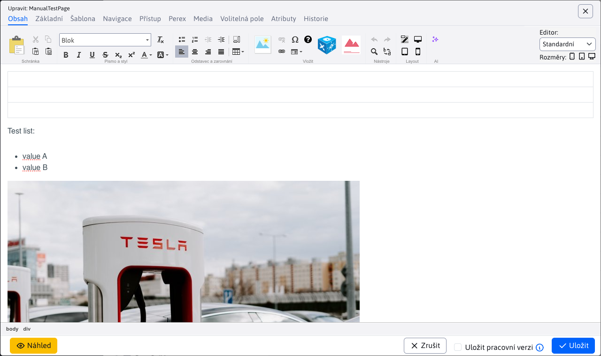

Přehled zkratek pro textový editor i další části administrace naleznete na stránce [Klávesové zkratky](../../admin/keyboard-shortcuts.md). Na Macu se při kopírování, vystřihování, vkládání a úpravě odkazů používá **Command (⌘)** místo **Ctrl**.

## Panel nástrojů v úzkém okně

Pokud se všechny nástroje nevejdou vedle sebe, část skupin naleznete pod tlačítkem **… Další nástroje**. Lišta se tak nezalomí do dalšího pásu a přepínač editoru i rozměrů zůstane dostupný. Funguje to ve Standardním editoru i v Page Builderu, například při mobilním zobrazení. Po rozšíření okna se skupiny vrátí na původní místa.

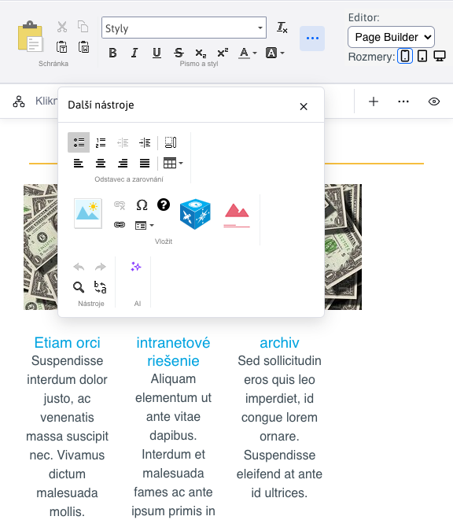

Panel zůstává otevřen při formátování textu, takže můžete použít více nástrojů za sebou. Zavřete jej kliknutím mimo panel, opětovným kliknutím na **…**, křížkem nebo klávesou **Escape**. Zavře se i při přechodu do jiného bloku či otevření dialogu. Delší obsah panelu můžete posouvat.

Pokud se dialog, například Obrázek, Odkaz nebo Aplikace, nevejde do šířky náhledu v Page Builderu, automaticky se otevře ve velikosti okna prohlížeče. Po potvrzení nebo zavření dialogu se obnoví původní šířka náhledu a posun stránky. Během automatického rozšíření se tlačítko **Zmenšit** nezobrazuje.

Klávesou **Alt+F10** přejdete na lištu. **Tab** přepíná mezi dostupnými skupinami a tlačítkem **…**, šipky mezi nástroji ve skupině. Tlačítko **…** otevřete klávesou **Enter**, mezerníkem nebo šipkou dolů. Pokud otevřete vnořenou nabídku, například barvy či Styly, první **Escape** zavře tuto nabídku a další panel nástrojů.

## Práce s textem (psaní/vkládání/kopírování)

Při práci s textem si musíte v první řadě uvědomit rozdíl mezi odstavcem a zalomeným textem, čili rozdělením věty do dalšího řádku. Jednotlivé odstavce vytvoříte běžným stisknutím ```ENTER```, zatímco zalomení textu pomocí klávesové kombinace ```SHIFT + ENTER```.

Rozdíl mezi nimi je zřetelný hlavně kvůli většímu odsazení mezi odstavci (oproti zalomení textu). Další důležitý rozdíl je v tom, že několik úprav textu (jako například vytvoření nadpisu) se aplikuje na celý odstavec. Pokud takový odstavec obsahuje zalomení řádku, tak se tato změna aplikuje i na zalomený řádek.

Pokud chcete, aby se text po napsání mezery nezalomil, můžete kromě normální mezery vložit **pevnou mezeru**. Takový případ se může vyskytnout například při psaní dat ```10. 2. 2009``` nebo různých jiných textů, které by neměly být rozděleny na dva řádky, například. velikost souborů ```123 kB``` nebo telefonní číslo ```0905 123 456```. Pevná mezera se vkládá klávesovou kombinací **Shift + mezerník**. Vzhledově se nijak neliší, rozdílné je jen její chování vůči okolnímu textu na konci řádku.

**Text ve WebJET editoru můžete upravovat následujícími způsoby**:

- psaním přímo do editoru
- vložením z jiného dokumentu (```DOC```, ```PDF```, ```XLS```, jiná web stránka...)

### Vložení z jiného dokumentu

**Klasické vložení textu** z panelu nástrojů pomocí ikony nebo kombinací kláves ```CTRL + v```. Při vložení textu tímto způsobem se text vloží is původním formátováním zdrojového textu. Tento způsob je však nechtěný hlavně z důvodu ponechání jednotného stylování textů na celém webu podle předdefinovaných stylů.

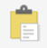

**Vložení neformátovaného textu** z panelu nástrojů pomocí ikony 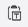. Můžete použít také zkratku pro vložení bez formátování, kterou poskytuje váš prohlížeč. Její podoba závisí na prohlížeči a operačním systému, například ```CTRL + t``` či ```CTRL + SHIFT + v```
Tento způsob vkládání textu vám text vloží bez jakéhokoli formátování, pro vkládání běžného textu je proto nejvhodnější.

**Vložení textu z ```Word``` / ```Excel``` souboru** z panelu nástrojů pomocí ikony .
Tato možnost vloží text se zachovanými odstavci a tabulkami, ale očištěný od všech stylů z původního dokumentu.

### Kopírování textu

Kopírování textu je možné označením textu a klepnutím na ikonku  (nebo kombinací kláves ```CTRL + c```).

### Vystřižení textu

Vystřižení textu je možné označením textu a kliknutím na ikonku  (nebo kombinací kláves ```CTRL + x```).

## Práce se styly a formátování textu

Nabídka **Styly** obsahuje předvolby připravené pro design vaší stránky, například barvy textu, odsazení, pozadí nebo orámování. Dostupné styly a jejich názvy závisí na šabloně. Ovládání je stejné ve Standardním editoru i v Page Builderu.

<div class="video-container">
    <iframe width="790" height="444" src="https://www.youtube.com/embed/IomtyBHpx64" title="YouTube video player" frameborder="0" allow="accelerometer; autoplay; clipboard-write; encrypted-media; gyroscope; picture-in-picture" allowfullscreen></iframe>
</div>

Tlačítko v panelu nástrojů zobrazuje aktuální element, například **Odstavec** nebo **Nadpis 2**. Pokud má nastavené styly, uvede zkrácenou HTML značku a jejich názvy, například **H2 + Spodní odsazení xs**. Dlouhý seznam se ořízne podle šířky tlačítka; celý text zobrazíte podržením kurzoru nad ním. Při výběru více typů elementů se zobrazí **Výběr**.

Klepněte do textu nebo označte jeho část a otevřete **Styly** v panelu nástrojů. Vybraný styl se použije ihned a okno zůstane otevřené, takže můžete nastavit více vlastností za sebou. Na web se změny přenesou až uložením stránky.

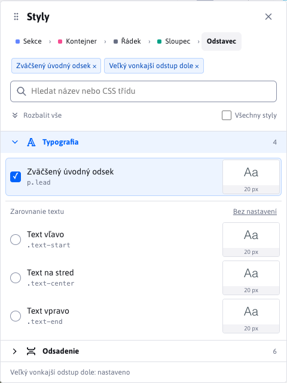

Pro správnou funkčnost je třeba mít správně nastaveny [CSS selektory](../../../frontend/page-builder/blocks.md#selektory-struktury) a vytvořeny [doplňkové komentáře](../../../frontend/examples/template-bare/README.md# web stránky.

### Výběr upravované části stránky

V horní části okna je cesta k aktuálnímu elementu, například **Sekce › Kontejner › Sloupec › Odstavec › Text**. Zvýrazněná položka určuje, co právě upravujete. Klepnutím na jinou položku můžete nastavit například pozadí celé sekce namísto barvy odstavce. Barevné čtverečky označují stejné části stránky jako v Page Builderu. Podržením kurzoru nad položkou zobrazíte podrobnosti o elementu.

- **Celý odstavec:** umístěte do něj kurzor. Styly odstavce se použijí na celý odstavec.
- **Část textu:** nejprve označte slova, která chcete upravit. Nabídka zpřístupní také styly pro vybraný text, například jeho barvu.
- **Už upravený úsek textu:** klikněte dovnitř úseku. Pokud je samostatně označen jako **Text**, nabídka upravuje tento úsek. Pro nastavení celého odstavce přepněte v horní cestě na **Odstavec**.

### Vyhledávání, náhledy a kombinování stylů

Styly jsou rozděleny do kategorií, které můžete jednotlivě rozbalit nebo sbalit. Odkaz **Rozbalit vše / Sbalit vše** ovládá všechny zobrazené kategorie. Pole pro vyhledávání hledá v názvech, CSS třídách, kategoriích i skupinách bez rozlišování velkých písmen a diakritiky.

Vpravo u každé položky vidíte náhled jejího vzhledu: barvu textu, pozadí, rámeček nebo podobu písma. Velké písmo se přizpůsobí prostoru náhledu; údaj v pixelech ukazuje skutečnou velikost. Při odsazení náhled znázorňuje mezeru a její hodnotu. Výsledek vždy vidíte také přímo v obsahu stránky.

Vlastnosti můžete kombinovat, například barvu textu s odsazením. Volby s kroužkem ve stejné skupině se nahrazují: výběr jiné barvy odebere předchozí barvu z této skupiny. Samostatné styly se čtvercovým políčkem lze zapínat nezávisle. **Odstranit** při názvu skupiny zruší volbu dané skupiny. Opakovaným kliknutím na aktivní styl jej odeberete; stejně funguje **×** při jeho názvu v horní části okna.

Nabídka zobrazuje styly použitelné pro aktuální výběr. Po zapnutí **Všechny styly** uvidíte i ostatní položky, ale ty, které na vybraný element nelze použít, zůstanou neaktivní.

Pokud okno překrývá upravovaný obsah, přesuňte jej za tečkovanou rukojeť vedle názvu **Styly**. Po zavření a opětovném otevření se vrátí k tlačítku v panelu nástrojů a seznam se posune na začátek. Zavřete jej křížkem, klávesou **Escape** nebo kliknutím mimo okno. Změnu stylu můžete vrátit příkazem **Zpět**.

### Obnovení základního vzhledu

Odkaz **Obnovit základní vzhled** odebere z aktuálně vybraného elementu všechny odstranitelné CSS třídy známé nabídce stylů. Zachová jeho základní konstrukční třídy i ostatní třídy, které nabídka nezná. Zobrazí se u elementu, pro který šablona definuje základní třídy.

Máte-li vybrán **Kontejner**, obnoví vzhled kontejneru; vnořené odstavce ani textové úseky neupravuje. Jejich zobrazení však může ovlivnit například barva zděděná z kontejneru. Obsah i typ elementu zůstanou zachovány. Reset zahrnuje také styly skryté vyhledáváním nebo sbalenou kategorií a lze jej vrátit jedním krokem **Zpět**.

### Formát odstavce a nadpisy

Na začátku nabídky je kategorie **Formát odstavce** s volbami **Odstavec** a **Nadpis 1–6**. Klepněte do odstavce a vyberte požadovanou úroveň nadpisu. Tato volba mění typ celého odstavce a jeho význam ve struktuře dokumentu. Samotný CSS styl, který zvětší písmo, z odstavce nadpis nevytvoří.

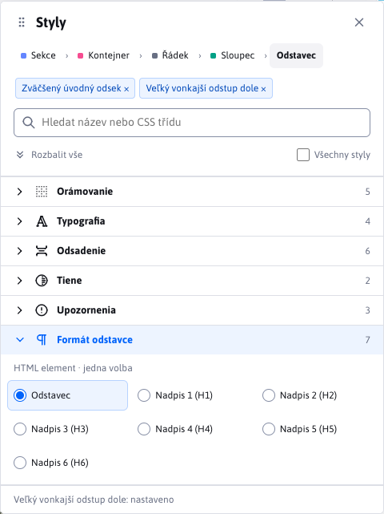

Úrovně nadpisů volte podle členění obsahu: hlavní nadpis, názvy sekcí, poté jejich podsekce. Pokud šablona již zobrazuje hlavní nadpis z názvu stránky, nemusíte jej v obsahu přidávat znovu. Výběrem **Odstavec** změníte nadpis zpět na běžný odstavec; samostatně nastavené CSS styly zůstanou zachovány.

Když upravujete **Text** nebo celý kontejner, pro změnu formátu nejprve vyberte příslušný odstavec. V některých blocích Page Buildera určuje typ elementu samotná šablona; tehdy je změna formátu nedostupná a nabídka zobrazí vysvětlení.

Definování dostupných stylů popisuje [manuál pro web designéra](../../../frontend/examples/template-bare/README.md#seznam-stylů-pre-editor).

### Další nástroje formátování

Další způsob formátování textu je pomocí následujících standardních nástrojů (aplikují se označením textu, který chcete upravit):

- , **hrubé písmo**
- 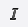, *kurziva*
- ,<ins> podtržení</ins>
- 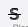, ~~přeškrtnutí~~
- 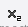, <sub>horní index</sub>
- 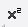, <sup>dolní index</sup>

Formátování textu pomocí nástroje pro změnu barvy textu  a podbarvení textu  doporučujeme nepoužívat, protože způsobuje grafickou nekonzistentnost web stránky a degraduje její hodnotu v rámci web sídla.

## Odstraňování formátování

Chcete-li změnit nadpis na běžný odstavec, klepněte do něj av nabídce **Styly → Formát odstavce** vyberte **Odstavec**. CSS styly odebírejte samostatně kliknutím na aktivní položku nebo na **×** při jejím názvu.

Pokud chcete odstranit z textu běžné formátování například tučný text nebo kurzívu, můžete to udělat dvěma způsoby. Buď po označení daného textu znovu kliknete na daný formátovací nástroj, dokud se formátování nezruší, nebo použijete univerzální nástroj pro odstraňování formátování 

Tento nástroj funguje tak, že formátovaný text označíte a po kliknutí na  se odstraní formátování na označeném textu. Tento nástroj odstraňuje také kombinované formátování na textu (např. kurzíva a tučný text dohromady)

## Seznamy (odrážkové / číslované) a odsazení textu

K vytvoření očíslovaného seznamu slouží ikonka 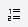.
K vytvoření odrážkového (nečíslovaného) seznamu slouží ikonka 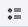.

Z obyčejného odstavce vytvoříte seznam tak, že kliknete do daného odstavce a kliknete na ikonku požadovaného seznamu (číslovaný nebo odrážkový).

Pokud chcete změnit typ odrážek při číslovaném seznamu, klikněte do položky seznamu a přes kontextové menu (pravý klik myši) se dostanete do vlastností seznamu, kde si můžete zvolit jiný typ seznamu.

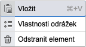

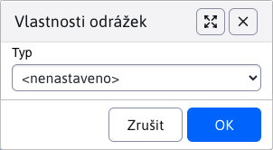

Pokud chcete vytvořit vnořený seznam, kliknete do dané položky seznamu a klepnutím na ikonku odsazení doprava 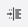 vytvoříte vnořený seznam. Zrušit vnořený seznam můžete ikonkou pro odsazení textu doleva 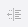.

Vytvoření seznamu ukončíte dvojnásobným stisknutím klávesy ```ENTER``` na konci seznamu.

## Odkazy na soubory a nahrávání souborů

Chcete-li vytvořit odkaz na dokument/soubor označte si text, který má být odkazem, klikněte na ikonku Odkaz 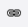 nebo pomocí zkratky ```CTRL + k```, zobrazí se vám dialogové okno pro vytvoření odkazu:

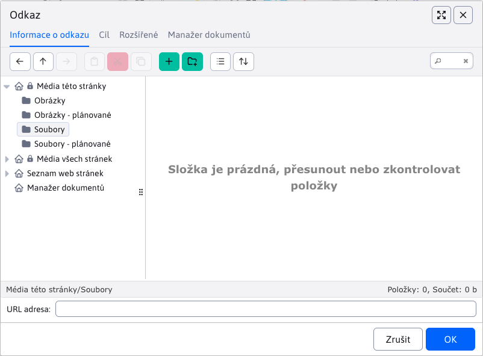

- pokud máte právo na **Manažer dokumentů** (`cmp_file_archiv`), v dialogu **Odkaz** se zobrazí i karta **Manažer dokumentů**.
  - V kartě je dostupná stromová struktura složek archivu a tabulka dokumentů z vybrané složky.
  - Klepnutím na název dokumentu se jeho URL adresa automaticky zkopíruje do pole URL.
  - Pokud potřebný dokument ještě není v archivu, můžete jej nahrát přímo v této kartě přesunutím souboru z počítače (`drag&drop`) do dialogu. Soubor se nahraje do aktuálně zvolené složky ve stromu.
  - Při nahrávání více souborů nebo při duplicitě reálného jména souboru se zobrazí stejné možnosti jako v manažeru dokumentů: **Přeskočit**, **Nahradit** nebo **Nová verze**.
  - Potvrdíte OK, čímž se vám na vyznačeném místě vytvoří odkaz na soubor z manažera dokumentů.

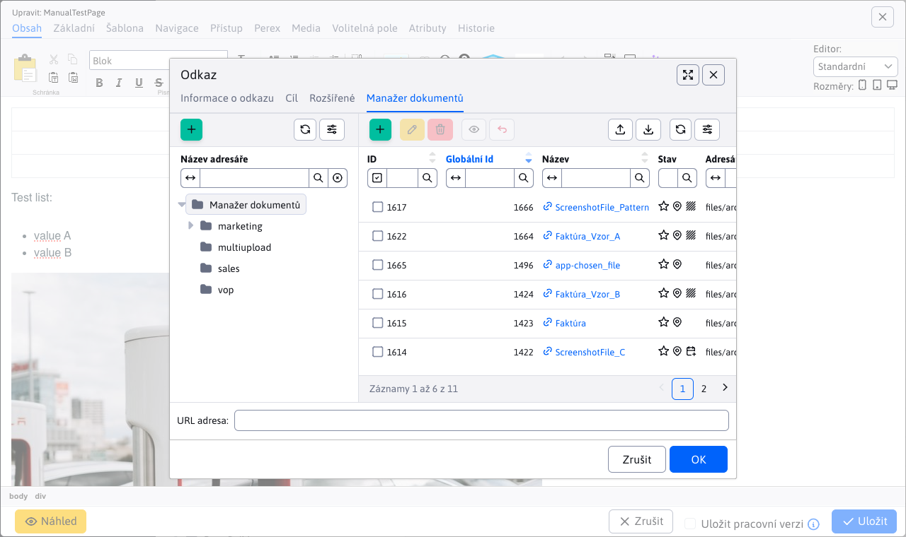

!> Soubory a složky [Manažéra dokumentů](../../files/file-archive/README.md) uložené v `/files/archiv` jsou ve stromové struktuře dialogů **Odkaz** a **Obrázek** dostupné pouze pro zobrazení a výběr. Nelze je nahrávat, přejmenovat, mazat ani jinak upravovat. Pro správu těchto souborů a složek použijte kartu **Manažer dokumentů**.

V dialogu **Odkaz** je označuje ikona<i class="ti ti-folder-x"></i> pouze ke čtení:

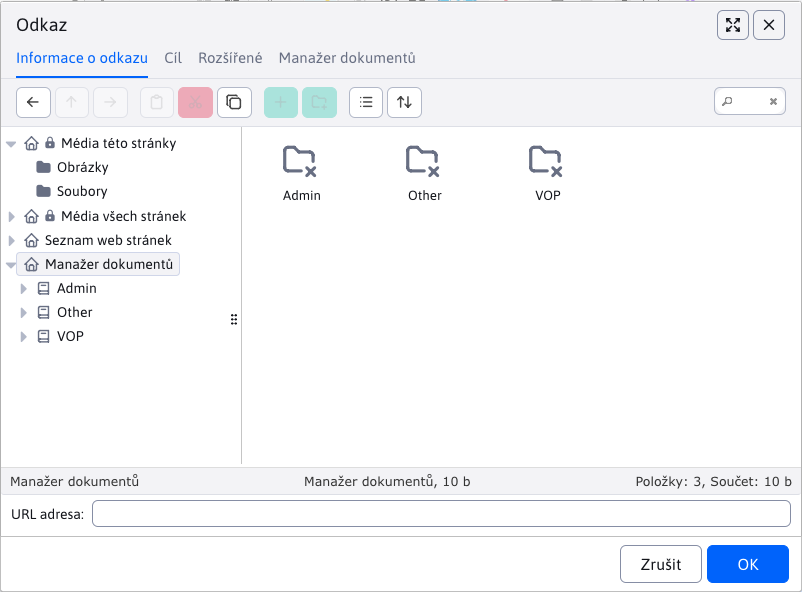

- v případě, že je dokument **určen pouze pro aktuální web stránku**, je třeba zvolit položku “Média této stránky” av ní položku “Soubory”.
  - Vyhledáte dokument, kliknete na něj a odkaz na dokument se automaticky zkopíruje do pole URL.
  - V případě, že se v seznamu požadovaný dokument nenachází, funkcí ```drag&drop``` je možné nahrát dokument z vašeho počítače
  - Potvrdíte OK, čímž se vám na vyznačeném místě vytvoří odkaz na soubor.

- v případě, že dokument **není určen pouze pro danou stránku** (dokument se může nacházet i na jiné stránce), je třeba zvolit položku **Média všech stránek** av ní položku **Soubory**.
  - Zobrazí se vám adresářová struktura adresářů a souborů na serveru, na které máte povolen přístup.
  - Vyhledáte v adresářích požadovaný soubor, kliknete na něj a odkaz na dokument se automaticky zkopíruje do pole URL
  - Potvrdíte OK, čímž se vám na vyznačeném místě vytvoří odkaz na soubor.

Podle směrnice na přístupnost web sídla by všechny textové soubory ke stažení nacházející se na web stránkách měly být uveřejňovány hlavně ve formátu ```PDF```. Formáty používané aplikací ```Word``` a ```Excel``` (```DOC``` a ```XLS```) nejsou vyhovující.

Pokud máte k tomu oprávnění, tak můžete v daném adresáři pro soubory vytvářet i nové podadresáře kliknutím na ikonku .
Názvy souborů na serveru by neměly obsahovat mezery, speciální znaky a písmena s diakritikou.

## Vkládání a úprava odkazů na jiné web stránky

Linky / odkazy na další stránky vkládáte podobně jako odkaz na dokument/soubor:

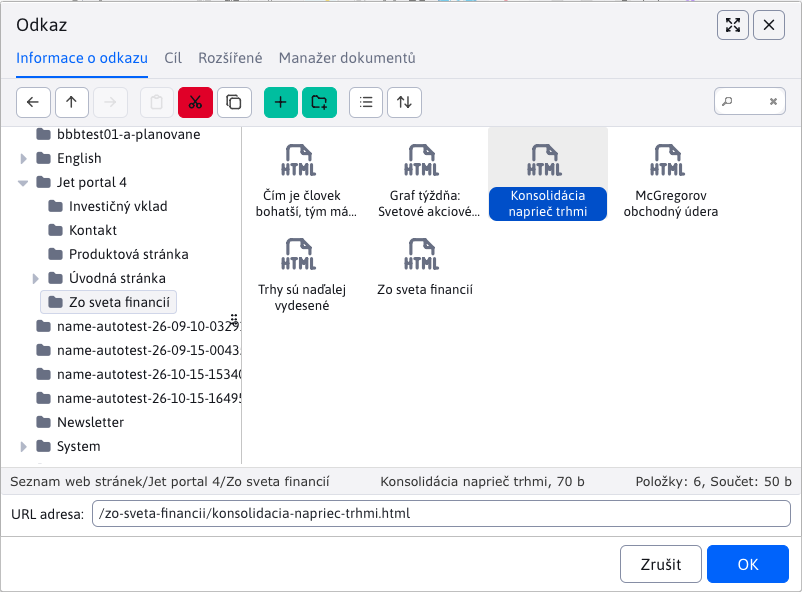

- Označte text (slovo), který má být klikatelný jako odkaz. Potom klepnete na ikonku Odkaz  nebo pomocí zkratky ```CTRL+ k```. Otevře se vám dialogové okno, ve kterém je třeba zvolit položku **Web stránky** a ve stromové struktuře vyhledat stránku na kterou chcete vytvořit odkaz. Po kliknutí na jméno stránky se vám do pole URL adresa zkopíruje adresa označené stránky. Potvrzením ```OK``` se vám na stránce vytvoří odkaz na zvolenou web stránku.

- Chcete-li vložit odkaz na stránku nacházející se na jiném web sídle (linka na externí web stránku), zadejte její adresu přímo do pole URL adresa (is prefixem ```https://```). Zároveň se automaticky změní pole **Cíl** (v kartě Cíl) na hodnotu **Nové okno (```_blank```)**, což zajistí, že po kliknutí na tento odkaz se stránka otevře v novém okně/kartě prohlížeče. Pole **Cíl** se na hodnotu **Nové okno (```_blank```)** nastavuje i v případě, že chcete vytvořit odkaz na dokument ke stažení. Pokud nechcete, aby se odkaz otevřel do nového okna, je třeba parametr **Cíl** nastavit na hodnotu **Totéž okno ```_self```**. Při odkazech na externí webové stránky a na dokumenty je však otevření odkazu do nového okna doporučeno.

## Tlačítka

Pokud je ve webové stránce vložen odkaz, nebo tlačítko, které má nastavený CSS styl obsahující výraz `btn` (nastavitelné přes konfigurační proměnnou `ckeditor_button_baseClass`) zobrazí se po kliknutí na takový odkaz v editoru okno nastavení tlačítka. V něm lze jednoduše změnit text tlačítka a nastavit odkaz po kliknutí, styl tlačítka a podobně.

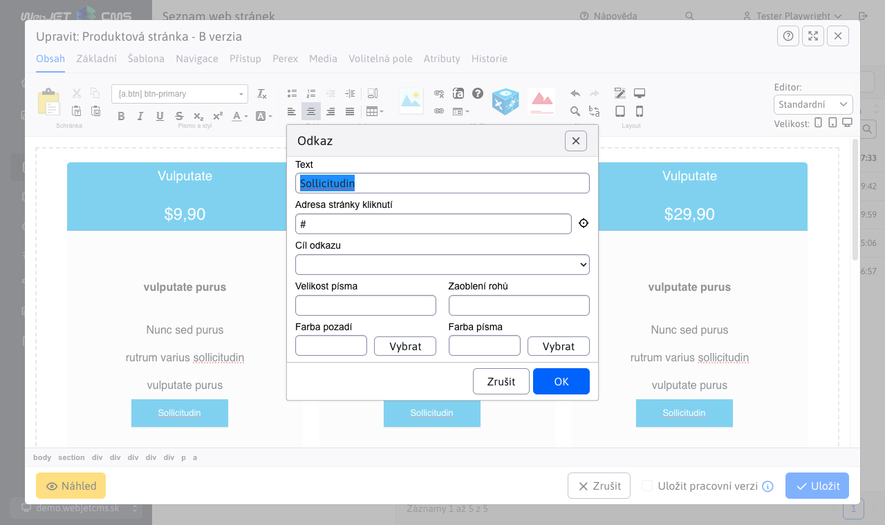

V kartě rozšířené lze nastavit další atributy jako ID elementu, titulek, popis pro čtečky (aria-label) a podobně.


Podobně existuje dialogové okno pro tlačítka (element `button`) is podporou SVG ikon. Ten vložíte kliknutím na menu výběrové menu pro vložení formuláře a následně možnost Tlačítko. Více informací je v [sekci pro web designéra](../../../frontend/setup/ckeditor.md#tlačítko).

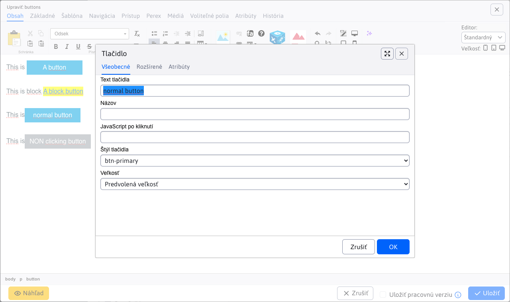

## Vkládání obrázků

Chcete-li vložit na stránku obrázek, umístěte kurzor na řádek nebo do buňky tabulky, kde se obrázek má nacházet, a klikněte na ikonku pro vložení obrázku 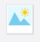.

Chcete-li změnit existující obrázek je třeba nejprve kliknout na obrázek, který si přejete změnit. Následně je třeba kliknout na stejnou ikonku vložit/změnit obrázek nebo přes kontextové menu na položku **Vlastnosti obrázku**. Další postup je v obou případech shodný.

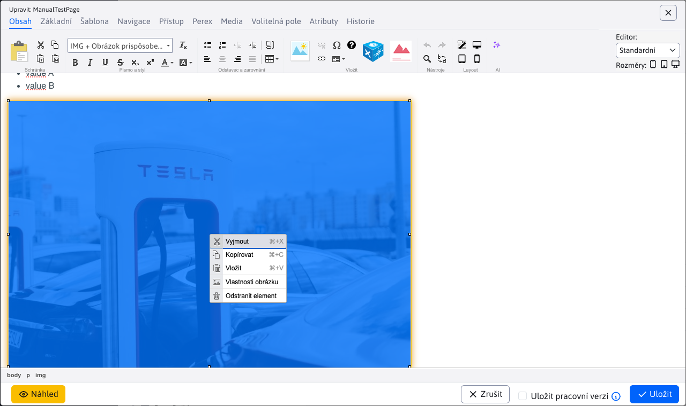

Po kliknutí na ikonku se vám zobrazí dialogové okno pro vložení obrázku:


Při procházení přes stromovou strukturu jsou zobrazeny pouze soubory typu obrázek nebo video, ostatní soubory jsou filtrovány.

### Karta Obsah

Pokud se soubor obrázku již nachází na serveru, můžete jej vyhledat v adresářové struktuře a klepnutím na něj se umístění obrázku automaticky zapíše do políčka URL adresa.

Při obrázcích je třeba zadefinovat i Alternativní text pro obrázek, který se využívá hlavně pro komunikaci se slabozrakými a nevidomými návštěvníky web stránky, nebo když má uživatel vypnuté zobrazování obrázků na web stránkách. Alternativní text by měl vystihovat, čeho se obrázek týká nebo co je na něm zobrazeno.

Po zvolení obrázku se automaticky vyplní pole šířka a výška, která definují aktuální velikost zvoleného obrázku.

### Karta fotobanka

Karta **Fotobanka** umožňuje získání (stažení) obrázků z bezplatné online platformy [Pixabay](https://pixabay.com). Tato platforma poskytuje rozsáhlou sbírku obrázků, které lze [možné použít zdarma](https://pixabay.com/service/license-summary/).

Po zadání a vyhledání výrazu, Vám budou nabídnuty vyhovující obrázky. Nabídka obsahuje několik stran, mezi kterými umíte procházet.

Při vyhledávání ve fotobance máte k dispozici také filtry:

- **Typ média** umožňuje vybrat režim vyhledávání:
  - obrázky: `all`, `photo`, `illustration`, `vector`
  - videa: `all`, `film`, `animation`
- **Kategorie** filtruje výsledky podle tematické oblasti (např. `nature`, `business`, `travel`, ...).

Pokud v poli **Typ média** vyberete video, vyhledávání se automaticky přepne na hledání video souborů.

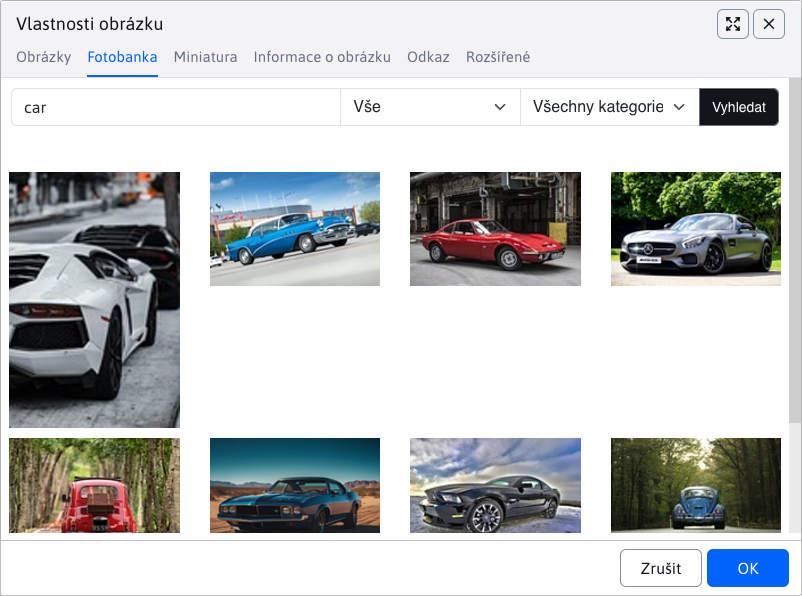

Po kliknutí na některý z nabízených obrázků se zobrazí dialog s náhledem, polem **Název souboru** a hodnotami **šířka** / **výška** daného obrázku.

U vybraného videu se zobrazí náhled a název souboru stejně, ale rozměry (**šířka** / **výška**) se v ukládacím dialogu nezadávají.

Pole **Název souboru** se automaticky předvyplní podle posledního vyhledaného výrazu, ale před uložením jej můžete upravit. WebJET název automaticky převede na malá písmena, odstraní diakritiku a nepovolené znaky a mezery nahradí pomlčkami. Příponu souboru nezadávejte, WebJET ji zjistí podle zdrojového obrázku a její typ zobrazí ikonou napravo od názvu.

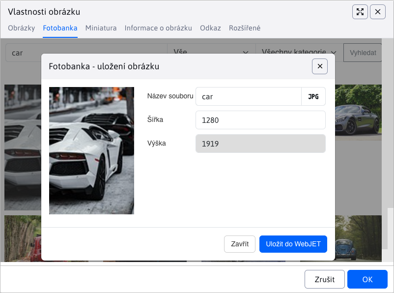

Přejete-li si změnit rozměry obrázku, můžete upravit hodnotu **šířka** a jeho **výška** se automaticky vypočítá podle původního poměru obrázku.

Rozměry obrázku se do názvu souboru nepřidávají. Pokud název nezadáte nebo soubor se stejným názvem již existuje ve zvolené složce, zobrazí se upozornění a obrázek se neuloží. Stávající soubor se nepřepíše.

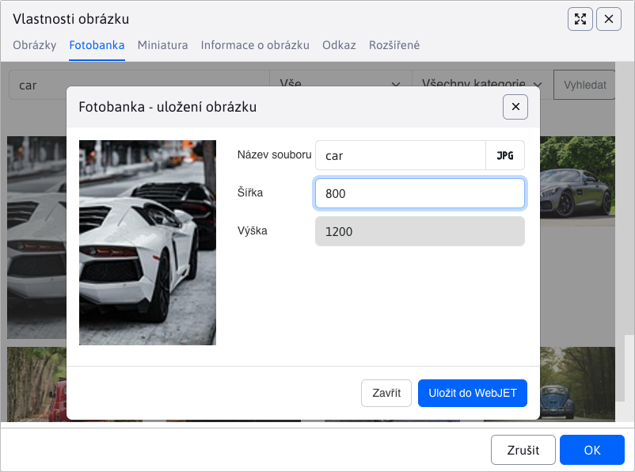

Následně po kliknutí na tlačítko **Uložit do WebJET** se obrázek stáhne a uloží pod zvoleným názvem. Automaticky se přepne karta na **Obsah**, kde máte okamžitě tento obrázek dostupný.

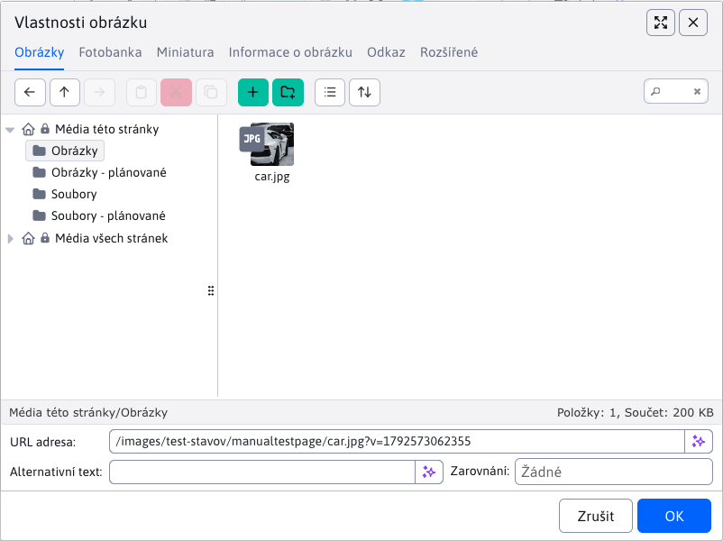

**URL adresa zdroje obrázku**

Uložené obrázky z **Fotobanky** mají automaticky vyplněnou hodnotu **URL adresa zdroje obrázku**. Tuto hodnotu si umíte prohlédnout/upravit v části [Průzkumník](../../files/fbrowser/README.md) při akci [Úprava souborů](../../files/fbrowser/file-edit/README.md).


### Karta Miniatura

Karta **Miniatura** umožňuje nastavit parametry automatického generování zmenšených obrázků `thumbnail` přímo z dialogového okna vkládání obrázků.

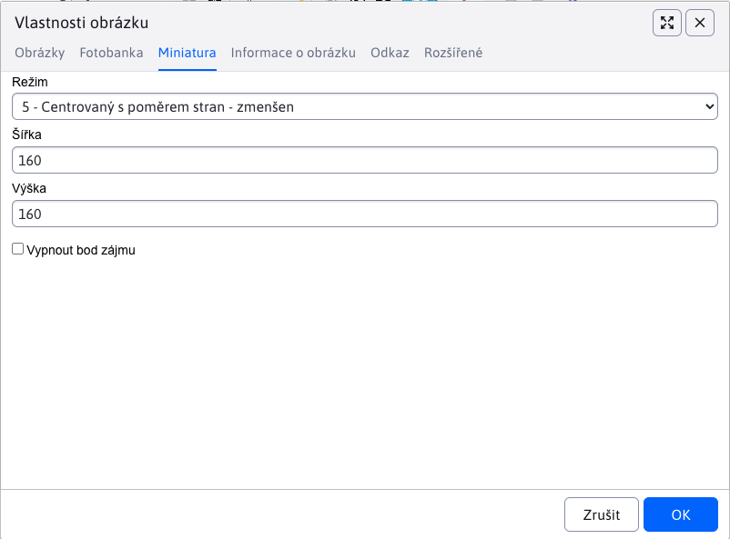

**Režim bodu zájmu (IP)**

Výběrem [režimu bodu zájmu](../../../frontend/thumb-servlet/interest-point.md) určíte, která část obrázku bude při ořezávání zachována:

| Režim | Popis |
| ------- | ------- |
| `1` | Zachovává pouze šířku (výška se přizpůsobí automaticky) |
| `2` | Zachovává pouze výšku (šířka se přizpůsobí automaticky) |
| `3` | Zachovává šířku i výšku + doplnění pozadí barvou |
| `4` | Zachovává šířku i výšku + doplnění pozadí barvou |
| `5` | Zachovává šířku i výšku bez doplnění pozadí |
| `6` | Zachovává celý bod zájmu rozšířením výřezu na požadovaný poměr stran |

**Dynamické zobrazení polí**

Pole na kartě Miniatura se dynamicky zobrazují/skrývají podle vybraného režimu bodu zájmu:

- Režimy `1` a `2`: Zobrazí se pouze jedno rozměrné pole (šířka nebo výška).
- Režimy `3` a `4`: Zobrazí se obě rozměrná pole + pole pro barvu pozadí. Barvu zadejte ve formátu `#rrggbb`
- Režimy `5` a `6`: Zobrazí se obě rozměrná pole bez pole pro barvu.
- Pole **Vypnout bod zájmu** se zobrazí pro všechny režimy kromě prázdné hodnoty a režimu `0`. To nastavuje, zda se při generování aplikuje i nastavený bod zájmu, nebo se použije celý obrázek.

**Výběr povoleného rozměru**

Jsou-li nastaveny [povolené rozměry](../../../frontend/thumb-servlet/README.md#omezení), karta nabídne jejich výběr s názvem režimu a číslem `ip`, například **96 px – Fixní výška (ip2)**. Volba **Nepoužít miniaturu** použije původní obrázek.

V režimu `strict` lze vybrat pouze povolenou kombinaci. Stávající nepovolený rozměr je třeba nahradit povoleným nebo použít původní obrázek. Režimy `learn`, `check` a `allow` nabízejí také **Zadat vlastní rozměr…**, což zobrazí pole popsaná výše; při prázdném seznamu se tato pole zobrazí přímo. V režimu `deny` je karta skrytá.

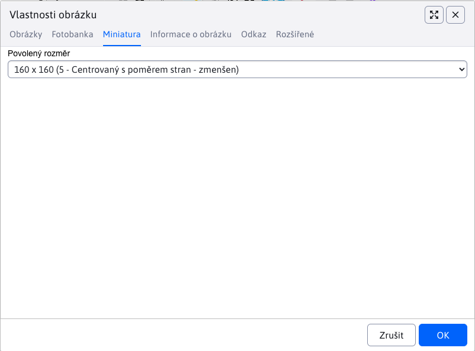

### Video soubory

Přes dialogové okno pro vložení obrázku můžete vkládat i video soubory. Buď přímo z vašeho serveru výběrem video souboru, nebo do pole URL adresa zadáte odkaz na web stránku `YouTube/Facebook/TikTok`.

WebJET automaticky pro video soubor vloží namísto obrázku video přehrávač.

### Editace obrázků

Pokud je obrázek příliš velký a nevejde se vám do stránky, nebo potřebujete provést v obrázku jinou změnu můžete použít editor obrázků. Klikněte na obrázek a následně na ikonu tužky pro otevření [editoru obrázků](../../image-editor/README.md).

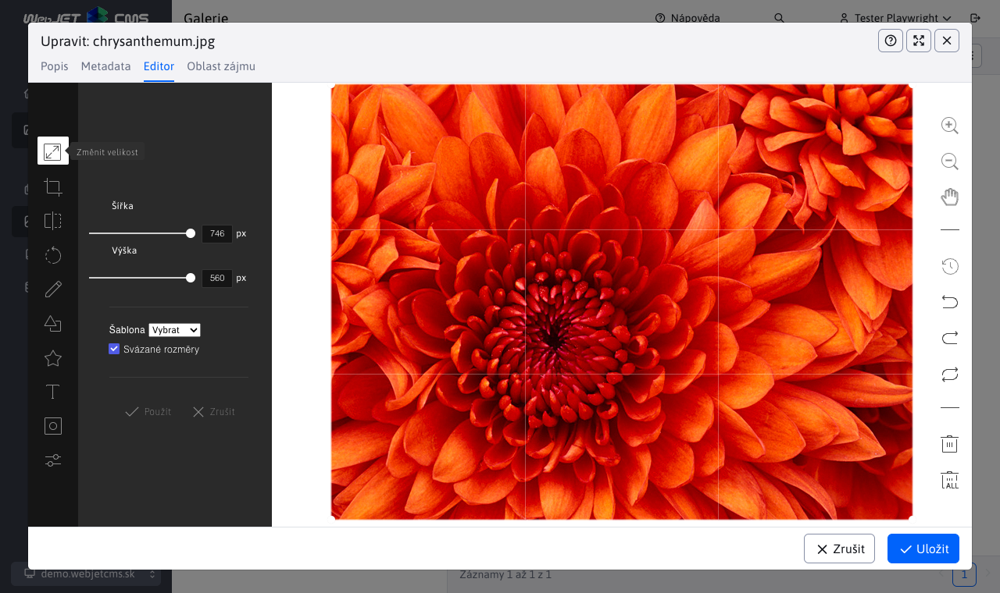

## Vkládání a úprava tabulek

Tabulku lze vytvořit dvěma způsoby. Použít předdefinovanou stylovanu tabulku, nebo vložit tabulku kopírováním z ```Word``` / ```Excel``` souboru.

### Vytvoření barevné tabulky

Tabulku vytvoříte kliknutím na ikonku **Vložit tabulku**, 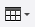:

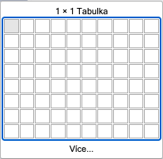

V případě, že potřebujete vytvořit komplexnější tabulku, je třeba kliknout na **Více** kde se vám zobrazí dialogové okno pro nastavení tabulky:

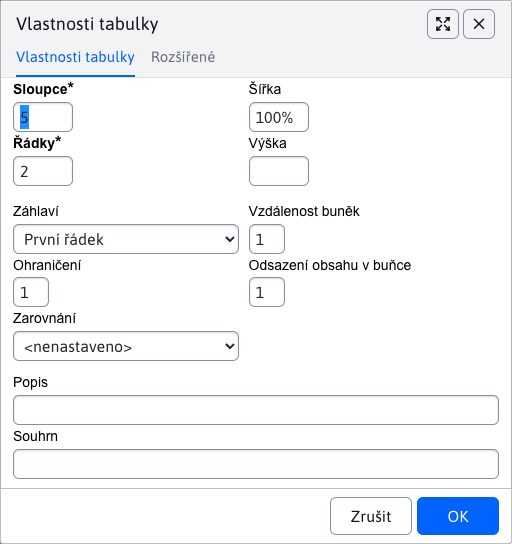

Zde můžete nastavit počet sloupců a řádků. Pokud chcete, aby se tabulka šířkou přizpůsobovala obsahu, tak šířku zadávat nemusíte (vymažte předvyplněnou hodnotu). Ostatní parametry by měly zůstat s nulovou hodnotou, aby se nebily s přednastaveným stylem tabulky. Potvrzením ```OK``` vložíte tabulka na původní pozici kurzoru.

### Vkládání tabulky z ```Word``` a ```Excel``` souboru

Při vkládání tabulky z jiných aplikací, resp. dokumentů přes klávesovou zkratku ```CTRL + v``` se vás systém automaticky zeptá, zda chcete tabulku vyčistit. Pokud kliknete ```OK```, tak editor očistí tabulku od nechtěných formátovacích znaků původního dokumentu, ale ponechá strukturu tabulky v původní formě.

Tabulka zůstane v obsahu stránky zachována i tehdy, použijete-li ke vkládání textu nástroj pro vkládání textu z ```Word``` / ```Excel``` souboru .

### Úprava stávající tabulky

Pokud potřebujete nějakým způsobem upravit existující tabulku, která se na stránce nachází, nebo kterou jste tam právě vložili některým z již zmíněných způsobů, tak pro její úpravu máte k dispozici více nástrojů. Klepnutím do některé z buněk tabulky pravým tlačítkem myši se vám zobrazí kontextové menu.

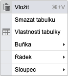

Pro vymazání nebo přidání dalšího řádku slouží pod-menu položky **Řádek**.

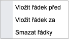

Pro vkládání nebo smazání sloupce slouží pod-menu položky **Sloupec**.

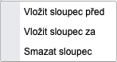

Pokud chcete sloučit dvě sousední buňky (v rámci řádku), tak musíte označit jejich obsah (pokud neobsahují žádný text nejprve do buňky zadejte libovolný text aby se dala buňka lépe označit), kliknout pravým tlačítkem na tento označený obsah a zvolit podmenu položky **Buňka** a v tomto pod-menu položku **.

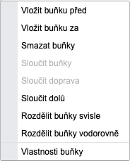

Obsah buněk se pak sloučí do jedné a vy jej můžete dále upravovat.

Pokud chcete odstranit původní orámování tabulky, změnit odsazení buněk, nebo provést tabulku barevnou klikněte na položku ** Vlastnosti tabulky**. Zobrazí se vám dialogové okno, ve kterém můžete změnit různé parametry tabulky kromě počtu řádků a sloupců tabulky (ty se upravují již zmíněným způsobem na předchozí straně).


Pokud chcete, aby se tabulka svou šířkou přizpůsobovala obsahu, tak se šířka tabulky zadávat nemusí (vymažte hodnotu). Pokud chcete, aby byla tabulka na celou šířku stránky, tak můžete zadat hodnotu 100 procent. Výšku nezadávejte.

Pokud chcete změnit zarovnání textu v buňce tabulky na střed nebo doprava, tak klikněte do dané buňky pravým tlačítkem myši a zvolit podmenu položky **Buňka** a v tomto pod-menu položku **Vlastnosti buňky**.

Zobrazí se vám dialogové okno pro vlastnosti buňky, ve kterém si můžete nastavit vertikální nebo horizontální zarovnání textu v buňce. Ostatní parametry v okně neměňte.

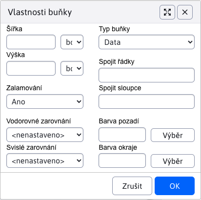

## Vložení aplikace

Pro vložení aplikace klikněte na ikonu modré kostky aplikace . Zobrazí se nám dialogové okno se seznamem aplikací:

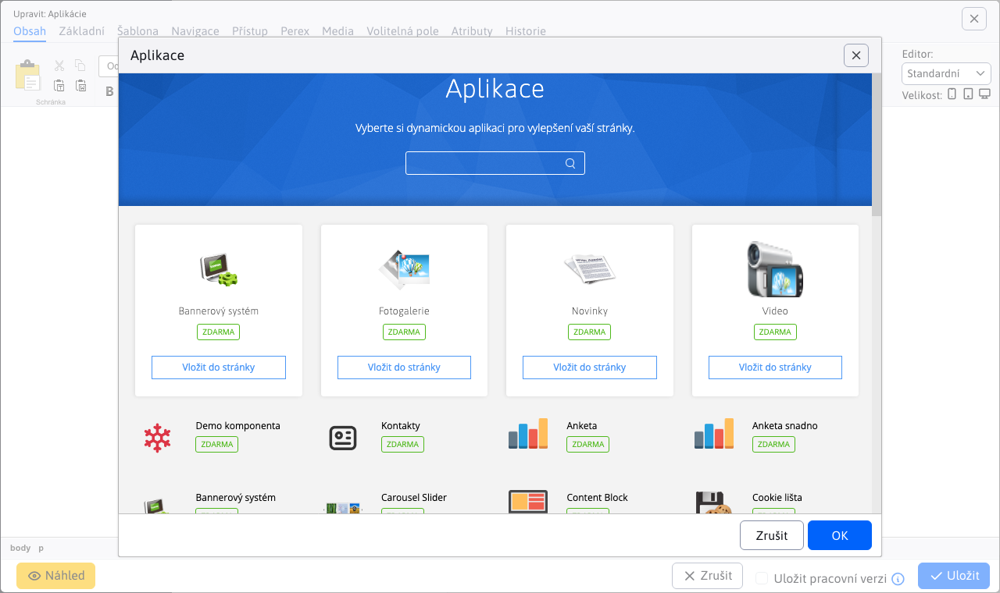

Do vyhledávání můžete zadat název aplikace:

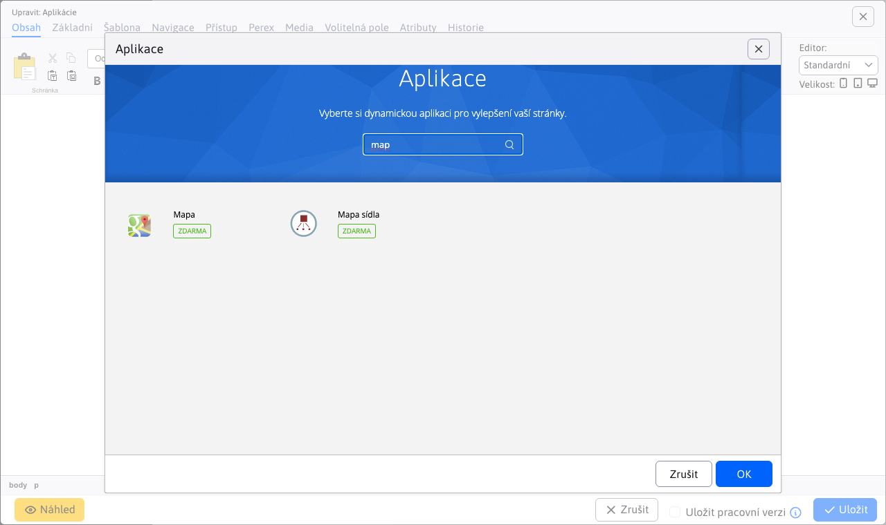

Po kliknutí na jméno aplikace se zobrazí podrobnosti o aplikaci - její popis, fotky a možnost vložit aplikaci do stránky:

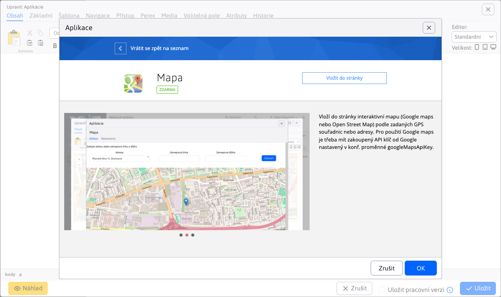

Při kliknutí na tlačítko "Vložit do stránky" se aplikace vloží do stránky a zobrazí se nastavení aplikace:

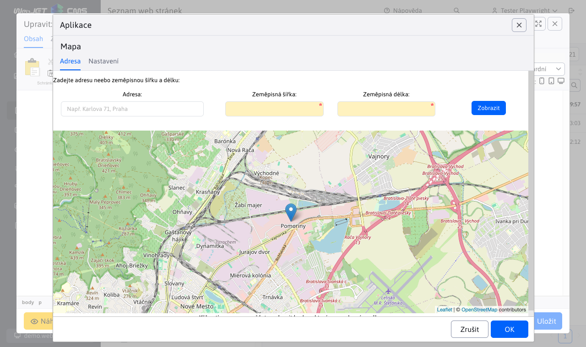

Pokud již je aplikace vložena ve stránce kliknutím dovnitř aplikace se vám zobrazí stejné okno nastavení aplikace. Můžete tak snadno upravit její stávající nastavení.

### Karta zobrazení

Většina aplikací obsahuje kartu Zobrazení pro společná nastavení (pokud tato možnost v aplikaci není z různých důvodů vypnuta).

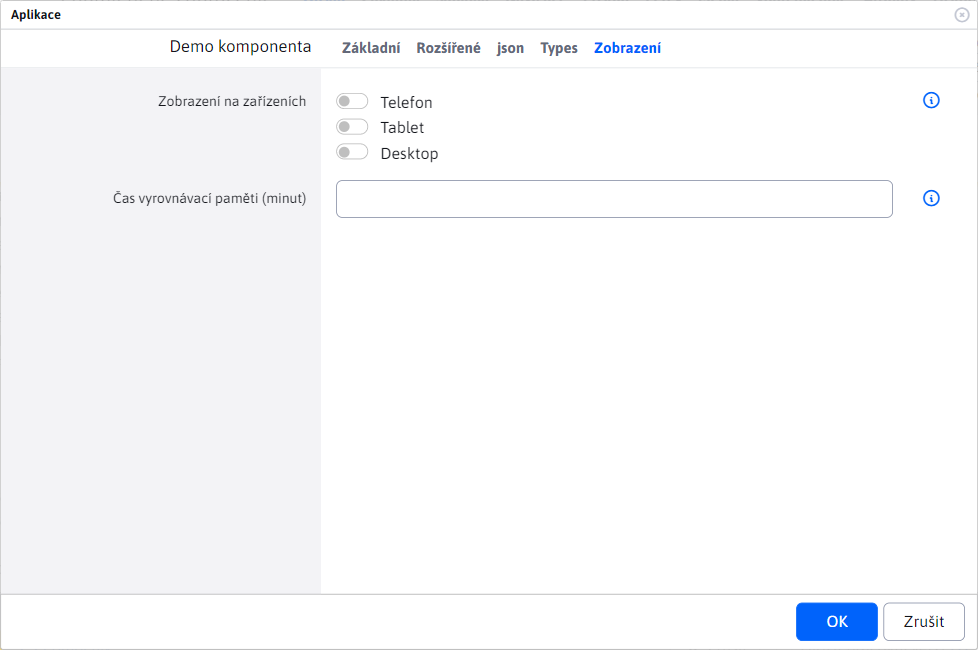

Karta obsahuje parametry:

- Zobrazení na zařízeních, sloužící k nastavení [podmíněného zobrazení aplikace](../../../custom-apps/appstore/README.md#podmíněné-zobrazení-aplikace) na zařízeních typu tablet, telefon nebo standardní počítač. Pokud není zvolena žádná možnost, zobrazí se aplikace na všech zařízeních (stejně jako když jsou zvoleny všechny možnosti).
- Přihlášený uživatel - umožňuje nastavit zobrazení aplikace podle stavu přihlášení návštěvníka web sídla - zobrazení vždy, jen pokud je uživatel přihlášen, nebo není-li přihlášen. V editoru stránek se aplikace zobrazí vždy, ale v náhledu nebo zobrazení stránky se zobrazí podle nastavené hodnoty.
- Čas vyrovnávací paměti (minuty) - slouží k nastavení doby v minutách, po jakou má být inicializovaná aplikace uložena ve vyrovnávací paměti pro její rychlejší zobrazení. Například seznam novinek se nemění často a jejich načtení je náročné na databázový server, je tedy vhodné nastavit například hodnotu 30. Pokud je přihlášen administrátor, vyrovnávací paměť se nepoužije a vždy se zobrazí aktuální údaje.

**Styl** - sekce obsahuje nastavení pro obalení výstupu aplikace do `div` kontejneru. Můžete tak nastavit například odsazení aplikace ve stránce, šířku nebo různé styly zobrazení, ale také informace pro čtečku pro slabozraké návštěvníky:

- CSS třída - výběr CSS tříd z předdefinovaného seznamu (např. `container`, `mt-2`, `w-100`). Seznam dostupných tříd je nastavitelný přes konfigurační proměnnou `appWrapperClasses` (čárkou oddělený seznam). Konfigurační proměnná podporuje dva formáty zápisu:
  - jednoduchý formát - pouze název CSS třídy. `container,mt-2,w-100` - ​​název třídy se zobrazí přímo v editoru.
  - formát s překladovým klíčem - `prekladový_kľúč:css_trieda`, Např. `apps.wrapper.container:container` - v editoru se zobrazí přeložený text podle jazyka administrace (např. "Kontejner (container)"), ale do HTML se vloží pouze hodnota CSS třídy. Překladový klíč se vyhledá v překladových textech.
  - oba formáty lze kombinovat v jednom seznamu, například. `apps.wrapper.container:container,mt-2,apps.wrapper.w-75:w-75`.
- ID - nastavení HTML `id` atributu pro obalovací `div` element.
- Titulek - nastavení HTML `title` atributu pro obalovací `div` element.
- `Aria Label` - ​​nastavení `aria-label` atributu pro obalovací `div` element, který slouží ke zlepšení přístupnosti pro čtečky obrazovky.

Je-li nastavena některá z těchto hodnot, výstup aplikace se automaticky obalí do `div` elementu se zadanými atributy. V náhledu aplikace v editoru se zobrazí informace o nastavených atributech.

## Před připravené bloky

Editor stránky nabízí možnost vkládání přednastavených bloků (```HTML``` objektů) na stránku. Např. tabulka, text, kontaktní formulář atp. Umíte vložit i obsah jiné stránky do aktuální stránky (např. opakující se formulář).

Zobrazení bloků provedete kliknutím na ikonu  v editoru stránky, která zobrazí dialogové okno s kategoriemi bloků.

Více informací v popisu aplikace [před-připravené bloky](../../apps/htmlbox/README.md).

## Vkládání speciálních znaků

Mohou nastat případy, kdy budete potřebovat při psaní napsat i znaky, které česká klávesnice neobsahuje, například znak Dolaru (```Mohou nastat případy, kdy budete potřebovat při psaní napsat i znaky, které česká klávesnice neobsahuje, například znak Dolaru (``), Euro (```€```) nebo zavináč (```@```). Pro usnadnění práce máte k dispozici vkládání speciálních znaků pomocí připraveného modulu. Klepnutím na ikonku  se vám zobrazí dialogové okno s nabídkou speciálních (ale i standardních) znaků.

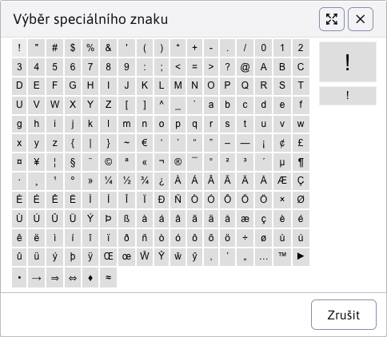

Po kliknutí na požadovaný znak se vám daný znak napíše na pozici kurzoru. Speciální znaky se vkládají jako text, takže nemají žádná další nastavení.

!> Upozornění: ikona pro vkládání speciálních znaků může být v některých případech změněna na ikonu 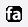 pro vkládání [FontAwesome](../../../frontend/webpages/fontawesome/README.md) obrázků.

## Vkládání textu na těžko dostupná místa

Někdy je obtížné umístit kurzor například za poslední odstavec nebo obrázek. Editor v takové situaci zobrazuje tzn. pomocnou čáru. Ta umožňuje vložit prázdný text, obrázek, aplikaci nebo blok. V případě Page Builder po kliknutí umožní vložit připravený blok do stránky.

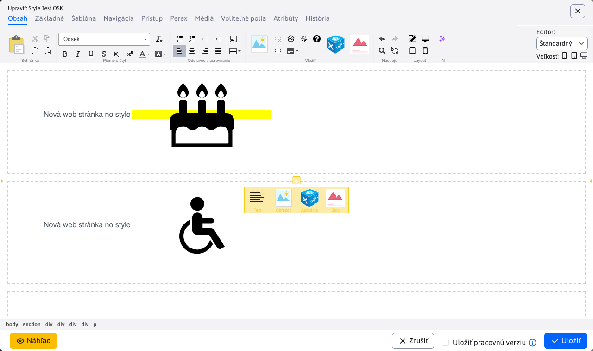

Podobně je někdy problém vložit kurzor za poslední SVG ikonu, tlustý text a podobně. V takovém případě za elementem editor zobrazuje ikonu pro přesun kurzoru na dané místo. Někdy se přesun nemusí podařit na první kliknutí, doporučujeme předem kliknout kdekoli do textu a poté na ikonu pro přesun kurzoru.

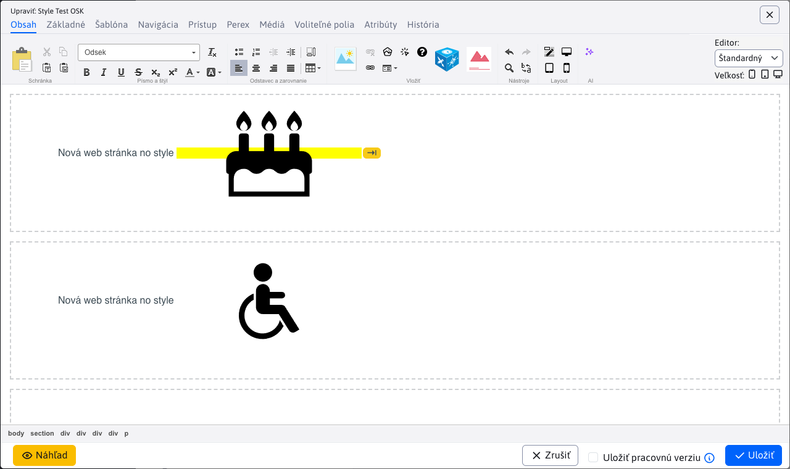

## Detekce změny obsahu stránky

Editor stránek obsahuje mechanismus, který detekuje změny obsahu stránky. Když klepnete na tlačítko Storno pro zavření okna a zároveň byly provedeny změny v obsahu stránky, zobrazí se vám dialogové okno s upozorněním, že nebyly uloženy změny. Klepnutím na OK okno zavřete bez uložení změn, kliknutím na Storno se vrátíte zpět do editoru stránky.

Po otevření stránky v editoru se po 5 sekundách získá aktuální obsah stránky (aby se stihly načíst všechny skripty a náhledy aplikací) a tento se následně porovnává s aktuálním obsahem při klepnutí na tlačítko Storno. Čili správná detekce funguje po 5 sekundách od otevření stránky v editoru.
