# WebJET CMS 2026

Welcome to the documentation for WebJET CMS version 2026. We recommend reading the [changelog](CHANGELOG-2026.md) and [roadmap](ROADMAP.md).

## List of changes in version 2026.40

> WebJET CMS 2026.40 brings [**new version of PageBuilder**](#websites) with a Structure panel, a clearer block library, and copying blocks between pages. [**Scheduled publishing of pages and files**](#websites) allows you to prepare future content with images and documents that will remain protected until the publication date. The feature is enabled by the administrator.
>
> [**Multi-step forms**](#forms) have improved setting of display conditions and field requirements, returning to the previous step while preserving filled-in data, copying fields between forms, and linking selection fields to code lists.
>
> You can customize the [**New home screen**](#home-screen) by selecting widgets, their size and order. This way you have the necessary data in one place. [**Quick search**](#home-screen) available throughout the administration via Ctrl+K / ⌘K will help you find pages, files and settings.
>
> [**Semantic Search**](#semantic-search) allows visitors to find pages based on the meaning of a question and optionally display an AI answer compiled from the content of the site. The new [**headless mode**](#headless-mode) makes content, navigation, search, and forms accessible via REST APIs for web applications with their own frontend.

!>**Before updating:** Review [breaking changes](#breaking-changes) and requirements for modifying the environment, configuration, or custom extensions.

### Home screen

- We have converted the [Home screen](redactor/admin/welcome.md) into a widget system so that you have the data you need to work in one place without having to navigate through individual parts of the administration. You choose the widgets yourself and set the displayed data, size and order according to your needs (#58806).

<div class="video-container">
    <iframe width="790" height="444" src="https://www.youtube.com/embed/X2GNFn8IpCI" title="YouTube video player" frameborder="0" allow="accelerometer; autoplay; clipboard-write; encrypted-media; gyroscope; picture-in-picture" allowfullscreen></iframe>
</div>

- [Quick search](redactor/admin/search/README.md) is available from the header of the entire administration by the **Search…** button or the shortcut **Ctrl+K / ⌘K**. It offers page suggestions by name and URL, results from page content, files, users, text keys and menu items. You can transfer the selected term to the appropriate section with additional filters (#348).

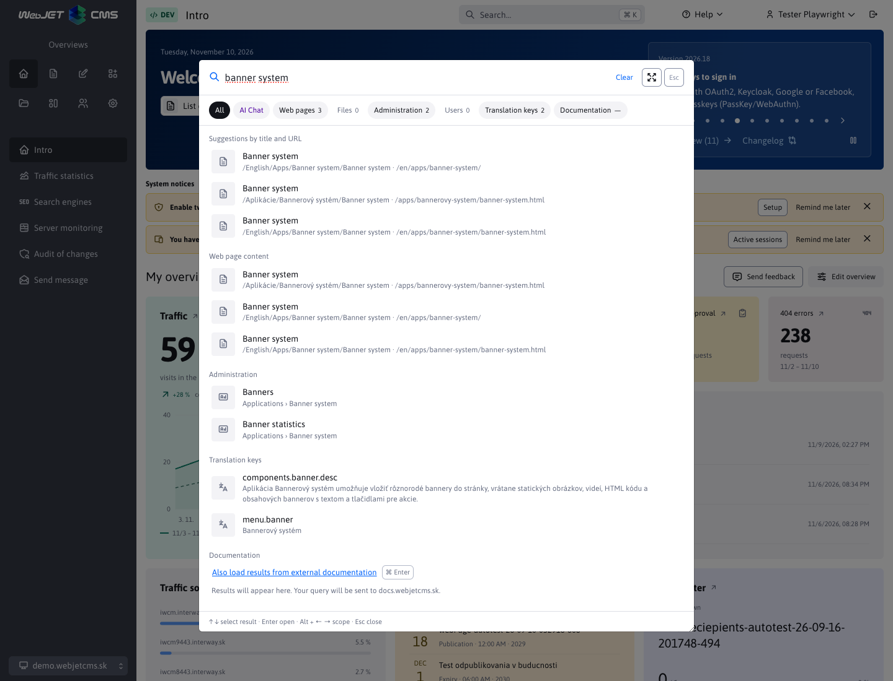

- New [AI Chat](redactor/admin/search/README.md#ai-chat) tab in quick search allows you to chat with an AI assistant. It supports assistant selection, continuous display and pausing of replies, Markdown with tables, and text copying. For saved OpenAI and Gemini chats, you can add images and documents by dragging anywhere into the chat area, search the history, and download attachments from the **Chat Files** panel. History and attachments are only available to the chat owner in the respective domain. Switching assistants preserves written messages and unsent attachments; you can zoom in or maximize the window. The magnifying glass in the history header displays chat search; attachments are added with the plus icon. The Slovak interface and documentation use the "chat" label (#386).

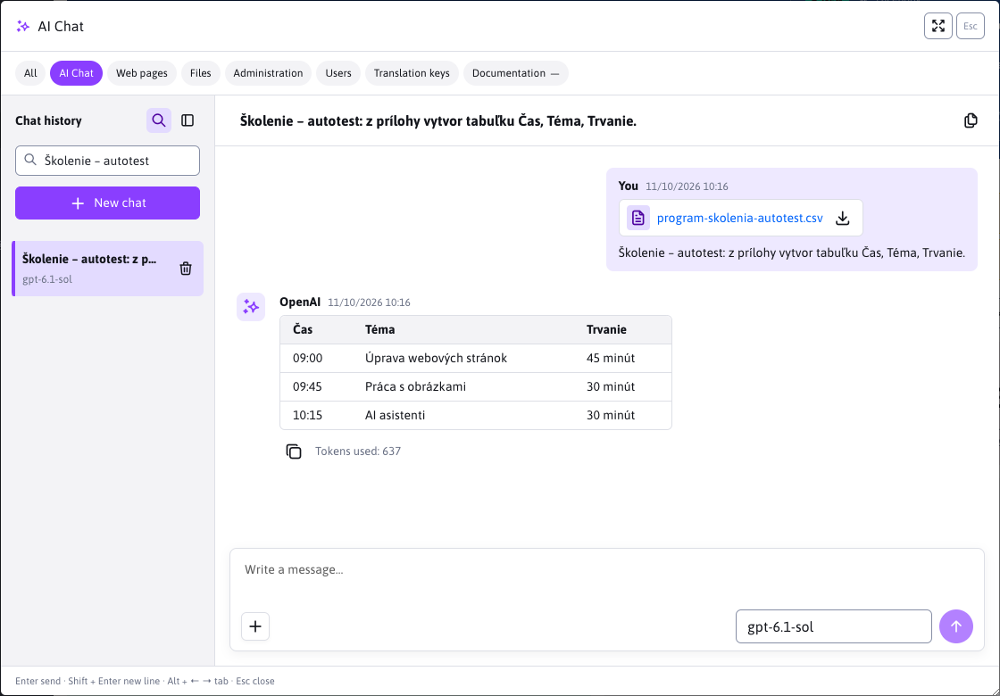

- The [What's New] panel (redactor/admin/welcome.md#What-is-new) supplements the news of the installed version with videos and posts from YouTube and Facebook of WebJET CMS. The **New** label is hidden after expanding the panel and again notifies about new content (#358).

### Account login and protection

- [User menu in the header](redactor/admin/README.md#user-menu) displays account information, number of active sessions, and two-factor authentication status. The **Active logins** item opens the custom logins management from any administration page. The documentation contains a current screenshot and description of all menu items (#351).

- WebJET CMS now [records the browsers you log in from](redactor/admin/logon.md#login-from-a-new-device). Logging in from a new browser will display a notification on the home screen and send an email so you can recognize someone else logging into your account. You can confirm your own device with an email link or a one-time code via **It was me** (#340).

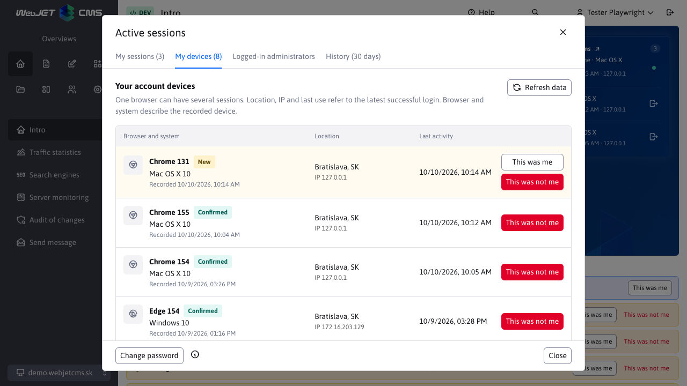

- If you do not know the login, you can [block the device and end its active logins](redactor/admin/welcome.md#ak-prihlanie-nepoznáte). The next time you log in from a blocked browser, after entering the correct name and password, **Verification of blocked device** will be displayed. To unblock and enter the administration, you must enter the six-digit code from the account email; if 2FA is enabled, this verification will only be performed after the code from the authentication application. Detailed instructions are in the [login instructions](redactor/admin/logon.md#overenie-zablokovoho-zariadenia) (#340).

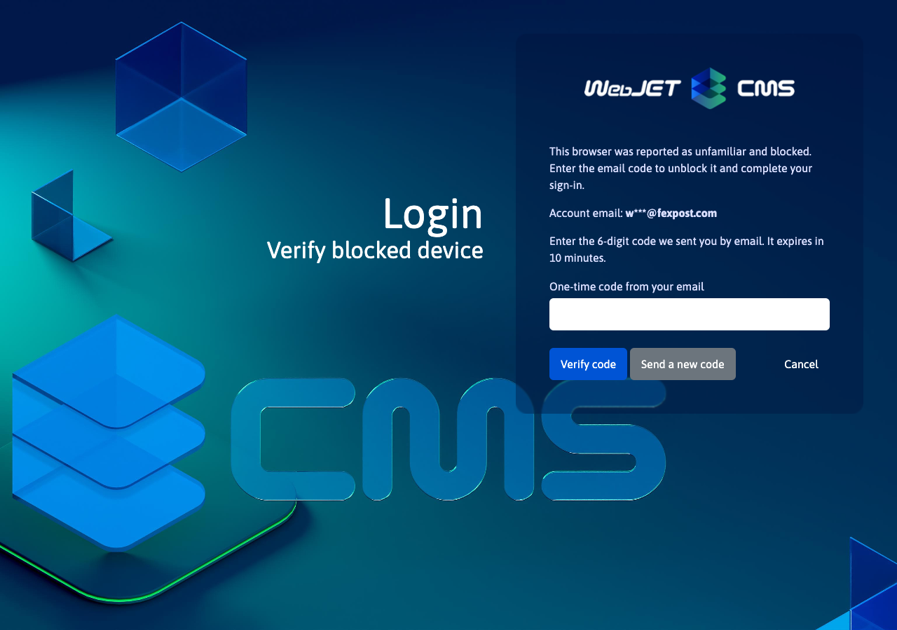

- Specific logins via `doFilterLogon` and `wjlogontoken` will be rejected by the blocked browser without an email prompt. To unblock, the regular login form in the same browser must be used (#340).

Device tracking can be disabled by setting the configuration variable `adminNewDeviceDetectionEnabled` to false. When logging in, the [approximate location](admin/setup/configuration/dashboard.md#login-approximate-location) is also determined by the IP address, which can be disabled by setting `adminLoginLocationApiKey` to the value `DISABLED`.

### Websites

- Page editor - new menu [Styles](redactor/webpages/working-in-editor/README.md#working-with-styles-and-text-formatting). It displays active styles with the option to remove them and allows you to select the edited paragraph, column or entire section. For proper functionality, it is necessary to have correctly set [CSS selectors](frontend/page-builder/blocks.md#structure-selectors) and created [additional comments](frontend/examples/template-bare/README.md#searching-and-style-groups) in the CSS file of the website. (#356).

<div class="video-container">
    <iframe width="790" height="444" src="https://www.youtube.com/embed/IomtyBHpx64" title="YouTube video player" frameborder="0" allow="accelerometer; autoplay; clipboard-write; encrypted-media; gyroscope; picture-in-picture" allowfullscreen></iframe>
</div>

- Website Trash - added [automatic deletion of old pages and folders](redactor/apps/gdpr/data-deleting.md) from the trash according to the set retention period. Added the ability to delete pages and folders in the trash and in the [Data deletion](sysadmin/data-deleting/README.md) section according to the selected date range. Unified logic for calculating the number and deleting, fixed permanent deletion of the trash folder and empty folders (#271).

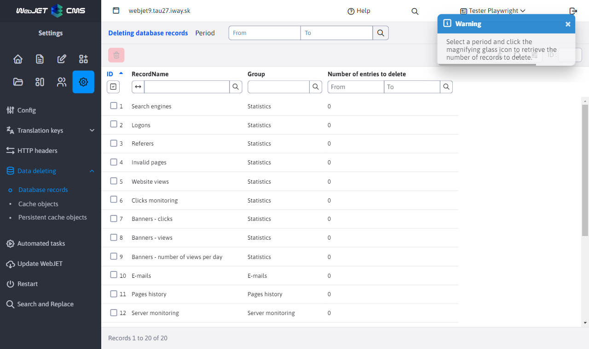

- Redirects - user-created redirects are distinguished from automatic ones (marked with a gray background) and can be [filtered in the redirect list] separately (redactor/webpages/redirects/README.md#automatic-and-user-created-redirects) (#58625).


- SEO - added a separate setting **Search engine tracking** with options **According to crawl settings**, **Enable tracking** (`follow`) and **Disable tracking** (`nofollow`). HTTP header `X-Robots-Tag` and Ninja `${ninja.page.robots}` use the same logic: when indexing without restrictions, they return `all`, otherwise a combination of directives `noindex` and `nofollow` according to the page settings. More in [Ninja documentation](frontend/ninja-starter-kit/ninja-jv/page/README.md#indexing-settings-string) (#OSK563).
- SEO - in [template groups](frontend/templates/template-groups.md#karta-seo) it is possible to set a default SEO description, image and image alternative text. The Ninja object `Page` will use them if the page does not have its own values ​​specified; the value `${ninja.page.seoImageAlt}` for `og:image:alt` has also been added (#OSK593).

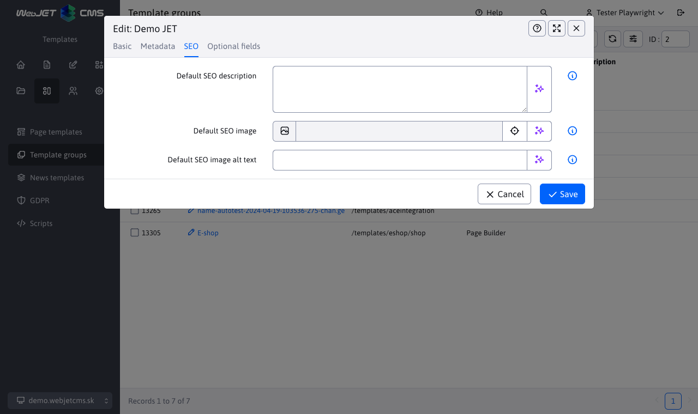

- Ninja - added [dimension generation](frontend/ninja-starter-kit/ninja-bp/README.md) SEO image `og:image:width` and `og:image:height` (#OSK563).
- Templates - added option to set the movement of `<style>` and `<link rel="stylesheet">` tags from the page body to `<head>` via [template option](frontend/templates/templates.md) with support for global configuration variable `showDocMoveStyleToHead`. Blocks in IE conditions, `noscript` and `script` remain in place (#231).

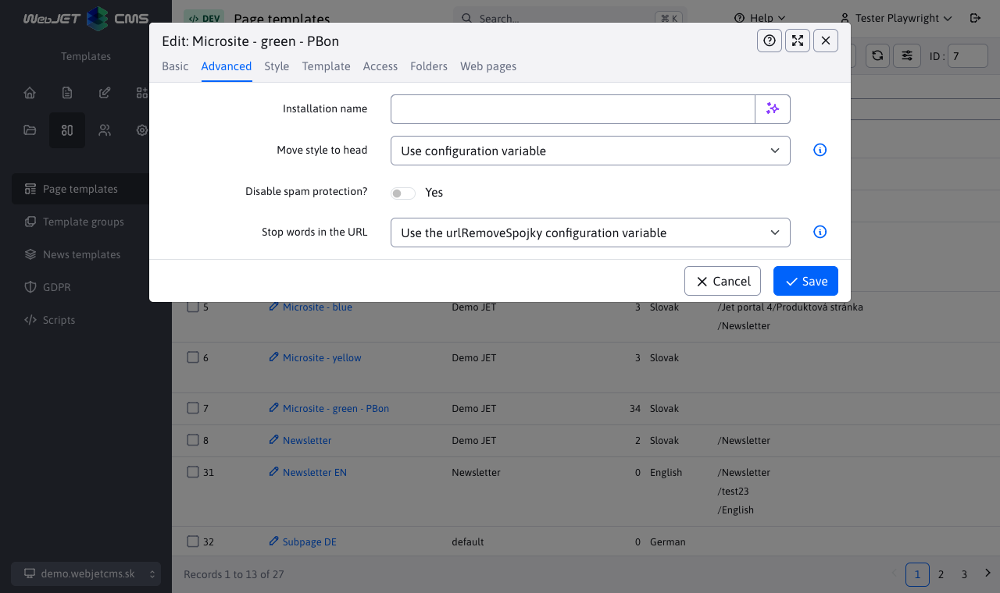

- Added **Thumbnail** tab in the image insertion dialog for setting parameters for [generating thumbnail images](redactor/webpages/working-in-editor/README.md#thumbnail-tab) `thumbnail`. Free size setting mode is supported, as well as [precisely defined size](frontend/thumb-servlet/README.md#constraints) mode by selecting from the options (#58317,#58758).
- Size selection shows both the mode name and the `ip` number. `learn/check/allow` modes also offer a custom size, `strict` requires an allowed combination, and `deny` the card is hidden. An existing disallowed thumbnail is flagged in `strict` mode and requires a replacement (#353).

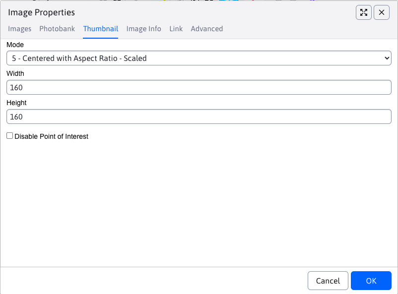

- Added [Document Manager](redactor/files/file-archive/README.md) tab in the insert link dialog for easy insertion of file links in the document manager, uploading new files, and managing them. Learn more in [File Links and File Uploading](redactor/webpages/working-in-editor/README.md#odkazy-na-syubory-a-nahravanie-syuborov) (#58593).

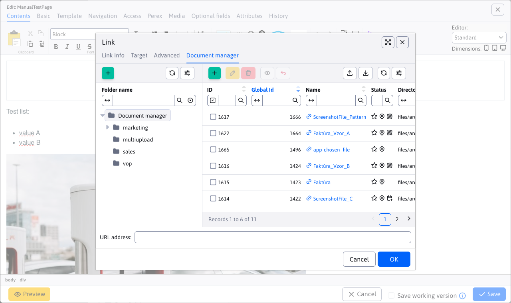

- Document Manager files in the `/files/archiv` folder are only available for viewing and selection in the link and image insertion dialogs. Uploading, renaming, deleting and other editing can only be done via [Document Manager](redactor/files/file-archive/README.md) (#298,#313,#317).

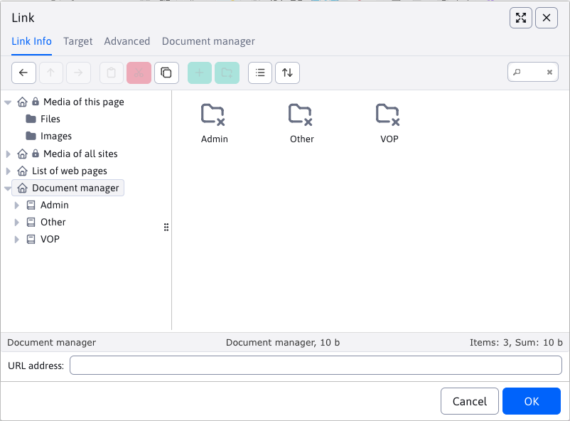

- [Photobank](redactor/webpages/working-in-editor/README.md#karta-fotobanka) - when downloading an image from the photobank, it is possible to set the file name. The name is automatically pre-filled and cleaned, the extension is determined by the source image and the existing file is not overwritten. Also added support for selecting the image type and category and the ability to search for video files (#58645).

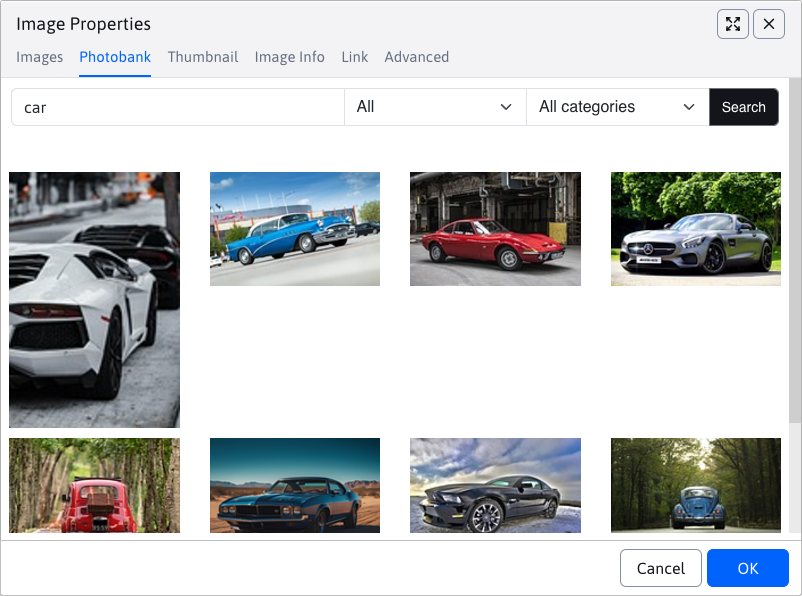

- Page Builder - elements marked with the CSS class [`pb-duplicable`](frontend/page-builder/settings.md#duplicate-element-orange-color) can be moved, duplicated, and deleted within the same parent. Custom or multiple selectors can be set via `pbCustomSettings` (#58750).
- Page Builder - added the ability to create a [div.pb-section](frontend/page-builder/settings.md), which will get the normal section control. Additionally, `!INCLUDE(...)!` applications inserted directly in a section, or containers, display a preview even though they are inserted outside the normal column (#osk711).
- Page Builder - modified [editor control](redactor/webpages/pagebuilder.md). Added fixed top bar with path to selected block, **Structure** panel, quick actions and mode for inserting sections, containers and columns directly into the page. Frames can be hidden or shown for the entire block hierarchy. Block library has a compact window with previews, categories and combined search with tags. Style settings use drop-down property groups and indicate the currently edited block (#308).

<div class="video-container">
    <iframe width="790" height="444" src="https://www.youtube.com/embed/B_m_vPPel80" title="YouTube video player" frameborder="0" allow="accelerometer; autoplay; clipboard-write; encrypted-media; gyroscope; picture-in-picture" allowfullscreen></iframe>
</div>

- Page Builder - improved detection of changes in the HTML code of the page so that the message "You probably have unsaved text in the editor" is not displayed even if you have not actually changed any text on the page (#317).
- Page Builder - fixed saving pages with incomplete HTML structure and invalid links to older editor instances. The content of such elements will be preserved along with current edits to other blocks (#400).
- [Page Builder](redactor/webpages/pagebuilder.md) - after clicking on the + in the yellow line in the **Insert Block** window on the **Basic** tab, the **Image** and **Application** options have been added. They will open the corresponding editor dialog and allow you to insert content at the selected location (#339).
- Page Builder - added [block copying between pages](redactor/webpages/pagebuilder.md#block-copying-between-pages). The **Copy** and **Paste** options transfer sections, containers, and columns with content and custom styles. The editor will only offer locations suitable for the block type. The clipboard is valid for 30 minutes from the time of copying (#353).
- Templates - on the Advanced tab you can set [removing links from page URL](frontend/templates/templates.md#advanced-tab): according to `urlRemoveSpojky`, always remove or keep. This way, the blog can keep links even when removal is enabled for the rest of the site (#353).
- Changing the folder URL with application to subfolders and subpages also updates non-displayed pages, scheduled versions, versions awaiting approval, and the last working version. It preserves their content, status, and publish date; scheduled publishing no longer reverts to the original URL (#353).
- SEO - **Browse** settings offer separate options to enable (`index`) and disable (`noindex`). **HTTP Headers** section on the Basic tab shows the current preview `X-Robots-Tag`, `Referrer-Policy` and, if redirect is set, `Location` according to unsaved page settings and server configuration (#353).
- History - users with the **Clean database** permission can [delete historical versions](redactor/webpages/history.md) directly in the page editor, also by mass selection. The currently published version and versions awaiting approval are protected. Without this permission, canceling future scheduled publishing remains available (#353).
- Planned publishing - when enabled `plannedPublishingEnabled`, a future version of the page can be prepared with protected images, documents, and a separate set of media [procedure and conditions of deployment](redactor/webpages/planned-publishing.md) (#362).

<div class="video-container">
    <iframe width="790" height="444" src="https://www.youtube.com/embed/z3QGUdDG2pk" title="YouTube video player" frameborder="0" allow="accelerometer; autoplay; clipboard-write; encrypted-media; gyroscope; picture-in-picture" allowfullscreen></iframe>
</div>

- Websites - new menu [More actions](redactor/webpages/README.md#more-actions-and-bulk-change-of-groups) in the right part of the toolbar includes bulk addition and removal of tags and user groups without overwriting other groups. Rights groups and email groups are selected together. We have also moved link checking, page statistics, saving as AB test and Import/Export (#368).

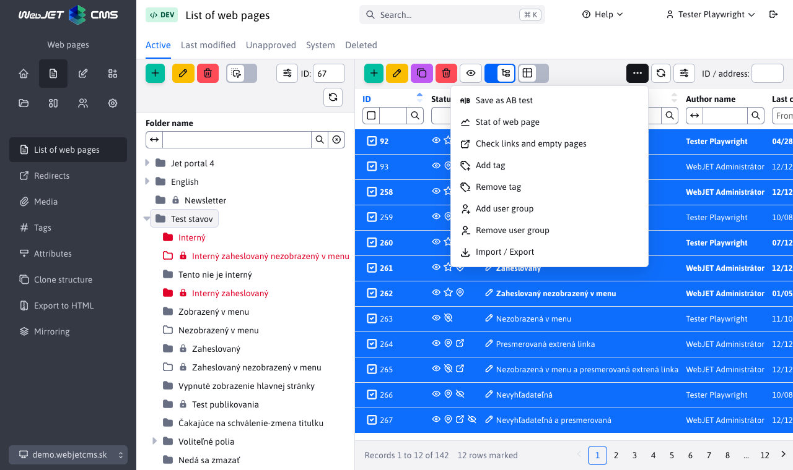

- Web pages - [default tree settings](redactor/webpages/README.md#default-settings-for-users) for a new user can be set via the configuration variable `webpagesTreeDefaultSettings` (#368).
- Page Editor - in a narrow window, the tool groups are moved to the [More Tools panel](redactor/webpages/working-in-editor/README.md#tool-panel-in-a-narrow-window). The bar does not wrap into another strip and does not overlap the editor and size switcher. The button with three dots is directly behind the last group of icons and has a bubble tip. The same control works in the Standard Editor and in the Page Builder (#372).

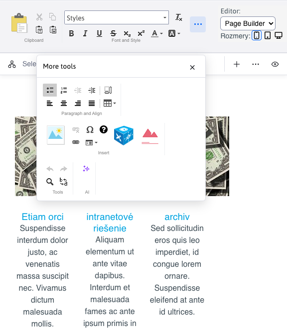

- Page Builder - dialogs that do not fit within the preview width will automatically expand to the size of the browser window. After confirmation or closing, the original preview width and page offset will be restored. Page Builder controls use the administration language (#372).
- Images - added support for images and animations in [AVIF format](frontend/thumb-servlet/README.md#images-avif). Server-side editing, watermarking, and thumbnails via `/thumb` preserve frames, transparency, and animation timing. Processing requires `ImageMagick` 7.1.2-34 or later with `libheif` 1.22.0 or later. Image editor saves a static image (#371).

- Mirroring the structure - before deleting a page or folder, a [list of mirrored items](redactor/webpages/README.md#deleting-mirrored-pages-and-folders) will be displayed, which will also be deleted.

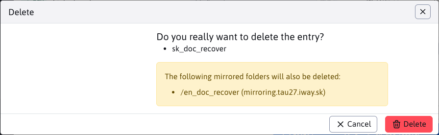

- Structure mirroring - the **Show mirroring** option in the tree structure display settings adds [language version links](redactor/webpages/README.md#navigation-between-mirrored-folders) and [warnings about incorrect mappings](redactor/webpages/mirroring/groups.md#warnings-in-tree-structure) to the tree (#370).

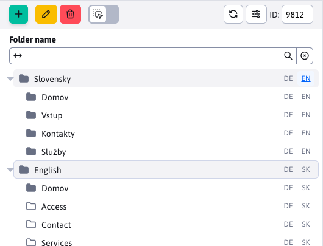

- AI Chat by field - added saved history filtered by the same field and record. You can search, open and continue an older conversation even after closing the editor; replies remain available for insertion into the field.
- AI Chat in the field and in the page editor - added image and document upload for assistants with history support. You can select files with the plus icon, drag and drop into the message, or insert an image from the clipboard - the assistant will process them along with the page content (#386).

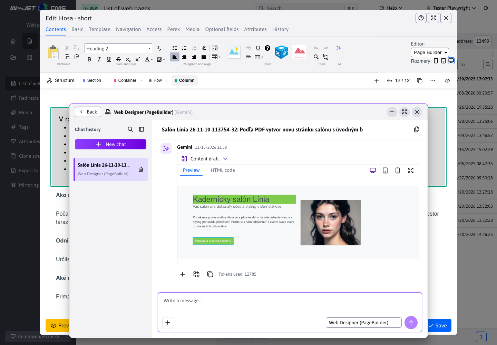

### Headless mode

Added [headless mode support](frontend/headless/README.md), in which WebJET CMS serves purely as a `backend` CMS. Content, navigation, search and forms are accessible via REST API. Frontend application (e.g. Astro, Next.js, Vue, React or any HTTP client) will download the data and display it according to its own templates (#258).

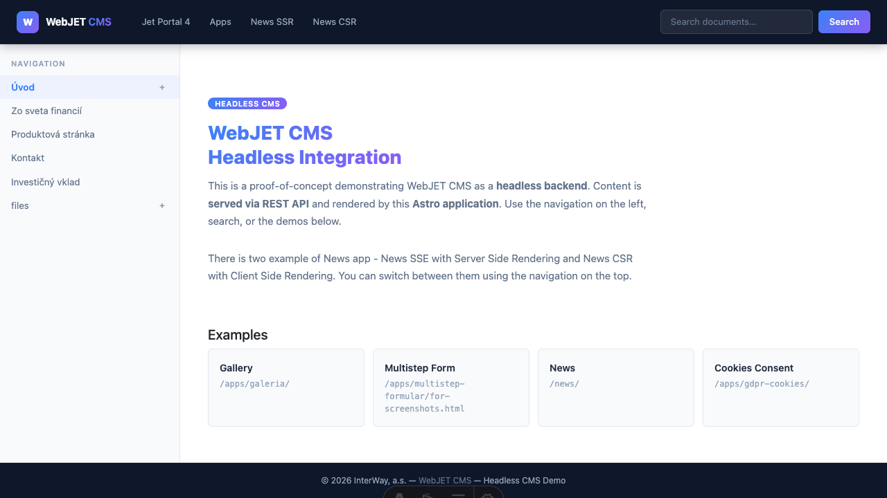

In one WebJET CMS you can have multiple (dozens) domains and subsequently have smaller websites created in different technologies that consume and display content from the CMS system. Inserting standard applications such as photo galleries, forms, GDPR cookies, and the like is also supported.

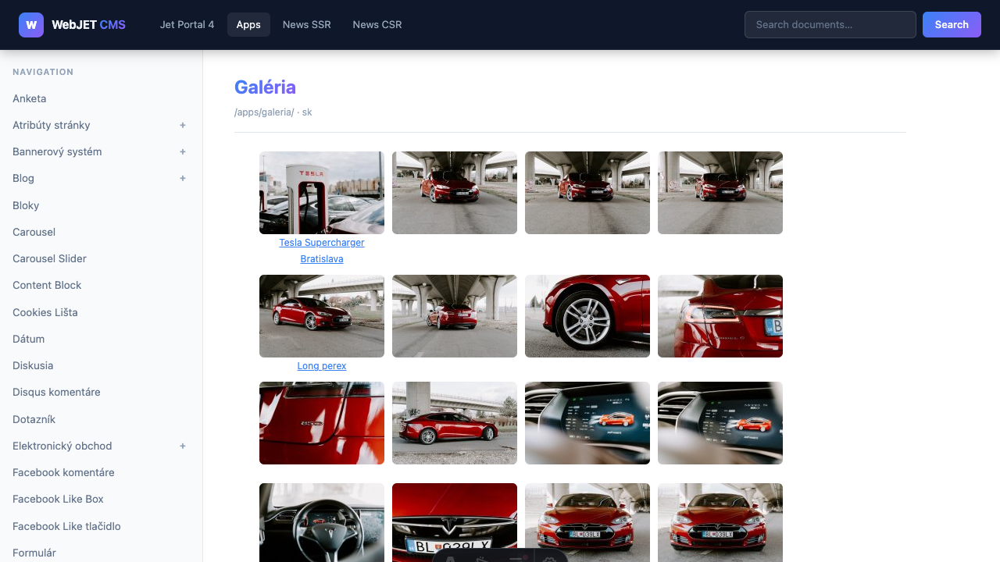

- Redirects - added [redirect cleanup and optimization](redactor/webpages/redirects/README.md#redirect-cleanup) with preview of changes before committing. Cleanup removes old, duplicate and cyclical redirects and shortens redirect chains (#58629).

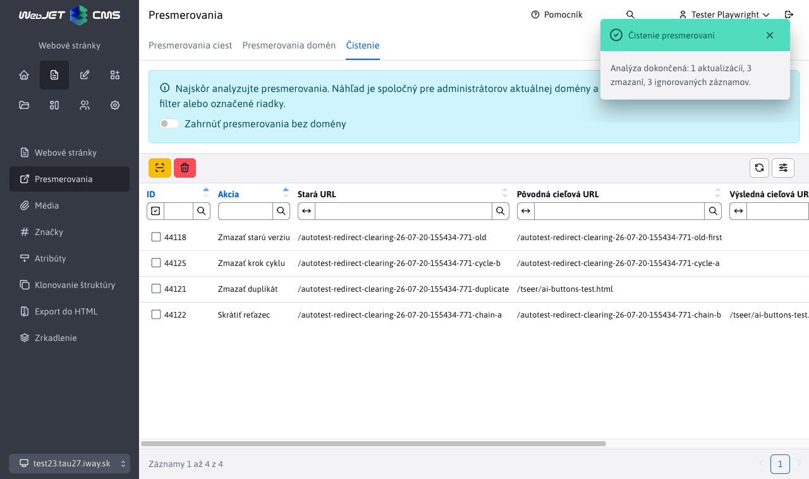

### Forms

- Multi-step forms - an optional **Help** field has been added to the editor of each item after the field name. It supports multi-line formatted text and more extensive HTML content. It is displayed after the field name in the form via the `${hint}` tag and is also transferred when copying the item (#396).
- Easy form and multi-step forms - single-line field name and explanation editor does not allow headings, lists, or line breaks. Inserted text and HTML are converted to a single line, preserving highlighting, colors, and links (#396).
- Form Settings - added **Optional Fields** tab with fields A–F. Fields are also available in the Form Simple editor and via `FormSettingsEntity`. In the HTML of the translation keys, you can use [`${settings.*}`](redactor/apps/formsimple/README.md#fields-from-form-settings) tags for A–F, email settings, redirects, file limits, and appearance. They are also supported by the preview and email appearance of multi-step forms. A–F and the text before and after the email are enabled by HTML (#364).
- Multi-step forms - added option to edit [HTML button to previous step](redactor/apps/formsimple/README.md#html-button-code) via translation key `components.multistep.form.back_button` (#osk782).
- Multi-step forms - after unsuccessfully moving to the next step or submitting, the page will scroll to the first visible error message even when retrying (#58794).
- Forms - validation of uploaded files distinguishes between an illegal character in the name and an illegal extension. A name error will indicate the specific illegal character or string. File names in error messages are displayed as text to prevent any HTML tags in the name from being executed (#58794).
- Multi-step forms - when [returning to the previous step](redactor/apps/multistep-form/README.md#returning-to-the-previous-step) both the processed values ​​and the completed uploads are preserved (#58794).
- Multi-step forms - added [field-abandonment validation] (redactor/apps/multistep-form/README.md#field-abandonment-validation) enabled by default. To disable it, set the configuration variable `multistepform_validateOnBlur` to `false` (#58794).
- [Forms](redactor/apps/form/README.md#possible-configuration-variables) - both classic and multi-step forms respect `sendMailSaveEmail` and save emails as `.eml` files to `sendMailSaveEmailPath` instead of SMTP sending. If the write fails, the form reports an error.
- Multi-step forms - added [return to previous step](redactor/apps/multistep-form/README.md#return-to-previous-step) with restoring saved values ​​and files and [CSS template selection](redactor/apps/multistep-form/README.md#css-templates) for each inserted instance and preview in the administration (#58742).

<div class="video-container">
    <iframe width="790" height="444" src="https://www.youtube.com/embed/5ooxA3JVWc0" title="YouTube video player" frameborder="0" allow="accelerometer; autoplay; clipboard-write; encrypted-media; gyroscope; picture-in-picture" allowfullscreen></iframe>
</div>

- Multi-step forms - fixed evaluating conditions after unchecking a box when returning to the previous step. A hidden or no longer required field will not block continuation due to the originally saved value (#58742).
- [Multistep form statistics](redactor/apps/multistep-form/stat.md) has been extended with a date filter and advanced metrics for views/attempts/languages ​​etc. (#58509).

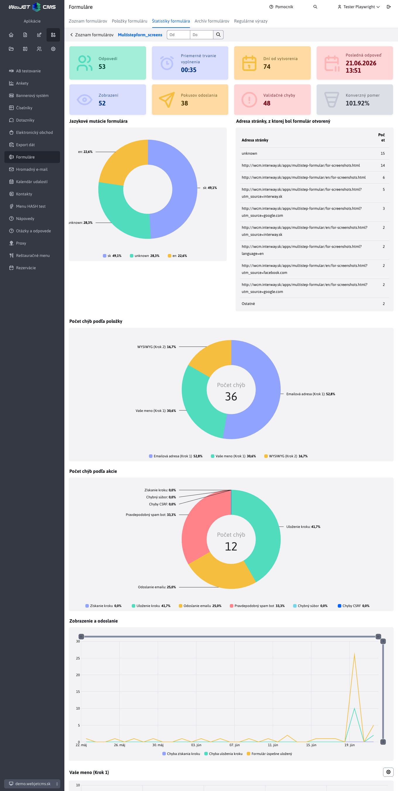

- Multi-step forms - [empty option](redactor/apps/multistep-form/README.md#empty-option) in a group of selection fields displays the adjustable text **Without selected option** (#381).
- Added the ability to easily set up checkboxes and groups of checkboxes/select fields in multi-step forms (#58517).

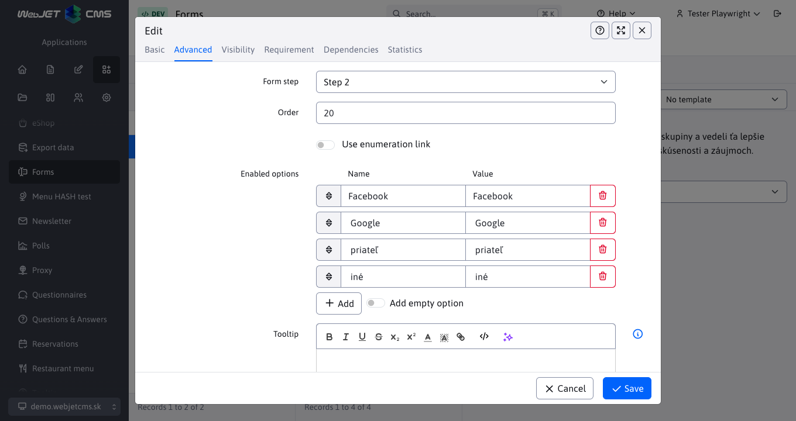

- Added the ability to link a selection field and a group of checkboxes/selection fields to a dial pad in multi-step forms (#58517).

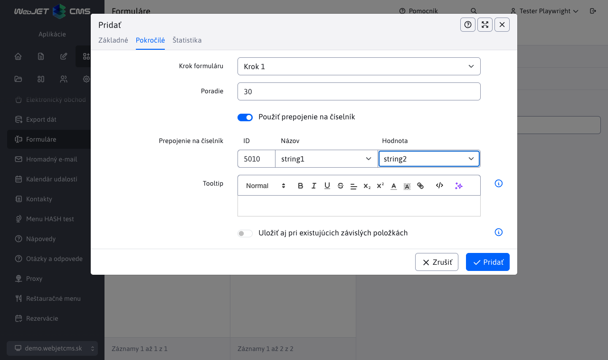

- Added the option to set the maximum combined file size in the form, previously only the size for a file could be set, if the form contains multiple files, it is possible to set the maximum size for all files together (#58517).
- [Multistep Forms](redactor/apps/multistep-form/README.md) - added duplication of the entire form including settings, steps and items. The item editor displays their automatically generated identifier and supports custom error message, whitespace trimming, empty option in picklist and new field type autocomplete with diacritic-insensitive search (#osk573).
- [Multistep forms](redactor/apps/multistep-form/README.md) - it is possible to insert item values ​​using tags in the introductory text of the step and [page with email version](redactor/apps/form/README.md#tab---settings). The recognition of name and email fields by the beginning of the identifier, language processing, reCAPTCHA v3, independent insertion of multiple form instances on one page and deleting all responses without deleting the form definition (#osk573) have been fixed.
- [Multistep forms](redactor/apps/multistep-form/README.md) - added the ability to enter a custom error message and trim spaces at the beginning and end of the text entered by the visitor (#osk573).
- Easy form and multi-step forms - [custom HTML tooltip code](redactor/apps/formsimple/README.md#custom-html-tooltip-code) in the translation key `components.formsimple.tooltipCode` supports tags with field, item and step identifiers, including the unique `${tooltipId}`. The control can thus be unambiguously linked to the tooltip content using `aria-describedby` even when the form is repeatedly inserted into the page. After each step is displayed, the multi-step form publishes an [event `WJ.multistepForm.stepShown`](redactor/apps/multistep-form/README.md#javascript-event-after-display-step) on the `window` object with references to its HTML elements and form and step identifiers (#306).
- Easy form and multi-step forms - the default tooltip is now available with both mouse and keyboard, provides a stable contextual title and description, remains displayed when the cursor is moved to its content, and can be closed with the `Escape` key (#306).
- Multistep forms - added [copy fields between forms and steps](redactor/apps/multistep-form/README.md#copy-fields-between-forms). Paste opens the editor with saved field settings; display conditions and obligations are not carried over. Internal clipboard works across browser tabs and allows repeated pasting for 30 minutes (#58826).
- Multi-step forms - added option [Show content without redirection](redactor/apps/form/README.md#tab---settings). The switch will use the web page from the **Redirect after completion** field and after successful submission will replace the default message with its content without changing the URL address. If the visitor does not have permission to view the web page, the default message about successful submission will be displayed (#58826).
- Multistep forms - the new [Bindings](redactor/apps/multistep-form/README.md#bindings) tab in the field editor displays separate lists of fields that use its value in display and obligation conditions (#377).


- Multi-step forms - when setting display conditions and obligations, the compared value for selection fields is selected from their options, including code lists and common radio groups. There is no need to enter values ​​manually (#391).
- Multi-step forms - selecting **Form Step** in the item editor now shows the current step number even after changing the order of steps by dragging with the mouse (#392).
- Regular expressions - the list displays the translated name according to the administration language and indicates the original name as **Translation key**. The **Allowed value** selection in multi-step forms uses the format **code - name** (#387).
- Multi-step forms - fixed typo in translation keys from `components.mustistep.*` to `components.multistep.*` (#378).
- Multi-step forms - auxiliary statistics entries on [public cluster node with limited database rights](install/config/ro-user.md#multi-step-forms) no longer block form display, validation, or submission. In case of an error, the visitor will see the application name instead of the Java class name (#384).
- Delayed email sending - increased column `emails.message` to `LONGTEXT` in MySQL/MariaDB so that saving a large HTML email does not fail. Added [instructions for smaller CSS for email and PDF](redactor/apps/form/README.md#css-styles-for-email-and-pdf) (#374).

### Semantic search

- Added support for **MariaDB Vector** as an alternative to `PostgreSQL/pgvector` for semantic and hybrid search and RAG responses. The minimum supported version is **MariaDB 11.8 LTS**, we recommend **11.8.9 or later patch**. Versions from **12.3 LTS** include search acceleration. The minimum and recommended versions of PostgreSQL, pgvector and MariaDB and their benefits are in [database requirements overview](custom-apps/apps/rag/semantic-search/README.md#supported-databases-and-versions) (#232).
- An unavailable standalone RAG database no longer blocks CMS startup. RAG persistence is initialized only on first use and allows another attempt after a failed connection without restarting the CMS (#232).

- Added support for [semantic search](redactor/apps/semantic-search/README.md) built on the `pgvector` and `OpenAI embeddings` vector database technology. It allows visitors to find relevant pages based on **the meaning of the query**, not just keyword matching (#211).
- Added hybrid semantic search mode and optional RAG response from indexed content. The **Search** app has new settings for search type, hybrid behavior, AI assistant selection, and response context limits (#58521).

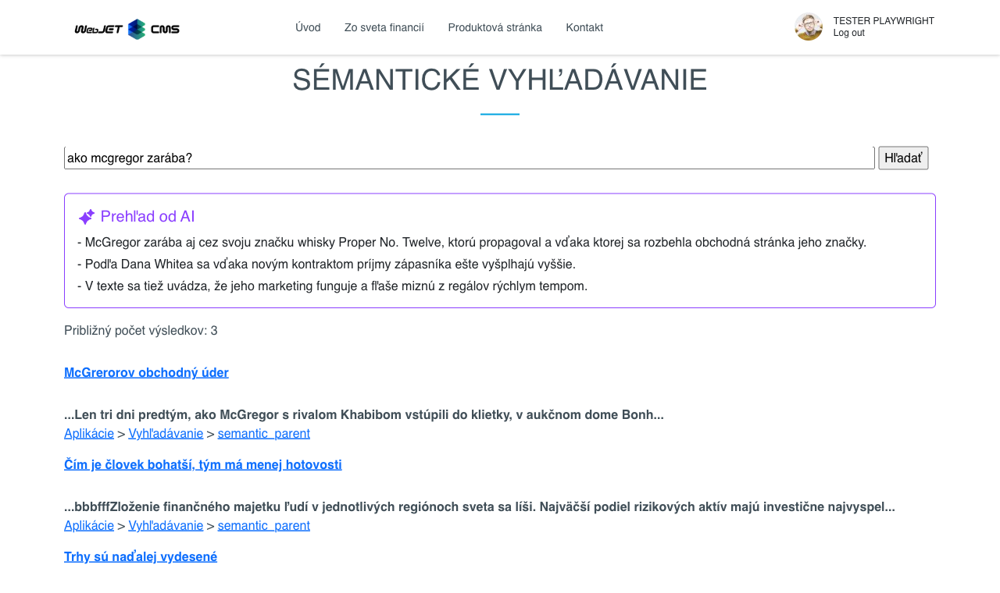

- Embedding indexing and search uses the provider and model set in the system AI assistant. Indexes of different providers and models can coexist; the **Semantic Index** page displays the current setting and preserves other combinations when re-indexing. The core of embedding requests, responses, and provider communication has been separated into the `webjet-ai` library; WebJET CMS continues to handle assistant selection, indexing, and vector storage (#58694).
- AI assistants and **semantic search** - added support for [local models](redactor/ai/settings/README.md#local-models) for text generation, translation and embedding directly on the server without sending content to an external AI service. These models can **run on regular hardware** (CPU), **do not require special graphics cards** (#58561).
- Semantic search - local [reranking of results](custom-apps/apps/rag/semantic-search/README.md#reranking-of-results) improves the ranking of results and the selection of RAG context based on the textual match to the query. It does not require additional AI calls or re-indexing (#58778).
- Semantic search - text chunks have a maximum of 50% larger than the target size (by default `1500` characters). Markdown preserves entire sections and blocks that fit within the maximum, and combines short sections with a common heading context. Larger content is broken down by sentences and words. Changes are applied after re-indexing. More in [indexing description](custom-apps/apps/rag/semantic-search/README.md#1-indexing) (#58778).
- Semantic search - added [Markdown documentation support](custom-apps/apps/rag/markdown-search.md) from both web and local folders (`file:`), scheduled change indexing, Docsify search by language and directory, and optional RAG response. New **Markdown documents** tab allows indexing and removal via folder tree selection. Language is derived from file path. Index is common to all domains; AI assistants and consumption belong to the domain of the performed operation. Search respects SPAM protection limits even before calling AI and displays a message when they are exceeded. Setting the alias `file:/docs`, task parameters `koreň|doména`, and migrating legacy indexes are described in the tutorial (#58778).

### Applications

- AI assistants - new tab [Token limits](redactor/ai/settings/README.md#karta---limity-tokenov) allows you to limit the assistant's consumption and view its development over the last 14 days. Notifications will be sent to the specified notification email when the 75% and 100% limit is reached. After the limit is reached, further requests will be blocked. Consumption can be reset manually for selected assistants or the current domain, or regularly for all domains with the `AiTokenUsageReset` task, which runs every day at midnight (#400) by default.
- AI assistants - fixed handling of continuous text responses including Gemini. Token counts and error messages are now handled correctly even when splitting or merging network blocks; technical data is not inserted into the generated text. An interrupted response is no longer marked as successfully completed.
- Enumerations - type selection and management moved to the tree in the left panel with search. More in [Enumerations documentation](redactor/apps/enumeration/README.md) (#58786).
- Blog - selecting and adding sections are available in the tree in the left panel with search. More in [Blog documentation](redactor/apps/blog/README.md) (#58786).
- News - folder selection has been moved to the tree in the left search panel, also available in the application editor. Automatic folder search skips blogger roots and their subfolders. More in [News documentation](redactor/apps/news/README.md) (#58786).
- E-commerce - added optional [price rounding](redactor/apps/basket/rounding.md) to calculate the basket from the displayed price per item. The number of decimal places is determined by `currencyFormat` ; templates with the `iway:curr` tag will automatically adopt the new formatting (#316).
- Codebooks - for named string fields, the field type, selection options, mandatory, help text, and length restrictions can be set in the new [String Field Types] tab (redactor/apps/enumeration/README.md#karta-typy-ťazcových-polí) just like for optional fields. The menu and configuration names are based on the last saved version of the codebook type. Unnamed fields remain hidden, are not evaluated as mandatory, and fields without a specific configuration are displayed as regular text. Older custom Excel templates and REST API integrations need to be modified from `string1` to `string12` to `fieldA` to `fieldL` (#58641).


- E-commerce - added [Statistics] application (redactor/apps/eshop/stats/README.md) with summary indicators, filtering by status, currency and period, and graphs of sales, products, categories, delivery methods and payment methods (#58065).

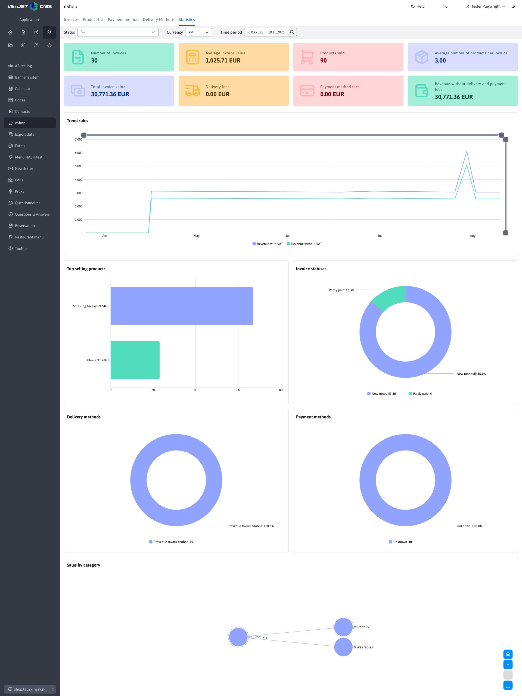

- Added new application [Language Redirect](redactor/apps/language-redirect/README.md) to automatically redirect visitors to the language version of the page based on language detection from the HTTP header `Accept-Language`. It supports up to 8 language assignments per URL, respecting the language cookie, and the option to redirect only to the root URL (#58497).

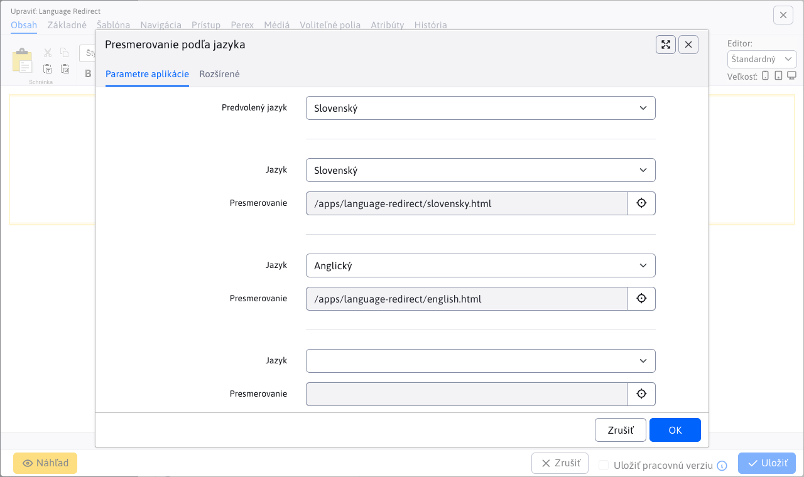

- Reservations - the **Time Reservation** and **Day Reservation** applications have a unified visual style according to the `Vanilla Calendar` calendar, adjusted contrasting cell colors according to `WCAG`, separated visual CSS styles into separate files, and **Time Reservation** displays the actual price in the hourly cells according to the price list of the reservation object (#58565).
- Reservations - a new application [My Reservations] (redactor/apps/reservation/my-reservations-app/README.md) has been added, which will show the logged-in user an overview of their reservations, reservation status, and the option to delete allowed future reservations (#58565).


- Document Manager - added folder tree view (#58593).

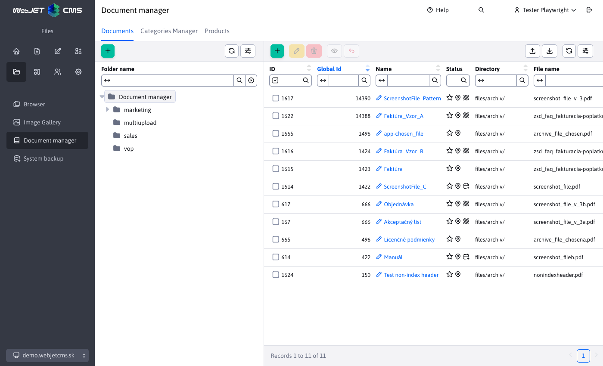

- Document Manager - added ability to upload multiple files at once via `drag&drop` (#58593).

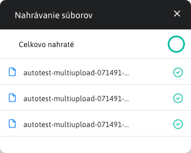

- Document Manager - when [bulk uploading files](redactor/files/file-archive/README.md#bulk-uploading-files) it is possible to set a common validity on the **Basic** and **Advanced** tabs, schedule a later upload with email notification, and enter extended document metadata (#58754).

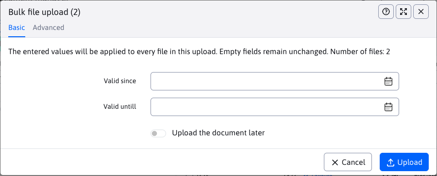

- Document Manager - improved file system rights checking. The icon for adding a folder is only displayed if the user has write rights, rights are checked when selecting a folder, if the user does not have write rights to files in `/files/archiv` an error message (#osk802) is displayed.
- Folder selection - disabled folders in the tree structure are displayed with a folder icon with a cross (#osk802).
- Document Manager - the folder tree has a minimum width of 200 px so that the search field with buttons does not extend into the table even when setting a smaller ratio. Therefore, the width settings in pixels offer values ​​starting from 200 px (#360).
- Document Manager - **Product** and **Category** fields normalize hard spaces, tabs, and line breaks, merge repeating spaces, and remove trailing spaces and distracting invisible characters from copied text when saving, renaming, and bulk uploading. **Warning:** When resaving an existing document, hard spaces in the title, products, and so on are removed. Filters in the application in websites are not automatically updated. If they use the original name with hard or repeating spaces or invisible characters, the document may not appear in the filtered list after saving. Correct the names in all affected documents and set the filters in the applications to the new values. Saving one document will not correct other documents with the same product or category name (#360).
- Document Manager - in [website application](redactor/files/file-archive/file-archive-app.md#tab---advanced) added sorting by validity start and end, product code, product, category, file name and document size (#359, #osk791).
- Document Manager - the configuration variable `fileArchivCheckHistoryValid=false` can be used to enable downloading of historical versions even outside the validity period; historical versions of documents will then also be displayed in the application on the website. The dates remain displayed in the archive; the default value `true` maintains the validity check from and to. More in [documentation](redactor/files/file-archive/README.md#validity-and-downloading-historical-versions) (#380).

### Gallery

- Added the ability to set a separate [resizing method for a large image](redactor/apps/gallery/structure.md#tab-dimensions) independent of the small image. By default, the same resizing method is used as set for the small image. The setting can optionally be copied to subfolders (#58633).

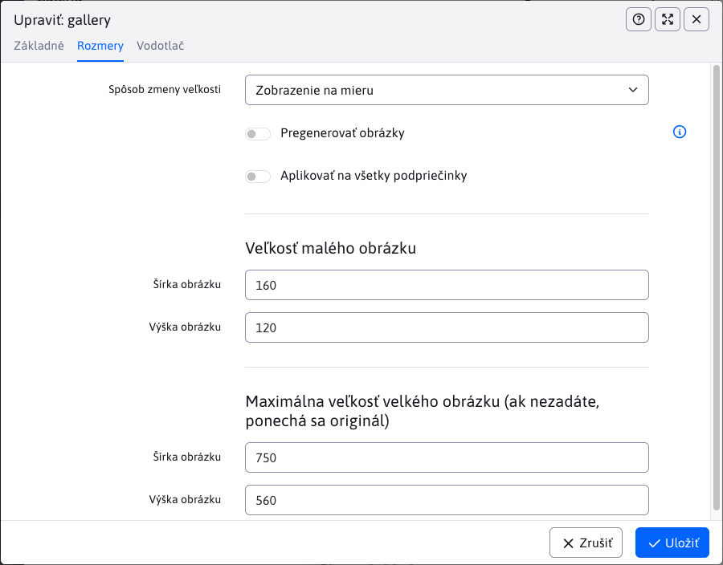

### Data tables

- The **Settings → Data Tables** section combines [Field Settings](frontend/datatables/fields-settings.md), [Tab Settings](frontend/datatables/tabs-settings.md) and [Optional Fields](frontend/datatables/custom-fields-settings.md). You can change the names, order, and display of fields for individual entities and domains, or disable their editing. You can also edit editor tabs and create your own tabs with optional fields. **Warning:** The original **Optional Fields** permission (`customFields`) has been removed. After the update, the relevant users or permission groups must be assigned the new **Data Tables** permission (`dataTablesConfig`). The original permissions will not be automatically transferred (#366).

<div class="video-container">
    <iframe width="790" height="444" src="https://www.youtube.com/embed/xkgdP7odoPA" title="YouTube video player" frameborder="0" allow="accelerometer; autoplay; clipboard-write; encrypted-media; gyroscope; picture-in-picture" allowfullscreen></iframe>
</div>

- Web pages - when saving, the values ​​of fields hidden in the editor and fields with editing disabled will be preserved according to the same rules as in other data tables. When editing from history, the values ​​from the selected version of the page will be used (#366).

### Optional fields

- Fully implemented [custom field settings] functionality (frontend/webpages/customfields/custom-fields-settings.md). Allows you to centrally set field properties without editing translation keys. All field types are supported (text, textarea, select, multiselect, autocomplete, enumeration, image, link, JSON and more) with type-specific settings such as maximum text length, selection options, linking to code lists or dependency on other fields. The user interface also offers an easy way to set possible values ​​for select/autocomplete fields (#58529).

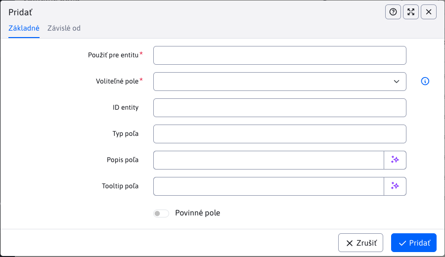

- Added option to set optional field as required (#58413).
- Added new optional field types [radio check box and radio check box](frontend/webpages/customfields/custom-fields-settings.md#difference-between-selectmultiselect-and-radiocheckbox) with support for both static options and codebook linking. The `multiselect` type now also supports [codebook linking](frontend/webpages/customfields/custom-fields-settings.md#option-source). The original `enumeration` type has been replaced by an option source switch for types `select`, `multiselect`, `radio` and `checkbox` where options are loaded from a linked codebook for all these field types (#58637).
- Added [JSON Editor](developer/datatables-editor/customfields.md#json-editor) type (`jsoneditor`) for direct input of JSON object with line numbers and formatting button (#311).

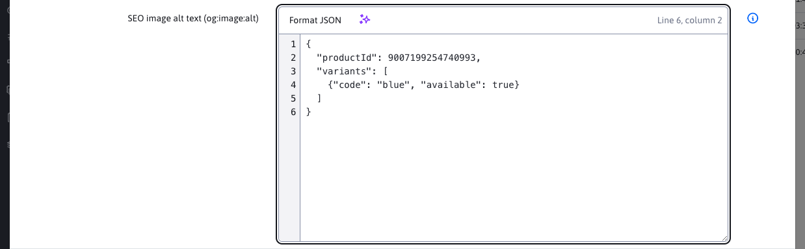

### Accessibility

- Administration - extended keyboard control and screen reader support for data tables, modals and notifications, tooltips, date and color pickers, and HTML editor. Improved focus shifting and returning, row and cell selection, accessible names and ARIA states, required field marking, control contrasts, and a skip to main content link. Automated regression `a11y` tests for these scenarios (#235) have been added.

### Multiweb

- Added option [create new domain](install/multiweb/config.md) from the control domain, it will also create user, template group, template and system pages (#58525).
- Added template group list view (#58525).
- All domain redirects can be edited in the control domain.
- Added option to view all files in the management domain.
- GDPR - fixed adding and editing cookies in other domains without permission to edit all translation keys. Provider, purpose and validity are stored and displayed for the current domain (#344).

### Other minor changes

- Server monitoring - in the current values, the [Character encoding] section has been added (sysadmin/monitoring/README.md#character-encoding), which displays the encoding of HTTP responses, JVM and locale environment of the running application server process (#305).
- Configuration - added hierarchical tree of configuration variables with **Changed**, **Custom**, **All** views and module branches (#293).
- Configuration - added **Set Temporarily** option, which sets the value of the configuration variable only on the current node without saving it to the database. After a restart, the value saved in the database will be restored (#291).

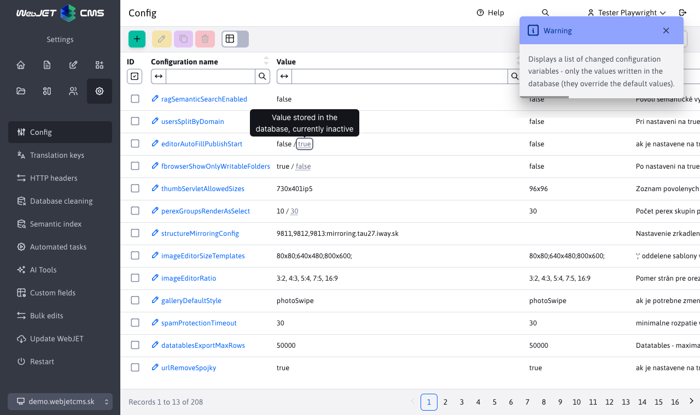

- Automated tasks - added option to [manually run task](admin/settings/cronjob/README.md) on node or node group set in **Runs on node** field. Original local run on current node remains available with separate button (#58718).

- Translation keys - added tree structure of translation key prefixes with filtering of the list by the selected prefix (#58714).

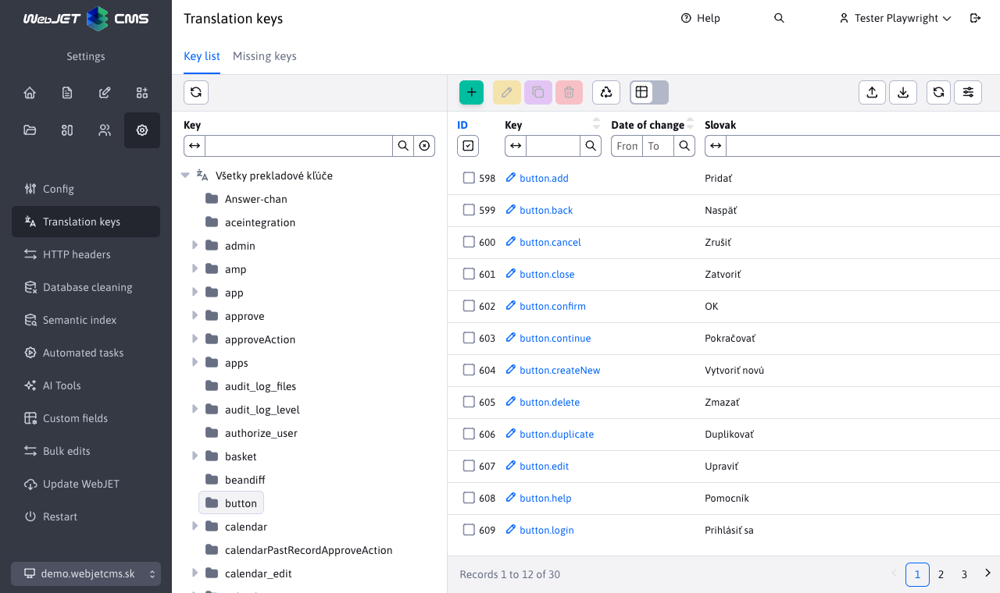

- Explorer - added [Unused files] tab in folder properties (redactor/files/fbrowser/folder-settings/README.md#unused-files) to find and delete unused files (#58621).

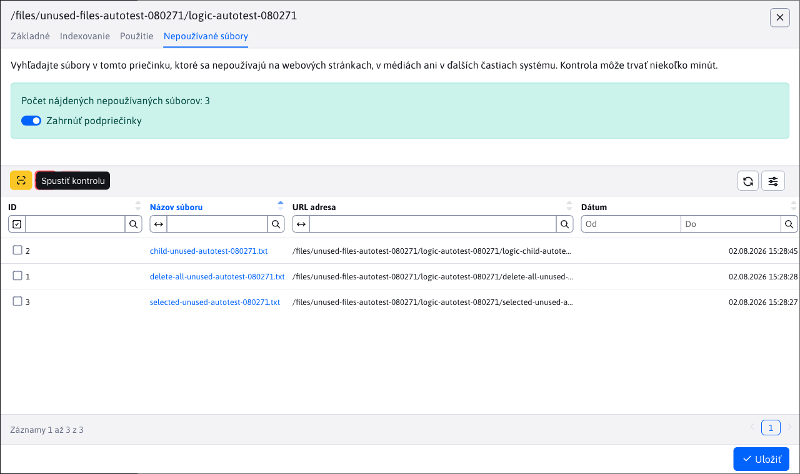

- Explorer - added right **Allow uploading files with accents**, which allows preserving accents when uploading, creating, and renaming files and folders in folders `/files`, `/images`, and `/shared`. Without this right, names will continue to be automatically edited without accents (#58589).
- Login - faster loading of the home page in the administration - added cache for the list of recent pages, changed pages and audit logs (#58589).
- Export/import files - modified dialog design and responsive display of form fields according to the current administration design (#58581).
- Charts - added a new tree chart [`TreeChartForm`](developer/frameworks/charts/frontend/statjs.md#tree-type-chart) for visualizing hierarchical data with zooming, expanding, and maximizing (#58065).
- Google reCaptcha - added support for inserting multiple multi-step forms into a page, `invisible/reCaptcha/reCaptchaV3` mode is supported, error message edited to more understandable text (#osk573).
- Web pages - added highlighting of the element above which the context menu is called. Important if you want to perform the Delete element action, so you can see exactly which element is marked (#OSK675).
- Multiweb - added option to rename an existing domain + redirection after renaming (#58317-15).
- Multiweb - modified [display of template groups](install/multiweb/README.md) according to available templates and alias of current domain (#58317-17).
- Statistics - the set date/from-to range is saved in the browser and is remembered even after logging out/restarting the browser (#58065).
- Statistics - browsers are saved without a frequently changing version number. A manually triggered batch migration has been added in the WebJET Update section, which will merge historical records without a website outage. On the `/admin/v9/settings/stat-browser-migration/` page, click Analyze and then start the migration. After a successful migration, click Finalize. Finalization verifies the use of identifiers before deletion, including operating systems and their versions, preserves the values ​​used, and displays the progress of the scan by table. The list of `User-Agent` browsers has been updated for better detection (#303).

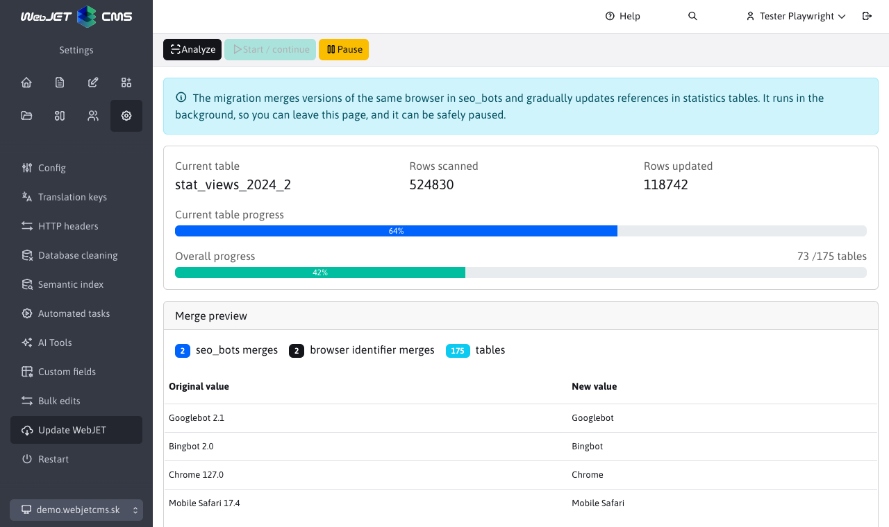

- Multi-step forms - added moving (`scroll`) to the beginning of the form after moving to the next step (#osk573).
- Explorer - when updating a file, the selection is limited to one file and a message warns of the wrong type (#317).
- Explorer - folder information no longer shows inaccurate recursive size (#317).
- Proxy - [exceptions `proxyHostsException`](install/config/README.md#httphttps-proxy) supports wildcard patterns like `*.firma.sk` and `127.*`, comma and `|` separators, and case-insensitive comparison. The same normalized list is used for both HTTP/HTTPS and JVM settings `http.nonProxyHosts`. Changing the configuration requires a restart (#361).

### Bug fixes

- Structure mirroring - when a translation fails, for example after running out of DeepL quota, the user will receive a notification with the specific reason for the translator exception, including the HTTP code and available DeepL error message. Hard spaces and their HTML entities are normalized in folder names and generated URLs to avoid `nbsp` addresses and unnecessary redirects (#402).
- Data tables - after editing a single record, when forced to refresh the data, the page with the edited record is displayed according to the current sorting. In the configuration, the variable is searched by name even when its ID is changed. When deleting, the current page is preserved, or the last valid page is displayed. When creating a record, the pagination is still reset (#400).
- Multi-step forms - the item identifier is generated from the field name text without HTML tags so that name formatting does not affect the identifier (#396).
- Multi-step forms - when an item, step, or form is deleted, the corresponding display conditions and obligations are also deleted. Conditions for already deleted items do not block the deletion of the fields they referenced (#395).
- Multi-step forms - **Allowed Value** rules no longer reject empty optional fields. For required fields, regular expressions are also checked for empty values; mandatory conditions are also taken into account when submitting a step (#394).
- Page Builder - inserted cards will receive their own ID even when copied before initialization is complete, so that their links do not link to the original block.
- Data tables - entering the ID will open the record even after previous filtering without results.
- Websites - fixed [export to ZIP archive](redactor/webpages/import-export.md) for images inserted via `/thumb/` that were not originally added to the export (#389).
- Web pages - the insert image dialog limits file selection to images, videos, and audio files, even in the Files folder. Unsupported types recognized by the browser will be rejected before submission. Additionally, the server will validate the extension before saving (#375).
- Websites - page redirection is not saved in the browser cache for the logged-in administrator so that its change or cancellation will be reflected the next time the page is opened (#372).
- Spring applications - [error creating or executing application](custom-apps/spring-mvc/README.md#error-executing-application) will replace only its `INCLUDE` tag. Surrounding text, JSP applications, and other Spring applications will remain on the page, and the message will state the name of the application that failed (#384).
- Redis session - fixed uploading files in parts, consuming one-time CSRF tokens, and updating logged-in user data after editing profile via registration form. Changed objects are written back to session.
- Page editor - fixed a bug when opening a preview after restoring a session from a serialized storage, such as Redis. Missing editor data will be restored from the preview version of the page.
- Templates - creation, modification and deletion audit uses uniform prefixes `CREATE:`, `UPDATE:` and `DELETE:` with the template ID and name.
- Page Editor - when switching pages, it waits for CKEditor to complete the refresh so that the content of the previous page is not displayed and saved.
- Websites - slashes in the page title, menu title, and header, footer, or navigation selection are displayed as `/` instead of `&#47;`.
- AI assistants - when HTTP error occurs while generating an image, an error is displayed and the processing indicator is terminated. The request can be retried.
- Datatables - HTML editor [`QUILL`](developer/datatables-editor/standard-fields.md#quill) - the titles, alignment, and color menus are no longer clipped at the bottom of the dialog box and remain available even in a low browser window (#376).
- E-commerce - fixed adding a product category without a marked product in the table (#373).
- Web pages - Page URLs, redirects, and image perex now preserve parameters even after loading via JPA, including history. The HTML sanitizer no longer rewrites the `&` and `=` characters in URLs to HTML entities (#373).
- Websites - page redirection is not saved in the browser cache for the logged-in administrator so that its change or cancellation will be reflected the next time the pages are opened (#372).
- Page Editor - when auto-maximizing in a low or narrow window, the entire toolbar remains above the page content. Content no longer shines through under icons and group names (#372).
- Page Editor - on failure to retrieve content or value `undefined` an error is displayed and saving is stopped to avoid overwriting the original content. `contenteditable` attributes are removed on both loading and saving HTML, including code inserted in HTML mode (#369).
- Page Builder - when content loading fails, you can switch to HTML mode by restoring the last available HTML. The restore requires confirmation as it may not contain the latest changes (#369).
- Page Builder - fixed editor freeze when opening HTML with remaining `contenteditable="true"` attribute. CKEditor no longer initializes twice on the same block.
- Page Builder - restoring focus after inserting content or a structural block, moving, duplicating, and closing properties or libraries does not move the page to the beginning of the editor. The fix also works in templates with smooth scrolling (`scroll-behavior: smooth`) (#389).
- Page Builder - unsupported elements marked `pb-editable`, such as list items `li`, no longer block switching from the HTML editor. Their content remains intact and can be edited via the parent editable area (#382).
- Page Builder - nested tags `pb-editable` and `pb-content` are removed before the editor is launched. Nested CKEditors are not created in one block and redundant markup is not copied when creating paragraphs or lists. Text and other CSS classes are preserved (#382).
- Email - fixed SMTP settings being affected between applications on a shared application server. Each send uses its own properties and mail session, so SSL port, authentication, or Amazon SES settings from another application are not transferred (#367).
- Page Builder - fixed accumulation of empty lines in HTML of nested blocks. When saving and switching to HTML editor, old extra lines between elements are also removed. Content of `pre`, `textarea` and spaces preserved via CSS `white-space` remain unchanged (#367).
- Webpages - fixed stuttering and jumping when [compare versions](redactor/webpages/history.md) if the page template uses smooth scrolling (`scroll-behavior: smooth`) (#367).
- Web pages - JSON editor now accepts fields and simple values ​​with comments. Fixed column splitting and scrolling in Page Builder and closing tooltip when editing from history (#346).
- Multi-step forms - fixed validation of fields with chained visibility conditions (#58794).
- Forms - fixed archiving of forms (#305).
- Forms - separate deletion of submitted data from settings and items. If a form is used by a displayed page or has data in the archive, the definition will be preserved and the notification will indicate the reason and the docId of the pages. When completely deleted, steps, items and their conditions will also be deleted (#393).
- Explorer - modified comparison of files with diacritics when checking the existence of a file when overwriting it - format `utf-8 NFC vs NFD` (#58317-12, #58698).
- Web pages - fixed adding empty `P` element to the end of the page (#58317-13).
- Websites - fixed loading of `ckeditor_button_sizes` value for button type `A` (#OSK674).
- SQL Monitoring - fixed lifecycle management of `PreparedStatement` measurements. The record is also deleted when closed before starting the measurement and individual `PreparedStatement` objects are distinguished by identity without JDBC calls `hashCode()` and `equals()`. Concurrent access uses `ConcurrentHashMap` and atomic state without a global `synchronized` block, so threads do not wait for a shared lock and measurements do not merge even when identity hashes collide.
- Page Builder - fixed unnecessary scrolling up/down the page if you were editing an application on a page (#343).
- Page Builder - fixed displaying the toolbar if the page does not contain any sections (#343).
- Page Builder - added option to set [structure window width](frontend/page-builder/settings.md) (#343)
- Administration - fixed display of check mark icon when an item is selected in the autocomplete menu (#osk800).
- Structure mirroring - [draft version](redactor/apps/docmirroring/README.md#edit-existing-webpage) no longer overwrites published translations and [bulk delete](redactor/webpages/README.md#delete-mirrored-pages-and-folders) no longer processes the same item repeatedly. Moving does not create duplicate language versions. When moving a folder, generated and inherited URLs are updated. Temporary cloning settings and mirror administration state are not shared between concurrent requests (#370).

### Performance

- Multi-step forms - accelerated repeated field checks during filling (#58794).
- Optimized loading of template groups when displaying a page and searching for optional fields. The group is cached and reused without having to read it from the database (#311).

### Safety

- AI assistants - search in statistics and usage graphs only show records and assistants of the current domain (#58850).
- Websites - deletion checks permissions for all mirrored pages and also requires `deleteDir` for folders. [Unmirroring](redactor/apps/clone-structure/README.md#unmirroring) checks permissions for the entire subtree including configured domain and user group restrictions (#370).
- Dependency Check - updated libraries `Jackson 2.22.3 → 2.22.4`, `Jackson 3.2.3 → 3.2.4` with fix `CVE-2026-110879` and `undici 6.28.1 → 6.29.1` with fix `CVE-2026-109383`. Jackson update tightens type checking during polymorphic deserialization; custom integrations using Java class names in JSON need to be verified (#385).
- Dependency Check - exceptions for `CVE-2026-116802`, `CVE-2026-116803` and `CVE-2026-116804` in `DOMPurify 3.4.16` have been verified and constrained to the exact hash of the supplied `Swagger UI 5.34.0` bundle. The integration handles HTML strings without XHTML mode, `IN_PLACE`, `SAFE_FOR_TEMPLATES` and DOM returns; its hook does not remove nodes. The exceptions confirm the non-use of the affected modes, not a fix for the DOMPurify library (#385).
- Dependency Check - updated libraries `Hibernate Validator 9.0.0.Final → 9.0.2.Final` with fix `CVE-2026-93879`, transitive dependency `ASM 9.7.1 → 9.11.1` with Java bytecode processing fixes, and administration build dependency `ip-address 10.7.1 → 10.7.4` with fix `CVE-2026-111997`. The updates do not require a Java version change or application API modification (#385).
- Dependency Check - added exception for `CVE-2026-104828` in `neko-htmlunit 4.5.0`, existing exception for `CVE-2026-47842` was re-verified for `spring-security-crypto 7.1.2`. Verified integrations do not use `HTMLWriterFilter` or the old AES API. Exceptions are limited to specific versions; they should be re-evaluated when changing integrations. This is not a fix for these libraries (#385).
- Forms - prevented overwriting of the encryption key by the `encryptKey` parameter in the request. A forged, empty or corrupted parameter will not change the encryption of the stored values ​​or the HTML form of the form (#376).
- Node.js - development and build version in `.nvmrc` and `devcontainer` updated to `22.23.4`, which fixes the Brotli decoder vulnerability CVE-2026-111497. Locally and in build environments, update Node.js according to [installation instructions](developer/install/README.md#rspack-build-js-css-a-pug-files) (#373).
- Web pages - when saving, the rights to the original page and to the target folder when moving are verified. Changing the ID and folder in the request does not allow you to download another page (#373).
- Web pages - page title and menu title are cleaned of dangerous HTML on both save and load (#373).
- HTML sanitization - added shared `AllowSafeHtmlAttributeConverterWithSave` to sanitize HTML on both save and load. Used for path from folder names in pages and history; older JDBC writes are also handled.
- Datatables - when rendering links and images, URLs in HTML attributes are escaped so that embedded quotes cannot create another attribute. The URL itself in the data remains unchanged (#373).
- Dependency Check - updated libraries `Jackson 2.22.3/3.2.3`, `jsoup 1.23.2`, `logback-core/classic 1.6.5`, `slf4j-api 2.0.19`, `mariadb-java-client 3.5.10`, `postgresql 42.7.14`, `Swagger UI 5.32.15` (with `DOMPurify 3.4.13`), `moment 2.31.0` including static copy, `@tootallnate/once 2.0.1`, `@xmldom/xmldom 0.9.12`, `brace-expansion 1.1.21/2.1.7/5.0.12`, `ip-address 10.7.1`, `http-cache-semantics 4.3.0`, `source-map-js 1.2.2`, `svgo 3.3.5`, `tar 7.5.21` and `undici 6.28.1`. Build requires Node.js 20 or 22 and later (#349).
- Dependency Check - added exceptions for `kotlin-stdlib 2.4.0`, `webjet-ai/webjet-ai-local 2.0.4`, `spring-security-crypto 7.1.1`, `http-cache-semantics 4.2.0`, `fabric 5.2.4/5.5.2` and `jQuery 3.3.1` in the e-shop test template. Exceptions for `ai.djl:api 0.36.0` and `tar 6.2.1` represent approved acceptance of residual risk. Details are in `dependency-check-suppressions-project.xml` (#349).
- Added support for generating `nonce` for the [Content-Security-Policy](sysadmin/pentests/README.md#content-security-policy-csp) header (#58533).
- AI assistants - added protection against `prompt injection` attacks with separation of system instructions from user content and detection of coded inputs (#58549).
- HTML sanitization - `AllowSafeHtmlAttributeConverter` preserves the `role`, `aria-*`, `data-*`, `id`, `title`, `lang`, `dir` (`ltr`, `rtl`, `auto`) and `tabindex` (`-1`, `0`) attributes on all previously allowed HTML elements. This allows the use of accessibility attributes and custom data attributes (#317).

### Documentation

- AI skills - added [WebJET skills overview](developer/guidelines/ai-skills.md#webjet-skills-overview) with purpose and usage examples. The same table is automatically transferred to the README of the `webjetcms/skills` distribution. Export checks the completeness of the list (#376).
- Forms - supplemented guide [Form Encryption](redactor/apps/form/encryption.md) with creation and setting of keys, decryption of records, scope of protection and technical description of algorithms (#376).
- Datatables - added explanation of [notifications about unsaved changes](redactor/datatables/README.md#notifications-about-unsaved-changes) when refreshing or leaving the page and when closing the editor with the Cancel button (#339).
- A new section [Overview of new features] (sales/README.md) has been created, which contains descriptions of new features and **functionalities of WebJET CMS in understandable language**, without unnecessarily technical formulations (#58505).
- Created a [Troubleshooting] section (sysadmin/troubleshooting/README.md) in the operation manual.

### For the programmer

#### Groundbreaking changes

- Forms - for classic forms and the Form application, the encryption key is easily loaded exclusively from the form's server settings. If it was previously entered only in the HTML field `encryptKey`, transfer it to the **Encryption key** field in the administration. The parameter sent by the visitor no longer affects encryption. More in the [Form encryption] guide (redactor/apps/form/encryption.md#setting-up-the-public-key-for-a-form) (#376).
- Databases - the minimum supported version is MariaDB 10.11 LTS or MySQL 8.4 LTS. Before updating WebJET CMS on an older server, update the database according to the manufacturer's instructions. Details and requirements for the updated JDBC driver are in the [installation guide](install/setup/README.md#basic-requirements-for-server) (#349).
- Statistics - browsers are saved without version numbers after updating, which change very often these days. After deploying this version, it is necessary to start the migration of historical statistics to URL `/admin/v9/settings/stat-browser-migration/`, without completing it, historical data will remain divided by browser version number (#303).
- The dependency on the [Vue.js](https://vuejs.org) library has been removed from the administration. We recommend checking the compatibility of your own applications before updating. The size of JavaScript files has been reduced by approximately 170kB, which also has an impact on the speed of administration initialization. More in the [programmer section](#further-changes).
- AspectJ - support for `load-time weavingu` (`aspectjweaver` and `META-INF/aop-ajc.xml`) has been removed from the distribution; built-in aspects are processed at compile time, more in [programmer section](#other-changes). When used in a MultiWeb installation, you can remove the `-javaagent:/www/tomcat/.../aspectjweaver.jar` setting from `JAVA_OPTS` in the application server (#290).
- Export content for Flash - the historical feature of generating XML files `/flash_xml/{docId}.xml` when publishing a page has been removed. The configuration variable `exportFlash` is no longer supported and defining it in `SpringConfig` will not restore the feature (#293).
- Microsoft SQL Server - support for versions older than 2012 has been discontinued and the `mssqlUseOldTopQuery` configuration variable has been removed. WebJET CMS requires Microsoft SQL Server 2012 or later, the old paging method using `TOP` is no longer supported (#293).
- Easy form and multi-step forms - modified display of `tooltip` from the original `i` element to the standard `button`. This meets the accessibility requirement - the tooltip is available with both the mouse and keyboard (#306).
- Gallery - method `sk.iway.iwcm.gallery.GalleryDB.resizePicture(String realPath, String dir)` returns processing result of type `int` instead of `void`: `0` on success, otherwise error code. After the update, it is necessary to recompile dependent Java code and JSP files, for example by cleaning the working folder of a specific application in Tomcat (#371).
- Multi-step forms - methods `validateStep` and `runStepInterceptor` of the [FormProcessorInterface](custom-apps/apps/multistep-forms/README.md#rozhranie-formprocessorinterface) interface receive a new parameter `FormSettingsEntity formSettings` instead of `formName`. If you use your own Java class for processing forms, you need to modify it and recompile it. Settings no longer need to be loaded by form name, but you will get it directly (#364).
- Multi-step forms - field identifier is now generated from the name with HTML code removed (only text is used). If you have HTM formatting used in the field name for radio groups, then re-save **all its options**. Also update the conditions and references to the changed identifiers (#396).

#### Other changes

- Datatables - settings tables have a common prefix `dt_`: `dt_customfields`, `dt_fields` and `dt_tabs`. The existing table `custom_fields` is automatically renamed during the update, preserving the data; custom SQL queries must be modified to `dt_customfields` (#58830).
- Datatables - Classes for [system settings](developer/datatables/README.md#system-settings) optional fields, fields, and cards have been moved under `sk.iway.iwcm.system.datatable.settings` to subpackages `customfields`, `fields`, and `tabs`. Custom code and templates using these classes require updating imports and full class names (#58830).
- Datatables - added field type [`BUTTON_GROUP`](developer/datatables-editor/standard-fields.md#button_group) for selecting a single option from a group of buttons. It uses administration styles and also supports the **No change** option for three-state settings (#58830).
- SBOM - added [generate a common list of Java and npm dependencies](developer/install/sbom.md) in CycloneDX JSON format with the `ant -f ant/build.xml sbom` command, including transitive dependencies and report validation.
- [Central News Generator](developer/install/social-media-feed.md) will remove unused previews with a 30-day grace period after successful publishing. It will preserve images of current posts as well as backup data for source failure (#358).
- Page Editor - [Styles menu setting](frontend/examples/template-bare/README.md#search-and-style-groups) supports metadata in `editor.scss` / `editor.css` comments for categories and their icons, mutually exclusive groups, allowed elements, and base classes preserved across skins. The new menu is enabled by default; setting `ckeditor_styleComboEnabled=false` restores the original style selection (#OSK764).
- AI agents - ready distribution of WebJET CMS skills via `npx skills`, including common conventions and project guidelines for Codex, GitHub Copilot and Claude Code. [Manual](custom-apps/skills/README.md) describes installation, update and use in older client projects. The instructions in `AGENTS.md` and the thematic references in `.github/agents/` have been verified against the current code; they describe the frameworks used, development and testing procedures, and differences between the CMS core and client projects (#357).
- Dashboard - added widget registry, responsive grid and REST interface for transactional settings storage to `user_settings_admin`. Existing MySQL/MariaDB table is converted to InnoDB during update. Usage is described in [welcome screen documentation](redactor/admin/welcome.md), background and environment labeling of its [configuration](admin/setup/configuration/dashboard.md). Development rules, contract and reasons for decisions are maintained by project skill `wj-dashboard-widget` in `.agents/skills/wj-dashboard-widget/` (#58806).
- Administration - removed dependency on [Vue.js](https://vuejs.org). Tree fields, start page, image area selection and server monitoring use native [web components](developer/frameworks/web-components.md). The global object `window.VueTools` and packages for Vue are no longer part of the administration. Custom extensions must replace them with web components or compile Vue themselves (#58722).
- AI Assistants - Provider-independent client logic for OpenAI, Gemini, and OpenRouter, stream processing, request/response types, and prompt protection have been separated into a separate artifact `com.webjetcms:webjet-ai` and an external [webjet-ai repository](https://github.com/webjetcms/webjet-ai). WebJET CMS passes configuration through a typed adapter and continues to provide auditing, persistence, and UI integration. This is an incompatible change: the original CMS SPI for custom providers and its transport and streaming support classes have been removed. Custom providers must be migrated to the `AiProvider` library interface and the CMS adapter `LibrarySupportLogic` (#58670).
- AI providers - your own implementation can be [added to the project](custom-apps/apps/ai/assistants/README.md) as a Spring bean `AiProvider` ; the CMS will automatically connect it to the built-in providers. The configuration and editor fields are concentrated in a single adapter `LibrarySupportLogic` /`AiAssitantsInterface`. Image generation options are loaded by provider, model and operation from the library `webjet-ai`, so only the supported number, size, quality and aspect ratio are dynamically displayed (#58694).
- Datatables - added a new field type `OPTIONS` for [dynamic list of values](developer/datatables-editor/standard-fields.md#options) in the editor. Each row contains two text fields (key and value), supports adding, removing and reordering using `drag & drop` (#58517).


- Data tables - extended functionality of field type [`OPTIONS`](developer/datatables-editor/standard-fields.md#options) by the ability to add an empty value using `allowEmptyOption` (#osk573).
- Data tables - HTML editor [`QUILL`](developer/datatables-editor/standard-fields.md#quill) removes extra blank paragraphs when editing source code (#osk573).
- Data tables - HTML editor [`QUILL`](developer/datatables-editor/standard-fields.md#quill) preserves nested wrapper elements `div`. Empty paragraph cleaning is now only performed at the end of the stored value; empty paragraphs between content are preserved (#osk782).
- Data tables - added a new field type `ENUMERATION` for [connection to enumeration tables](developer/datatables-editor/standard-fields.md#enumeration) in the editor. The field stores the configuration in `enumeration-options|ID_CISELNIKA|MENO_STLPCA_TEXTU|MENO_STLPCA_HODNOTY` format and allows you to set the source of values ​​(#58517).
- Data tables - [folder selection](developer/datatables-editor/field-json.md#options-classname) via the `dt-tree-dir-simple` field with limited rights correctly displays the set root folder and inactive parents of allowed folders and respects the `fbrowserShowOnlyWritableFolders` configuration variable. The added `data-dt-field-writableOnly` attribute allows you to limit the selection only to folders with write rights (#58317-17).


- AspectJ - historical aspects `CloudFilter`, `SqlPerformance` and `AspectException` in `.aj` format have been migrated to Java classes with `@Aspect` annotation. Gradle first compiles the source codes via `javac`, which runs the Lombok/MapStruct annotation processors, and the `io.freefair.aspectj.post-compile-weaving` plugin then processes the bytecode using `AspectJ weaving`. Duplicate Ant/AJC compilation and local copies of build libraries have been removed; Ant packaging uses Gradle output and `Delombok` tasks. `CloudFilter` uses `execution pointcut` and the corresponding `advice` is inserted into `GroupsDB` and `DocDB` during compilation, so that filtering is also applied when calling from JSPs compiled without LTW. Regression tests have been added and [deployment documentation](developer/install/deployment.md#java-a-aspectj-compilation) updated (#290).
- Logging - added attribute `sessionId` and user login name `userLogin` (#OSK526) to [Logback MDC](https://logback.qos.ch/manual/mdc.html).
- Updated [Tabler Icons](https://tabler.io/icons) library to version 3.44.0, fixed issue with simultaneous use of `Outline` and `Filled` sets (#58509).
- Web pages - if you need to have an empty first line in the configuration variable `imageMagickCustomParams*` for [custom parameter settings](redactor/apps/gallery/README.md#custom-parameters-imagemagick) `ImageMagick` enter the value `---`.
- Translation keys - adjusted auditing of missing translation keys - excluded auditing if later testing whether the key actually exists (#261).
- Testing - added [automated presentation video recording](developer/testing/video.md) using CodeceptJS and Playwright. Video scripts produce high-quality WebM output with a synthetic cursor, natural movement path, and reproducible click flow. Spoken word can be automatically generated from the script via the ElevenLabs API as an MP3 file with customizable model and voice (#299).
- Configuration - obsolete configuration variables have been removed from classes `Constants` and `ConstantsV9`. If you use them in your project, you can add the necessary definition to your `SpringConfig`:

```java
		setString("smsSendCmd", "", MOD_SMS,
				"Format pre odosielanie SMS, pre Orange:email e2sms@e2sms.orange.sk smtp.iway.sk tomas.kosec@interway.sk, pre T-Mobile:email sms.eurotel.sk obsidian.interway.sk");
		setString("smsSendInternational", "", MOD_SMS, "Format cisla pre SMS, moze mat hodnoty ++42, +42, 42");
		setInt("smsSendMaxlength", 140, MOD_SMS, "maximalna dlzka SMS spravy");
		setString("syncRemoteServer", "", "sync", "Adresa servera, s ktorym sa tento synchronizuje");
		setString("multilang", "", MOD_CONFIG, "overwrite string na ziskanie moznych hodnot MultilangDB");
		setBoolean("editorEnableXHTML", true, MOD_OBSOLETE, "xhtml mode for Struts framework");
		setBoolean("usrLogonRequireSMS", false, "user;security",
				"ak je true, tak prihlasenie na stranke vyzaduje SMS autorizaciu, vyzaduje nastavenie modulu SMS");
		setString("fbrowserFileEditor", "editarea", MOD_OBSOLETE, "typ editora suborov - normal, alebo editarea");
		setString("chartColors", "#5C5CF7,#F75C5C,#5CF75C,#FFC165,#E463E4,#A13600,#55FFFF,#FFAFAF,#B10505,#065BD8",
				"stat;config", "farby ciar a textov pre grafy statistiky (Open Flash Chart)");
		setString("mapGoogleLicense", "", "map", "predvoleny licencny kluc pre google mapy");
		setBoolean("magzillaChangeEmailRecipients", true, MOD_MAGZILLA,
				"flag ci sa v magzille pri commente k bugu zobrazi moznost zmenit komu sa posle email, alebo sa nezobrazi a maily sa poslu podla default nastaveni");
		setString("magzilla_mail_sufix", "interway.sk", MOD_MAGZILLA, "suffix emailu pre komunikaciu s magzillou");
		setString("magzilla_web", "", MOD_MAGZILLA,
				"base URL adresa pre magzilla stranky (napr. http://www.interway.sk/helpdesk)");
		setString("magzilla_attachments_dir", "/files/helpdesk/", MOD_MAGZILLA, "adresar pre prilohy magzilly");
		setString("mgz_mailbox", "INBOX", MOD_MAGZILLA, "udaje pre mail parser helpdesku - priecinok s inboxom");
		setString("mgz_user_name", "", MOD_MAGZILLA, "udaje pre mail parser helpdesku - prihlasovacie meno");
		setString("mgz_host", "", MOD_MAGZILLA, "udaje pre mail parser helpdesku - adresa POP3 servera");
		setInt("mgz_port", -1, MOD_MAGZILLA, "udaje pre mail parser helpdesku - port POP3 servera");
		setBoolean("mgz_use_ssl", false, MOD_MAGZILLA,
				"udaje pre mail parser helpdesku - pouzitie SSL pri pristupe k POP3 serveru");
		setString("mgz_password", "", MOD_MAGZILLA, "udaje pre mail parser helpdesku - heslo");
		setString("mgz_client_type", "pop3", MOD_MAGZILLA, "udaje pre mail parser helpdesku - typ pripojenia");
		setString("mgz_strings",
				"__________ Informacia od ESET NOD32 Antivirus|--\nS pozdravom|<br>--\n<br>|<pre class=\"moz-signature\"|<p class=MsoAutoSig>",
				MOD_MAGZILLA, "zoznam retazcov oddelenych znakom | za ktorymi sa povazuje sprava za ukoncenu");
		setString("mgz_subjects", "Re:|Fwd:|FW:", MOD_MAGZILLA, "prefixy, ktore sa odstranuje z predmetu spravy");
		setString("mgzManagerGroupName", "Prava-manazeri", MOD_MAGZILLA, "Nazov hlavnej skupiny manazerov");
		setString("mgzClientGroupName", "HD Klienti", MOD_MAGZILLA, "Nazov hlavnej skupiny klientov");
		setString("mgzSolverGroupName", "Prava-solveri", MOD_MAGZILLA, "Nazov hlavnej skupiny solverov");
		setString("mgzTesterGroupName", "Prava-testeri", MOD_MAGZILLA, "Nazov hlavnej skupiny testerov");
		setString("mgzManagerBugViews", "managerAllBugs,managerWaitingBugs,allNewBugs,allBugs,notSolvedBugs,solvedBugs",
				MOD_MAGZILLA,
				"predvolene pohlady bugov generovane do selectBoxu v MagZille pri parametri allowBugs=all, generuju sa do selectBoxu podla poradia - pre manazera");
		setString("mgzClientBugViews", "clientAllBugs,clientWaitingBugs,clientSolvedBugs", MOD_MAGZILLA,
				"predvolene pohlady bugov generovane do selectBoxu v MagZille pri parametri allowBugs=all, generuju sa do selectBoxu podla poradia -  pre klienta");
		setString("mgzSolverBugViews", "assignedSolverBugs,allNewBugs,notSolvedBugs,solvedBugs", MOD_MAGZILLA,
				"predvolene pohlady bugov generovane do selectBoxu v MagZille pri parametri allowBugs=all, generuju sa do selectBoxu podla poradia - pre solvera");
		setString("mgzTesterBugViews", "assignedTesterBugs,newTesterBugs,allTesterBugs,notSolvedBugs,solvedBugs",
				MOD_MAGZILLA,
				"predvolene pohlady bugov generovane do selectBoxu v MagZille pri parametri allowBugs=all, generuju sa do selectBoxu podla poradia - pre testera");
		setString("microsite_web", "", MOD_MICROSITE,
				"base URL adresa pre microsite stranky (napr. http://www.interway.sk/microsite)");
		setInt("KurzyDBCacheInMinutes", 60, "kurzy;performance", "default nastavenie poctu minut, pre KurzyDB");
		setBoolean("magmaSaveAttendance", false, "magma",
				"Nastavenim na true sa bude zaznamenavat prihlasenie pouzivatela do prace");
		setString("magma_defaultApproverEmail", "", "magma",
				"email adresa pre schvalovanie dovoleniek ak nie je nikto nastaveny");
		setString("magma_holidaysApproveCC", "", "magma",
				"CC email so spravou o schvaleni dovolenky (napr. email ekonomky)");
		setString("magmaCalendarLoginEnabled", "", "magma",
				"ciarkou oddeleny zoznam IP adries z ktorych sa zaznamena prichod a odchod do prace (aby sa nezaznamenal prichod do prace napr. z domu");
		setString("usersPositionListReport", "", MOD_MAGZILLA,
				"Pre helpdesk definuje zoznam pozicii zamestnanca, pre ktore sa budu generovat reporty. Jednotlive pozicie sa oddeluju znakom |.");
		setString("magma_meetingUserGroup", "", "magma",
				"Názov skupiny z ktorej sa budú zobrazovat pouzivatelia pri vytvarani schodzky");
		setString("magzilla_private_web", "", MOD_MAGZILLA,
				"interna base URL adresa pre magzilla stranky(napr. http://intra.iway.sk/helpdesk)");
		setString("magzillaNotifyOnTicket", "", MOD_MAGZILLA,
				"Zoznam bodkociarkou oddelenych zaznamov v tvare id ticketu:email napr. (5555:helpdesk@iway.sk;). Nasledne ak si pouzivatel prida ticket 5555 do kalendara, odosle sa mail na helpdesk@iway.sk");
		setBoolean("webdavActive", false, "webdav", "Určuje či je prístup cez WebDav aktívny");
		setString("webdavUrlPrefix", "webdav", "webdav", "Určuje prefix cez ktorý je WebDav pristupny napr 'webdav' ");
		setString("webdavSharedDirectories", "/css/;/jscripts/;/files/;/images/", "webdav",
				"Urcuje, ktore adresare su pristupne cez WebDav. Priklad : /images/;/files/;");
		setString("mgzAutoreplyWords", "Out Of Office|Automatická odpoveď|AutoReply", MOD_MAGZILLA,
				"Slovička, ktorými sa definujú autoreply maily v predmete správy. Takéto správy sa odstraňujú. Pokiaľ je hodnota prázdna, tak sa funkcia odstraňovania takýchto e-mailov vypne.");
		setString("magzillaAutomaticChangeStatus", "RIESI SA,In progress", MOD_MAGZILLA,
				"Automatická zmena statusu ticketu pri vytvorení nového záznamu do kalendára z prostredia helpdesk v intranete");
		setBoolean("dragDropUploadEnabled", true, MOD_OBSOLETE,
				"Povolenia Drag & Drop nahrávania súborov z desktopu do WebJETu vo FireFoxe");
		setBoolean("googleDocsEnabled", false, "Googel Docs",
				"Ak je nastavene na true, spristupni sa upload a otvorenie prilohy v ticketoch cez Google Docs.");
		setString("googleDocsConsumerKey", "", "Googel Docs",
				"Kluc pre domenu, cez ktoru sa bude ku Google Docs pristupovat. Ak je prazdne, Google Docs v tiketoch nie je pristupny.");
		setString("googleDocsConsumerSecret", "", "Googel Docs",
				"Secret pre domenu, cez ktoru sa bude ku Google Docs pristupovat. Ak je prazdne, Google Docs v tiketoch nie je pristupny.");
		setString("mgzBugErrorStrings", "bug,chyba", MOD_MAGZILLA, " Vyhladavane texty pri nefakturovanom case");
		setBoolean("zmluvyApprovEditChanges", false, "zmluvy",
				"Pokial je nastavena hodnota na true, tak editovanu zmluvu bude treba opatovne schvalit na publikaciu. E-mail o zmene sa posle schvalovatelom ci je hodnota true alebo false.");
		setBoolean("portalStartup", false, "portal", "Spustanie portalu pri starte WJ");
		setString("AngularCDNVersion", "2.0.0-beta.0");
		setBoolean("sassCompilerEnabled", false, MOD_CONFIG,
				"nastavenim na true, sa zapne kompilacia sass a scss suborov");
		setString("AngularCDNVersion", "", "angular", "Verzia angular.io ktora sa ma vlozit do stranky");
		setString("emailAttachmentsPublisher.pop3.host", "", "emailAttachmentsPublisher", "adresa na pop3");
		setString("emailAttachmentsPublisher.pop3.user", "", "emailAttachmentsPublisher", "pouzivatel na pop3");
		setString("emailAttachmentsPublisher.pop3.password", "", "emailAttachmentsPublisher", "heslo na pop3");
		setBoolean("zmluvyEnableVo", false, "zmluvy",
				"Ak je nastavena na true, tak sa budu zobrazovat aj skupiny pre verejne obstaravanie.");
```

- Data tables - modified validation of required fields of type [`DATE` and `DATETIME`](developer/datatables-editor/standard-fields.md#date). This allows you to delete the set date or number value in the editor - originally, when the value was empty, the value in the saved entity was preserved (#58770).
- Data tables - field validation error [`QUILL`](developer/datatables-editor/standard-fields.md#quill) highlights both the toolbar and editor border (#58770).
- Data tables - a clearer error message will be displayed for a duplicate value, an attempt to delete or change a record referenced by other records, or an empty value for the `NOT NULL` column (#58770).

