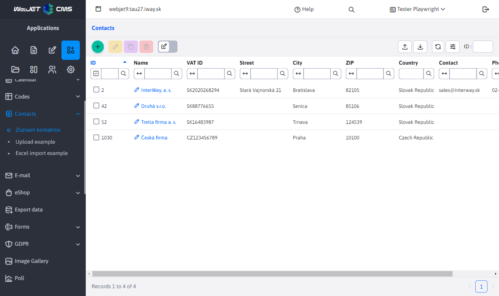
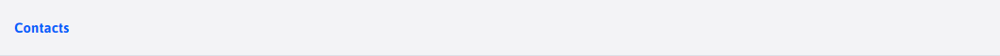
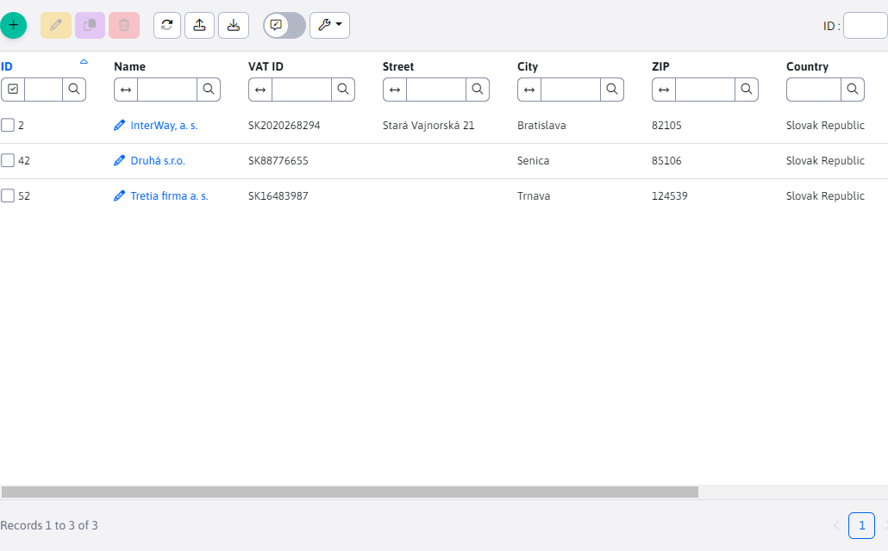

# Admin menu item

The administration is based on [data tables](../../developer/datatables/README.md) and [REST interfaces](../../developer/datatables/restcontroller.md). As a basis, it is necessary to understand their functioning according to the documentation for [WebJET CMS Programmer](../../developer/README.md).

In this example, we will program contact management, using the ```contact``` table, which exists in the standard WebJET CMS installation (but is typically not used).



## Backend

The ideal solution uses a `Spring DATA` repository, a REST controller, and a datatable generated from ```@DataTableColumn```, [annotations](../../developer/datatables-editor/datatable-columns.md).

Sample JPA entity also with ```@DataTableColumn``` annotations, [for datatable and editor](../../developer/datatables-editor/datatable-columns.md). Also note the ```@EntityListeners``` annotation for automatic [audit logging](../../developer/backend/auditing.md) when changing the entity.

Required fields and other validations [are set with annotations](../../developer/datatables/restcontroller.md#validation--required-fields), ```@NotBlank,@Size,@Email``` etc.

!>**Warning:** Do not use primitive types `int, long` in the entity, but only object types `Integer, Long`, otherwise filtering/searching will not work correctly.

```java
package sk.iway.basecms.contact;

import jakarta.persistence.Column;
import jakarta.persistence.Entity;
import jakarta.persistence.EntityListeners;
import jakarta.persistence.GeneratedValue;
import jakarta.persistence.Id;
import jakarta.persistence.Table;
import jakarta.persistence.TableGenerator;
import jakarta.validation.constraints.Email;
import jakarta.validation.constraints.NotBlank;
import jakarta.validation.constraints.Size;

import lombok.Getter;
import lombok.Setter;
import sk.iway.iwcm.system.adminlog.EntityListenersType;
import sk.iway.iwcm.system.datatable.DataTableColumnType;
import sk.iway.iwcm.system.datatable.annotations.DataTableColumn;

/**
 * Ukazkova JPA entita pre pouzitie v datatabulke
 * http://docs.webjetcms.sk/v2022/#/custom-apps/admin-menu-item
 */

//nastavenie JPA entity
@Entity
@Table(name = "contact")
//automaticke generovanie getter/setter metod cez lombok
@Getter
@Setter
//nastavenie automatickeho auditovania zmien, dolezite je nastavit Adminlog.TYPE_XXX
@EntityListeners(sk.iway.iwcm.system.adminlog.AuditEntityListener.class)
@EntityListenersType(sk.iway.iwcm.Adminlog.TYPE_CLIENT_SPECIFIC)
public class ContactEntity {

    @Id
    @Column(name = "contact_id")
	@GeneratedValue(generator = "WJGen_contact")
	@TableGenerator(name = "WJGen_contact", pkColumnValue = "contact")
    @DataTableColumn(inputType = DataTableColumnType.ID)
    private Long id;

    @DataTableColumn(inputType = DataTableColumnType.OPEN_EDITOR, title="components.contact.property.name")
    @NotBlank
    private String name;

    @DataTableColumn(inputType = DataTableColumnType.TEXT, title="components.contact.property.vatid")
    private String vatid;

    @DataTableColumn(inputType = DataTableColumnType.TEXT, title="components.contact.property.street")
    private String street;

    @DataTableColumn(inputType = DataTableColumnType.TEXT, title="components.contact.property.city")
    private String city;

    @DataTableColumn(inputType = DataTableColumnType.TEXT, title="components.contact.property.zip")
    @Size(min=5, max=8)
    private String zip;

    @DataTableColumn(inputType = DataTableColumnType.SELECT, title="components.contact.property.country")
    private String country;

    @DataTableColumn(inputType = DataTableColumnType.TEXT, title="components.contact.property.contact")
    @Email
    private String contact;

    @DataTableColumn(inputType = DataTableColumnType.TEXT, title="components.contact.property.phone")
    private String phone;

}
```

Sample JPA repository, when using it always use the ```Pageable``` object for pagination and ordering. To support dynamic generation of search criteria (in the REST controller, the ```addSpecSearch``` method), the repository also extends ```JpaSpecificationExecutor```.

```java
package sk.iway.basecms.contact;

import org.springframework.data.domain.Page;
import org.springframework.data.domain.Pageable;
import org.springframework.data.jpa.repository.JpaRepository;
import org.springframework.data.jpa.repository.JpaSpecificationExecutor;

/**
 * Ukazkovy Spring DATA repozitar pre pouzitie v datatabulke
 * http://docs.webjetcms.sk/v2022/#/custom-apps/admin-menu-item
 */
public interface ContactRepository extends JpaRepository<ContactEntity, Long>, JpaSpecificationExecutor<ContactEntity> {

    //citanie firiem podla zadanej krajiny pre MVC ukazku
    public Page<ContactEntity> findAllByCountry(String country, Pageable pageable);

}
```

!>**Warning:** note the use of ```JpaSpecificationExecutor```. This allows for dynamic creation of SQL statements for searching/filtering/sorting records in a datatable. If you do not use it, the search is performed in the form of [Query By Example](https://www.baeldung.com/spring-data-query-by-example) where you **must** not use primitive types and initialization values ​​in the Entity (e.g. ```String text="test"```). When searching, the value ```test``` would then be automatically searched for even if it is not specified. This is solved by ```JpaSpecificationExecutor```, which searches only for parameters specified in the filter (by testing request parameters starting with ```search```).

Sample REST controller, always pay attention to checking permissions via the ```@PreAuthorize``` annotation and don't forget the ```@Datatable``` annotation for correct generation of error responses.

In the ```getOptions``` method, it sets the options for the country selection field.

In the ```beforeSave``` method, it is possible to set additional (non-editable) data before saving the entity to the database.

```java
package sk.iway.basecms.contact;

import java.util.ArrayList;
import java.util.List;

import org.springframework.beans.factory.annotation.Autowired;
import org.springframework.security.access.prepost.PreAuthorize;
import org.springframework.web.bind.annotation.RequestMapping;
import org.springframework.web.bind.annotation.RestController;

import sk.iway.iwcm.system.datatable.Datatable;
import sk.iway.iwcm.system.datatable.DatatablePageImpl;
import sk.iway.iwcm.system.datatable.DatatableRestControllerV2;
import sk.iway.iwcm.system.datatable.json.LabelValue;

/**
 * Ukazkovy Spring REST pre pouzitie v datatabulke
 * http://docs.webjetcms.sk/v2022/#/custom-apps/admin-menu-item
 */

@RestController
//nastavenie URL adresy REST controllera
@RequestMapping("/admin/rest/apps/contact/")
//nastavenie kontroly prav na alikaciu cmp_contact (tento kluc sa definuje v modinfo.properties)
@PreAuthorize("@WebjetSecurityService.hasPermission('cmp_contact')")
@Datatable
public class ContactRestController extends DatatableRestControllerV2<ContactEntity, Long> {

    @SuppressWarnings("unused")
    private final ContactRepository contactRepository;

    @Autowired
    public ContactRestController(ContactRepository contactRepository) {
        super(contactRepository, ContactEntity.class);
        //odlozme si repozitar na pripadne specialne pouzitie
        this.contactRepository = contactRepository;
    }

    @Override
    public void getOptions(DatatablePageImpl<ContactEntity> page) {

        //pridaj zoznam pre pole country
        page.addOptions("country", getCountries(), "label", "value", false);
    }

    @Override
    public void beforeSave(ContactEntity entity) {
        //tu mozete vykonat nastavenie pred ulozenim, napr. nastavit datum poslednej zmeny
    }

    /**
     * Vrati zoznam vyberoveho pola pre krajinu
     * @return
     */
    public static List<LabelValue> getCountries() {
        //vytvor zoznam krajin, toto by sa idealne malo citat z nejakeho ciselnika
        List<LabelValue> countries = new ArrayList<>();
        countries.add(new LabelValue("Slovenská republika", "sk"));
        countries.add(new LabelValue("Česká republika", "cz"));
        countries.add(new LabelValue("Rakúsko", "at"));

        return countries;
    }
}
```

## Frontend

As mentioned above, data tables are used for the frontend. The administration is compiled from pug files into html and then displayed.

To easily create a new page in the administration, we have introduced a ready-made page layout template. You only need to fill in the middle part of the page (the template will generate the header and menu). [URL mapping](../../src/main/java/sk/iway/iwcm/admin/ThymeleafAdminController.java) is prepared as ```/apps/{app}/admin/``` or ```/apps/{app}/admin/{subpage}```.

Just prepare the file ```/apps/{app}/admin/index.html``` or ```/apps/{app}/admin/{subpage}.html``` where ```{app}``` is the name of the directory where the application is located (without diacritics and spaces) and ```{subpage}``` is the possible file name without an extension (if it is not index.html).

An example is the application ```src/main/webapp/apps/contact/admin/index.html``` called via the URL address ```/apps/contact/admin/```:

```html
<script>
    var dataTable;

    window.domReady.add(function () {

        WJ.breadcrumb({
            id: "contact",
            tabs: [
                {
                    url: '/apps/contact/admin/',
                    title: '[[#{components.contact.title}]]',
                    active: true
                }
            ]
        })

        //URL adresa REST rozhrania
        let url = "/admin/rest/apps/contact";
        //package a meno triedy s JPA entitou
        let columns = [(${layout.getDataTableColumns("sk.iway.basecms.contact.ContactEntity")})];

        dataTable = WJ.DataTable({
            url: url,
            serverSide: true,
            columns: columns,
            //id musi byt zhodne s tagom table nizsie
            id: "dataTable",
            fetchOnEdit: true,
            fetchOnCreate: true
        });
    });

</script>

<table id="dataTable" class="datatableInit table"></table>
```

Using the [WJ.breadcrumb](../../developer/frameworks/webjetjs.md#navigation-bar) function, a navigation bar is generated.



The function [WJ.DataTable](../../developer/datatables/README.md#configuration-options) initializes the datatable in the page into an HTML table with ```id=dataTable```. Please note the call ```window.domReady.add```, which must be used instead of ```$(document).ready``` - the call waits for the initialization of [translation keys](../../developer/libraries/translator.md) and only after they are obtained is the specified function called.



To display the menu item and display the user rights, it is still necessary to create a configuration file ```modinfo.properties```, place it in ```/apps/MENO_APLIKACIE/```, in our case ```src/main/webapp/apps/contact/modinfo.properties```:

```sh
#prekladovy kluc menu polozky
leftMenuNameKey=components.contact.title
#pouzivatelske pravo
itemKey=cmp_contact
#ak je true, je mozne pravo nastavovat
userItem=true
#linka v menu
leftMenuLink=/apps/contact/admin/
#Tabler icon name without the "ti ti-" prefix
icon=address-book
#Disable the new permission for existing administrators on its first initialization
defaultDisabled=true
#Custom module flag; it does not change the order in the current administration menu
custom=true

#submenu
#leftSubmenu1NameKey=components.contact.subpage.title
#leftSubmenu1Link=/apps/contact/admin/subpage/
```

If you have a page of type ```master-detail``` that is not defined in ```modinfo.properties```, the left menu may not display correctly because it does not know which item to highlight. The simplest solution is to name such a page ```meno-details.html``` (such as the URL address ```/apps/stat/admin/top-details/?docId=35267&dateRange=``` in the file ```/apps/stat/admin/top-details.html```). The expression ```-details``` or ```-detail``` will be removed when searching for an item to highlight in the menu, and the main (```master```) page will be highlighted.

If this is not appropriate, you can use the ```WJ.selectMenuItem(href)``` JavaScript function in your page to highlight the specified menu item. In the ```href``` parameter, you directly enter the URL address of the page in the menu that you want to highlight:

```JavaScript
window.domReady.add(function () {
    WJ.selectMenuItem("/admin/v9/apps/gallery/");
});
```

In the case of an old JSP component, call the function using ```setTimeout``` so that it is executed only after the page is displayed.

### Attaching a JavaScript file

If you need to connect a JavaScript module to your application, WebJET automatically looks for the file ```/apps/{app}/admin/{app}.js``` and, if it exists, inserts it into the HTML code header as a module, importing it as the object ```appModule```:

```html
<script type="module">
        import * as appModule from "[[${appIncludePathJs}]]";
        window.appModule = appModule;
</script>
```

For example, in the stat application there would be a file ```/apps/stat/admin/stat.js```:

```javascript
export const ChartType = {
    Bar: "bar"
    ...
}

export class ChartForm {
    constructor(chartType, yAxeName, xAxeName, chartTitle) {
        this.chartType = chartType;
        ...
    }
}

export async function setAmchart(chartForm) {
    ...
}
```

which is then called in JavaScript/HTML code as ```appModule.ChartType.Bar``` etc.

## Automated test

There is a [basic automated test](../../developer/testing/datatable.md) ready for the datatable, which you just need to configure. Create a new test scenario in ```src/test/webapp/tests/apps/contact.js``` with at least a basic test:

```javascript
Feature('contact');

Before(({ I, login }) => {
    login('admin');
    I.amOnPage("/apps/contact/admin/");
});

Scenario('contact-zakladne testy', async ({ I, DataTables, DTE }) => {
    await DataTables.baseTest({
         dataTable: 'dataTable',
         //meno prava na kontrolu podla modinfo.properties
         perms: 'cmp_contact',
         createSteps: function(I, options) {
            //toto pole musime vyplnit rucne, kedze ma specialnu validaciu
            DTE.fillField("zip", "85106");
         }
    });
});
```

## modinfo.properties file reference

The file `modinfo.properties` registers the module, its items in the administration menu, user rights, and additional applications for embedding into the page. It is loaded by the class `sk.iway.iwcm.system.Modules`, the menu display is provided by `MenuService`, and the list of applications in the AppStore is prepared by `AppManager`.

### Location and loading

Place the file in `/components/MENO_APLIKACIE/` or `/apps/MENO_APLIKACIE/`. `Modules` only traverses the immediate subdirectories of these two folders. In each, it reads `modinfo.properties` and possibly `modinfo1.properties` to `modinfo29.properties`. The numbering does not have to be consecutive.

Each file represents a separate module definition. Numbered files do not inherit settings from the base file, so give them their own `itemKey`. The matching identifier will usually replace the earlier definition. The exception is an automatically created module from `/apps/` without its own reference, which will not overwrite an already loaded module.

The basic module will also be created for a folder without a file `modinfo.properties`. It will automatically receive the identifier `cmp_MENO_APLIKACIE`, the path to the folder, and the translation key `components.MENO_APLIKACIE.title`, or `apps.MENO_APLIKACIE.title`. However, the mere existence of the folder will not create an item in the left menu or adjustable user rights.

Write the values ​​`true` and `false` in lowercase without trailing spaces. The parser compares the exact string for some attributes. The default encoding is `ISO-8859-1`, for a file in UTF-8 add the directive `#encoding=utf-8` at the beginning.

Definitions are stored in memory. After changing the file, the modules need to be reloaded, for example by restarting WebJET CMS. The AppStore also has its own cache of the list of applications by language.

### Complete example

The example for `/components/example/modinfo.properties` includes all the attributes that `Modules` reads, including the alias `custom` and legacy flags. The paths, translation keys, and permission names are sample. Before use, modify or omit the constraints `installName`, `requireConstantsKey`, and `domainName`. In this example, the configuration variable `exampleEnabled` must be set to, for example, `true`.

```properties
#encoding=utf-8

#Module identity and administration menu
leftMenuNameKey=components.example.title
itemKey=cmp_example
leftMenuLink=/apps/example/admin/
group=components
icon=address-book
menuOrder=120

#Permissions and availability
userItem=true
defaultDisabled=true
requireConstantsKey=exampleEnabled
installName=customer,customer-test
domainName=www.example.sk,www.example.cz

#AppStore registration and custom module flag
app=true
isCustom=true
#Alias used only when isCustom is missing or empty
custom=true

#Legacy flags - see the reference below
showSubcategories=false
hideSubmenu=false

#Submenu with its own permission
leftSubmenu1NameKey=components.example.records.title
leftSubmenu1Link=/apps/example/admin/records/
leftSubmenu1ItemKey=cmp_example_records
leftSubmenu1UserItem=true
leftSubmenu1DefaultDisabled=false
leftSubmenu1Icon=list

#Standalone permission without a visible menu link
leftSubmenu2NameKey=components.example.export.title
leftSubmenu2Link=javascript:void();
leftSubmenu2ItemKey=cmp_example_export
leftSubmenu2UserItem=true
leftSubmenu2DefaultDisabled=true
leftSubmenu2Icon=download

#Additional application in the page editor
component1NameKey=components.example.card.title
component1Link=/components/example/editor_card.jsp
component1Icon=/components/example/editoricon.png
```

### Identification and menu

- `leftMenuNameKey` - ​​translation key of the module name in the menu and in the current rights tree. If missing, `components.MENO_APLIKACIE.title` or `apps.MENO_APLIKACIE.title` will be used depending on the folder. It does not change the internal `nameKey`, which is used by a regular JSP application in the AppStore.
- `itemKey` - ​​a unique module identifier and also the name of the right, for example `cmp_contact`. The default value is `cmp_MENO_APLIKACIE`. Use the same identifier when checking rights in the REST controller, JSP or Java code. For a separately configurable right, use a key with at least three characters.
- `leftMenuLink` - ​​URL address or JavaScript action of the main menu item. A non-empty value also enables the module to be displayed in the left menu; an empty or omitted value does not enable it. Example: `/apps/contact/admin/`. The link `javascript:void();` can serve as a container for sub-items.
- `group` - ​​section of the administration menu and rights tree. The default value is `components`. The current menu knows the values ​​`welcome`, `website`, `news`, `components`, `files`, `templates`, `users`, `config` ; the new value itself does not create a new section. For some standard modules, the mapping in `MenuService` takes precedence. This attribute does not determine the category of the application in the AppStore.
- `icon` - ​​the name of the Tabler icon without the prefix `ti ti-`, for example `address-book`. The `MenuService` prefix will be added when creating the menu and the rights tree. By default, the value is empty; for standard modules, internal icon mapping may take precedence. The card icon in the AppStore is set by a different mechanism, described below.
- `menuOrder` - ​​integer for ascending order of modules, defaults to `1000`. An invalid non-empty value is converted to `0` ; if it matches, the internal `nameKey` is compared. In the current menu, some standard modules have a hard-mapped order, and the `components` section is then sorted by translated names. Therefore, in this section, `menuOrder` does not determine the final order. It does not determine the order of the cards in the AppStore either.

### Rights and accessibility

- `userItem` - ​​with `true`, the module's right to be set in user and group rights is available. The default value is `false`. The flag itself does not grant the user the right, and the value `false` does not mean that the application is prohibited.
- `defaultDisabled` - ​​default `false`. With `true`, the initialization of the newly detected right adds a one-time ban to existing administrators. `UpdateDatabase` records the execution under the label `NEW MODULE: itemKey`. The right can then be enabled in the user settings or via a rights group. This is not a permanent shutdown of the module or a default setting for every future user. Changing back to `false` will not remove the already registered bans.
- `requireConstantsKey` - ​​the name of one configuration variable on which the module's availability depends. Its value in `Constants` must be non-empty and different from the exact string `false`. For example, `requireConstantsKey=exampleEnabled` checks for variable `exampleEnabled`, does not set it. An empty or omitted attribute disables this condition.
- `installName` - ​​restricts loading of the entire definition to specific installations according to `Constants.getInstallName()`. Separate multiple values ​​with a comma without spaces, for example `customer,customer-test`. The comparison is case-sensitive. In case of a mismatch, the definition including sub-items is skipped. An empty or omitted value does not restrict loading.
- `domainName` - ​​display restriction by current domain, for example `www.example.sk,www.example.cz`. An empty or omitted value does not restrict display. It is used when creating the current administration menu and when filtering applications in `appstore.jsp`. The exact comparison and restrictions on transfer to the AppStore are described in the section [AppStore and filtering by domain](#appstore-and-filtering-by-domain).

Rights are set in the rights tree of a user or rights group; its creation is described in the [user list] documentation (../../developer/apps/users/README.md). WebJET CMS stores user bans, with permission via a rights group taking precedence over a user ban. Module availability according to license and configuration is checked separately, so user permission will not make an unavailable module available.

The definition in `modinfo.properties` does not replace the rights check in the application code. The Thymeleaf administrative controller checks the rights derived from the menu item URL, but protect the REST interface separately, for example with the `@PreAuthorize("@WebjetSecurityService.hasPermission('cmp_contact')")` annotation from the example above.

### Menu sub-items and separate rights

Instead of `N`, use a number from **1 to 24**. Numbers can be omitted. The sub-item is only created if both `leftSubmenuNNameKey` and `leftSubmenuNLink` are non-empty.

- `leftSubmenuNNameKey` - ​​translation key for the name of a sub-item in a menu or the name of a separate right.
- `leftSubmenuNLink` - ​​URL address or JavaScript action of the subitem. The value `javascript:void();` allows you to register a right without a visible link in the menu; even with such a right, the attribute must be filled in.
- `leftSubmenuNItemKey` - ​​the subitem's own right identifier. Without it, the right of the parent module will be used when displaying and checking the URL. When entered, this right is checked separately, the parent right is not automatically added to it as an additional condition.
- `leftSubmenuNUserItem` - ​​with `true`, it displays the sub-item as a separately configurable right. By default, `false`, independent of the parent `userItem`. For a separate right, also set your own `leftSubmenuNItemKey` with at least three characters.
- `leftSubmenuNDefaultDisabled` - ​​same one-time disablement as `defaultDisabled`, but for the subitem right. If missing, it takes the value of the parent `defaultDisabled`. Explicit `false` disables this inheritance, `true` enables disabling regardless of the parent.
- `leftSubmenuNIcon` - ​​Tabler icon name without the prefix `ti ti-`. Currently used in the rights tree; the third level of the left menu does not render this icon. It is not set by default.

If a user has a subitem with its own right enabled, it can be displayed even if the parent module's right is disabled. The parent will remain in the menu as a container and its link will change to the first enabled subitem.

To condition a reference on existing rights, you can use `leftSubmenuNItemKey=pravoA&pravoB` to satisfy both rights simultaneously, or `leftSubmenuNItemKey=pravoA|pravoB` to satisfy at least one. Such a subitem usually does not have `leftSubmenuNUserItem=true` because it does not define a new, separate right. Do not combine both operators in a single expression; `WebjetSecurityService.hasPermission` rejects such a notation.

### AppStore and additional applications

- `app` - ​​default `true`. The value `false` excludes this module definition from application creation in `AppManager`, including its items `componentN...`. This does not disable the menu or user rights. It is used, for example, with another `modinfo2.properties`, which adds an administration screen to an already existing module.
- `componentNNameKey` - ​​translation key for the name of the add-on application in the page editor.
- `componentNLink` - ​​a link to the add-on editor, passed as an action when selecting an application. In `appstore.jsp`, a path starting with `/` is opened directly; for a simple name, `/components/NAZOV/editor_component.jsp` is built. In an installation named `cloud`, `AppManager` has special handling of legacy paths containing `cloud/`.
- `componentNIcon` - ​​image of the additional application, for example `/components/example/editoricon.png`. `appstore.jsp` also supports the entire notation of Tabler icon classes, for example `ti ti-address-book`. Unlike `icon`, the prefix is ​​not automatically filled in here. The attribute is optional when loading, but you must fill it in to render the card; the existence of the file is not checked for this branch of registration.

For `componentN...` use the numbers **1 to 14**, again with spaces in the numbering. The record will only be created if `componentNNameKey` and `componentNLink` are not empty. These items create additional applications to insert into the page, not additional links in the administration menu. They will only take over the rights of the parent module if `userItem=true` ; otherwise they will receive an empty rights identifier.

For a regular JSP application, `AppManager` looks in the module folder for `editor_component.jsp` and `editoricon.png`, or `editoricon.gif`. The basic card requires an editor and at least one of these images. If the editor exists but both images are missing, the entire module, including its items `componentN...`, is skipped. Its name is based on the automatic `nameKey`, not `leftMenuNameKey`. The list is also populated by custom folders and annotations `@WebjetAppStore`, which have their own settings; therefore, `app=true` alone is not a complete card definition, and `app=false` does not disable separate registration via annotation.

#### AppStore and filtering by domain

`appstore.jsp` gets the list via `AppManager.getAppsList(request, true)`. The list already respects the rights of the logged in user and omits applications marked with `hideInAppstore`. The domain is filtered only by the JSP, because the common list of applications is cached by language.

The current domain is obtained via `DocDB.getDomain(request)` and converted to lowercase. If `domainName` is not empty, it is tested whether its value **contains the current domain as a substring**. The same comparison method is used by `Modules.filterDomain()` for the administration menu. Therefore, write the values ​​in lowercase, without the protocol and path. The comma is only used as a practical separator: the filter does not split the value into exact domain names and does not support masks or regular expressions. For example, `domainName=www.example.sk` will also match the current domain `example.sk`, because it contains it.

When creating a basic JSP application, `domainName` is transferred from the module to `AppBean`. For additional items, `componentN...` it is **not transferred**, so filtering by parent `domainName` cannot be expected for them. Restricting the display does not replace permission control or data separation by domain.

An annotation `@WebjetAppStore` with the same non-empty `itemKey` and the same variant can replace an already created card. The new card will use `domainName` from the annotation; it will not inherit the constraint from the `modinfo.properties` file. So if your application uses the annotation, set the required domains in it as well.

`appstore.jsp` additionally omits items with names `components.user.title` and `components.form.title`. The highlighted applications are selected by the configuration variable `appstorePromo`. These rules are not attributes of the `modinfo.properties` file.

### Customer and senior symptoms

- `isCustom` - ​​customer module designation, default `false`. In the current `MenuService` the flag is not transferred to the menu item and `AppManager` it is not copied from `ModuleInfo` to the application. Therefore, the setting itself does not change the order or classification among customer applications in these interfaces.
- `custom` - ​​alias for `isCustom`, used only when `isCustom` is missing or empty. For example, `isCustom=false` takes precedence over `custom=true`. In a regular file, it is enough to use one of these attributes.
- `showSubcategories` - ​​older flag intended for selecting groups or categories in module rights, defaults to `false`. `Modules` still loads it, but the current WebJET 9 menu and rights tree do not use it. Does not enable display of `leftSubmenuN...` items. Attribute name contains lowercase `c` in `categories`.
- `hideSubmenu` - ​​default `false`. Hiding subitems uses the old `admin/skins/webjet8/layout_sidebar.jsp` file; the current WebJET 9 menu does not evaluate this flag. To create a separate right without a navigation link, use `leftSubmenuNLink=javascript:void();`.
- `#encoding=utf-8` - ​​directive `IwayProperties` for file encoding. It is not a module attribute, despite the initial `#` it has an effect on file loading.

### Specialties in existing files

- `components/file_archiv/modinfo.properties` also defines rights without a reference in the menu using `javascript:void();`, for example `menuFileArchivExportFiles`.
- `components/adminlog/modinfo.properties` uses the combination of rights `cmp_adminlog&menuWebpages` ; `components/stat/modinfo.properties` uses `users.edit_admins|users.edit_public_users`.

The properties of the object `ModuleInfo` are not automatically valid file attributes. `Modules` does not read, for example, `nameKey`, `path`, `wjVersions`, `showInLeftMenu` or `hideInAppstore` from the file. It derives the path and the basic translation key from the folder, and turns on the display in the menu via `leftMenuLink`.
