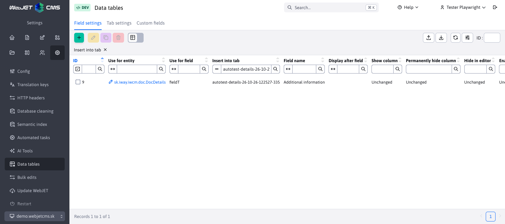
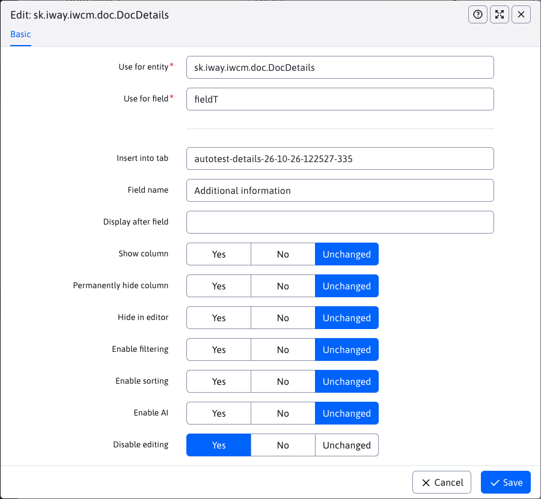

# Field settings

On the **Settings → Data Tables → Field Settings** tab, you can customize the names, order, and display of fields in the editor and columns in the table. The setting applies to all records of the selected entity in the currently selected domain. You need the **Data Tables** permission (`dataTablesConfig`) to access it.

## Field selection

When creating a setting, first select the entity class in the **Apply to entity** field, such as `sk.iway.iwcm.doc.DocDetails` for web pages. Then, in the **Apply to field** field, select the property you want to modify, such as `title` for page name.

Both fields support auto-completion after entering at least one character. Both the name and technical identifier are displayed in the field and card designs; the identifier is saved. Enter `*` or `%` to see all available options. The field and card offerings depend on the entity selected.

## Location and name

| Field | Meaning |
| --- | --- |
| **Add to card** | The identifier of the existing tab to which the field will be moved, e.g. `basic`. The menu also includes custom tabs created in [Tab Settings](tabs-settings.md). |
| **Field name** | New field name in the editor and column name in the table. You can enter text or a translation key. |
| **Show behind the field** | The identifier of the field after which the edited field will be placed, e.g. `navbar`. Select the field in the target tab. |

If you leave any of these fields blank, the original value from the entity definition will be used. First create a new tab in [Tab Settings](tabs-settings.md) and then drag and drop fields onto it.

## Display and behavior

The radio buttons have three values: **Yes**, **No**, and **No Change**. The value **No Change** leaves the field's original setting; it does not automatically mean **No**.

| Setting | Meaning of the value **Yes** |
| --- | --- |
| **Show column** | The column is displayed in the table by default. If set to **No**, the user can enable it in the column selector. |
| **Permanently hide column** | The column will not appear in the column selector either. This option takes precedence over the **Show column** setting. |
| **Hide in editor** | The field will not be displayed in the record edit dialog. The column display in the table is set separately. |
| **Enable filtering** | Enables a filter for the given column. |
| **Enable sorting** | Allows sorting the table by a given column. |
| **Enable AI** | Enables the use of AI features for the field, if available for it. |
| **Disable editing** | The field is read-only in the editor. |

The display of columns can also be affected by the saved custom table settings. If the change does not take effect, reset the table settings.

When editing an existing record, the values ​​of hidden and edit-disabled fields are preserved. In web pages, they are taken from the edited version of the page, even when opened from history. Do not hide required fields, such as the page name (`title`): their obligation remains in effect, and a missing value will block saving.

## Example of editing a page title

To rename the page name field and adjust its location:

1. Select field `title` for entity `sk.iway.iwcm.doc.DocDetails`.
2. In the **Field name** field, enter, for example, `Názov webovej stránky`.
3. Set the **Insert into card** field to `basic` and the **Show after field** field to `navbar`.
4. Leave the other switches at **No change**.
5. Save the settings, reload the website list, and open the editor.

You can set the type, mandatory fields, help, and options for optional fields `fieldA` to `fieldZ` on the [Optional fields](custom-fields-settings.md) tab. To move them to another tab, use **Field settings**.

## Validation and cancellation of settings

There can only be one record per domain for an entity and field combination. Both the field and the target card must exist for the selected entity. A field cannot be listed as itself or as a non-existent field.

After saving the settings, reload the relevant administration page. Deleting a record from the settings will restore the original field definition. It will not delete the saved values ​​of the records.
