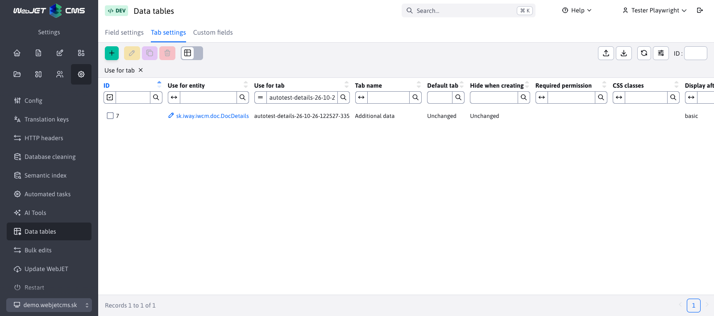
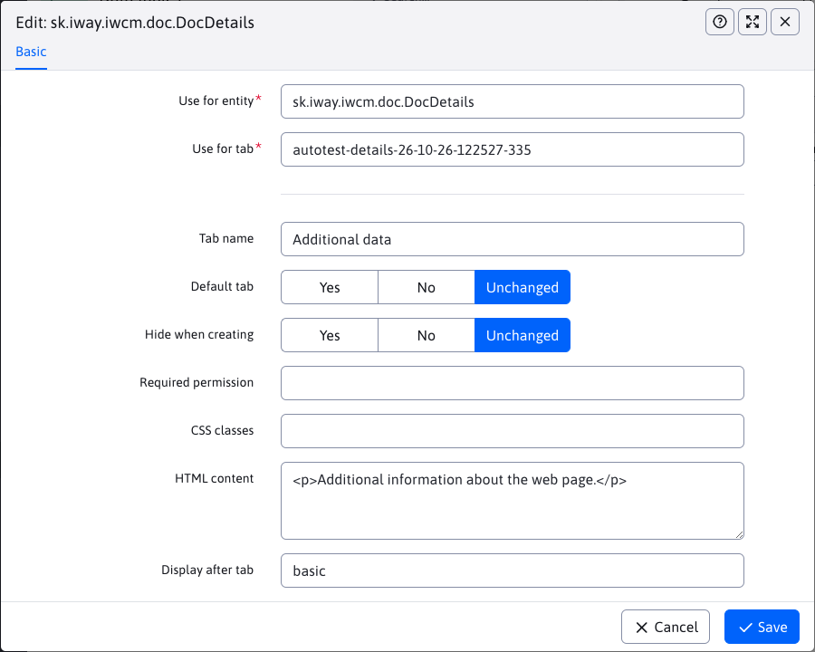

# Card settings

On the **Settings → Data Tables → Tab Settings** tab, you can adjust the editor layout: rename and sort tabs, set a default tab, or add a custom tab. The setting applies to all records of the selected entity in the currently selected domain. You need the **Data Tables** permission (`dataTablesConfig`) to access it.

## Select or create a card

First, in the **Use for entity** field, select an entity class, such as `sk.iway.iwcm.doc.DocDetails` for websites. In the **Use for card** field, select an existing card identifier, such as `basic`, or enter a new identifier, such as `details`. Selecting an existing identifier will modify the card, entering a new identifier will create a custom card.

Autocomplete suggests entities and cards after you enter at least one character. Enter `*` or `%` to see all available options. Both the name and identifier are displayed for each card. The identifier is saved in the settings.

## Settings

| Field | Meaning |
| --- | --- |
| **Card name** | Display name or translation key. For a new card without a name, its identifier will be used. |
| **Default card** | The value **Yes** selects the tab when opening the editor. |
| **Hide on creation** | A value of **Yes** hides the tab when creating a new record; it remains available when editing an existing record. |
| **Required permission** | The authorization code that the user needs to view the card. |
| **CSS Classes** | CSS classes to customize the appearance of the card. |
| **HTML content** | Additional card content, e.g. explanatory text. The fields themselves are assigned to the card via [Field Settings](fields-settings.md). |
| **Show behind card** | The identifier of the card after which this card will be ranked. A value of `FIRST` will rank it at the beginning. |

The **Default tab** and **Hide on creation** radio buttons offer values ​​of **Yes**, **No**, and **No change**. The value of **No change** preserves the original behavior. If you leave the text box blank, the original value of the existing tab is preserved.

We recommend that you select only one tab as the default. If you select more than one, the editor will select the first one in the resulting order. If the default tab is not displayed when you create a record, the editor will select an available tab.

## Custom card with optional fields

1. In **Card Settings**, create an entry for `sk.iway.iwcm.doc.DocDetails` with an identifier of `details` and a name of `Doplňujúce údaje`. Set the **Show behind card** field to `basic`.
2. On the [Optional Fields] tab (custom-fields-settings.md), set the fields **A** and **B** for the same entity: their type, description, and mandatory fields.
3. In [Field Settings](fields-settings.md), create a separate entry for each of the fields `fieldA` and `fieldB`. In both, set **Insert in card** to `details`. For the field `fieldB`, you can set **Show after field** to `fieldA`.
4. Reload the website list and open the editor. The fields will appear in the **Additional data** tab. They will retain the type, options, and mandatory fields from the optional fields settings.

## Validation and cancellation of settings

The combination of entity and card identifier must be unique within a single domain. A card cannot be listed after itself. In the **Show behind card** field, you can select an existing card for the given entity or enter `FIRST`.

Deleting the original card settings will restore its original definition. When deleting a custom card, first move its fields to another card or remove their move settings. Only then delete the card. Verify the change after reloading the administration page.
