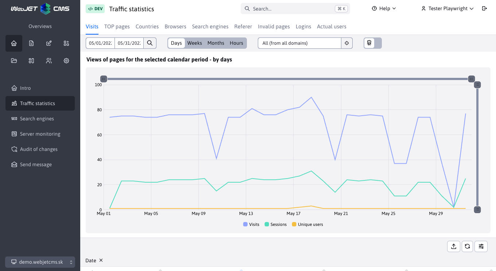
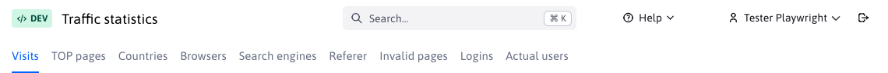
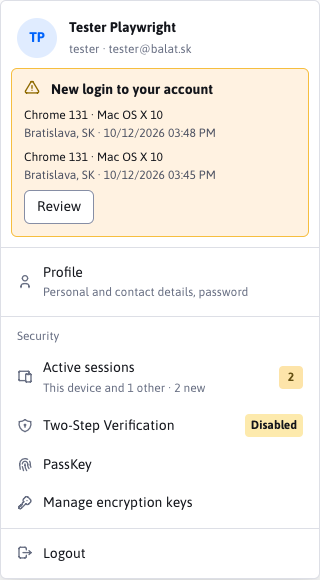
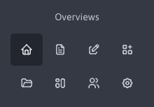
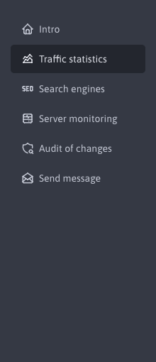
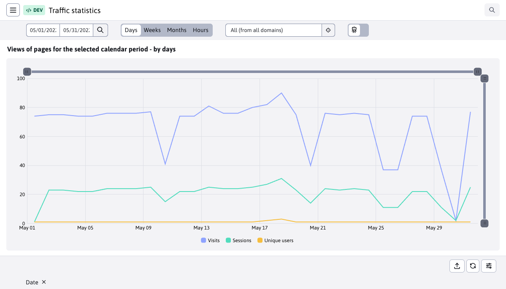
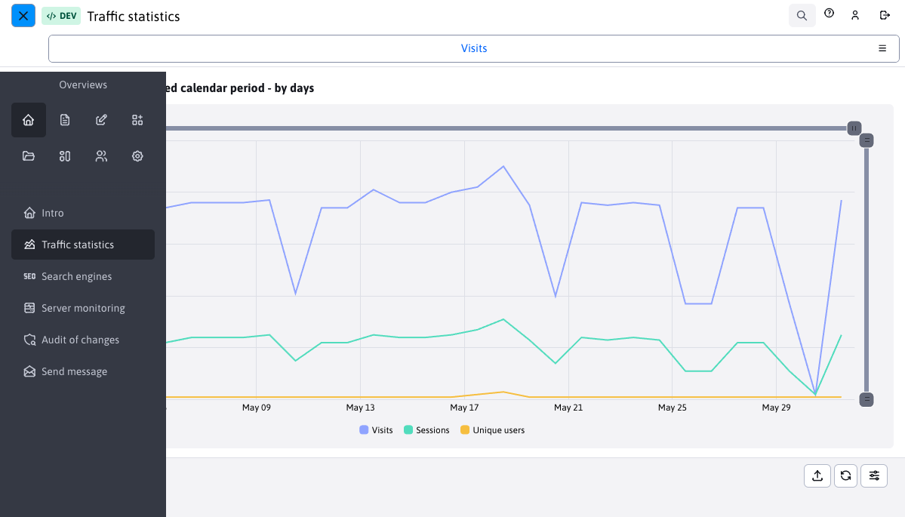
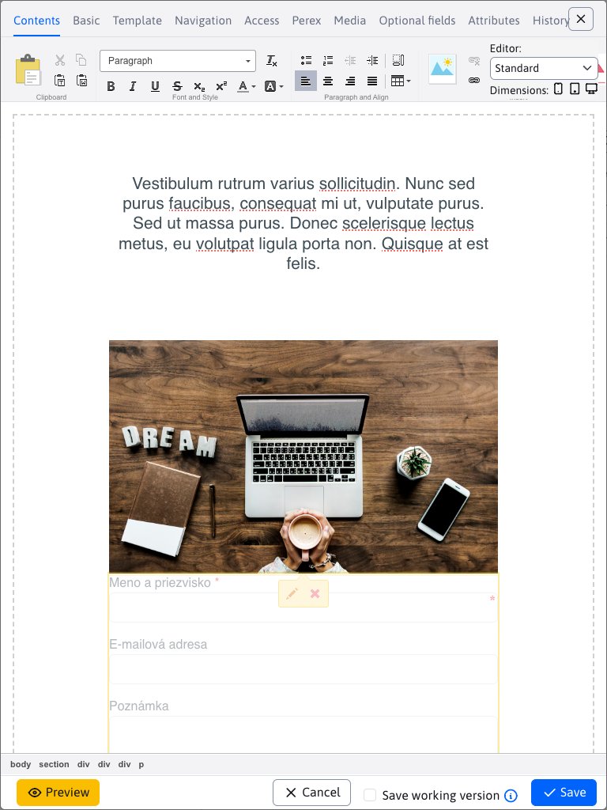
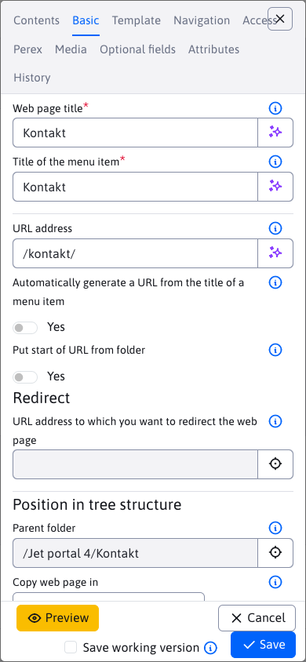

# Main controls

The administration layout is standard. The header is at the top, the menu is on the left. The third level of the menu is displayed as navigation tabs in the header.

## Header

At the top is the header:

contains the following options:

- **Environment label** – a colored label before the page name, such as **DEV**, **TEST**, or **PROD**, that helps you distinguish which environment you are working in. You can set its text, color, and icon according to the [Configure the splash screen and environment label](../../admin/setup/configuration/dashboard.md) instructions.
- **Current page name** – for example **Visit statistics**, displayed after the environment label.
- **Search…** button to open [quick search](search/README.md). You can also open the dialog with the shortcut **Ctrl+K** on Windows or **⌘K** on Mac.
- **Help** menu with help for the current page, documentation, news and contacts.
- The name of the currently logged in user, which will open the [user menu](#user-menu) with profile, account security, and logout.
-  Icon for logging out of the administration.

Tabs to navigate to the third menu level can be displayed in the header.

### Search

The **Search…** button in the header opens a quick search above the current page. Depending on your permissions, you can search for web pages, files, users, text keys, and administration menu items; searching the documentation is also available. For a detailed description of the options and controls, see the [Search] section (search/README.md).

### Helper

The **Help** menu is available in the header on all administration pages. It offers:

- **Help for this page** – instructions for the open part of the administration. Below the link is the name of the current page. If the page does not have instructions associated with it, the item will not be displayed.
- **WebJET CMS Documentation** – the home page of the documentation in the language of the logged-in user.
- **Keyboard shortcuts** – [overview of shortcuts](keyboard-shortcuts.md) and where they work.
- **What's new in version…** – a specific version in the documentation. The number of new features and the **New** label correspond to the tab on the home screen. The label remains for 30 days from the first time the given content is displayed in the menu or on the home screen; editing the content starts a new period.
- **List of all changes** – complete changelog.
- **Send Feedback** – a dialog for an idea, problem or compliment. It also works outside the home screen. The back arrow will take you back to the menu; closing with the cross will keep the written message while this page is open.
- **Contact Support** – support page set for the user's language.

Links to documentation and support open in a new tab. At the bottom of the menu is the edition, version, and server of WebJET CMS. Use the copy icon to copy the information for support.

The menu can be controlled with the keyboard: **Enter** or the spacebar opens it, the arrows scroll through the items, and **Esc** closes it and returns focus to the **Help** button.

### User menu

Click on your name in the top right of the header to open the user menu. At the top are your initials, full name, username, and email address, if you have one filled out in your profile.

The menu offers:

- **Profile** – edit your personal and contact information and password. After saving, the system recommends logging out and logging in again for all changes to take effect.
- **Active Logins** – Goes to the home page and opens the **Active Logins** window on the **My Logins** tab. You can check your own sessions, log out other logins, manage devices, and view login history; depending on your permissions, a tab for logged in administrators is also available. For a detailed description, see [Logins on the Home Page](welcome.md#logins). The number next to the item includes your account sessions on all cluster nodes, using the same records as **My Logins**. The registered device count matches the total records in **My Devices**, including devices without an active session. When new logins need review, their count is also shown; follow the link to manage logins on the home page.
- **Two-step verification** – set up verification with a code from the application, for example `Google Authenticator` or `Microsoft Authenticator`. The **On** or **Off** label shows the status for your account. The status is loaded each time you open the menu. The procedure for enabling it is described in [Two-step verification](logon.md#two-step-verification). The item is displayed if the configuration variable `2factorAuthEnabled` is set to `true`.
- **Access Key** – Manage access keys for biometric or device PIN login. Allows you to add a new key and remove a registered key. For instructions, see [Adding a new access key](logon.md#adding-a-new-access-key). This item is displayed if the `password_passKeyEnabled` configuration variable is set to `true`.
- **Manage encryption keys** – create a new key to encrypt forms or enter an existing key to decrypt them. The item is visible to users with the **Forms** right.
- **Logout** – log out of the administration. The separate logout icon next to your name in the header has the same function.

The menu is available on all administration pages. Press **Enter** or the spacebar to open it, use the up and down arrows to scroll through the items, and press **Esc** to close it and return the focus to your name.

The menu opens immediately. Counts and verification status load afterwards, leaving empty placeholders until the response arrives. If loading fails, the menu reports that account status is unavailable and its links remain usable.

## Menu

On the left side under the WebJET logo are icons representing the main menu sections. We decided to represent the first level menu like this so that we don't have to have deeply nested menu items:

Clicking on the main section icon will display the menu items of the selected section:

The selection of the domain you are working with (for a multi-domain installation) is located at the bottom of the left menu.

## Viewing on mobile devices

The administration is adapted to mobile devices. If the window width is less than 1200 points, the page header and left menu will be hidden:

To display the header and menu, click the hamburger menu icon  in the top left. The menu and header will then appear above the page. The navigation tabs will appear as a drop-down menu in the header.

To close the menu, click the close menu icon .

The editor in the data table will be displayed at the full window size when the window width is less than 992 points (tablet view):

For a window narrower than 576 points, the field names will also be moved from the left side above the field for better viewing, e.g. on a mobile phone:

