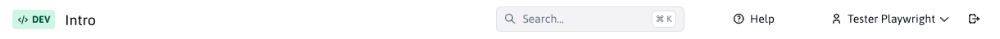
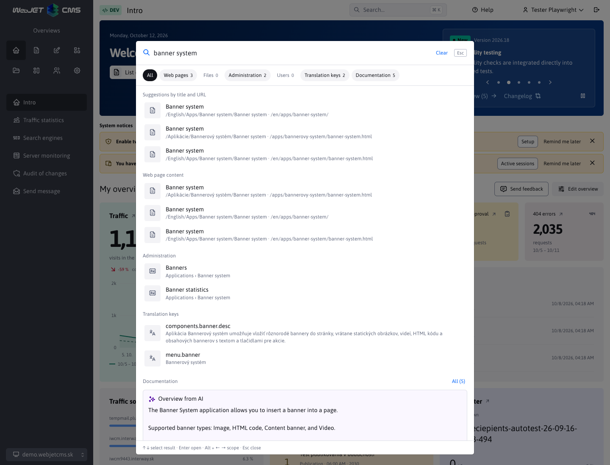
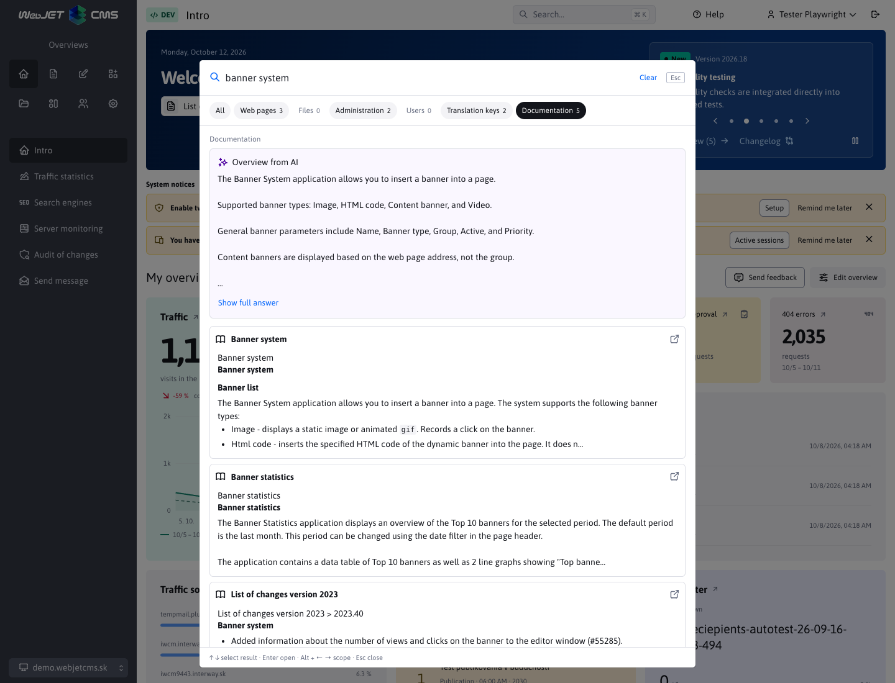
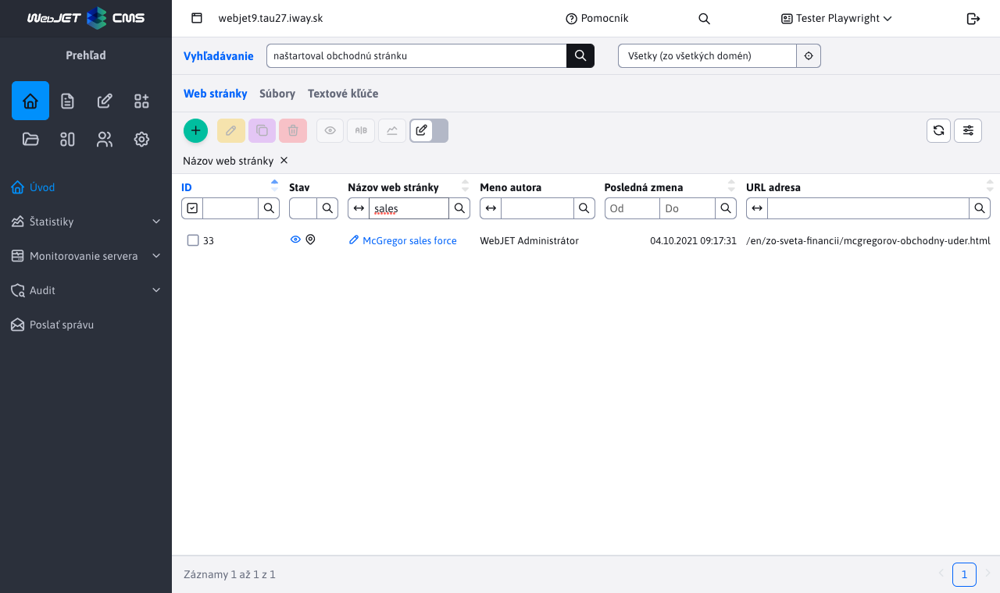

# Search

## Quick search in the header

The **Search…** button in the header opens the search above the current page. It is available throughout the administration. You can also open it with the keys **Ctrl+K** on Windows or **⌘K** on Mac; after opening, you can write immediately. The shortcut does not take over commands when writing in another text field or editor.

Before you enter a term, you will see recent searches and links to available sections. The browser remembers the history separately for the logged-in user and domain. You can delete individual entries or the entire history.

The **All** range shows up to three results from each area. Clicking the **All** range or link will display results from the selected area only. The menu is governed by your permissions:

- **Websites** – suggestions by page name or URL and search in content. The page design will open in its editor.
- **Files** – search in file names and indexed content.
- **Administration** – links to available menu items including their tabs.
- **Users** – search by first name, last name, full name, email or login name.
- **Text keys** – search for keys and their translations.
- **Documentation** – semantic search with documentation previews right in the dialog. If the service also returns an AI answer, it will be displayed above the results and you can expand it. Headings, lists, and other Markdown formatting will remain readable. Clicking on a result will open the corresponding documentation page in a new tab.

**All** is selected by default on the initial page. When opening from a supported section, its scope is selected by default. The scope change is valid until the dialog is closed. You can also switch it in a field using **Alt+left/right arrow**. **Tab** and **Shift+Tab** move the focus between controls, the up/down arrows select the result, and **Enter** opens it.

The **Open results in section…** link will take your search term to the appropriate section, where you can apply additional filters. If nothing is found, you can select **Search everywhere** to narrow down your search. A connection error will display the message **Search is temporarily unavailable** and a **Try again** button.

To close the dialog, press the **Esc** key, the close button, or click outside the dialog. The focus returns to the button in the header; the search term is not written to the button.

The documentation is not automatically searched by default. The tab displays a dash, which means **not searched yet**, not zero results. In the **All** scope, you will find an explanation of which server the expression will be sent to, and a link **Load results from external documentation as well**. Clicking this link or the **Documentation** tab will search for the expression you have already entered and display the results in the dialog. The tab's tooltip explains sending the expression to an external server. The keyboard shortcut **Ctrl+Enter** on Windows/Linux or **⌘+Enter** on Mac will load the documentation results in any scope of the open dialog. The corresponding shortcut is displayed next to the link.

After changing the expression, the documentation results are cleared and the tab displays a dash again. To start a new search, click the tab or link, or press **Enter** in the **Documentation** scope. Enter in the **All** scope searches only internal sources by default. Switching scopes with **Alt+arrow** does not send an external query by itself.

### Setting up documentation search

In **Settings → Configuration**, set the variable `adminDocumentationSearchUrl` to a valid full URL of the search service, including the path. The default value is `https://docs.webjetcms.sk/rest/rag/markdown/search`. When changing the domain or path, just edit this variable and refresh the administration.

The empty value `adminDocumentationSearchUrl` disables documentation search and hides its tab and button in the results.

The `adminDocumentationAlwaysSearch` variable has a default value of `false`. Setting `true` turns on automatic searching in the **All** and **Documentation** ranges after a two-second pause at least 8 characters after removing trailing spaces. Enter will also search for a shorter non-empty expression in these ranges. Turn it on only in deployments where the documentation service can accept internal queries, such as on an approved custom server. An empty URL turns off documentation even with a value of `true`. After changing the configuration, refresh the administration.

The `adminDocumentationSearchUrl` variable also specifies the server for links in the **Help**, `WJ.showHelpWindow` and changelog menus. From the URL, only the protocol, domain and port are used for these links; the search service path is ignored. For example, `https://manual.example:8443/rest/rag/markdown/search` opens the documentation at `https://manual.example:8443/latest/sk/`. The documentation is available in Slovak, Czech and English; for other administration languages, the English version opens.

The administration will complete the parameter `query` with the search term and send `language` and `directory` depending on the interface language:

| Administration language | `language` | `directory` |
| --- | --- | --- |
| Slovak | `en` | `/sk/` |
| Czech | `en` | `/en/` |
| English | `en` | `/en/` |

The endpoint returns JSON with a field `results`. Each result contains `title`, `url`, and a Markdown sample `snippet`. An optional AI summary is in the `answer` element in Markdown format. Relative links in the results open on the documentation server.

If the documentation runs on a different domain, its server must enable CORS. The setting belongs **to the documentation server**. For the administration opened on `http://iwcm.interway.sk`, set:

- `accessControlAllowOriginUrls` must contain `/rest/rag/markdown/search`. The default list `/rest/,/private/rest/,/admin/rest/` already covers this path, keep the other necessary paths.
- Set `accessControlAllowOriginValue` to the required domain or `*`. This is the administration address, not the documentation address. For a different protocol or port, use the exact value from the `Origin` request header.
- `accessControlAllowMethods` must enable `GET`, the default value includes it.
- If you are using the `accessControlAllowedOrigins` restriction, add the same administration origin to it.

Search sends a public request without cookies or credentials. For the public documentation API intended for arbitrary installations, you can return `Access-Control-Allow-Origin: *`. If the header is set by a reverse proxy server, ensure that it is not sent twice. Configuration details are in [HTTP headers](../../../sysadmin/pentests/README.md#http-headers).

The HTTPS endpoint must have a valid certificate. In the event of a certificate or CORS error, the browser will not provide a response to the administration and will display the option to repeat the search.

## Advanced search

The **Search** section provides tables for web pages, files, and text keys. You can open it by clicking the **Open results in section…** link from the relevant quick search scope. It will save your search term and select the corresponding tab.

## Key features

1. **Full-text search**:
   - The search is performed not only in the titles of the pages, but also in their text content.
   - The user can also find content based on keywords found in the text of documents or files.

2. **Filtering results**:
   - In addition to full-text search, column filters can be used for a more precise display of results.
   - Tables allow filtering based on columns such as `Názov web stránky`, `Meno autora` or `Kľúč`.

3. **Support for multiple content types**:
   - Websites
   - Files
   - Text keys

## Using the Search section

### Search Interface

The section is divided into several tabs. Each tab allows for specific searching and filtering:

#### 1. Website

- **Full-text search:** Enter a keyword that is found in the text of the page or its title.
- **Restriction by tree structure**  You can limit the search by selecting the folder in which to search (it also searches in subfolders).
- **Filtering:** Use columns like `Názov web stránky` and `Meno autora` to narrow down your results.
- **User rights:** The results displayed depend on the rights of each user. The user can only see the pages to which they have permission.

#### 2. Files

- **Full-text search:** Search for text found in file contents as well as file names.
- **Filtering:** Columns like `Názov súboru` and `URL adresa` help to precisely specify results.
- **Eye symbol:** Click on the eye icon  next to the file name to view the file.
- **URL address:** Links  allow quick navigation to a directory in Explorer.

!> Warning: [full-text file index](../../files/fbrowser/folder-settings/README.md#indexing) is used to search files, so only files that are indexed are found.

#### 3. Text keys

- **Full-text search:** Find text keys by content in all available languages.
- **Filtering:** Use columns like `Kľúč` or `Jazyk` for more precise searches.

## Usage examples

- **Website search:**
  - You are searching for the phrase `naštartoval obchodnú stránku`.
  - The results contain pages where this phrase is found in the text. To narrow down the results, use the `sales` filter in the column for `Názov stránky`.

- **File search:**
  - You are looking for `only for users in Bankari group`.
  - The results contain all files where this phrase is found in the text.

- **Text key search:**
  - You are looking for `Pridať adresár`.
  - The results contain keys with Slovak text `Pridať adresár`. You can then use the filter `addGroup` in the column `Kľúč` to narrow down the results.
