# Home screen

On the home screen, you can check traffic, submitted forms, or pages awaiting approval, and return to pages in progress.

    <iframe width="790" height="444" src="https://www.youtube.com/embed/X2GNFn8IpCI" title="YouTube video player" frameborder="0" allow="accelerometer; autoplay; clipboard-write; encrypted-media; gyroscope; picture-in-picture" allowfullscreen></iframe>

The overview consists of **widgets**, i.e. cards with data, such as a traffic graph or a list of approval requests. Choose the ones you use in your work. Use [shortcuts](#your-shortcuts) to open a frequently used part of the administration or a specific folder.

By default, the **Visit**, **Forms**, **For Approval**, **404 Errors**, **Continue Working**, **Where Visitors Came From**, **Upcoming Publish**, and **Newsletter** widgets will be displayed based on your permissions. Above them, you will find a welcome with shortcuts, news, and system notifications.

The layout is saved to your account and is common across all domains and browsers. The selection of a specific form or campaign is remembered separately for each domain. The availability of widgets depends on your permissions.

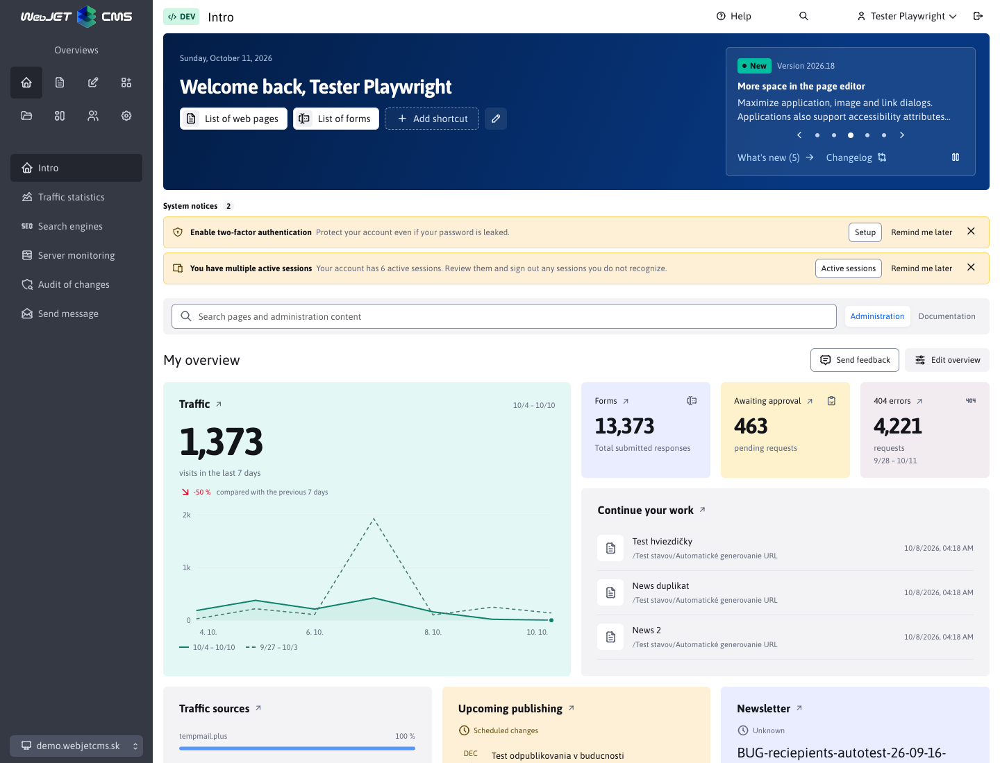

The label **PROD**, **TEST**, **CIT**, **INT**, **UAT**, **DEMO**, **LOCAL** or **DEV** helps distinguish the environments you are working in. You can find it in the administration header, on the login page and in the browser tab title. The administrator can adjust its appearance in [environment configuration](../../admin/setup/configuration/dashboard.md).

## Customize the report

Place the widgets you check most often at the top. You can remove the ones you don't need.

Click **Edit Report**. The bar will display **Restore Defaults**, **Add Widget**, **Cancel**, and **Save** buttons. You can drag and drop widgets or edit them in **Widget Options**.

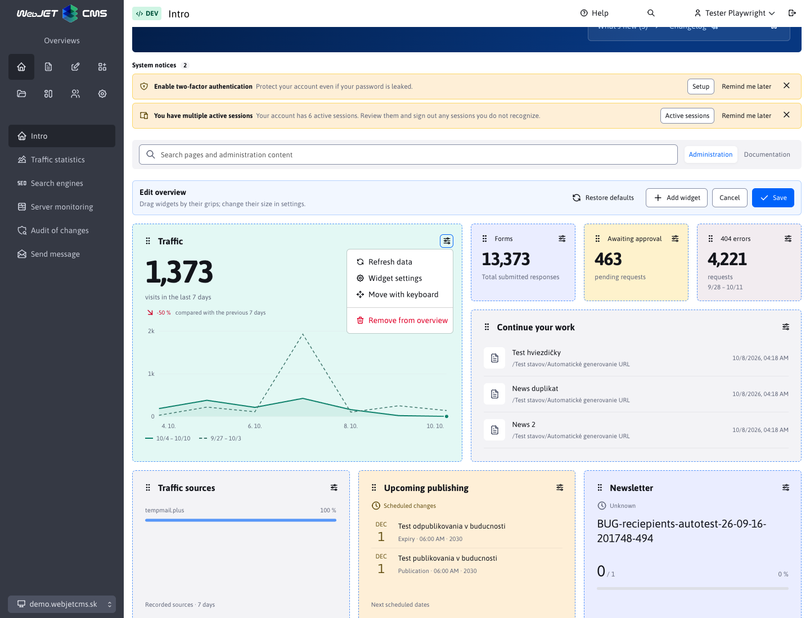

To add a new widget:

1. Click **Add widget** and search for it in the catalog.
2. For the widget, click **Add** or **Add another**.
3. Select the size and other settings. Check the result in the preview.
4. Confirm with the **Add widget** button. The widget will be added to the end of the overview. If you cancel the setting, it will not be added.

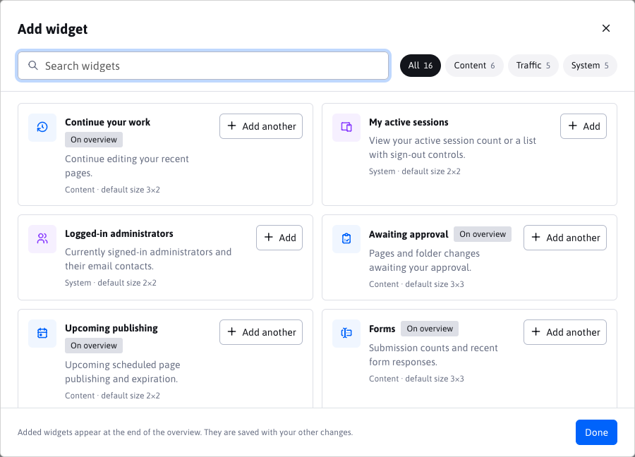

The **Widget Options** button offers:

- **Widget settings**: change the size, color, and available options, such as period or form. Not every widget offers multiple sizes. Confirm your changes with the **Apply** button.
- **Move with keyboard**: use the arrow keys to change the position, press **Enter** to confirm, or **Esc** to cancel the move. You can also start the move with the spacebar on the handle. The **Esc** key will also cancel the move with the mouse.
- **Remove from overview**: remove the card without confirmation. The application data will be preserved. You can undo the action with **Back** in the notification or **Ctrl Z**. The notification is available for 8 seconds; hovering over it or focusing with the keyboard stops the countdown. You can add the widget again at any time.
- **Refresh data**: load the current card data.

Select a larger tab for a more detailed graph or a longer list. In the **Background Color** section, select a shade from the palette or a **Custom color**, which you can also enter using a HEX code. A color that is too dark should be replaced with a lighter one. The **Default** option restores the widget's original background. You will see the changes in the preview.

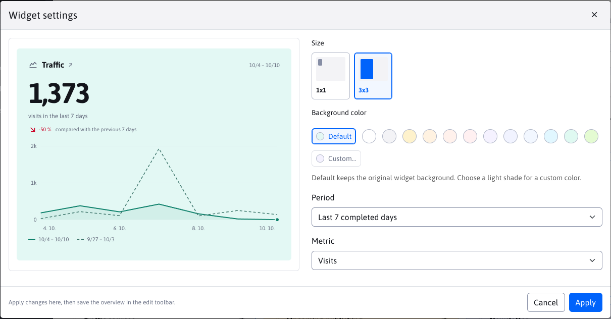

When finished, click **Save** in the toolbar. This will save all widget edits. In case of an error, the changes will remain available for re-saving. For unsaved changes, the **Cancel** button will offer **Continue Editing** or **Discard Changes** ; the browser will notify you when you leave the page. Shortcuts are edited and saved separately.

A layout can contain up to 48 items, including shortcuts, logins, news, and search.

The **Restore Defaults** button, when confirmed, will restore the original widget selection, sizes, order, and settings. Clicking **Save** will complete the restore and also clear widget filters across all domains. Shortcuts and other account settings will be preserved.

If you hold down **Shift** while clicking **Restore Defaults**, a summary of all available widgets in each supported size will be prepared after confirmation. Remove unnecessary variants and save the result.

## Available information

You can add widgets repeatedly with different settings, for example to track two forms or traffic over 7 and 30 days.

By default, the statistics widgets show the last seven completed days. You can also select 30 or 90 days; the comparison uses the same previous period. The actual date range is listed on the card. Forms and 404 errors have the rules described below.

### Module shortcut

Opens a frequently used part of the administration, a folder, or a custom URL. To add it, see [Your shortcuts](#your-shortcuts).

### Keep working.

It displays up to six of your most recently edited pages. Clicking on a page will take you back to its editor, or clicking on the widget title will open the full list of websites.

### For approval

Displays requests from the **Unapproved** tab in Web Pages. The larger variant contains the six most recent requests to change or delete a page or folder.

Click on an item to open its approval. The title or total number will open the entire list of requests.

### Upcoming publication

It shows which pages are to be **published or unpublished**, along with the date and time of the change. Click on the title to open the full publishing schedule.

### Forms

Displays submitted forms, such as inquiries or contact messages. In the settings, select a specific form or all available forms.

- **All Forms**: total number of responses for the entire period. A large widget displays the ten most recently submitted forms. Click on the name to open the responses.
- **Specific form**: in a large widget, the last ten submissions for the selected period. The **Form** column contains the first name, last name, and email; if these fields are missing, the first three filled in data are displayed. Click to open the submission detail.

### Attendance

Compares website traffic with the previous period. In the settings, select the period and data: number of views, visits or unique visitors. To see the exact values, hover over the graph.

### Most visited pages

Shows the pages with the highest number of views for the selected period. Helps determine which content to focus on when updating. Click on a page to open its detailed statistics.

### What visitors are looking for

It displays search terms and their numbers for the selected period. You can find out which topics visitors are interested in and whether they can find up-to-date information about them on the website.

### Where did the visitors come from?

Compares the share of traffic sources for the selected period. Hover over the graph to see exact values.

### 404 errors

It helps find non-existent addresses and determine which links or redirects to check first.

Counts error requests, not different addresses. Data includes entire weeks spanning the selected period; the current week includes data to date. The actual date range is shown in the card. If historical data cannot be separated by domain, the card will indicate that it is unavailable.

### Newsletter

Tracks the progress of sending a mass email and recorded opens or clicks. Selects the active campaign, the next scheduled one, or the last completed one. You can select a specific campaign in the settings.

When sending, the visible card data is refreshed every 30 seconds.

### What's new

In the **What's New** panel, you can find news about the installed version of WebJET CMS as well as videos and posts from YouTube and Facebook of WebJET CMS. This way, you can follow new features and instructions for using them in one place. Click on a news item or the **What's New** button to expand the entire overview.

The **New** label indicates unread content. When the panel is expanded, the displayed news is marked as read and the label is hidden. It reappears when a new post is added or the installed version's news is updated.

### System notifications

Alerts inform you of issues that require your attention. New login from an unknown device is always first, followed by errors, warnings, and information.

Errors remain visible until the cause is resolved. You can postpone the regular warning for 7 days by clicking **Remind me later** or **×**.

#### New login from an unknown device

If you log in from a browser that WebJET CMS does not recognize as being used for your account within the last 90 days, you will see a notification and receive an email. Check your browser, operating system, IP address, and login time. For your current browser, you will see **You have logged in from a new browser** and the label **This browser**.

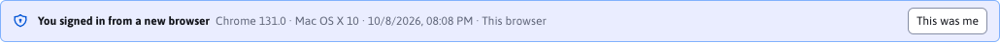

The **New WebJET CMS Login** email contains login details and buttons to confirm your login or secure your account.

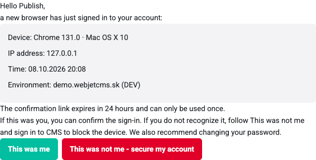

#### If you know the login

Click **It was me**. A six-digit code will be sent to your email. Enter it below the notification and click **Confirm code**.

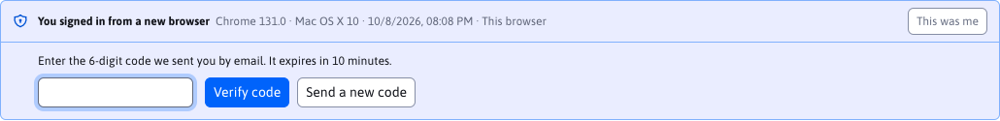

You can find the code in the email **WebJET CMS login confirmation code**:

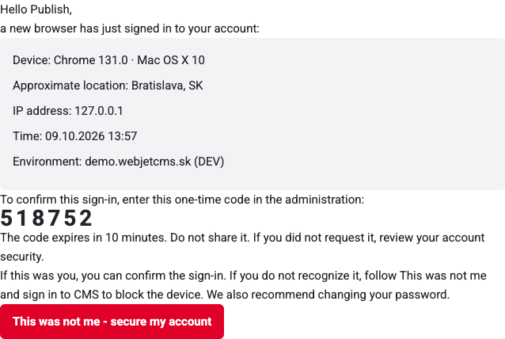

The code is valid for 10 minutes and allows a maximum of 5 attempts. After a minute, you can request another one via **Send new code** ; the previous one will expire. After verification, the device will be confirmed and the notification will also disappear in other browsers after refreshing the report.

You can also use the **It was me** link in the original email. It is valid for 24 hours, only once, and after logging into the relevant account. Requesting a new code will not cancel it; successful confirmation will invalidate both the link and the code.

#### If you don't know your login

When prompted or in the **My Devices** tab in the **Active Logins** window, click **It wasn't me**. The device will be locked and its known sessions will be signed out. If you lock the current browser, it will also sign you out.

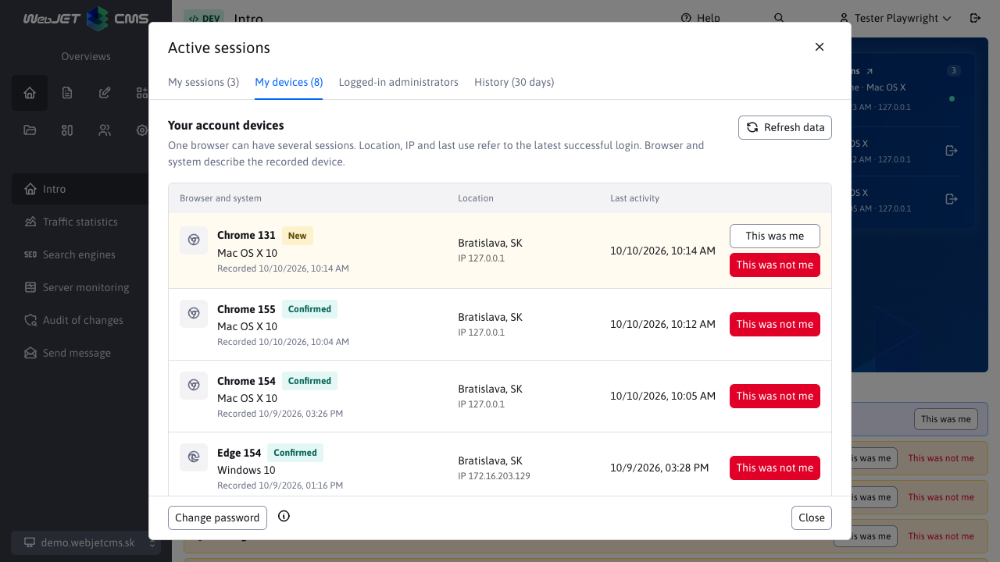

The **It wasn't me - secure your account** link in the email after you log in will open the **Secure your account** window. Opening it alone will not lock your device; use the **Lock device** button.

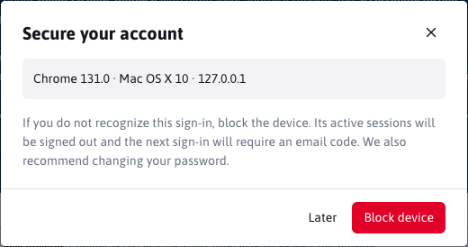

Once locked, select **Change Password** and check your other logins. If available, set up two-factor authentication via **Enable 2FA**. **Later** will just close the window. For a corporate account, change your password with your login provider or contact your administrator.

The next time you log in from a blocked device, after entering the correct login details, you must enter [code from email](logon.md#verify-blocked-device). Only the correct code will unblock the browser.

#### Browser memory and notification validity

After successful two-factor authentication, the unblocked browser is automatically verified. You will receive an information email with the option **It wasn't me**. For a blocked device, an email code is still required after 2FA; see [Verifying a blocked device](logon.md#verifying-a-blocked-device).

The new device notification cannot be postponed or closed with a cross. It disappears after the device is confirmed or blocked, at the latest after 7 days from the event. Further logins do not extend the period. The blocking remains in effect even after the notification disappears. Device detection, confirmation, and blocking are recorded in the audit as **USER_DEVICE**.

WebJET CMS remembers the browser using a cookie. Each completed login extends the memory by 90 days; logging out does not remove the cookie. After deleting or expiring the cookie, the browser is recognized as new and its previous blocking does not apply. You can also receive a new notification in a different profile or in an anonymous window. Updating the browser or changing the IP address while the cookie is still present will not trigger it. The administrator can change the period in [configuration](../../admin/setup/configuration/dashboard.md).

### Search and help

Click **Search…** in the header or press **Ctrl+K** on Windows or **⌘K** on Mac. [Quick Search](search/README.md) finds pages, files, administration items, users, and text keys based on your permissions. You can search for pages by name or URL.

The **Documentation** scope will search for the entered term in the manuals. You can also find help for the open administration section via Help in the header.

### My active logins

You review your logins and sign out of a device you no longer use. The panel at the top of the overview cannot be removed; you can also add a separate widget from the catalog. For details, see [Logins](#logins).

### Logged in admins

Shows colleagues who are currently working in the system and allows you to send them an email. Availability depends on your permissions. See [Logged-in administrators](#logged-in-administrators).

### Changed pages

Displays the latest edits to available pages on the current domain, along with the author of the change.

### Audit

Displays the latest events from the entire server according to your permissions. It will help you check operations or determine the cause of a problem.

### Memory usage

Displays server memory usage, for example to check for system slowdowns. For details, see [Changed pages, auditing, and monitoring](#changed-pages-auditing-and-monitoring).

### CPU load

Shows the server's CPU load. This can help you determine if it's related to slow responses. See [Changed pages, auditing, and monitoring](#changed-pages-auditing-and-monitoring).

## Logins

You can open the **Active Logins** window from any page via the [user menu](README.md#user-menu): click on your name and select **Active Logins**. You will be taken to the home page with the **My Logins** tab open.

You can also open the window via the widget title **My active logins** or the link in the system notification for multiple sessions. It offers custom logins, device management, history for the last 30 days, and, depending on permissions, logged in administrators.

### My active logins

The **My Logins** tab shows your account's active sessions. A single browser can have multiple sessions. For each, you see the browser, operating system, login date, and IP address. The current session is labeled **This Login**.

The **Location** column contains the [reference city and country](../../admin/setup/configuration/dashboard.md#reference-location-login) according to the public internet connection. If these cannot be determined, **Unknown** will be displayed. The IP address detected by the server may be internal.

You can log out of other sessions individually via **Log Out**, for example if you forgot to log out on another computer. The **Log Out All Others** button requires confirmation. **Change Password** opens your profile; the information icon next to the button contains instructions for corporate accounts.

The **My Active Logins** widget will announce that you are logged in only here for a single session. For multiple sessions, it will show the number and, in larger variants, a list. Sessions from unconfirmed devices will be labeled **New**.

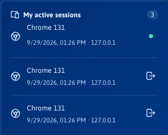

In the cluster, the session also displays the server on which it is active. If you select **Logout this session**, it will be terminated immediately on the current node; on another node, it will wait for synchronization, typically within a minute. To display the domain and node, hover over the entry.

The data is updated after the user logs in. The administrator can set a more frequent update via [background job](../../admin/settings/cronjob/README.md) `sk.iway.iwcm.stat.SessionClusterService`, for example every 10 minutes. The job deletes records older than 60 minutes; without it, records older than 24 hours are deleted upon login.

### My devices

The **My Devices** tab contains your account's saved browsers, even without an active session. They are sorted from most recently used, 20 per page. Use the **Refresh Data** button to load the current state.

For a device, you see the browser, operating system, time of recording, and last successful login information: **Last Activity**, IP Address, and **Location**. An unavailable location is labeled **Unknown**. The current browser is labeled **This Device**.

- **New**: the device is not yet confirmed. Send yourself an email code via **It was me** and enter it under the device. When the correct code is entered, the device will confirm and remove the warning. **Cancel** will close the form without changing the status.
- **Verified**: If you don't recognize the device, you can block it with **It wasn't me**. Hover over the label to see the verification date.
- **Blocked**: will be unblocked the next time you log in by verifying the code from your email. Hover over the label to see the date and instructions.

If you don't recognize the new device, also use **It wasn't me**. Blocking will log out all of its known sessions, including yours if it's the current browser. For other browsers, the **Secure your account** window will open with further steps.

### Logged in administrators

With the **Home - View Logged In Administrators** right, you can add the **Logged In Admins** widget. It displays the number of administrators and their active sessions. One account can have multiple sessions, so the numbers may vary.

Clicking on the title will open the **Active Logins** window in the **Logged in Administrators** tab. The icon<i class="ti ti-mail fs-6"></i> send an email to the selected administrator.

## Your shortcuts

Shortcuts below the welcome page open a frequently used part of the administration, a specific folder, or a custom URL including parameters. They are saved to your account and are available in all browsers.

By default, they will redirect to websites and forms based on your permissions. If these modules are not available, the first available menu item will be used.

To add a new shortcut:

1. Click **Add Shortcut** after the list of shortcuts.
2. In the **Where should the shortcut go?** field, select **Main**, **Section**, and the destination under **Select a tab**. You can also search for a destination by name and select it by clicking or using the arrows and **Enter**. The **Back** option will return you to the previous level in the list. For a custom link, select **Use custom URL…** and fill in the **URL**.
3. Fill in **Shortcut Name**, or leave the name of the selected destination. For a custom URL, the name is required.
4. Select **Icon** and **Color**. The **Custom…** option allows you to enter a name for the Tabler icon or select a color, including transparency or HEX value. A non-existent icon cannot be saved. The color will be used for the icon background; you can also select **No color**.
5. Check the preview and click **Add Shortcut**.

Use the pencil button **Edit shortcuts** to enable editing. Click on the shortcut to open its settings. Confirm the changes with **Save changes** ; in the same window, you can delete it with **Delete shortcut**. The notification will offer **Back** for 8 seconds. Finish editing with **Done**.

You can move the shortcut by using the handle in front of the icon. Use the **spacebar**, **left/right arrows**, and **Enter** on your keyboard; **Esc** cancels the move. You can also select a position in the dialog box by clicking on the handle.

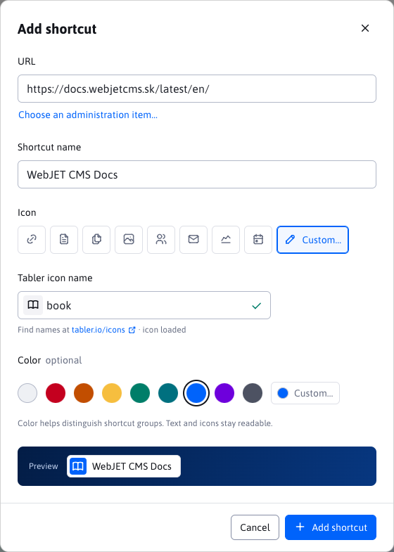

For a shortcut to a specific folder, open the folder in Web Pages and copy the address including the `groupid` parameter. When adding, select **Use custom URL…**, enter the address, and enter a name, such as **News**.

The address can be in the form `/admin/v9/webpages/web-pages-list/?groupid=123`. Replace the number `123` with the ID from your copied address. The shortcut will then open the selected folder directly.

You can fix or remove a shortcut to an unavailable menu item in edit mode. The cross **×** will remove it without confirmation; you can restore it with **Back** within 8 seconds. You can also delete the last shortcut, but after refreshing the page, the empty list will be filled with default shortcuts according to permissions. Widgets and other settings will not be changed.

## Changed pages, auditing and monitoring

You can add the **Changed Pages**, **Audit**, **Logged in Admins**, **Memory Usage** and **CPU Usage** widgets according to your permissions via the catalog. Changed Pages apply to the current domain; audit, logged in admins and monitoring the entire server.

The memory and CPU graphs have a default size of **3×3** ; you can also choose **3×2** in the settings. The data in the visible widget is updated every 5 seconds. Click on the title to open the full overview.

The measurement will start when you open the widget even without history saving enabled. The update will pause when you hide the browser tab or widget.

## Feedback

You can send a comment, improvement suggestion, or compliment to the WebJET CMS development team. Click **Send Feedback** in the top bar of the overview.

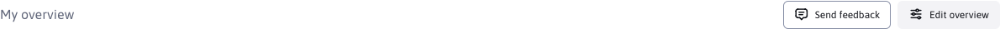

Describe the requested change or issue. You can also attach files, such as a screenshot. The form will be submitted via email. If you select **Send anonymously**, your name and email address will not be included in the sender information.

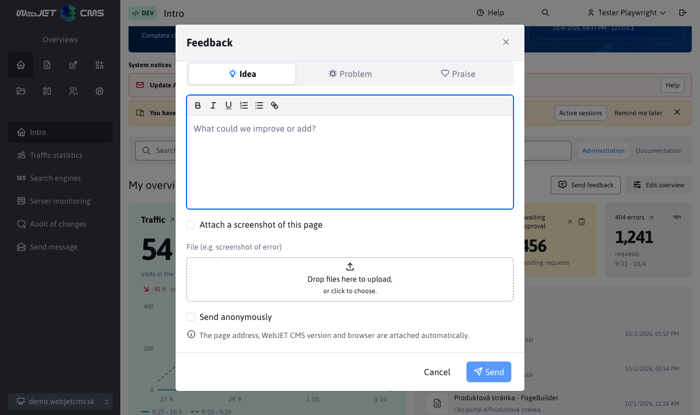

We will consider your comments when planning the development. You can find the planned changes in the [development map](../../ROADMAP.md).
