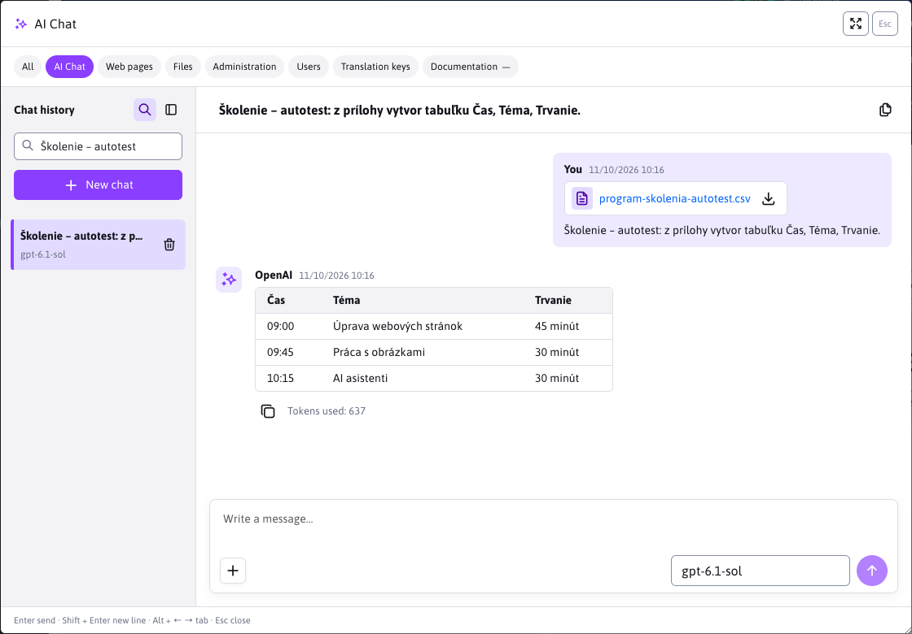
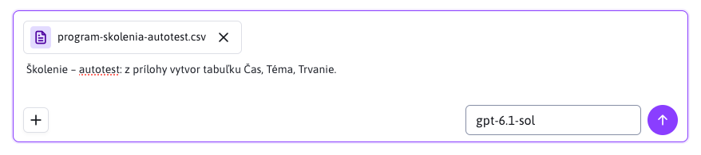
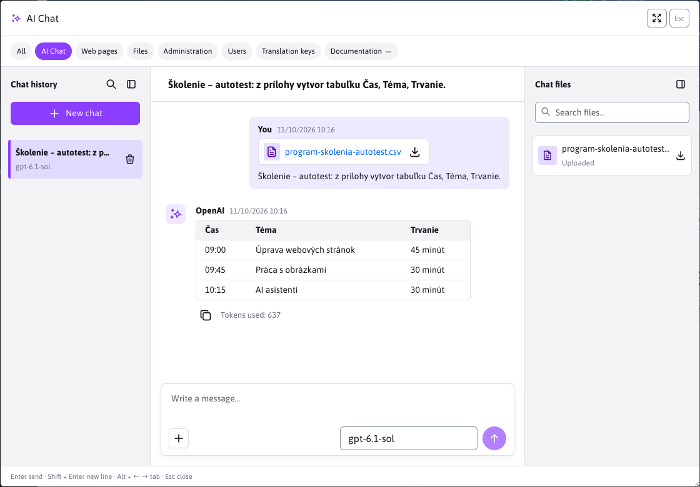
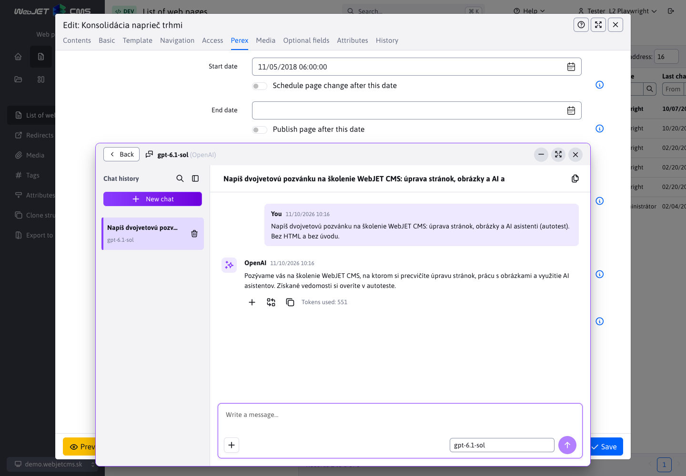
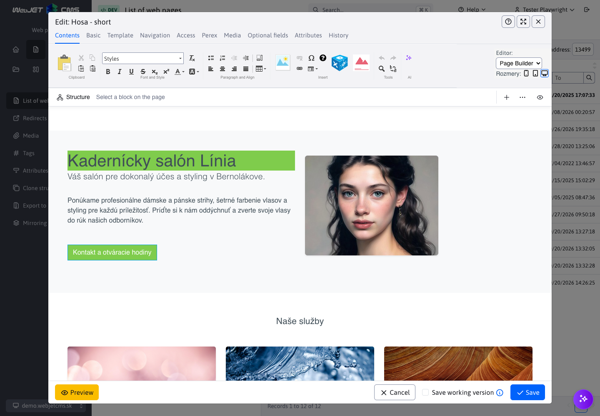

# AI Chat

In AI Chat, you can gradually refine your task, ask about the content of attached documents, or prepare texts for the web. You select a configured assistant and enter a request; you can follow up on the response with another message. The ability to preserve the context of the conversation depends on the provider, model, and assistant settings.

There are two ways to open a chat:

| Location | What is it for? | Working with page content |
| --- | --- | --- |
| **AI Chat** tab in quick search | Individual conversations, work with attachments and saved history. | The content of the open page is not sent. You can copy the response. |
| AI button next to a field or in the editor panel | Design and edit the content of a specific field, text, or PageBuilder page. | The assistant will receive the content according to the source field settings or the selected text. You will only enter the answer after your own confirmation. |

## Starting a conversation

1. In the administration header, click **Search…** or press **Ctrl+K / ⌘K** and select the **AI Chat** tab.
2. Select an assistant in the bottom right corner of the message field. You can also select the same universal assistant via the AI ​​button next to the text field.
3. Type your request and send it using the up arrow key or the **Enter** key. **Shift+Enter** inserts a new line.
4. Write another request in the same field. For example, after designing the training program, you can request to shorten it or add a break.

If the assistant has progressive loading enabled, the answer will be added in parts. The **Stop** button with the square icon will interrupt the generation. The text already received will remain displayed. Closing the dialog or switching tabs will not stop the generation.

Replies display Markdown including headings, lists, highlighting, and tables. The sender's name displays the time of the message, and **Tokens Used** appears below the reply. The **Copy** button copies the original text, including Markdown tags. The names of the button icons appear in a bubble upon mouseover or keyboard focus.

If the assistant returns HTML code, for example when creating a PageBuilder page, the **Content Draft** tab will appear. When the answer is complete, its **Preview** will automatically open and the older draft will be collapsed. Explanation outside the HTML block remains visible.

- **Preview** shows the final appearance. In the page editor, it uses CSS styles and wrapper classes loaded in the classic editor or PageBuilder. In a standalone chat without page context, it uses basic formatting.
- **Desktop**, **Tablet**, and **Mobile** icons will switch their rendering width to 1280, 768, and 375 pixels, respectively. The wider design will be scaled down to fit the chat window.
- The **Maximize window** icon will open the suggestion to the full chat area. The **Minimize window** icon or the **Esc** key will return it to the reply.
- **HTML code** will display the source code. You can copy the entire response by clicking the **Copy** icon below the message.

Previewing the design does not change the content of the field or page. You insert it using the button below the answer. Previewing does not run scripts or embedded iframes, so a map or dynamic app, for example, may not display its final content. Copying the entire answer and pasting it into a page still use the original content.

## New chat and return to conversation

**New Chat** starts a separate conversation with the selected assistant. The last assistant selection on the **AI Chat** tab is saved in the user's administration settings and is restored even after refreshing the page or logging in again. If the assistant is no longer available, the first one from the current menu is selected. The chat next to the field uses the assistant selected in the editor.

If a reply is still being generated, **New Chat** will stop it. This does not delete the saved conversation: it remains in the history.

Switching an assistant restores their last opened conversation, including the drafted message and unsent attachments. The same data is preserved when switching tabs and closing and reopening the dialog until you leave the current administration page. Drafted messages and unsent attachments are not saved to the server.

### Saved and temporary conversations

For **OpenAI** and **Gemini** assistants with the **Enable temporary chat** option turned off and models that support chat, sent messages and replies are stored on the server. You can find them in the history even after refreshing the page or logging in again. Conversations and attachments are only accessible to their owner in the respective domain.

With other settings, the interface will warn that the conversation is not being saved. Such a chat is not added to the history and you cannot upload attachments to it. After leaving or refreshing the page, its displayed content is lost. Preserving the previous context with the provider is controlled by the assistant settings; the message list in the window alone does not guarantee that the model is working with the entire conversation.

### Platoon history

The **Chat History** panel is displayed by default. You can hide or show it again using the sidebar icon on the left in the header. This choice is saved in the user administration settings and will persist after page refresh or re-login; it also applies to chat in the field and in the page editor. Automatically closing the panel on a narrow screen does not change the saved choice.

Click on the name to open the saved chat. The selected chat is indicated by a colored background and a purple stripe.

The magnifying glass in the header of the panel, before the close icon, displays a **Search history…** field. You can search by name, message text, assistant, or provider. The search also includes older conversations that are not yet loaded in the list, and is not case-sensitive or accented. Clearing the term will refresh the entire list. Clicking the magnifying glass again or pressing the **Esc** key will hide the search field and cancel the filter. Another **Esc** will close the history panel.

The continuation uses the context stored with the provider. If the provider is no longer available or the assistant, model, or configuration changes, the conversation may remain read-only. You can continue to read its messages and download attachments; start a new chat to continue working.

### Deleting a conversation

In a conversation, click the **Delete** trash icon and confirm the deletion. WebJET will first ask the provider to delete the saved responses, and then delete the local history and attachments.

If the provider does not confirm the deletion, the conversation will remain marked for deletion. You can repeat the action using the button in the conversation. In the case of an aborted request without a response ID returned, it may not be possible to confirm a complete deletion; the interface will display the appropriate status.

## Attachments

Attachments are available in saved conversations in the **AI Chat** tab, in field chat, and in the page editor with **OpenAI** or **Gemini** assistants. For example, you can attach a training program and have the assistant create a spreadsheet or invitation from it.

1. Click the plus icon **Upload file**, drag files anywhere in the chat area, or paste an image from your clipboard into the message field. You can also drag a file from your computer.
2. Check the file names and image thumbnails. Remove any unwanted attachments by clicking the **×** button before sending.
3. Complete the request and send the message. You can also send attachments without text.

| Limitation | Supported value |
| --- | --- |
| Number of attachments in one message | At most 5 |
| Total size of attachments per message | Maximum 10 MB |
| Pictures | PNG, JPEG, WebP |
| Documents | PDF, DOCX, XLSX, PPTX |
| Text files in UTF-8 | TXT, MD, CSV, TSV, JSON, XML, HTML, HTM, CSS, JS, JAVA, SQL, YAML, YML, LOG |
| Text extracted from attachments of one message | Up to 100,000 characters |
| Number of PDF pages | Up to 200 |

Documents must contain readable text. Scanned PDFs without a text layer will not be processed. The content of the documents will be used as the context for the conversation. Images are first described by the selected model and this description is added to the context; therefore, the model must support image input. Image processing also consumes tokens. Voice input is not supported.

### Files in the chat

The **Chat Files** icon on the right in the header opens a panel with files from all messages in the selected conversation. It distinguishes **Uploaded** and **Generated** files, if the assistant returns them in a reply. You can search them by name and click to download them. Unsent attachments do not yet appear in this panel.

You can also download an attachment by clicking its name or the download icon directly on the message. The file will download under its original name. Attachments remain available after you refresh the page until you delete the conversation. On a narrow screen, the history and files panels appear one above the conversation at a time.

## Chat in the field and in the page editor

In a text field or in the editor toolbar, click the AI ​​icon and select an assistant with a request type of **Chat**. Type your entry and submit it. Selected text in the supported editor takes precedence over the contents of the set **Source field**. If you do not select text, the source field is used. If this is not set either, the contents of the field or page are not submitted. The same rule applies to saved and new records and bulk editing.

When selecting text in the editor, the assistant is also instructed to return only the modified HTML fragment, preserving its structure. For example, when requesting bold text, it should add `<strong>` tags directly to the text without adding a title or PageBuilder wrappers. This instruction takes precedence over the assistant's rules for creating the entire page when editing the selection and does not depend on the set CSS wrapper classes. It applies to both temporary and saved chats processed by the server provider.

You can move the chat window by dragging the top bar so that it doesn't cover the text on the page. After focusing the bar with the **Tab** key, you can also move it with the arrows; with **Shift**, you move in larger steps. You can also edit the editor content when the chat is open.

The **Minimize Chat** (minus) button in the top right hides the window to the AI ​​icon in the bottom right corner. Clicking **Restore Chat** will return you to the same conversation, draft message, unsent attachments, and open panels. The window position is also preserved; any replies in progress continue while minimized. When you minimize the browser, the moved window adjusts to remain accessible. You can also restore the minimized chat by using the original AI button in the same field, which is accessible by pressing the **Tab** key. Closing the editor will also remove the minimized icon.

For **OpenAI** and **Gemini** assistants, you can add files using the plus icon **Upload file**, dragging and dropping into the message, or pasting an image from the clipboard. The same [attachment formats and limits](#attachments) apply as in the AI ​​Chat tab. The assistant receives the contents of the attachments along with the contents of the field or highlighted text. You can also use attachments when **Enable temporary chat** is enabled.

The reply will first appear in the chat. You can change the content of the field or page only by clicking the button below the completed reply:

| Button | Result |
| --- | --- |
| **Add** (plus) | Appends the response to the end of the target field or page content. |
| **Replace content** (replace icon) | Replaces the contents of the target field or page with the answer. |
| **Replace selected text** | When a valid selection is made in the editor, it will replace only the marked part. |
| **Copy** | Copies the response to the clipboard. |

After you paste a reply, **Undo Paste** appears in the chat bar. It will revert to the state before the last paste, unless you have further edited the content in the meantime. If the selected text has changed, the chat will refuse to overwrite the outdated selection; select the text again and reopen the assistant.

In PageBuilder, the response can also contain HTML blocks. Adding or replacing them is done using the same buttons below the response. You can make further edits by sending a new message in the chat. Finally, save the page changes using the usual editor button.

With a saved record, you can use the **Chat History** icon to open conversations belonging to the same field of the same record. For example, the history of a page content field will not show conversations for its title or for the content of another page. The list includes chats from different assistants for this field; you can search it, open an older conversation, and continue it. Even with an older response open, the buttons for inserting content remain available.

For supported OpenAI and Gemini assistants with the **Enable temporary chat** option turned off, both messages and attachments are saved. History remains available after closing the editor or refreshing the page, and is separated from individual conversations in quick search. New, unsaved entries and bulk editing of multiple entries use temporary chat without saving history.

Closing the AI ​​window will preserve the draft message and unsent attachments while the editor remains open. Closing the editor itself will discard them and cancel any running requests; it will not delete any conversations that have already been saved. For temporary chats, messages and attachments are not permanently saved in the CMS.

## Availability and troubleshooting

- **AI Chat tab not showing:** user needs permission to use AI assistants.
- **No assistant available:** The administrator must enable the assistant with the request type **Chat**, configure its provider, and add `top-search-field` to the target fields or `CHAT_SEARCH` to the entities. The procedure is in [chat assistant settings](../settings/README.md#chat-assistant-settings).
- **The button to add attachments is inactive:** the assistant does not support attachments, the chat is currently processing a request, or is read-only. Additionally, conversation saving must be enabled on the AI ​​Chat tab in Quick Search.
- **The attachment cannot be processed:** check the format, size and readability of the text; for images, also check that the model supports image input.
- **Response could not be completed:** The chat will display the reason and, depending on the type of error, offer to repeat the request or start a new chat. Requests are not automatically repeated.

Details of storage and the REST interface are in the [programmer documentation](../../../custom-apps/apps/ai/assistants/README.md#saved-conversations).
