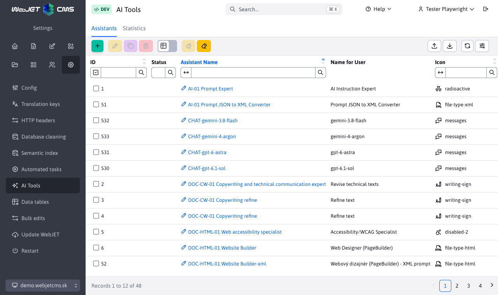
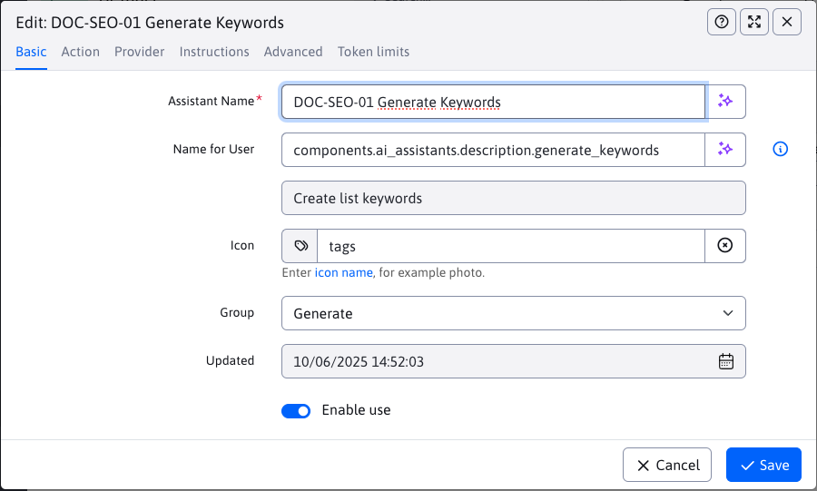
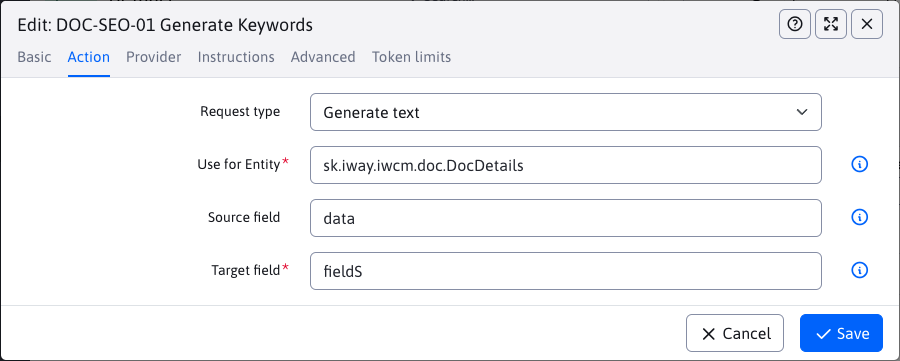
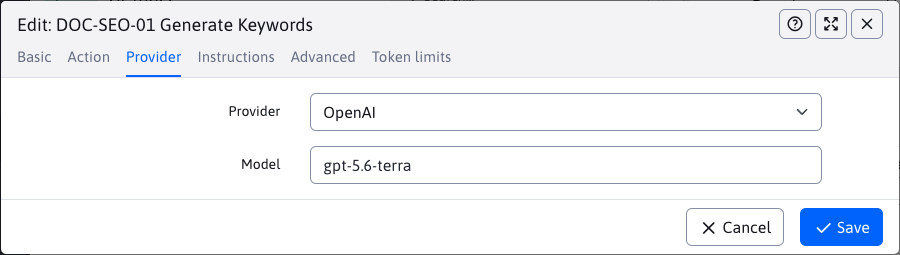
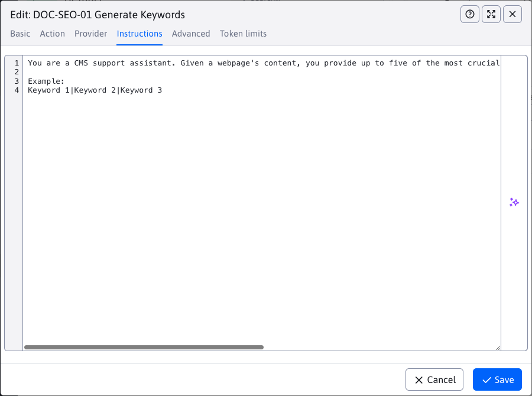
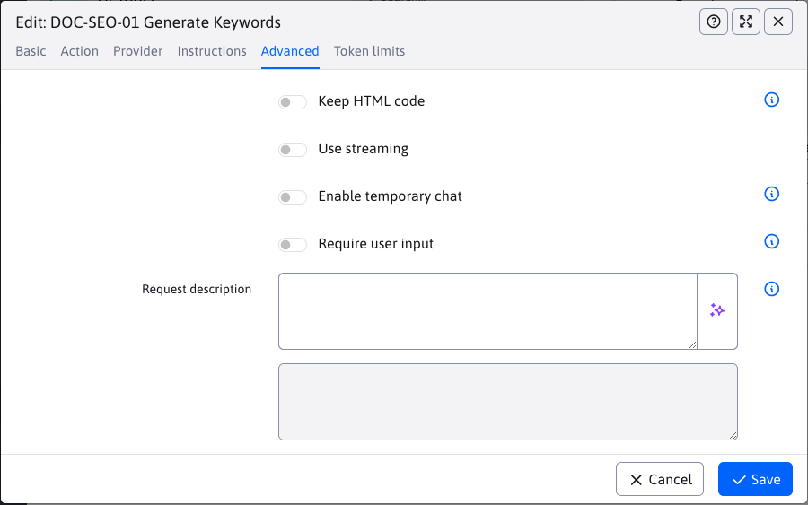
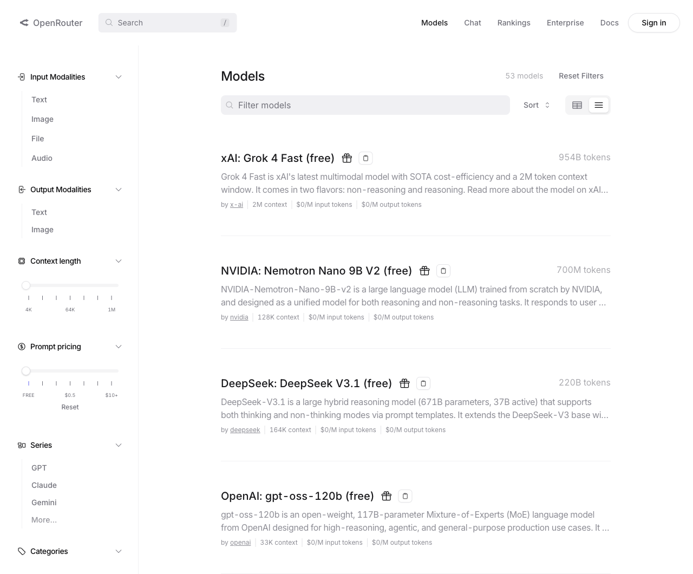

# Setting

This document describes the management and configuration of AI assistants in WebJET CMS. In the **AI assistants** section, you can create and edit individual assistants, with each entry representing a specific type of action with a selected AI service provider. The settings allow you to specify where (in which table) and for which field or fields the given assistant will be available, i.e. it will perform the set action.



!>**Warning:** Settings should only be performed by a person who has sufficient knowledge of how AI assistants work and understands the capabilities of individual providers. Incorrect settings may lead to suboptimal behavior of the assistant or limited functionality. We recommend that the configuration be performed by an administrator or a technically savvy user who knows how to correctly enter instructions and parameters for a specific AI provider.

## Basic information

In this section, we will discuss how to add/set up a new **AI assistant**. The following cards are available for this action:

- Basic
- Action
- Provider
- Instructions
- Advanced

### Tab - Basic

This tab contains basic information about the assistant, such as its name, icon, or creation date. It contains the following fields:

- **Assistant Name** – internal identifier of the assistant (not visible to the user). It must be unique in combination with the **Provider** value (i.e. you can use the same name for multiple assistants, but each must have a different provider).
- **User Name** – the name displayed in the interface. It does not have to be unique. If it is not filled in, the value from the **Assistant Name** field will be used. You can also enter a translation key (the key value will be displayed in the field below it).

  The `{model}` tag is replaced with the current value of the **Model** field when displayed. For example, `{model}` displays `gpt-6.1-sol` and `Čet {model}` displays `Čet gpt-6.1-sol`. The tag can also be preceded by a translation key: `components.ai_assistants.groups.00-chat {model}` displays the translated group name and model. You can also use the tag directly in the translation key value. The preview below the field updates when the name or model changes.

- **Icon** – the name of the icon from https://tabler.io/icons. It is displayed together with the **User Name** field. Enter only the icon identifier (without the URL).
- **Group** – a logical or visual grouping of assistants in the interface. It has no effect on processing or result.
- **Created** – system-generated creation date. Cannot be edited and only appears when editing an existing assistant.
- **Allow use** – if not enabled, the assistant is not displayed to the user and cannot be launched (serves as a quick deactivation).



### Card - Action

On this tab, you set what action the AI ​​assistant should perform, where it will get data from, and where it will be available. The following fields are available:

- **Request type** – you specify what type of task the assistant should perform:
  - Generate text
  - Generate image
  - Edit image
  - Chat
- **Use for Entity** – you select the entity (table) in which the assistant will be available. As you type, all supported entities and the value `CHAT_SEARCH` for a standalone AI Chat will automatically appear in the quick search.
- **Source Field** – you specify the field from the selected entity from which the assistant should draw data when performing the action. This field is not required; select it only if input data is required. All fields of the given entity will be displayed.
- **Target Field** – you select the field in the entity where the assistant will be available. For the **Chat** type, you can also add `top-search-field` for the **AI Chat** card in the quick search. If the only entity is `CHAT_SEARCH`, when saving the chat assistant, the empty target field will be filled in with `*`.



For the entity, source and target fields, it is also possible to enter values ​​of the type:

- `value1,value2,value3` – applies to multiple values
- `*` – applies to all values
- `%value!` – applied if it contains the value `value` anywhere
- `%value` – applies if it starts with the value `value`
- `value!` – applies if it ends with the value `value`

For the target field, it is possible to specify not only the name of the attribute in the entity, but also the CSS class and the value `renderFormat`. Thus, it is possible to specify the value `dt-format-text,dt-format-text-wrap` to apply to all types of text fields.

Optional fields (i.e. fields whose name is `fieldX`) can change dynamically, for example according to the selected template in web pages. When generating AI assistants, only the main type is detected on the server side, regardless of the page template used. Therefore, the assistant may not be displayed correctly if the pages have different templates. Optional fields are initialized when the web page is refreshed according to the template of the folder you are in, so refreshing the page can load the correct values. However, switching to another page with a different template will not change the assistants.

At the same time, if a specific assistant is set for an optional field (the field name matches the value in the Target Field field of the assistant definition), other general assistants defined, e.g. by field type, etc., will not be displayed. It is assumed that if you define an assistant for a specific optional field, you do not need other general assistants (such as Correct Grammar). If you need such an assistant, you just need to add the name of the optional field to these general assistants as well.

If you don't want AI tools options to appear for a field in an entity, simply set the `ai=false` attribute to the annotation or add the `ai-off` CSS class. In this case, the AI ​​assistant button will only appear for the field if it is specified for the specific entity and field.

```java
	@Lob
	@Column(name = "description")
	@DataTableColumn(inputType = DataTableColumnType.OPEN_EDITOR, renderFormat = "dt-format-text", tab="description", ai=false, editor = {
			@DataTableColumnEditor(type = "textarea", attr = {
					@DataTableColumnEditorAttr(key = "class", value = "textarea-code") }) })
	private String description;
```

### Card - Provider

This tab is used to select the AI ​​service provider that will be used to process the assistant request. The selection box displays all available providers; for providers without the required configuration, the name is appended with the warning **not configured**. For configured server providers, the list of models is loaded directly from their API and cached separately by provider, domain, and effective configuration. After selecting a provider, only the fields supported by its CMS adapter are displayed; for example, a browser provider does not display its own model selection.



### Card - Instructions

This tab is crucial for the assistant to function properly. It contains a single field where you enter detailed instructions for what the assistant should do when it starts. The instructions should be clear, specific, and understandable so that the assistant knows exactly what task it is supposed to perform. Properly entered instructions will ensure that the assistant performs the required actions efficiently and as expected. You can read more in the [writing instructions](../instructions/README.md) section.



### Tab - Advanced

This tab provides advanced configuration options for the Assistant, allowing you to further customize its behavior to suit your needs. The available settings may vary depending on the AI ​​service provider you choose. We recommend that you only change these settings if you know exactly how they will affect the Assistant's performance, as they may affect its results or the way it interacts with the user.

- **Preserve HTML code** - if enabled, HTML tags from the source field will not be stripped and will be sent to the provider as is. Enable only if the model needs to work with structured HTML (e.g. parsing or editing content). Otherwise, leave disabled for cleaner input.
- **Use progressive loading** – the answer will be displayed in parts (streaming) instead of in one block. Suitable for longer generated texts so that the user has immediate feedback. Works only for text outputs.
- **Enable temporary chat** – disables saving the conversation to the AI ​​Chat history. Displayed messages remain only on the current administration page and attachments are not available. For saved history on the AI ​​Chat tab, disable this option and use a supported OpenAI or Gemini model. The setting does not replace the provider's data processing and retention policies.
- **Require user input** – Before running the assistant, the user must provide their own input (e.g., entering a topic, additional instructions, or keywords). If disabled, the assistant runs without additional input.
- **Request Description** – a short hint displayed next to the input field (makes it easier for the user to understand what to type). A translation key can also be entered; its evaluated value will be displayed in the field below it.



## Chat Assistant Settings

The update adds four universal assistants to the default domain in the **Chat** group:

| Assistant name | Provider | Model |
| --- | --- | --- |
| `CHAT-gpt-6.1-sol` | OpenAI | `gpt-6.1-sol` |
| `CHAT-gpt-6-astra` | OpenAI | `gpt-6-astra` |
| `CHAT-gemini-3.8-flash` | Gemini | `gemini-3.8-flash` |
| `CHAT-gemini-4-argon` | Gemini | `gemini-4-argon` |

Once the provider is configured, these assistants will be offered in quick search and text fields, including the WYSIWYG editor. In the **Use for Entity** setting, they have `*` and in the **Target Field** setting, they have `dt-format-text,dt-format-text-wrap,dt-format-wysiwyg,top-search-field`.

The menu displays the model name (`{model}`). Assistants have response loading and conversation saving enabled. Common instructions specify short responses in the user's language, Markdown formatting, linking to previous messages, and a link to WebJET CMS documentation. You can edit both the model and instructions in the assistant settings.

To set up your own chat assistant:

1. In **Settings → AI Assistants**, create or edit an assistant and turn on **Allow use**.
2. On the **Action** tab, select **Request Type → Chat**.
3. To display in quick search, add the value `top-search-field` to the **Target Field**. Separate additional target fields with a comma. For example, for an entity `sk.iway.iwcm.doc.DocDetails` and a target `title,top-search-field`, the assistant will be available in the page title and in quick search. If it should be available only in quick search, just set **Use for Entity** to `CHAT_SEARCH`.
4. On the **Provider** tab, select the configured provider and model supporting the desired way of working.
5. In **Instructions**, specify the assistant's role, language, and desired response format.
6. For saved conversations with attachments in the **AI Chat** tab, use OpenAI or Gemini, a chat-enabled model, and turn off **Enable temporary chat**. To display the response continuously, turn on **Use progressive loading**, if the model supports it.

Quick search offers active chat assistants of the current domain with the configured provider. Requires the exact value `top-search-field` in the target field list or `CHAT_SEARCH` in the entity list. A conversation opened from quick search starts with no content on the open page. If you remove the last quick search binding for an assistant, its saved conversations in this menu will remain read-only.

The user needs permission to use AI assistants (`cmp_ai_button`). If you change the model, assistant, or provider configuration, older saved chats may remain read-only. For instructions on how to work with chats, see the [AI Chat](../chat/README.md) chapter.

## Providers

The provider provides AI tools, models, and functionalities used to process requests in the CMS. This can be an external service configured, for example, with an API key, or a local model running directly on the server. Individual providers may differ in capabilities, price, quality of results, or specialization in specific types of tasks. Choosing the right provider depends on your needs and requirements for a specific AI functionality.

### OpenAI

OpenAI is one of the most well-known and widely used AI service providers. Its API is already integrated in WebJET CMS - to activate it, just enter your API key in the `ai_openAiAuthKey` configuration variable. When entering the key, we recommend using the **Encrypt** option for higher security.

Integration is currently supported for the following request types:

- Text generation
- Image generation
- Image editing

You can get an API key by registering on the [OpenAI](https://platform.openai.com/signup) website. After logging into your account, go to the `API Keys` section, where you can generate a new key. Then insert this key into the CMS settings as described above.

### Gemini

Gemini, like OpenAI, is one of the most well-known and widely used AI service providers. Its API is already integrated into WebJET CMS via the [AI Studio](https://aistudio.google.com/) tool - to activate it, just enter your API key in the `ai_geminiAuthKey` configuration variable. When entering the key, we recommend using the **Encrypt** option for higher security.

Integration is currently supported for the following request types:

- Text generation
- Image generation
- Image editing

You can get an API key as follows:

- Open the [Google AI Studio](https://aistudio.google.com/apikey) page.
- Log in to account `Google` (the key will be bound to this account).
- Click on `Create API key`.
- Select an existing or create a new `Google Cloud` project to which the key will be assigned.
- Confirm generation – the generated key will be displayed, which you can then insert into the CMS settings according to the procedure above.

The newly generated key initially works in free (limited) mode - there are limits on the number of requests per minute / hour / day. For higher limits and stable operation, set up billing via the `Set up billing` link next to the key. After adding a payment method, the limits will be available according to the current terms and conditions of the company `Google`.

Advanced settings (quotas, billing, key rotation, statistics) can be found in the [Google Cloud Console](https://console.cloud.google.com/).

### OpenRouter

The [OpenRouter](https://openrouter.ai) service connects various AI service providers to a single common API. Technically, it directs your request to the API of the given provider, the advantage is that you do not need to have accounts created with multiple providers, but you have one account in OpenRouter, which you use for multiple AI service providers. Many models are available for free, so the service is also useful for testing/examining the capabilities of AI models.

To use paid models, you can add a fixed amount of credit to the service, or set up automatic credit replenishment when it runs out. Usage statistics for individual models are also available.

Set the generated API key to the configuration variable `ai_openRouterAuthKey`.



### Local models

Local models execute requests directly on the WebJET CMS application server. The quality of the models, of course, does not reach the quality of large commercial models, but they are run locally on your server, the data does not leave your environment. No special graphics card is required, these models are run on standard processors. Of course, their operation increases the requirements for computing power and server memory. Practical deployment needs to be verified and load tests performed.

!>**Note:**: Running models on `Linux x86_64`, `Windows x64` or `macOS ARM64` architectures is currently supported.

There are three separate types of providers available:

- **Local text generation model** - uses the `utter-project/EuroLLM-1.7B-Instruct` model and only supports text generation. Response streaming is not supported and requests are not cached.
- **Local translation model** - uses the `facebook/m2m100_418M` model for plain text translation. It does not support HTML code, `INCLUDE` commands, structured input, or additional user input.
- **Local Embedding Model** - uses the `intfloat/multilingual-e5-base` model for [semantic indexing and search](../../apps/semantic-search/README.md). The model generates vectors with `768` dimensions.

Model packages in ZIP format must be prepared and approved in advance for WebJET CMS. First, you need to add a dependency and a task to create the files in your `build.gradle` file (set the `com.webjetcms:webjet-ai-local` version to match the version in WebJET CMS):

```gradle
dependencies {
	....
	implementation "com.webjetcms:webjet-ai-local:2.0.4"
}

def localAiModelsDirectory = file('src/main/webapp/WEB-INF/local-ai-models')
def localAiModelTasks = [
    prepareLocalAiTextModel: [
        model: 'utter-project/EuroLLM-1.7B-Instruct',
        variant: 'q4-k-m',
        output: 'eurollm-1.7b-instruct-q4-k-m.zip'
    ],
    prepareLocalAiTranslationModel: [
        model: 'facebook/m2m100_418M',
        variant: 'int8',
        output: 'm2m100-418m-int8.zip'
    ],
    prepareLocalAiEmbeddingModel: [
        model: 'intfloat/multilingual-e5-base',
        variant: 'fp32',
        output: 'multilingual-e5-base-fp32.zip'
    ]
]

localAiModelTasks.each { taskName, modelDefinition ->
    tasks.register(taskName, JavaExec) {
        group = 'webjet-ai'
        description = "Prepares ${modelDefinition.model} for local WebJET AI use."
        classpath = configurations.runtimeClasspath
        mainClass = 'com.webjetcms.ai.local.tool.LocalModelTool'
        args 'prepare',
            '--model', modelDefinition.model,
            '--output', new File(localAiModelsDirectory, modelDefinition.output).absolutePath
        if (modelDefinition.variant != null) {
            args '--variant', modelDefinition.variant
        }
        if (providers.gradleProperty('overwriteLocalAiModel').getOrElse('false').toBoolean()) {
            args '--overwrite'
        }
    }
}
```

Then, from the root folder of the project, start model generation:

```shell
gradlew prepareLocalAiEmbeddingModel
gradlew prepareLocalAiTranslationModel
gradlew prepareLocalAiTextModel
```

The tool will download the fixed model files, verify their size and checksum, and create a ZIP in the `src/main/webapp/WEB-INF/local-ai-models` folder. It will not overwrite the existing ZIP, if you want to consciously replace it, run the appropriate script with the `-PoverwriteLocalAiModel=true` parameter. Each creation or overwriting of a model package requires an internet connection.

Set the path to the created package in the appropriate configuration variable:

| Variable | Model | Path created by script |
| --- | --- | --- |
| `ai_localEmbeddingModelBundlePath` | `intfloat/multilingual-e5-base` | `/WEB-INF/local-ai-models/multilingual-e5-base-fp32.zip` |
| `ai_localTranslateModelBundlePath` | `facebook/m2m100_418M` | `/WEB-INF/local-ai-models/m2m100-418m-int8.zip` |
| `ai_localTextModelBundlePath` | `utter-project/EuroLLM-1.7B-Instruct` | `/WEB-INF/local-ai-models/eurollm-1.7b-instruct-q4-km.zip` |

The path can be an absolute path on the server or a path starting with `/WEB-INF/`. Paths starting with `/WEB-INF/` are evaluated against the root directory of the deployed application on the server.

The paths are global for the entire installation, the file must be readable by the application server process, and a restart is required after changing them. The model will only open on first use. The provider will be marked as unconfigured in the editor until the appropriate path is set.

Set the configuration variables:

- `ragEmbeddingDimensions` to the value 768
- `ragSemanticSearchEnabled` to true - activates semantic search
- `searchType` to the value `semantic` to support semantic search
- `ragAnswerAllowed` to true if you want to display the "Overview from AI" section above the search and you also have `ai_localTextModelBundlePath` activated. Please note that this is a relatively small language model, so RAG answers may not be displayed at all, or may not be completely correct / complete, compared to commercial models. At the same time, generating an overview from AI significantly burdens the server's performance and the response takes significantly longer than a simple semantic search.

For more information, see the [search documentation](../../apps/search/README.md).

!>**Warning:**: when changing `ragEmbeddingDimensions`, the table `rag_embedding_chunks` with existing semantic index records will be deleted, because the data structure is set according to the dimension.

For embedding in the AI ​​tools section, edit the `RAG-EMB-INDEX` and `RAG-EMB-SEARCH` assistants - in both of them, set the Provider value to Local embedding model and the Model value to `intfloat/multilingual-e5-base` in the Provider tab. For the `RAG-SEARCH` assistant, set the Local text generation model and the model to `utter-project/EuroLLM-1.7B-Instruct`. If such assistants do not exist, the system will create them the first time you use semantic indexing or search, then set the provider and models after creating them.

For local translation, the **Instructions** field must contain the source and target languages ​​in JSON format, optionally with the prefix `Translator:`:

```text
Translator: {"sourceLanguage":"sk","targetLanguage":"en","maximumOutputTokens":200}
```

Languages ​​must be specified explicitly; the value `autodetect` is not supported. The value `userLng` will use the current user language and the code `cz` will automatically change to `cs`. The optional value `maximumOutputTokens` must be a positive integer, at most `200`.

!>**Warning:** Model files can be hundreds of megabytes to several gigabytes in size. Please verify sufficient disk space and RAM before activating and only use a package from a trusted source.

Don't forget to also set up a [background task](../../apps/semantic-search/README.md) that performs indexing.

### Browser

The **Browser** provider uses [Google Chrome's built-in AI interfaces](https://developer.chrome.com/docs/ai/get-started). Models are downloaded to the user's computer and requests are executed in the browser. You can disable the availability of this provider by setting the configuration variable `ai_browserAiEnabled` to `false`.

To run AI in the browser, you must:

- [HW requirements](https://developer.chrome.com/docs/ai/get-started#hardware) of the computer.
- The connection to WebJET CMS must be secure (HTTPS protocol used).

#### Enabling the necessary APIs

The availability of individual APIs depends on the version of Chrome; some are [still experimental](https://developer.chrome.com/docs/ai/built-in-apis#api_status). If the API you want is not available, open `chrome://flags/`, find the specific item, and set it to **Enabled**:

| APIs | Use in WebJET CMS | Setting address |
| --- | --- | --- |
| **API Prompt** | Custom assignments for `LanguageModel` | `chrome://flags/#prompt-api` |
| **Summarizer API** | Text summarization | `chrome://flags/#summarizer-api` |
| **Writer API** | Creating new text | `chrome://flags/#writer-api` |
| **Rewriter API** | Rewriting the text, for example into an informal form | `chrome://flags/#rewriter-api` |

The names may vary between Chrome versions; older versions also used **for Gemini Nano**. After changing, click **Restart**. Save your edits in progress in WebJET CMS before restarting.

**Do not enable all AI-related experiments.** For normal use of assistants, leave these options at **Default**:

| Experiment | Setting address |
| --- | --- |
| **Gemma 4 for Built-in AI** | `chrome://flags/#gemma4-for-built-in-ai` |
| **Speculative Decoding for Built-in AI** | `chrome://flags/#on-device-model-speculative-decoding` |
| **Prompt API Tool Usage** | `chrome://flags/#prompt-api-tool-use` |

These experiments may also force a different model or execution pattern for other AI APIs. When tested in **Chrome 157.0.8103.50 on macOS**, Rewriter repeatedly crashed with a combination of these three experiments enabled. After reverting all three to **Default** and restarting Chrome, it started working. The test confirmed this workaround; it did not determine which experiment or combination of experiments was causing the crash.

#### Download and verify functionality

When you first launch the assistant, Chrome may request a model download that is several GB in size. Once the download is complete, the progress view will change to Preparing the model; wait for the request to complete. You can verify the status of the models at `chrome://on-device-internals/`, in the **Broker State** tab. Installed models have a status of **Ready** and a progress of **100%**. It is not necessary to have all the models in the list installed.

You can first try the translation, which will download the required translation model. **Successful translation does not confirm the functionality of Rewriter or other generative APIs**, as they use different models. Therefore, try the desired action separately, for example **Rewrite text to informal form** on a short text.

Some APIs do not support all languages, so WebJET CMS may translate the output afterwards. This translation may also require downloading a translation model on first use.

#### Errors when running the model

The `The device is unable to create a session to run the model. Please check the result of availability() first.` message means that Chrome was unable to establish a session with the model. It can also appear when the model is downloaded and `availability()` returns `available` ; the availability status alone does not confirm a successful launch.

The message `The model process crashed too many times for this version` means that Chrome has blocked the model process after repeated crashes. Follow these steps:

1. Check the three experiments listed and change any **Enabled** to **Default**.
2. Open `chrome://on-device-internals/`. If Chrome reports that internal diagnostic pages are disabled, enable them via `chrome://chrome-urls/` and then return to diagnostics.
3. On the **Broker State** tab, check the **Model crash count (current/maximum)**. For example, a value of `6 / 3` means that the crash limit has been exceeded. The **Reset** button will only reset this counter, the installed models will be preserved.
4. Save your edits and completely quit and restart Chrome. Restarting alone may not reset the counter, and **Reset** alone may not immediately remove the block from the running browser.
5. Try one short request. If the counter increases again, the model process is crashing again. Look for additional data in the **Event Logs** tab and `chrome://crashes/` ; running the assistant repeatedly will not resolve this condition.

## Connection

Calling external AI services requires an internet connection. Make sure your server has access to the external services and that a firewall or other security measures are not blocking requests to the provider's API. Local models do not require an internet connection for processing. The following domain names are used for external providers:

- OpenAI: `api.openai.com`
- Gemini: `generativelanguage.googleapis.com`
- OpenRouter: `openrouter.ai`

these need to be enabled in outgoing requests on any proxy server or firewall.
