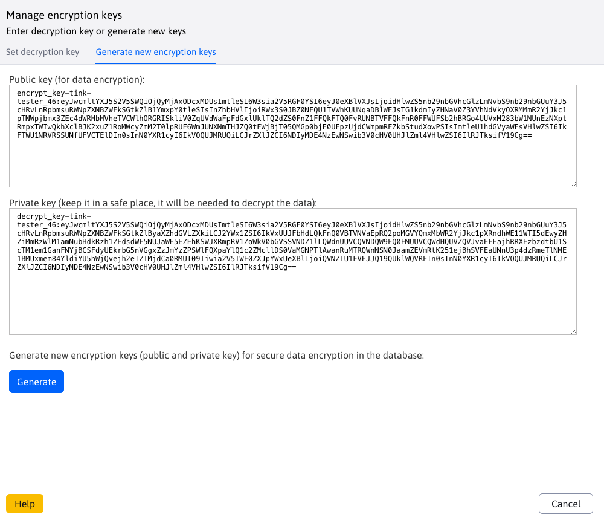
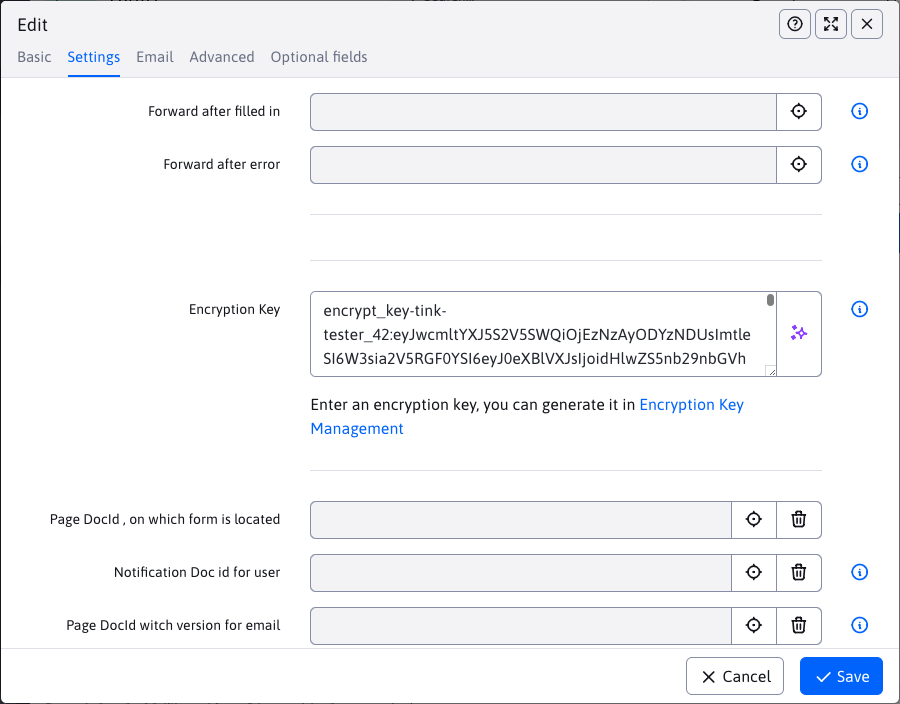
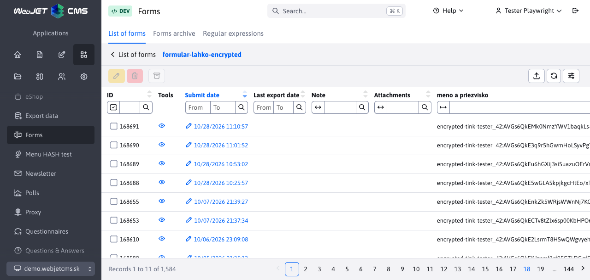
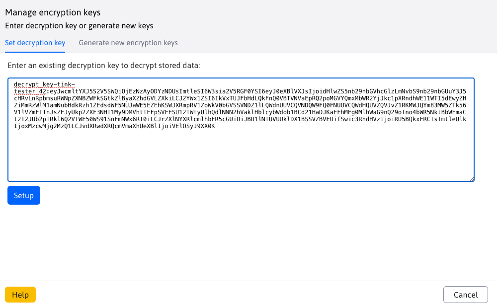
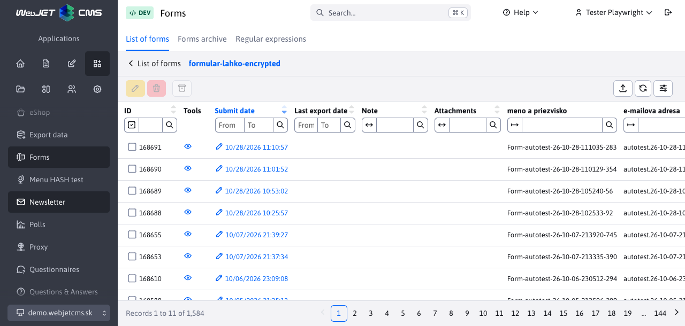

# Form encryption

Form encryption protects the content of submitted forms stored in a database. If the database or its backup is compromised, an attacker without the corresponding private key cannot read encrypted values, such as name, email address, or request text.

WebJET uses a pair of keys:

| Key | What is it for? | Where do you enter it? |
| --- | --- | --- |
| **Public key** | It encrypts new data. The public key alone is not enough to decrypt it. | In the **Encryption Key** field in the form settings. |
| **Private key** | Decrypts data encrypted with the corresponding public key. | To **Encryption Key Management** when viewing submitted forms. |

Keep the private key separate from the database and its backups, such as in a password manager with access only for authorized personnel. If it is leaked along with the database, the protection of the encrypted content is lost.

## What is encrypted?

Encryption is available for both classic forms, [Simple Form](../formsimple/README.md) and [multistep forms](../multistep-form/README.md). It is used when storing submitted data on the server.

| Data | Scope of protection |
| --- | --- |
| Filled in common field values | They are stored encrypted in the database. In a multi-step form, empty values ​​remain empty. |
| Saved HTML form | It is encrypted in the database, and a private key is required to view it via the eye icon. |
| Field names and operational data | They are not encrypted with this key. This applies to, for example, the form name, submission time, identifiers, or notes to the record. |
| Uploaded files | The content of attachments is not encrypted by this mechanism. In the case of a multi-step form, even the saved file names remain readable. |
| Email and PDF copy | They contain readable filled values. Setting an encryption key does not encrypt them. |
| Export after decryption | It contains readable data that needs to be protected separately. |

Encrypting database values ​​does not replace HTTPS, access rights, or email and file protection. The server also works with readable data when processing the form. Therefore, this feature does not provide end-to-end encryption between the visitor and the form handler.

## Creating a key pair

1. In the administration header, open the user menu and select **Encryption key management**. The item is visible to users with the **Forms** right. You can also open the report using the link next to the **Encryption key** field in the form settings.
2. Go to the **Generate new encryption keys** tab.
3. Click **Generate**.
4. Copy the entire **Public Key (used to encrypt data)** and the entire **Private Key (store it in a safe place, it will be needed to decrypt data)**. Also keep the beginning of the key before the colon.
5. Store your private key safely before closing the window. Keep a record of which forms and period it belongs to.



The keys in the images are sample keys. Always generate your own pair for your own forms.

!> **If you lose your private key, you will not be able to decrypt the data.** Clicking **Generate** again will create a different key pair, not restore the original one. Key Management does not provide a list for retrieving previously generated private keys.

## Setting up a public key for a form

1. Open **Forms → Form List**.
2. Select the desired form and click **Edit**. Clicking on its name opens a list of submitted records.
3. On the **Settings** tab, enter the entire public key in the **Encryption Key** field, which starts with `encrypt_key-tink-` for the default algorithm.
4. Save the settings.



Only the public key belongs in the form settings. Do not enter the private key starting with `decrypt_key-` here.

The setting applies to subsequent submissions. Already saved records will not be encrypted additionally. Similarly, changing or deleting the public key will not decrypt older records.

!> **When updating older forms**, transfer the public key from the possible hidden HTML field `encryptKey` to the **Encryption key** field in the administration. Entering the key in the HTML itself no longer turns on encryption. After updating, verify the new submission and its decryption.

### Verifying the setting

1. Submit a form on the website with recognizable test data.
2. In the administration without a set private key, open the submitted records of the given form.
3. Check that instead of test values ​​you see strings starting with `encrypted-tink-`. For older RSA keys it starts with `encrypted-rsa2048-`.
4. Also check the preview via the eye icon. Without the private key, it contains encrypted text.
5. Set the private key according to the following procedure and verify that the original test values ​​and preview are displayed.



!> **Successful form submission does not in itself confirm successful encryption.** The current implementation returns the original text for some encryption errors; some Tink key loading errors may result in empty encrypted content. Therefore, verify the entire process, including decryption, especially after changing the key.

## Decrypting the list of forms

1. Open **Encryption Key Management** in the user menu.
2. On the **Set Decryption Key** tab, enter the entire private key belonging to the form's public key. For the default algorithm, it starts with `decrypt_key-tink-`.
3. Click **Set**. You will see the message **Decryption key set successfully**.
4. Go back to the list of submitted forms and refresh it. The values ​​encrypted with the corresponding public key will be displayed in readable form.





Readable data is then also available in the record details, preview via the eye icon, and during export. **They remain encrypted in the database** — setting the private key is used to decrypt them when reading.

The private key is set in the user's current server session (`session`). It must be entered again after logging out or the session ends. Simply closing the key management window does not remove it from the session. Log out when you are finished, especially on a shared computer.

One private key is set per session. If you have forms or older records encrypted with a different pair, set their corresponding private key. The message about successful setup confirms that the key was inserted into the session, not that it is correct for the specific data.

## Key replacement and troubleshooting

When changing keys, generate a new pair and set the new public key in the form. Keep the old private key for older records. Data is not automatically encrypted when you change the setting.

| Problem | What to check |
| --- | --- |
| After setting the private key, the values ​​remain encrypted. | Use the entire private key from the original pair and refresh the list. Also check the `cryptoContextInfo` configuration for consistency, especially after transferring data to another server. |
| Some records will appear readable and others will remain encrypted. | The records may have been encrypted with different keys. Refer to the identifier at the beginning of the encrypted value. |
| You can see the new data legibly even without the private key. | Check the public key in the form settings in the administration and the errors in the server log. The key only in the HTML field `encryptKey` does not enable encryption. Verify in a session without a decryption key. |
| The private key has been lost. | Find its securely stored backup. The new pair will not allow you to read data encrypted by the original pair. |

## Technical information

### Default algorithm

The configuration variable `cryptoAlg` has a default value of `CryptoTink`. The `CryptoTink` implementation uses the Google Tink library and a template to generate keys:

```text
ECIES_P256_HKDF_HMAC_SHA256_AES128_CTR_HMAC_SHA256
```

This is a hybrid encryption that combines an asymmetric part with fast symmetric content encryption. The template used includes:

- **ECIES with NIST P-256 curve** for the asymmetric part and shared secret derivation using ECDH.
- **HKDF-HMAC-SHA-256** for key derivation.
- **AES-128 in CTR mode** for content encryption.
- **HMAC-SHA-256** for integrity checking within the symmetric part.

Hybrid encryption allows you to process long values ​​and HTML form forms. It uses randomness, so two identical values ​​do not have to have the same encrypted notation. Details of the principle are in the [Google Tink documentation](https://developers.google.com/tink/hybrid) ; the specific template used by WebJET CMS is shown above.

### Key and data format

WebJET uses the following shapes for Tink keys:

```text
encrypt_key-tink-<login>_<id>:<verejný kľúč v Base64>
decrypt_key-tink-<login>_<id>:<privátny kľúč v Base64>
encrypted-tink-<login>_<id>:<šifrovaný obsah v Base64>
```

The `<login>_<id>` part identifies the user who generated the pair and the sequential identifier of the pair. It helps to associate data with the key; it does not specify access rights. The key can also be used for decryption by another authorized user who has it.

Tink key material is serialized as JSON and encoded in Base64. **Base64 is not encryption of the private key** or password protection. Therefore, treat the entire string as a secret.

Field values ​​are stored in the column `forms.data` ; each field value is encrypted, field names and separators remain readable. The HTML form is encrypted as a whole into `forms.html`. Decryption is performed by the server using `CryptoFactory`, which reads the private key from the current session. The decrypted version is not written to the database during this read.

### Related configuration

| Variable | Meaning |
| --- | --- |
| `cryptoAlg` | Selects the implementation when generating a new pair: default `CryptoTink`, alternatively `CryptoRsa2048`. When working with existing keys, the implementation is selected based on the key label. Changing the variable does not encrypt the stored data. |
| `cryptoContextInfo` | Context used for both encryption and decryption via Tink. If empty, WebJET will create it on use and save it to the configuration. The same value is required for decryption as for encryption. Keep this configuration when migrating. |
| `cryptoToolsShowGeneratedKeysLog` | When set to `true`, it prints generated keys, including the private key, to the server log. Leave it disabled for normal operation. |

The older implementation `CryptoRsa2048` uses RSA with a 2048-bit key length and the prefix `rsa2048`. It encrypts a single block directly via Java `Cipher.getInstance("RSA")`, so it has limited input length and is not suitable for long form values ​​or HTML. The exact block padding (`padding`) depends on the Java cryptographic provider. For new form pairs, leave the default implementation `CryptoTink`.

The implementation can be found in the classes `CryptoFactory`, `CryptoTink` and `CryptoRsa2048`. Saving classic forms and Easy Form is provided by `FormMailAction`, for multi-step forms by `SaveFormService` and `FormHtmlHandler`. Displaying decrypted values ​​and HTML is provided by `FormsService` and `FormsController`.
