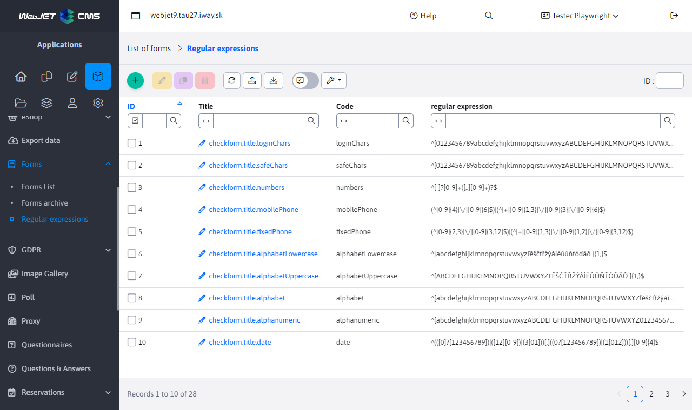
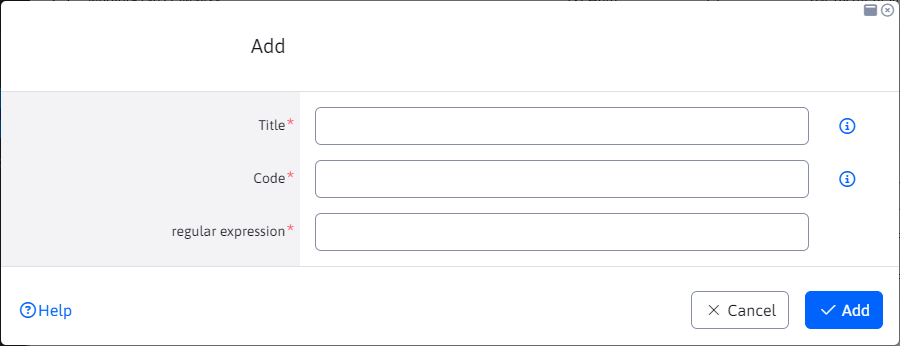

# Regular expressions

The Forms application contains a Regular Expressions node, through which you can define rules for checking field completion. Rules are defined using a regular expression.

The **Translated name** column displays the description of the rule in the language in which you are logged into the administration. You can filter and sort the list by this name, code, and translation key. The translated name is not stored in the database and is not part of the export.

The list is sorted alphabetically by the **Code** column by default. **Allowed Value** options in multi-step forms are also sorted by code, regardless of case and administration language.

The editor contains the following fields.

- Translation key - the key of the rule description, for example `checkform.title.alphabetLowercase`. You can also enter your own text, for example `minimálne 8 znakov`, which will be displayed directly. If a translation is missing, the standard WebJET CMS replacement translation will be used. If it is not found, the key itself will be displayed.
- Code - Code designation, can only contain letters without spaces. In HTML code, it will be used as a CSS class on the input field.
- Regular Expression - [Regular Expression](https://www.w3schools.com/jsref/jsref_obj_regexp.asp) rules.

