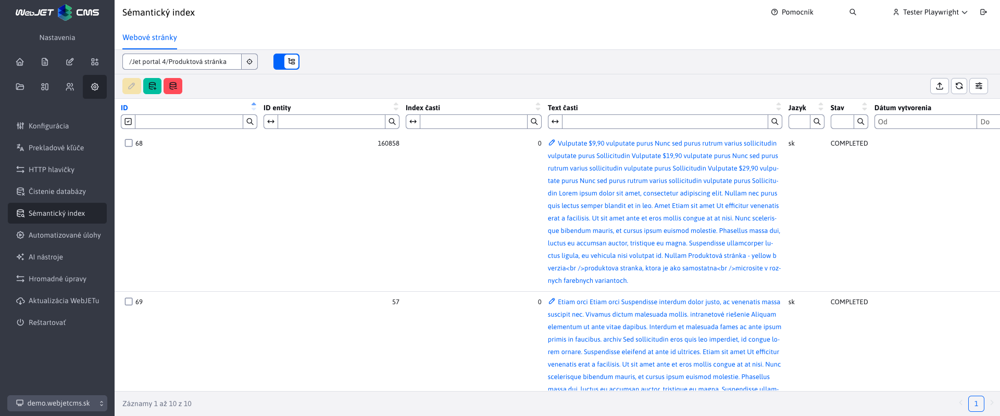
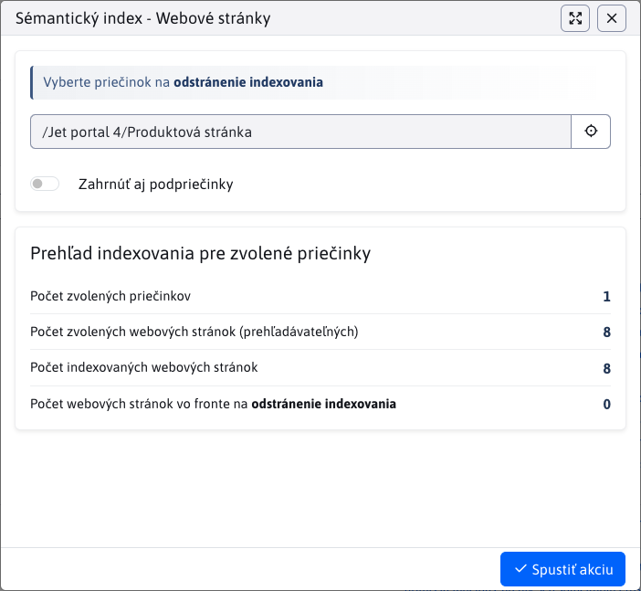

# Semantic index

The semantic index converts the content of the pages into vector representations (`embedding`) using the configured AI provider and stores them in a vector database. It is used for semantic search, hybrid search, and for generating RAG answers in search.

For more accurate results, the content is divided into smaller parts - **chunks**. Each chunk is indexed separately, which allows the system to match queries to specific parts of the text rather than the entire page at once.

You can find vector management in the **Settings → Semantic Index** section.

The index is divided into **Websites** and **Markdown Documents** tabs.

!>**Warning:** Indexing **does not happen immediately**. Each request (add, modify, delete) is placed in a **queue** and processed at regular intervals using a cron job.

To view the list of indexed objects, you must have the Semantic Index right.

## Indexing Markdown documentation

The Markdown documentation and its index are common to all domains. Roots are set globally by the administrator in `ragMarkdownFolders`. Indexing uses the `RAG-EMB-INDEX` helper of the domain that queued the request; consumption is also recorded for that domain. Search uses the helper of the current domain. The provider and search model must match the index.

On the **Markdown Documents** tab, select the configured root or its subfolder in the tree. The **Show also from subfolders** switch sets the scope of both the table and the action dialogs; when disabled, only files directly in the selected folder will be used. The table contains the **Document Path** and **Document Name** data, which are read-only. The selection and switch setting are retained when switching tabs.

The administrator can also use server folders, for example `file:/srv/manuals`. The alias `file:/docs` requires a global mapping in `symlinkTranslate`, for example `/docs/|/srv/documentation/webjetcms/`. Local indexing alone will not make files accessible over the web.

**Documentation must use language folders**, such as `sk`, `en` or `cs`. The language is determined from the closest recognized folder in the entire path including the root: files under `file:/docs/sk/admin/users` will be given language `sk`. The recognized languages ​​are based on the global variable `languages` ; `sk`, `en` and `cs` are always supported. Files without a language folder are skipped during indexing.

The **Add Indexing** and **Remove Indexing** buttons open a dialog where you can change the folder and the inclusion of subfolders. The dialog displays the total number of documents, the number of indexed documents, and the number in the queue for the selected action. Indexing counts files with a recognized language and an index for the current provider, model, and derived language. Deleting includes all indexes in the selected range, including records for files that no longer exist.

Once confirmed, the requests are queued. They are processed by `sk.iway.iwcm.rag.service.RagIndexCronTask` ; errors remain in the queue for another attempt. The deletion also cancels any pending indexing of the same resource from another domain. Requests for other folders are preserved. If no roots are set, information about the required configuration is displayed and the action buttons are disabled.

When migrating from an older version, follow the [technical documentation](../../../custom-apps/apps/rag/markdown-search.md#index-management-in-administration), especially for relative paths and legacy domain indexes. Shared indexes with `domainId = 0` remain valid; the domain in the queue determines the consumption owner.

!>Removing the index does not delete the Markdown files or disable their automatic indexing. The `MarkdownIndexCronTask` task will re-create the index the next time it crawls.

## Website indexing

The plain text of the page without HTML tags is indexed. Only web pages that are enabled for search are included in the indexing. The content is divided into chunks, which are shown in the table below.

Each chunk contains the following columns:

- **Entity ID** - Website ID.
- **Chapter index** - the order of the chunk within the page (0, 1, 2, ...).
- **Part text** - the text for which the embedding was generated. The embedding itself is not displayed in the table.
- **Embedding provider** - the provider used to create the vector, e.g. `openai` or `gemini`.
- **Embedding model** - the embedding model used, e.g. `text-embedding-3-small` or `gemini-embedding-001`.
- **Dimensions** - number of dimensions of the vector, e.g. `1536`.
- **Language** - language version of the page.
- **Status** - processing status:
  - **COMPLETED** - successfully processed.
  - **ERROR** - an error occurred.
  - **PENDING** - waiting for processing.
- **Error message** - error description if processing failed.
- **Creation Date** - processing time, not queue addition time.

Additionally, the database stores `group_id` and the columns `root_group_l1`, `root_group_l2`, `root_group_l3`. These values ​​are used to quickly limit semantic and hybrid searches to folders selected in the **Search** application.

After loading the page, an informational notification will appear with the current provider and model used for indexing. The settings are loaded from the system AI assistant `RAG-EMB-INDEX`, which you can edit in the **Settings → AI assistants** section.

If the system assistant does not yet exist, it will be created automatically based on the configuration variables `ragEmbeddingProvider` and `ragEmbeddingModel`. Once it is created, the values ​​set in the assistant take precedence over the configuration variables.

!>**Warning:** After changing the provider or model, run the index again. Indexes created by different provider and model combinations are stored separately and can coexist for the same page. The `RAG-EMB-SEARCH` search assistant must use the same provider and model identifier as the index it is to search.

The queue item does not contain a provider or model; these values ​​are read from the `RAG-EMB-INDEX` assistant only during processing. If the queue in progress is to complete the original index, let it fully process before changing the assistant.

## Splitting text into chunks

The chunk size is set by configuration variables:

- `ragEmbeddingChunkSize` - ​​approximate target chunk size in characters, defaults to `1000`. The maximum size is 50% higher, defaults to `1500` characters. A value less than or equal to zero disables text splitting.
- `ragEmbeddingChunkOverlap` - ​​approximate overlap between adjacent chunks in characters, defaults to `200`.

Chunks start and end at the recognized sentence or paragraph boundary closest to the target size, if possible. A sentence that wraps across multiple lines will stay together as long as it fits within the maximum size. Longer sentences or paragraphs will be split across words. If a word itself exceeds the maximum, it will be split in the middle.

The overlay is scaled to fit entire sentences or paragraphs where possible, so its actual size varies and can be zero if necessary to continue the text or meet the maximum size. Each additional chunk adds new content. The new boundaries are applied to existing documents upon reindexing.

Overlay is used to preserve context between adjacent chunks. In a RAG response, adjacent chunks of a single page can be re-merged, removing duplicate text created by the overlay.

!>**Warning:** The older configuration variables `ragChunkSize` and `ragChunkOverlap` are no longer used. Please re-run indexing after changing chunk sizes or migrating from older settings.

## Filtering

The following filters are available in the table header:

- **Select folder** - displays chunks only for pages from a given folder within the current domain.
- **Show also from subfolders** - includes pages from subfolders in the results.
- **Embedding Provider** and **Embedding Model** - restrict the table to a specific combination of the stored index.

!>**Warning:** If you select **Root Folder** without enabling **Show also from subfolders**, you will not get any results. The root folder is virtual and does not contain pages directly.

## Redirect from Websites

In the **Websites** section, you can click the button next to the selected folder. <button class="btn btn-sm buttons-selected btn-outline-secondary"><i class="ti ti-database-search"></i></button> in the folder header. This will open the **Semantic Index** section with the filter automatically set for that folder.

### Automatic indexing

The system automatically queues a page when:

- **created or edited** - the page is indexed or updated without manual intervention,
- **deleted or moved to the trash** - all related chunks are removed from the database,
- **restore from trash** - the page is being re-indexed.

### Manual indexing

Click the button <button class="btn btn-sm btn-success" type="button"><i class="ti ti-database-plus"></i></button> to open the indexing dialog.

The dialog will display an overview of the pages in the selected folder - total number, number already indexed, and number in queue. Only pages that have an index for the current provider and assistant model `RAG-EMB-INDEX` are considered indexed. An index created by another provider or model is therefore not taken into account in this count.

Manual actions can only be performed on folders in the current domain for which the user has edit rights. When selecting a root folder, the user must have rights to all root folders in the domain.

The folder and the **Show also from subfolders** option are taken from the active filter. After confirmation, all searchable pages from the selected range are queued. If the chunk text has not changed, the system will try to use an existing embedding with the same provider and model according to its hash value. Reindexing will only replace the index for the current provider and model combination; other indexes for the same page will be preserved.

You start the action with the button <button class="btn btn-primary"><i class="ti ti-check"></i>Start the action</button> .

### Manually remove indexing

Click the button <button class="btn btn-sm btn-danger" type="button"><i class="ti ti-database-minus"></i></button> to open the delete indexes dialog.

The dialog will take the folder and the **Show also from subfolders** option and display the same overview as for indexing, but the number of indexed pages includes all providers and models. After confirmation, the pages will be queued for removal of all chunks for pages of the selected range, regardless of provider and model.

You start the action with the button <button class="btn btn-primary"><i class="ti ti-check"></i>Start the action</button> .

## Indexing errors

If an error occurs while indexing a page, the system saves a record with the status **ERROR** and a short error message. The error is also written to the administrator log in the **Search** category (`SEARCH`). If processing of an item fails at the queue level, the item remains in the queue and the system attempts to process it the next time the cron job runs.

!>**Warning:** The configuration variable `ragEmbeddingDimensions` is global to the entire installation. Changing it will delete the entire semantic index for all providers and models, because the database column `vector(N)` has a common dimension. After changing it, all content must be re-indexed. The local model `intfloat/multilingual-e5-base` requires the value `768`.

## Implementation details

A technical description of the indexing process can be found in the [developer documentation](../../../custom-apps/apps/rag/semantic-search/README.md).
