# Working in the editor

WebJET includes an intelligent web page editor that shows you as faithfully as possible what the page will look like.

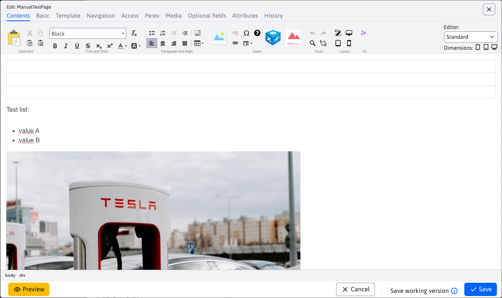

An overview of shortcuts for the text editor and other parts of the administration can be found on the [Keyboard Shortcuts](../../admin/keyboard-shortcuts.md) page. On Mac, **Command (⌘)** is used instead of **Ctrl** when copying, cutting, pasting, and editing links.

## Toolbar in a narrow window

If all the tools don't fit side by side, you can find some of the groups under the **… More tools** button. This way, the bar won't wrap into another strip and the editor and size switcher will remain available. This works in the Standard Editor and in the Page Builder, for example in mobile view. After expanding the window, the groups will return to their original locations.

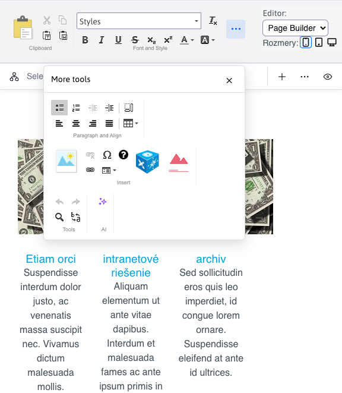

The panel remains open while formatting text, so you can use multiple tools in a row. You can close it by clicking outside the panel, clicking **…** again, using the cross, or pressing the **Escape** key. It also closes when you move to another block or open a dialog. You can scroll longer contents of the panel.

If a dialog, such as Image, Link, or Applications, does not fit within the width of the preview in Page Builder, it will automatically open to the size of the browser window. When you confirm or close the dialog, the original preview width and page offset will be restored. The **Shrink** button is not displayed during auto-expansion.

**Alt+F10** will take you to the toolbar. **Tab** will switch between available groups and the **…** button will arrow between tools in a group. **…** button will be opened by **Enter**, Spacebar or Down Arrow. If you open a nested menu, such as Colors or Styles, the first **Escape** will close that menu and the next toolbar.

## Working with text (typing/pasting/copying)

When working with text, you must first be aware of the difference between a paragraph and a text break, i.e. dividing a sentence into the next line. You create individual paragraphs by pressing ```ENTER```, while you create a text break using the key combination ```SHIFT + ENTER```.

The difference between them is mainly due to the greater indentation between paragraphs (as opposed to text wrapping). Another important difference is that many text adjustments (such as creating a heading) are applied to the entire paragraph. If such a paragraph contains a line break, the change is also applied to the broken line.

If you want the text not to wrap after typing a space, you can insert a **fixed space** in addition to the normal space. This can happen, for example, when typing dates ```10. 2. 2009``` or various other texts that should not be divided into two lines, such as file sizes ```123 kB``` or phone numbers ```0905 123 456```. A fixed space is inserted with the key combination **Shift + spacebar**. It does not differ in appearance, the only difference is its behavior towards the surrounding text at the end of the line.

**You can edit text in the WebJET editor in the following ways**:

- by typing directly into the editor
- by pasting from another document (```DOC```, ```PDF```, ```XLS```, another website...)

### Paste from another document

**Classic text insertion** from the toolbar using the icon or the key combination ```CTRL + v```. When inserting text in this way, the text is also inserted with the original formatting of the source text. However, this method is undesirable mainly because it leaves the text styling uniform throughout the website according to predefined styles.


**Paste unformatted text** from the toolbar using the . You can also use the shortcut for pasting without formatting provided by your browser. Its appearance depends on the browser and operating system, for example ```CTRL + t``` or ```CTRL + SHIFT + v```
This method of inserting text inserts text without any formatting, so it is most suitable for inserting regular text.

**Pasting text from ```Word``` / ```Excel``` file** from the toolbar using the 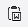 icon.
This option inserts text with paragraphs and tables preserved, but stripped of all styles from the original document.

### Copying text

Copying text is possible by selecting the text and clicking the  icon (or by pressing the key combination ```CTRL + c```).

### Cut text

You can cut text by selecting the text and clicking the  icon (or using the key combination ```CTRL + x```).

## Working with styles and text formatting

The **Styles** menu contains presets ready for your page design, such as text colors, padding, backgrounds, or borders. The available styles and their names depend on the template. The controls are the same in the Standard Editor and in the Page Builder.

<div class="video-container">
    <iframe width="790" height="444" src="https://www.youtube.com/embed/IomtyBHpx64" title="YouTube video player" frameborder="0" allow="accelerometer; autoplay; clipboard-write; encrypted-media; gyroscope; picture-in-picture" allowfullscreen></iframe>
</div>

A button in the toolbar displays the current element, such as **Paragraph** or **Heading 2**. If it has styles set, it lists the abbreviated HTML tag and their names, such as **H2 + Bottom padding xs**. A long list is clipped to the width of the button; hover over it to see the full text. **Selection** appears when multiple element types are selected.

Click in the text or select a section of it and open **Styles** in the toolbar. The selected style is applied immediately and the window remains open so you can set multiple properties in a row. The changes are not transferred to the web until you save the page.


For proper functionality, it is necessary to have correctly set [CSS selectors](../../../frontend/page-builder/blocks.md#structure-selectors) and created [additional comments](../../../frontend/examples/template-bare/README.md#searching-and-style-groups) in the website's CSS file.

### Selecting the part of the page to edit

At the top of the window is the path to the current element, for example **Section › Container › Column › Paragraph › Text**. The highlighted item determines what you are currently editing. By clicking on a different item, you can set, for example, the background of the entire section instead of the paragraph color. Colored squares indicate the same parts of the page as in Page Builder. Hover over an item to view details about the element.

- **Entire paragraph:** place the cursor in it. Paragraph styles will be applied to the entire paragraph.
- **Part of text:** First, select the words you want to edit. The menu will also make styles available for the selected text, such as its color.
- **Already edited section of text:** click inside the section. If it is separately marked as **Text**, the menu edits this section. To set the entire paragraph, switch to **Paragraph** in the top path.

### Search, preview, and combine styles

The styles are divided into categories that you can expand or collapse individually. The **Expand All / Collapse All** link controls all displayed categories. The search field searches in names, CSS classes, categories, and groups without case or diacritics.

On the right of each item, you can see a preview of its appearance: text color, background, frame, or font style. Large fonts will fit the preview area; the pixel value shows the actual size. When indenting, the preview shows the spacing and its value. You can always see the result directly in the page content.

You can combine properties, such as text color with indentation. Options with a circle in the same group are replaced: selecting a different color removes the previous color from that group. Individual styles with a square box can be enabled independently. **Remove** on a group name deselects that group. Clicking the active style again will remove it; the **×** on its name at the top of the window also works.

The menu displays the styles applicable to the current selection. When you turn on **All Styles**, you will also see the other items, but those that cannot be applied to the selected element will remain inactive.

If the window overlaps the content you are editing, drag it by the dotted handle next to the **Styles** name. When closed and reopened, it returns to the toolbar button and the list moves to the beginning. You can close it with the cross, the **Escape** key, or by clicking outside the window. You can undo the style change with the **Undo** command.

### Restoring the basic look

The **Restore Basic Appearance** link removes all removable CSS classes known to the style menu from the currently selected element. It preserves its basic structural classes and other classes not known to the menu. It appears next to an element for which the template defines basic classes.

If you have **Container** selected, it will reset the appearance of the container; it will not modify nested paragraphs or text sections. However, their appearance may be affected by, for example, the color inherited from the container. The content and type of the element will be preserved. The reset also includes styles hidden by search or a collapsed category and can be undone with a single **Undo** step.

### Paragraph format and headings

At the top of the menu is the **Paragraph Format** category with the options **Paragraph** and **Heading 1–6**. Click in the paragraph and select the desired heading level. This option changes the type of the entire paragraph and its meaning in the document structure. The CSS style alone, which makes the font larger, does not make the paragraph a heading.


Choose heading levels according to the structure of your content: main heading, section titles, then their subsections. If your template already displays the main heading from the page title, you don't need to add it again in the content. Selecting **Paragraph** will change the heading back to a regular paragraph; any separately set CSS styles will be preserved.

When editing **Text** or the entire container, first select the relevant paragraph to change the format. In some Page Builder blocks, the template itself determines the element type; in such cases, changing the format is unavailable and the menu displays an explanation.

Defining the available styles is described in the [web designer manual](../../../frontend/examples/template-bare/README.md#list-of-styles-for-editor).

### Other formatting tools

Another way to format text is by using the following standard tools (they are applied by selecting the text you want to edit):

- 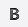, **bold font**
- , *italics*
- 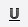,<ins> underline</ins>
- 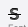, ~~strikethrough~~
- 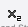, <sub>superscript</sub>
- 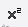, <sup>subscript</sup>

We recommend not using text formatting using the text color change tool 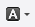 and text undercoloring tool 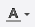, as it causes graphic inconsistency on the web page and degrades its value within the website.

## Removing formatting

To change a heading to a regular paragraph, click inside it and select **Paragraph** from the **Styles → Paragraph Format** menu. Remove CSS styles individually by clicking on the active item or the **×** next to its name.

If you want to remove common formatting from text, such as bold or italics, you can do this in two ways. Either select the text and click on the formatting tool again until the formatting is removed, or use the universal formatting removal tool 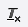

This tool works by selecting formatted text and clicking  to remove the formatting from the selected text. This tool also removes combined formatting from text (e.g. italics and bold text together)

## Lists (bulleted/numbered) and text indentation

To create a numbered list, use the  icon.
To create a bulleted (unnumbered) list, use the 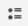 icon.

To create a list from a regular paragraph, click in the paragraph and click the icon for the desired list (numbered or bulleted).

If you want to change the bullet type for a numbered list, click on the list item and use the context menu (right-click) to access the list properties, where you can choose a different list type.

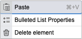

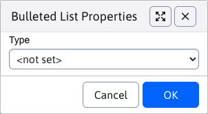

If you want to create a nested list, click in the list item and click the right indent icon 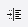 to create a nested list. You can cancel the nested list by clicking the left indent icon .

To end the list creation, press the ```ENTER``` key twice at the end of the list.

## File links and file uploads

To create a link to a document/file, select the text that should be the link, click the Link icon 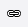 or use the shortcut ```CTRL + k```, a dialog box for creating a link will appear:

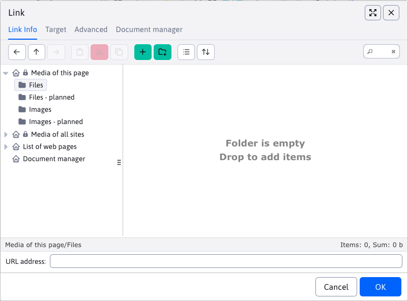

- if you have the right to **Document Manager** (`cmp_file_archiv`), the **Document Manager** tab will also appear in the **Link** dialog.
  - The tab contains a tree structure of archive folders and a table of documents from the selected folder.
  - By clicking on the document name, its URL address will be automatically copied into the URL field.
  - If the required document is not yet in the archive, you can upload it directly in this tab by dragging the file from your computer (`drag&drop`) into the dialog. The file will be uploaded to the currently selected folder in the tree.
  - When uploading multiple files or when the real file name is duplicated, the same options will be displayed as in the document manager: **Skip**, **Replace**, or **New version**.
  - Confirm OK, which will create a link to the file from the document manager at the marked location.

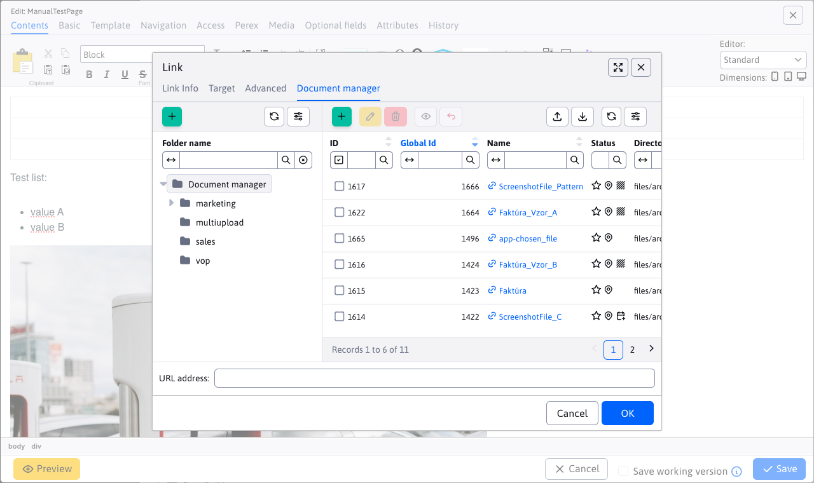

!> [Document Manager](../../files/file-archive/README.md) files and folders stored in `/files/archiv` are only available for viewing and selection in the **Link** and **Image** dialog tree structure. They cannot be uploaded, renamed, deleted, or otherwise modified. Use the **Document Manager** tab to manage these files and folders.

In the **Link** dialog, they are indicated by an icon<i class="ti ti-folder-x"></i> read-only:

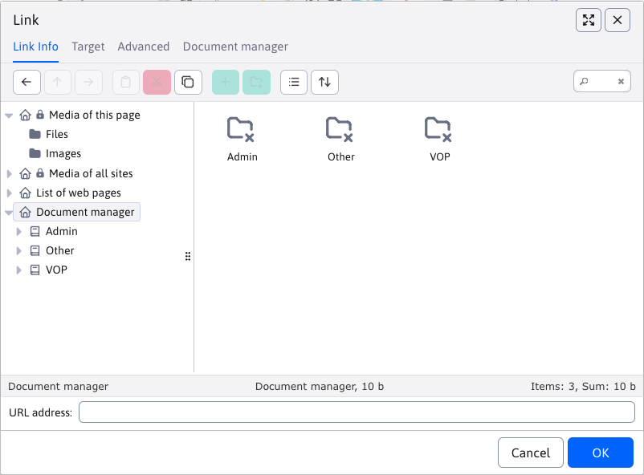

- if the document is **intended only for the current web page**, it is necessary to select the item “Media of this page” and then the item “Files”.
  - You search for a document, click on it, and the link to the document is automatically copied into the URL field.
  - If the required document is not in the list, you can use the ```drag&drop``` function to upload a document from your computer.
  - Confirm OK, which will create a link to the file at the marked location.

- if the document **is not intended only for a given page** (the document may also be located on another page), it is necessary to select the **Media of all pages** item and then the **Files** item.
  - You will be shown the directory structure of directories and files on the server to which you are allowed access.
  - Search for the desired file in the directories, click on it and the link to the document will be automatically copied to the URL field
  - Confirm OK, which will create a link to the file at the marked location.

According to the website accessibility guideline, all downloadable text files found on websites should be published primarily in the ```PDF``` format. The formats used by the ```Word``` and ```Excel``` (```DOC``` and ```XLS```) application are not compliant.

If you have permission, you can also create new sub-directories in the given file directory by clicking on the  icon.
File names on the server should not contain spaces, special characters, or accented letters.

## Inserting and editing links to other websites

You insert links to other pages in a similar way to a link to a document/file:

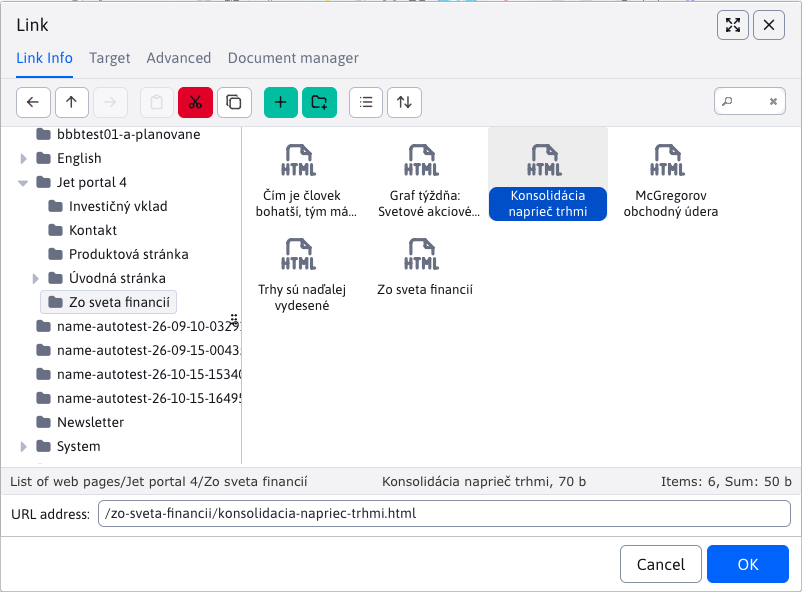

- Select the text (word) that should be clickable as a link. Then click on the Link icon  or use the shortcut ```CTRL+ k```. A dialog box will open in which you need to select the **Web pages** item and in the tree structure find the page you want to create a link to. After clicking on the page name, the address of the selected page will be copied to the URL address field. By confirming ```OK```, a link to the selected web page will be created on the page.

- If you want to insert a link to a page located on another website (link to an external website), enter its address directly into the URL address field (also with the prefix ```https://```). At the same time, the **Target** field (in the Target tab) will automatically change to **New window (```_blank```)**, which will ensure that when you click on this link, the page will open in a new browser window/tab. The **Target** field is also set to **New window (```_blank```)** if you want to create a link to a downloadable document. If you do not want the link to open in a new window, the **Target** parameter should be set to **Same window ```_self```**. However, for links to external websites and documents, opening the link in a new window is recommended.

## Buttons

If a web page contains a link or button that has a CSS style set to contain the expression `btn` (settable via the configuration variable `ckeditor_button_baseClass`), clicking on such a link will display a button settings window in the editor. In it, you can easily change the button text and set the link after clicking, the button style, and so on.

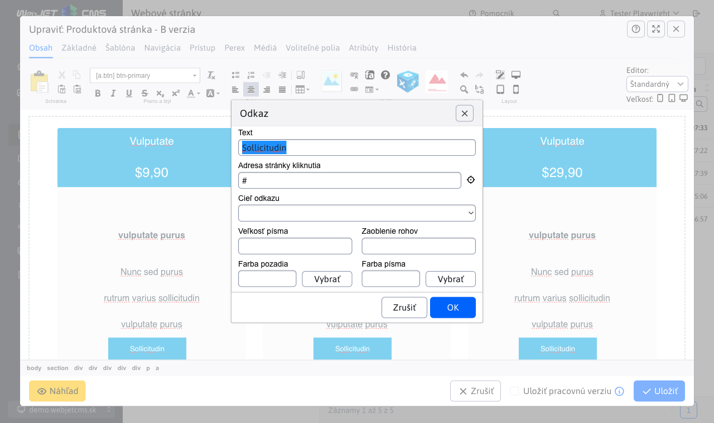

In the advanced tab, you can set additional attributes such as element ID, title, description for readers (aria-label), and the like.

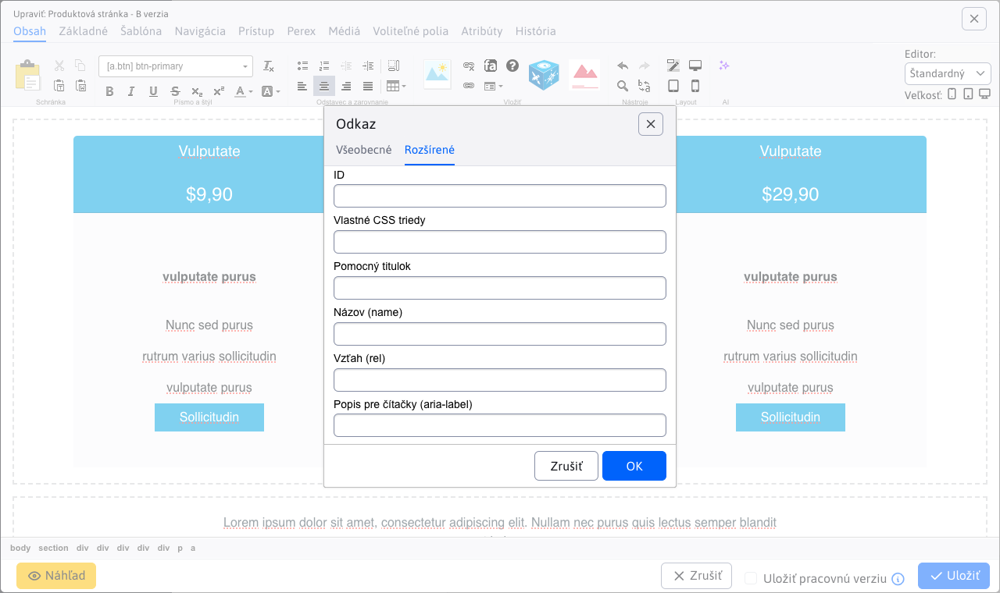

Similarly, there is a dialog box for buttons (element `button`) also with SVG icon support. You insert it by clicking on the menu selection menu for inserting a form and then the Button option. More information is in the [web designer section](../../../frontend/setup/ckeditor.md#button).


## Inserting images

To insert an image into a page, place the cursor on the row or table cell where the image should be located and click the image insertion icon .

If you want to change an existing image, you must first click once on the image you wish to change. Then you must click on the same icon to insert/change image or via the context menu on the item **Image properties**. The further procedure is identical in both cases.

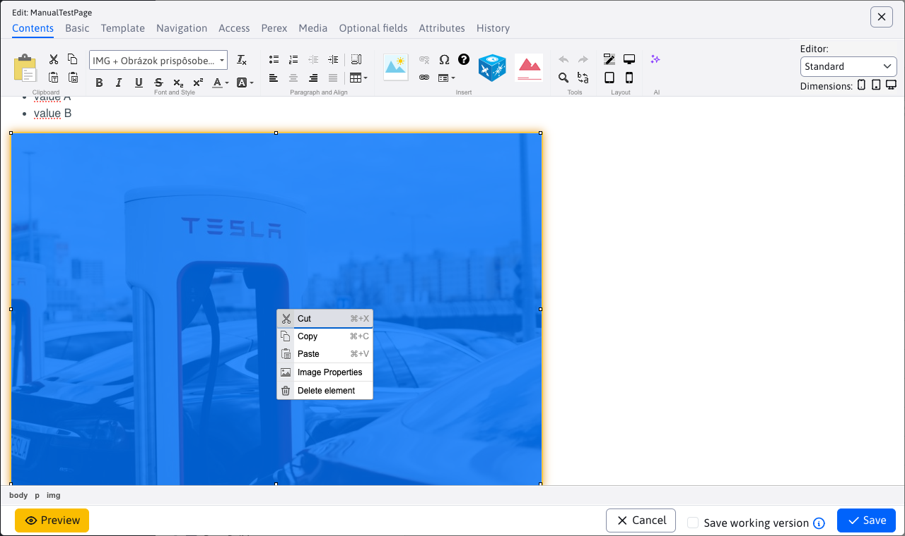

After clicking on the icon, a dialog box for inserting an image will appear:


When navigating through the tree structure, only image or video files are displayed, other files are filtered.

### Contents tab

If the image file is already on the server, you can browse to it in the directory structure and clicking on it will automatically enter the image location in the URL field.

For images, it is also necessary to define Alternative text for the image, which is mainly used for communication with visually impaired and blind website visitors, or when the user has disabled the display of images on websites. Alternative text should describe what the image is about or what is shown in it.

After selecting an image, the width and height fields are automatically filled in, defining the current size of the selected image.

### Photobank card

The **Photo Bank** tab allows you to obtain (download) images from the free online platform [Pixabay](https://pixabay.com). This platform provides a large collection of images that are [free to use](https://pixabay.com/service/license-summary/).

After entering and searching for a term, you will be offered matching images. The menu contains several pages that you can browse between.

When searching in the photo bank, you also have filters available:

- **Media Type** allows you to select the search mode:
  - images: `all`, `photo`, `illustration`, `vector`
  - videos: `all`, `film`, `animation`
- **Category** filters results by topic area (e.g. `nature`, `business`, `travel`, ...).

If you select video in the **Media type** field, the search will automatically switch to searching for video files.

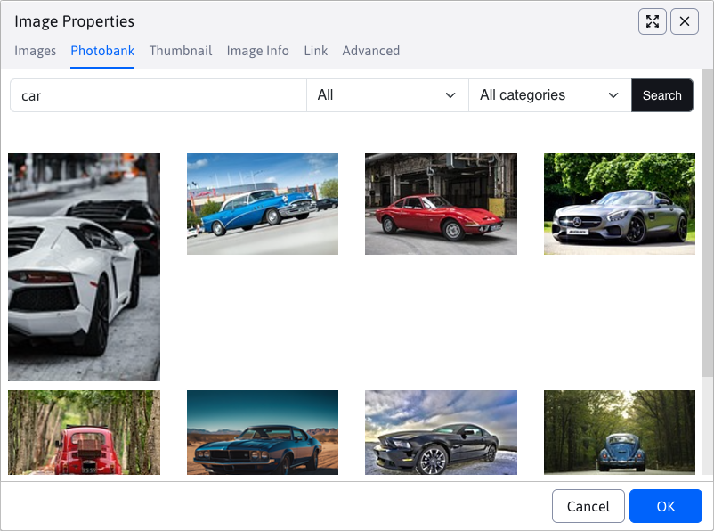

After clicking on one of the offered images, a dialog will appear with a preview, a **File name** field, and the **width** / **height** values ​​of the given image.

When a video is selected, the preview and file name are displayed the same, but the dimensions (**width** / **height**) are not entered in the save dialog.

The **File name** field is automatically pre-filled with the last search term, but you can edit it before saving. WebJET automatically converts the name to lowercase, removes accents, and replaces disallowed characters and spaces with dashes. Do not enter a file extension; WebJET will detect it from the source image and display its type with an icon to the right of the name.

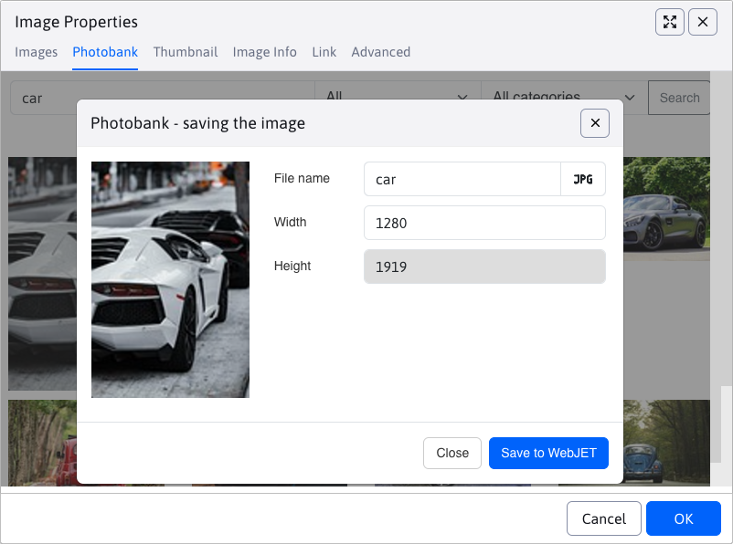

If you wish to change the dimensions of the image, you can adjust the **width** value and its **height** will be automatically calculated based on the original aspect ratio of the image.

The image dimensions are not added to the file name. If you do not enter a name or a file with the same name already exists in the selected folder, a warning is displayed and the image is not saved. The existing file is not overwritten.

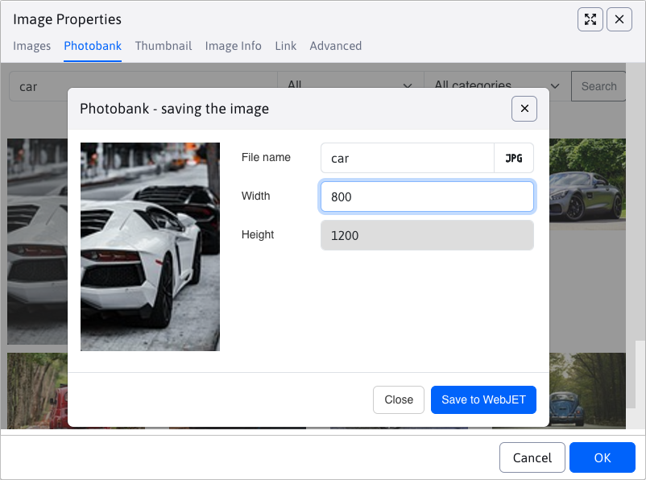

Then, after clicking the **Save to WebJET** button, the image will be downloaded and saved under the selected name. The tab will automatically switch to **Content**, where you will have the image immediately available.

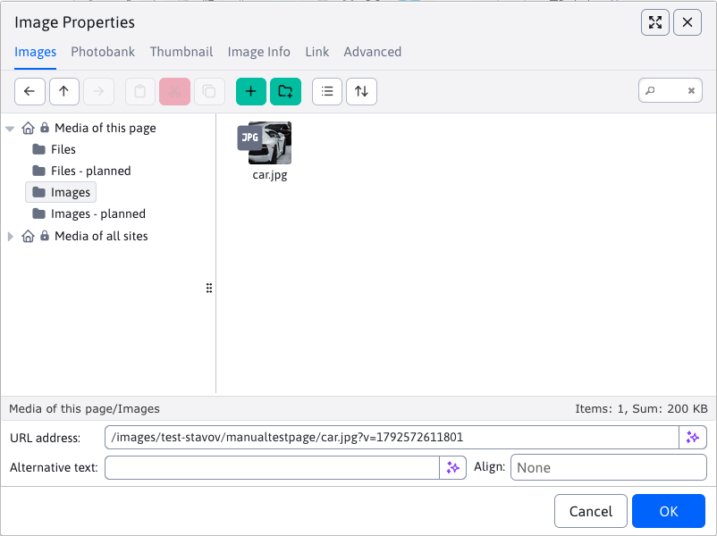

**Image source URL**

Saved images from **Photo Bank** have the value **Image source URL** automatically filled in. You can view/edit this value in the [Explorer](../../files/fbrowser/README.md) section under the [Edit files](../../files/fbrowser/file-edit/README.md) action.

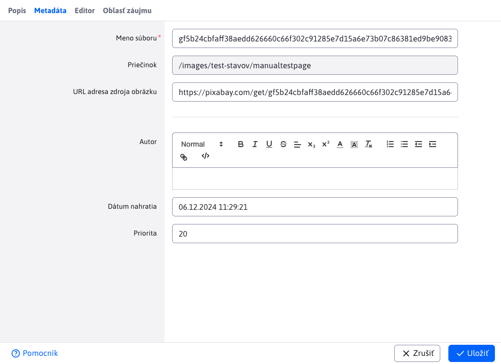

### Thumbnail tab

The **Thumbnail** tab allows you to set the parameters for automatically generating thumbnail images `thumbnail` directly from the image insertion dialog box.

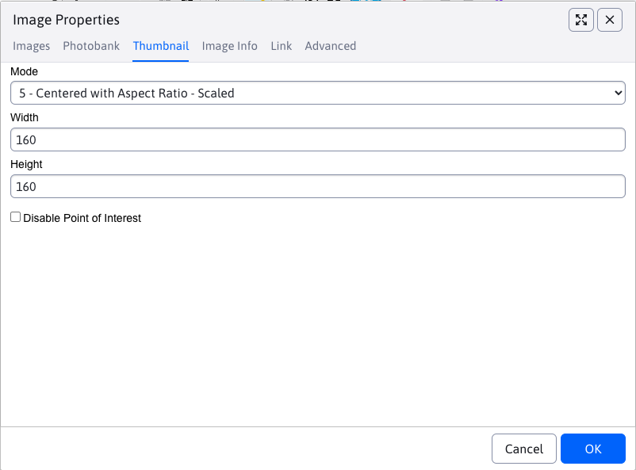

**Point of Interest (POI) Mode**

By selecting [point of interest mode](../../../frontend/thumb-servlet/interest-point.md) you determine which part of the image will be preserved when cropping:

| Mode | Description |
| ------- | ------- |
| `1` | Preserves only the width (height adjusts automatically) |
| `2` | Preserves height only (width adjusts automatically) |
| `3` | Preserves width and height + adds background color |
| `4` | Preserves width and height + adds background color |
| `5` | Preserves both width and height without adding background |
| `6` | Preserves the entire point of interest by expanding the viewport to the desired aspect ratio |

**Dynamic display of fields**

The fields on the Thumbnail tab are dynamically shown/hidden based on the selected POI mode:

- `1` and `2` modes: Only one dimensional field (width or height) is displayed.
- `3` and `4` modes: Both dimensional fields + a field for the background color are displayed. Enter the color in the format `#rrggbb`
- `5` and `6` modes: Both dimensional fields are displayed without a color field.
- The **Disable POI** field is displayed for all modes except the empty value and the `0` mode. This sets whether the set POI is also applied during generation, or the entire image is used.

**Selecting the allowed size**

If [allowed dimensions](../../../frontend/thumb-servlet/README.md#restrictions) are set, the tab will offer their selection with the mode name and the number `ip`, for example **96 px – Fixed height (ip2)**. The **Do not use thumbnail** option will use the original image.

In `strict` mode, only a permitted combination can be selected. An existing disallowed dimension must be replaced with a permitted one or the original image must be used. `learn`, `check` and `allow` modes also offer **Enter custom dimension…**, which displays the fields described above; if the list is empty, these fields are displayed directly. In `deny` mode, the tab is hidden.

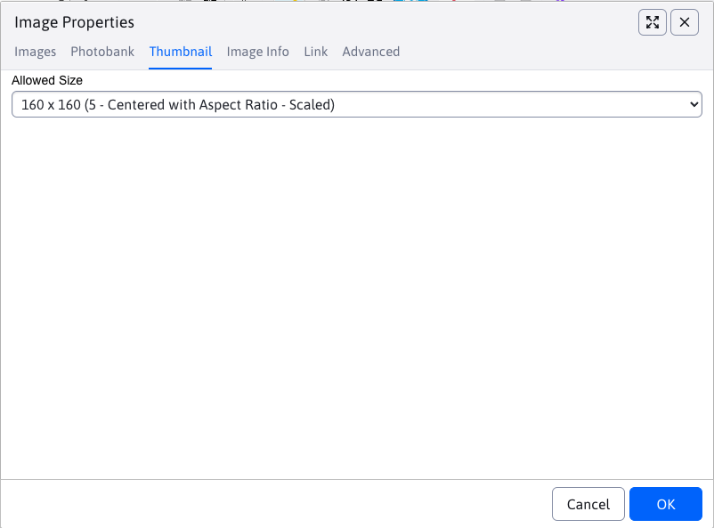

### Video files

You can also insert video files through the image insertion dialog box. Either directly from your server by selecting a video file, or by entering a link to the website `YouTube/Facebook/TikTok` in the URL address field.

WebJET automatically inserts a video player instead of an image for a video file.

### Image editing

If the image is too large to fit on the page, or you need to make other changes to the image, you can use the image editor. Click on the image and then on the pencil icon to open the [image editor](../../image-editor/README.md).

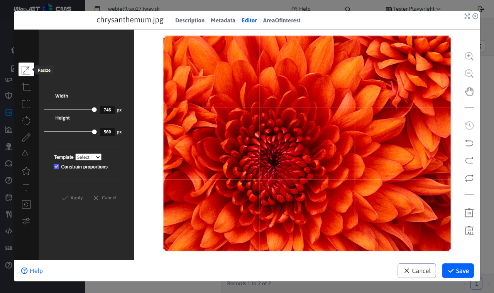

## Inserting and editing tables

There are two ways to create a table. Use a predefined styled table, or insert a table by copying it from a ```Word``` / ```Excel``` file.

### Creating a color table

You can create a table by clicking on the **Insert Table** icon, :

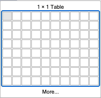

If you need to create a more complex table, you need to click **More** where you will see a dialog box for setting up the table:

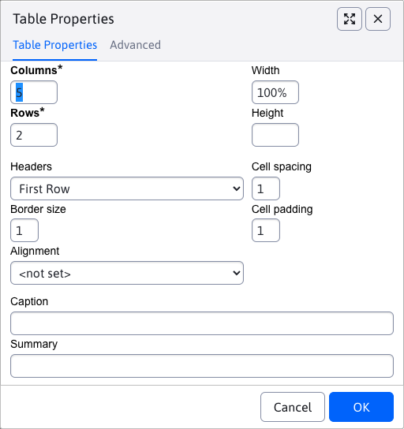

Here you can set the number of columns and rows. If you want the table to fit the width of the content, you do not need to enter the width (delete the pre-filled value). The other parameters should be left with a zero value so that they do not conflict with the preset table style. Confirming ```OK``` will insert the table at the original cursor position.

### Inserting a table from ```Word``` and ```Excel``` file

When inserting a table from other applications or documents via the keyboard shortcut ```CTRL + v```, the system automatically asks you if you want to clean the table. If you click ```OK```, the editor will clean the table from unwanted formatting characters from the original document, but will leave the table structure in its original form.

The table will remain in the page content even if you use the text insertion tool from the ```Word``` / ```Excel``` file .

### Editing an existing table

If you need to modify an existing table that is on the page, or that you have just inserted there using one of the methods mentioned above, you have several tools available to edit it. Right-clicking on any of the table cells will display a context menu.

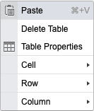

To delete or add another line, use the **Line** submenu.

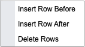

To insert or delete a column, use the **Column** submenu.

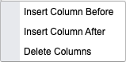

If you want to merge two adjacent cells (within a row), you must select their contents (if they do not contain any text, first enter any text into the cell to make the cell more clearly marked), right-click on this selected content and select the **Cell** submenu item and in this submenu the **Merge cells** item.

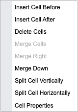

The cell contents are then merged into one and you can edit it further.

If you want to remove the original table border, change the cell indentation, or make the table colored, click **Table Properties**. A dialog box will appear where you can change various table parameters except the number of rows and columns in the table (these are adjusted as mentioned on the previous page).


If you want the table to fit the content, you don't need to enter the table width (delete the value). If you want the table to fill the entire width of the page, you can enter a value of 100 percent. Do not enter the height.

If you want to change the alignment of the text in a table cell to center or right, right-click in the cell and select the **Cell** submenu, and in this submenu, the **Cell Properties** item.

The Cell Properties dialog box will appear, where you can set the vertical or horizontal alignment of the text in the cell. Do not change the other parameters in the window.

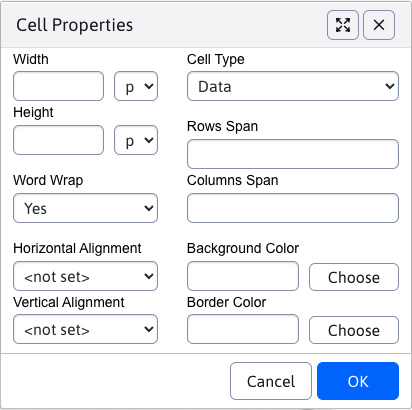

## Embedding an application

To insert an application, click on the blue cube application icon . A dialog box with a list of applications will appear:

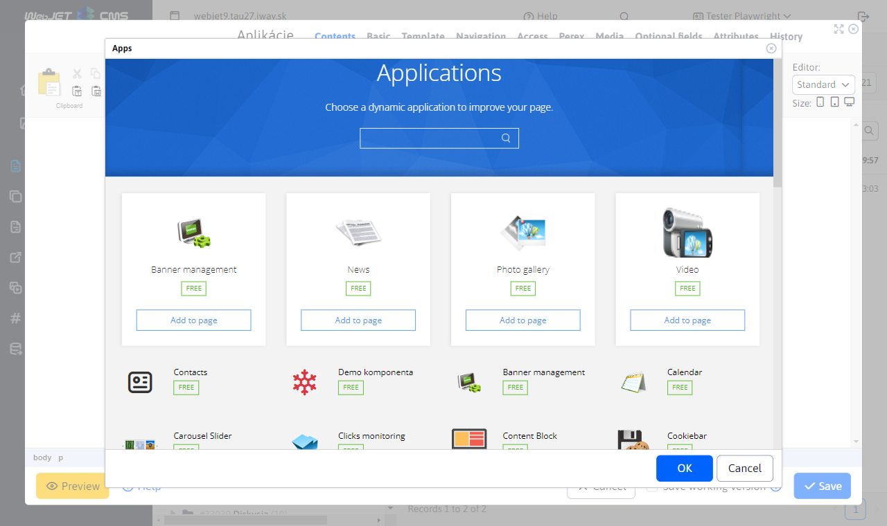

You can enter the name of the application in the search:

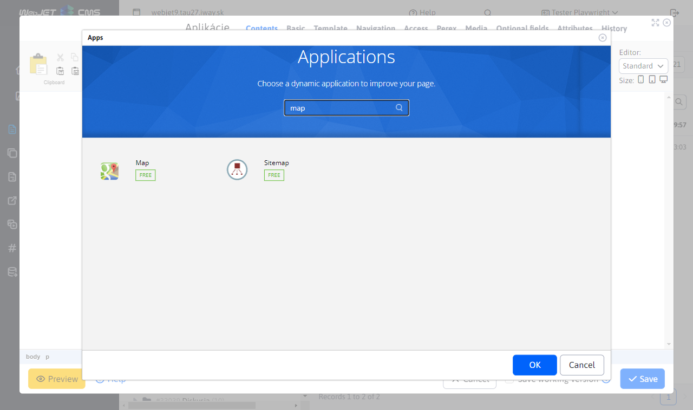

After clicking on the application name, details about the application will be displayed - its description, photos and the option to embed the application into the page:

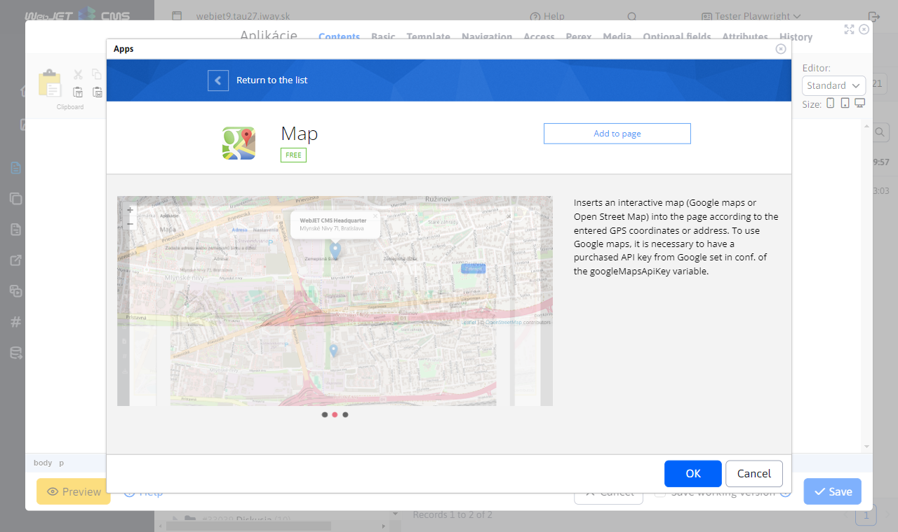

When you click the "Insert into Page" button, the application is inserted into the page and the application settings are displayed:

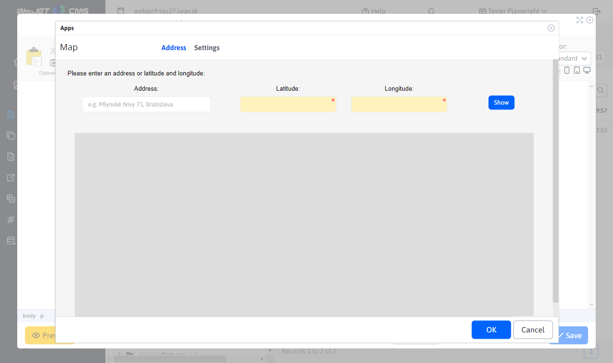

If the application is already embedded in the page, clicking inside the application will display the same application settings window. You can easily edit its existing settings.

### Display tab

Most applications include a Display tab for common settings (unless this option is disabled in the application for various reasons).

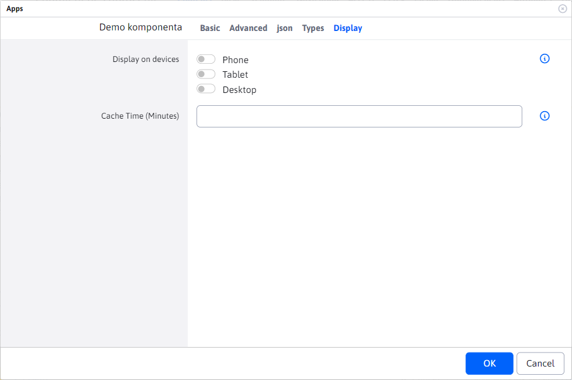

The card contains the following parameters:

- Display on devices, used to set [conditional display of the application](../../../custom-apps/appstore/README.md#conditional-display-of-application) on devices such as tablet, phone or standard computer. If no option is selected, the application will be displayed on all devices (the same as when all options are selected).
- Logged in user - allows you to set the application display according to the login status of the website visitor - display always, only if the user is logged in, or if they are not logged in. In the page editor, the application is always displayed, but in the preview or page view it is displayed according to the set value.
- Cache time (minutes) - is used to set the time in minutes for which the initialized application should be stored in the cache for faster display. For example, the news list does not change often and loading it is demanding on the database server, so it is advisable to set the value, for example, to 30. If the administrator is logged in, the cache will not be used and the current data will always be displayed.

**Style** - the section contains settings for wrapping the application output into a `div` container. You can set, for example, the application's indentation on the page, width or various display styles, as well as information for a reader for visually impaired visitors:

- CSS class - selection of CSS classes from a predefined list (e.g. `container`, `mt-2`, `w-100`). The list of available classes is configurable via the configuration variable `appWrapperClasses` (comma-separated list). The configuration variable supports two writing formats:
  - simple format - just the CSS class name, e.g. `container,mt-2,w-100` - ​​the class name is displayed directly in the editor.
  - format with translation key - `prekladový_kľúč:css_trieda`, e.g. `apps.wrapper.container:container` - the editor displays the translated text according to the administration language (e.g. "Container"), but only the CSS class value is inserted into the HTML. The translation key is searched for in the translated texts.
  - both formats can be combined in one list, e.g. `apps.wrapper.container:container,mt-2,apps.wrapper.w-75:w-75`.
- ID - setting the HTML `id` attribute for the wrapping `div` element.
- Title - setting the HTML `title` attribute for the wrapping `div` element.
- `Aria Label` - ​​setting the `aria-label` attribute for the wrapper `div` element, which serves to improve accessibility for screen readers.

If any of these values ​​are set, the application output is automatically wrapped in a `div` element with the specified attributes. The application preview in the editor displays information about the set attributes.

## Pre-prepared blocks

The page editor offers the ability to insert predefined blocks (```HTML``` objects) into a page. For example, a table, text, contact form, etc. You can also insert content from another page into the current page (e.g. a repeating form).

To view blocks, click the  icon in the page editor, which will display a dialog box with block categories.

More information in the application description [pre-made blocks](../../apps/htmlbox/README.md).

## Inserting special characters

There may be cases when you need to type characters that the Slovak keyboard does not contain, for example, the Dollar sign (```There may be cases when you need to type characters that the Slovak keyboard does not contain, for example, the Dollar sign (``), Euro (```€```) or at sign (```@```). To make your work easier, you can insert special characters using a ready-made module. By clicking on the 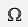 icon, a dialog box with a menu of special (and standard) characters will appear.

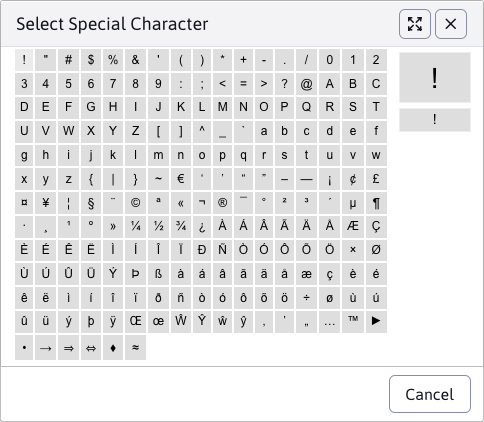

After clicking on the desired character, that character will be written at the cursor position. Special characters are inserted as text, so they have no additional settings.

!> Warning: the icon for inserting special characters may in some cases be changed to the  icon for inserting [FontAwesome](../../../frontend/webpages/fontawesome/README.md) images.

## Inserting text in hard-to-reach places

Sometimes it is difficult to place the cursor, for example, after the last paragraph or image. In such a situation, the editor displays a so-called help line. This allows you to insert empty text, an image, an application or a block. In the case of Page Builder, after clicking, it allows you to insert a prepared block into the page.


Similarly, sometimes it is a problem to insert the cursor after the last SVG icon, bold text, etc. In such a case, the editor displays an icon behind the element to move the cursor to the given location. Sometimes the move may not succeed on the first click, we recommend that you first click anywhere in the text and then click the icon to move the cursor.


## Page content change detection

The page editor includes a mechanism that detects changes to page content. If you click the Cancel button to close the window while changes have been made to the page content, you will see a dialog box warning you that the changes have not been saved. Click OK to close the window without saving your changes, or click Cancel to return to the page editor.

After opening a page in the editor, the current page content is retrieved after 5 seconds (to allow time for all scripts and application previews to load) and this is then compared to the current content when the Cancel button is clicked. This means that correct detection works after 5 seconds from opening the page in the editor.
