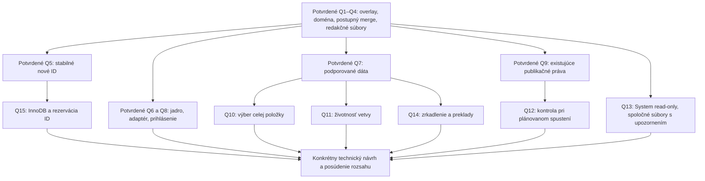

# Rozhodnutia návrhu

Tento dokument je jediný register produktových rozhodnutí pre návrh. Technické dokumenty naň nadväzujú; návrhové odporúčanie sa nestáva potvrdeným rozhodnutím len tým, že je popísané podrobne.

## Potvrdené používateľom

| ID | Rozhodnutie | Dôsledok |
| --- | --- | --- |
| Q1 | Pracovná vrstva nad aktuálnou produkciou. | Nekopírujeme celý web. Základ položky vzniká pri jej prvej zmene vo vetve, nie pri vytvorení vetvy. |
| Q2 | Jedna doména na vetvu. | Obsah na ďalšej doméne patrí do inej vetvy. |
| Q3 | Postupný merge. | Nie je potrebná globálna transakcia DB + filesystem ani atómové prepnutie celého webu. |
| Q4 | Iba redakčné súbory. | Úpravy zdrojov aplikácií, šablón, CSS/JS a konfigurácie sú mimo rozsahu. |
| Q5 | Stabilné ID aj pre nové stránky a priečinky. | ID sa pridelí pred prvým použitím v odkazoch; merge ho nemení. Presný spôsob rezervácie musí rešpektovať existujúce databázové generátory. |
| Q6 | Garantované jadro a integračné API pre zákaznícke aplikácie. | Priame zákaznícke SQL/JPA bez adaptácie číta produkciu; nemožno mu deklarovať plný náhľad vetvy. |
| Q7 | Obmedzené vedľajšie údaje. | Atribúty stránok, multigroup väzby, definície kategórií, galéria, `file_atr` a `dirprop` sa vo vetve neupravujú. Priradenie média k existujúcim kategóriám je súčasťou snapshotu média; definície kategórií sa nemenia. Tak sa zachová dnešná kategorizácia aj pri vytváraní/úprave samotného média. |
| Q8 | Náhľad pre prihlásených používateľov administrácie. | Zdieľateľné anonymné odkazy sa nenavrhujú do prvej verzie. |
| Q9 | Merge iba s existujúcimi právami priameho publikovania celej zmeny. | Rola koordinátora neobíde schvaľovanie ani oprávnenia. Nový viacstupňový proces sa nepridáva. |
| Q10 | Používateľ delegoval výber jednoduchšej implementácie. Zvolené rozhodovanie za celú položku. | Trojcestné porovnanie podporovaných údajov; pri súbežnej odlišnej zmene výber produkcia/vetva. Polia slúžia na zobrazenie diffu, nie automatické skladanie. Vlastná kombinácia vznikne bežnou úpravou vo vetve. |
| Q11 | Jednorazové nezávislé vetvy. | Viac vetiev z produkcie; úspešný úplný merge vetvu uzavrie. Vetvy z vetiev a merge medzi vetvami sa nepridávajú. |
| Q12 | Nový problém pri plánovanom spustení zastaví balík. | Znovu overiť konflikty, práva a samostatné plány; nevynucovať staré rozhodnutie nad novými dátami. |
| Q13 | Používateľ delegoval jednoduchší model spoločných prvkov. | Spoločné System stránky ostávajú read-only. Súbory používajú existujúce mapovanie úložísk a adresárové práva; fyzicky spoločné súbory možno meniť s upozornením na dosah na ďalšie domény. Nevzniká nový systém vlastníctva súborov ani vyhľadávanie všetkých použití. |
| Q14 | Bez skrytého zrkadlenia a prekladov. | Publikovať iba explicitne zobrazené položky; zmeny jazykových stránok pripraví tím. |
| Q15 | Funkcia môže vyžadovať InnoDB. | Žiadna podpora MyISAM v tejto funkcii a žiadna automatická konverzia zákazníckych tabuliek. |
| Q16 | Preklikateľný náhľad zohľadní zvolený výsledok konfliktu. | Voľba produkcie sa prejaví aj v stránke, strome, Novinkách, médiách a súboroch. Pracovný editor uchová WORK; náhľad a editor majú odlišný účel. Nevyriešené konflikty sú v náhľade označené, nejde o potvrdený výsledok publikovania. |
| Q17 | V súboroch vytvoriť adresár a upravovať jednotlivé súbory. | Prázdny adresár má položku v existujúcej pracovnej súborovej tabuľke. Presun, premenovanie, mazanie a rekurzívne kopírovanie súborových adresárov sa zatiaľ nepodporujú. Toto obmedzenie sa netýka stromu webových stránok. |
| Q18 | Galerijné adresáre sú do rozšírenia galérie iba na čítanie. | Ani obyčajný upload alebo správca súborov nesmie meniť albumové súbory a ich varianty. Bežné obrázky a prílohy mimo galérie sa upravovať môžu. |
| Q19 | Náhľad sa otvára na hostiteľovi administrácie. | Používa jeho prihlásenie; logická doména obsahu pochádza z overenej vetvy a je viditeľná v lište. Nevytvára sa prenos prihlásenia na verejnú doménu. |

## Doplnenie požiadavky 2. novembra 2026

**N1 — NewsApp/NewsActionBean je povinná súčasť náhľadu.** Používateľ výslovne požaduje zobrazenie upravených a nových stránok v existujúcom výpise noviniek podľa jeho kritérií. Návrh preto zachová aplikáciu a jej šablóny, ale zapojí účinný zdroj pred filtrovaním, radením, počtom a stránkovaním. Podrobnosti a hranice sú v [03a — Novinky](03a-novinky.md).

Technický dôsledok N1: povoliť priradenie stránky k existujúcim perex skupinám cez pracovné `perex_group`, inak by nová novinka nemohla vyhovieť bežnému kategorizačnému filtru. `perex_group_doc` sa obnoví ako odvodený index až pri merge konkrétnej stránky. Nepribúda pracovná tabuľka, editácia definícií kategórií ani atribútov. Toto spresňuje pôvodné obmedzenie vedľajších údajov Q7; nie je to nové kolo otázok ani povolenie implementácie.

## Zostávajúci krok diskusie

**N2 — Rozšíriteľnosť ďalších modulov.** Používateľ požaduje posúdiť budúce zapojenie galérie, bannerov a alternatívu k pracovnej tabuľke pre každý modul. Následne výslovne zúžil prvý príklad bannera na nový banner a úpravu názvu, popisu a obrázka; zapisovanie štatistík netreba riešiť. [Dokument 08](08-rozsirovanie-modulov.md) odporúča typované jadro a jednu spoločnú JSON tabuľku budúcich modulov, s malým integračným kontraktom pripraveným už teraz. Architektonická voľba je odporúčaním autora na posúdenie, nie dodatočnou potvrdenou odpoveďou používateľa. Rozsah P01–P08 sa nerozširuje o samotné moduly.

Produktové otázky Q1–Q19 sú uzatvorené. Q16–Q19 vyplynuli z kontroly pripravenosti 2. novembra 2026 a používateľ potvrdil uvedené odporúčania. Pri Q10 a Q13 výslovne prenechal technický výber autorovi; uvedené riešenia preto nevyžadujú ďalšie kolo tej istej otázky. Zostáva predložiť kompletný návrh na záverečné posúdenie spoločného porozumenia. To nie je povolenie implementácie.

## Pomenovanie tabuliek a Java tried, 3. november 2026

**N3 — Krátky prefix a presný názov originálu.** Používateľ požaduje prefix `branch_` a zachovanie názvu pôvodnej tabuľky vrátane množného čísla. Záväzné mapovanie a názvy pomocných tabuliek sú v [dátovom modeli](02-datovy-model.md#odporúčanie); platia aj pre SQL príklady a implementačné zadania. Navrhované Java triedy a rozhrania používajú krátky prefix `Branch` a jadrový balík `sk.iway.iwcm.branch` podľa [Java návrhu](03-nahlad-a-java.md#1-rozdelenie-zodpovednosti), vrátane ukážok kódu a testovacích príkazov. Krátke pomenovanie platí aj pre kontextové polia, konfiguračný prepínač, REST endpointy a adresáre úložiska/testov.

## Menu webu, 3. november 2026

**N4 — menu_ul_li.jsp/MenuULLI je povinná súčasť vetvy.** Používateľ výslovne požaduje, aby menu zobrazovalo zmenené aj pridané stránky a priečinky a fungovalo pri preklikávaní pracovného webu. [03b — Menu](03b-menu.md) určuje úpravy existujúcej triedy/JSP, pomocných čítaní, cache a povinné overenie. Ide o spresnenie už dohodnutej navigácie Q6; nevzniká nový renderer, pracovná tabuľka ani samostatná etapa.

## Strom návrhu

## Overenia, ktoré má vykonať autor návrhu

Toto nie sú otázky na používateľa. Treba ich vyriešiť zdrojovým kódom, dokumentáciou DB a neskôr cieleným integračným overením:

- Rezervácia ID bez potvrdených produkčných zástupných riadkov a bez kolízie s bežnými insertmi.
- Čítanie nepotvrdených databázových zápisov v existujúcich cestách a jeho vplyv na rezerváciu ID.
- Efektívny SQL zdroj dokumentov pred filtrovaním a stránkovaním noviniek a administrácie.
- Presný vstup náhľadu pred routovaním, oddelenie cache a prenos kontextu na súbory/thumbnail.
- Uloženie vetvy bez produkčných udalostí, synchronizácií a indexovania.
- Rozdelenie dnešných save metód na opätovne použiteľné kontroly/normalizáciu a konkrétny zápis.

## Pravidlo uzatvorenia návrhu

Po uzatvorení otvorených otázok sa predloží technický návrh so zásahmi do kódu, etapami a odhadom. Potvrdenie spoločného porozumenia ukončí rozhovor podľa zručnosti `grilling`. Samo osebe nespúšťa implementáciu: aktuálne zadanie výslovne povoľuje iba návrhy. Neskorší výslovný pokyn na realizáciu príslušnej etapy je dostatočný; agent potom nemá žiadať opakovane súhlas s už zadaným krokom.
