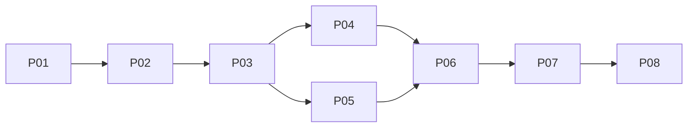

# Postupná realizácia

Toto je plán budúcej implementácie. V aktuálnej fáze sa nevykonal žiadny krok P01–P08. [Orchestračný dokument](ORCHESTRACIA.md) určuje, ako kroky zadávať agentom a ako evidovať dokončenie. Produktový rozsah je uzatvorený v [rozhodnutiach](01-rozhodnutia.md); záverečné posúdenie technického návrhu ostáva na používateľovi.

## Poradie a veľkosť

| Krok | Výsledok | Závisí od | Orientačná práca vývojára |
| --- | --- | --- | --- |
| P01 | Dôkaz priechodnosti ID, náhľadu a účinného SQL zdroja | Návrh | 4–7 dní |
| P02 | Schéma, kontext, stabilné ID a mapovanie podporovaných údajov | P01 | 8–13 dní |
| P03 | Celý podporovaný náhľad a čítacie adaptéry | P02 | 7–12 dní |
| P04 | Izolovaná editácia stránok a priečinkov | P03 | 8–14 dní |
| P05 | Izolované médiá a redakčné súbory | P03, zmluvy P04 | 8–14 dní |
| P06 | Porovnanie, vyriešenie konfliktov a manuálny merge | P04, P05 | 8–14 dní |
| P07 | Naplánovanie balíka a dokončenie používateľského toku | P06 | 6–10 dní |
| P08 | Integračné overenie, dokumentácia a pilotné zapnutie | P07 | 8–12 dní |
| **Spolu** | **Celý dohodnutý výsledok** | | **57–96 vývojárskych dní** |

Ide o návrhový odhad pre vývojárov, ktorí poznajú WebJET, s pripravenými DB/testovacími profilmi. Nie je to záväzný termín ani počet dní agentického behu. Pri dvoch vývojároch a priebežnej podpore QA je rozumné uvažovať približne **10–16 kalendárnych týždňov**; kroky nie sú plne paralelné. Samostatne počítať s približne 15–25 QA dňami podľa existujúcich testovacích prostredí. P01 má spresniť odhad pred väčšou investíciou.

Odhad nezahŕňa zákaznícke SQL/JS adaptéry, prestavbu šablón mimo podporovaného jadra, konverziu veľkých MyISAM databáz, nové schvaľovacie workflow, anonymný náhľad ani podporu DB storage súborov. Pôvodných 7–10 týždňov z konkurenčného prieskumu sa týkalo užšieho release koordinátora; nie je to odhad tejto kompletnej pracovnej vetvy.

Najväčšia neistota je v izolovaní existujúcich save vedľajších účinkov a v pokrytí celého náhľadu. Päť tabuliek samo osebe nie je dominantnou časťou práce. Rezervácia ID vrátane DB profilov tvorí významnú časť P01/P02; nemožno ju označiť za hotovú iba podľa správania jednej lokálnej MariaDB.

Požiadavka N1 na `NewsApp`/`NewsActionBean` je povinnou súčasťou týchto etáp podľa [03a — Novinky](03a-novinky.md). Odhad už základné Novinky zahŕňal; P01 ho spresní o konkrétne SQL/atribútové prípady a podporované DB. Pribúda perex kategorizácia existujúcimi skupinami, bez šiestej pracovnej tabuľky a bez ďalšej etapy. Novinky sa nesmú odsunúť medzi zákaznícke adaptéry.

Požiadavka N2 pridáva návrh [rozširovania modulov](08-rozsirovanie-modulov.md). V týchto etapách sa pripraví iba spoločná identita/obal položiek a register obslužných typov; banner, galéria ani ich spoločná JSON tabuľka sa ešte neimplementujú. P01 uvedie vplyv tohto rozdelenia služieb na pôvodný odhad osobitne. Budúce E01–E03 majú samostatné orientačné náklady v dokumente 08 a vyžadujú vlastné zadanie.

P04 a P05 sa môžu realizovať paralelne po dohodnutí mapovania dokumentov, uloženia nových ID a kontextu. V spoločných triedach pracuje vždy jeden vlastník; druhý agent môže paralelne písať izolované služby, UI alebo testovať výsledok. Pri menšom tíme stačí celé poradie vykonať sekvenčne.

## P01 — Technické overenie pred rozšírením jadra

**Vstupy:** dátový model, identifikátory, náhľad, `03a-novinky.md`, tri zdrojové analýzy. **Účel:** overiť najdrahšie predpoklady, nie začať kompletnú implementáciu potajme.

Práca:

1. Na jednorazovej testovacej DB overiť rezerváciu stránkového/priečinkového ID a explicitný insert pre všetky deklarované DB profily podľa `02a`. Nezasahovať do produkčných dát.
2. Overiť, že krátky technický insert nevie žiadna podporovaná core čítacia cesta uvidieť pri zapnutom READ_COMMITTED režime. Zaznamenať chýbajúce externé DB profily ako neoverené, nie ako úspešné.
3. Na reprezentatívnej podporovanej šablóne vyskúšať gateway, jednu prepísanú stránku, zmenené menu/URL, obrázok a thumbnail. Overiť aj root-relative CSS/JS požiadavky.
4. Overiť SQL zloženie produkcie a pracovných dokumentov pred filtrovaním/count/paging pre `NewsQuery`; stačia testovacie riadky, netreba hotový editor. Povinne nové/zmenené/zmazané novinky, pracovná perex skupina, oba režimy `perexGroupUseJoin` a atribútové násobenie riadkov. Doložiť jedinečné ID, bind parametre a CLOB projekciu podľa N01/N02/N06 z `03a`.
5. Posúdiť navrhovaný spoločný obal/handler z dokumentu 08 proti dnešným štyrom typom jadra. Overiť, že nevyžaduje dvojité pracovné ukladanie ani prepis `NewsQuery` na JSON; generický storage a budúce moduly zatiaľ nevytvárať.
6. Na testovacom podstrome overiť obnovu z koša cez minimálne pre-delete histórie podľa `04`, aj pri vypnutej bežnej histórii. Tým sa uzavrie formát obnovovacích údajov, nejde ešte o implementáciu celého publishera.
7. Zapísať výsledky, podmienky prostredia, potrebné template adaptéry a upravený odhad do dokumentu výsledkov kroku v tomto adresári.

**Hranica:** skúšobný kód/fixture na testovanie predpokladov; žiadne všeobecné prepisovanie DocDB, žiadna produkčná migrácia. Použiteľný skúšobný kód možno v ďalších krokoch upratať do výslednej implementácie, nie držať dve konkurenčné implementácie.

**Dokončené, keď:** je doložená rezervačná časť T01 pre stránky/priečinky vrátane súbežného produkčného insertu a reštartu, prvá časť T03/T07/T10 a výsledky každého deklarovaného DB profilu. Celé T01 vrátane média a výsledného merge dokončia P02/P06; P01 ich nesmie vykázať ako vykonané. Chýbajúci kritický profil znamená `PARTIAL`, nie DONE. Ak sa ukáže zásadný rozpor so stabilnými ID alebo použiteľným náhľadom, autor upraví návrh a vysvetlí konkrétny kompromis. Automaticky nepostupuje k veľkému refaktoringu na základe neovereného predpokladu.

## P02 — Úložisko, ID a základ kontextu

**Vstupy:** výsledok P01, `02-datovy-model.md`, `02a-identifikatory.md`, kontext z `03-nahlad-a-java.md`, aktuálna príprava rozšírení z `08-rozsirovanie-modulov.md`.

Práca:

1. Pridať päť tabuliek cez existujúce SQL XML migrácie pre podporované DB, entity/repositories/mappery a potrebnú registráciu Spring/JPA balíka.
2. Zaviesť explicitnú klasifikáciu obsahových polí: podporované, odvodené, prevádzkové, mimo rozsahu. Kanonické snapshoty a hashe nesmú závisieť od poradia JSON properties, transient polí a runtime počítadiel.
3. Implementovať natívnu rezerváciu nových ID a explicitný writer; upraviť striktnú rezerváciu médií podľa `02a`.
4. Pridať feature flag `contentBranchesEnabled`, overenie enginov/práv/úložiska a centrálny READ_COMMITTED režim pri zapnutej funkcii. Všetky uzly obsluhujúce obsah musia mať rovnakú konfiguráciu.
5. Zaviesť nemenný request kontext, explicitný LIVE technický režim a minimálne API vytvorenia/listovania vetvy. Zapojenie produkčného publikovania musí zostať explicitne LIVE.
6. Zaviesť stabilné `type + objectKey`, spoločný obal zmien a malý register podporovaných typov. Každý dnešný typ číta práve svoju pracovnú tabuľku. Nepoužívať názov tabuľky/Java triedy dodaný klientom a nepridávať zatiaľ `content_branch_item`.
7. Odovzdať konkrétnu maticu stĺpcov a mapovanie pre každý typ: WORK obsah, odvodené polia, aktuálne LIVE údaje a hodnoty nového objektu. Zaviesť čisté B/L/W rozhodovanie z `04`, ktoré použije náhľad v P03 a publisher v P06; zatiaľ bez produkčného merge. Súborový model zahrnie aj vytvorenie prázdneho adresára v tej istej tabuľke podľa Q17.

**Existujúce miesta:** `DBPool`, `PkeyGenerator`, `ConstantsV9`, SQL XML aktualizácie, `V9JpaDBConfig`, `V9SpringConfig`. Writer znovu použije mapovanie produkčných polí; nemení PK ani bežné produkčné generátory.

**Dokončené, keď:** migrácie sa aplikujú na čistom aj existujúcom testovacom profile; nový pracovný objekt má trvalé ID bez produkčného riadka; T01/T14 a úložisková časť T02/T04 cez service/fixture prejdú. Kompletná editácia a upload z T02 sa overia až v P04/P05. Feature flag je štandardne vypnutý a bežná administrácia funguje bez vytvorenej vetvy.

## P03 — Čítanie a preklikateľný náhľad

**Vstupy:** `03-nahlad-a-java.md`, `03a-novinky.md`, dátový model, výsledok P01.

Práca:

1. Zaviesť request-local výsledný pohľad a oddelené objekty stránok/priečinkov; zapojiť detail, metadáta, URL→ID, ID→URL a strom v `DocDB`/`GroupsDB`.
2. Zapnúť gateway a URL helper pred `PathFilter`, výstupný prepis podporovaných URL/redirectov a vypnutie HTML/component cache.
3. Adaptovať `NewsQuery`, relevantné SQL zoznamy `DocDB`, administratívne JPA listy a `GroupsTreeService` pred filtráciou/paging. Zachovať celý render `NewsApp` → `NewsActionBean` → `NewsQuery` → Velocity; zapojiť účinné korene/default stránky, všetky štandardné filtre, `previewAt`, perex skupiny, unikátne výsledky, count a stránkovanie. Cielené opravy joinov/poradia platia aj v LIVE. Podrobnosti a hranice vlastných kritérií určuje `03a`.
4. Dodať základ prepínača pod doménou, vytvorenia cez `Nová pracovná verzia`, následnej aktivácie cez `Upravovať web` a trvalého označenia kontextu podľa UI návrhu. Každá obsahová AJAX/write požiadavka nesie kontext obrazovky; mismatch sa odmietne. Vytvorenie samo admin výber nemení.
5. Dodať integračný kontrakt a inventár podporovaných komponentov/šablón. V preview sa neodosielajú formuláre ani nezapisuje produkčná návštevnosť; vlastné dynamické komponenty potrebujú explicitný adaptér.
6. Už tu zapojiť čítanie `MediaDB`, kontrolu existencie pracovných súborov, perex obrázkové helpery a lokálne thumbnaily. P05 pridá ich redakčné zápisy, nie prvú funkčnú čítaciu cestu. WORK médiám premietnuť čas výslednej vlastníckej stránky podľa `02`; LIVE médiá zachovajú dnešný filter dostupnosti.
7. Náhľad otvárať na admin hostiteľovi s overenou logickou doménou vetvy (Q19). Odlíšiť WORK pohľad editora od zvoleného výsledku v preview (Q16), vrátane SQL, stromu a súborov. Rozhodnutia možno pripraviť fixture; používateľské riešenie konfliktu dodá P06. Prenos kontextu musí overovať doménu aj branch ID, vrátane LIVE→LIVE po zmene domény.

**Hranica:** testovacie pracovné riadky možno pripravovať fixture/službou z P02; kompletná redakčná editácia príde v P04/P05. Verejné vyhľadávacie indexy a zákaznícke obchodné dáta zostávajú produkčné; UI/integrácia nesmú tvrdiť opak.

**Dokončené, keď:** T03–T07/T10 pre čítacie cesty prejdú s fixture dátami, dve vetvy a produkcia sa dajú otvoriť súčasne bez miešania cache. Pri T07 sa tu overí gateway/thumbnail nad pripravenými súbormi, nie zatiaľ kompletný upload. T06 môže používať minimálny kontextový endpoint; reálne uloženie editora príde v P04. Nová/zmazaná položka správne ovplyvní filter, count aj stránkovanie.

**Povinná podmienka Noviniek:** T16/N01–N08 v čítacom rozsahu musia prejsť na skutočnom renderi s fixture dátami. Samotný `DocDB.getDoc`, mockovaný zoznam alebo viditeľný riadok v administrácii nestačí na DONE P03. Súborové/mediálne závislosti N07/N08 sa tu overia pripravenými fixture dátami; kompletné nahrávanie príde v P05.

## P04 — Editácia stránok a priečinkov

**Vstupy:** `02`, `03`, `03a-novinky.md`, pravidlá pracovného zápisu z `04`, UI editora.

Práca:

1. Oddeliť spoločnú validáciu a normalizáciu v `EditorFacade`/`EditorService` od konkrétneho produkčného zápisu a vedľajších účinkov.
2. Implementovať branch načítanie a uloženie s hashom zobrazenej verzie pri prvej zmene, rezerváciou nových ID a podporou PageBuilder HTML bez nového editora.
3. V `GroupsRestController`/`GroupsDB`/`GroupsService` oddeliť podporované zmeny priečinka od živých JDBC a automatických synchronizácií. Presuny/premenovania materializujú viditeľné závislé zmeny.
4. Zaviesť pracovné mazanie a vrátenie zmeny; kontrolovať strom, cieľový priečinok, doménu, default stránku a URL kolízie.
5. Jasne vypnúť nepodporované polia, multi-group operácie a legacy/import cesty, ktoré by pri aktívnej branch zapísali produkciu. Rovnaké pravidlo musí presadiť server.
6. Zachovať pracovnú cieľovú dostupnosť, perex skupiny a normalizované dátumy/autora podľa `03a`. Napojenie správy Noviniek zahŕňa `NewsRestController`, scan vložených aplikácií a kontext vnoreného iframe; neuspokojiť sa s úpravou predka controllera.

**Hranica:** pracovné uloženie nesmie zapisovať produkčné `documents_history`, spúšťať zrkadlenie, preklad, index ani aktualizáciu živých médií. Zdieľané System stránky sú na čítanie. Multigroup stránky sa v prvej verzii needitujú, ak by sa museli synchronizovať kópie mimo explicitného balíka; UI uvedie konkrétny dôvod.

**Dokončené, keď:** T02/T05/T06/T08/T13 prejdú. Používateľ vytvorí/premenuje/presunie stránku a priečinok vo vetve, náhľad zodpovedá zmene a produkcia vrátane vedľajších tabuliek ostáva obsahovo rovnaká.

T16 navyše preukáže skutočné vytvorenie dostupnej novinky s perexom a existujúcou kategóriou, zaradenie do verejného náhľadu podľa filtra a absenciu v produkcii. Pokryje N09 a editovateľnú časť N02/N04; produkčný `perex_group_doc` sa nezmení.

## P05 — Médiá a súbory

**Vstupy:** dátový model súborov/médií, zdrojová analýza, ID a preview API z P02/P03.

Práca:

1. Zaviesť explicitnú súborovú službu `read/list/mkdir/put/delete/move`; zápis nikdy nepoužije produkčný fallback. Storage `operation` je `UPSERT/DELETE`, `put` je názov servisnej operácie. `mkdir` vytvorí marker adresára v rovnakej tabuľke; delete/move/rename sa týkajú iba jednotlivých súborov. Rekurzívne operácie adresárov server odmietne podľa Q17.
2. Napojenie cez `IwcmFsVolume`/`FsService`, moderný admin upload a CKEditor upload. Príkazy obchádzajúce volume sa buď napoja, alebo server vo vetve odmietne; na začiatok netreba ZIP extract alebo hromadné transformácie.
3. Oddeliť pracovné operácie bežných obrázkov od GalleryDB, file_atr, dirprop, fulltextu, redirectov a customer hookov. Galerijné cesty a varianty sú podľa Q18 iba na čítanie, vrátane priameho uploadu či elFinder bypassu. Zachovať dnešné upload typové/veľkostné/prístupové kontroly; konkrétne následky príkazov inventarizuje súborová analýza.
4. Zapájať médiá cez `MediaRestController`, `MediaDB`, `MediaService`, presné ID a kategorizáciu. Filtrovanie kategórií musí rešpektovať pracovný zoznam pred paging.
5. Doplniť gateway asset streaming a oddelené thumbnail kľúče, súborové konflikty a informáciu o dosahu spoločného fyzického úložiska.
6. Overiť media-only uloženie bez uloženia stránky: WORK médium v náhľade aj po publikovaní zostane viditeľné pri staršom `dateCreated` stránky. Nezmeniť tým autora, SAVE_DATE ani viditeľnosť rozpracovaných produkčných médií.

**Dokončené, keď:** T02/T05/T07/T09 prejdú pre oba upload vstupy a elFinder. Produkčná URL nikdy nevráti pracovné bajty; pracovná DELETE sa nikdy neprepadne na pôvodný súbor. Nové aj existujúce médiá zachovajú ID.

## P06 — Porovnanie a manuálny merge

**Vstupy:** `04-merge-a-publikovanie.md`, `05-rozhranie.md`, merge kontrakt v `03a-novinky.md`, všetky pracovné zapisovacie cesty.

Práca:

1. Implementovať trojcestné porovnanie za celú položku, prehľad diffu a výber produkcia/vetva. Vlastná kombinácia vzniká bežnou editáciou, bez nového HTML merge algoritmu.
2. Validovať celý výsledok: oprávnenia, stav, závislosti, URL/strom, súbory, plány a aktuálnosť ručných rozhodnutí.
3. Implementovať jednoduché poradie produkčných krokov a ich evidenciu v pracovných riadkoch; stabilné ID, podporný audit/história/index/cache, bez skrytého zrkadlenia a prekladu.
4. Dokončiť základné UI prehľadu, rozhodnutí a priebehu. Pri chybe ukázať dokončené/pending položky a bezpečné pokračovanie.
5. Pri merge stránky zachovať zvolené perex skupiny, autora a dátumy. Odvodený `perex_group_doc` synchronizovať na rovnakom JDBC spojení iba pre dané ID, bez automatických multigroup zmien. Podľa N10/N11 porovnať render pred merge a po ňom pri rovnakých vstupoch.
6. Zapojiť dnešné typy cez obslužný kontrakt dokumentu 08: spoločné porovnanie/checkpointy/UI, konkrétna validácia a zápis typu. Typové filtre UI odvodiť z registra. Súborový zápis zostáva mimo DB transakcie; pevné poradie merge sa nemení na všeobecný workflow engine.
7. Overiť zmazanie a obnovu celého podstromu so zachovaným vnorením a ID; presunúť do koša iba jeho koreň podľa `04`. Kontrola súborových plánov zahrnie aj iné stránky mimo balíka. Ručná voľba produkcie sa okamžite prejaví v celom náhľade a Novinkách; zastaraná voľba sa nesmie použiť bez novej kontroly.

**Hranica:** žiadna globálna transakcia, distribuovaný lock manager ani samostatný workflow engine. Krátka operácia jedného DB riadka/väzieb môže mať štandardnú DB transakciu. Súbory a celý balík do nej nepatria. Plný rollback celého webu sa neponúka.

**Dokončené, keď:** T01/T08/T09/T11/T13/T15 prejdú; dvadsaťstránkový balík s médiami, presunom priečinka a prílohou možno pripraviť, porovnať a zverejniť pod pôvodnými ID. Chyba v polovici nezmení už splnené kroky na falošný úspech a opakovanie neprepíše novšiu produkciu.

Pre T16 prejdú N10/N11: po merge sa zoznam Noviniek zhoduje s predmerge náhľadom v ID, poradí, počte a obsahu pri rovnakých dátach, T, identite a šablóne. Samotný merge nezmení SAVE_DATE, autora ani kategorizáciu.

## P07 — Plánovanie a dokončenie UI

**Vstupy:** funkčný manuálny merge P06; existujúci cron mechanizmus a schvaľovacie/publikačné kontroly.

Práca:

1. Naplánovať balík jedným termínom, zmeniť termín jednou operáciou a zrušiť plán bez straty pracovných dát.
2. Scheduler na určenom publisher uzle zavolá rovnakú merge službu ako ručné publikovanie. Načíta používateľa z DB a overí jeho dnešné práva; nepoužíva odloženú HTTP session.
3. V čase spustenia znova skontrolovať živé dáta a samostatné plány. Problém pred prvým zápisom vedie do `NEEDS_ATTENTION`, chyba po čiastočnom zápise do `MERGE_FAILED`.
4. Doplniť stavy, hlásenia, lokalizované texty, klávesnicové ovládanie a mobilné rozloženie obrazoviek. Stav je viditeľný v CMS; v prvej verzii netreba nový emailový/externý notifikačný systém.

**Dokončené, keď:** T12/T13/T15 prejdú a rovnaký balík sa správa rovnako pri ručnom aj časovanom publikovaní. Presun termínu nemení individuálne plány stránok ani nespúšťa druhý nezávislý publisher.

T16/N12 overí budúci `previewAt` Noviniek, posun a zrušenie termínu aj označenie času v banneri; nejde o globálne cestovanie časom iných aplikácií.

## P08 — Regresia a pilot

**Vstupy:** všetky dokončené kroky, matica `07-overenie.md`, podporované DB a reprezentatívny web.

Práca:

1. Dokončiť chýbajúce DB integračné a CodeceptJS scenáre; regresne preveriť bežnú produkčnú editáciu, plánovanie, schvaľovanie, médiá, URL, históriu a oprávnenia.
2. Prejsť jednu reálnu kampaň s približne dvadsiatimi stránkami a tromi redaktormi. Porovnať bežné načítanie produkcie s feature flag off/on; pri SQL Serveri overiť aj dopad READ_COMMITTED na bežné dotazy.
3. Dodať používateľskú dokumentáciu, integračný návod pre šablóny/komponenty, konfiguráciu proxy a postup zapnutia/vypnutia/obnovy zálohy so zachovaním rezervovaných ID.
4. Aktualizovať príslušné core release podklady podľa vtedy aktuálneho príspevkového procesu. Nevymýšľať číslo PR.
5. Pilotné zapnutie na konkrétnom nasadení vykonať až na pokyn používateľa pre toto nasadenie; predtým je výsledkom otestovaná implementácia s vypnutým predvoleným flagom.

**Dokončené, keď:** všetky povinné prípady T01–T16 vrátane N01–N12 majú doložený výsledok, otvorené obmedzenia sú viditeľné v dokumentácii a neoverený DB profil nie je deklarovaný ako podporovaný. Dokumentácia obsahuje skutočný inventár podporovaných šablón/aplikácií, nie všeobecný prísľub kompatibility ľubovoľného webu. Regresia zahrnie existujúce `apps/news.js`, render Noviniek s feature flag off/on a porovnanie s výsledkom merge.

Overenie pripravenosti rozšírení z dokumentu 07 doloží spoločné spracovanie všetkých dnešných typov a odmietnutie neznámeho typu bez jeho preskočenia. Nevytvára sa kvôli tomu produkčná implementácia banneru/galérie; budúce kroky E01–E03 zostávajú mimo DONE P08.

## Zjednodušenia, ktoré ponechávame

- Jedna verzia na položku a vetvu, celý podporovaný objekt pri konflikte, bez automatického HTML merge.
- Jednorazové vetvy, bez rebase/cherry-pick a bez merge vetva→vetva.
- Pracovné súbory na filesysteme; žiadny nový object storage ani obsahové adresovanie celého webu.
- Request-local náhľad a vypnutá výstupná preview cache; optimalizovať až podľa merania.
- Existujúce oprávnenia, prihlásenie a DataTables; bez novej identity, rolového modelu či frontend frameworku.
- Jeden koordinátor, existujúci cron, krátke normálne DB operácie a jednoduché checkpointy v piatich tabuľkách.

Toto sú zámerné hranice výsledku, nie zoznam položiek, ktoré má agent pri realizácii automaticky „vylepšiť“.
