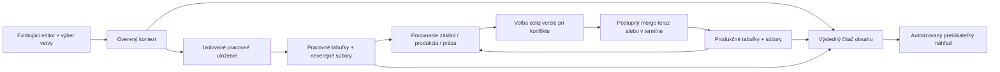

# Pracovné vetvy webu a publikačné balíky

Stav: **návrh po kontrole pripravený na technické overenie P01, bez implementácie**. Podklady vznikli 1. novembra 2026 nad aktuálnym checkoutom WebJET CMS; 2. novembra pribudlo podrobné zapojenie aplikácie Novinky a návrh budúceho rozširovania modulov. Produktové rozhodnutia Q1–Q19 a doplnenia N1–N5 sú v [rozhodnutiach](01-rozhodnutia.md).

**Priorita tejto fázy: jednoduchý a čitateľný POC.** Overujeme použiteľnosť pre niekoľko spolupracujúcich redaktorov. Použiť konkrétne služby a minimum vrstiev; nepripravovať frameworky pre hypotetické moduly, zriedkavé súbehy či veľkú prevádzku. Záväzné [pokyny pre agentov](ORCHESTRACIA.md#záväzná-priorita-jednoduchý-a-čitateľný-poc) zachovávajú dohodnuté funkcie a určujú aj rozsah prvého overenia.

Cieľom je pripraviť viac stránok, zmeny stromu, stránkové médiá a redakčné súbory v jednej pracovnej vetve. Redaktor môže preklikať pripravovaný web, porovnať zmeny s produkciou, vyriešiť konflikty a publikovať balík okamžite alebo v spoločnom termíne. Existujúce aj nové stránky a priečinky si zachovajú ID.

**Kde vytvorím balík a ako ho vyberiem?** [Rýchly postup v návrhu UI](05-rozhranie.md#rýchly-postup-od-vytvorenia-po-prepnutie) ukazuje vytvorenie cez `Pracovné verzie`, aktiváciu cez `Upravovať web` a prepínač pod doménou. Dokument obsahuje formulár aj rozbalenú ponuku produkcie a pracovných verzií.

**Ako začnem implementáciu?** [Orchestrácia](ORCHESTRACIA.md#ako-prácu-spustiť) obsahuje kopírovateľný prompt pre P01, pokračovanie P02–P08 aj obnovu rozpracovaného kroku. [Modely a roly](ORCHESTRACIA.md#modely-a-spôsob-riadenia) odporúčajú jeden model GPT-6.1 Sol / High pre hlavného agenta aj pomocníkov; voliteľné alternatívy sú uvedené osobitne. Ide o pokyny agentovi, nie samostatný program, ktorý treba inštalovať.

Výsledok kontroly všetkých podkladov, opravené medzery a zostávajúce technické overenia sú v [09 — Kontrola pripravenosti](09-kontrola-pripravenosti.md). Q16–Q19 sú uzatvorené; žiadna ďalšia produktová otázka nezostáva otvorená. P01 musí ešte overiť kritické predpoklady v reálnom prostredí.

## Dohodnutý základ

- Vetva je pracovná vrstva nad aktuálnou produkciou. Neupravené položky sa čítajú z produkcie; pri prvej zmene sa zachytí základ na porovnanie a pracovná verzia.
- Jedna vetva patrí jednej doméne. Môže obsahovať jej jazykové priečinky.
- Merge je postupný. Krátky zmiešaný stav počas publikovania je prijateľný; atómové prepnutie celého webu sa nepožaduje.
- Súborová časť zahŕňa redakčné obrázky, PDF a prílohy. Zdrojové súbory šablón, CSS/JS, JSP/Java a konfigurácia sa nevetvujú.
- Nové objekty dostanú konečné ID už vo vetve. V produkcii sa pred publikovaním nesmú objaviť ako obsahové položky.
- Náhľad podporuje jadro: stránky, strom, menu, navigáciu, novinky a médiá. Zákaznícke aplikácie s vlastným SQL/JPA potrebujú adaptačné API; ich vlastné obchodné dáta sa nevetvujú.
- `menu_ul_li.jsp`/`MenuULLI` vykreslí menu nad zvolenými stránkami a priečinkami vetvy: názvy, poradie, viditeľnosť, default odkazy aj aktívnu cestu. Konkrétne zmeny triedy, JSP a testy určuje [03b — Menu](03b-menu.md).
- `NewsApp`/`NewsActionBean` zobrazia nové aj upravené pracovné stránky podľa existujúcich kritérií vrátane priečinkov, perex skupín, dátumov, radenia a stránkovania. Použijú spoločný účinný zdroj v `NewsQuery`; nevzniká druhá aplikácia Novinky. Výber existujúcich perex skupín je podporovaná úprava stránky.
- Prvá verzia nemení atribúty stránok, multigroup väzby, definície kategórií médií, galerijné záznamy ani vlastnosti súborov uložené v ďalších tabuľkách. Zachováva členstvo médií v existujúcich kategóriách.
- Náhľad je určený prihláseným používateľom administrácie s oprávnením k obsahu. Beží na hostiteľovi administrácie a obsah načíta pre overenú doménu vetvy. Ukazuje zvolený LIVE/WORK výsledok konfliktov; editor uchová pracovný obsah.
- Súborový rozsah podporuje vytvorenie adresára a operácie nad jednotlivými súbormi. Presuny/premenovania/mazanie celých súborových adresárov a zápisy do galérií zostávajú mimo prvého vydania. Galériu zapojí neskoršie rozšírenie.
- Merge môže spustiť iba používateľ, ktorý smie priamo publikovať všetky dotknuté stránky a meniť dotknuté priečinky/súbory. Nevzniká nový viacstupňový schvaľovací proces.
- Konflikt sa rieši za celú položku výberom produkcie alebo pracovnej verzie. Rozdiely po poliach slúžia na porovnanie. Vlastná kombinácia sa pripraví bežnou editáciou; automatické skladanie HTML ani polí sa nepridáva.
- Viac vetiev môže existovať vedľa seba. Každá je jednorazová a po úplnom merge sa uzavrie.
- Pred plánovaným spustením sa znova overia konflikty, práva a samostatné plány stránok/priečinkov. Nový problém publikovanie zastaví.
- Merge nespúšťa skryté zrkadlenie ani automatické preklady. Publikuje iba zmeny viditeľné v balíku.
- Funkcia vyžaduje transakčné tabuľky; na MySQL/MariaDB InnoDB. Neprevádza existujúce MyISAM tabuľky automaticky.

## Prečo nestačí pôvodný návrh release balíka

[Pôvodný prieskum](../cms-competitors-2026-11.md) navrhoval najmä spoločné publikovanie historických verzií stránok. Požadovaná pracovná vetva navyše potrebuje izolované zápisy, celé URL routovanie, strom, zoznamy aplikácií a súbory. Najväčšia práca je v čítacích a zapisovacích cestách existujúceho CMS, nie v obrazovke so zoznamom balíkov.

Produkčné tabuľky odporúčame zachovať s dnešnými primárnymi kľúčmi. Pracovné údaje budú v samostatných tabuľkách a súborovom úložisku. Produkčný SQL kód tak nezačne omylom vracať rozpracované verzie. Podporované náhľadové cesty dostanú explicitný kontext vetvy.

Tento adresár nie je návrhom kopírovania celého Git modelu. Git ostáva prirovnaním pre pracovnú vetvu, porovnanie a zlúčenie; CMS potrebuje vlastné pravidlá URL, oprávnení, publikovania a súborov.

## Ako čítať podklady

| Dokument | Čo v ňom posúdiť |
| --- | --- |
| [01 — Rozhodnutia](01-rozhodnutia.md) | Potvrdený rozsah, delegované zjednodušenia a hranice. |
| [02 — Dátový model](02-datovy-model.md) | Päť nových tabuliek, snapshoty, mapovanie polí, súbory a migrácia. |
| [02a — Stabilné identifikátory](02a-identifikatory.md) | Konkrétna rezervácia ID podľa databázy, explicitné inserty a režim čítania. |
| [03 — Náhľad a Java](03-nahlad-a-java.md) | Triedy a integračné body, DocDB/GroupsDB, SQL/JPA, URL gateway, cache a adaptéry. |
| [03a — Novinky](03a-novinky.md) | Konkrétny návrh NewsApp/NewsActionBean: pracovné stránky pred filtrami, kategórie, čas, count/paging, admin editor a zhoda po merge. |
| [03b — Menu](03b-menu.md) | Povinný menu_ul_li.jsp/MenuULLI: účinný strom, parametre, aktívna cesta, default odkazy, perex/HTML, cache a M01–M11. |
| [04 — Merge a publikovanie](04-merge-a-publikovanie.md) | Pracovné ukladanie, porovnanie, API, poradie zápisov, termín a chyby. |
| [05 — Rozhranie](05-rozhranie.md) | Vytvorenie balíka krok za krokom, formulár, aktivácia a prepínač pod doménou; konflikty, plánovanie a priebeh. |
| [06 — Implementačný plán](06-plan-implementacie.md) | Osem postupných krokov, závislosti, podmienky dokončenia a odhad. |
| [07 — Overenie](07-overenie.md) | Šestnásť akceptačných oblastí vrátane Noviniek a existujúce testy, na ktoré nadviazať. |
| [08 — Ďalšie moduly](08-rozsirovanie-modulov.md) | Porovnanie architektúr, spoločná budúca JSON tabuľka, príprava jadra už dnes a konkrétny postup pre základný banner a galériu. |
| [09 — Kontrola pripravenosti](09-kontrola-pripravenosti.md) | Výsledok auditu, opravené rozpory, potvrdené doplnenia a hranica pripravenosti na P01. |
| [ORCHESTRACIA](ORCHESTRACIA.md) | Modely a roly, prompty P01–P08, pokračovanie po prerušení, riadenie rozsahu a odovzdávanie práce. |
| [STAV](STAV.md) | Evidencia návrhu a neskoršieho dokončovania krokov; teraz sú všetky nespustené. |

Overený stav jadra je oddelený od navrhovaných zmien: [čítanie a náhľad](analyza-citanie-a-nahlad.md), [zápis a publikovanie](analyza-zapis-a-publikovanie.md), [médiá a súbory](analyza-media-a-subory.md). Tieto analýzy vysvetľujú, prečo treba uvedené zásahy a ktoré existujúce postupy sa nedajú použiť bez úpravy.

## Architektúra v jednom pohľade

## Veľkosť zásahu a odporúčaný postup

Návrh je realizovateľný, ale zasahuje do jadra čítania aj ukladania. Neodporúčam začať obrazovkou balíkov a až potom skúšať izoláciu webu. **Prvý krok P01 má overiť stabilné ID, účinné SQL zoznamy a náhľad na reálnej šablóne.** Po ňom sa spresní rozpočet alebo upraví technické riešenie bez rozpracovania celej funkcie.

Pracovný odhad celého výsledku je **57–96 vývojárskych dní**, pri dvoch vývojároch a priebežnej QA približne **10–16 kalendárnych týždňov**. Je to pôvodný odhad celého rozsahu vrátane širšieho overenia, nie cena prvého POC ani dôvod budovať zložité vrstvy. P01 na jednom reálnom DB profile spresní náklady a riziká. Použiteľný POC míľnik je po P06: príprava, náhľad, konflikty a ručný merge; P07 pridá dohodnuté plánovanie a P08 regresiu/pripravenosť nasadenia. Predpoklady, ďalšie profily a vylúčené práce sú v pláne.

Zásadné praktické hranice:

- Nejde o nemenný snapshot celého webu. Nezmenené položky naďalej sledujú produkciu.
- Súbor používaný viacerými doménami môže po merge zmeniť všetky tieto weby. Použijú sa dnešné adresárové práva a mapovanie úložísk, s upozornením v prehľade; nový register vlastníctva sa nepridáva. Spoločné System stránky mimo domény ostávajú iba na čítanie.
- Vlastné SQL/JPA a dynamické URL v šablónach potrebujú adaptér. Vyhľadávacie indexy zostávajú produkčné. Náhľad nie je sandbox pre objednávky či formulárové zápisy.
- Multigroup operácie a editácia stránok vyžadujúcich nepodporovanú synchronizáciu sa v prvej verzii odmietnu s vysvetlením. Automatické redirect pravidlá pri zmene URL sú mimo rozsahu.
- Aktivácia vyžaduje autorizovanú preview gateway cez proxy, neverejný filesystem a vhodný DB profil. Stabilné nové ID znamenajú aj READ_COMMITTED režim core databázových čítaní pri zapnutej funkcii.
- Krátke transakcie pre rezerváciu ID a jednotlivý DB zápis sú súčasťou návrhu. Celý balík ani súbory nie sú v jednej transakcii; nie je potrebný distribuovaný lock systém alebo všeobecný workflow engine.

Označenie „navrhovaná trieda/tabuľka/API“ znamená budúcu implementáciu; nejde o existujúce rozhranie WebJET. DB algoritmy a filter chain sú návrhy podložené zdrojmi, ktoré ešte vyžadujú reálne integračné overenie.

## Rast o ďalšie moduly

Odporúčanie je kombinovať typované jadro so spoločnou `branch_items` pre budúce moduly. Pri banneroch a galérii tak neskôr pribudne jedna tabuľka spolu, nie jedna na každý modul. V P02/P06 sa pripraví spoločná identita položky a spoločné spracovanie, s priamymi volaniami konkrétnych služieb. Rozhranie handlera/register nie sú povinné; fyzické všeobecné úložisko vznikne až s prvým modulom. Moduly stále potrebujú vlastné zapojenie čítania a zápisu. Podrobný postup, alternatívy a orientačné náklady sú v [08](08-rozsirovanie-modulov.md).

Prvý príklad bannera je podľa používateľa úzky: nový banner alebo zmena názvu, popisu a obrázka; bez úprav zapisovania štatistík. Budúce kroky E01–E03 nie sú automaticky súčasťou dnešného rozsahu ani odhadu P01–P08.

## Hranica tejto práce

V tejto fáze sa menia iba Markdown dokumenty v tomto adresári. Nevykonáva sa migrácia DB, zmena Java/JavaScript kódu, nasadenie, vytvorenie issue ani Git commit. Implementačné príkazy v budúcich krokoch budú návodom na neskoršiu realizáciu, nie záznamom vykonaných zmien.
