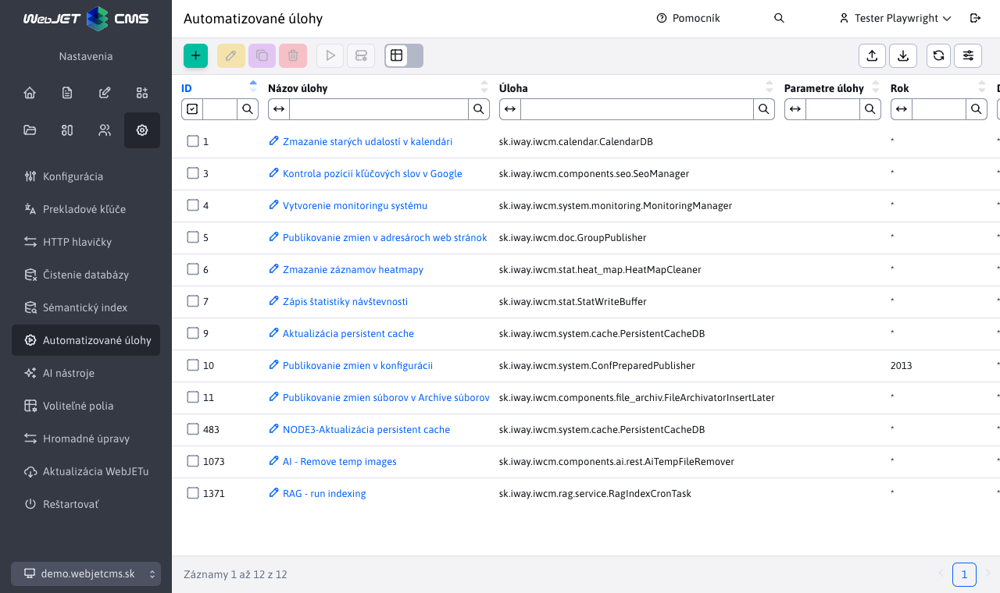
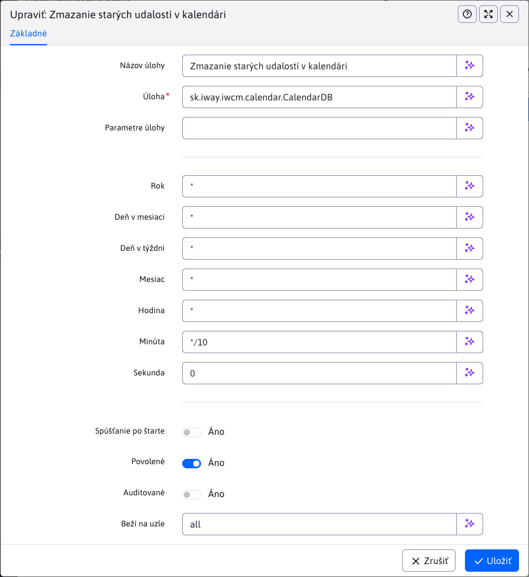

# Automatizované úlohy

Automatizované úlohy umožňujú zadefinovať úlohy, ktoré sa vykonávajú automatizovane na serveri.
Položku nájdete v sekcii **Nastavenia** pod položkou **Automatizované úlohy**.

V okne editora záznamu je možné nastaviť:

- **Názov úlohy** - Zadajte názov úlohy, ktorý bude popisovať, čo úloha robí (váš vlastný názov).
- **Úloha** - odkaz na Java triedu implementujúcu metódu `main`, ktorá sa vykoná. Pripravená je napr. úloha na sťahovanie dát [sk.iway.iwcm.system.cron.DownloadURL](../../../../../src/main/java/sk/iway/iwcm/system/cron/DownloadURL.java)
- **Parametre úlohy** - parametre predané pre zadanú úlohu oddelené znakom `|`. V prípade úlohy `DownloadURL` sú parametre:
  - `URL-adresa|[fromEmail]|[toEmail]|[subject]`
  - Povinný parameter **URL-adresa** musí byť kompletná adresa vrátane `http://`.
  - Nepovinné parametre `fromEmail,toEmail,subject` umožňujú po stiahnutí stránky jej zaslanie na zadaný email (pre kontrolu).
- **Rok, deň v mesiaci, deň v týždni, mesiac, hodina, minúta, sekunda** - časový interval, kedy sa má zadaná úloha vykonať. Možné hodnoty sú napríklad:
  - `*` - vykoná sa vždy.
  - `*/10` - každých 10 (alebo iné zadané číslo).
  - `20` - keď má daný typ hodnotu 20.
  - `3-5` - 3., 4. a 5. časovú jednotku. Počíta sa od nuly, takže každá sekunda sa dá zapísať ako rozpätie 0-59.
  - Ak napr. chcete udalosť spúšťať každých 10 minút, zadáte všade znak `*` a do poľa **Minúty** zadáte `*/10`.
- **Spúšťanie po štarte** - Určuje, či sa má úloha spustiť automaticky po štarte WebJET (napr. pre aktualizáciu údajov).
- **Povolené** - Určuje, či je úloha aktuálne povolená alebo zakázaná. Ak je povolená, bude sa vykonávať podľa zadaného časového harmonogramu. Ak je zakázaná, nebude sa spúšťať vôbec.
- **Auditované** - Určuje, či sú záznamy o vykonaní úlohy zaznamenávané v audite. Táto možnosť je užitočná pre sledovanie a kontrolu vykonávania úloh.
- **Beží na uzle** - Určuje, na ktorom uzle alebo serveri sa má úloha vykonávať, ak pracujete v prostredí s viacerými uzlami clustra. Hodnota `all` spustí úlohu na všetkých uzloch, `all-admin` len na uzloch v plnej konfigurácii a `all-public` len na uzloch typu verejný uzol (bez administrácie).

## Manuálne spustenie

Po označení jednej alebo viacerých úloh ich môžete manuálne spustiť pomocou tlačidiel v nástrojovej lište:

- tlačidlo prehrávania spustí úlohu na aktuálnom uzle,
- tlačidlo servera spustí úlohu podľa hodnoty **Beží na uzle**. Hodnota `all` ju spustí na všetkých uzloch, `all-admin` na administračných uzloch, `all-public` na verejných uzloch a konkrétny názov iba na zadanom uzle.

Požiadavka na vzdialené spustenie sa prenáša cez cluster a vykoná sa najneskôr pri ďalšej kontrole nastavenej konfiguračnou premennou `clusterRefreshTimeout`. Mimo cluster režimu sa úloha spustí lokálne.

Zmeny pre časovanie úloh sa aplikujú okamžite, ale už odštartované úlohy ostanú bežať až pokým neskončia.

### Zlučovanie historických kliknutí

V časti **Nastavenia → Automatizované úlohy** pridajte úlohu s triedou `sk.iway.iwcm.stat.heat_map.HeatMapAggregationCronJob`. Ak chcete spracovať iba október 2025, do poľa **Parametre úlohy** zadajte `year=2025|month=10` (prípadne `2025_10` alebo `2025|10`). Uložte úlohu, označte ju v zozname a spustite ju tlačidlom prehrávania.

Bez parametrov úloha vyberie všetky ukončené mesiace. Plánovač takto spracuje aj pole obsahujúce iba medzery alebo iba oddeľovače `|`. Úloha spracuje mesiac najskôr 24 hodín po jeho skončení, aby prehliadače stihli odoslať posledné kliknutia. Pre pravidelné spracovanie nastavte deň v mesiaci na `3`, hodinu na `2`, minútu a sekundu na `0` a ostatné časové polia na `*`.

Úloha sčíta kliknutia z rovnakého dňa, domény a stránky v jednej bunke mapy. Veľkosť bunky určuje konfiguračná premenná `statHeatMapCellSize`: predvolená hodnota `5` znamená 5 × 5 CSS pixely, `4` znamená 4 × 4 a `10` znamená 10 × 10. Platné hodnoty sú 1 až 1024; pri neplatnej hodnote sa použije 4. Rovnakú veľkosť používa aj vykresľovanie mapy. Zmena sa použije pri ďalšom spustení úlohy a načítaní mapy bez reštartu servera. Už spustená úloha dokončí spracovanie s pôvodnou veľkosťou.

Úloha zachová členenie podľa režimu súradníc, šírky rozloženia a skutočnej šírky okna. Počet riadkov v databáze sa tým zníži a mapa naďalej zobrazuje všetky započítané kliknutia. Väčšia bunka umožní zlúčiť viac riadkov, ale zníži presnosť polohy. Zmenšenie bunky neobnoví súradnice už zlúčených kliknutí. Výsledok pre každú spracovanú tabuľku nájdete v protokole servera.

Pri aktualizácii WebJET sa existujúce mesačné tabuľky kliknutí v MySQL/MariaDB s úložiskom MyISAM prevedú na InnoDB. Zlučovanie tak môže používať transakcie aj pri starších tabuľkách. Úloha podporu transakcií vopred nekontroluje; prípadnú databázovú chybu zapíše do protokolu servera.

Ak používate `statTableCreateProcedureName`, upravte vlastnú procedúru tak, aby v nových mesačných tabuľkách vytvorila stĺpec `count` s predvolenou hodnotou jeden. Pozrite si [príklad procedúry pre Oracle](../../../install/config/ro-user.md#oracle).

## Štandardné úlohy

[sk.iway.iwcm.system.cron.Echo](../../../../../src/main/java/sk/iway/iwcm/system/cron/Echo.java) - Diagnostická úloha - svoj prvý parameter vypíše do konzoly.

**Parametre:**

1. Text, ktorý chcete vypísať.

[sk.iway.iwcm.system.cron.DownloadURL](../../../../../src/main/java/sk/iway/iwcm/system/cron/DownloadURL.java) - Stiahne zadané URL a pošle ho na email.

**Parametre:**

1. URL, vrátane `http://` predpony, napr. `https://www.interway.sk/`.
2. Email odosielateľa.
3. Prijímateľ (možno aj viacero oddelených čiarkou).
4. Predmet správy.

[sk.iway.iwcm.system.cron.SqlBatchRunner](../../../../../src/main/java/sk/iway/iwcm/system/cron/SqlBatchRunner.java) - Spustí SQL príkazy zadané ako parametre.

**Parametre:**

SQL príkazy, oddelené znakom `|`.

[sk.iway.iwcm.filebrowser.UnusedFilesCleaner](../../../../../src/main/java/sk/iway/iwcm/filebrowser/UnusedFilesCleaner.java) - Preskúma zadaný adresár (súborový), či neobsahuje indexované súbory, na ktoré sa už žiadna stránka neodkazuje, a zruší publikovanie takýchto súborov. Takéto nepoužité súbory by sa totiž mohli zobrazovať vo výsledkoch vyhľadávania. Automatické prečisťovanie má význam iba pri automatickom indexovaní, ktoré sa zapína konfiguračnou premennou `fileIndexerIndexAllFiles`.

**Parametre:**

1. Adresár na skenovanie, napr.: `/files`.
2. Email, na ktorý sa pošle notifikácia o zrušených súboroch.
3. `true/false` hodnota. Ak je nastavená hodnota `true`, stránkam sa zruší publikovanie. Ak `false`, pošle sa iba notifikácia.

[sk.iway.iwcm.doc.GroupPublisher](../../../../../src/main/java/sk/iway/iwcm/doc/GroupPublisher.java) - Publikuje naplánované zmeny v priečinkoch web stránok.

**Parametre:**

- Nemá.

[sk.iway.iwcm.calendar.CalendarDB](../../../../../src/main/java/sk/iway/iwcm/calendar/CalendarDB.java) - Posiela notifikácie na email o blížiacich sa udalostiach v kalendári udalostí.

**Parametre:**

- Nemá.

[sk.iway.iwcm.components.seo.SeoManager](../../../../../src/main/java/sk/iway/iwcm/components/seo/SeoManager.java) - Zisťuje poradie stránky vo vyhľadávačoch podľa kľúčových slov.

**Parametre:**

- Nemá.

[sk.iway.iwcm.system.monitoring.MonitoringManager](../../../../../src/main/java/sk/iway/iwcm/system/monitoring/MonitoringManager.java) - Ukladá údaje pre monitorovanie servera.

**Parametre:**

- Nemá.

[sk.iway.iwcm.stat.StatWriteBuffer](../../../../../src/main/java/sk/iway/iwcm/stat/StatWriteBuffer.java) - Údaje o štatistikách návštevnosti web stránky sa zbierajú do pamäte. Pri spustení tejto triedy sa pamäť vyčistí a zapíše sa do databázy.

**Parametre:**

- Nemá.

[sk.iway.iwcm.stat.heat_map.HeatMapCleaner](../../../../../src/main/java/sk/iway/iwcm/stat/heat_map/HeatMapCleaner.java) - Maže generované obrázky teplotných máp kliknutí v štatistike.

**Parametre:**

- Nemá.

[sk.iway.iwcm.system.ConfPreparedPublisher](../../../../../src/main/java/sk/iway/iwcm/system/ConfPreparedPublisher.java) - Publikuje naplánované zmeny v konfiguračných premenných.

**Parametre:**

- Nemá.

[sk.iway.iwcm.components.file_archiv.FileArchivatorInsertLater](../../../../../src/main/java/sk/iway/iwcm/components/file_archiv/FileArchivatorInsertLater.java) - Publikuje naplánované zmeny v archíve súborov.

**Parametre:**

- Nemá.
