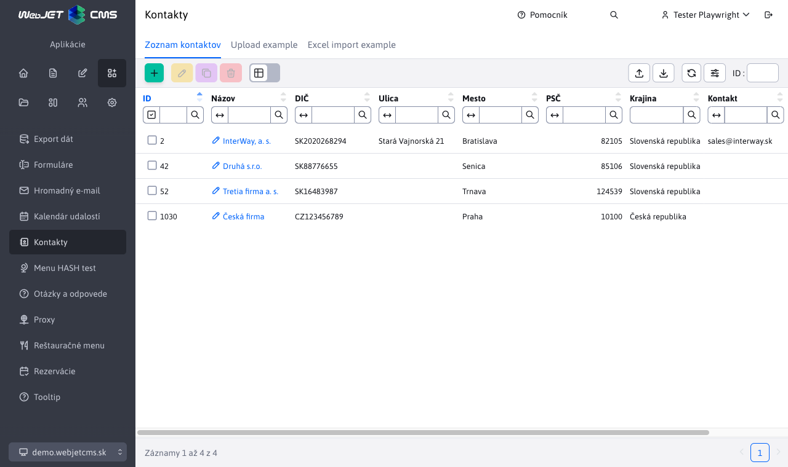
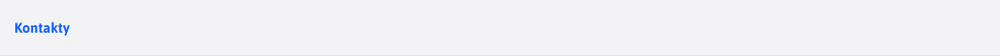
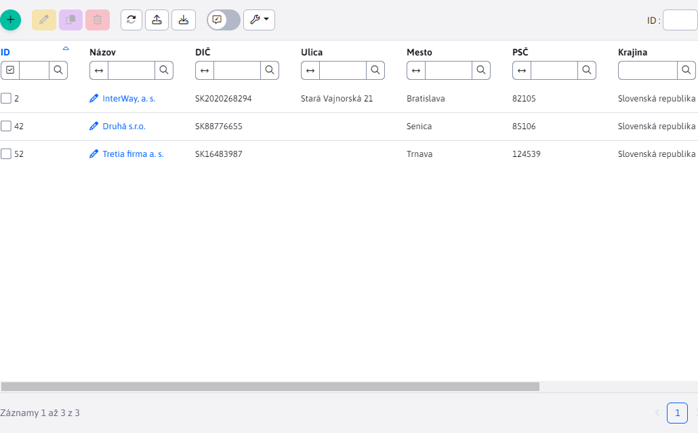

# Položka v menu admin časti

Administrácia je založená na [data tabuľkách](../../developer/datatables/README.md) a [REST rozhraní](../../developer/datatables/restcontroller.md). Ako základ je potrebné pochopiť ich fungovanie podľa dokumentácie pre [Programátora WebJET CMS](../../developer/README.md).

V tejto ukáže naprogramujeme správu kontaktov, využitá je tabuľka ```contact```, ktorá existuje v štandardnej inštalácii WebJET CMS (ale typicky sa nepoužíva).



## Backend

Ideálne riešenie využíva `Spring DATA` repozitár, REST controller a datatabuľku generovanú z ```@DataTableColumn```, [anotácií](../../developer/datatables-editor/datatable-columns.md).

Ukážková JPA entita aj s anotáciami ```@DataTableColumn```, [pre datatabuľku a editor](../../developer/datatables-editor/datatable-columns.md). Tiež si všimnite anotáciu ```@EntityListeners``` pre automatické [zapisovanie auditu](../../developer/backend/auditing.md) pri zmene entity.

Povinné polia a iné validácie [nastavujete anotáciami](../../developer/datatables/restcontroller.md#validácia--povinné-polia), ```@NotBlank,@Size,@Email``` atď.

!>**Upozornenie:** v entite nepoužívajte primitívne typy `int, long` ale len objektové `Integer, Long`, inak nebude korektne fungovať filtrovanie/vyhľadávanie.

```java
package sk.iway.basecms.contact;

import jakarta.persistence.Column;
import jakarta.persistence.Entity;
import jakarta.persistence.EntityListeners;
import jakarta.persistence.GeneratedValue;
import jakarta.persistence.Id;
import jakarta.persistence.Table;
import jakarta.persistence.TableGenerator;
import jakarta.validation.constraints.Email;
import jakarta.validation.constraints.NotBlank;
import jakarta.validation.constraints.Size;

import lombok.Getter;
import lombok.Setter;
import sk.iway.iwcm.system.adminlog.EntityListenersType;
import sk.iway.iwcm.system.datatable.DataTableColumnType;
import sk.iway.iwcm.system.datatable.annotations.DataTableColumn;

/**
 * Ukazkova JPA entita pre pouzitie v datatabulke
 * http://docs.webjetcms.sk/v2022/#/custom-apps/admin-menu-item
 */

//nastavenie JPA entity
@Entity
@Table(name = "contact")
//automaticke generovanie getter/setter metod cez lombok
@Getter
@Setter
//nastavenie automatickeho auditovania zmien, dolezite je nastavit Adminlog.TYPE_XXX
@EntityListeners(sk.iway.iwcm.system.adminlog.AuditEntityListener.class)
@EntityListenersType(sk.iway.iwcm.Adminlog.TYPE_CLIENT_SPECIFIC)
public class ContactEntity {

    @Id
    @Column(name = "contact_id")
	@GeneratedValue(generator = "WJGen_contact")
	@TableGenerator(name = "WJGen_contact", pkColumnValue = "contact")
    @DataTableColumn(inputType = DataTableColumnType.ID)
    private Long id;

    @DataTableColumn(inputType = DataTableColumnType.OPEN_EDITOR, title="components.contact.property.name")
    @NotBlank
    private String name;

    @DataTableColumn(inputType = DataTableColumnType.TEXT, title="components.contact.property.vatid")
    private String vatid;

    @DataTableColumn(inputType = DataTableColumnType.TEXT, title="components.contact.property.street")
    private String street;

    @DataTableColumn(inputType = DataTableColumnType.TEXT, title="components.contact.property.city")
    private String city;

    @DataTableColumn(inputType = DataTableColumnType.TEXT, title="components.contact.property.zip")
    @Size(min=5, max=8)
    private String zip;

    @DataTableColumn(inputType = DataTableColumnType.SELECT, title="components.contact.property.country")
    private String country;

    @DataTableColumn(inputType = DataTableColumnType.TEXT, title="components.contact.property.contact")
    @Email
    private String contact;

    @DataTableColumn(inputType = DataTableColumnType.TEXT, title="components.contact.property.phone")
    private String phone;

}
```

Ukážkový JPA repozitár, pri jeho použití vždy využívajte aj ```Pageable``` objekt pre stránkovanie a usporiadanie. Pre podporu dynamického generovania vyhľadávacích kritérií (v REST controlleri metóda ```addSpecSearch```) repozitár rozširuje aj ```JpaSpecificationExecutor```.

```java
package sk.iway.basecms.contact;

import org.springframework.data.domain.Page;
import org.springframework.data.domain.Pageable;
import org.springframework.data.jpa.repository.JpaRepository;
import org.springframework.data.jpa.repository.JpaSpecificationExecutor;

/**
 * Ukazkovy Spring DATA repozitar pre pouzitie v datatabulke
 * http://docs.webjetcms.sk/v2022/#/custom-apps/admin-menu-item
 */
public interface ContactRepository extends JpaRepository<ContactEntity, Long>, JpaSpecificationExecutor<ContactEntity> {

    //citanie firiem podla zadanej krajiny pre MVC ukazku
    public Page<ContactEntity> findAllByCountry(String country, Pageable pageable);

}
```

!>**Upozornenie:** všimnite si použitie ```JpaSpecificationExecutor```. Ten umožňuje dynamickú tvorbu SQL príkazu pre vyhľadávanie/filtrovanie/usporiadanie záznamov v datatabuľke. Ak by ste ho nepoužili, tak sa vyhľadáva vo forme [Query By Example](https://www.baeldung.com/spring-data-query-by-example) kedy **nesmiete** použiť primitívne typy a inicializačné hodnoty v Entite (napr. ```String text="test"```). Pri vyhľadávaní by sa potom hodnota ```test``` automaticky hľadala aj keď nie je zadaná. Toto rieši ```JpaSpecificationExecutor```, ktorý hľadá len parametre zadané vo filtri (testovaním request parametrov začínajúcich na ```search```).

Ukážkový REST controller, vždy dávajte pozor na kontrolu práv cez anotáciu ```@PreAuthorize``` a nezabudnite aj anotáciu ```@Datatable``` pre korektné generovanie chybových odpovedí.

V metóde ```getOptions``` nastavuje možnosti pre výberové pole krajina.

V metóde ```beforeSave``` je možné nastaviť dodatočné (needitovateľné) údaje pred uložením entity do databázy.

```java
package sk.iway.basecms.contact;

import java.util.ArrayList;
import java.util.List;

import org.springframework.beans.factory.annotation.Autowired;
import org.springframework.security.access.prepost.PreAuthorize;
import org.springframework.web.bind.annotation.RequestMapping;
import org.springframework.web.bind.annotation.RestController;

import sk.iway.iwcm.system.datatable.Datatable;
import sk.iway.iwcm.system.datatable.DatatablePageImpl;
import sk.iway.iwcm.system.datatable.DatatableRestControllerV2;
import sk.iway.iwcm.system.datatable.json.LabelValue;

/**
 * Ukazkovy Spring REST pre pouzitie v datatabulke
 * http://docs.webjetcms.sk/v2022/#/custom-apps/admin-menu-item
 */

@RestController
//nastavenie URL adresy REST controllera
@RequestMapping("/admin/rest/apps/contact/")
//nastavenie kontroly prav na alikaciu cmp_contact (tento kluc sa definuje v modinfo.properties)
@PreAuthorize("@WebjetSecurityService.hasPermission('cmp_contact')")
@Datatable
public class ContactRestController extends DatatableRestControllerV2<ContactEntity, Long> {

    @SuppressWarnings("unused")
    private final ContactRepository contactRepository;

    @Autowired
    public ContactRestController(ContactRepository contactRepository) {
        super(contactRepository, ContactEntity.class);
        //odlozme si repozitar na pripadne specialne pouzitie
        this.contactRepository = contactRepository;
    }

    @Override
    public void getOptions(DatatablePageImpl<ContactEntity> page) {

        //pridaj zoznam pre pole country
        page.addOptions("country", getCountries(), "label", "value", false);
    }

    @Override
    public void beforeSave(ContactEntity entity) {
        //tu mozete vykonat nastavenie pred ulozenim, napr. nastavit datum poslednej zmeny
    }

    /**
     * Vrati zoznam vyberoveho pola pre krajinu
     * @return
     */
    public static List<LabelValue> getCountries() {
        //vytvor zoznam krajin, toto by sa idealne malo citat z nejakeho ciselnika
        List<LabelValue> countries = new ArrayList<>();
        countries.add(new LabelValue("Slovenská republika", "sk"));
        countries.add(new LabelValue("Česká republika", "cz"));
        countries.add(new LabelValue("Rakúsko", "at"));

        return countries;
    }
}
```

## Frontend

Ako je spomenuté vyššie pre frontend sa využívajú datatabuľky. Administrácia je skompilovaná z pug súborov do html a následne zobrazená.

Pre jednoduché vytvorenie novej stránky v administrácii sme zaviedli pred pripravenú šablónu rozloženia stránky. Vy doplníte len strednú časť stránky (šablóna zabezpečí generovanie hlavičky a menu). [Mapovanie URL adries](../../src/main/java/sk/iway/iwcm/admin/ThymeleafAdminController.java) je pripravené ako ```/apps/{app}/admin/``` alebo ```/apps/{app}/admin/{subpage}```.

Stačí pripraviť súbor ```/apps/{app}/admin/index.html``` alebo ```/apps/{app}/admin/{subpage}.html``` kde ```{app}``` je meno adresára v ktorom je aplikácia (bez diakritiky a medzier) a ```{subpage}``` je prípadné meno súboru bez prípony (ak sa nejedná o meno index.html).

Príkladom je aplikácia ```src/main/webapp/apps/contact/admin/index.html``` volaná cez URL adresu ```/apps/contact/admin/```:

```html
<script>
    var dataTable;

    window.domReady.add(function () {

        WJ.breadcrumb({
            id: "contact",
            tabs: [
                {
                    url: '/apps/contact/admin/',
                    title: '[[#{components.contact.title}]]',
                    active: true
                }
            ]
        })

        //URL adresa REST rozhrania
        let url = "/admin/rest/apps/contact";
        //package a meno triedy s JPA entitou
        let columns = [(${layout.getDataTableColumns("sk.iway.basecms.contact.ContactEntity")})];

        dataTable = WJ.DataTable({
            url: url,
            serverSide: true,
            columns: columns,
            //id musi byt zhodne s tagom table nizsie
            id: "dataTable",
            fetchOnEdit: true,
            fetchOnCreate: true
        });
    });

</script>

<table id="dataTable" class="datatableInit table"></table>
```

Pomocou funkcie [WJ.breadcrumb](../../developer/frameworks/webjetjs.md#navigačná-lišta) je vygenerovaná navigačná lišta.



Funkcia [WJ.DataTable](../../developer/datatables/README.md#možnosti-konfigurácie) inicializuje v stránke datatabuľku do HTML tabuľky s ```id=dataTable```. Upozorňujeme na volanie ```window.domReady.add```, ktoré je potrebné používať namiesto ```$(document).ready``` - volanie čaká na inicializáciu [prekladových kľúčov](../../developer/libraries/translator.md) a až po ich získaní je vyvolaná zadaná funkcia.



Pre zobrazenie položky v menu a zobrazenie práva pre používateľa je ešte potrebné vytvoriť konfiguračný súbor ```modinfo.properties```, ten umiestnite do ```/apps/MENO_APLIKACIE/```, pre náš prípad ```src/main/webapp/apps/contact/modinfo.properties```:

```sh
#prekladovy kluc menu polozky
leftMenuNameKey=components.contact.title
#pouzivatelske pravo
itemKey=cmp_contact
#ak je true, je mozne pravo nastavovat
userItem=true
#linka v menu
leftMenuLink=/apps/contact/admin/
#Tabler icon name without the "ti ti-" prefix
icon=address-book
#Disable the new permission for existing administrators on its first initialization
defaultDisabled=true
#Custom module flag; it does not change the order in the current administration menu
custom=true

#submenu
#leftSubmenu1NameKey=components.contact.subpage.title
#leftSubmenu1Link=/apps/contact/admin/subpage/
```

Ak máte stránky typu ```master-detail```, ktorá nie je definovaná v ```modinfo.properties``` nemusí sa korektne zobraziť ľavé menu, pretože nevie akú položku má zvýrazniť. Najjednoduchšie riešenie je takúto stránku pomenovať ```meno-details.html``` (ako je napr. URL adresa ```/apps/stat/admin/top-details/?docId=35267&dateRange=``` v súbore ```/apps/stat/admin/top-details.html```). Výraz ```-details``` alebo ```-detail``` sa pri hľadaní položky na zvýraznenie v menu odstráni a zvýrazní sa tak hlavná (```master```) stránka.

Ak takého použitie nie je vhodné môžete využiť vo vašej stránke JavaScript funkciu ```WJ.selectMenuItem(href)``` pre zvýraznenie zadanej menu položky. V parametri ```href``` zadáte priamo URL adresu stránky v menu, ktorú chcete zvýrazniť:

```JavaScript
window.domReady.add(function () {
    WJ.selectMenuItem("/admin/v9/apps/gallery/");
});
```

V prípade starej JSP komponenty funkciu volajte pomocou ```setTimeout``` aby sa vykonala až po zobrazení stránky.

### Priloženie JavaScript súboru

Ak potrebujete k aplikácii pripojiť JavaScript modul WebJET automaticky hľadá súbor ```/apps/{app}/admin/{app}.js``` a ak existuje vloží ho do hlavičky HTML kódu ako modul, pričom ho importuje ako objekt ```appModule```:

```html
<script type="module">
        import * as appModule from "[[${appIncludePathJs}]]";
        window.appModule = appModule;
</script>
```

Napríklad v aplikácii stat by existoval súbor ```/apps/stat/admin/stat.js```:

```javascript
export const ChartType = {
    Bar: "bar"
    ...
}

export class ChartForm {
    constructor(chartType, yAxeName, xAxeName, chartTitle) {
        this.chartType = chartType;
        ...
    }
}

export async function setAmchart(chartForm) {
    ...
}
```

ktorý sa následne v JavaScript/HTML kóde volá ako ```appModule.ChartType.Bar``` atď.

## Automatizovaný test

Pre datatabuľku je pripravený [základný automatizovaný test](../../developer/testing/datatable.md), ktorý stačí nakonfigurovať. Vytvorte nový testovací scenár v ```src/test/webapp/tests/apps/contact.js``` s aspoň základným testom:

```javascript
Feature('contact');

Before(({ I, login }) => {
    login('admin');
    I.amOnPage("/apps/contact/admin/");
});

Scenario('contact-zakladne testy', async ({ I, DataTables, DTE }) => {
    await DataTables.baseTest({
         dataTable: 'dataTable',
         //meno prava na kontrolu podla modinfo.properties
         perms: 'cmp_contact',
         createSteps: function(I, options) {
            //toto pole musime vyplnit rucne, kedze ma specialnu validaciu
            DTE.fillField("zip", "85106");
         }
    });
});
```

## Referencia súboru modinfo.properties

Súbor `modinfo.properties` registruje modul, jeho položky v administračnom menu, používateľské práva a doplnkové aplikácie pre vkladanie do stránky. Načítava ho trieda `sk.iway.iwcm.system.Modules`, zobrazenie menu zabezpečuje `MenuService` a zoznam aplikácií v AppStore pripravuje `AppManager`.

### Umiestnenie a načítanie

Súbor umiestnite do `/components/MENO_APLIKACIE/` alebo `/apps/MENO_APLIKACIE/`. `Modules` prechádza len bezprostredné podadresáre týchto dvoch priečinkov. V každom načíta `modinfo.properties` a prípadné `modinfo1.properties` až `modinfo29.properties`. Číslovanie nemusí byť súvislé.

Každý súbor predstavuje samostatnú definíciu modulu. Číslované súbory nepreberajú nastavenia zo základného súboru, preto im zadajte vlastný `itemKey`. Zhodný identifikátor spravidla nahradí skoršiu definíciu. Výnimkou je automaticky vytvorený modul z `/apps/` bez vlastného odkazu, ktorý neprepíše už načítaný modul.

Základný modul vznikne aj pre priečinok bez súboru `modinfo.properties`. Automaticky dostane identifikátor `cmp_MENO_APLIKACIE`, cestu k priečinku a prekladový kľúč `components.MENO_APLIKACIE.title`, prípadne `apps.MENO_APLIKACIE.title`. Samotná existencia priečinka však nevytvorí položku v ľavom menu ani nastaviteľné používateľské právo.

Hodnoty `true` a `false` zapisujte malými písmenami bez koncových medzier. Parser pri niektorých atribútoch porovnáva presný reťazec. Predvolené kódovanie je `ISO-8859-1`, pre súbor v UTF-8 pridajte na začiatok direktívu `#encoding=utf-8`.

Definície sa uchovávajú v pamäti. Po zmene súboru je potrebné opätovné načítanie modulov, napríklad reštartom WebJET CMS. AppStore má aj vlastnú vyrovnávaciu pamäť zoznamu aplikácií podľa jazyka.

### Kompletný príklad

Príklad pre `/components/example/modinfo.properties` obsahuje všetky atribúty, ktoré `Modules` číta, vrátane aliasu `custom` a starších príznakov. Cesty, prekladové kľúče a názvy práv sú ukážkové. Pred použitím upravte alebo vynechajte obmedzenia `installName`, `requireConstantsKey` a `domainName`. V tomto príklade musí byť konfiguračná premenná `exampleEnabled` nastavená napríklad na `true`.

```properties
#encoding=utf-8

#Module identity and administration menu
leftMenuNameKey=components.example.title
itemKey=cmp_example
leftMenuLink=/apps/example/admin/
group=components
icon=address-book
menuOrder=120

#Permissions and availability
userItem=true
defaultDisabled=true
requireConstantsKey=exampleEnabled
installName=customer,customer-test
domainName=www.example.sk,www.example.cz

#AppStore registration and custom module flag
app=true
isCustom=true
#Alias used only when isCustom is missing or empty
custom=true

#Legacy flags - see the reference below
showSubcategories=false
hideSubmenu=false

#Submenu with its own permission
leftSubmenu1NameKey=components.example.records.title
leftSubmenu1Link=/apps/example/admin/records/
leftSubmenu1ItemKey=cmp_example_records
leftSubmenu1UserItem=true
leftSubmenu1DefaultDisabled=false
leftSubmenu1Icon=list

#Standalone permission without a visible menu link
leftSubmenu2NameKey=components.example.export.title
leftSubmenu2Link=javascript:void();
leftSubmenu2ItemKey=cmp_example_export
leftSubmenu2UserItem=true
leftSubmenu2DefaultDisabled=true
leftSubmenu2Icon=download

#Additional application in the page editor
component1NameKey=components.example.card.title
component1Link=/components/example/editor_card.jsp
component1Icon=/components/example/editoricon.png
```

### Identifikácia a menu

- `leftMenuNameKey` - prekladový kľúč názvu modulu v menu a v aktuálnom strome práv. Ak chýba, použije sa `components.MENO_APLIKACIE.title` alebo `apps.MENO_APLIKACIE.title` podľa priečinka. Nemení interné `nameKey`, ktoré používa bežná JSP aplikácia v AppStore.
- `itemKey` - jednoznačný identifikátor modulu a zároveň názov práva, napríklad `cmp_contact`. Predvolená hodnota je `cmp_MENO_APLIKACIE`. Rovnaký identifikátor použite pri kontrole práv v REST controlleri, JSP alebo Java kóde. Pre samostatne nastaviteľné právo používajte kľúč s aspoň tromi znakmi.
- `leftMenuLink` - URL adresa alebo JavaScript akcia hlavnej položky menu. Neprázdna hodnota zároveň zapne zobrazovanie modulu v ľavom menu; prázdna alebo vynechaná hodnota ho nezapne. Príklad: `/apps/contact/admin/`. Odkaz `javascript:void();` môže slúžiť ako kontajner podpoložiek.
- `group` - sekcia administračného menu a stromu práv. Predvolená hodnota je `components`. Aktuálne menu pozná hodnoty `welcome`, `website`, `news`, `components`, `files`, `templates`, `users`, `config`; nová hodnota sama nevytvorí novú sekciu. Pre niektoré štandardné moduly má prednosť mapovanie v `MenuService`. Tento atribút neurčuje kategóriu aplikácie v AppStore.
- `icon` - názov Tabler ikony bez prefixu `ti ti-`, napríklad `address-book`. `MenuService` prefix doplní pri tvorbe menu a stromu práv. Predvolene je hodnota prázdna; pre štandardné moduly môže mať prednosť interné mapovanie ikon. Ikonu karty v AppStore nastavuje iný mechanizmus, opísaný nižšie.
- `menuOrder` - celé číslo pre vzostupné radenie modulov, predvolene `1000`. Neplatná neprázdna hodnota sa prevedie na `0`; pri zhode sa porovná interné `nameKey`. V aktuálnom menu majú niektoré štandardné moduly pevne mapované poradie a sekcia `components` sa následne zoradí podľa preložených názvov. V tejto sekcii preto `menuOrder` neurčuje konečné poradie. Neurčuje ani poradie kariet v AppStore.

### Práva a dostupnosť

- `userItem` - pri `true` sprístupní právo modulu na nastavovanie v právach používateľov a skupín práv. Predvolená hodnota je `false`. Samotný príznak právo používateľovi neudeľuje a hodnota `false` neznamená zákaz aplikácie.
- `defaultDisabled` - predvolene `false`. Pri `true` inicializácia novo zisteného práva jednorazovo pridá zákaz existujúcim administrátorom. `UpdateDatabase` vykonanie zaznamená pod označením `NEW MODULE: itemKey`. Právo potom možno povoliť v nastavení používateľa alebo cez skupinu práv. Nejde o trvalé vypnutie modulu ani o predvolené nastavenie pre každého budúceho používateľa. Zmena späť na `false` už zapísané zákazy neodstráni.
- `requireConstantsKey` - názov jednej konfiguračnej premennej, od ktorej závisí dostupnosť modulu. Jej hodnota v `Constants` musí byť neprázdna a odlišná od presného reťazca `false`. Napríklad `requireConstantsKey=exampleEnabled` kontroluje premennú `exampleEnabled`, nenastavuje ju. Prázdny alebo vynechaný atribút túto podmienku vypne.
- `installName` - obmedzí načítanie celej definície na konkrétne inštalácie podľa `Constants.getInstallName()`. Viac hodnôt oddeľte čiarkou bez medzier, napríklad `customer,customer-test`. Porovnanie rozlišuje veľké a malé písmená. Pri nezhode sa definícia vrátane pod položiek preskočí. Prázdna alebo vynechaná hodnota načítanie neobmedzuje.
- `domainName` - obmedzenie zobrazenia podľa aktuálnej domény, napríklad `www.example.sk,www.example.cz`. Prázdna alebo vynechaná hodnota zobrazenie neobmedzuje. Používa sa pri tvorbe aktuálneho administračného menu a pri filtrovaní aplikácií v `appstore.jsp`. Presné porovnávanie a obmedzenia prenosu do AppStore sú opísané v časti [AppStore a filtrovanie podľa domény](#appstore-a-filtrovanie-podľa-domény).

Práva sa nastavujú v strome práv používateľa alebo skupiny práv; jeho tvorbu opisuje dokumentácia [zoznamu používateľov](../../developer/apps/users/README.md). WebJET CMS ukladá používateľské zákazy, pričom povolenie cez skupinu práv má prednosť pred používateľským zákazom. Dostupnosť modulu podľa licencie a konfigurácie sa kontroluje osobitne, takže používateľské povolenie nesprístupní nedostupný modul.

Definícia v `modinfo.properties` nenahrádza kontrolu práv v aplikačnom kóde. Administračný Thymeleaf controller kontroluje právo odvodené z URL položky menu, ale REST rozhranie chráňte samostatne, napríklad anotáciou `@PreAuthorize("@WebjetSecurityService.hasPermission('cmp_contact')")` z ukážky vyššie.

### Podpoložky menu a samostatné práva

Namiesto `N` použite číslo **1 až 24**. Čísla môžu byť vynechané. Podpoložka sa vytvorí len vtedy, keď sú neprázdne oba atribúty `leftSubmenuNNameKey` a `leftSubmenuNLink`.

- `leftSubmenuNNameKey` - prekladový kľúč názvu podpoložky v menu alebo názvu samostatného práva.
- `leftSubmenuNLink` - URL adresa alebo JavaScript akcia podpoložky. Hodnota `javascript:void();` umožňuje zaregistrovať právo bez viditeľného odkazu v menu; aj pri takomto práve musí byť atribút vyplnený.
- `leftSubmenuNItemKey` - vlastný identifikátor práva podpoložky. Bez neho sa pri zobrazení a kontrole URL použije právo nadradeného modulu. Pri zadaní sa kontroluje toto právo samostatne, nadradené právo sa k nemu automaticky nepridáva ako ďalšia podmienka.
- `leftSubmenuNUserItem` - pri `true` zobrazí podpoložku ako samostatne nastaviteľné právo. Predvolene `false`, nezávisle od rodičovského `userItem`. Pre samostatné právo nastavte aj vlastný `leftSubmenuNItemKey` s aspoň tromi znakmi.
- `leftSubmenuNDefaultDisabled` - rovnaké jednorazové zakázanie ako pri `defaultDisabled`, ale pre právo podpoložky. Ak chýba, preberá hodnotu rodičovského `defaultDisabled`. Výslovné `false` toto dedenie vypne, `true` zapne zakázanie bez ohľadu na rodiča.
- `leftSubmenuNIcon` - názov Tabler ikony bez prefixu `ti ti-`. Aktuálne sa používa v strome práv; tretia úroveň ľavého menu túto ikonu nevykresľuje. Predvolene nie je nastavená.

Ak má používateľ povolenú podpoložku s vlastným právom, môže sa mu zobraziť aj pri zakázanom práve nadradeného modulu. Rodič zostane v menu ako kontajner a jeho odkaz sa zmení na prvú povolenú podpoložku.

Na podmienenie odkazu existujúcimi právami možno použiť `leftSubmenuNItemKey=pravoA&pravoB` pre súčasné splnenie oboch práv alebo `leftSubmenuNItemKey=pravoA|pravoB` pre splnenie aspoň jedného. Takáto podpoložka spravidla nemá `leftSubmenuNUserItem=true`, pretože nedefinuje nové samostatné právo. V jednom výraze nekombinujte oba operátory; `WebjetSecurityService.hasPermission` taký zápis odmieta.

### AppStore a doplnkové aplikácie

- `app` - predvolene `true`. Hodnota `false` vyradí túto definíciu modulu z tvorby aplikácií v `AppManager`, vrátane jej položiek `componentN...`. Menu ani používateľské práva tým nevypne. Používa sa napríklad pri ďalšom `modinfo2.properties`, ktorý pridáva administračnú obrazovku do už existujúceho modulu.
- `componentNNameKey` - prekladový kľúč názvu doplnkovej aplikácie v editore stránky.
- `componentNLink` - odkaz na editor doplnkovej aplikácie, odovzdaný ako akcia pri výbere aplikácie. V `appstore.jsp` sa cesta začínajúca `/` otvorí priamo; pri jednoduchom názve sa zostaví `/components/NAZOV/editor_component.jsp`. Pri inštalácii s názvom `cloud` má `AppManager` osobitné spracovanie starších ciest obsahujúcich `cloud/`.
- `componentNIcon` - obrázok doplnkovej aplikácie, napríklad `/components/example/editoricon.png`. `appstore.jsp` podporuje aj celý zápis tried Tabler ikony, napríklad `ti ti-address-book`. Na rozdiel od `icon` sa tu prefix automaticky nedopĺňa. Atribút je pri načítaní voliteľný, pre vykreslenie karty ho však vyplňte; existencia súboru sa pri tejto vetve registrácie nekontroluje.

Pre `componentN...` použite čísla **1 až 14**, opäť aj s medzerami v číslovaní. Záznam vznikne len pri neprázdnych `componentNNameKey` a `componentNLink`. Tieto položky vytvárajú ďalšie aplikácie na vkladanie do stránky, nie ďalšie odkazy v administračnom menu. Právo nadradeného modulu prevezmú iba pri `userItem=true`; inak dostanú prázdny identifikátor práva.

Pre bežnú JSP aplikáciu `AppManager` hľadá v priečinku modulu `editor_component.jsp` a `editoricon.png`, prípadne `editoricon.gif`. Základná karta vyžaduje editor a aspoň jeden z týchto obrázkov. Ak editor existuje, ale chýbajú oba obrázky, preskočí sa celý modul vrátane jeho položiek `componentN...`. Jej názov vychádza z automatického `nameKey`, nie z `leftMenuNameKey`. Zoznam sa dopĺňa aj zo zákazníckych priečinkov a anotácií `@WebjetAppStore`, ktoré majú vlastné nastavenia; samotné `app=true` preto nie je úplnou definíciou karty a `app=false` nevypína samostatnú registráciu cez anotáciu.

#### AppStore a filtrovanie podľa domény

`appstore.jsp` získava zoznam cez `AppManager.getAppsList(request, true)`. Zoznam už rešpektuje práva prihláseného používateľa a vynecháva aplikácie označené `hideInAppstore`. Doménu filtruje až JSP, pretože spoločný zoznam aplikácií je uložený vo vyrovnávacej pamäti podľa jazyka.

Aktuálna doména sa získa cez `DocDB.getDomain(request)` a prevedie na malé písmená. Pri neprázdnom `domainName` sa testuje, či jeho hodnota **obsahuje aktuálnu doménu ako podreťazec**. Rovnaký spôsob porovnávania používa `Modules.filterDomain()` pre administračné menu. Hodnoty preto zapisujte malými písmenami, bez protokolu a cesty. Čiarka slúži len ako praktický oddeľovač: filter nerozdeľuje hodnotu na presné názvy domén a nepodporuje masky ani regulárne výrazy. Napríklad `domainName=www.example.sk` vyhovie aj aktuálnej doméne `example.sk`, pretože ju obsahuje.

Pri tvorbe základnej JSP aplikácie sa `domainName` prenesie z modulu do `AppBean`. Pri doplnkových položkách `componentN...` sa **neprenáša**, takže u nich nemožno očakávať filtrovanie podľa rodičovského `domainName`. Obmedzenie zobrazenia zároveň nenahrádza kontrolu oprávnení ani oddelenie dát podľa domén.

Anotácia `@WebjetAppStore` s rovnakým neprázdnym `itemKey` a rovnakým variantom môže nahradiť už vytvorenú kartu. Nová karta použije `domainName` z anotácie; obmedzenie zo súboru `modinfo.properties` nepreberá. Ak teda aplikácia používa anotáciu, nastavte požadované domény aj v nej.

`appstore.jsp` navyše vynecháva položky s názvami `components.user.title` a `components.form.title`. Zvýraznené aplikácie vyberá konfiguračná premenná `appstorePromo`. Tieto pravidlá nie sú atribútmi súboru `modinfo.properties`.

### Zákaznícke a staršie príznaky

- `isCustom` - označenie zákazníckeho modulu, predvolene `false`. V aktuálnom `MenuService` sa príznak neprenáša do položky menu a `AppManager` ho z `ModuleInfo` nekopíruje do aplikácie. Samotné nastavenie preto nemení poradie ani zaradenie medzi zákaznícke aplikácie v týchto rozhraniach.
- `custom` - alias pre `isCustom`, použitý iba vtedy, keď `isCustom` chýba alebo je prázdne. Napríklad `isCustom=false` má prednosť pred `custom=true`. V bežnom súbore stačí použiť jeden z týchto atribútov.
- `showSubcategories` - starší príznak určený pre výber skupín alebo kategórií v právach modulu, predvolene `false`. `Modules` ho stále načítava, ale aktuálne menu a strom práv WebJET 9 ho nepoužívajú. Nezapína zobrazenie položiek `leftSubmenuN...`. Názov atribútu obsahuje malé `c` v časti `categories`.
- `hideSubmenu` - predvolene `false`. Skrytie podpoložiek používa starý súbor `admin/skins/webjet8/layout_sidebar.jsp`; aktuálne menu WebJET 9 tento príznak nevyhodnocuje. Na vytvorenie samostatného práva bez navigačného odkazu použite `leftSubmenuNLink=javascript:void();`.
- `#encoding=utf-8` - direktíva `IwayProperties` pre kódovanie súboru. Nie je to atribút modulu, napriek úvodnému `#` má na načítanie súboru vplyv.

### Špeciality v existujúcich súboroch

- `components/file_archiv/modinfo.properties` definuje aj práva bez odkazu v menu pomocou `javascript:void();`, napríklad `menuFileArchivExportFiles`.
- `components/adminlog/modinfo.properties` používa kombináciu práv `cmp_adminlog&menuWebpages`; `components/stat/modinfo.properties` používa `users.edit_admins|users.edit_public_users`.

Vlastnosti objektu `ModuleInfo` nie sú automaticky platnými atribútmi súboru. `Modules` zo súboru nečíta napríklad `nameKey`, `path`, `wjVersions`, `showInLeftMenu` ani `hideInAppstore`. Cestu a základný prekladový kľúč odvodzuje z priečinka, zobrazovanie v menu zapína cez `leftMenuLink`.
