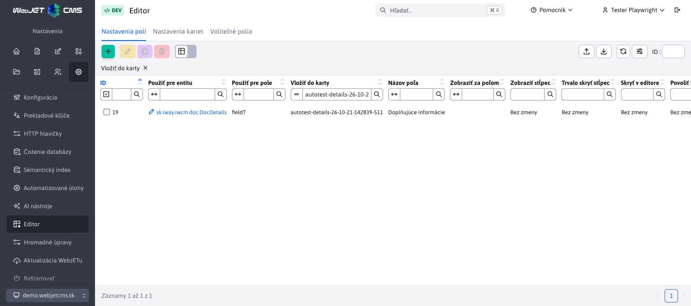
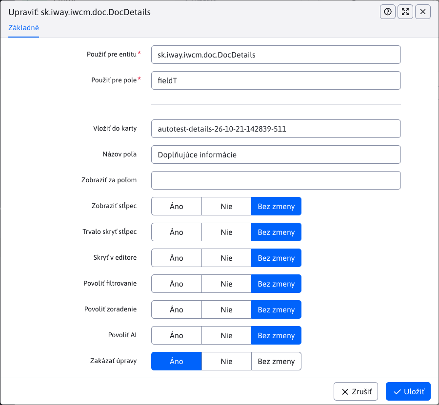

# Nastavenia polí

Karta **Nastavenia → Editor → Nastavenia polí** umožňuje upraviť názvy, poradie a zobrazenie polí v editore aj stĺpcov v tabuľke. Nastavenie sa vzťahuje na všetky záznamy vybranej entity v aktuálne zvolenej doméne. Na prístup potrebujete právo **Editor** (`dataTablesConfig`).

## Výber poľa

Pri vytváraní záznamu najprv vyberte **Použiť pre entitu**, napríklad `sk.iway.iwcm.doc.DocDetails` pre webové stránky. Potom v poli **Použiť pre pole** vyberte vlastnosť, ktorú chcete upraviť, napríklad `title` pre názov stránky.

Obe polia podporujú automatické dopĺňanie po zadaní aspoň jedného znaku. V návrhoch polí a kariet sa zobrazuje názov aj technický identifikátor; uloží sa identifikátor. Zadaním `*` alebo `%` zobrazíte všetky dostupné možnosti. Ponuka polí a kariet závisí od vybranej entity.

## Umiestnenie a názov

| Pole | Význam |
| --- | --- |
| **Vložiť do karty** | Identifikátor existujúcej karty, do ktorej sa pole presunie, napr. `basic`. Ponuka zahŕňa aj vlastné karty vytvorené v [Nastaveniach kariet](tabs-settings.md). |
| **Názov poľa** | Nový názov poľa/stĺpca. Môžete zadať text alebo prekladový kľúč. |
| **Zobraziť za poľom** | Identifikátor poľa, za ktoré sa upravované pole zaradí, napr. `navbar`. Vyberte pole v cieľovej karte. |

Prázdna hodnota v týchto nastaveniach ponechá pôvodnú hodnotu z definície entity. Novú kartu najprv vytvorte v [Nastaveniach kariet](tabs-settings.md), až potom do nej presúvajte polia.

## Zobrazenie a správanie

Prepínače majú tri hodnoty: **Áno**, **Nie** a **Bez zmeny**. Hodnota **Bez zmeny** ponechá pôvodné nastavenie poľa; neznamená automaticky **Nie**.

| Nastavenie | Význam hodnoty **Áno** |
| --- | --- |
| **Zobraziť stĺpec** | Stĺpec sa predvolene zobrazí v tabuľke. Pri hodnote **Nie** ho môže používateľ zapnúť vo výbere stĺpcov. |
| **Trvalo skryť stĺpec** | Stĺpec sa nezobrazí ani vo výbere stĺpcov. Táto voľba má prednosť pred nastavením **Zobraziť stĺpec**. |
| **Skryť v editore** | Pole sa nezobrazí v dialógu úpravy záznamu. Zobrazenie stĺpca v tabuľke sa nastavuje samostatne. |
| **Povoliť filtrovanie** | Povolí filter pre daný stĺpec. |
| **Povoliť zoradenie** | Povolí zoradenie tabuľky podľa daného stĺpca. |
| **Povoliť AI** | Povolí použitie AI funkcií pre pole, ak sú preň dostupné. |
| **Zakázať úpravy** | Pole je v editore iba na čítanie. |

Zobrazenie stĺpcov môže ovplyvniť aj uložené používateľské nastavenie tabuľky. Ak sa zmena neprejaví, obnovte nastavenie tabuľky.

## Príklad úpravy názvu stránky

Pre entitu `sk.iway.iwcm.doc.DocDetails` vyberte pole `title`, zadajte **Názov poľa** napr. `Názov webovej stránky`, **Vložiť do karty** nastavte na `basic` a **Zobraziť za poľom** na `navbar`. Ostatné voľby ponechajte **Bez zmeny**. Po uložení znovu načítajte zoznam webových stránok a otvorte editor.

Typ, povinnosť, nápovedu a možnosti voliteľných polí `fieldA` až `fieldZ` nastavujete na karte [Voliteľné polia](custom-fields-settings.md). Na ich presun do inej karty použite tieto **Nastavenia polí**.

## Validácia a zrušenie nastavenia

Pre kombináciu entity a poľa môže v jednej doméne existovať iba jeden záznam. Pole aj cieľová karta musia existovať pre vybranú entitu. Pole nemožno zaradiť za seba samé ani za neexistujúce pole.

Po uložení nastavenia znovu načítajte príslušnú stránku administrácie. Odstránením záznamu sa zrušia jeho úpravy a použije sa pôvodná definícia poľa; uložené hodnoty záznamov sa tým neodstránia.
