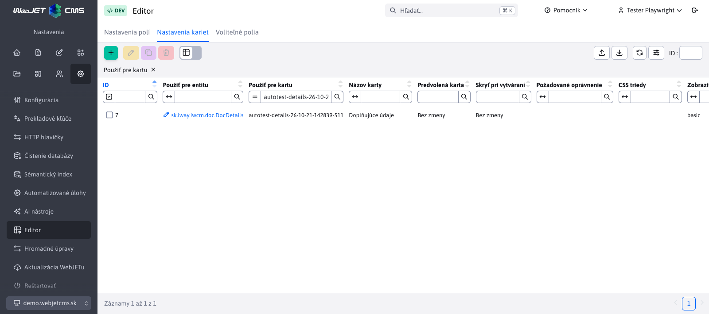
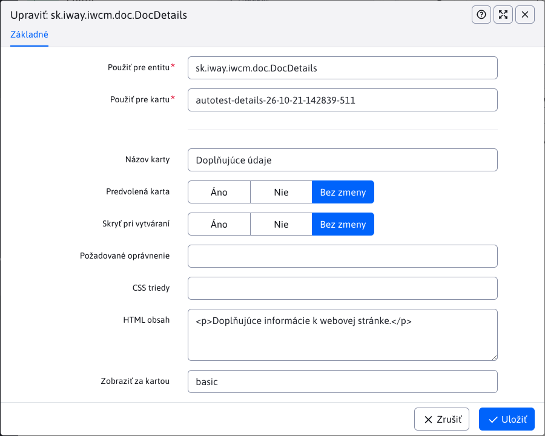

# Nastavenia kariet

Na karte **Nastavenia → Editor → Nastavenia kariet** upravíte členenie editora: premenujete a zoradíte karty, nastavíte predvolenú kartu alebo pridáte vlastnú kartu. Nastavenie platí pre všetky záznamy vybranej entity v aktuálne zvolenej doméne. Na prístup potrebujete oprávnenie **Editor** (`dataTablesConfig`).

## Výber alebo vytvorenie karty

Najprv v poli **Použiť pre entitu** vyberte triedu entity, napríklad `sk.iway.iwcm.doc.DocDetails` pre webové stránky. V poli **Použiť pre kartu** vyberte identifikátor existujúcej karty, napríklad `basic`, alebo zadajte nový identifikátor, napríklad `details`. Výberom existujúceho identifikátora upravíte danú kartu, zadaním nového vytvoríte vlastnú kartu.

Automatické dopĺňanie ponúka entity a karty po zadaní aspoň jedného znaku. Zadaním `*` alebo `%` zobrazíte všetky dostupné možnosti. Pri každej karte sa zobrazuje názov aj identifikátor. Do nastavenia sa uloží identifikátor.

## Nastavenia

| Pole | Význam |
| --- | --- |
| **Názov karty** | Zobrazený názov alebo prekladový kľúč. Pri novej karte bez názvu sa použije jej identifikátor. |
| **Predvolená karta** | Hodnota **Áno** vyberie kartu pri otvorení editora. |
| **Skryť pri vytváraní** | Hodnota **Áno** skryje kartu pri vytváraní nového záznamu; pri úprave existujúceho záznamu zostane dostupná. |
| **Požadované oprávnenie** | Kód oprávnenia, ktoré používateľ potrebuje na zobrazenie karty. |
| **CSS triedy** | CSS triedy na úpravu vzhľadu karty. |
| **HTML obsah** | Doplnkový obsah karty, napr. vysvetľujúci text. Samotné polia sa do karty priraďujú cez [Nastavenia polí](fields-settings.md). |
| **Zobraziť za kartou** | Identifikátor karty, za ktorú sa táto karta zaradí. Hodnota `FIRST` ju zaradí na začiatok. |

Prepínače **Predvolená karta** a **Skryť pri vytváraní** ponúkajú hodnoty **Áno**, **Nie** a **Bez zmeny**. Hodnota **Bez zmeny** zachová pôvodné správanie. Ak textové pole ponecháte prázdne, zachová sa pôvodná hodnota existujúcej karty.

Ako predvolenú odporúčame označiť iba jednu kartu. Ak ich označíte viac, editor vyberie prvú z nich vo výslednom poradí. Ak sa predvolená karta pri vytváraní záznamu nezobrazuje, editor vyberie dostupnú kartu.

## Vlastná karta s voliteľnými poľami

1. V **Nastaveniach kariet** vytvorte záznam pre `sk.iway.iwcm.doc.DocDetails` s identifikátorom `details` a názvom `Doplňujúce údaje`. Pole **Zobraziť za kartou** nastavte na `basic`.
2. Na karte [Voliteľné polia](custom-fields-settings.md) nastavte pre rovnakú entitu polia **A** a **B**: ich typ, popis a povinnosť vyplnenia.
3. V [Nastaveniach polí](fields-settings.md) vytvorte pre každé z polí `fieldA` a `fieldB` samostatný záznam. V oboch nastavte **Vložiť do karty** na `details`. Pri poli `fieldB` môžete nastaviť **Zobraziť za poľom** na `fieldA`.
4. Znovu načítajte zoznam webových stránok a otvorte editor. Polia sa zobrazia na karte **Doplňujúce údaje**. Zachovajú si typ, možnosti aj povinnosť vyplnenia z nastavení voliteľných polí.

## Validácia a zrušenie nastavenia

Kombinácia entity a identifikátora karty musí byť v jednej doméne jedinečná. Kartu nemožno zaradiť za seba samú. V poli **Zobraziť za kartou** môžete vybrať existujúcu kartu danej entity alebo zadať `FIRST`.

Odstránením nastavenia pôvodnej karty sa obnoví jej pôvodná definícia. Pri rušení vlastnej karty najprv presuňte jej polia na inú kartu alebo odstráňte ich nastavenia presunu. Až potom odstráňte kartu. Zmenu overte po opätovnom načítaní stránky administrácie.
