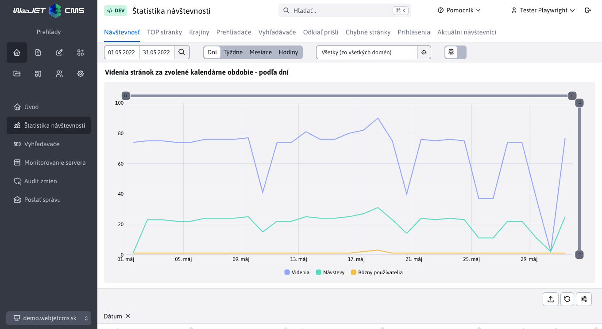
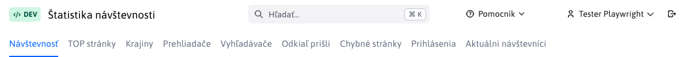
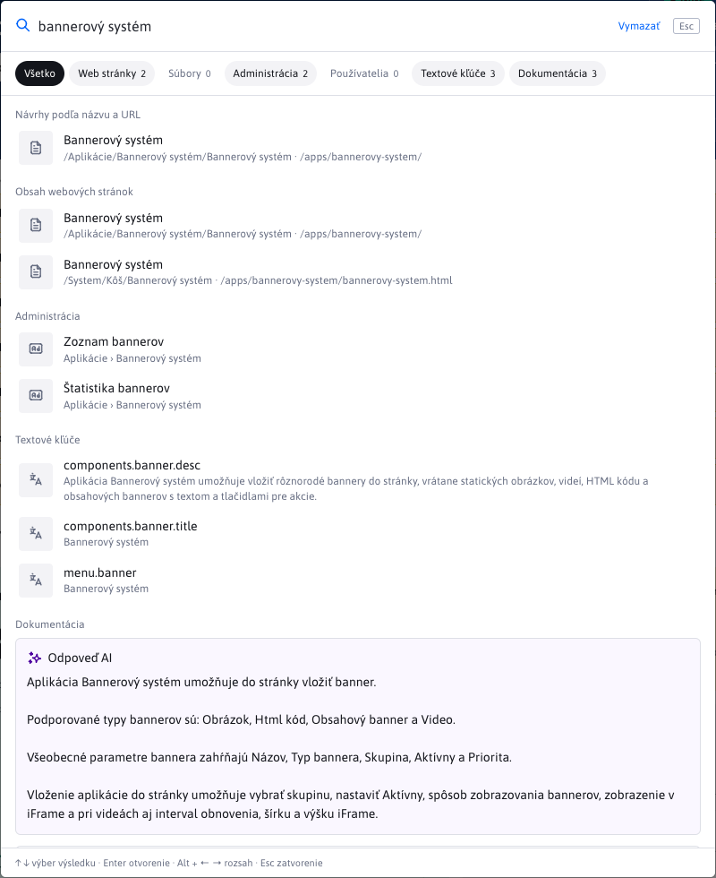
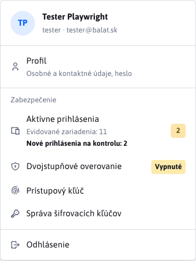
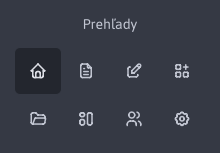
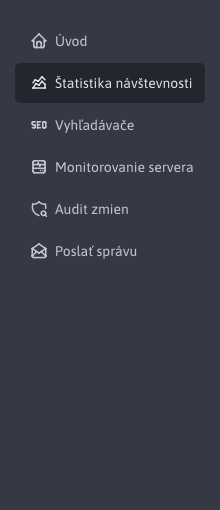
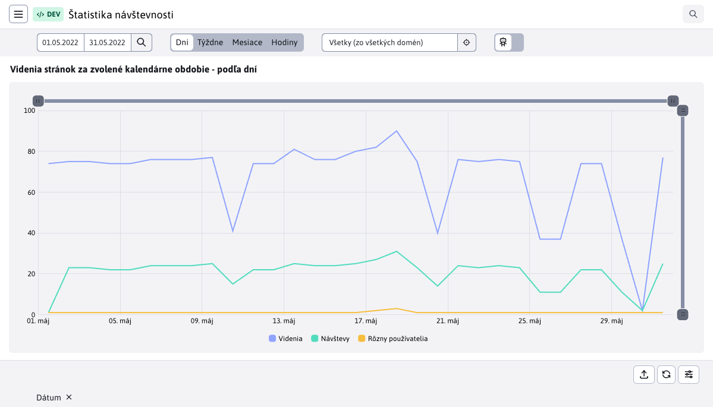
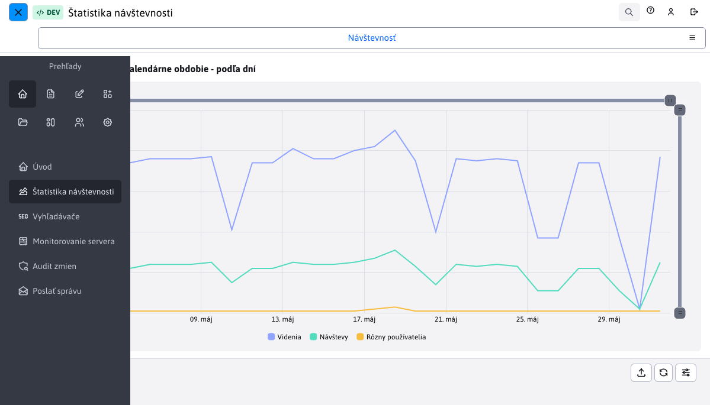
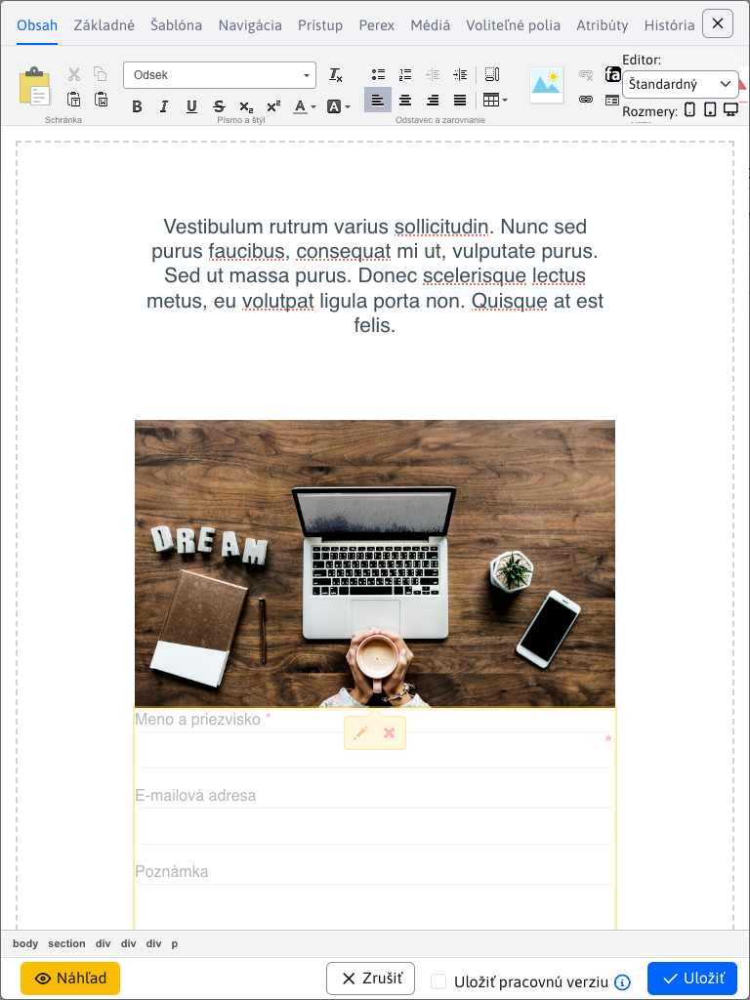
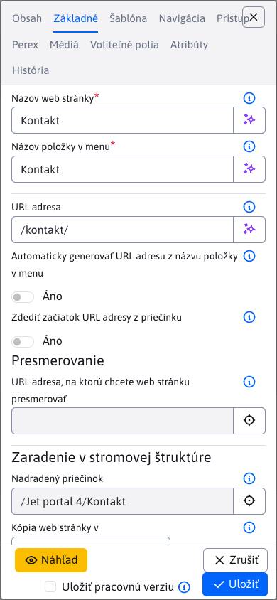

# Hlavné ovládacie prvky

Rozloženie administrácie je štandardné. V hornej časti sa nachádza hlavička, v ľavej časti menu. Tretia úroveň menu je zobrazená ako navigačné karty v hlavičke.

## Hlavička

V hornej časti sa nachádza hlavička:

obsahuje nasledovné možnosti:

- **Označenie prostredia** – farebný štítok pred názvom stránky, napríklad **DEV**, **TEST** alebo **PROD**, ktorý pomáha rozlíšiť, v ktorom prostredí pracujete. Jeho text, farbu a ikonu nastavíte podľa návodu [Konfigurácia úvodnej obrazovky a označenia prostredia](../../admin/setup/configuration/dashboard.md).
- **Názov aktuálnej stránky** – napríklad **Štatistika návštevnosti**, zobrazený za označením prostredia.
- Tlačidlo **Hľadať…** na otvorenie [rýchleho vyhľadávania](search/README.md). Dialóg otvoríte aj skratkou **Ctrl+K** vo Windows alebo **⌘K** na Macu.
- Menu **Pomocník** s pomocou k aktuálnej stránke, dokumentáciou, novinkami a kontaktmi.
- Meno aktuálne prihláseného používateľa, ktorým otvoríte [používateľské menu](#používateľské-menu) s profilom, zabezpečením účtu a odhlásením.
-  Ikonu na odhlásenie z administrácie.

V hlavičke sa môžu zobrazovať karty na prechod do tretej úrovne menu.

### Vyhľadávanie

Tlačidlo **Hľadať…** v hlavičke otvorí rýchle vyhľadávanie ponad aktuálnu stránku. Podľa vašich oprávnení môžete hľadať webové stránky, súbory, používateľov, textové kľúče a položky menu administrácie; dostupné je aj vyhľadávanie v dokumentácii. Podrobný opis možností a ovládania nájdete v časti [Vyhľadávanie](search/README.md).

### Pomocník

Menu **Pomocník** je dostupné v hlavičke na všetkých stránkach administrácie. Ponúka:

- **Pomoc k tejto stránke** – návod k otvorenej časti administrácie. Pod odkazom je názov aktuálnej stránky. Ak stránka nemá priradený návod, položka sa nezobrazí.
- **Dokumentácia WebJET CMS** – úvodná stránka dokumentácie v jazyku prihláseného používateľa.
- **Klávesové skratky** – [prehľad skratiek](keyboard-shortcuts.md) a miest, kde fungujú.
- **Čo je nové vo verzii…** – konkrétna verzia v dokumentácii. Počet aj označenie **Nové** sa týkajú noviniek nainštalovanej verzie, bez sociálnych príspevkov. Označenie zhasne po rozbalení noviniek na úvodnej obrazovke a vráti sa pri zmene ich textu. Samotné otvorenie menu obsah neoznačí za prečítaný.
- **Zoznam všetkých zmien** – kompletný changelog.
- **Poslať spätnú väzbu** – dialóg pre nápad, problém alebo pochvalu. Funguje aj mimo úvodnej obrazovky. Šípka späť vás vráti do menu; zatvorenie krížikom zachová rozpísanú správu počas otvorenia tejto stránky.
- **Kontaktovať podporu** – stránka podpory nastavená pre jazyk používateľa.

Odkazy na dokumentáciu a podporu sa otvárajú v novej karte. V spodnej časti menu je edícia, verzia a server WebJET CMS. Ikonou kopírovania skopírujete informácie pre podporu.

Menu možno ovládať klávesnicou: **Enter** alebo medzerník ho otvorí, šípky prechádzajú položky a **Esc** ho zatvorí a vráti fokus na tlačidlo **Pomocník**.

### Používateľské menu

Kliknutím na svoje meno v pravej hornej časti hlavičky otvoríte používateľské menu. V jeho hornej časti sú iniciály, celé meno, prihlasovacie meno a email, ak ho máte vyplnený v profile.

Menu ponúka:

- **Profil** – úprava vlastných osobných a kontaktných údajov a hesla. Po uložení systém odporúča odhlásiť sa a znova prihlásiť, aby sa prejavili všetky zmeny.
- **Aktívne prihlásenia** – prejde na úvodnú stránku a otvorí okno **Aktívne prihlásenia** na karte **Moje prihlásenia**. Môžete skontrolovať vlastné relácie, odhlásiť ostatné prihlásenia, spravovať zariadenia a prezerať históriu prihlásení; podľa oprávnení je dostupná aj karta prihlásených administrátorov. Podrobný opis nájdete v časti [Prihlásenia na úvodnej stránke](welcome.md#prihlásenia). Číslo pri položke udáva počet relácií vášho účtu zo všetkých serverov clustra, rovnako ako karta **Moje prihlásenia**. Text **Toto zariadenie a 3 ďalšie · 1 nové** znamená štyri relácie a jedno nové zariadenie na kontrolu. Žltý blok **Nové prihlásenie do vášho účtu** zobrazuje pri každom novom zariadení prehliadač a systém na prvom riadku, dostupnú polohu a čas posledného prihlásenia na druhom. Dátum a čas zostávajú pri zalomení spolu. Tlačidlo **Skontrolovať** otvorí dialóg na karte **Moje zariadenia**, kde môžete prihlásenia overiť.
- **Dvojstupňové overovanie** – nastavenie overovania kódom z aplikácie, napríklad `Google Authenticator` alebo `Microsoft Authenticator`. Štítok **Zapnuté** alebo **Vypnuté** ukazuje stav pre váš účet. Stav sa načíta pri každom otvorení menu. Postup zapnutia opisuje [Dvojstupňové overovanie](logon.md#dvojstupňové-overovanie). Položka sa zobrazuje, ak je konfiguračná premenná `2factorAuthEnabled` nastavená na `true`.
- **Prístupový kľúč** – správa prístupových kľúčov na prihlasovanie pomocou biometrie alebo PIN-u zariadenia. Umožňuje pridať nový kľúč a odstrániť zaregistrovaný kľúč. Postup nájdete v časti [Pridanie nového prístupového kľúča](logon.md#pridanie-nového-prístupového-kľúča). Položka sa zobrazuje, ak je konfiguračná premenná `password_passKeyEnabled` nastavená na `true`.
- **Správa šifrovacích kľúčov** – vytvorenie nového kľúča na šifrovanie formulárov alebo zadanie existujúceho kľúča na ich dešifrovanie. Položka sa zobrazuje používateľom s právom **Formuláre**.
- **Odhlásenie** – odhlásenie z administrácie. Rovnakú funkciu má samostatná ikona odhlásenia vedľa vášho mena v hlavičke.

Menu je dostupné na všetkých stránkach administrácie. Klávesom **Enter** alebo medzerníkom ho otvoríte, šípkami nahor a nadol prechádzate položky a klávesom **Esc** ho zatvoríte a vrátite fokus na svoje meno.

Menu sa otvorí ihneď. Počty a stav overovania sa načítajú následne; dovtedy je na ich mieste prázdny priestor. Ak načítanie zlyhá, zobrazí sa informácia o nedostupnosti údajov a odkazy v menu ostávajú funkčné.

## Menu

V ľavej časti pod logom WebJETu sú ikony reprezentujúce hlavné sekcie menu. Rozhodli sme sa pre takúto reprezentáciu prvej úrovne menu, aby sme nemuseli mať hlboko vnorené menu položky:

Kliknutím na ikonu hlavnej sekcie sa zobrazia menu položky zvolenej sekcie:

Výber domény s ktorou pracujete (pri viac doménovej inštalácii) sa nachádza v spodnej časti ľavého menu.

## Zobrazenie na mobilných zariadeniach

Administrácia sa prispôsobuje mobilným zariadeniam. Pri šírke okna menej ako 1200 bodov sa schová hlavička stránky a ľavé menu:

hlavičku a menu zobrazíte kliknutím na ikonu hamburger menu  vľavo hore. Následne sa menu a hlavička zobrazí ponad stránku. Navigačné karty sa v hlavičke zobrazia ako výberové menu.

menu zatvoríte kliknutím na ikonu zatvorenia menu .

Editor v datatabuľke pri šírke okna menej ako 992 bodov (tabletové zobrazenie) sa zobrazí na plnú veľkosť okna:

Pri okne užšom ako 576 bodov sa presunú aj názvy polí z ľavej strany nad pole pre lepšie zobrazenie napr. na mobilnom telefóne:

