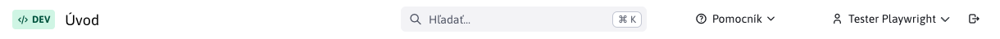
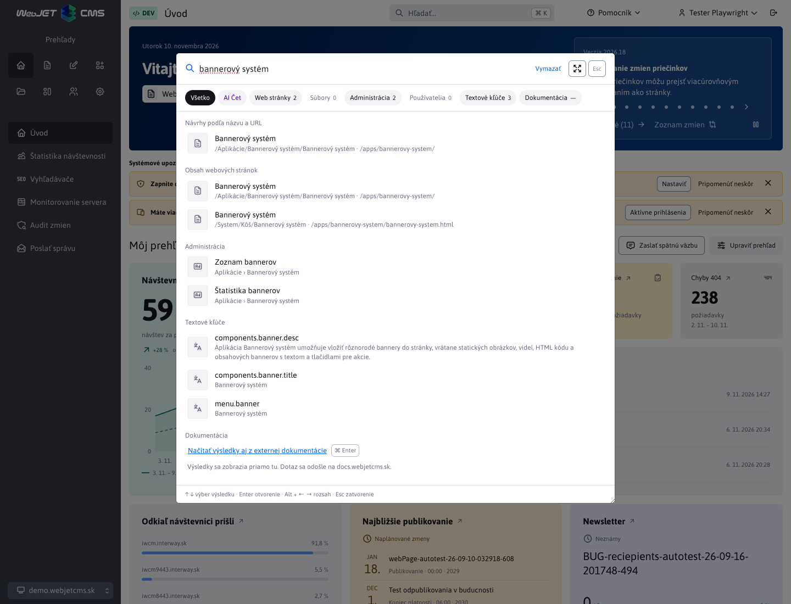
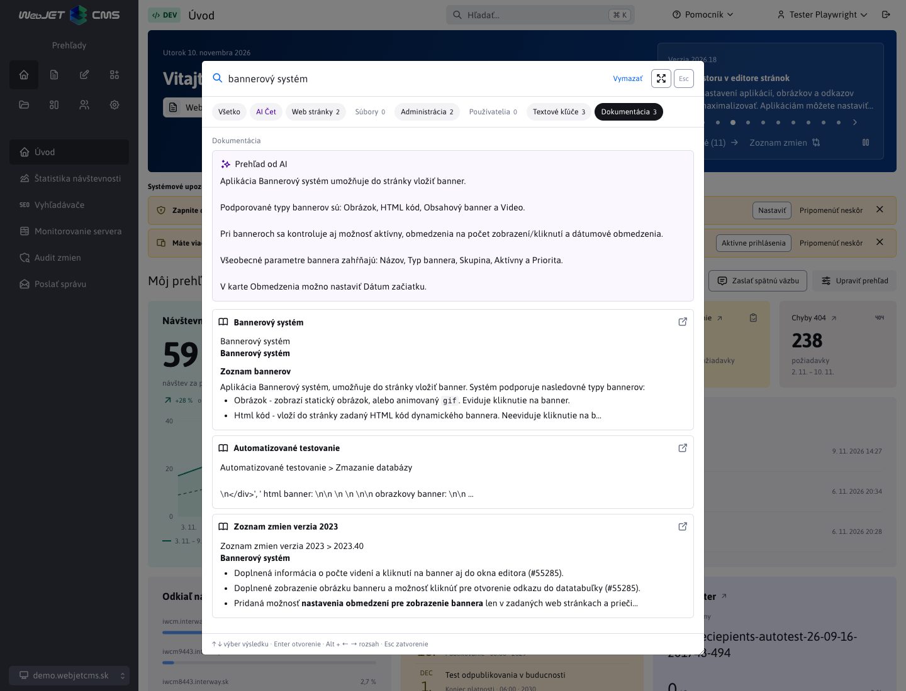
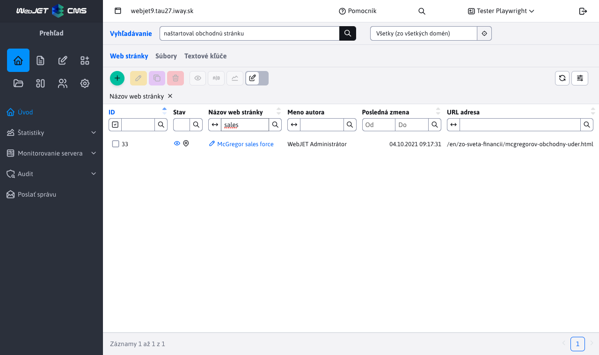

# Vyhľadávanie

## Rýchle vyhľadávanie v hlavičke

Tlačidlo **Hľadať…** v hlavičke otvorí vyhľadávanie ponad aktuálnu stránku. Je dostupné v celej administrácii. Otvoríte ho aj klávesmi **Ctrl+K** vo Windows alebo **⌘K** na Macu; po otvorení môžete hneď písať. Skratka nepreberá príkazy pri písaní v inom textovom poli alebo editore.

Pred zadaním výrazu uvidíte posledné hľadania a odkazy na dostupné sekcie. Históriu si prehliadač pamätá osobitne pre prihláseného používateľa a doménu. Jednotlivé záznamy aj celú históriu môžete odstrániť.

Rozsah **Všetko** zobrazuje najviac tri výsledky z každej oblasti. Kliknutím na rozsah alebo odkaz **Všetky** zobrazíte výsledky iba z vybratej oblasti. Ponuka sa riadi vašimi oprávneniami:

- **AI Chat** – rozhovor s AI asistentom bez väzby na obsah otvorenej webovej stránky. Karta je hneď za rozsahom **Všetko** a je dostupná používateľom s oprávnením na používanie AI asistentov.
- **Web stránky** – návrhy podľa názvu alebo URL stránky a hľadanie v obsahu. Návrh stránky otvorí jej editor.
- **Súbory** – hľadanie v názvoch a indexovanom obsahu súborov.
- **Administrácia** – odkazy na dostupné položky menu vrátane ich kariet.
- **Používatelia** – hľadanie podľa mena, priezviska, celého mena, emailu alebo prihlasovacieho mena.
- **Textové kľúče** – hľadanie kľúčov a ich prekladov.
- **Dokumentácia** – sémantické vyhľadávanie s ukážkami z dokumentácie priamo v dialógu. Ak služba vráti aj AI odpoveď, zobrazí sa nad výsledkami a môžete ju rozbaliť. Nadpisy, zoznamy a ďalšie Markdown formátovanie zostanú čitateľné. Kliknutím na výsledok otvoríte príslušnú stránku dokumentácie v novej karte.

Na úvodnej stránke sa predvolí **Všetko**. Pri otvorení z podporovanej sekcie sa predvolí jej rozsah. Zmena rozsahu platí do zatvorenia dialógu. V poli ho prepnete aj pomocou **Alt+šípka vľavo/vpravo**. **Tab** a **Shift+Tab** presúvajú fokus medzi ovládacími prvkami, šípky hore/dole vyberajú výsledok a **Enter** ho otvorí.

Odkaz **Otvoriť výsledky v sekcii…** prenesie hľadaný výraz do príslušnej sekcie, kde môžete použiť ďalšie filtre. Ak sa nič nenašlo, pri zúženom rozsahu môžete zvoliť **Hľadať všade**. Chyba spojenia zobrazí správu **Vyhľadávanie je dočasne nedostupné** a tlačidlo **Skúsiť znova**.

Dialóg zavriete klávesom **Esc**, tlačidlom zatvorenia alebo kliknutím mimo neho. Fokus sa vráti na tlačidlo v hlavičke; hľadaný výraz sa do tlačidla neprepisuje.

Veľkosť dialógu môžete meniť ťahaním za pravý dolný roh. Tlačidlo **Maximalizovať okno** v hlavičke zväčší dialóg na dostupnú plochu prehliadača. Tlačidlo **Zmenšiť okno** obnoví pôvodnú veľkosť aj po ručnom zväčšení. Zmena veľkosti zachová výsledky vyhľadávania, rozhovor aj rozpísanú správu v AI Chate.

Dokumentácia sa predvolene neprehľadáva automaticky. Karta zobrazuje pomlčku, ktorá znamená **zatiaľ neprehľadané**, nie nulový počet výsledkov. V rozsahu **Všetko** nájdete vysvetlenie, na ktorý server sa výraz odošle, a odkaz **Načítať výsledky aj z externej dokumentácie**. Kliknutie na tento odkaz alebo na kartu **Dokumentácia** vyhľadá už zadaný výraz a zobrazí výsledky v dialógu. Tooltip karty vysvetľuje odoslanie výrazu na externý server. Klávesová skratka **Ctrl+Enter** vo Windows/Linux alebo **⌘+Enter** na Macu načíta výsledky dokumentácie v ľubovoľnom rozsahu otvoreného dialógu. Príslušná skratka sa zobrazuje pri odkaze.

Po zmene výrazu sa výsledky dokumentácie vymažú a karta znova zobrazí pomlčku. Nové vyhľadávanie spustíte kliknutím na kartu alebo odkaz, prípadne klávesom **Enter** v rozsahu **Dokumentácia**. Enter v rozsahu **Všetko** predvolene prehľadáva iba interné zdroje. Prepínanie rozsahov pomocou **Alt+šípka** samo externý dotaz neodošle.

### AI Chat

Na karte **AI Chat** napíšte správu do zaobleného poľa v spodnej časti dialógu. V jeho dolnom riadku si vyberte nakonfigurovaného chatového asistenta. Správu odošlete tlačidlom so šípkou nahor alebo klávesom **Enter**; **Shift+Enter** vloží nový riadok. Pole sa počas písania zväčšuje podľa obsahu. Odpoveď môžete skopírovať tlačidlom s ikonou kopírovania pred údajom **Použité tokeny**. Text **Kopírovať** sa zobrazí po podržaní kurzora nad tlačidlom. Chat nepreberá obsah otvorenej stránky a neponúka jeho nahradenie ani doplnenie.

Odpovede asistenta zobrazujú formátovanie Markdown vrátane nadpisov, zoznamov, zvýraznenia, kódu a tabuliek, aj počas generovania a po otvorení uloženého rozhovoru. Tlačidlo **Kopírovať** skopíruje pôvodný text s Markdown značkami.

V hlavičke rozhovoru sa zobrazuje jeho názov. Otázky majú svetlofialové pozadie a odpovede asistenta označuje ikona iskier. Správy využívajú dostupnú šírku dialógu: odpovede zostávajú pri ľavom okraji a otázky pri pravom aj po zväčšení okna. Tabuľky oddeľujú riadky jemnými čiarami a číselné hodnoty zarovnávajú doprava, ak odpoveď neurčuje iné zarovnanie. Výber asistenta zostáva v poli na písanie správy.

Pri mene odosielateľa sa zobrazuje dátum a čas vytvorenia otázky alebo odpovede vo formáte administrácie a časovom pásme prehliadača. Uložené rozhovory zobrazujú pôvodný čas správ; pri starších správach bez časového údaja sa dátum nezobrazuje.

Rozhovor aj rozpísaná správa zostanú zachované pri prepnutí karty, výbere iného asistenta aj zatvorení a opätovnom otvorení vyhľadávania, kým neopustíte aktuálnu stránku administrácie. Pri návrate k asistentovi sa obnoví jeho naposledy otvorený rozhovor vrátane rozpísanej správy a neodoslaných príloh. Platí to aj pre nový rozhovor, v ktorom ste ešte neposlali správu. Tlačidlo **Nový chat** začne nový rozhovor so zvoleným asistentom. Počas generovania sa odosielacie tlačidlo zmení na **Zastaviť** so štvorcovou ikonou. Zastaví odpoveď vybraného asistenta a zachová už prijatý text aj rozpísanú správu.

Pri asistentoch OpenAI a Gemini s vypnutým dočasným režimom sa rozhovory ukladajú na serveri. V histórii nájdete svoje rozhovory pre aktuálnu doménu aj po obnovení stránky. Pokračovanie využíva kontext uložený u poskytovateľa. Ak už nie je dostupný, rozhovor zostane na čítanie a môžete začať nový chat.

V paneli **História chatov** môžete hľadať podľa názvu rozhovoru, textu otázok a odpovedí alebo mena asistenta a poskytovateľa. Vyhľadávanie prehľadá aj staršie, zatiaľ nenačítané rozhovory a nerozlišuje veľké písmená ani diakritiku. Vymazaním výrazu znova zobrazíte celú históriu.

Vybraný rozhovor v histórii označuje fialový pásik a farebné pozadie. Tlačidlo **Nový chat** je pri otvorenej histórii v jej hornej časti; po skrytí panela je v hlavičke rozhovoru. Panel skryjete ikonou bočného panela pri nadpise **História chatov**.

Ikona **Súbory v chate** v pravom hornom rohu rozhovoru otvorí panel so súbormi zo všetkých jeho správ. Nájdete v ňom nahrané prílohy aj súbory vrátené asistentom, označené ako **Nahrané** alebo **Vygenerované**. Podľa názvu ich môžete vyhľadať a kliknutím stiahnuť. Rozpísané, ešte neodoslané prílohy sa do zoznamu nezaradia. Pri prepnutí rozhovoru sa zobrazia súbory vybraného chatu. Na úzkej obrazovke sa panely histórie a súborov otvárajú ponad rozhovor vždy po jednom. Kláves **Esc** zatvorí panel a vráti fokus na jeho ikonu.

Tlačidlo **Vymazať** s ikonou koša pri rozhovore odstráni uložené odpovede u poskytovateľa a potom lokálnu históriu. Ak poskytovateľ vymazanie nepotvrdí, rozhovor zostane označený na vymazanie a akciu môžete zopakovať. Pri prerušenej požiadavke bez vráteného ID odpovede nie je možné potvrdiť úplné vymazanie; rozhranie tento stav zobrazí.

Pri ukladaných chatoch OpenAI a Gemini pridáte prílohy tlačidlom s ikonou kancelárskej sponky, pretiahnutím súborov do poľa správy alebo vložením obrázka zo schránky. Pred odoslaním uvidíte názvy súborov a náhľady obrázkov; prílohu môžete odstrániť tlačidlom **×**. Môžete odoslať aj samotné prílohy bez správy.

Jedna správa môže obsahovať najviac 5 príloh s celkovou veľkosťou do 10 MB. Podporované sú obrázky PNG, JPEG a WebP, dokumenty PDF, DOCX, XLSX a PPTX a textové súbory v UTF-8 (napríklad TXT, Markdown, CSV alebo JSON). Dokumenty musia obsahovať čitateľný text; skenované PDF bez textovej vrstvy sa nespracujú. Text príloh jednej správy môže mať najviac 100 000 znakov. Obrázky najprv opíše zvolený model; tento krok spotrebúva tokeny a jeho opis sa použije ako kontext rozhovoru. Model preto musí podporovať obrazový vstup.

Každý rozhovor má vlastný priečinok `/files/protected/ai-chat/<userId>/<threadId>/`, ktorý obsahuje súbor `ai_chat.json` s históriou rozhovoru a všetky jeho prílohy. Nové prílohy sa ukladajú pod poradovým číslom s pôvodnou príponou, napríklad `1.docx`, `2.png`, `3.jpg`; číslovanie pokračuje aj v ďalších správach rozhovoru. Staršie rozhovory sa pri načítaní automaticky presunú do tejto štruktúry a ich JSON súbor sa premenuje na `ai_chat.json`. Prílohy zostávajú pri správe v histórii aj po obnovení stránky. Kliknutím na názov súboru alebo tlačidlo **Stiahnuť prílohu** ich uložíte pod pôvodným názvom. Stiahnuť ich môže iba ich vlastník v príslušnej doméne, aj keď už nie je možné pokračovať v rozhovore. Ak sa prílohu nepodarí načítať, chat zobrazí chybový oznam. Vymazaním rozhovoru sa odstráni celý jeho priečinok vrátane príloh. V neukladaných chatoch je tlačidlo na prílohy neaktívne. Chat nepodporuje hlasový vstup.

Chat používa aktívnych a nakonfigurovaných asistentov s akciou **Chat**. Ak žiadny nie je dostupný, karta zobrazí oznam. Výraz z vyhľadávania sa do chatu neodosiela; správu odošlete až v poli chatu. Skratka na vyhľadávanie v dokumentácii počas písania v chate neprepína kartu.

### Nastavenie vyhľadávania v dokumentácii

V **Nastavenia → Konfigurácia** nastavte premennú `adminDocumentationSearchUrl` na platnú celú URL vyhľadávacej služby vrátane cesty. Predvolená hodnota je `https://docs.webjetcms.sk/rest/rag/markdown/search`. Pri zmene domény alebo cesty stačí upraviť túto premennú a obnoviť administráciu.

Prázdna hodnota `adminDocumentationSearchUrl` vypne vyhľadávanie v dokumentácii a skryje jeho kartu aj tlačidlo vo výsledkoch.

Premenná `adminDocumentationAlwaysSearch` má predvolenú hodnotu `false`. Nastavenie `true` zapne automatické vyhľadávanie v rozsahoch **Všetko** a **Dokumentácia** po dvoj sekundovej pauze pri aspoň 8 znakoch po odstránení okrajových medzier. Enter v týchto rozsahoch vyhľadá aj kratší neprázdny výraz. Zapnite ho iba v nasadení, kde dokumentačná služba môže prijímať interné dotazy, napríklad na schválenom vlastnom serveri. Prázdna URL vypne dokumentáciu aj pri hodnote `true`. Po zmene konfigurácie obnovte administráciu.

Premenná `adminDocumentationSearchUrl` zároveň určuje server pre odkazy v menu **Pomocník**, `WJ.showHelpWindow` a changelog. Z URL sa pre tieto odkazy použije iba protokol, doména a port; cesta vyhľadávacej služby sa ignoruje. Napríklad `https://manual.example:8443/rest/rag/markdown/search` otvorí dokumentáciu na `https://manual.example:8443/latest/sk/`. Dokumentácia je dostupná po slovensky, česky a anglicky; pre ostatné jazyky administrácie sa otvorí anglická verzia.

Administrácia doplní parameter `query` s hľadaným výrazom a podľa jazyka rozhrania odošle `language` a `directory`:

| Jazyk administrácie | `language` | `directory` |
| --- | --- | --- |
| Slovenský | `sk` | `/sk/` |
| Český | `cs` | `/cs/` |
| Anglický | `en` | `/en/` |

Endpoint vracia JSON s poľom `results`. Každý výsledok obsahuje `title`, `url` a Markdown ukážku `snippet`. Voliteľné AI zhrnutie je v elemente `answer` v Markdown formáte. Relatívne odkazy vo výsledkoch sa otvárajú na serveri dokumentácie.

Na serveri dokumentácie povoľte službu nastavením `restAllowedIpAddresses-MarkdownSearchRestController` na `*` alebo na povolené IP adresy či ich prefixy oddelené čiarkou. Pri predvolenej prázdnej hodnote sa použije globálne `restAllowedIpAddresses` (predvolene `127.0.0.1`). Neprázdne nastavenie controllera má prednosť. Pre verejné vyhľadávanie bez prihlásenia na server dokumentácie nastavte aj `ragMarkdownSearchRequireLogin=false`.

Ak dokumentácia beží na inej doméne, jej server musí povoliť CORS. Nastavenie patrí **na server dokumentácie**. Pre administráciu otvorenú na `http://iwcm.interway.sk` nastavte:

- `accessControlAllowOriginUrls` musí obsahovať `/rest/rag/markdown/search`. Predvolený zoznam `/rest/,/private/rest/,/admin/rest/` už túto cestu pokrýva, zachovajte ostatné potrebné cesty.
- `accessControlAllowOriginValue` nastavte na potrebnú doménu alebo `*`. Ide o adresu administrácie, nie dokumentácie. Pri inom protokole alebo porte použite presnú hodnotu z hlavičky `Origin` požiadavky.
- `accessControlAllowMethods` musí povoľovať `GET`, predvolená hodnota ho obsahuje.
- Ak používate obmedzenie `accessControlAllowedOrigins`, pridajte doň rovnaký origin administrácie.

Vyhľadávanie odosiela verejnú požiadavku bez cookies a prihlasovacích údajov. Pri verejnom dokumentačnom API určenom pre ľubovoľné inštalácie môžete vracať `Access-Control-Allow-Origin: *`. Ak hlavičku nastavuje reverzný proxy server, zabezpečte, aby sa neposielala dvakrát. Podrobnosti konfigurácie sú v [HTTP hlavičkách](../../../sysadmin/pentests/README.md#http-hlavičky).

HTTPS endpoint musí mať platný certifikát. Pri chybe certifikátu alebo CORS prehliadač odpoveď neposkytne administrácii a zobrazí sa možnosť zopakovať vyhľadávanie.

## Pokročilé vyhľadávanie

Sekcia **Vyhľadávanie** poskytuje tabuľky pre webové stránky, súbory a textové kľúče. Otvoríte ju odkazom **Otvoriť výsledky v sekcii…** z príslušného rozsahu rýchleho vyhľadávania. Zachová hľadaný výraz a zvolí zodpovedajúcu kartu.

## Kľúčové funkcie

1. **Fulltextové vyhľadávanie**:
   - Vyhľadávanie prebieha nielen v titulkoch stránok, ale aj v ich textovom obsahu.
   - Používateľ môže nájsť obsah aj na základe kľúčových slov, ktoré sa nachádzajú v texte dokumentov alebo súborov.

2. **Filtrovanie výsledkov**:
   - Okrem fulltextového vyhľadávania je možné využiť stĺpcové filtre pre presnejšie zobrazenie výsledkov.
   - Tabuľky umožňujú filtrovanie na základe stĺpcov, ako sú `Názov web stránky`, `Meno autora` alebo `Kľúč`.

3. **Podpora viacerých typov obsahu**:
   - Webové stránky
   - Súbory
   - Textové kľúče

## Používanie sekcie Vyhľadávanie

### Rozhranie Vyhľadávania

Sekcia je rozdelená do niekoľkých kariet. Každá karta umožňuje špecifické vyhľadávanie a filtrovanie:

#### 1. Web stránky

- **Fulltextové vyhľadávanie:** Zadajte kľúčové slovo, ktoré sa nachádza v texte stránky alebo jej titulku.
- **Obmedzenie podľa stromovej štruktúry**  Môžete obmedziť vyhľadávanie výberom priečinka v ktorom sa bude vyhľadávať (hľadá sa aj v pod priečinkoch).
- **Filtrovanie:** Použite stĺpce ako `Názov web stránky` a `Meno autora` na zúženie výsledkov.
- **Práva používateľov:** Zobrazené výsledky závisia od práv jednotlivých používateľov. Používateľ vidí iba tie stránky, na ktoré má oprávnenie.

#### 2. Súbory

- **Fulltextové vyhľadávanie:** Vyhľadávajte text, ktorý sa nachádza v obsahu súborov, ako aj v názvoch súborov.
- **Filtrovanie:** Stĺpce ako `Názov súboru` a `URL adresa` pomáhajú presne špecifikovať výsledky.
- **Symbol oka:** Kliknutím na ikonu oka  pri názve súboru si môžete súbor zobraziť.
- **URL adresa:** Odkazy  umožňujú rýchlu navigáciu do adresára v Prieskumníkovi.

!> Upozornenie: na vyhľadávanie v súboroch sa používa [plno textový index súborov](../../files/fbrowser/folder-settings/README.md#indexovanie), nájdené sú teda len súbory, ktoré sú indexované.

#### 3. Textové kľúče

- **Fulltextové vyhľadávanie:** Nájdite textové kľúče podľa obsahu vo všetkých dostupných jazykoch.
- **Filtrovanie:** Používajte stĺpce, ako `Kľúč` alebo `Jazyk`, na presnejšie vyhľadávanie.

## Príklady použitia

- **Vyhľadávanie vo web stránkach:**
  - Hľadáte frázu `naštartoval obchodnú stránku`.
  - Výsledky obsahujú stránky, kde sa táto fráza nachádza v texte. Pre zúženie výsledkov použijete filter `sales` v stĺpci pre `Názov stránky`.

- **Vyhľadávanie v súboroch:**
  - Hľadáte `only for users in Bankari group`.
  - Výsledky obsahujú všetky súbory, kde sa táto fráza nachádza v texte.

- **Vyhľadávanie textových kľúčov:**
  - Hľadáte `Pridať adresár`.
  - Výsledky obsahujú kľúče so slovenským textom `Pridať adresár`. Následne môžete použiť filter `addGroup` v stĺpci `Kľúč` na zúženie výsledkov.
