# Úvodná obrazovka

Na úvodnej obrazovke skontrolujete návštevnosť, odoslané formuláre či stránky čakajúce na schválenie a vrátite sa k rozpracovaným stránkam.

    <iframe width="790" height="444" src="https://www.youtube.com/embed/X2GNFn8IpCI" title="YouTube video player" frameborder="0" allow="accelerometer; autoplay; clipboard-write; encrypted-media; gyroscope; picture-in-picture" allowfullscreen></iframe>

Prehľad tvoria **widgety**, teda karty s údajmi, napríklad grafom návštevnosti alebo zoznamom požiadaviek na schválenie. Vyberte si tie, ktoré pri práci využívate. Pomocou [skratiek](#vaše-skratky) otvoríte často používanú časť administrácie alebo konkrétny priečinok.

Predvolene sa podľa vašich oprávnení zobrazia widgety **Návštevnosť**, **Formuláre**, **Na schválenie**, **Chyby 404**, **Pokračujte v práci**, **Odkiaľ návštevníci prišli**, **Najbližšie publikovanie** a **Newsletter**. Nad nimi nájdete privítanie so skratkami, novinky a systémové upozornenia.

Rozloženie sa ukladá na váš účet a je spoločné pre všetky domény a prehliadače. Výber konkrétneho formulára alebo kampane sa pamätá osobitne pre každú doménu. Dostupnosť widgetov závisí od vašich oprávnení.

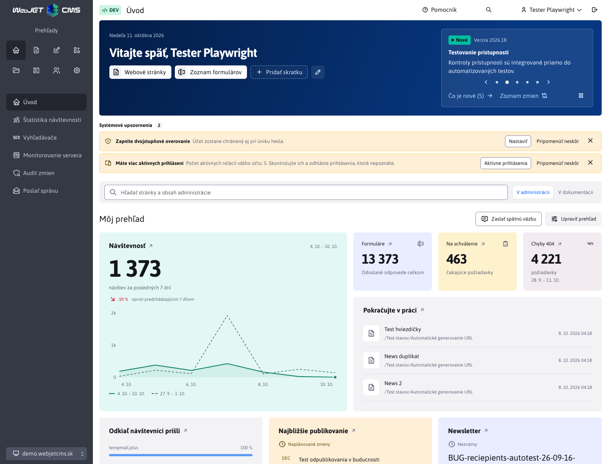

Označenie **PROD**, **TEST**, **CIT**, **INT**, **UAT**, **DEMO**, **LOCAL** alebo **DEV** pomáha rozlíšiť prostredia, v ktorých pracujete. Nájdete ho v hlavičke administrácie, na prihlasovacej stránke aj v titulku karty prehliadača. Správca môže jeho vzhľad upraviť v [konfigurácii prostredia](../../admin/setup/configuration/dashboard.md).

## Prispôsobenie prehľadu

Widgety, ktoré kontrolujete najčastejšie, umiestnite na začiatok. Nepotrebné môžete odstrániť.

Kliknite na **Upraviť prehľad**. V lište sa zobrazia tlačidlá **Obnoviť predvolené**, **Pridať widget**, **Zrušiť** a **Uložiť**. Widgety môžete presúvať úchytom alebo upravovať cez **Možnosti widgetu**.

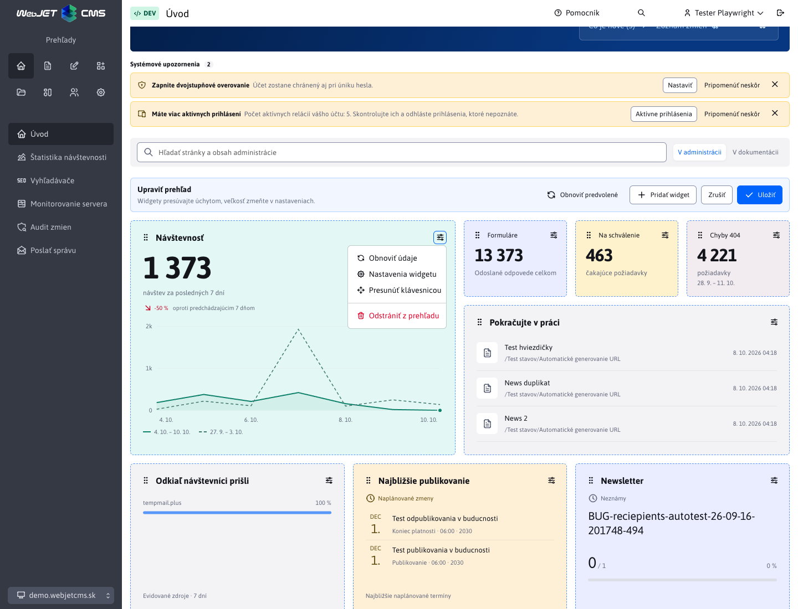

Nový widget pridáte takto:

1. Kliknite na **Pridať widget** a vyhľadajte ho v katalógu.
2. Pri widgete kliknite na **Pridať** alebo **Pridať ďalší**.
3. Vyberte veľkosť a ďalšie nastavenia. Výsledok skontrolujte v náhľade.
4. Potvrďte tlačidlom **Pridať widget**. Widget pribudne na koniec prehľadu. Ak nastavenie zrušíte, nepridá sa.

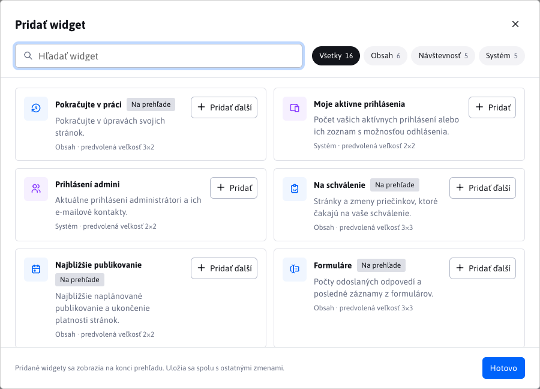

Tlačidlo **Možnosti widgetu** ponúka:

- **Nastavenia widgetu**: zmeňte veľkosť, farbu a dostupné možnosti, napríklad obdobie alebo formulár. Nie každý widget ponúka viac veľkostí. Zmeny potvrďte tlačidlom **Použiť**.
- **Presunúť klávesnicou**: šípkami zmeňte pozíciu, klávesom **Enter** ju potvrďte alebo **Esc** presun zrušte. Presun spustíte aj medzerníkom na úchyte. Kláves **Esc** zruší aj presun myšou.
- **Odstrániť z prehľadu**: odstráňte kartu bez potvrdenia. Údaje aplikácie zostanú zachované. Akciu vrátite cez **Späť** v oznámení alebo **Ctrl Z**. Oznámenie je dostupné 8 sekúnd; pri podržaní myši alebo zameraní klávesnicou sa odpočet zastaví. Widget môžete kedykoľvek pridať znova.
- **Obnoviť údaje**: načítajte aktuálne údaje karty.

Väčšiu kartu zvoľte pre podrobnejší graf alebo dlhší zoznam. V časti **Farba pozadia** vyberte odtieň z palety alebo **Vlastnú farbu**, ktorú môžete zadať aj kódom HEX. Príliš tmavú farbu treba nahradiť svetlejšou. Voľba **Predvolená** obnoví pôvodné pozadie widgetu. Zmeny uvidíte v náhľade.

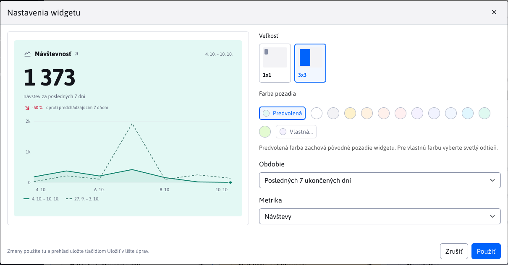

Po dokončení kliknite na **Uložiť** v lište. Až tým sa uložia všetky úpravy widgetov. Pri chybe zostanú zmeny dostupné na opätovné uloženie. Pri neuložených zmenách tlačidlo **Zrušiť** ponúkne **Pokračovať v úpravách** alebo **Zahodiť zmeny**; pri odchode zo stránky upozorní prehliadač. Skratky sa upravujú a ukladajú samostatne.

Rozloženie môže obsahovať najviac 48 položiek vrátane skratiek, prihlásení, noviniek a vyhľadávania.

Tlačidlo **Obnoviť predvolené** po potvrdení pripraví pôvodný výber widgetov, ich veľkosti, poradie a nastavenia. Kliknutím na **Uložiť** sa obnova dokončí a vymažú sa aj filtre widgetov vo všetkých doménach. Skratky a ostatné nastavenia účtu zostanú zachované.

Ak pri kliknutí na **Obnoviť predvolené** podržíte **Shift**, po potvrdení sa pripraví prehľad so všetkými dostupnými widgetmi v každej podporovanej veľkosti. Nepotrebné varianty odstráňte a výsledok uložte.

## Dostupné informácie

Widgety môžete pridať opakovane s rôznymi nastaveniami, napríklad na sledovanie dvoch formulárov alebo návštevnosti za 7 a 30 dní.

Štatistické widgety predvolene zobrazujú posledných sedem ukončených dní. Vybrať môžete aj 30 alebo 90 dní; porovnanie používa rovnako dlhé predchádzajúce obdobie. Skutočný rozsah dátumov je uvedený na karte. Formuláre a chyby 404 majú pravidlá opísané nižšie.

### Skratka do modulu

Otvorí často používanú časť administrácie, priečinok alebo vlastnú URL adresu. Postup pridania nájdete v časti [Vaše skratky](#vaše-skratky).

### Pokračujte v práci

Zobrazuje najviac šesť vašich naposledy upravovaných stránok. Kliknutím na stránku sa vrátite do jej editora, kliknutím na nadpis widgetu otvoríte celý zoznam webových stránok.

### Na schválenie

Zobrazuje požiadavky z karty **Neschválené** vo Web stránkach. Väčší variant obsahuje šesť najnovších požiadaviek na zmenu alebo zmazanie stránky či priečinka.

Kliknutím na položku otvoríte jej schvaľovanie. Nadpis alebo celkový počet otvorí celý zoznam požiadaviek.

### Najbližšie publikovanie

Ukazuje, ktoré stránky sa majú **zverejniť alebo prestať zobrazovať**, spolu s dátumom a časom zmeny. Kliknutím na nadpis otvoríte úplný plán publikovania.

### Formuláre

Zobrazuje odoslané formuláre, napríklad dopyty alebo kontaktné správy. V nastaveniach vyberte konkrétny formulár alebo všetky dostupné formuláre.

- **Všetky formuláre**: celkový počet odpovedí za celé obdobie. Veľký widget zobrazí desať formulárov s najnovším odoslaním. Kliknutím na názov otvoríte odpovede.
- **Konkrétny formulár**: vo veľkom widgete posledných desať odoslaní za zvolené obdobie. V stĺpci **Formulár** je meno, priezvisko a email; ak tieto polia chýbajú, zobrazia sa prvé tri vyplnené údaje. Kliknutím otvoríte detail odoslania.

### Návštevnosť

Porovnáva návštevnosť webu s predchádzajúcim obdobím. V nastaveniach vyberte obdobie a údaj: počet zobrazení, návštev alebo unikátnych návštevníkov. Presné hodnoty zobrazíte podržaním kurzora nad grafom.

### Najnavštevovanejšie stránky

Zobrazuje stránky s najvyšším počtom zobrazení za zvolené obdobie. Pomôže určiť, ktorému obsahu venovať pozornosť pri aktualizácii. Kliknutím na stránku otvoríte jej podrobnú štatistiku.

### Čo návštevníci hľadajú

Zobrazuje hľadané výrazy a ich počty za zvolené obdobie. Zistíte, o ktoré témy majú návštevníci záujem a či k nim na webe nájdu aktuálne informácie.

### Odkiaľ návštevníci prišli

Porovnáva podiel zdrojov návštevnosti za zvolené obdobie. Presné hodnoty zobrazíte podržaním kurzora nad grafom.

### Chyby 404

Pomáha nájsť neexistujúce adresy a určiť, ktoré odkazy alebo presmerovania treba preveriť ako prvé.

Počíta chybové požiadavky, nie rôzne adresy. Údaje zahŕňajú celé týždne zasahujúce do zvoleného obdobia; aktuálny týždeň obsahuje doterajšie údaje. Skutočný rozsah dátumov vidíte na karte. Ak historické údaje nemožno oddeliť podľa domény, karta oznámi ich nedostupnosť.

### Newsletter

Sleduje priebeh odosielania hromadného emailu a zaznamenané otvorenia či kliknutia. Vyberá aktívnu kampaň, najbližšiu naplánovanú alebo poslednú dokončenú. V nastaveniach môžete zvoliť konkrétnu kampaň.

Pri odosielaní sa údaje viditeľnej karty obnovujú každých 30 sekúnd.

### Čo je nové

V paneli **Čo je nové** nájdete novinky nainštalovanej verzie WebJET CMS aj videá a príspevky z YouTube a Facebooku WebJET CMS. Na jednom mieste tak môžete sledovať nové funkcie a návody na ich používanie. Kliknutím na novinku alebo tlačidlo **Čo je nové** rozbalíte celý prehľad.

Štítok **Nové** upozorňuje na neprečítaný obsah. Po rozbalení panela sa zobrazené novinky označia za prečítané a štítok sa skryje. Znova sa objaví, keď pribudne príspevok alebo sa aktualizujú novinky nainštalovanej verzie.

### Systémové upozornenia

Upozornenia informujú o problémoch vyžadujúcich vašu pozornosť. Nové prihlásenie z neznámeho zariadenia je vždy prvé, za ním nasledujú chyby, varovania a informácie.

Chyby zostávajú viditeľné do vyriešenia príčiny. Bežné varovanie môžete odložiť na 7 dní tlačidlom **Pripomenúť neskôr** alebo **×**.

#### Nové prihlásenie z neznámeho zariadenia

Ak sa prihlásite z prehliadača, ktorý WebJET CMS pri vašom účte nerozpozná ako použitý počas posledných 90 dní, zobrazí sa upozornenie a dostanete email. Skontrolujte prehliadač, operačný systém, IP adresu a čas prihlásenia. Pri aktuálnom prehliadači sa zobrazí **Prihlásili ste sa z nového prehliadača** a označenie **Tento prehliadač**.

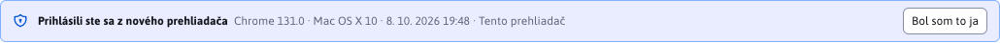

Email **Nové prihlásenie do WebJET CMS** obsahuje údaje o prihlásení a tlačidlá na jeho potvrdenie alebo zabezpečenie účtu.

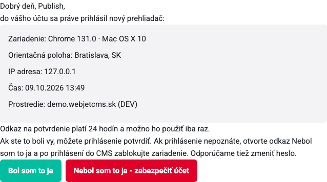

#### Ak prihlásenie poznáte

Kliknite na **Bol som to ja**. Na váš email sa odošle šesťmiestny kód. Zadajte ho pod upozornením a kliknite na **Potvrdiť kód**.

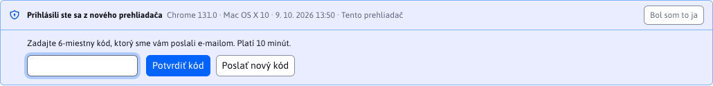

Kód nájdete v emaile **Kód na potvrdenie prihlásenia do WebJET CMS**:

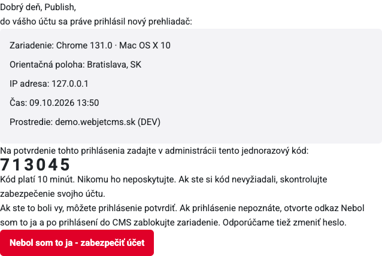

Kód platí 10 minút a umožňuje najviac 5 pokusov. Po minúte môžete cez **Poslať nový kód** vyžiadať ďalší; predchádzajúci prestane platiť. Po overení sa zariadenie potvrdí a upozornenie zmizne aj v ostatných prehliadačoch po obnovení prehľadu.

Použiť môžete aj odkaz **Bol som to ja** v pôvodnom emaile. Platí 24 hodín, iba raz a po prihlásení do príslušného účtu. Vyžiadanie nového kódu ho nezruší; úspešné potvrdenie zneplatní odkaz aj kód.

#### Ak prihlásenie nepoznáte

Pri upozornení alebo v karte **Moje zariadenia** v okne **Aktívne prihlásenia** kliknite na **Nebol som to ja**. Zariadenie sa zablokuje a jeho známe relácie sa odhlásia. Ak zablokujete aktuálny prehliadač, odhlási aj vás.

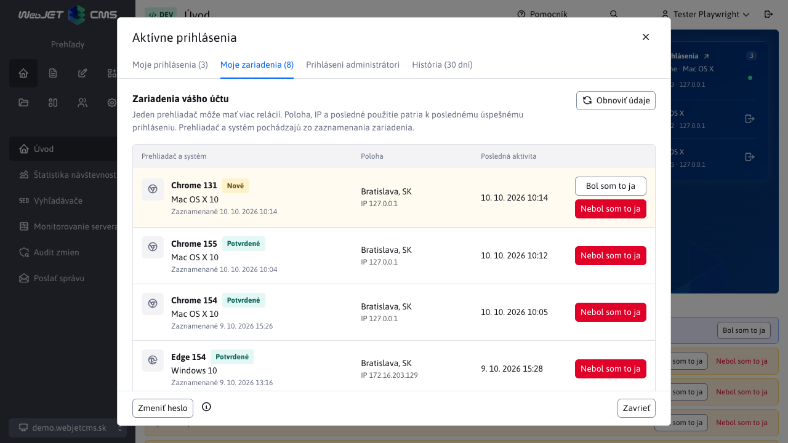

Odkaz **Nebol som to ja – zabezpečiť účet** v emaile po prihlásení otvorí okno **Zabezpečte svoj účet**. Samotné otvorenie zariadenie nezablokuje; použite tlačidlo **Zablokovať zariadenie**.

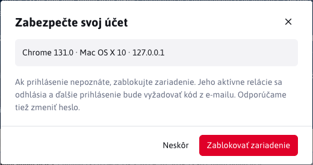

Po zablokovaní zvoľte **Zmeniť heslo** a skontrolujte ostatné prihlásenia. Ak je dostupné, cez **Zapnúť 2FA** nastavte dvojstupňové overovanie. **Neskôr** iba zatvorí okno. Pri firemnom účte zmeňte heslo u poskytovateľa prihlásenia alebo kontaktujte správcu.

Pri ďalšom prihlásení zo zablokovaného zariadenia treba po zadaní správnych prihlasovacích údajov zadať [kód z emailu](logon.md#overenie-zablokovaného-zariadenia). Až správny kód prehliadač odblokuje.

#### Zapamätanie prehliadača a platnosť upozornenia

Po úspešnom dvojfaktorovom overení sa nezablokovaný prehliadač potvrdí automaticky. Dostanete informačný email s možnosťou **Nebol som to ja**. Pri zablokovanom zariadení sa aj po 2FA vyžaduje emailový kód; pozrite [Overenie zablokovaného zariadenia](logon.md#overenie-zablokovaného-zariadenia).

Upozornenie na nové zariadenie nemožno odložiť ani zavrieť krížikom. Zmizne po potvrdení alebo zablokovaní zariadenia, najneskôr po 7 dňoch od udalosti. Ďalšie prihlásenia lehotu nepredĺžia. Zablokovanie zostáva platné aj po zmiznutí upozornenia. Zistenie, potvrdenie a zablokovanie zariadenia sa zapisujú do auditu ako **USER_DEVICE**.

WebJET CMS si prehliadač pamätá pomocou cookie. Každé dokončené prihlásenie predĺži zapamätanie o 90 dní; odhlásenie cookie neodstráni. Po vymazaní alebo expirácii cookie sa prehliadač rozpozná ako nový a neuplatní sa ani jeho predchádzajúce blokovanie. Nové upozornenie môžete dostať aj v inom profile alebo anonymnom okne. Aktualizácia prehliadača či zmena IP adresy pri zachovanej cookie ho nevyvolá. Lehotu môže správca zmeniť v [konfigurácii](../../admin/setup/configuration/dashboard.md).

### Vyhľadávanie a pomoc

Kliknite na **Hľadať…** v hlavičke alebo stlačte **Ctrl+K** vo Windows či **⌘K** na Macu. [Rýchle vyhľadávanie](search/README.md) nájde podľa vašich oprávnení stránky, súbory, položky administrácie, používateľov a textové kľúče. Stránky môžete hľadať podľa názvu alebo URL.

Rozsah **Dokumentácia** vyhľadá zadaný výraz v návodoch. Pomoc k otvorenej časti administrácie nájdete aj cez Pomocníka v hlavičke.

### Moje aktívne prihlásenia

Skontrolujete svoje prihlásenia a odhlásite zariadenie, ktoré už nepoužívate. Panel v hornej časti prehľadu nemožno odstrániť; z katalógu môžete pridať aj samostatný widget. Podrobnosti nájdete v časti [Prihlásenia](#prihlásenia).

### Prihlásení admini

Ukazuje kolegov, ktorí práve pracujú v systéme, a umožňuje im odoslať email. Dostupnosť závisí od vašich oprávnení. Pozrite [Prihlásení administrátori](#prihlásení-administrátori).

### Zmenené stránky

Zobrazuje posledné úpravy dostupných stránok v aktuálnej doméne aj s autorom zmeny.

### Audit

Zobrazuje posledné udalosti z celého servera podľa vašich oprávnení. Pomôže pri kontrole operácií alebo zisťovaní príčiny problému.

### Obsadenosť pamäte

Zobrazuje využitie pamäte servera, napríklad na preverenie spomalenia systému. Podrobnosti nájdete v časti [Zmenené stránky, audit a monitorovanie](#zmenené-stránky-audit-a-monitorovanie).

### Zaťaženie CPU

Zobrazuje zaťaženie procesora servera. Pomôže preveriť, či súvisí s pomalými odozvami. Pozrite [Zmenené stránky, audit a monitorovanie](#zmenené-stránky-audit-a-monitorovanie).

## Prihlásenia

Okno **Aktívne prihlásenia** otvoríte z ktorejkoľvek stránky cez [používateľské menu](README.md#používateľské-menu): kliknite na svoje meno a vyberte **Aktívne prihlásenia**. Prejdete na úvodnú stránku s otvorenou kartou **Moje prihlásenia**.

Okno otvoríte aj cez nadpis widgetu **Moje aktívne prihlásenia** alebo odkaz v systémovom upozornení na viacero relácií. Ponúka vlastné prihlásenia, správu zariadení, históriu za posledných 30 dní a podľa oprávnení aj prihlásených administrátorov.

### Moje aktívne prihlásenia

Karta **Moje prihlásenia** zobrazuje aktívne relácie vášho účtu. Jeden prehliadač môže mať viac relácií. Pri každej vidíte prehliadač, operačný systém, dátum prihlásenia a IP adresu. Aktuálna relácia je označená ako **Toto prihlásenie**.

Stĺpec **Poloha** obsahuje [orientačné mesto a krajinu](../../admin/setup/configuration/dashboard.md#orientačná-poloha-prihlásenia) podľa verejného internetového pripojenia. Ak ich nemožno zistiť, zobrazí sa **Neznáma**. IP adresa zistená serverom môže byť interná.

Ostatné relácie môžete odhlásiť jednotlivo cez **Odhlásiť**, napríklad ak ste sa zabudli odhlásiť na inom počítači. Tlačidlo **Odhlásiť všetky ostatné** vyžaduje potvrdenie. **Zmeniť heslo** otvorí váš profil; informačná ikona pri tlačidle obsahuje pokyny pre firemné účty.

Widget **Moje aktívne prihlásenia** pri jedinej relácii oznámi, že ste prihlásený iba tu. Pri viacerých ukáže počet a vo väčších variantoch aj zoznam. Relácie nepotvrdených zariadení označí štítkom **Nové**.

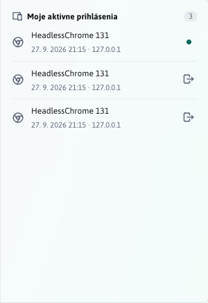

V clustri sa pri relácii zobrazuje aj server, na ktorom je aktívna. Ak zvolíte **Odhlásiť túto reláciu**, na aktuálnom uzle sa ukončí okamžite; na inom uzle sa čaká na synchronizáciu, typicky do minúty. Doménu a uzol zobrazíte podržaním kurzora nad záznamom.

Údaje sa aktualizujú po prihlásení používateľa. Častejšiu aktualizáciu môže správca nastaviť cez [úlohu na pozadí](../../admin/settings/cronjob/README.md) `sk.iway.iwcm.stat.SessionClusterService`, napríklad každých 10 minút. Úloha odstraňuje záznamy staršie ako 60 minút; bez nej sa pri prihlásení odstránia záznamy staršie ako 24 hodín.

### Moje zariadenia

Karta **Moje zariadenia** obsahuje uložené prehliadače vášho účtu aj bez aktívnej relácie. Sú zoradené od naposledy použitých, po 20 na stránku. Tlačidlom **Obnoviť údaje** načítate aktuálny stav.

Pri zariadení vidíte prehliadač, operačný systém, čas zaznamenania a údaje posledného úspešného prihlásenia: **Posledná aktivita**, IP adresa a **Poloha**. Nedostupná poloha je označená ako **Neznáma**. Aktuálny prehliadač má štítok **Toto zariadenie**.

- **Nové**: zariadenie zatiaľ nie je potvrdené. Cez **Bol som to ja** si pošlite emailový kód a zadajte ho pod zariadením. Až správny kód zariadenie potvrdí a odstráni upozornenie. **Zrušiť** zavrie formulár bez zmeny stavu.
- **Potvrdené**: ak zariadenie nepoznáte, cez **Nebol som to ja** ho môžete zablokovať. Dátum potvrdenia zobrazíte podržaním kurzora nad štítkom.
- **Zablokované**: odblokuje sa až pri ďalšom prihlásení overením kódu z emailu. Dátum a pokyny zobrazíte podržaním kurzora nad štítkom.

Ak nepoznáte nové zariadenie, tiež použite **Nebol som to ja**. Zablokovanie odhlási všetky jeho známe relácie vrátane vašej, ak ide o aktuálny prehliadač. Pri inom prehliadači sa otvorí okno **Zabezpečte svoj účet** s ďalšími krokmi.

### Prihlásení administrátori

S právom **Úvod - zobrazenie prihlásených administrátorov** môžete pridať widget **Prihlásení admini**. Zobrazuje počet administrátorov a ich aktívnych relácií. Jeden účet môže mať viac relácií, preto sa počty môžu líšiť.

Kliknutím na nadpis otvoríte okno **Aktívne prihlásenia** v karte **Prihlásení administrátori**. Ikonou <i class="ti ti-mail fs-6"></i> odošlete vybranému administrátorovi email.

## Vaše skratky

Skratkami pod privítaním otvoríte často používanú časť administrácie, konkrétny priečinok alebo vlastnú URL adresu vrátane parametrov. Ukladajú sa na váš účet a sú dostupné vo všetkých prehliadačoch.

Predvolene smerujú na webové stránky a formuláre podľa vašich oprávnení. Ak tieto moduly nie sú dostupné, použije sa prvá dostupná položka menu.

Novú skratku pridáte takto:

1. Kliknite na **Pridať skratku** za zoznamom skratiek.
2. V poli **Kam má skratka viesť?** vyberte **Hlavnú časť**, **Sekciu** a cieľ pod **Vyberte kartu**. Cieľ môžete vyhľadať aj podľa názvu a vybrať kliknutím alebo šípkami a **Enter**. Voľba **Naspäť** vráti zoznam o úroveň vyššie. Pre vlastný odkaz zvoľte **Použiť vlastnú adresu URL…** a vyplňte **URL adresu**.
3. Vyplňte **Názov skratky**, alebo nechajte názov vybraného cieľa. Pri vlastnej URL je názov povinný.
4. Vyberte **Ikonu** a **Farbu**. Voľba **Vlastná…** umožňuje zadať názov ikony Tabler alebo vybrať farbu vrátane priehľadnosti či HEX hodnoty. Neexistujúcu ikonu nemožno uložiť. Farba sa použije na pozadie ikony; zvoliť môžete aj **Bez farby**.
5. Skontrolujte náhľad a kliknite na **Pridať skratku**.

Tlačidlom s ceruzkou **Upraviť skratky** zapnite úpravy. Kliknutím na skratku otvoríte jej nastavenia. Zmeny potvrďte cez **Uložiť zmeny**; v rovnakom okne ju môžete odstrániť cez **Odstrániť skratku**. Oznámenie ponúkne **Späť** na 8 sekúnd. Úpravy ukončíte tlačidlom **Hotovo**.

Skratku presuniete úchytom pred ikonou. Klávesnicou použite **medzerník**, **šípky vľavo/vpravo** a **Enter**; **Esc** presun zruší. Kliknutím na úchyt môžete pozíciu vybrať aj v dialógovom okne.

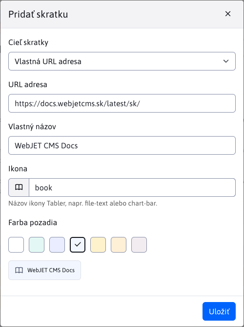

Pre skratku na konkrétny priečinok otvorte priečinok vo Web stránkach a skopírujte adresu aj s parametrom `groupid`. Pri pridávaní zvoľte **Použiť vlastnú adresu URL…**, vložte adresu a zadajte názov, napríklad **Aktuality**.

Adresa môže mať tvar `/admin/v9/webpages/web-pages-list/?groupid=123`. Číslo `123` nahraďte ID zo svojej skopírovanej adresy. Skratka potom otvorí priamo vybraný priečinok.

Skratku na nedostupnú položku menu môžete v režime úprav opraviť alebo odstrániť. Krížik **×** ju odstráni bez potvrdenia; cez **Späť** ju do 8 sekúnd vrátite. Odstrániť môžete aj poslednú skratku, no po obnovení stránky sa prázdny zoznam doplní predvolenými skratkami podľa oprávnení. Widgety a ostatné nastavenia sa tým nezmenia.

## Zmenené stránky, audit a monitorovanie

Widgety **Zmenené stránky**, **Audit**, **Prihlásení admini**, **Obsadenosť pamäte** a **Zaťaženie CPU** pridáte podľa oprávnení cez katalóg. Zmenené stránky sa týkajú aktuálnej domény; audit, prihlásení administrátori a monitorovanie celého servera.

Grafy pamäte a CPU majú predvolenú veľkosť **3×3**; v nastaveniach môžete zvoliť aj **3×2**. Údaje viditeľného widgetu sa aktualizujú každých 5 sekúnd. Kliknutím na názov otvoríte úplný prehľad.

Meranie sa začne otvorením widgetu aj bez zapnutého ukladania histórie. Pri skrytí karty prehliadača alebo widgetu sa aktualizácia pozastaví.

## Spätná väzba

Vývojovému tímu WebJET CMS môžete poslať pripomienku, návrh na zlepšenie alebo pochvalu. Kliknite na **Zaslať spätnú väzbu** v hornej lište prehľadu.

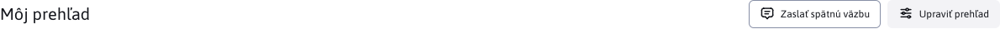

Opíšte požadovanú zmenu alebo problém. Priložiť môžete aj súbory, napríklad snímku obrazovky. Formulár sa odošle emailom. Pri voľbe **Zaslať anonymne** nebude v údajoch odosielateľa vaše meno ani emailová adresa.

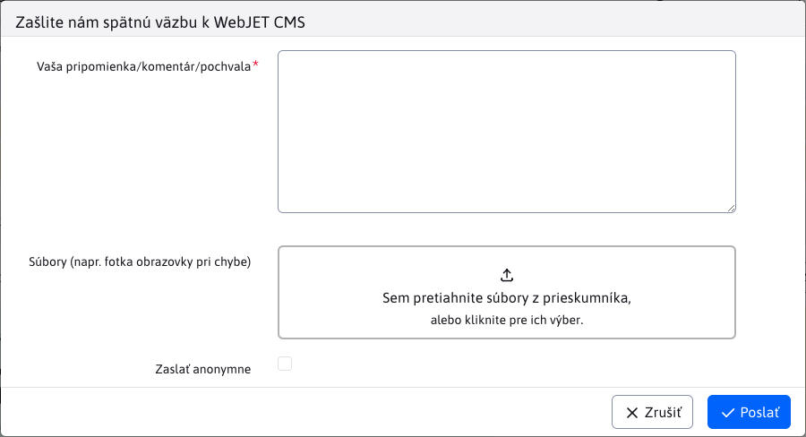

Pripomienky posúdime pri plánovaní vývoja. Plánované zmeny nájdete v [mape rozvoja](../../ROADMAP.md).
