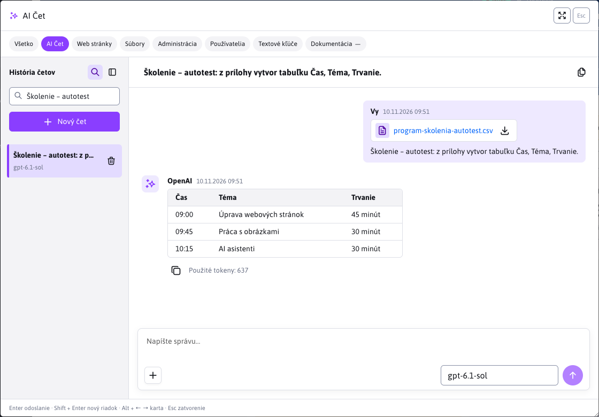
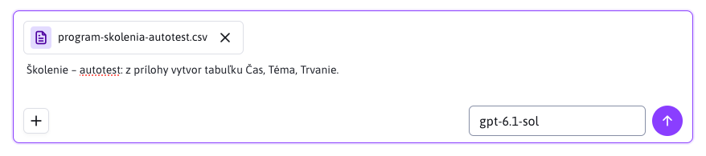
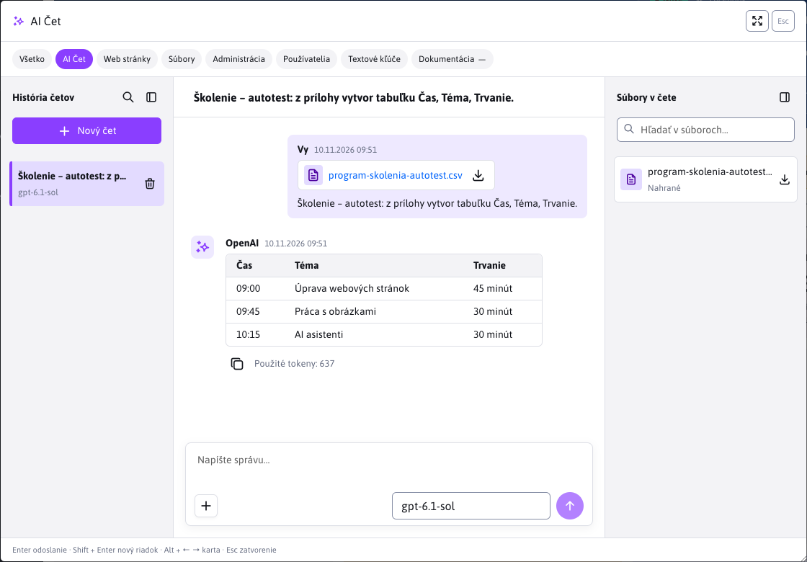
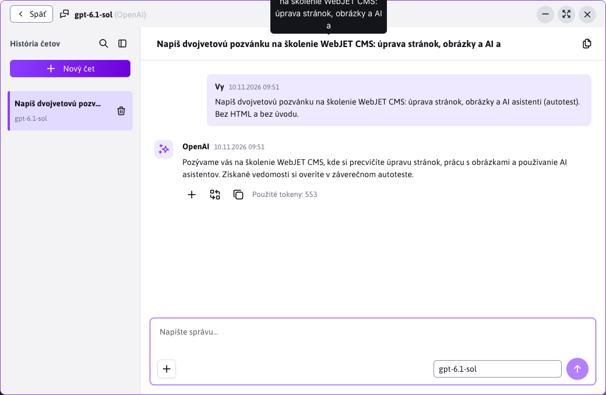
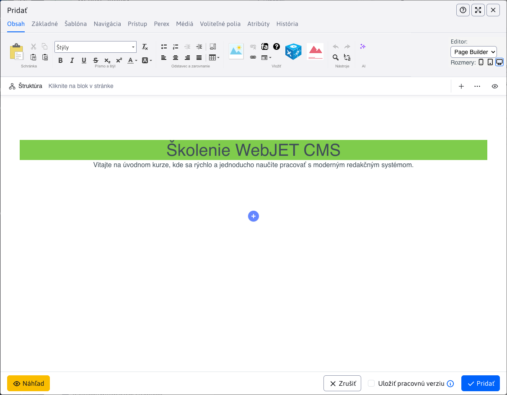

# AI Čet

V AI Čete môžete postupne spresňovať zadanie, pýtať sa na obsah priložených dokumentov alebo pripravovať texty pre web. Vyberiete si nakonfigurovaného asistenta a zadáte požiadavku; na odpoveď môžete nadviazať ďalšou správou. Možnosť uchovať kontext rozhovoru závisí od poskytovateľa, modelu a nastavenia asistenta.

Čet otvoríte dvoma spôsobmi:

| Umiestnenie | Na čo slúži | Práca s obsahom stránky |
| --- | --- | --- |
| Karta **AI Čet** v rýchlom vyhľadávaní | Samostatné rozhovory, práca s prílohami a uloženou históriou. | Obsah otvorenej stránky sa neposiela. Odpoveď môžete skopírovať. |
| Tlačidlo AI pri poli alebo v paneli editora | Návrh a úprava obsahu konkrétneho poľa, textu alebo PageBuilder stránky. | Asistent dostane obsah podľa nastavenia zdrojového poľa alebo označený text. Odpoveď vložíte až vlastným potvrdením. |

## Začatie rozhovoru

1. V hlavičke administrácie kliknite na **Hľadať…** alebo stlačte **Ctrl+K / ⌘K** a vyberte kartu **AI Čet**.
2. V pravom dolnom rohu poľa na správu vyberte asistenta. Rovnakého univerzálneho asistenta môžete vybrať aj cez tlačidlo AI pri textovom poli.
3. Napíšte požiadavku a odošlite ju tlačidlom so šípkou nahor alebo klávesom **Enter**. **Shift+Enter** vloží nový riadok.
4. Ďalšiu požiadavku napíšte do rovnakého poľa. Napríklad po návrhu programu školenia môžete požiadať o jeho skrátenie alebo doplnenie prestávky.

Ak má asistent zapnuté postupné načítanie, odpoveď pribúda po častiach. Tlačidlom **Zastaviť** so štvorcovou ikonou prerušíte generovanie. Už prijatý text zostane zobrazený. Samotné zatvorenie dialógu ani prepnutie karty generovanie nezastaví.

Odpovede zobrazujú Markdown vrátane nadpisov, zoznamov, zvýraznenia a tabuliek. Pri mene odosielateľa je čas správy, pod odpoveďou údaj **Použité tokeny**. Tlačidlo **Kopírovať** skopíruje pôvodný text aj s Markdown značkami. Názvy tlačidiel s ikonami sa zobrazia v bubline po prejdení myšou alebo zameraní klávesnicou.

Ak asistent vráti HTML kód, napríklad pri tvorbe PageBuilder stránky, zobrazí sa karta **Návrh obsahu**. Po dokončení odpovede sa automaticky otvorí jej **Náhľad** a starší návrh sa zbalí. Vysvetlenie mimo HTML bloku zostáva viditeľné.

- **Náhľad** zobrazí výsledný vzhľad. V editore stránky používa CSS štýly a obalové triedy načítané v klasickom editore alebo PageBuilderi. V samostatnom čete bez kontextu stránky používa základné formátovanie.
- Ikony **Desktop**, **Tablet** a **Mobil** prepnú šírku vykresľovania na 1280, 768 a 375 pixelov. Širší návrh sa zmenší tak, aby sa zmestil do okna četu.
- Ikona **Maximalizovať okno** otvorí návrh na celú plochu četu. Ikona **Zmenšiť okno** alebo kláves **Esc** ho vráti do odpovede.
- **HTML kód** zobrazí zdrojový kód. Celú odpoveď skopírujete ikonou **Kopírovať** pod správou.

Prezeranie návrhu nemení obsah poľa ani stránky. Vložíte ho až tlačidlom pod odpoveďou. Náhľad nespúšťa skripty ani vložené iframe, preto napríklad mapa alebo dynamická aplikácia nemusí zobraziť svoj konečný obsah. Kopírovanie celej odpovede aj vloženie do stránky naďalej používajú pôvodný obsah.

## Nový čet a návrat k rozhovoru

**Nový čet** začne samostatný rozhovor so zvoleným asistentom. Posledný výber asistenta na karte **AI Čet** sa ukladá do používateľských nastavení administrácie a obnoví sa aj po obnovení stránky alebo opätovnom prihlásení. Ak už asistent nie je dostupný, vyberie sa prvý z aktuálnej ponuky. Čet pri poli používa asistenta vybraného v editore.

Ak sa ešte generuje odpoveď, **Nový čet** ju zastaví. Uložený rozhovor tým nevymažete: zostáva v histórii.

Prepnutie asistenta obnoví jeho naposledy otvorený rozhovor vrátane rozpísanej správy a neodoslaných príloh. Rovnaké údaje sa zachovajú pri prepnutí karty a zatvorení a opätovnom otvorení dialógu, kým neopustíte aktuálnu stránku administrácie. Rozpísané správy a neodoslané prílohy sa na server neukladajú.

### Ukladané a dočasné rozhovory

Pri asistentoch **OpenAI** a **Gemini** s vypnutou voľbou **Zapnúť dočasný čet** a modelom podporujúcim čet sa odoslané správy a odpovede ukladajú na serveri. Nájdete ich v histórii aj po obnovení stránky alebo opätovnom prihlásení. Rozhovory a prílohy sú dostupné iba ich vlastníkovi v príslušnej doméne.

Pri ostatných nastaveniach rozhranie upozorní, že rozhovor sa neukladá. Takýto čet sa nepridá do histórie a nemôžete doň nahrávať prílohy. Po opustení alebo obnovení stránky sa jeho zobrazený obsah stratí. Uchovanie predchádzajúceho kontextu u poskytovateľa sa riadi nastavením asistenta; samotný zoznam správ v okne nezaručuje, že model pracuje s celým rozhovorom.

### História četov

Panel **História četov** je predvolene zobrazený. Ikonou bočného panela vľavo v hlavičke ho môžete skryť alebo znova zobraziť. Táto voľba sa ukladá do používateľských nastavení administrácie a zachová sa aj po obnovení stránky či opätovnom prihlásení; platí aj pre čet pri poli a v editore stránky. Automatické zatvorenie panela na úzkej obrazovke uloženú voľbu nemení.

Kliknutím na názov otvoríte uložený čet. Vybraný rozhovor označuje farebné pozadie a fialový pásik.

Lupa v hlavičke panela, pred ikonou zatvorenia, zobrazí pole **Hľadať v histórii…**. V ňom môžete hľadať podľa názvu, textu správ, asistenta alebo poskytovateľa. Vyhľadávanie zahŕňa aj staršie rozhovory, ktoré ešte nie sú načítané v zozname, a nerozlišuje veľké písmená ani diakritiku. Vymazaním výrazu obnovíte celý zoznam. Opätovným kliknutím na lupu alebo klávesom **Esc** vyhľadávacie pole skryjete a zrušíte filter. Ďalší **Esc** zatvorí panel histórie.

Pokračovanie používa kontext uchovaný u poskytovateľa. Ak už nie je dostupný alebo sa zmení asistent, model či konfigurácia poskytovateľa, rozhovor môže zostať iba na čítanie. Jeho správy môžete naďalej čítať a prílohy sťahovať; na ďalšiu prácu začnite nový čet.

### Vymazanie rozhovoru

Pri rozhovore kliknite na ikonu koša **Vymazať** a potvrďte vymazanie. WebJET najskôr požiada poskytovateľa o odstránenie uložených odpovedí a potom odstráni lokálnu históriu aj prílohy.

Ak poskytovateľ vymazanie nepotvrdí, rozhovor zostane označený na vymazanie. Akciu môžete zopakovať tlačidlom pri rozhovore. Pri prerušenej požiadavke bez vráteného ID odpovede nemusí byť možné potvrdiť úplné vymazanie; rozhranie zobrazí príslušný stav.

## Prílohy

Prílohy sú dostupné v ukladaných rozhovoroch na karte **AI Čet** aj v čete pri poli a v editore stránky s asistentom **OpenAI** alebo **Gemini**. Môžete napríklad priložiť program školenia a požiadať asistenta, aby z neho vytvoril tabuľku alebo pozvánku.

1. Kliknite na ikonu plus **Nahrať súbor**, pretiahnite súbory kamkoľvek do plochy četu alebo vložte obrázok zo schránky do poľa správy. Súbor môžete aj pretiahnuť zo svojho počítača.
2. Skontrolujte názvy súborov a náhľady obrázkov. Nechcenú prílohu pred odoslaním odstráňte tlačidlom **×**.
3. Doplňte požiadavku a odošlite správu. Odoslať môžete aj samotné prílohy bez textu.

| Obmedzenie | Podporovaná hodnota |
| --- | --- |
| Počet príloh v jednej správe | Najviac 5 |
| Celková veľkosť príloh jednej správy | Najviac 10 MB |
| Obrázky | PNG, JPEG, WebP |
| Dokumenty | PDF, DOCX, XLSX, PPTX |
| Textové súbory v UTF-8 | TXT, MD, CSV, TSV, JSON, XML, HTML, HTM, CSS, JS, JAVA, SQL, YAML, YML, LOG |
| Text získaný z príloh jednej správy | Najviac 100 000 znakov |
| Počet strán PDF | Najviac 200 |

Dokumenty musia obsahovať čitateľný text. Skenované PDF bez textovej vrstvy sa nespracujú. Obsah dokumentov sa použije ako kontext rozhovoru. Obrázky najskôr opíše zvolený model a tento opis sa pridá do kontextu; model preto musí podporovať obrazový vstup. Spracovanie obrázkov tiež spotrebúva tokeny. Hlasový vstup nie je podporovaný.

### Súbory v čete

Ikona **Súbory v čete** vpravo v hlavičke otvorí panel so súbormi zo všetkých správ vybraného rozhovoru. Rozlišuje **Nahrané** a **Vygenerované** súbory, ak ich asistent v odpovedi vráti. Môžete v nich hľadať podľa názvu a kliknutím ich stiahnuť. Neodoslané prílohy sa v tomto paneli ešte nezobrazujú.

Prílohu stiahnete aj kliknutím na jej názov alebo ikonu sťahovania priamo pri správe. Súbor sa stiahne pod pôvodným názvom. Prílohy zostávajú dostupné aj po obnovení stránky, kým rozhovor nevymažete. Na úzkej obrazovke sa panely histórie a súborov zobrazujú ponad rozhovor vždy po jednom.

## Čet pri poli a v editore stránky

Pri textovom poli alebo v paneli nástrojov editora kliknite na ikonu AI a vyberte asistenta s typom požiadavky **Čet**. Napíšte zadanie a odošlite ho. Označený text v podporovanom editore má prednosť pred obsahom nastaveného **Zdrojového poľa**. Ak text neoznačíte, použije sa zdrojové pole. Ak ani to nie je nastavené, obsah poľa ani stránky sa neposiela. Rovnaké pravidlo platí pre uložené aj nové záznamy a hromadnú úpravu.

Pri označenom texte v editore dostane asistent aj pokyn vrátiť iba upravený HTML fragment so zachovaním jeho štruktúry. Napríklad pri požiadavke na tučné písmo má doplniť značky `<strong>` priamo do textu bez pridania nadpisu či obalov PageBuildera. Tento pokyn má pri úprave výberu prednosť pred pravidlami asistenta pre tvorbu celej stránky a nezávisí od nastavených CSS tried obalov. Platí pre dočasné aj ukladané čety spracované serverovým poskytovateľom.

Okno četu môžete presunúť ťahaním za hornú lištu, aby nezakrývalo text stránky. Po zameraní lišty klávesom **Tab** ho môžete posúvať aj šípkami; so **Shift** sa posúva väčším krokom. Obsah editora môžete upravovať aj pri otvorenom čete.

Tlačidlo **Minimalizovať čet** (mínus) vpravo hore skryje okno do AI ikony v pravom dolnom rohu. Kliknutím na **Obnoviť čet** sa vrátite k rovnakému rozhovoru, rozpísanej správe, neodoslaným prílohám a otvoreným panelom. Zachová sa aj pozícia okna; prebiehajúca odpoveď pokračuje počas minimalizovania. Pri zmenšení prehliadača sa presunuté okno prispôsobí tak, aby zostalo dostupné. Minimalizovaný čet obnovíte aj pôvodným tlačidlom AI pri rovnakom poli, ktoré je dostupné klávesom **Tab**. Zatvorenie editora odstráni aj minimalizovanú ikonu.

Pri asistentoch **OpenAI** a **Gemini** môžete pridať súbory ikonou plus **Nahrať súbor**, pretiahnutím do správy alebo vložením obrázka zo schránky. Platia rovnaké [formáty a limity príloh](#prílohy) ako na karte AI Čet. Asistent dostane obsah príloh spolu s obsahom poľa alebo označeným textom. Prílohy môžete používať aj pri zapnutej voľbe **Zapnúť dočasný čet**.

Odpoveď sa najskôr zobrazí v čete. Obsah poľa alebo stránky zmeníte až tlačidlom pod dokončenou odpoveďou:

| Tlačidlo | Výsledok |
| --- | --- |
| **Pridať** (plus) | Pridá odpoveď na koniec obsahu cieľového poľa alebo stránky. |
| **Nahradiť obsah** (ikona nahradenia) | Nahradí obsah cieľového poľa alebo stránky odpoveďou. |
| **Nahradiť označený text** | Pri platnom výbere v editore nahradí iba označenú časť. |
| **Kopírovať** | Skopíruje odpoveď do schránky. |

Po vložení odpovede sa v lište četu zobrazí **Zrušiť vloženie**. Vráti stav pred posledným vložením, pokiaľ ste medzitým obsah ďalej neupravili. Ak sa označený text zmenil, čet odmietne prepísať neaktuálny výber; označte text znova a znovu otvorte asistenta.

V PageBuilderi môže odpoveď obsahovať aj HTML bloky. Ich pridanie alebo nahradenie sa vykoná rovnakými tlačidlami pod odpoveďou. Ďalšie úpravy zadávate novou správou v čete. Zmeny stránky nakoniec uložte obvyklým tlačidlom editora.

Pri uloženom zázname otvoríte ikonou **História četov** rozhovory patriace k rovnakému poľu toho istého záznamu. Napríklad história poľa obsahu stránky nezobrazí rozhovory k jej názvu ani k obsahu inej stránky. Zoznam zahŕňa čety rôznych asistentov pre toto pole; môžete v ňom vyhľadávať, otvoriť starší rozhovor a pokračovať v ňom. Aj pri otvorenej staršej odpovedi zostávajú dostupné tlačidlá na vloženie obsahu.

Pri podporovaných asistentoch OpenAI a Gemini s vypnutou voľbou **Zapnúť dočasný čet** sa správy aj prílohy ukladajú. História zostáva dostupná po zatvorení editora alebo obnovení stránky a je oddelená od samostatných rozhovorov v rýchlom vyhľadávaní. Nové, ešte neuložené záznamy a hromadná úprava viacerých záznamov používajú dočasný čet bez ukladanej histórie.

Zatvorenie okna AI zachová rozpísanú správu a neodoslané prílohy, kým zostáva otvorený editor. Zatvorenie samotného editora ich zahodí a zruší bežiace požiadavky; už uložené rozhovory tým nevymažete. Pri dočasných četoch sa správy ani prílohy v CMS trvalo neukladajú.

## Dostupnosť a riešenie problémov

- **Karta AI Čet sa nezobrazuje:** používateľ potrebuje oprávnenie na používanie AI asistentov.
- **Nie je dostupný žiadny asistent:** správca musí povoliť asistenta s typom požiadavky **Čet**, nakonfigurovať jeho poskytovateľa a pridať `top-search-field` medzi cieľové polia alebo `CHAT_SEARCH` medzi entity. Postup je v [nastavení četového asistenta](../settings/README.md#nastavenie-četového-asistenta).
- **Tlačidlo na pridanie príloh je neaktívne:** asistent nepodporuje prílohy, čet práve spracúva požiadavku alebo je dostupný iba na čítanie. Na karte AI Čet v rýchlom vyhľadávaní musí byť navyše zapnuté ukladanie rozhovoru.
- **Prílohu nemožno spracovať:** overte formát, veľkosť a čitateľnosť textu; pri obrázku aj podporu obrazového vstupu modelom.
- **Odpoveď sa nepodarilo dokončiť:** čet zobrazí dôvod a podľa typu chyby ponúkne opakovanie požiadavky alebo nový čet. Požiadavky sa automaticky neopakujú.

Podrobnosti ukladania a REST rozhrania sú v [dokumentácii pre programátora](../../../custom-apps/apps/ai/assistants/README.md#ukladané-rozhovory).
