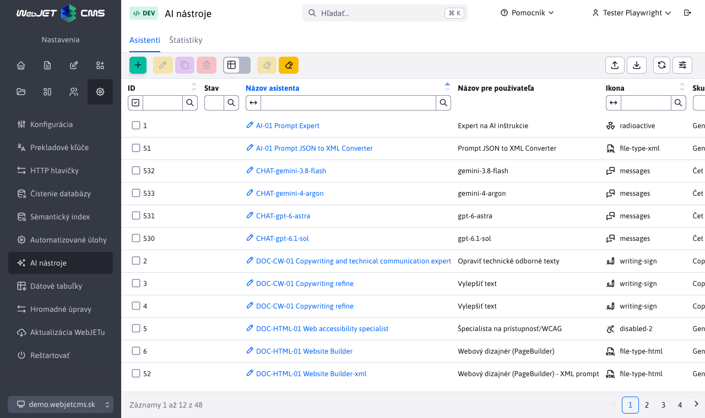
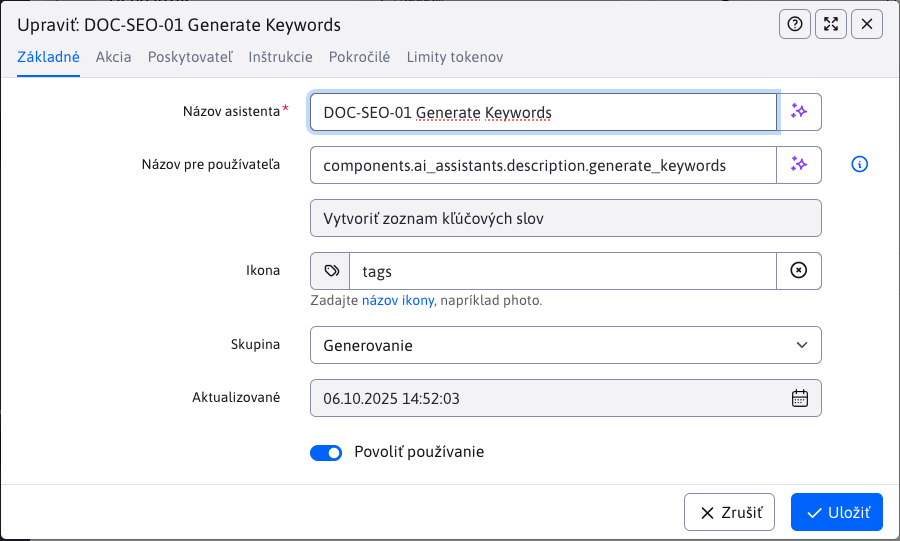
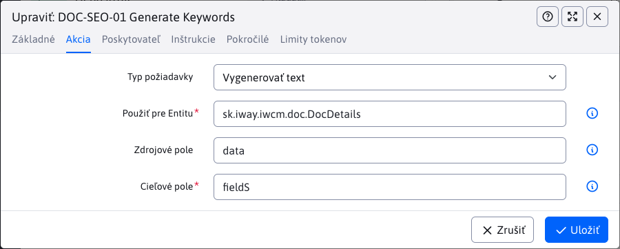
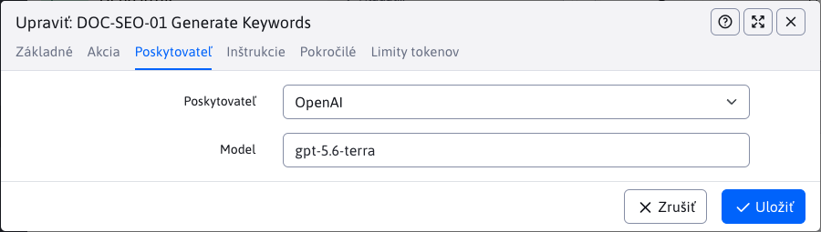
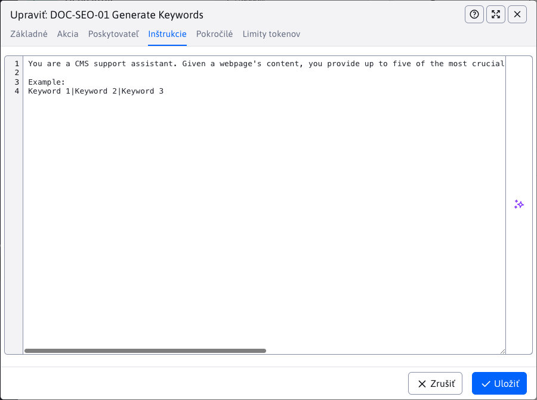
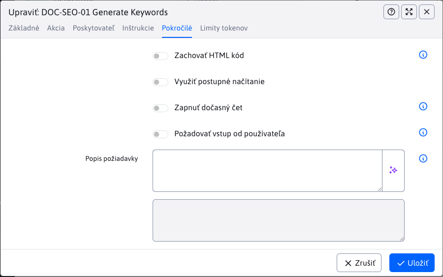
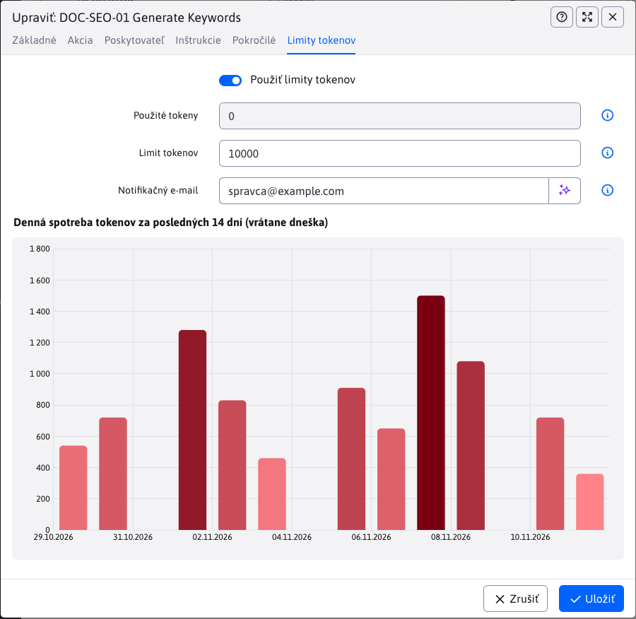
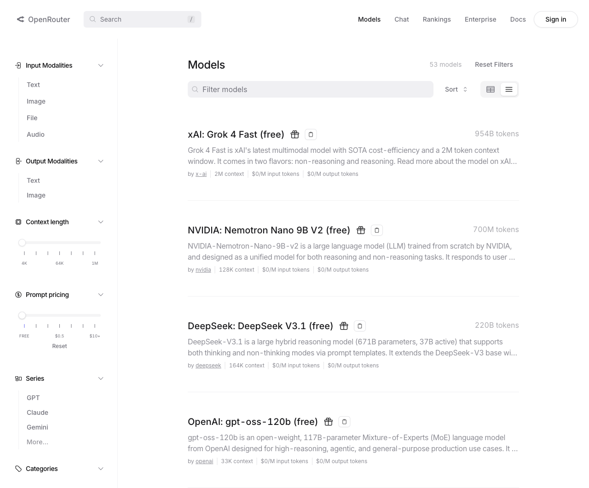

# Nastavenie

Tento dokument popisuje správu a konfiguráciu AI asistentov vo WebJET CMS. V sekcii **AI asistenti** môžete vytvárať a upravovať jednotlivých asistentov, pričom každý záznam predstavuje konkrétny typ akcie s vybraným poskytovateľom AI služieb. Nastavenia umožňujú určiť, kde (v ktorej tabuľke) a pre ktoré pole alebo polia bude daný asistent dostupný, čiže bude vykonávať nastavenú akciu.

Stĺpec **Stav** v zozname asistentov zobrazuje možné stavy:

- <span class="text"><i class="ti ti-ban" style="color: #E00028;" aria-hidden="true"></i> Vypnutý asistent</span> - asistent má vypnutú možnosť **Povoliť používanie**. Používateľom sa nezobrazuje a nie je možné ho spustiť.
- <span class="text"><i class="ti ti-alert-triangle" style="color: #FABD00;" aria-hidden="true"></i> Neinicializovaný poskytovateľ</span> - poskytovateľ AI nie je pripravený na používanie. Skontrolujte jeho konfiguráciu, napríklad API kľúč alebo nastavenie lokálneho modelu.
- <span class="text"><i class="ti ti-gauge-off" style="color: #FABD00;" aria-hidden="true"></i> Dosiahnutý limit tokenov</span> - počet použitých tokenov dosiahol alebo prekročil nastavený limit. Ďalšie požiadavky sú zablokované, kým spotrebu nevynulujete alebo limit nezvýšite nad aktuálnu spotrebu.

Pomocou filtra v tomto stĺpci môžete vyhľadať napríklad asistentov so stavom **Dosiahnutý limit tokenov**.



!>**Upozornenie:** Nastavenia by mala vykonávať iba osoba, ktorá má dostatočné znalosti o fungovaní AI asistentov a rozumie možnostiam jednotlivých poskytovateľov. Nesprávne nastavenie môže viesť k neoptimálnemu správaniu asistenta alebo k obmedzeniu jeho funkčnosti. Odporúčame, aby konfiguráciu vykonával administrátor alebo technicky zdatný používateľ, ktorý vie správne zadať inštrukcie a parametre pre konkrétneho AI poskytovateľa.

## Základné informácie

V tejto časti si preberieme, ako pridať/nastaviť nového **AI asistenta**. Pri tejto akcii sú dostupné nasledujúce karty:

- Základné
- Akcia
- Poskytovateľ
- Inštrukcie
- Pokročilé
- Limity tokenov

### Karta - Základné

Táto karta obsahuje základné informácie o asistentovi ako názov, ikona alebo dátum vytvorenia. Obsahuje polia:

- **Názov asistenta** – interný identifikátor asistenta (používateľ ho nevidí). Musí byť unikátny v kombinácii s hodnotou **Poskytovateľ** (t. j. rovnaký názov môžete použiť pre viacerých asistentov, ale každý musí mať iného poskytovateľa).
- **Názov pre používateľa** – zobrazený názov v rozhraní. Nemusí byť unikátny. Ak nie je vyplnený, použije sa hodnota z poľa **Názov asistenta**. Môžete zadať aj prekladový kľúč (hodnota kľúča sa zobrazí v poli pod ním).

  Značka `{model}` sa pri zobrazení nahradí aktuálnou hodnotou poľa **Model**. Napríklad `{model}` zobrazí `gpt-6.1-sol` a `Čet {model}` zobrazí `Čet gpt-6.1-sol`. Pred značkou môže byť aj prekladový kľúč: `components.ai_assistants.groups.00-chat {model}` zobrazí preložený názov skupiny a model. Značku môžete použiť aj priamo v hodnote prekladového kľúča. Náhľad pod poľom sa aktualizuje pri zmene názvu alebo modelu.

- **Ikona** – názov ikony zo stránky https://tabler.io/icons. Zobrazuje sa spolu s poľom **Názov pre používateľa**. Zadajte len identifikátor ikony (bez URL).
- **Skupina** – logické alebo vizuálne zoskupenie asistentov v rozhraní. Nemá vplyv na spracovanie ani výsledok.
- **Vytvorené** – systémom generovaný dátum vytvorenia. Nedá sa upraviť a zobrazí sa len pri editácii existujúceho asistenta.
- **Povoliť používanie** – ak nie je zapnuté, asistent sa nezobrazuje používateľom a nie je možné ho spustiť (slúži ako rýchla deaktivácia).



### Karta - Akcia

Na tejto karte nastavujete, akú akciu má AI asistent vykonávať, odkiaľ bude získavať dáta a kde bude dostupný. K dispozícii sú tieto polia:

- **Typ požiadavky** – určujete, aký typ úlohy má asistent vykonať:
  - Vygenerovať text
  - Vygenerovať obrázok
  - Upraviť obrázok
  - Čet
- **Použiť pre Entitu** – vyberáte entitu (tabuľku), v ktorej bude asistent dostupný. Pri písaní sa automaticky zobrazia všetky podporované entity aj hodnota `CHAT_SEARCH` pre samostatný AI Čet v rýchlom vyhľadávaní.
- **Zdrojové pole** – určujete pole z vybranej entity, z ktorého má asistent čerpať dáta pri vykonávaní akcie. Toto pole nie je povinné; vyberte ho len v prípade, že sú potrebné vstupné dáta. Zobrazia sa všetky polia danej entity.
- **Cieľové pole** – vyberáte pole v entite, pri ktorom bude asistent dostupný. Pri type **Čet** môžete pridať aj `top-search-field` pre kartu **AI Čet** v rýchlom vyhľadávaní. Ak je jedinou entitou `CHAT_SEARCH`, pri uložení četového asistenta sa prázdne cieľové pole doplní na `*`.



Pre entitu, zdrojové a cieľové pole je možné zadať aj hodnoty typu:

- `value1,value2,value3` – aplikuje sa na viaceré hodnoty
- `*` – aplikuje sa na všetky hodnoty
- `%value!` – aplikuje sa, ak kdekoľvek obsahuje hodnotu `value`
- `%value` – aplikuje sa, ak začína hodnotou `value`
- `value!` – aplikuje sa, ak končí hodnotou `value`

Pre cieľové pole je možné zadať nielen meno atribútu v entite, ale aj CSS triedu a hodnotu `renderFormat`. Je teda možné zadať hodnotu `dt-format-text,dt-format-text-wrap` pre aplikovanie na všetky typy textových polí.

Voliteľné polia (teda polia ktorých názov je `fieldX`) sa môžu dynamicky meniť, napríklad podľa zvolenej šablóny vo webových stránkach. Pri generovaní AI asistentov sa na serverovej strane deteguje len hlavný typ bez ohľadu na použitú šablónu stránky. Preto nemusí byť asistent zobrazený správne ak majú stránky rôzne šablóny. Voliteľné polia sa inicializujú pri obnovení web stránky podľa šablóny priečinka v ktorom sa nachádzate, čiže obnovenie stránky môže načítať správne hodnoty. Prechod na inú stránku s inou šablónou ale asistentov nezmení.

Zároveň ak je pre voliteľné pole nastavený konkrétny asistent (meno poľa sa zhoduje s hodnotou v poli Cieľové pole definície asistenta), nezobrazia sa ostatný všeobecný asistenti definovaný napr. podľa typu poľa a podobne. Predpokladá sa, že ak definujete asistenta pre konkrétne voliteľné pole, nepotrebujete ostatných všeobecných asistentov (ako napr. Opraviť gramatiku). Ak takéhoto asistenta potrebujete, stačí pridať meno voliteľného poľa aj do týchto všeobecných asistentov.

Ak v entite nechcete, aby sa pre pole zobrazovali možnosti AI nástrojov, stačí do anotácie nastaviť atribút `ai=false` alebo pridať CSS triedu `ai-off`. V takom prípade sa pri poli zobrazí tlačidlo pre AI asistenta len vtedy, ak je zadaný presne pre danú entitu a pole.

```java
	@Lob
	@Column(name = "description")
	@DataTableColumn(inputType = DataTableColumnType.OPEN_EDITOR, renderFormat = "dt-format-text", tab="description", ai=false, editor = {
			@DataTableColumnEditor(type = "textarea", attr = {
					@DataTableColumnEditorAttr(key = "class", value = "textarea-code") }) })
	private String description;
```

### Karta - Poskytovateľ

Táto karta slúži na výber poskytovateľa AI služieb, ktorý bude použitý na spracovanie požiadavky asistenta. Vo výberovom poli sa zobrazia všetci dostupní poskytovatelia; pri poskytovateľovi bez potrebnej konfigurácie sa k názvu doplní upozornenie **nenakonfigurovaný**. Pri nakonfigurovaných serverových poskytovateľoch sa zoznam modelov načíta priamo z ich API a ukladá sa do vyrovnávacej pamäte oddelene podľa poskytovateľa, domény a účinnej konfigurácie. Po výbere poskytovateľa sa zobrazia iba polia podporované jeho CMS adaptérom; prehliadačový poskytovateľ napríklad vlastný výber modelu nezobrazuje.



### Karta - Inštrukcie

Táto karta je kľúčová pre správne fungovanie asistenta. Obsahuje jedno pole, do ktorého zadávate detailné inštrukcie, čo má asistent vykonať po spustení. Inštrukcie by mali byť jasné, konkrétne a zrozumiteľné, aby asistent vedel presne, akú úlohu má splniť. Správne zadané inštrukcie zabezpečia, že asistent bude vykonávať požadované akcie efektívne a podľa očakávaní. Viac sa dočítate v časti [písanie inštrukcií](../instructions/README.md).



### Karta - Pokročilé

Na tejto karte nájdete rozšírené možnosti konfigurácie asistenta, ktoré umožňujú detailnejšie prispôsobiť jeho správanie podľa vašich potrieb. Dostupné nastavenia sa môžu líšiť v závislosti od vybraného poskytovateľa AI služieb. Odporúčame meniť tieto nastavenia len vtedy, ak presne viete, aký bude ich vplyv na fungovanie asistenta, keďže môžu ovplyvniť jeho výsledky alebo spôsob interakcie s používateľom.

- **Zachovať HTML kód** – ak je zapnuté, HTML značky zo zdrojového poľa sa neodstránia a odošlú sa poskytovateľovi tak, ako sú. Zapnite iba v prípade, že model potrebuje pracovať so štruktúrovaným HTML (napr. analýza alebo úprava obsahu). Inak ponechajte vypnuté kvôli čistejšiemu vstupu.
- **Využiť postupné načítanie** – odpoveď sa bude zobrazovať po častiach (streamovanie) namiesto jedného bloku. Vhodné pri dlhších generovaných textoch, aby mal používateľ okamžitú spätnú väzbu. Funguje iba pre textové výstupy.
- **Zapnúť dočasný čet** – vypne ukladanie rozhovoru do histórie AI Četu. Zobrazené správy zostávajú iba na aktuálnej stránke administrácie a prílohy nie sú dostupné. Pre uloženú históriu na karte AI Čet túto voľbu vypnite a použite podporovaný model OpenAI alebo Gemini. Nastavenie nenahrádza pravidlá spracovania a uchovávania údajov u poskytovateľa.
- **Požadovať vstup od používateľa** – pred spustením asistenta musí používateľ zadať vlastný vstup (napr. zadanie témy, doplňujúcej inštrukcie alebo kľúčových slov). Ak je vypnuté, asistent beží bez dodatočného vstupu.
- **Popis požiadavky** – krátka nápoveda zobrazovaná pri poli na zadanie vstupu (uľahčuje používateľovi pochopiť, čo má napísať). Môže byť zadaný aj prekladový kľúč; jeho vyhodnotená hodnota sa zobrazí v poli pod ním.



### Karta - Limity tokenov

Na karte **Limity tokenov** môžete obmedziť spotrebu konkrétneho asistenta. Limit je spoločný pre všetkých používateľov tohto asistenta v aktuálnej doméne.

- **Použiť limity tokenov** - zapne kontrolu spotreby a zobrazí ďalšie polia. Po vypnutí a uložení sa limit aj počítadlo použitých tokenov vynulujú.
- **Použité tokeny** - počet tokenov spotrebovaných počas zapnutého obmedzenia od posledného vynulovania. Pole je iba na čítanie, hodnota sa aktualizuje po zaznamenaní spotreby asistenta.
- **Limit tokenov** - povinné celé číslo väčšie ako `0`, ak je obmedzenie zapnuté.
- **Notifikačný e-mail** - voliteľná e-mailová adresa, na ktorú sa odošle upozornenie pri dosiahnutí **75 %** a **100 %** limitu. Ak pole ponecháte prázdne, upozornenia sa neodosielajú.

Upozornenie sa vyhodnotí po zaznamenaní spotreby asistenta. E-mail obsahuje názov asistenta, doménu, počet použitých tokenov a nastavený limit. Každé upozornenie sa odošle raz do vynulovania spotreby. Ak jedna požiadavka zvýši spotrebu z hodnoty pod 75 % rovno na 100 % alebo viac, odošle sa iba upozornenie o dosiahnutí celého limitu.

!> Upozornenie: Pred spustením požiadavky sa overí aktuálna spotreba. Ak je počet použitých tokenov rovný limitu alebo vyšší, asistent požiadavku odmietne. Už spustená požiadavka môže limit prekročiť, pretože jej spotreba sa pripočíta až po spracovaní. Asistenta môžete znova používať po vynulovaní spotreby alebo po zvýšení limitu nad aktuálnu spotrebu.

Karta poskytuje aj graf **Denná spotreba tokenov za posledných 14 dní (vrátane dneška)**. Pomáha zvoliť limit podľa doterajšieho používania. Každý stĺpec predstavuje denný súčet tokenov zo [štatistiky AI](../stat/README.md); vyššia spotreba má tmavší odtieň červenej. Graf zahŕňa aj spotrebu pred zapnutím limitu a jeho história sa pri vynulovaní počítadla zachová.



### Vynulovanie spotreby

Na konci nástrojovej lišty sú dve tlačidlá <button class="btn btn-sm btn-warning" type="button"><span><i class="ti ti-eraser" aria-hidden="true"></i></span></button>

- **Vynulovať použité tokeny vybraných asistentov** - prvé tlačidlo je dostupné po označení jedného alebo viacerých asistentov.
- **Vynulovať použité tokeny všetkých asistentov v aktuálnej doméne** - druhé tlačidlo je dostupné, keď nie je označený žiadny asistent. Vynuluje spotrebu celej aktuálnej domény, aj keď je zoznam filtrovaný.

Obe akcie vyžadujú potvrdenie a výsledok zobrazia v notifikácii. Vynulujú počítadlo **Použité tokeny** a umožnia opätovné odoslanie e-mailových upozornení pri dosiahnutí 75 % a 100 % limitu. Nastavené limity, notifikačný e-mail aj história štatistík a grafu zostanú zachované. To isté platí pri automatickom vynulovaní.

### Automatické vynulovanie tokenov

Pravidelné vynulovanie nastavíte v sekcii **Nastavenia → [Automatizované úlohy](../../../admin/settings/cronjob/README.md)** na adrese `/admin/v9/settings/cronjob/`. Vytvorte úlohu s týmito hodnotami:

- **Názov úlohy** - napríklad `Vynulovanie tokenov AI asistentov`.
- **Úloha** - `sk.iway.iwcm.components.ai.rest.AiTokenUsageReset`.
- **Parametre úlohy** - ponechajte prázdne.
- **Povolené** - zapnite.
- **Spúšťanie po štarte** - ponechajte vypnuté, ak chcete nulovať iba podľa zadaného harmonogramu.

Úloha vynuluje spotrebu **všetkých AI asistentov vo všetkých doménach**. Neprijíma parameter domény. Nastavené limity ani historické štatistiky nemení a počet aktualizovaných asistentov zapíše do auditu automatizovaných úloh.

Ak existuje povolená úloha `AiTokenUsageReset` s budúcim termínom spustenia, nad zoznamom asistentov sa zobrazí informácia **Najbližšie vynulovanie počtu použitých tokenov** s dátumom a časom. Pri viacerých povolených úlohách sa zobrazí najbližší termín.

## Nastavenie četového asistenta

Aktualizácia pridá do predvolenej domény štyroch univerzálnych asistentov v skupine **Čet**:

| Názov asistenta | Poskytovateľ | Model |
| --- | --- | --- |
| `CHAT-gpt-6.1-sol` | OpenAI | `gpt-6.1-sol` |
| `CHAT-gpt-6-astra` | OpenAI | `gpt-6-astra` |
| `CHAT-gemini-3.8-flash` | Gemini | `gemini-3.8-flash` |
| `CHAT-gemini-4-argon` | Gemini | `gemini-4-argon` |

Po nakonfigurovaní poskytovateľa sa títo asistenti ponúknu v rýchlom vyhľadávaní aj pri textových poliach vrátane WYSIWYG editora. V nastavení **Použiť pre Entitu** majú `*` a v nastavení **Cieľové pole** majú `dt-format-text,dt-format-text-wrap,dt-format-wysiwyg,top-search-field`.

V ponuke sa zobrazí názov modelu (`{model}`). Asistenti majú zapnuté postupné načítanie odpovede a ukladanie rozhovorov. Spoločné inštrukcie určujú stručné odpovede v jazyku používateľa, formátovanie Markdown, nadväzovanie na predchádzajúce správy a odkaz na dokumentáciu WebJET CMS. Model aj inštrukcie môžete upraviť v nastaveniach asistenta.

Vlastného četového asistenta nastavíte takto:

1. V **Nastavenia → AI asistenti** vytvorte alebo upravte asistenta a zapnite **Povoliť používanie**.
2. Na karte **Akcia** vyberte **Typ požiadavky → Čet**.
3. Pre zobrazenie v rýchlom vyhľadávaní pridajte do **Cieľového poľa** hodnotu `top-search-field`. Ďalšie cieľové polia oddeľte čiarkou. Napríklad pre entitu `sk.iway.iwcm.doc.DocDetails` a cieľ `title,top-search-field` bude asistent dostupný pri názve stránky aj v rýchlom vyhľadávaní. Ak má byť dostupný iba v rýchlom vyhľadávaní, stačí nastaviť **Použiť pre Entitu** na `CHAT_SEARCH`.
4. Na karte **Poskytovateľ** vyberte nakonfigurovaného poskytovateľa a model podporujúci požadovaný spôsob práce.
5. V **Inštrukciách** určite úlohu asistenta, jazyk a požadovaný formát odpovedí.
6. Pre ukladané rozhovory s prílohami na karte **AI Čet** použite OpenAI alebo Gemini, model s podporou četu a vypnite **Zapnúť dočasný čet**. Pre priebežné zobrazovanie odpovede zapnite **Využiť postupné načítanie**, ak ho model podporuje.

Rýchle vyhľadávanie ponúka aktívnych četových asistentov aktuálnej domény s nakonfigurovaným poskytovateľom. Vyžaduje presnú hodnotu `top-search-field` v zozname cieľových polí alebo `CHAT_SEARCH` v zozname entít. Rozhovor otvorený z rýchleho vyhľadávania sa začína bez obsahu otvorenej stránky. Ak asistentovi odstránite poslednú väzbu na rýchle vyhľadávanie, jeho uložené rozhovory v tejto ponuke zostanú dostupné iba na čítanie.

Používateľ potrebuje oprávnenie na používanie AI asistentov (`cmp_ai_button`). Ak zmeníte model, asistenta alebo konfiguráciu poskytovateľa, starší uložený rozhovor môže zostať dostupný iba na čítanie. Postup práce s rozhovormi je v kapitole [AI Čet](../chat/README.md).

## Poskytovatelia

Poskytovateľ zabezpečuje AI nástroje, modely a funkcionality využívané pri spracovaní požiadaviek v CMS. Môže ísť o externú službu nakonfigurovanú napríklad API kľúčom alebo o lokálny model spustený priamo na serveri. Jednotliví poskytovatelia sa môžu líšiť v možnostiach, cene, kvalite výsledkov alebo špecializácii na konkrétne typy úloh. Výber vhodného poskytovateľa závisí od vašich potrieb a požiadaviek na konkrétnu AI funkcionalitu.

### OpenAI

OpenAI patrí medzi najznámejších a najpoužívanejších poskytovateľov AI služieb. Vo WebJET CMS je jeho API už integrované – na aktiváciu stačí zadať váš API kľúč do konfiguračnej premennej `ai_openAiAuthKey`. Pri zadávaní kľúča odporúčame využiť možnosť **Šifrovať** pre vyššiu bezpečnosť.

Aktuálne je podporovaná integrácia pre tieto typy požiadaviek:

- Generovanie textu
- Generovanie obrázkov
- Úprava obrázkov

API kľúč získate registráciou na stránke [OpenAI](https://platform.openai.com/signup). Po prihlásení do svojho účtu prejdite do sekcie `API Keys`, kde si môžete vygenerovať nový kľúč. Tento kľúč následne vložte do nastavení CMS podľa vyššie uvedeného postupu.

### Gemini

Gemini, podobne ako OpenAI, patrí medzi najznámejších a najpoužívanejších poskytovateľov AI služieb. Vo WebJET CMS je jeho API už integrované cez nástroj [AI Studio](https://aistudio.google.com/) – na aktiváciu stačí zadať váš API kľúč do konfiguračnej premennej `ai_geminiAuthKey`. Pri zadávaní kľúča odporúčame využiť možnosť **Šifrovať** pre vyššiu bezpečnosť.

Aktuálne je podporovaná integrácia pre tieto typy požiadaviek:

- Generovanie textu
- Generovanie obrázkov
- Úprava obrázkov

API kľúč získate nasledovne:

- Otvorte stránku [Google AI Studio](https://aistudio.google.com/apikey).
- Prihláste sa do účtu `Google` (kľúč bude viazaný na tento účet).
- Kliknite na `Create API key`.
- Vyberte existujúci alebo vytvorte nový `Google Cloud` projekt, ku ktorému sa kľúč priradí.
- Potvrdíte generovanie – zobrazí sa vygenerovaný kľúč, ktorý následne vložte do nastavení CMS podľa vyššie uvedeného postupu.

Novo vygenerovaný kľúč funguje najskôr v bezplatnom (obmedzenom) režime – platia limity na počet požiadaviek za minútu / hodinu / deň. Pre vyššie limity a stabilnú prevádzku nastavte fakturáciu cez odkaz `Set up billing` pri kľúči. Po pridaní spôsobu platby sa limity sprístupnia podľa aktuálnych podmienok spoločnosti `Google`.

Pokročilé nastavenia (kvóty, fakturácia, rotácia kľúčov, štatistiky) nájdete v [Google Cloud Console](https://console.cloud.google.com/).

### OpenRouter

Služba [OpenRouter](https://openrouter.ai) prepája rôznych poskytovateľov AI služieb do jedného spoločného API. Technicky vašu požiadavku smeruje na API daného poskytovateľa, výhoda je, že nepotrebujete mať vytvorené účty u viacerých poskytovateľov, ale máte jeden účet v OpenRouter, ktorý používate pre viacero poskytovateľov AI služieb. Mnoho modelov je dostupných zdarma, služba je teda výhodná aj na testovanie/skúšanie možností AI modelov.

Pre používanie platených modelov do služby môžete doplniť fixný kredit, alebo nastaviť automatické dopĺňanie kreditu, ak sa spotrebuje. Dostupné sú aj štatistiky využitia jednotlivých modelov.

Vygenerovaný API kľúč nastavte do konfiguračnej premennej `ai_openRouterAuthKey`.



### Lokálne modely

Lokálne modely vykonávajú požiadavky priamo na aplikačnom serveri WebJET CMS. Kvalita modelov samozrejme nedosahuje kvality veľkých komerčných modelov, ale sú spustené lokálne na vašom serveri, dáta neopúšťajú vaše prostredie. Nie je potrebná špeciálna grafická karta, tieto modely sú spúšťané na štandardných procesoroch. Samozrejme ale, ich prevádzka zvyšuje požiadavky na výpočtový výkon a pamäť servera. Praktické nasadenie je potrebné overiť a vykonať aj záťažové testy.

!>**Upozornenie:**: aktuálne je podporovaný beh modelov na architektúrach `Linux x86_64`, `Windows x64` alebo `macOS ARM64`.

Dostupné sú tri samostatné typy poskytovateľov:

- **Lokálny model na generovanie textu** - používa model `utter-project/EuroLLM-1.7B-Instruct` a podporuje iba generovanie textu. Streamovanie odpovede nie je podporované a požiadavky sa neukladajú.
- **Lokálny prekladový model** - používa model `facebook/m2m100_418M` na preklad čistého textu. Nepodporuje HTML kód, `INCLUDE` príkazy, štruktúrovaný vstup ani doplňujúci vstup používateľa.
- **Lokálny embeddingový model** - používa model `intfloat/multilingual-e5-base` na [sémantické indexovanie a vyhľadávanie](../../apps/semantic-search/README.md). Model generuje vektory s `768` dimenziami.

Modelové balíky vo formáte ZIP musia byť vopred pripravené a schválené pre WebJET CMS. Najskôr je potrebné vo vašom `build.gradle` súbore pridať závislosť a task na vytvorenie súborov (verziu `com.webjetcms:webjet-ai-local` nastavte zhodnú s verziou vo WebJET CMS):

```gradle
dependencies {
	....
	implementation "com.webjetcms:webjet-ai-local:2.0.4"
}

def localAiModelsDirectory = file('src/main/webapp/WEB-INF/local-ai-models')
def localAiModelTasks = [
    prepareLocalAiTextModel: [
        model: 'utter-project/EuroLLM-1.7B-Instruct',
        variant: 'q4-k-m',
        output: 'eurollm-1.7b-instruct-q4-k-m.zip'
    ],
    prepareLocalAiTranslationModel: [
        model: 'facebook/m2m100_418M',
        variant: 'int8',
        output: 'm2m100-418m-int8.zip'
    ],
    prepareLocalAiEmbeddingModel: [
        model: 'intfloat/multilingual-e5-base',
        variant: 'fp32',
        output: 'multilingual-e5-base-fp32.zip'
    ]
]

localAiModelTasks.each { taskName, modelDefinition ->
    tasks.register(taskName, JavaExec) {
        group = 'webjet-ai'
        description = "Prepares ${modelDefinition.model} for local WebJET AI use."
        classpath = configurations.runtimeClasspath
        mainClass = 'com.webjetcms.ai.local.tool.LocalModelTool'
        args 'prepare',
            '--model', modelDefinition.model,
            '--output', new File(localAiModelsDirectory, modelDefinition.output).absolutePath
        if (modelDefinition.variant != null) {
            args '--variant', modelDefinition.variant
        }
        if (providers.gradleProperty('overwriteLocalAiModel').getOrElse('false').toBoolean()) {
            args '--overwrite'
        }
    }
}
```

Následne z koreňového priečinka projektu spustite generovanie modelov:

```shell
gradlew prepareLocalAiEmbeddingModel
gradlew prepareLocalAiTranslationModel
gradlew prepareLocalAiTextModel
```

Nástroj stiahne pevne určené súbory modelu, overí ich veľkosť a kontrolný súčet a vytvorí ZIP v priečinku `src/main/webapp/WEB-INF/local-ai-models`. Existujúci ZIP neprepíše, ak ho chcete vedome nahradiť, spustite príslušný skript s parametrom `-PoverwriteLocalAiModel=true`. Každé vytvorenie alebo prepísanie modelového balíka vyžaduje pripojenie na internet.

Cestu k vytvorenému balíku nastavte v príslušnej konfiguračnej premennej:

| Premenná | Model | Cesta vytvorená skriptom |
| --- | --- | --- |
| `ai_localEmbeddingModelBundlePath` | `intfloat/multilingual-e5-base` | `/WEB-INF/local-ai-models/multilingual-e5-base-fp32.zip` |
| `ai_localTranslateModelBundlePath` | `facebook/m2m100_418M` | `/WEB-INF/local-ai-models/m2m100-418m-int8.zip` |
| `ai_localTextModelBundlePath` | `utter-project/EuroLLM-1.7B-Instruct` | `/WEB-INF/local-ai-models/eurollm-1.7b-instruct-q4-k-m.zip` |

Cesta môže byť absolútna cesta na serveri alebo cesta začínajúca `/WEB-INF/`. Cesty začínajúce `/WEB-INF/` sa vyhodnotia voči koreňovému adresáru nasadenej aplikácie na serveri.

Cesty sú globálne pre celú inštaláciu, súbor musí byť čitateľný procesom aplikačného servera a po ich zmene je potrebný reštart. Model sa otvorí až pri prvom použití. Poskytovateľ sa v editore označí ako nenakonfigurovaný, kým príslušná cesta nie je nastavená.

Nastavte ešte konfiguračné premenné:

- `ragEmbeddingDimensions` na hodnotu 768
- `ragSemanticSearchEnabled` na hodnotu true - aktivuje sémantické vyhľadávanie
- `searchType` na hodnotu `semantic` pre podporu sémantického vyhľadávania
- `ragAnswerAllowed` na hodnotu true ak chcete nad vyhľadávaním zobraziť aj sekciu "Prehľad od AI" a máte aktivovaný aj `ai_localTextModelBundlePath`. Upozorňujeme, že sa jedná o pomerne malý jazykový model, takže RAG odpovede oproti komerčným modelom nemusia byť vôbec zobrazené, alebo nie sú úplne správne / kompletné. Zároveň generovanie prehľadu od AI výrazne zaťažuje výkon servera a odpoveď trvá výrazne dlhšie oproti jednoduchému sémantickému hľadaniu.

Viac informácií nájdete v [dokumentácii k vyhľadávaniu](../../apps/search/README.md).

!>**Upozornenie:**: pri zmene `ragEmbeddingDimensions` sa zmaže tabuľka `rag_embedding_chunks` s existujúcimi záznamami sémantického indexu, pretože podľa dimenzie je nastavená dátová štruktúra.

Pre embedding v sekcii AI nástroje upravte asistenta `RAG-EMB-INDEX` a `RAG-EMB-SEARCH` - obom nastavte v karte Poskytovateľ hodnotu Poskytovateľ na Lokálny embeddingový model a hodnotu Model na `intfloat/multilingual-e5-base`. Asistentovi `RAG-SEARCH` nastavte Lokálny model na generovanie textu a model `utter-project/EuroLLM-1.7B-Instruct`. Ak takýto asistenti neexistujú, systém ich vytvorí pri prvom použití sémantického indexovania, alebo vyhľadávania, potom po vytvorení poskytovateľa a modely nastavte.

Pre lokálny preklad musí pole **Inštrukcie** obsahovať zdrojový a cieľový jazyk vo formáte JSON, prípadne s prefixom `Translator:`:

```text
Translator: {"sourceLanguage":"sk","targetLanguage":"en","maximumOutputTokens":200}
```

Jazyky musia byť určené explicitne; hodnota `autodetect` nie je podporovaná. Hodnota `userLng` použije aktuálny jazyk používateľa a kód `cz` sa automaticky zmení na `cs`. Voliteľná hodnota `maximumOutputTokens` musí byť kladné celé číslo, najviac `200`.

!>**Upozornenie:** Modelové súbory môžu mať stovky megabajtov až niekoľko gigabajtov. Pred aktiváciou overte dostatok diskového priestoru a operačnej pamäte a použite iba balík z dôveryhodného zdroja.

Nezabudnite nastaviť aj [úlohu na pozadí](../../apps/semantic-search/README.md), ktorá vykonáva indexovanie.

### Prehliadač

Poskytovateľ **Prehliadač** používa [zabudované AI rozhrania Google Chrome](https://developer.chrome.com/docs/ai/get-started). Modely sa sťahujú do počítača používateľa a požiadavky sa vykonávajú v prehliadači. Dostupnosť tohto poskytovateľa môžete vypnúť nastavením konfiguračnej premennej `ai_browserAiEnabled` na hodnotu `false`.

Pre spustenie AI v prehliadači je potrebné splniť:

- [HW požiadavky](https://developer.chrome.com/docs/ai/get-started#hardware) počítača.
- Spojenie do WebJET CMS musí byť zabezpečené (použitý protokol HTTPS).

#### Zapnutie potrebných API

Dostupnosť jednotlivých API závisí od verzie Chrome; niektoré sú [stále experimentálne](https://developer.chrome.com/docs/ai/built-in-apis#api_status). Ak požadované API nie je dostupné, otvorte `chrome://flags/`, vyhľadajte konkrétnu položku a nastavte ju na **Enabled**:

| API | Použitie vo WebJET CMS | Adresa nastavenia |
| --- | --- | --- |
| **Prompt API** | Vlastné zadania pre `LanguageModel` | `chrome://flags/#prompt-api` |
| **Summarizer API** | Sumarizácia textu | `chrome://flags/#summarizer-api` |
| **Writer API** | Vytvorenie nového textu | `chrome://flags/#writer-api` |
| **Rewriter API** | Prepísanie textu, napríklad do neformálnej podoby | `chrome://flags/#rewriter-api` |

Názvy sa môžu medzi verziami Chrome líšiť; staršie verzie používali aj označenie **for Gemini Nano**. Po zmene kliknite na **Znova spustiť**. Pred reštartom uložte rozpracované úpravy vo WebJET CMS.

**Nezapínajte všetky experimenty súvisiace s AI.** Pre bežné používanie asistentov ponechajte tieto voľby na **Default**:

| Experiment | Adresa nastavenia |
| --- | --- |
| **Gemma 4 for Built-in AI** | `chrome://flags/#gemma4-for-built-in-ai` |
| **Speculative Decoding for Built-in AI** | `chrome://flags/#on-device-model-speculative-decoding` |
| **Prompt API Tool Use** | `chrome://flags/#prompt-api-tool-use` |

Tieto experimenty môžu vynútiť iný model alebo spôsob jeho spúšťania aj pre ostatné AI API. Pri testovaní v **Chrome 157.0.8103.50 na macOS** Rewriter opakovane zlyhával so zapnutou kombináciou týchto troch experimentov. Po návrate všetkých troch na **Default** a reštarte Chrome začal fungovať. Test potvrdil tento postup riešenia; neurčil, ktorý experiment alebo ich kombinácia spôsobovali pád.

#### Sťahovanie a overenie funkčnosti

Pri prvom spustení asistenta môže Chrome vyžiadať stiahnutie modelu s veľkosťou niekoľkých GB. Po dokončení sťahovania sa zobrazenie priebehu zmení na prípravu modelu; počkajte na dokončenie požiadavky. Stav modelov môžete overiť na `chrome://on-device-internals/`, na karte **Broker State**. Nainštalované modely majú stav **Ready** a priebeh **100 %**. Nie je potrebné mať nainštalované všetky modely v zozname.

Ako prvý môžete vyskúšať preklad, ktorý stiahne potrebný prekladový model. **Úspešný preklad nepotvrdzuje funkčnosť Rewriteru ani ostatných generatívnych API**, pretože používajú odlišné modely. Samostatne preto vyskúšajte aj požadovanú akciu, napríklad **Prepísať text do neformálnej podoby** na krátkom texte.

Niektoré API nepodporujú všetky jazyky, preto WebJET CMS môže výstup následne preložiť. Aj tento preklad môže pri prvom použití vyžadovať stiahnutie prekladového modelu.

#### Chyby pri spúšťaní modelu

Hlásenie `The device is unable to create a session to run the model. Please check the result of availability() first.` znamená, že Chrome nedokázal vytvoriť reláciu modelu. Môže sa objaviť aj vtedy, keď je model stiahnutý a `availability()` vracia `available`; samotný stav dostupnosti nepotvrdzuje úspešné spustenie.

Hlásenie `The model process crashed too many times for this version` znamená, že Chrome po opakovaných pádoch zablokoval modelový proces. Postupujte takto:

1. Skontrolujte uvedené tri experimenty a prípadné **Enabled** zmeňte na **Default**.
2. Otvorte `chrome://on-device-internals/`. Ak Chrome hlási, že interné diagnostické stránky sú vypnuté, povoľte ich cez `chrome://chrome-urls/` a potom sa vráťte do diagnostiky.
3. Na karte **Broker State** skontrolujte **Model crash count (current/maximum)**. Hodnota napríklad `6 / 3` znamená prekročený limit pádov. Tlačidlo **Reset** vynuluje iba toto počítadlo, nainštalované modely zostanú zachované.
4. Uložte rozpracované úpravy a Chrome úplne ukončite a znovu spustite. Samotný reštart nemusí vynulovať počítadlo a samotný **Reset** nemusí hneď odstrániť blokovanie z bežiaceho prehliadača.
5. Vyskúšajte jednu krátku požiadavku. Ak počítadlo znovu rastie, modelový proces opäť padá. Ďalšie údaje hľadajte na karte **Event Logs** a na `chrome://crashes/`; opakované spúšťanie asistenta tento stav nevyrieši.

## Pripojenie

Volanie externých AI služieb vyžaduje pripojenie na internet. Uistite sa, že váš server má prístup k vonkajším službám a že firewall alebo iné bezpečnostné opatrenia neblokujú požiadavky na API daného poskytovateľa. Lokálne modely internetové pripojenie pri spracovaní nevyžadujú. Pre externých poskytovateľov sa používajú nasledovné doménové mená:

- OpenAI: `api.openai.com`
- Gemini: `generativelanguage.googleapis.com`
- OpenRouter: `openrouter.ai`

tieto je potrebné povoliť v odchádzajúcich požiadavkách na prípadnom proxy serveri alebo firewalle.
