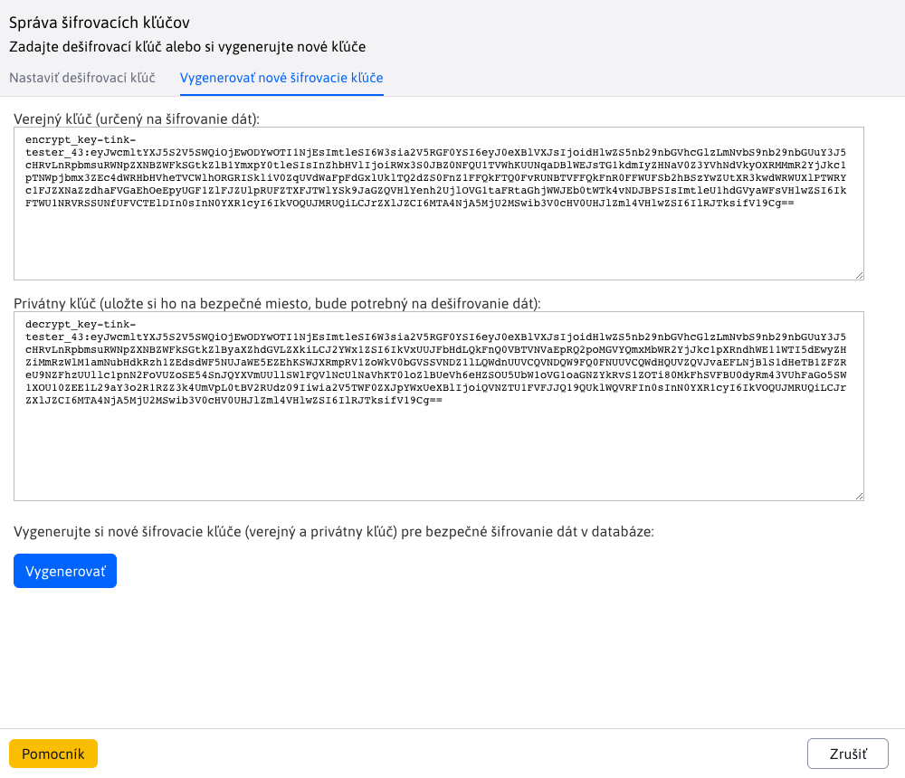
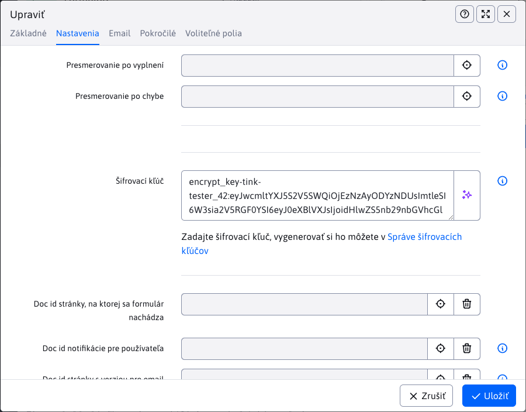
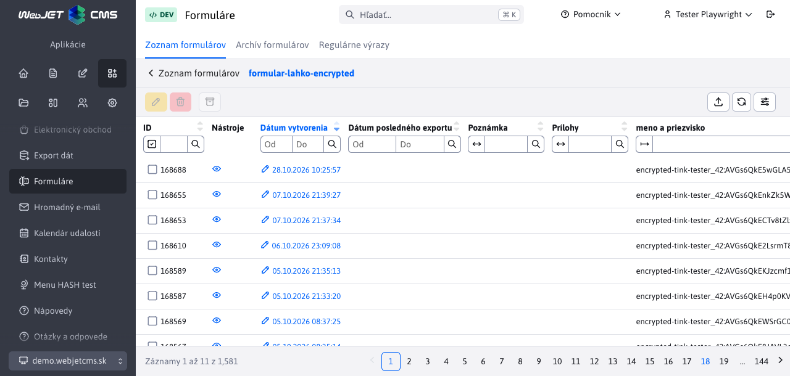
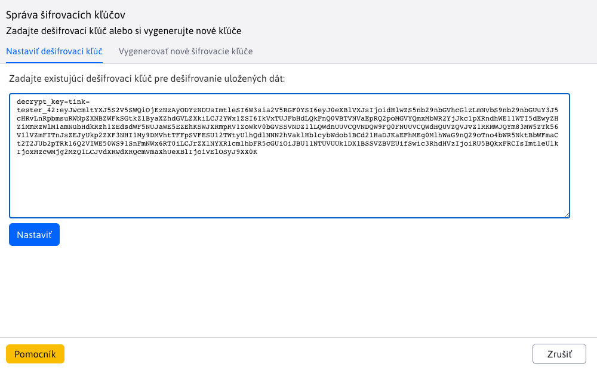
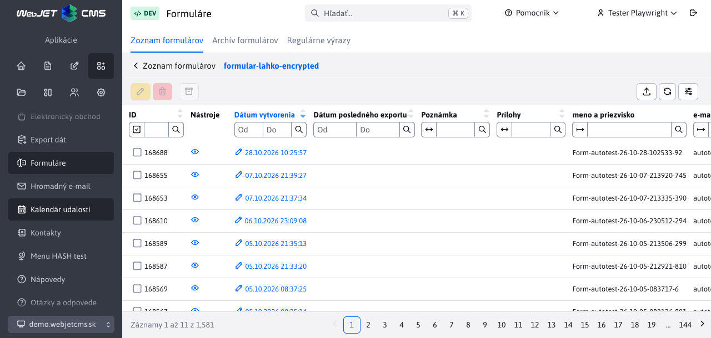

# Šifrovanie formulárov

Šifrovanie formulárov chráni obsah odoslaných formulárov uložený v databáze. Pri úniku databázy alebo jej zálohy tak útočník bez príslušného privátneho kľúča nedokáže prečítať zašifrované hodnoty, napríklad meno, emailovú adresu či text žiadosti.

WebJET používa dvojicu kľúčov:

| Kľúč | Na čo slúži | Kam ho zadáte |
| --- | --- | --- |
| **Verejný kľúč** | Zašifruje nové údaje. Samotný verejný kľúč nestačí na ich dešifrovanie. | Do poľa **Šifrovací kľúč** v nastaveniach formulára. |
| **Privátny kľúč** | Dešifruje údaje zašifrované zodpovedajúcim verejným kľúčom. | Do **Správy šifrovacích kľúčov** pri prezeraní odoslaných formulárov. |

Privátny kľúč si uchovajte oddelene od databázy a jej záloh, napríklad v správcovi hesiel s prístupom iba pre poverených pracovníkov. Ak unikne spolu s databázou, ochrana zašifrovaného obsahu sa stráca.

## Čo sa šifruje

Šifrovanie je dostupné pre klasické formuláre, [Formulár ľahko](../formsimple/README.md) aj [viackrokové formuláre](../multistep-form/README.md). Používa sa pri ukladaní odoslaných údajov na serveri.

| Údaje | Rozsah ochrany |
| --- | --- |
| Vyplnené hodnoty bežných polí | Do databázy sa ukladajú zašifrované. Pri viackrokovom formulári zostávajú prázdne hodnoty prázdne. |
| Uložená HTML podoba formulára | V databáze je zašifrovaná, na jej zobrazenie cez ikonu oka je potrebný privátny kľúč. |
| Názvy polí a prevádzkové údaje | Nešifrujú sa týmto kľúčom. Týka sa to napríklad názvu formulára, času odoslania, identifikátorov či poznámky k záznamu. |
| Nahraté súbory | Obsah príloh sa týmto mechanizmom nešifruje. Pri viackrokovom formulári zostávajú čitateľné aj uložené názvy súborov. |
| Email a PDF kópia | Obsahujú čitateľné vyplnené hodnoty. Nastavenie šifrovacieho kľúča ich nešifruje. |
| Export po dešifrovaní | Obsahuje čitateľné údaje, ktoré treba chrániť samostatne. |

Šifrovanie databázových hodnôt nenahrádza HTTPS, prístupové práva ani ochranu emailových schránok a súborov. Server pri spracovaní formulára pracuje aj s čitateľnými údajmi. Táto funkcia preto neposkytuje koncové šifrovanie medzi návštevníkom a pracovníkom, ktorý formuláre spracúva.

## Vytvorenie páru kľúčov

1. V hlavičke administrácie otvorte používateľské menu a zvoľte **Správa šifrovacích kľúčov**. Položka sa zobrazuje používateľom s právom **Formuláre**. Správu môžete otvoriť aj odkazom pri poli **Šifrovací kľúč** v nastaveniach formulára.
2. Prejdite na kartu **Vygenerovať nové šifrovacie kľúče**.
3. Kliknite na **Vygenerovať**.
4. Skopírujte celý **Verejný kľúč (určený na šifrovanie dát)** a celý **Privátny kľúč (uložte si ho na bezpečné miesto, bude potrebný na dešifrovanie dát)**. Zachovajte aj začiatok kľúča pred dvojbodkou.
5. Privátny kľúč bezpečne uložte ešte pred zatvorením okna. Evidujte, ku ktorým formulárom a obdobiu patrí.



Kľúče na obrázkoch sú ukážkové. Pre vlastné formuláre si vždy vygenerujte vlastný pár.

!> **Pri strate privátneho kľúča nedokážete príslušné údaje dešifrovať.** Opätovné kliknutie na **Vygenerovať** vytvorí inú dvojicu kľúčov, neobnoví pôvodnú. Správa kľúčov neposkytuje zoznam na opätovné vyzdvihnutie predtým vygenerovaných privátnych kľúčov.

## Nastavenie verejného kľúča pre formulár

1. Otvorte **Formuláre → Zoznam formulárov**.
2. Označte požadovaný formulár a kliknite na **Upraviť**. Kliknutie na jeho názov otvára zoznam odoslaných záznamov.
3. Na karte **Nastavenia** vložte do poľa **Šifrovací kľúč** celý verejný kľúč, ktorý pri predvolenom algoritme začína na `encrypt_key-tink-`.
4. Uložte nastavenia.



Do nastavení formulára patrí iba verejný kľúč. Privátny kľúč začínajúci na `decrypt_key-` sem nevkladajte.

Nastavenie platí pre nasledujúce odoslania. Už uložené záznamy sa dodatočne nezašifrujú. Rovnako zmena alebo odstránenie verejného kľúča nedešifruje staršie záznamy.

!> **Pri aktualizácii starších formulárov** preneste verejný kľúč z prípadného skrytého HTML poľa `encryptKey` do poľa **Šifrovací kľúč** v administrácii. Samotné zadanie kľúča v HTML už šifrovanie nezapína. Po aktualizácii overte nové odoslanie aj jeho dešifrovanie.

### Overenie nastavenia

1. Na webovej stránke odošlite formulár s rozpoznateľnými skúšobnými údajmi.
2. V administrácii bez nastaveného privátneho kľúča otvorte odoslané záznamy daného formulára.
3. Skontrolujte, že namiesto skúšobných hodnôt vidíte reťazce začínajúce na `encrypted-tink-`. Pri starších RSA kľúčoch je začiatok `encrypted-rsa2048-`.
4. Skontrolujte aj náhľad cez ikonu oka. Bez privátneho kľúča obsahuje šifrovaný text.
5. Nastavte privátny kľúč podľa nasledujúceho postupu a overte, že sa zobrazia pôvodné skúšobné hodnoty aj náhľad.



!> **Úspešné odoslanie formulára samo osebe nepotvrdzuje úspešné šifrovanie.** Aktuálna implementácia pri niektorých chybách šifrovania vracia pôvodný text; pri niektorých chybách načítania Tink kľúča môže vzniknúť prázdny šifrovaný obsah. Preto overte celý postup vrátane dešifrovania, najmä po zmene kľúča.

## Dešifrovanie zoznamu formulárov

1. V používateľskom menu otvorte **Správa šifrovacích kľúčov**.
2. Na karte **Nastaviť dešifrovací kľúč** vložte celý privátny kľúč patriaci k verejnému kľúču formulára. Pri predvolenom algoritme začína na `decrypt_key-tink-`.
3. Kliknite na **Nastaviť**. Zobrazí sa hlásenie **Dešifrovací kľúč úspešne nastavený**.
4. Vráťte sa do zoznamu odoslaných formulárov a obnovte ho. Hodnoty zašifrované príslušným verejným kľúčom sa zobrazia v čitateľnej podobe.





Čitateľné údaje sú potom dostupné aj v detaile záznamu, náhľade cez ikonu oka a pri exporte. **V databáze zostávajú zašifrované** — nastavenie privátneho kľúča slúži na ich dešifrovanie pri čítaní.

Privátny kľúč sa nastavuje do aktuálnej serverovej relácie používateľa (`session`). Po odhlásení alebo zániku relácie ho treba zadať znovu. Samotné zatvorenie okna správy kľúčov ho z relácie neodstráni. Po skončení práce sa odhláste, najmä na zdieľanom počítači.

V jednej relácii je nastavený jeden privátny kľúč. Ak máte formuláre alebo staršie záznamy šifrované iným párom, nastavte ich zodpovedajúci privátny kľúč. Hlásenie o úspešnom nastavení potvrdzuje vloženie kľúča do relácie, nie jeho správnosť pre konkrétne dáta.

## Výmena kľúčov a riešenie problémov

Pri výmene kľúčov vygenerujte nový pár a nastavte nový verejný kľúč do formulára. Starý privátny kľúč si ponechajte pre staršie záznamy. Údaje sa pri zmene nastavenia automaticky neprešifrujú.

| Problém | Čo skontrolovať |
| --- | --- |
| Po nastavení privátneho kľúča zostávajú hodnoty zašifrované. | Použite celý privátny kľúč z pôvodného páru a obnovte zoznam. Skontrolujte aj zhodu konfigurácie `cryptoContextInfo`, najmä po prenose údajov na iný server. |
| Niektoré záznamy sa zobrazia čitateľne a iné zostávajú zašifrované. | Záznamy mohli byť šifrované rôznymi kľúčmi. Orientujte sa podľa identifikátora v začiatku zašifrovanej hodnoty. |
| Nové údaje vidíte čitateľne aj bez privátneho kľúča. | Skontrolujte verejný kľúč v nastaveniach formulára v administrácii a chyby v serverovom logu. Kľúč iba v HTML poli `encryptKey` šifrovanie nezapína. Overujte v relácii bez dešifrovacieho kľúča. |
| Privátny kľúč sa stratil. | Vyhľadajte jeho bezpečne uloženú zálohu. Nový pár neumožní prečítať údaje šifrované pôvodným párom. |

## Technické informácie

### Predvolený algoritmus

Konfiguračná premenná `cryptoAlg` má predvolenú hodnotu `CryptoTink`. Pri generovaní kľúčov používa implementácia `CryptoTink` knižnicu Google Tink a šablónu:

```text
ECIES_P256_HKDF_HMAC_SHA256_AES128_CTR_HMAC_SHA256
```

Ide o hybridné šifrovanie, ktoré kombinuje asymetrickú časť s rýchlym symetrickým šifrovaním obsahu. Použitá šablóna zahŕňa:

- **ECIES s krivkou NIST P-256** na asymetrickú časť a odvodenie spoločného tajomstva pomocou ECDH.
- **HKDF-HMAC-SHA-256** na odvodenie kľúčov.
- **AES-128 v režime CTR** na šifrovanie obsahu.
- **HMAC-SHA-256** na kontrolu integrity v rámci symetrickej časti.

Hybridné šifrovanie umožňuje spracovať aj dlhé hodnoty a HTML podobu formulára. Používa náhodnosť, takže dve rovnaké hodnoty nemusia mať rovnaký šifrovaný zápis. Podrobnosti princípu sú v [dokumentácii Google Tink](https://developers.google.com/tink/hybrid); vyššie je uvedená konkrétna šablóna používaná WebJET CMS.

### Formát kľúčov a údajov

Pri Tink kľúčoch WebJET používa tieto tvary:

```text
encrypt_key-tink-<login>_<id>:<verejný kľúč v Base64>
decrypt_key-tink-<login>_<id>:<privátny kľúč v Base64>
encrypted-tink-<login>_<id>:<šifrovaný obsah v Base64>
```

Časť `<login>_<id>` identifikuje používateľa, ktorý pár vygeneroval, a poradový identifikátor páru. Pomáha priradiť údaje ku kľúču; neurčuje prístupové práva. Kľúč môže na dešifrovanie použiť aj iný oprávnený používateľ, ktorý ho má k dispozícii.

Kľúčový materiál Tink je serializovaný ako JSON a zakódovaný do Base64. **Base64 nie je šifrovanie privátneho kľúča** ani jeho ochrana heslom. S celým reťazcom preto zaobchádzajte ako s tajomstvom.

Hodnoty polí sú uložené v stĺpci `forms.data`; šifruje sa hodnota každého poľa, názvy polí a oddeľovače zostávajú čitateľné. HTML podoba sa šifruje ako celok do `forms.html`. Dešifrovanie vykonáva server pomocou `CryptoFactory`, ktorý prečíta privátny kľúč z aktuálnej relácie. Do databázy sa pri tomto čítaní nezapisuje dešifrovaná verzia.

### Súvisiaca konfigurácia

| Premenná | Význam |
| --- | --- |
| `cryptoAlg` | Vyberá implementáciu pri generovaní nového páru: predvolene `CryptoTink`, alternatívne `CryptoRsa2048`. Pri práci s existujúcimi kľúčmi sa implementácia vyberá podľa označenia kľúča. Zmena premennej neprešifruje uložené dáta. |
| `cryptoContextInfo` | Kontext použitý pri šifrovaní aj dešifrovaní cez Tink. Ak je prázdny, WebJET ho pri použití vytvorí a uloží do konfigurácie. Pre dešifrovanie je potrebná tá istá hodnota ako pri šifrovaní. Pri migrácii zachovajte aj túto konfiguráciu. |
| `cryptoToolsShowGeneratedKeysLog` | Pri hodnote `true` vypisuje generované kľúče vrátane privátneho do serverového logu. Na bežnej prevádzke ho ponechajte vypnuté. |

Staršia implementácia `CryptoRsa2048` používa RSA s kľúčom dĺžky 2048 bitov a prefixom `rsa2048`. Šifruje priamo jeden blok cez Java `Cipher.getInstance("RSA")`, preto má obmedzenú dĺžku vstupu a nie je vhodná na dlhé formulárové hodnoty ani HTML. Presné doplnenie bloku (`padding`) závisí od kryptografického poskytovateľa Javy. Pre nové páry formulárov ponechajte predvolenú implementáciu `CryptoTink`.

Implementáciu nájdete v triedach `CryptoFactory`, `CryptoTink` a `CryptoRsa2048`. Ukladanie klasických formulárov a Formulára ľahko zabezpečuje `FormMailAction`, pri viackrokových formulároch `SaveFormService` a `FormHtmlHandler`. Zobrazenie dešifrovaných hodnôt a HTML zabezpečujú `FormsService` a `FormsController`.
