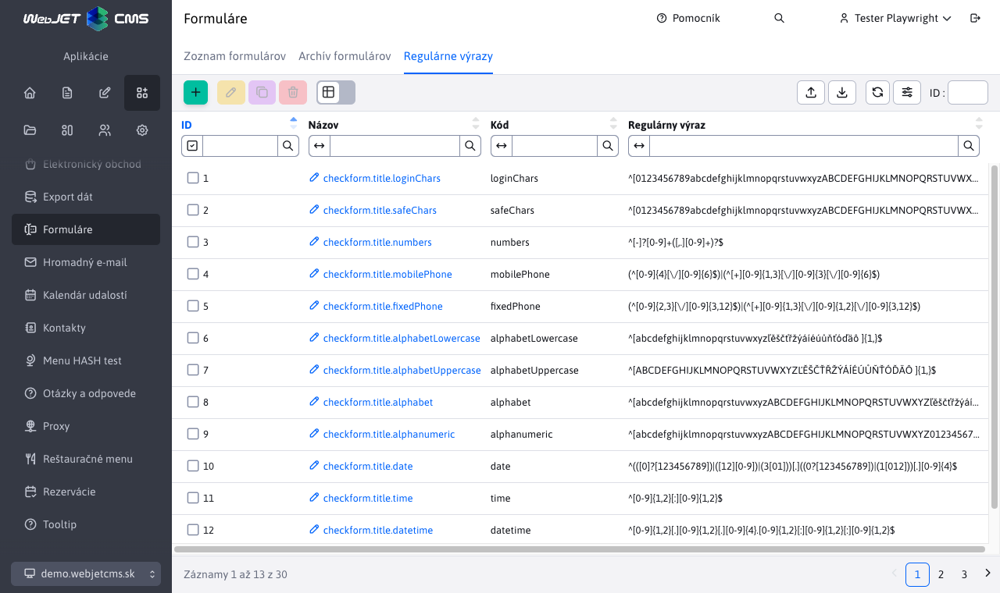
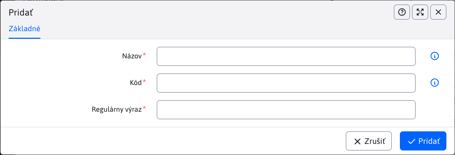

# Regulárne výrazy

Aplikácia Formuláre obsahuje uzol Regulárne výrazy, cez ktoré je možné definovať pravidlá pre kontrolu vyplnenia polí. Pravidlá sa definujú pomocou regulárneho výrazu.

Stĺpec **Preložený názov** zobrazuje popis pravidla v jazyku, v ktorom ste prihlásený do administrácie. Podľa tohto názvu, kódu aj prekladového kľúča môžete zoznam filtrovať a zoradiť. Preložený názov sa do databázy neukladá a nie je súčasťou exportu.

Zoznam je predvolene zoradený abecedne podľa stĺpca **Kód**. Podľa kódu sú zoradené aj možnosti **Povolená hodnota** vo viackrokových formulároch, bez ohľadu na veľkosť písmen a jazyk administrácie.

Editor obsahuje nasledovné polia.

- Prekladový kľúč - kľúč popisu pravidla, napríklad `checkform.title.alphabetLowercase`. Môžete zadať aj vlastný text, napríklad `minimálne 8 znakov`, ktorý sa zobrazí priamo. Pri chýbajúcom preklade sa použije štandardný náhradný preklad WebJET CMS. Ak sa nenájde, zobrazí sa samotný kľúč.
- Kód - Kódové označenie, môže obsahovať len písmená bez medzier. V HTML kóde sa použije ako CSS trieda na vstupnom poli.
- Regulárny výraz - [Regulárny výraz](https://www.w3schools.com/jsref/jsref_obj_regexp.asp) pravidla.

