# Mapa kliknutí

Mapa kliknutí ukazuje, na ktoré časti stránky návštevníci klikajú. Otvorte **Štatistika → Mapa kliknutí**, vyberte obdobie a kliknite na názov stránky. Zoznam obsahuje stránky aktuálnej domény so zaznamenanými kliknutiami, ku ktorým máte prístup.

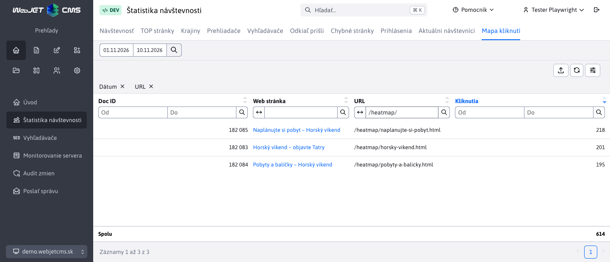

## Zapnutie merania

V šablóne alebo skupine šablón vyberte **Štatistika + mapa kliknutí**. Skript sa vloží automaticky. **Štatistika** meria iba návštevnosť, **Vypnuté** zastaví meranie a **Zdediť nastavenie** použije nadradenú úroveň. Šablóna má prednosť pred skupinou šablón.

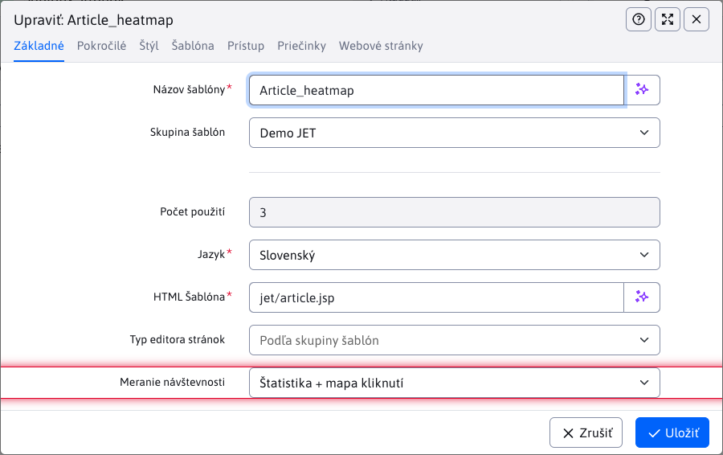

Globálne nastavenie `statMode=none` vypne celé meranie; `statEnableClickTracking=false` vypne iba mapu kliknutí aj pri jej zapnutí v šablóne.

Kliknutia sa zaznamenávajú iba so súhlasom so štatistickými cookies. V existujúcej inštalácii doplňte chýbajúcu definíciu cookie:

- **Názov cookie:** `wj_hm_*`
- **Kategória:** Štatistické
- **Typ:** `http`
- **Platnosť:** 24 hodín
- **Účel:** Dočasne uchováva kliknutia do ich odoslania na vytvorenie mapy.

Potom na webe povoľte štatistické cookies. Nové inštalácie už definíciu obsahujú.

## Výber šírky a náhľad

Náhľad zobrazuje mapu kliknutí a panel najklikanejších oblastí.

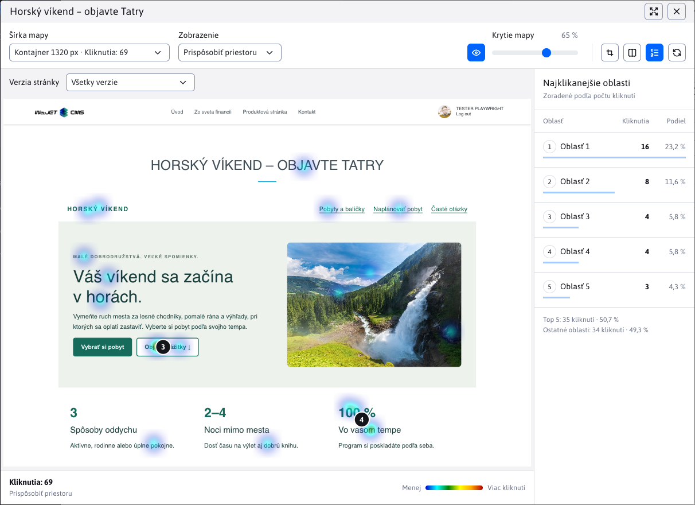

**Šírka mapy** ponúka skupiny s počtami kliknutí; predvolene vyberie najpoužívanejšiu. Pevné vycentrované kontajnery zoskupuje podľa šírky kontajnera, ostatné podľa presnej šírky okna. Skupiny zostávajú oddelené aj pri rovnakej číselnej šírke. Obnovené počty môžu mať oneskorenie do 30 sekúnd.

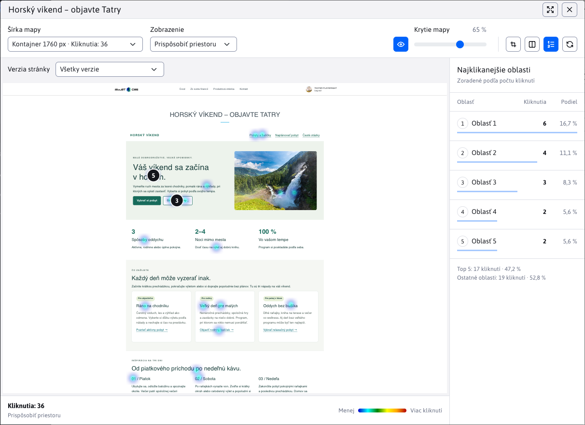

Rozsah merania určuje CSS selektor `statHeatMapMainContainerSelector` (predvolene `.container`). Zaznamenávajú sa iba kliknutia v zodpovedajúcich kontajneroch. Prázdna hodnota meria celú stránku; neplatný selektor alebo chýbajúci kontajner znamená, že sa kliknutia nezaznamenávajú. Selektor musí používať štandardnú CSS syntax bez rozšírení jQuery.

Ak nemožno spoľahlivo určiť pevnú šírku kontajnera, použije sa šírka okna. Ak v náhľade chýba zodpovedajúci kontajner, zobrazí sa upozornenie a mapa sa skryje; uložené údaje zostávajú zachované.

### Veľkosť zobrazenia

**Zobrazenie** mení mierku náhľadu, nie šírku stránky.

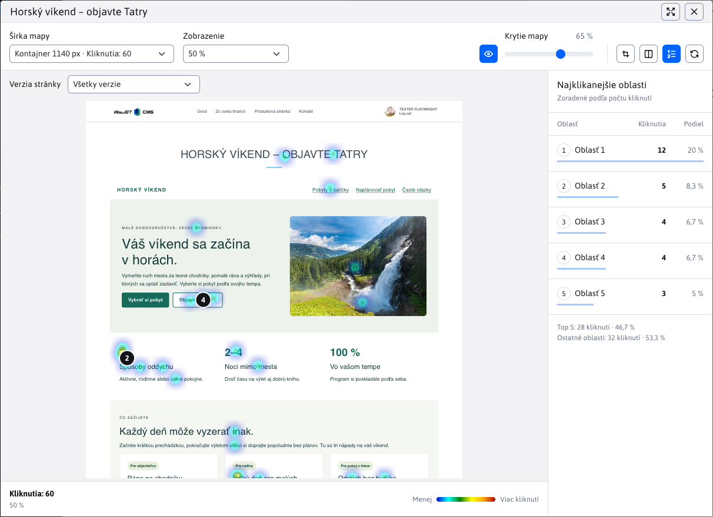

### Posúvanie stránky

Náhľad posúvajte kolieskom myši. Pripnutá hlavička zakrýva aj značky kliknutí pod ňou.

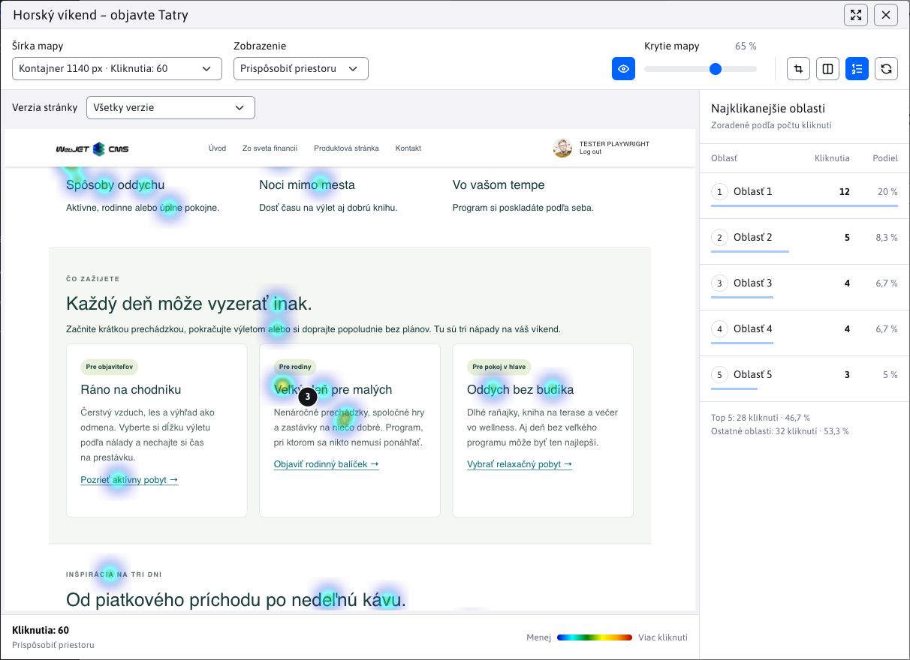

### Krytie a skrytie mapy

**Krytie mapy** upravuje intenzitu farebnej vrstvy.

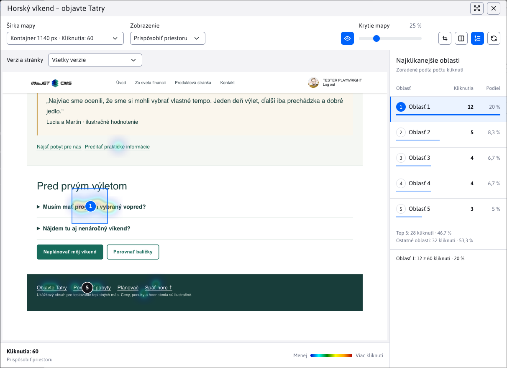

Prepínač **Zobraziť mapu** vrstvu skryje alebo zobrazí.

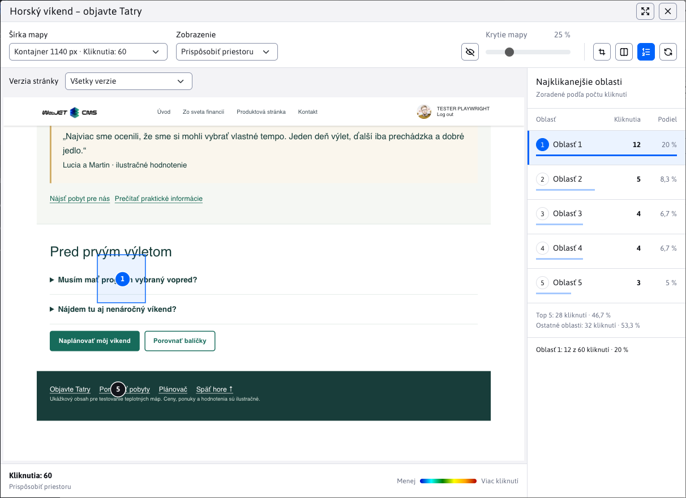

### Obnovenie náhľadu

Pri chybe načítania použite **Obnoviť náhľad**.

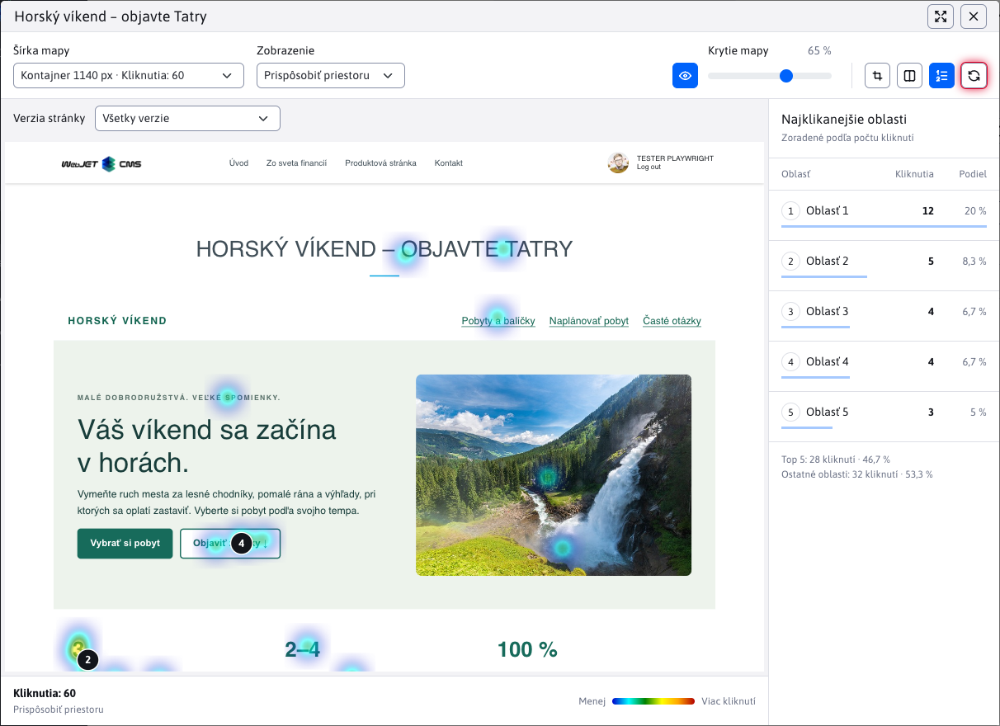

### Celá obrazovka

Tlačidlom v pravom hornom rohu náhľad zväčšíte na celú obrazovku alebo vrátite späť.

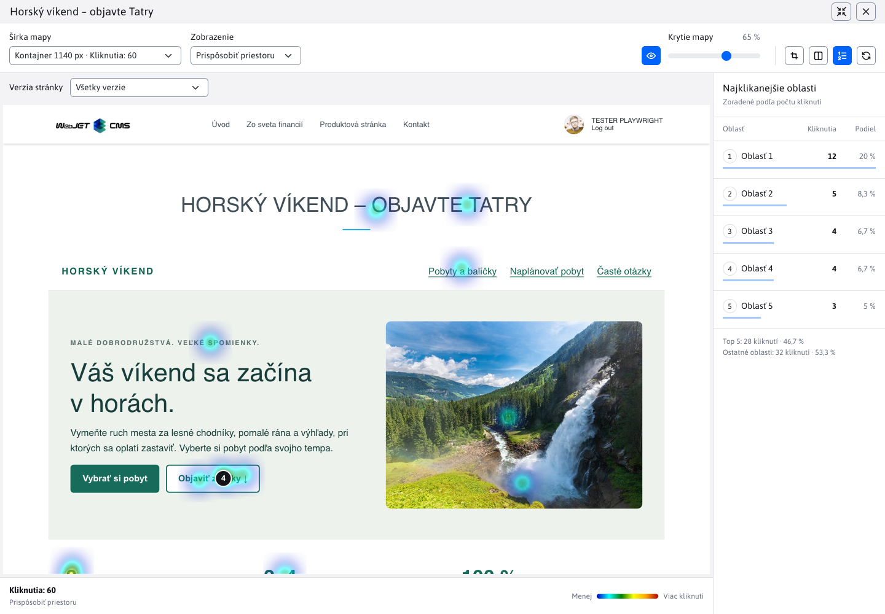

### Farby mapy

Farby od modrej po červenú vyjadrujú rastúcu hustotu kliknutí. Škála sa prispôsobuje vybraným údajom a pri posúvaní sa nemení. Farba nevyjadruje percentuálny podiel kliknutí v oblasti.

## Verzie stránky

Náhľad predvolene zobrazuje publikovaný obsah ku koncu obdobia. Ak nie je dostupný, upozorní na použitie aktuálneho obsahu alebo nedostupnosť náhľadu. V poli **Verzia stránky** vyberte konkrétnu verziu alebo **Všetky verzie**. Zoznam obsahuje najviac 100 najnovších publikovaných verzií za obdobie; staršie hľadajte v skoršom období.

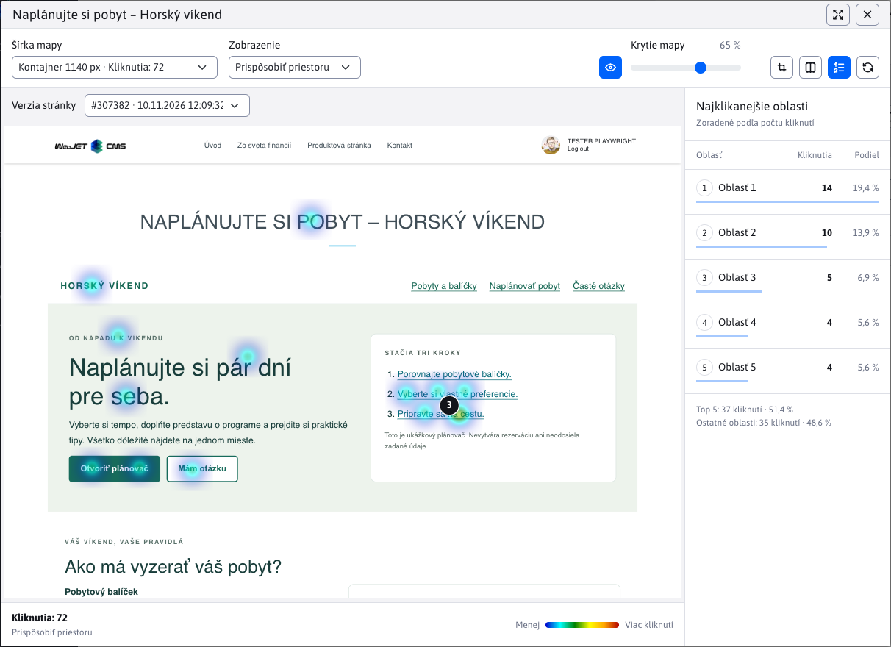

Kliknutia sa priraďujú po celých dňoch. Verzie publikované v rovnaký deň preto môžu obsahovať rovnaké kliknutia; **Všetky verzie** započíta každé raz. Verziu bez kliknutí možno prezerať s nulovým počtom. Čas plánovaného publikovania je približný.

Šablóna, hlavička, päta, ponuky, aplikácie a obrázky používajú aktuálne zdroje. Zmeny rozloženia či výšky obsahu môžu posunúť mapu oproti pôvodným kliknutiam.

## Porovnanie dvoch verzií

Ak obdobie obsahuje aspoň dve publikované verzie, kliknite na **Porovnať verzie**. V poliach **Verzia A** a **Verzia B** vyberte odlišné verzie.

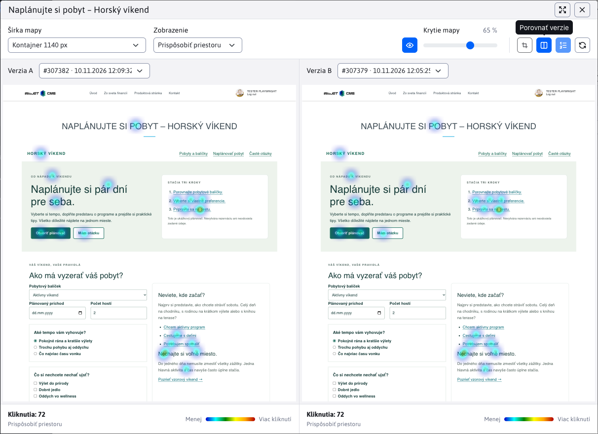

Náhľady zdieľajú šírku, mierku, krytie a viditeľnosť mapy. Posúvať ich môžete samostatne.

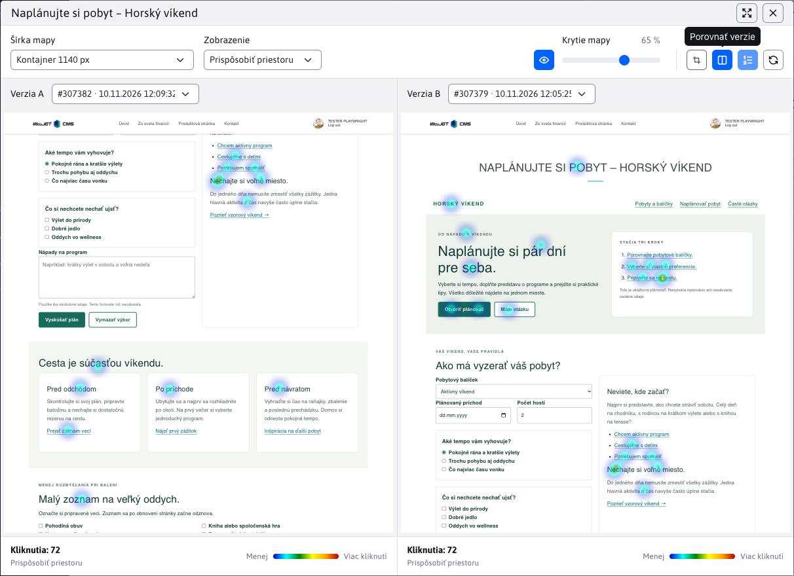

Každá verzia má vlastný počet kliknutí a farebnú škálu; rovnaká farba neznamená rovnaký počet. Počty sa neupravujú podľa návštevnosti ani dĺžky platnosti verzie. Verzia bez kliknutí sa zobrazí bez farebnej vrstvy.

Opätovným kliknutím na **Porovnať verzie** obnovíte pôvodný náhľad.

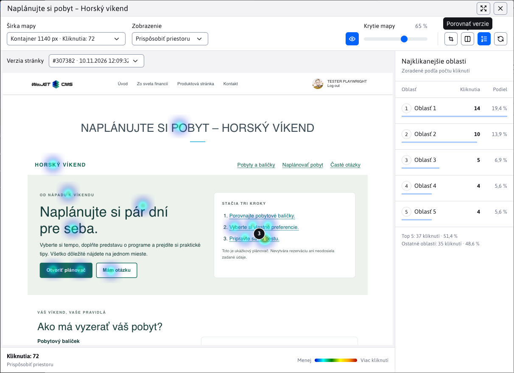

## Počet kliknutí v oblasti

Zapnite **Vybrať oblasť** a myšou označte obdĺžnik. Pod náhľadom uvidíte počet a podiel kliknutí pre vybrané obdobie, verziu a šírku. Počas výberu môžete stránku posúvať kolieskom. Pri porovnávaní verzií je výber nedostupný.

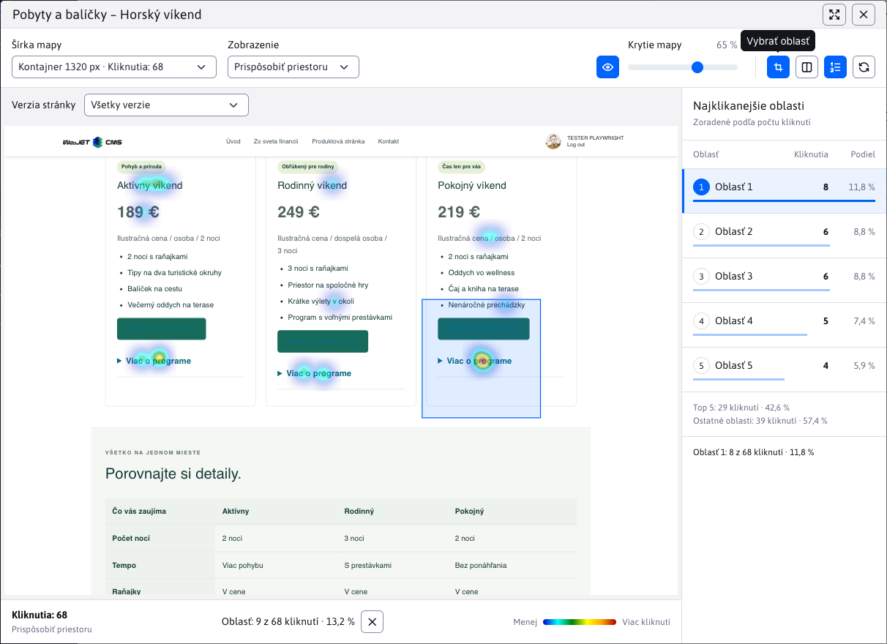

Výber zrušíte vypnutím **Vybrať oblasť**, tlačidlom **Zrušiť oblasť**, zmenou verzie či šírky alebo obnovením náhľadu.

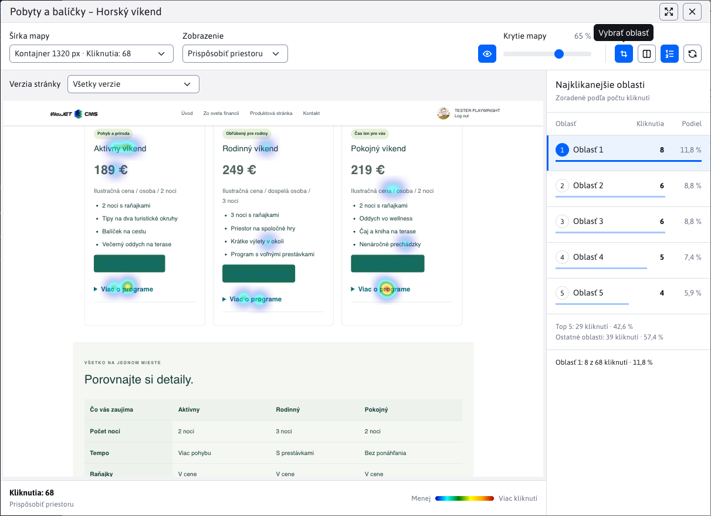

## Najklikanejšie oblasti

Tlačidlom <button class="btn btn-sm btn-primary" type="button" title="Oblasti" aria-label="Oblasti"><i class="ti ti-list-numbers" aria-hidden="true"></i></button> zobrazíte alebo skryjete najviac päť najklikanejších neprekrývajúcich sa oblastí s počtami a podielmi kliknutí pre aktuálny výber. Kliknutím na riadok sa presuniete na označenú oblasť. Pri porovnávaní verzií je panel skrytý.

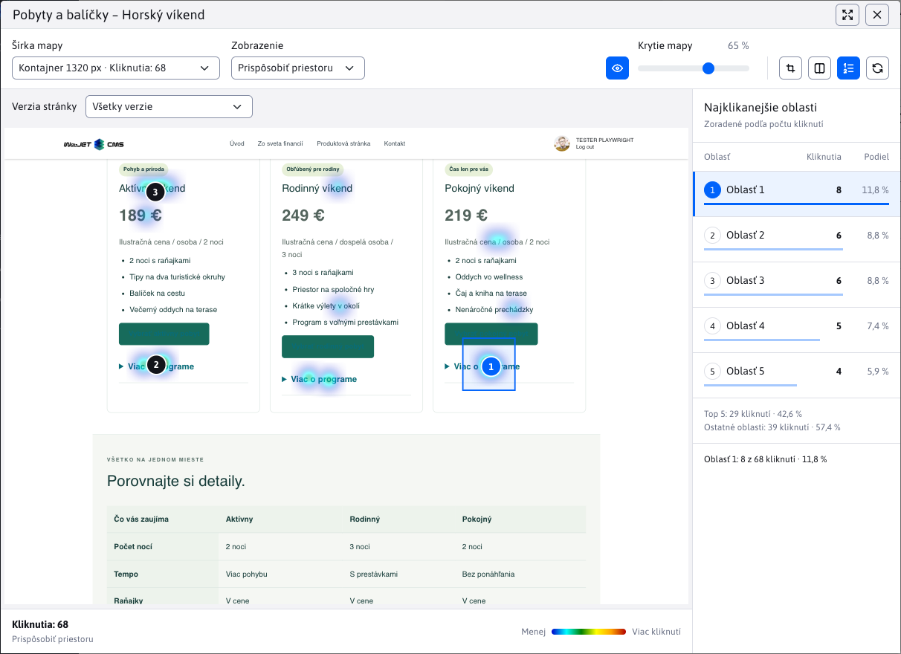

Skrytím panelu získate viac priestoru pre náhľad.

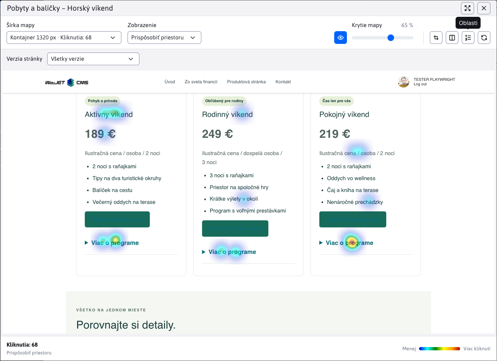

## Prenos a obmedzenia

Kliknutia čakajú v cookies na ďalšiu požiadavku na server. Posledné kliknutia pred odchodom alebo pri obsluhe z vyrovnávacej pamäte sa nemusia odoslať. Limit je 16 cookies, spolu 2 KiB, s platnosťou 24 hodín; pri prekročení sa najstaršie neodoslané kliknutia zahodia. Mapa nezaznamenáva pohyb myši ani relácie.

Správca môže [zlúčiť historické kliknutia](../../../admin/settings/cronjob/README.md#zlučovanie-historických-kliknutí) alebo odstrániť údaje nástrojom na čistenie databázy. `statHeatMapCellSize` určuje veľkosť bunky pri vykresľovaní aj zlučovaní (predvolene `5`, teda 5 × 5 CSS pixelov). Väčšie bunky znižujú presnosť; neskoršie zmenšenie neobnoví zlúčené súradnice.

## Pôvodné údaje

Staré záznamy zostávajú zachované. Kliknutia bez šírky okna nájdete pod **1920 px**; ich poloha je orientačná. Spätne sa neprepočítavajú ani nezlučujú s kontajnerovými skupinami.

Doména sa priradí podľa aktuálnej domény zdrojovej stránky. Záznamy bez dohľadateľnej stránky alebo domény zostanú uložené, ale nezobrazia sa. Historické zmeny domény sa neobnovujú.
