# Prieskumník

Prieskumník slúži na nahrávanie, vyhľadávanie a správu súborov a priečinkov.

Pozostáva z niekoľkých častí:

- panel nástrojov
- cesta k otvorenému priečinku a strom priečinkov
- hlavná plocha
- pätička

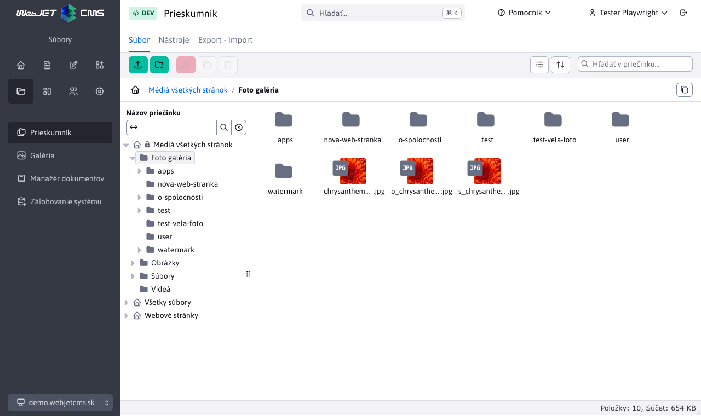

## Vyhľadávanie priečinkov

Nad stromom priečinkov je pole **Názov priečinku**, ktoré funguje podobne ako v galérii. Vyberte spôsob porovnania **Obsahuje**, **Začína na**, **Končí na** alebo **Rovná sa**, zadajte názov a stlačte Enter alebo tlačidlo s lupou. Vyhľadávanie prehľadá aj nerozbalené priečinky v dostupných vetvách a nerozlišuje veľké písmená ani diakritiku.

Počas načítavania výsledkov je strom priečinkov neaktívny. Výsledky zostávajú v stromovej štruktúre. Zodpovedajúce priečinky sú zvýraznené tučným písmom a ich nadradené priečinky sú rozbalené, podobne ako v galérii. Kliknutím otvoríte priečinok; tlačidlom na zrušenie filtra alebo klávesom Escape obnovíte strom. Vyhľadávanie súborov v paneli nástrojov zostáva samostatné.

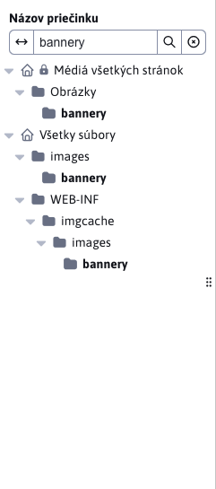

## Panel nástrojov

Dostupnosť tlačidiel závisí od vybraných položiek a oprávnení na prácu s nimi. Názov akcie sa zobrazí v bublinovej nápovede po podržaní kurzora nad tlačidlom. Rovnakú nápovedu používajú aj súbory, strom priečinkov a dialógy.

Nástroje sú rozdelené do troch kariet:

- Súbor
- Nástroje
- Export - Import

### Karta Súbor

Karta Súbor ponúka základné možnosti na prácu ako:

- <button class="btn btn-sm btn-success"><i class="ti ti-upload"></i></button>, **Nahrať súbory**, nahrá súbory do otvoreného priečinka.
- <button class="btn btn-sm btn-success"><i class="ti ti-folder-plus"></i></button>, **Nový priečinok**, vytvorí priečinok v aktuálnom umiestnení.
- <button class="btn btn-sm btn-danger"><i class="ti ti-cut"></i></button>, **Vystrihnúť**, pripraví označené položky na presun. Po vložení do cieľového priečinka sa odstránia z pôvodného umiestnenia.
- <button class="btn btn-sm btn-outline-secondary"><i class="ti ti-copy"></i></button>, **Kopírovať**, pripraví označené položky na kopírovanie.
- <button class="btn btn-sm btn-outline-secondary"><i class="ti ti-clipboard"></i></button>, **Vložiť**, vloží skopírované alebo vystrihnuté položky do otvoreného priečinka.

- <button class="btn btn-sm btn-outline-secondary"><i class="ti ti-list"></i></button>, **Zoznam**, zmení zobrazenie súborov/priečinkov v pracovnej zóne na tabuľkové zobrazenie.
- <button class="btn btn-sm btn-outline-secondary"><i class="ti ti-layout-grid"></i></button>, **Ikony**, zmení zobrazenie súborov/priečinkov v pracovnej zóne na zobrazenie pomocou ikon.

Zoznam                     |  Ikony
:-------------------------:|:-------------------------:
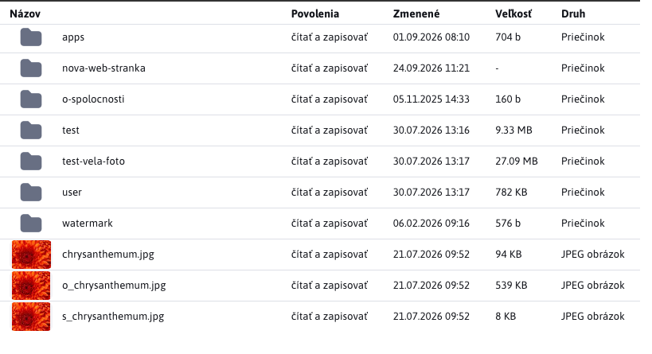     |  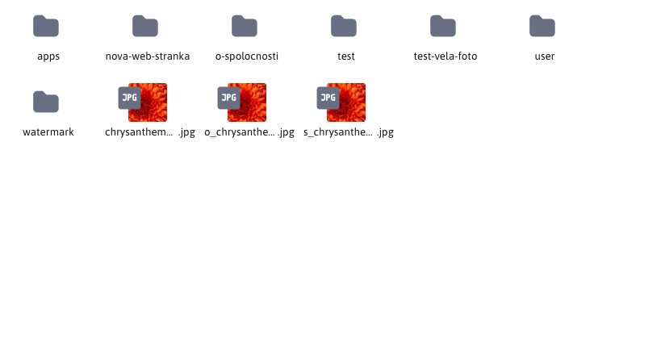

- <button class="btn btn-sm btn-outline-secondary"><i class="ti ti-arrows-up-down"></i></button>, **Zoradiť**, umožňuje zoradiť súbory/priečinky podľa vybraného kritéria.

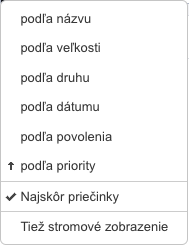

### Karta Nástroje

Karta **Nástroje** obsahuje náhľad, informácie o položke, sťahovanie, premenovanie, úpravu, duplikovanie, prácu s archívmi a vymazanie. Prepínač zobrazenia, zoradenie a vyhľadávanie sú dostupné aj na tejto karte.

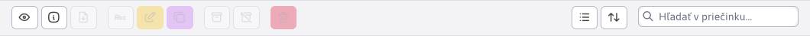

- <button class="btn btn-sm btn-outline-secondary"><i class="ti ti-file-download"></i></button>, **Stiahnuť**, umožňuje stiahnutie vybraného súboru (IBA súboru).

- <button class="btn btn-sm btn-outline-secondary"><i class="ti ti-eye"></i></button>, **Náhľad**, poskytuje rozdielnu funkcionalitu v závislosti od zvoleného elementu, základom je vždy dialógové okno, ktoré je možné zväčšiť/zmenšiť. Naraz môže byť otvorené vždy **len jedno okno**. Pri výbere iného súboru/priečinka sa okno aktualizuje (neotvorí sa nové). Pomocou šípok viete meniť zvolený súbor/priečinok v aktuálne zvolenej lokácií.
  - Priečinok alebo bežný súbor, poskytne informáciu o názve a poslednej úprave.
  - Textový súbor ako `text/plain`, `text/html`, `text/jsp`, `text/javascript`, `text/css`, `text/xml`, `text/x-js`, `text/markdown`, otvorí súbor v dialógovom okne (súbor sa však **nedá upraviť**).
  - Obrázok sa zobrazí ako náhľad v dialógovom okne.

Priečinok/súbor            |  Textové súbory           | Obrázok
:-------------------------:|:-------------------------:|:-------------------------:
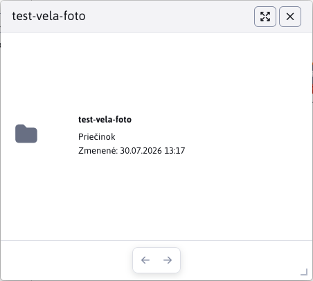  |  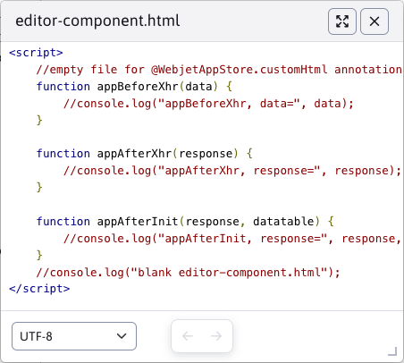  | 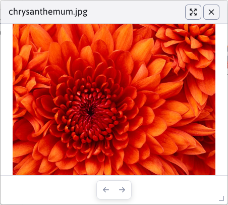

- <button class="btn btn-sm btn-outline-secondary"><i class="ti ti-info-square-rounded"></i></button>, **Získať info**, poskytuje podrobné informácie o zvolenom súbore/priečinku, ktoré sa zobrazia v okne. Týchto okien môže byť viac (na rozdiel oproti **Náhľadu**). Ak zvolíte viacero súborov/priečinkov, získate iba informáciu o ich počte a spoločnej veľkosti.

Priečinok                  |  Súbor
:-------------------------:|:-------------------------:
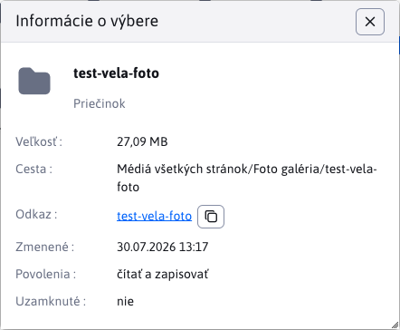       |  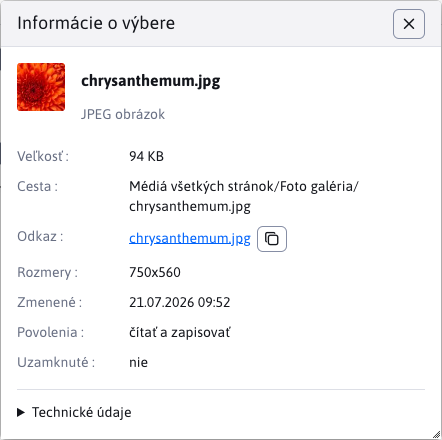

Veľkosť priečinka sa po otvorení okna **Získať info** vypočíta na pozadí vrátane súborov v podpriečinkoch, ku ktorým máte prístup. Počas výpočtu sa zobrazuje priebežná veľkosť a počet skontrolovaných priečinkov. Zatvorením okna sa prebiehajúci výpočet zastaví. Pri chybe ho môžete zopakovať tlačidlom **Skúsiť znova**. Výpočet je dostupný pre priečinky súborového systému, nie pre virtuálne korene alebo položky webových stránok.

Odkaz na súbor môžete skopírovať tlačidlom vedľa odkazu. Identifikátor položky je v rozbaľovacej časti **Technické údaje**.

  
- <button class="btn btn-sm btn-warning"><i class="ti ti-edit"></i></button>, **Upraviť**, umožňuje úpravy súborov a IBA súborov. Bližšie informácie v časti [Úprava súborov](../fbrowser/file-edit/README.md).
- <button class="btn btn-sm btn-duplicate"><i class="ti ti-copy"></i></button>, **Duplikovať**, umožňuje duplikovať označené priečinky/súbory. Klonované priečinky/súbory sa uložia do rovnakej lokácie, z ktorej boli duplikované.
- <button class="btn btn-sm btn-danger"><i class="ti ti-trash"></i></button>, **Vymazať**, umožňuje permanentne vymazať zvolené priečinky/súbory.
- <button class="btn btn-sm btn-outline-secondary"><i class="ti ti-abc"></i></button>, **Premenovať**, umožňuje premenovať priečinok/súbor. Zvolený môže byť v rovnakej chvíli iba JEDEN priečinok/súbor.
  
- <button class="btn btn-sm btn-outline-secondary"><i class="ti ti-archive"></i></button>, **Vytvoriť archív**, umožňuje archivovať všetky označené priečinky/súbory do jedného ZIP archívu (ZIP je jediný podporovaný). Archív sa uloží do rovnakej lokácie ako zvolené priečinky/súbory.
- <button class="btn btn-sm btn-outline-secondary"><i class="ti ti-archive-off"></i></button>, **Extrahovať súbory z archívu**, umožňuje extrahovanie dát z označených ZIP archívov. Extrahovanie sa vykoná v rovnakej lokalite, v ktorej sa archív nachádza.

### Karta Export - Import

Klikom na kartu Export - Import sa otvorí dialógové okno k exportu/importu/rollback-u súborov.

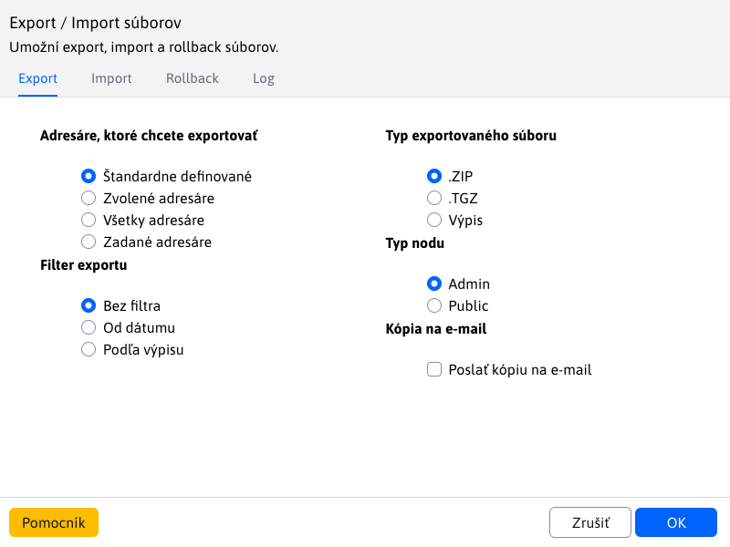

### Vyhľadávanie

V poli **Hľadať v priečinku…** zadáte názov súboru alebo jeho časť vrátane prípony a stlačíte Enter. Predvolene sa prehľadáva aktuálny priečinok. V ponuke pod poľom môžete zvoliť aj vyhľadávanie **V podpriečinkoch**.

Ak sa nenájdu žiadne súbory, hlavná plocha zobrazí hlásenie a tlačidlá **Zrušiť vyhľadávanie** a **Hľadať aj v podpriečinkoch**. Druhé tlačidlo rozšíri hľadanie rovnakého výrazu na vnorené priečinky; pri už zapnutom rekurzívnom hľadaní sa nezobrazuje.

Hľadanie v aktuálnom priečinku | Hľadanie aj v podpriečinkoch
:----------------------------:|:---------------------------:
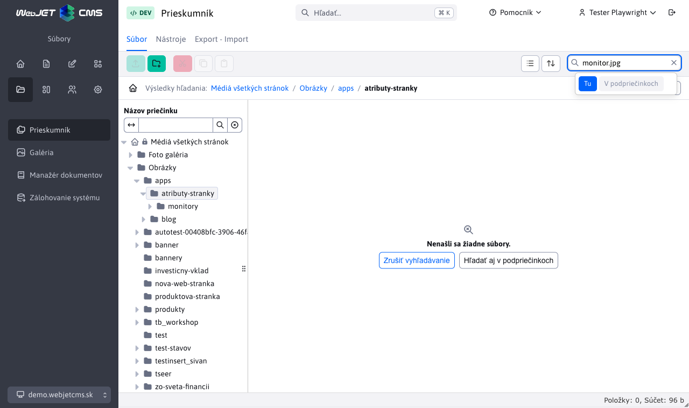        | 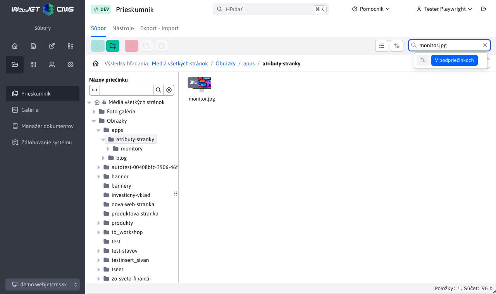

Vyhľadávanie zrušíte tlačidlom s krížikom v poli alebo tlačidlom **Zrušiť vyhľadávanie** na hlavnej ploche. Vyhľadávanie súborov je nezávislé od filtra názvu priečinka nad stromom.

## Navigačná lišta

Pod panelom nástrojov je cesta k otvorenému priečinku. Kliknutím na jej časť prejdete do nadradeného priečinka. Ikona domčeka otvorí ponuku koreňov, napríklad **Médiá všetkých stránok**, **Všetky súbory** a **Webové stránky**, podľa vašich oprávnení. Tlačidlom **Kopírovať cestu** na pravom okraji skopírujete zobrazenú cestu.

Vľavo je strom priečinkov. Šípkou pri názve rozbalíte alebo zbalíte podpriečinky; kliknutím na názov otvoríte priečinok na hlavnej ploche.

Šírka navigačnej lišty nie je fixná, a dá sa meniť podľa potreby. Stromová štruktúra podporuje taktiež `Drag and Drop`, čiže umožňuje presúvanie priečinkov. Každý riadok s priečinkom môže obsahovať ikony:

- <i class="ti ti-home"></i>, hlavný priečinok, ktorý už nemá nad sebou rodičovský priečinok
- <i class="ti ti-lock"></i>, uzamknutý priečinok, povolené je len čítanie
- <i class="ti ti-caret-right-filled"></i>, priečinok ktorý obsahuje pod-priečinky, ale zoznam je zbalený
- <i class="ti ti-caret-down-filled"></i>, priečinok ktorý obsahuje pod-priečinky, a zoznam je rozbalený

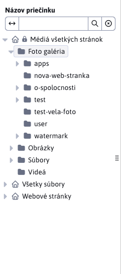

## Hlavná plocha

Hlavná plocha zobrazuje priamy obsah otvoreného priečinka. Vnorené súbory uvidíte až po otvorení podpriečinka alebo pri vyhľadávaní v podpriečinkoch.

V prázdnom priečinku sa zobrazí oznam. Ak máte oprávnenie nahrávať súbory, zobrazí sa aj výzva na ich presunutie a tlačidlo na nahratie.

Ako aj "Navigačná lišta", "Hlavná plocha" taktiež podporuje `Drag and Drop` akciu.
!>**Upozornenie:** akcia `Drag and Drop` funguje aj medzi "Hlavná plocha" a "Navigačná lišta", čiže môžete priečinok/súbor presunúť z plochy priamo do priečinka navigačnej lišty.

**Ľavý klik**, slúži na označenie priečinkov a súborov.

**Dvojitý ľavý klik**, na:

- priečinok, vykoná jeho otvorenie
- na textový súbor typov `text/plain`, `text/html`, `text/jsp`, `text/javascript`, `text/css`, `text/xml`, `text/x-js`, `text/markdown`, spusti akciu úpravy
- na iné nepodporované súbory ako `.tld`, neurobí nič

**Pravý klik** slúži hlavne na zobrazenie najpoužívanejších nástrojov z [Panela nástrojov](#panel-nástrojov). Zobrazí sa malé okno s dostupnými nástrojmi, ktoré sa môžu líšiť podľa toho, na ktorej položke ste klikli. Pri súbore alebo priečinku je v záhlaví ponuky jeho názov.

Pravý klik na plochu       |  Pravý klik na priečinok  | Pravý klik na súbor
:-------------------------:|:-------------------------:|:-------------------------:
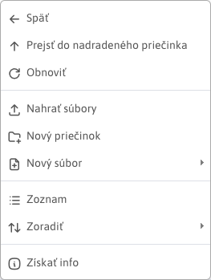      |  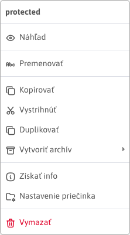       | 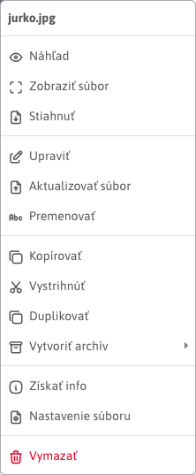

Ako môžete vidieť z predchádzajúcej série obrázkov, zobrazené nástroje sa líšia v závislosti od zvoleného elementu. Napríklad pre súbor máme zobrazenú možnosť **Stiahnuť** ale pre priečinok nie, nakoľko povolené je IBA sťahovanie súborov.
Taktiež ste si mohli všimnúť nástroje, ktoré sme si v sekcií [Panela nástrojov](#panel-nástrojov) nespomenuli, nakoľko nemajú vlastné tlačidlo v paneli. Ide o nástroje:

- <i class="ti ti-reload"></i>, **Obnoviť**, je to akcia nad hlavnou plochou, ktorá vykoná opätovné načítanie dát aktuálneho priečinka.
- <i class="ti ti-file-plus"></i>, **Nový súbor**, je to akcia nad hlavnou plochou, umožňuje okamžite v aktuálnom priečinku vytvoriť textový súbor týchto typov `TEXT, CSS, HTML`.
- <i class="ti ti-folder-cog"></i>, **Nastavenie priečinka**, je to akcia nad priečinkom, bližšie informácie v časti [Nastavenie adresáru](../fbrowser/folder-settings/README.md).
- <i class="ti ti-maximize"></i>, **Zobraziť súbor**, otvorí súbor v novej karte.
- <i class="ti ti-file-upload"></i>, **Aktualizovať súbor**, je to akcia nad súborom, umožňuje nahrať nový súbor, ktorý nahradí zvolený súbor (nad ktorom sme volali túto akciu).
- <i class="ti ti-file-settings"></i>, **Nastavenie súboru**, je to akcia nad súborom, bližšie informácie v časti [Nastavenie súboru](../fbrowser/file-settings/README.md).

## Pätička

V spodnej časti prieskumníka je počet položiek a súčet veľkostí súborov v aktuálnom zobrazení. Po označení položiek sa zobrazí aj informácia o výbere. Na zistenie celkovej veľkosti priečinka vrátane podpriečinkov použite **Získať info**.

## Konfigurácia

- `elfinderMoveConfirm` - štandardne sa zobrazí potvrdenie presunu súboru alebo priečinka, pri použití funkcie "drag & drop" alebo kopírovania/vloženia cez kontextové menu. Ak chcete potvrdzovanie presunu súboru alebo priečinka vypnúť zmeňte hodnotu konfiguračnej premennej `elfinderMoveConfirm` na `false`.

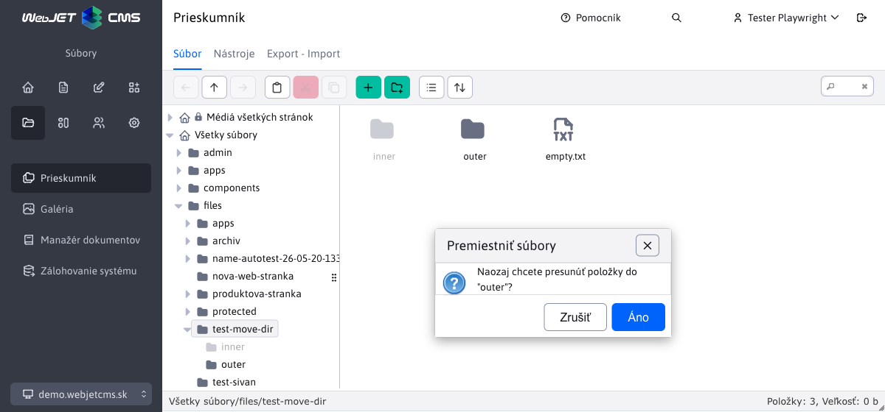

- Po nastavení konf. premennej `iwfs_useVersioning` na `true` sa začne zapisovať história zmien v súboroch (každý súbor sa po nahratí a pred prepísaním archivuje do priečinka `/WEB-INF/libfilehistory`). Zoznam je dostupný v prieskumníku v kontextovom menu Nastavenie súboru s možnosťou porovnania, zobrazenia historickej verzie a vrátenia zmeny. Cestu `/WEB-INF/libfilehistory` viete upraviť v konfiguračnej premennej `fileHistoryPath`, ak súbory potrebujete ukladať napr. na sieťový disk.
