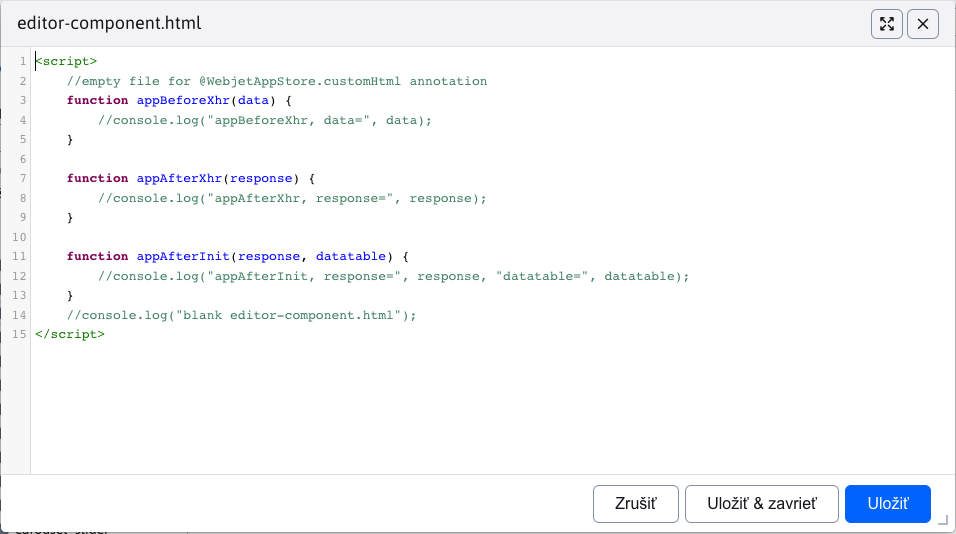
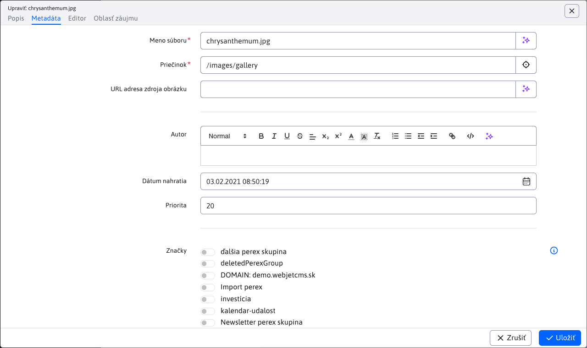
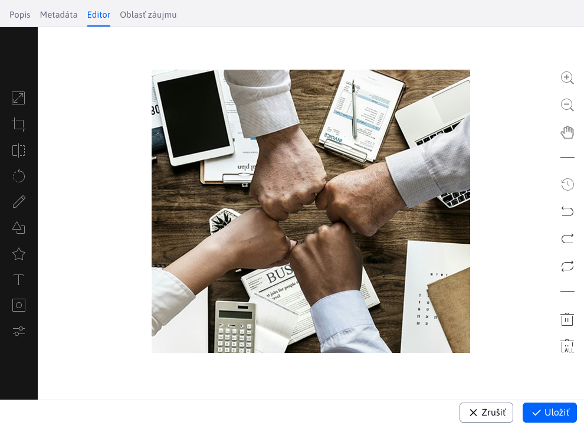

# Úprava súborov

Spôsob úpravy súboru v aplikácii [Prieskumník](../../fbrowser/README.md) závisí od jeho typu a umiestnenia. Vyberte súbor a použite **Upraviť** na karte **Nástroje** alebo v kontextovej ponuke.

Textové súbory, napríklad `.txt`, `.json` alebo `.properties`, sa otvoria v dialógovom okne s editorom. Naraz môžete mať otvorených viac súborov. Okno môžete zväčšiť potiahnutím okraja alebo maximalizovať tlačidlom v jeho záhlaví; editor využije dostupný priestor. Na rozdiel od **Náhľadu** tu môžete obsah upraviť a uložiť.

Pri úprave HTML položky z vetvy **Webové stránky** sa editor danej stránky otvorí v novej karte prehliadača.

Pri obrázkoch rozhoduje ich umiestnenie.

Ak je obrázok v priečinku `gallery` alebo v jeho podpriečinkoch, v novej karte prehliadača sa otvorí aplikácia [Galéria](../../../../redactor/apps/gallery/README.md) s editorom vybraného obrázka.

Pri obrázku mimo priečinka `gallery` sa otvorí samostatné okno s editorom obrázkov. Používa rovnaký editor ako aplikácia [galéria](../../../../redactor/apps/gallery/README.md).

