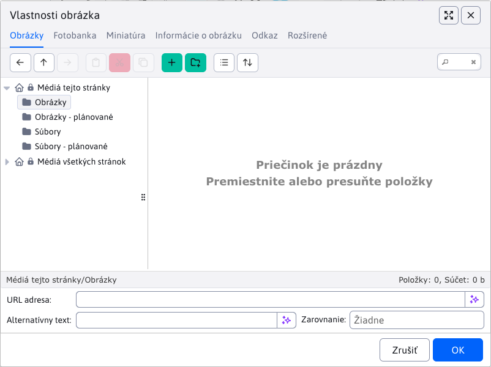

# Plánované publikovanie s chránenými súbormi

Budúcu verziu stránky môžete pripraviť aj s obrázkami a dokumentmi, ktoré do termínu zverejnenia nesmú byť dostupné návštevníkom. Živý obsah a bežná pracovná verzia zostávajú samostatné. Funkciu musí správca zapnúť konfiguračnou premennou `plannedPublishingEnabled=true`; predvolene je vypnutá.

<div class="video-container">
    <iframe width="790" height="444" src="https://www.youtube.com/embed/z3QGUdDG2pk" title="YouTube video player" frameborder="0" allow="accelerometer; autoplay; clipboard-write; encrypted-media; gyroscope; picture-in-picture" allowfullscreen></iframe>
</div>

## Príprava stránky

1. Otvorte existujúcu stránku alebo vytvorte novú a vyplňte jej obsah.
2. V karte **Perex** nastavte **Dátum začiatku** a zapnite **Naplánovať zmenu stránky po tomto dátume**. Pri novej stránke potvrďte **Uložiť a pokračovať**. WebJET uloží rozpracovaný obsah s vypnutou možnosťou **Zobrazovať**, zatvorí editor a znova ho otvorí na karte Perex so zapnutým plánovaním a zachovaným dátumom. Pri chybe ukladania zostane pôvodný editor otvorený. WebJET jednorazovo skopíruje médiá uloženej stránky do plánovanej sady.
3. Nové podklady nahrajte vo výbere súborov do **Médiá tejto stránky → Obrázky - plánované** alebo **Súbory - plánované**. Tieto priečinky sú dostupné aj pri výbere perexového obrázka a odkazov v karte **Médiá**.
4. Upravte obsah a plánované médiá. Kliknite na **Naplánovať**.
5. Pri ďalšej úprave použite **Otvoriť plánovanú verziu** v karte Perex alebo otvorte príslušnú verziu cez Históriu. Opätovné otvorenie už nekopíruje živé médiá.



Prvé uloženie novej stránky ešte nepotvrdzuje termín publikovania. Ak po ňom editor zatvoríte bez kliknutia na **Naplánovať**, stránka zostane uložená ako nezverejnená. Zrušenie úvodného potvrdenia stránku neuloží. Pri vypnutom `plannedPublishingEnabled` zostáva pôvodný postup: novú stránku môžete priamo naplánovať, ale jej súbory a obrázky sa neukladajú do plánovaných priečinkov.

Na jednu stránku je podporovaný jeden plán. Zmena termínu nahradí pôvodné naplánovanie. Plánovaná verzia pri publikovaní nahradí obsah a celú sadu médií vrátane ich poradia a skupín. Novšie opravy živej stránky preto do pripravovanej verzie preneste ručne. Ak odstránite všetky plánované médiá, po publikovaní bude živá sada prázdna.

Atribúty stránky a zmeny jej priradenia do ďalších priečinkov (multikategórie) sa neplánujú. Rovnako ako pri pôvodnom plánovaní sa ukladajú okamžite, aj pri uložení plánovanej verzie.

Zmeny médií sa ukladajú priebežne. Zatvorenie editora cez **Zrušiť** ich nevracia. Odškrtnutie časovania pripravené údaje neodstráni. Tlačidlo **Zrušiť plánované zmeny** zruší naplánovanie, odstráni plánované médiá a vymaže všetky obrázky a súbory z plánovaných priečinkov vrátane podpriečinkov. HTML živej stránky ani záznamov histórie nemení. Odkazy na vymazané podklady preto v zrušenej histórii už nebudú fungovať.

Pri ukladaní stránky alebo média bez plánovaného publikovania nemožno odkazovať na súbory ani obrázky z plánovaných zmien. Ak sa zobrazí toto upozornenie, zapnite plánované publikovanie stránky alebo vyberte súbor či obrázok z bežného priečinka. Dostupnosť plánovaných súborov, práva na ich cieľové priečinky a konflikty s inými plánmi sa kontrolujú pri uložení plánu a pred publikovaním, nie pri každej úprave média.

Plán nemožno uložiť, ak obsah alebo médiá odkazujú do plánovaného priečinka inej stránky alebo používajú zápis plánovanej cesty, ktorý sa pri publikovaní nedá prepísať. Vyberte súbor alebo obrázok znova z plánovaných priečinkov tejto stránky.

## Súbory a odkazy

Príklad pre stránku s ID `42`:

```text
/files/protected/planned-changes/42/images/apple/foto.webp
→ /images/apple/foto.webp

/files/protected/planned-changes/42/files/apple/parametre.pdf
→ /files/apple/parametre.pdf
```

Cieľ je uložený v ceste súboru, preto ho neskoršie premenovanie stránky nezmení. **Publikujú sa všetky súbory z priečinkov Obrázky - plánované a Súbory - plánované vrátane podpriečinkov**, aj keď na ne stránka ani médiá neodkazujú. Po úspešnom uložení stránky, médií a histórie sa tieto pracovné priečinky vyčistia. Ďalší plán tak začína s prázdnymi priečinkami.

Podporované sú obsah, anotácia, perexový obrázok, `htmlHead`, voliteľné polia a odkazy, náhľady či popisy médií. Pri publikovaní sa každý výskyt prefixu `/files/protected/planned-changes/<docId>/` danej stránky nahradí za `/`. Náhrada funguje aj v absolútnych URL, `/thumb/`, CSS a parametroch `!INCLUDE(...)!` bez rozlišovania domény či HTML atribútov. Existujúce parametre vrátane `v` a fragmenty sa zachovajú bez zmeny; nové parametre sa nepridávajú. Rovnaký prepis sa uloží aj do konkrétneho publikovaného záznamu histórie. Ostatné záznamy histórie sa nemenia; ich pôvodné odkazy do vyčistených plánovaných priečinkov môžu prestať fungovať.

Dialóg **Vlastnosti obrázka** pri výbere obrázka nastavuje parameter `v` podľa času poslednej zmeny súboru. Pri nahradení obrázka ho v dialógu vyberte znova, aby sa nová hodnota dostala do HTML. Pri zapnutom `elfinderUseFastLoading` sa čas zmeny nečíta a hodnota je `0`; vtedy použite nový názov súboru.

Pre perexové obrázky používajte pri výmene **nový názov súboru**. Ich URL bežne neobsahuje parameter `v`, preto pri zachovaní rovnakého názvu môže prehliadač alebo CDN aj po publikovaní zobrazovať starý obrázok z cache. Rovnaké obmedzenie platí pre ostatné odkazy bez zmeneného parametra `v`. WebJET pri prepísaní súboru vyčistí vlastnú cache súboru a miniatúr, cache prehliadača ani CDN tým však nevymaže.

Nerozpoznané použitie chránenej URL sa odmietne pri ukladaní alebo publikovaní. Externé CSS/JS, iframe a ich závislosti sa neprechádzajú. Produktový prehliadač a e-shop potrebujú vlastný publikačný postup.

Prepísanie existujúceho súboru ovplyvní všetky stránky používajúce rovnakú cestu. Pri ukladaní a publikovaní sa kontroluje, či už iný plán nepoužíva rovnaký cieľový súbor. Táto kontrola nezamyká databázu, preto nezaručuje odhalenie kolízie pri súčasnom ukladaní dvoch plánov. Už verejne nahraný súbor nie je možné týmto postupom spätne utajiť. Ani odverejnenie stránky automaticky neskryje predtým publikované súbory.

## Nasadenie a prevádzka

- Pred prvým zapnutím funkcie skontrolujte existujúce časované verzie v histórii stránok. Pre každú stránku ponechajte najviac jednu čakajúcu naplánovanú verziu; ostatné naplánovania zrušte. Samotné zapnutie funkcie staršie naplánovania nezruší. Ak ich zostane viac, staršia verzia sa môže publikovať až po novšej a prepísať jej obsah.
- Konfiguračnú premennú `plannedPublishingEnabled` nastavte pri zavedení funkcie na `true` a počas jej používania už hodnotu nemeňte. Vypínanie a opätovné zapínanie funkcie s existujúcimi plánmi nie je podporovaný prevádzkový postup.

## Chyby publikovania

Pred prvou výmenou sa kontrolujú súbory nájdené v plánovaných priečinkoch, ich ciele a aktuálne oprávnenia autora na zápis do cieľových priečinkov. Právo autora editovať stránku sa pri automatickom publikovaní znova neoveruje. Zoznam na kopírovanie vzniká výhradne z obsahu priečinkov; existencia súborov uvedených v odkazoch sa nekontroluje. Jednotlivé súbory sa nahrádzajú atómovo, takže návštevník nedostane čiastočne zapísaný súbor. Pôvodné súbory sa uchovávajú v chránenom podpriečinku `<docId>/backup/<historyId>/`; správca ich môže obnoviť cez súborový systém. Použije sa aj existujúca história súborov, ak je zapnutá.

Plánované aj bežné verzie publikuje spoločný postup v `DocPublishService`. Najprv sa publikujú plánované súbory a prepíšu ich cesty, potom sa uloží obsah stránky, médiá, multikategórie a poznámky. História sa označí za publikovanú až po úspešných zápisoch. Zápisy neprebiehajú v jednej spoločnej transakcii. Pri chybe preto môžu byť súbory alebo obsah už nové a živá sada médií môže byť dočasne prázdna alebo neúplná.

Ak zlyhá uloženie multikategórie alebo poznámky pre redaktorov, história zostane čakajúca a pracovné súbory sa nevyčistia. Ďalšia publikačná kontrola uloženie zopakuje. Obsah stránky už v tom čase môže byť zverejnený.

Plánované médiá vrátane pôvodných chránených odkazov zostávajú zachované, kým sa neuložia všetky živé kópie. Ak výmena zlyhá, ďalší pokus vymaže neúplnú živú sadu a vytvorí ju znovu z kompletného plánu. Po uložení celej sady sa vynuluje `planned_media_initialized`, odstránia sa plánované záznamy médií a až potom sa história označí za publikovanú. Ak zlyhá tento záverečný krok, ďalší pokus ponechá dokončenú živú sadu a dokončí upratanie a históriu. Pracovné súbory sa vymažú až po úspešnom dokončení; zálohy pôvodných verejných súborov v `backup/<historyId>/` zostávajú na disku. Ak zlyhá samotné čistenie priečinkov, publikovanie zostáva dokončené a chyba sa zapíše do logu. Zvyšné pracovné súbory možno odstrániť tlačidlom **Zrušiť plánované zmeny**.

Rovnako sa dá zopakovať inicializácia: pokiaľ príznak ešte nie je nastavený, prípadné neúplné plánované kópie sa najprv odstránia a živé médiá sa skopírujú znova. Pri zmene plánu sa pôvodné naplánovanie zruší až po uložení novej verzie do histórie. Chyba publikovania sa zaznamená do logu spolu s ID histórie.

Pred produkčným použitím vykonajte akceptačný test na pripravovanej WebJET stránke Apple vrátane produkčnej proxy/CDN a oprávnení obmedzeného redaktora.
