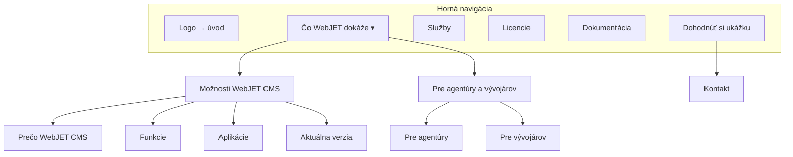

# Návrh preskupenia navigácie

Stav k 15. 11. 2026: používateľ rozhodol ponechať stránky **Pre agentúry** a **Pre vývojárov** zatiaľ mimo horného menu. Dostupné zostávajú z úvodu a súvisiacich obsahových sekcií. Nasledujúci návrh je podkladom pre budúcu úpravu šablóny; aktuálne menu ani HTML fragmenty nemení.

## Odporúčaná horná navigácia

```text
[Logo → úvod]   Čo WebJET dokáže ▾   Služby   Licencie   Dokumentácia   [Dohodnúť si ukážku]
```

Štyri obsahové položky a jedno hlavné CTA. Logo preberá úlohu odkazu Domov. Vyhľadávanie môže zostať samostatnou ikonou. Tlačidlo na ukážku vedie na existujúci kontakt; bežné kontakty zostávajú aj v pätičke.

V [súčasnom menu](https://www.webjetcms.sk/) sú Benefity, Funkcie, Aplikácie a Aktuálna verzia na rovnakej úrovni ako Služby, Licencie a Dokumentácia. Odporúčanie ich zoskupuje podľa účelu: prvé štyri vysvetľujú produkt, ďalšie pomáhajú s realizáciou, nákupom alebo používaním. Nejde o záver z analytiky návštevnosti, ale o návrh podľa dohodnutých obchodných priorít.

Používateľ odmietol pracovný názov **Produkt** ako nejasný. Nový navrhovaný názov **Čo WebJET dokáže** vopred pomenúva obsah podmenu: možnosti systému a ich prínosy. Je to návrh na posúdenie, nie používateľom potvrdený názov. Kratšia alternatíva je **Funkcie**, tá však menej vystihuje odkazy pre agentúry a vývojárov. Šírku dlhšieho názvu treba preveriť v hlavičke so štyrmi hlavnými položkami.

## Podmenu Čo WebJET dokáže

Na desktope sa rozbalí panel s dvoma stĺpcami:

| Možnosti WebJET CMS | Pre agentúry a vývojárov |
| --- | --- |
| Prečo WebJET CMS | Pre agentúry |
| Funkcie | Pre vývojárov |
| Aplikácie | |
| Aktuálna verzia | |

**Prečo WebJET CMS** je nové označenie odkazu na existujúce Benefity. Táto stránka ukazuje hlavné funkcie a ich prínosy vrátane AI, headless režimu a viackrokových formulárov. **Funkcie** zostávajú podrobnejším prehľadom a **Aplikácie** výberom podľa použitia. Stránky sa nezlučujú.

Nadpis druhého stĺpca priamo pomenúva obidve skupiny návštevníkov. Odkazy tak nepotrebujú samostatnú položku „Pre tímy“ v hlavnom riadku. Sekcie nie sú ďalšou úrovňou rozbaľovania: všetkých šesť odkazov je viditeľných po otvorení podmenu.

**Aktuálna verzia** patrí k informáciám o produkte. **Dokumentácia** zostáva priamym odkazom, aby pravidelní používatelia nemuseli otvárať druhé podmenu. Odkaz „Pozrieť všetky zmeny v dokumentácii“ pod živými novinkami na úvode zostáva samostatnou cestou k úplnému prehľadu zmien.

## Strom navigácie a cieľové adresy

Ide o navigačné zoskupenie, nie o zmenu adresárov alebo URL. „Čo WebJET dokáže“ je tlačidlo otvárajúce podmenu, nepotrebuje novú obsahovú stránku.

```text
Logo → Úvod (/)
├── Čo WebJET dokáže [ovládanie podmenu, bez novej URL]
│   ├── Prečo WebJET CMS (/benefity/)
│   ├── Funkcie (/funkcie/)
│   ├── Aplikácie (/aplikacie/)
│   ├── Aktuálna verzia (/aktualna-verzia/)
│   ├── Pre agentúry (/pre-agentury/)
│   └── Pre vývojárov (/pre-vyvojarov/)
├── Služby (/produktove-sluzby/)
├── Licencie (/licencie/)
├── Dokumentácia (/dokumentacia/)
└── Dohodnúť si ukážku (/kontakt/)
```



Uzly „Možnosti WebJET CMS“ a „Pre agentúry a vývojárov“ v schéme predstavujú nadpisy stĺpcov, nie nové stránky alebo klikacie kroky.

## Pätička, mobil a odkazy v obsahu

- V pätičke ponechať kontakty a existujúce právne odkazy. Pri budúcej úprave pridať priamo pomenované odkazy Pre agentúry, Pre vývojárov, Dokumentácia a Aktuálna verzia. Nevyžaduje to novú obsahovú stránku.
- Odkazy z úvodu na obidve nové stránky aj odkazy z Benefitov na technické možnosti zostávajú. Podmenu je ďalšia cesta k rovnakému obsahu.
- Na mobile otvoriť panel menu s rovnakými štyrmi položkami a CTA. „Čo WebJET dokáže“ sa rozbalí do zoznamu; nadpisy skupín sa zobrazia pod sebou. Nepoužívať ďalšie vnorené podmenu.
- Na desktope postačí rozbalenie položky „Čo WebJET dokáže“. Celostránkové výsuvné menu by bolo samostatnou dizajnovou voľbou, ktorú tento rozsah obsahu nevyžaduje.
- Podmenu musí fungovať kliknutím, dotykom aj klávesnicou. Pri implementácii overiť Tab, Enter/Space, Escape, stav rozbalenia a viditeľnosť fokusu; samotný hover nestačí.

Rozloženie treba preveriť v skutočnej hlavičke na desktope, pri medziveľkostiach a na mobile. Počet a kratšie názvy položiek vytvárajú viac miesta, konkrétne zalamovanie sa bez implementácie nepotvrdzuje. Preskupenie menu nemení samo osebe URL ani breadcrumb navigáciu existujúcich stránok.

## Čo platí teraz

Aktuálne menu zostáva bez úprav. Pre agentúry a Pre vývojárov sú verejné stránky dostupné cez existujúce odkazy v obsahu, s vypnutým zobrazením v hornom menu podľa nastavenia CMS. Budúca realizácia návrhu bude úpravou šablóny mimo `article.ly-article`.
