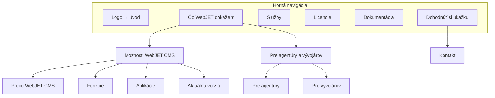

# Navigácia: potvrdený stav a pôvodný návrh

## Potvrdený stav SK navigácie

Záznam zosúladený 28. 11. 2026 s neskoršími potvrdeniami používateľa. Používateľ odmietol názov **Produkt** ako nejasný a použil **Čo WebJET dokáže**. Vytvoril rodičovskú stránku `/co-webjet-dokaze/` a zaradil pod ňu tieto stránky:

- Benefity
- Funkcie
- Aplikácie
- Pre vývojárov
- Pre agentúry

Pôvodné rozhodnutie ponechať stránky Pre agentúry a Pre vývojárov mimo horného menu už neplatí. Odkazy na ne z úvodu a súvisiacich sekcií zostávajú ďalšími cestami k obsahu. Menu je mimo `article.ly-article`; vloženie obsahových fragmentov ho automaticky nemení.

Pre rodičovskú stránku bolo odporúčané presmerovanie na Benefity, pretože ich obsah už vysvetľuje najdôležitejšie možnosti systému. **Nasadenie presmerovania nie je potvrdené.** Existencia `/co-webjet-dokaze/` neznamená, že vznikol nový obsahový fragment v tomto balíku.

Dvojstĺpcové rozloženie, premenovanie Benefity na „Prečo WebJET CMS“ a presun Aktuálnej verzie do podmenu zostávajú návrhmi bez potvrdeného nasadenia. Z potvrdení pre SK nemožno odvodiť stav EN menu; ten treba overiť na `webjetcms.com` samostatne.

## Archív pôvodného návrhu z 15. 11. 2026

Nasledujúce rozloženie, strom, adresy a odporúčania zachytávajú pôvodný návrh. Nie sú opisom celej aktuálnej navigácie ani pokynom na jej automatickú zmenu. Potvrdené časti a neskoršie rozhodnutia uvádza sekcia vyššie.

### Navrhovaná horná navigácia

```text
[Logo → úvod]   Čo WebJET dokáže ▾   Služby   Licencie   Dokumentácia   [Dohodnúť si ukážku]
```

Štyri obsahové položky a jedno hlavné CTA. Logo preberá úlohu odkazu Domov. Vyhľadávanie môže zostať samostatnou ikonou. Tlačidlo na ukážku vedie na existujúci kontakt; bežné kontakty zostávajú aj v pätičke.

V menu zaznamenanom pri pôvodnom audite boli Benefity, Funkcie, Aplikácie a Aktuálna verzia na rovnakej úrovni ako Služby, Licencie a Dokumentácia. Návrh ich zoskupoval podľa účelu: prvé štyri vysvetľujú produkt, ďalšie pomáhajú s realizáciou, nákupom alebo používaním. Nešlo o záver z analytiky návštevnosti, ale o návrh podľa dohodnutých obchodných priorít.

Po odmietnutí názvu **Produkt** vznikol názov **Čo WebJET dokáže**, ktorý používateľ následne použil. Kratšia zvažovaná alternatíva **Funkcie** menej vystihovala odkazy pre agentúry a vývojárov. Odporúčanie preveriť šírku dlhšieho názvu v skutočnej hlavičke zostáva relevantné pri ďalších úpravách.

### Pôvodný návrh dvojstĺpcového podmenu

Pôvodný návrh pre desktop počítal s panelom s dvoma stĺpcami; toto rozloženie nie je potvrdené ako nasadené:

| Možnosti WebJET CMS | Pre agentúry a vývojárov |
| --- | --- |
| Prečo WebJET CMS | Pre agentúry |
| Funkcie | Pre vývojárov |
| Aplikácie | |
| Aktuálna verzia | |

**Prečo WebJET CMS** bolo navrhnuté označenie odkazu na existujúce Benefity. Používateľom potvrdené podmenu používa názov **Benefity**. Táto stránka ukazuje hlavné funkcie a ich prínosy vrátane AI, headless režimu a viackrokových formulárov. **Funkcie** zostávajú podrobnejším prehľadom a **Aplikácie** výberom podľa použitia. Stránky sa nezlučujú.

Nadpis druhého stĺpca priamo pomenúva obidve skupiny návštevníkov. Odkazy tak nepotrebujú samostatnú položku „Pre tímy“ v hlavnom riadku. Sekcie nie sú ďalšou úrovňou rozbaľovania: všetkých šesť odkazov je viditeľných po otvorení podmenu.

**Aktuálna verzia** bola navrhnutá do podmenu ako informácia o produkte; používateľ jej presun nepotvrdil. **Dokumentácia** mala zostať priamym odkazom, aby pravidelní používatelia nemuseli otvárať druhé podmenu. Odkaz „Pozrieť všetky zmeny v dokumentácii“ pod živými novinkami na úvode zostáva samostatnou cestou k úplnému prehľadu zmien.

### Pôvodný strom navigácie a cieľové adresy

Pôvodný návrh chápal „Čo WebJET dokáže“ iba ako tlačidlo otvárajúce podmenu bez vlastnej URL. Túto časť nahradilo používateľovo vytvorenie `/co-webjet-dokaze/`; strom nižšie ostáva archívom návrhu.

```text
Logo → Úvod (/)
├── Čo WebJET dokáže [ovládanie podmenu, bez novej URL]
│   ├── Prečo WebJET CMS (/benefity/)
│   ├── Funkcie (/funkcie/)
│   ├── Aplikácie (/aplikacie/)
│   ├── Aktuálna verzia (/aktualna-verzia/)
│   ├── Pre agentúry (/pre-agentury/)
│   └── Pre vývojárov (/pre-vyvojarov/)
├── Služby (/produktove-sluzby/)
├── Licencie (/licencie/)
├── Dokumentácia (/dokumentacia/)
└── Dohodnúť si ukážku (/kontakt/)
```



Uzly „Možnosti WebJET CMS“ a „Pre agentúry a vývojárov“ v schéme predstavujú nadpisy stĺpcov, nie nové stránky alebo klikacie kroky.

### Pôvodné odporúčania pre pätičku, mobil a odkazy v obsahu

- V pätičke ponechať kontakty a existujúce právne odkazy. Pri budúcej úprave pridať priamo pomenované odkazy Pre agentúry, Pre vývojárov, Dokumentácia a Aktuálna verzia. Nevyžaduje to novú obsahovú stránku.
- Odkazy z úvodu na obidve nové stránky aj odkazy z Benefitov na technické možnosti zostávajú. Podmenu je ďalšia cesta k rovnakému obsahu.
- Na mobile otvoriť panel menu s rovnakými štyrmi položkami a CTA. „Čo WebJET dokáže“ sa rozbalí do zoznamu; nadpisy skupín sa zobrazia pod sebou. Nepoužívať ďalšie vnorené podmenu.
- Na desktope postačí rozbalenie položky „Čo WebJET dokáže“. Celostránkové výsuvné menu by bolo samostatnou dizajnovou voľbou, ktorú tento rozsah obsahu nevyžaduje.
- Podmenu musí fungovať kliknutím, dotykom aj klávesnicou. Pri implementácii overiť Tab, Enter/Space, Escape, stav rozbalenia a viditeľnosť fokusu; samotný hover nestačí.

Rozloženie treba preveriť v skutočnej hlavičke na desktope, pri medziveľkostiach a na mobile. Počet a kratšie názvy položiek vytvárajú viac miesta, konkrétne zalamovanie sa bez implementácie nepotvrdzuje. Preskupenie menu nemení samo osebe URL ani breadcrumb navigáciu existujúcich stránok.
